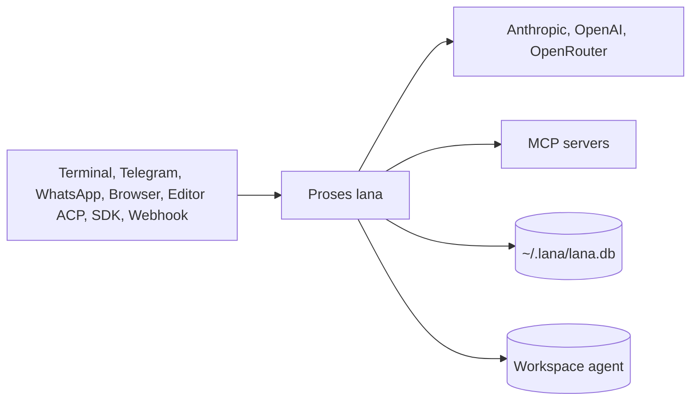

# Arsitektur lana-harness

Dokumen ini menjelaskan arsitektur target `lana-harness`: modul, service, dan hook; profile;
turn dan step; session event log; multi-agent dan subagent; permission; storage; ekstensi;
scheduler; dan semua pintu masuk (channel, HTTP, ACP, SDK).

> **Status**: rencana. Kode belum ada. Isi dokumen ini mengikuti ADR berstatus `Proposed`. Saat
> implementasi berbeda dari rencana, perbarui dokumen ini dan ADR terkait dalam satu perubahan.

Keputusan arsitektur dicatat di [`docs/adr/`](adr/). Diagram detail ada di [`docs/diagram/`](diagram/).

## 1. Gambaran umum

`lana-harness` adalah agent harness pribadi yang ringan untuk tiga peran:

- **Coding assistant**: baca dan edit file, jalankan shell, git.
- **Personal assistant**: catatan, memory, riset web, reminder.
- **Automation/ops**: task terjadwal dan laporan ke chat.

Referensi:

| Referensi | Yang diambil |
|---|---|
| **deepseek-harness (`dsh`)** | Cara kerja: modul dengan service dan hook, session sebagai event log append-only, turn dan step, approval fail-closed, profile dan patch, subagent, ACP dan SDK |
| **zeroclaw** | Rust, satu binary, config TOML, memory SQLite |
| **nouride** | Satu daemon multi-agent, channel chat, scheduled work, web dashboard, data di satu folder |

Ringkasan teknologi:

| Area | Pilihan | ADR |
|---|---|---|
| Bahasa dan runtime | Rust edition 2024, `tokio`, satu binary | [0001](adr/0001-gunakan-rust-single-binary-daemon.md) |
| Struktur core | Modul compile-in, service di `Context`, hook bertipe | [0002](adr/0002-core-dari-modul-service-dan-hook.md) |
| Agent | Multi-agent dalam satu proses, routing dari channel | [0003](adr/0003-multi-agent-dengan-routing-channel.md) |
| Permission | Policy `trust`/`ask`/`never`, rule `allow`/`deny`, approval fail-closed | [0004](adr/0004-permission-mode-per-agent.md) |
| Storage | Satu file SQLite, memory FTS5 | [0005](adr/0005-sqlite-sebagai-storage-tunggal.md) |
| Ekstensi | MCP client (`rmcp`) dan Skills (`SKILL.md`) | [0006](adr/0006-ekstensi-lewat-mcp-client-dan-skills.md) |
| Scheduler | Cron di dalam proses, state di SQLite | [0007](adr/0007-scheduler-cron-di-dalam-daemon.md) |
| Interface | CLI/TUI, Telegram, WhatsApp, HTTP API, web dashboard | [0008](adr/0008-interface-cli-channel-http-dan-web-dashboard.md) |
| Session | Event log append-only, fork, resume | [0009](adr/0009-session-sebagai-event-log-append-only.md) |
| Komposisi | Profile dan config patch berlapis | [0010](adr/0010-profile-dan-config-patch.md) |
| Subagent | Child session lewat tool `task` | [0011](adr/0011-subagent-sebagai-child-session.md) |
| Protokol | Server ACP dan SDK JSON-RPC | [0012](adr/0012-acp-dan-sdk-json-rpc.md) |



Diagram lengkap: [0001. System Context Dan Roadmap](diagram/0001-system-context-dan-roadmap.md).

## 2. Modul, service, dan hook

Prinsip dari `dsh`: **tidak ada core istimewa yang perlu di-patch**. Agent loop, model adapter,
tool registry, dan session log semuanya modul. Bedanya, di `lana` semua modul dikompilasi ke
binary. Plugin runtime (dynamic library, WASM, proses eksternal) tidak masuk v1.

- **Modul** mengimplementasikan `Module`: punya `id`, daftar service yang dibutuhkan, dan `install()`.
- **Service** adalah objek bertipe di `Context` yang dipakai modul lain lewat trait.
- **Hook** adalah titik intercept bertipe. Mode `waterfall` berarti middleware dengan `next`:
  listener bisa mengubah input, meneruskan, atau memutus. Mode `observe` hanya mendengar.

Service:

| Service | Tanggung jawab |
|---|---|
| `ctx.llm` | Registry adapter provider |
| `ctx.tools` | Registry tool dan pipeline eksekusi |
| `ctx.sessions` | Session event log dan projection |
| `ctx.agents` | Agent hidup, inbox, pembuatan child dan fork |
| `ctx.approval` | Permintaan approval dan policy session |
| `ctx.prompt` | Section system prompt dan schema tool |

Hook:

| Hook | Mode | Contoh listener |
|---|---|---|
| `agent.pre_step` | waterfall | compaction, injeksi konteks |
| `agent.request` | waterfall | atur max tokens |
| `llm.stream` | waterfall | retry, fallback provider, metering token |
| `tools.pre_execute` | waterfall | permission |
| `tools.execute` | waterfall | timeout, sandbox nanti |
| `tools.post_execute` | waterfall | potong atau spill output besar |
| `approval.request` | waterfall | penjawab channel, ACP, SDK |
| `agent.turn_stopping` | serial | lanjutkan turn jika tugas belum selesai |
| `session.event` | observe | channel, web, ACP, SDK membaca event durable |

Tempat perilaku baru:

| Tujuan | Mekanisme |
|---|---|
| Tambah provider model | Daftarkan adapter di `ctx.llm` |
| Tambah tool untuk model | Daftarkan di `ctx.tools`. Schema masuk prompt otomatis |
| Intercept request, tool, atau turn | Listener di hook `agent.*` atau `tools.*` |
| Tambah pintu masuk baru | Modul yang mengirim ke `ctx.agents`, membaca `session.event`, dan menjawab `approval.request` |
| Tambah state yang harus bertahan | Tambah jenis event di session log |
| Tambah konteks untuk model | Inject sebagai `user/message` lewat `agent.pre_step` |
| Integrasi layanan luar | MCP server atau skill, sebelum menulis builtin tool |

## 3. Profile dan subcommand

Satu binary, banyak peran. Profile memilih modul yang aktif. Konfigurasi efektif dibangun dari
lapisan berurutan: base, profile bawaan, `~/.lana/profiles/<profile>.toml`, `~/.lana/config.toml`,
lalu `--patch`. Baris `[[modules]]` digabung per `id`, dan baris yang sama mengganti seluruh `config`.

| Profile | Subcommand | Isi |
|---|---|---|
| `daemon` | `lana daemon` | base + HTTP, web, Telegram, WhatsApp, scheduler, router |
| `headless` | `lana run --agent X "prompt"` | base + runner one-shot. Policy `never` kecuali `--ask` |
| `acp` | `lana acp --agent X` | base + server ACP di stdio |
| `sdk` | `lana sdk` | base + server JSON-RPC di stdio atau unix socket |
| `minimal` | `lana --profile minimal` | provider, store, agent loop saja |

Subcommand lain:

| Subcommand | Fungsi |
|---|---|
| `lana init` | Buat `~/.lana/`, config contoh, token dashboard |
| `lana chat [--agent X] [--yolo]` | Chat terminal. Attach ke daemon, atau jalan dengan `minimal` + CLI |
| `lana --profile <p> --dump-config` | Cetak konfigurasi efektif dan asal tiap baris |
| `lana config check` | Validasi semua lapisan |
| `lana session list/export/fork` | Kelola session dari terminal |
| `lana cron add/list/rm` | Kelola job terjadwal |
| `lana db prune --older-than 90d` | Hapus session lama secara utuh |
| `lana service install` | Pasang LaunchAgent (macOS) atau systemd user unit (Linux) |

Diagram: [0004. Profile, Fork, Subagent, Dan Protokol](diagram/0004-profile-fork-subagent-dan-protokol.md).

## 4. Struktur workspace

```text
flake.nix               Toolchain Rust dan tool dev lewat Nix
Cargo.toml              Workspace dan profil release kecil
crates/
  lana-core/            Context, Module, Hooks, tipe pesan dan event, trait service. Tanpa I/O.
  lana-agent/           Agent loop (turn dan step), inbox, subagent, compaction
  lana-store/           SQLite: session event log, projection, memory, cron
  lana-providers/       anthropic, openai_compat
  lana-tools/           builtin tools dan modul permission
  lana-mcp/             MCP client
  lana-channels/        cli, telegram, whatsapp
  lana-protocol/        server ACP dan SDK JSON-RPC
  lana-web/             axum HTTP API, SSE, dashboard embedded
  lana/                 binary: subcommand, profile bawaan, loader config
docs/
  adr/  diagram/  specs/
```

Aturan dependency: `lana-core` tidak bergantung pada crate lain di workspace. Crate implementasi
hanya bergantung pada `lana-core`. Hanya crate `lana` yang merakit semuanya.

Feature flag Cargo untuk modul besar:

| Feature | Isi | Default |
|---|---|---|
| `telegram` | Channel Telegram | ya |
| `web` | Dashboard embedded | ya |
| `acp` | Server ACP | ya |
| `tui` | TUI penuh dengan `ratatui` | tidak |
| `whatsapp` | Channel WhatsApp Cloud API | tidak |

## 5. Turn dan step

- **Step** = satu request ke model ditambah tool yang dipanggilnya.
- **Turn** = nol atau lebih step. Turn ditutup saat tidak ada `tool_result` atau pesan inbox yang harus dijawab.

```text
turn/start
  claim input dari inbox
  agent.pre_step
  step/start -> agent.request -> user/message -> derive riwayat -> llm.stream
    assistant/message | assistant/attempt
    tool/call -> tools.pre_execute -> tools.execute -> tools.post_execute -> tool/result
  step/end
  ulangi jika masih ada yang harus dijawab
  agent.turn_stopping
turn/end
```

Invariant:

- **Model-visible means logged**: setiap request model bisa direkonstruksi dari session log.
- Setiap `tool/call` selalu punya `tool/result`, termasuk saat ditolak, dibatalkan, atau error.
- Satu session punya satu turn aktif dan satu inbox. Pesan baru di-claim di awal step berikutnya,
  jadi user bisa mengoreksi agent di tengah turn.
- `max_steps` default 25 per turn.
- Tool `Read` yang independen boleh jalan paralel. Tool `Write` dan `Exec` berurutan.

Diagram: [0002. Agent Loop Dan Approval](diagram/0002-agent-loop-dan-approval.md).

## 6. Session event log

Session adalah urutan event append-only di tabel `session_events (session_id, seq, kind, payload)`.
Riwayat untuk model dihitung oleh fungsi murni `derive_messages(events)`.

| Kelompok | Event |
|---|---|
| Lifecycle | `session/created`, `turn/start`, `turn/end`, `step/start`, `step/end` |
| Konten model | `system/message`, `user/message`, `assistant/message`, `tool/call`, `tool/result` |
| Hanya log | `assistant/attempt` (percobaan gagal, tidak masuk riwayat model) |
| Approval | `approval/asked`, `approval/decided`, `approval/policy` |
| Lainnya | `model/selection`, `compaction/summary` |

- Streaming token dikirim sebagai frame sementara. Log hanya menyimpan pesan final.
- **Compaction** menulis `compaction/summary { upto_seq }`. Event lama tidak dihapus.
- **Fork** membuat session dengan `parent_session_id` dan `inherited_seq`. Event induk dibaca, tidak disalin. Fork hanya di batas turn.
- **Resume**: jika event terakhir bukan `turn/end`, store menulis `tool/result` error untuk call yatim lalu `turn/end { reason: "interrupted" }`.
- Tabel `sessions` adalah projection yang bisa dibangun ulang dari event.

## 7. Konfigurasi dan multi-agent

Agent adalah data, bukan proses. Contoh `~/.lana/config.toml`:

```toml
[providers.anthropic]
kind = "anthropic"
api_key_env = "ANTHROPIC_API_KEY"

[providers.openrouter]
kind = "openai_compat"
base_url = "https://openrouter.ai/api/v1"
api_key_env = "OPENROUTER_API_KEY"

[agents.coder]
provider = "anthropic"
model = "claude-sonnet-5-5"
fallback = ["openrouter:anthropic/claude-haiku-5-5"]
prompt_file = "agents/coder.md"
workspace = "~/coding"
tools = ["read_file", "write_file", "edit_file", "glob", "grep", "bash", "task"]
subagents = ["explorer"]
mcp = ["github"]
skills = ["git-workflow"]
permission = "ask"

[agents.coder.rules]
allow = ["bash(git status*)", "bash(cargo test*)"]
deny  = ["bash(rm -rf*)", "bash(sudo*)"]

[agents.explorer]
provider = "openrouter"
model = "openai/gpt-5-mini"
tools = ["read_file", "glob", "grep"]
permission = "ask"

[agents.asisten]
provider = "openrouter"
model = "openai/gpt-5-mini"
prompt_file = "agents/asisten.md"
tools = ["web_fetch", "memory_search", "memory_save", "cron_create"]
permission = "trust"

[channels.telegram]
token_env = "TELEGRAM_BOT_TOKEN"

[mcp.github]
command = "github-mcp-server"
args = ["stdio"]

[[modules]]
id = "channel.whatsapp"
disabled = true

[[routes]]
channel = "telegram"
match = { chat_id = 123456789 }
agent = "asisten"

[[routes]]
channel = "cli"
agent = "coder"
```

Routing: route pertama yang cocok menang. Tanpa route yang cocok, pesan ditolak. `/agent <nama>`
mengganti agent untuk session itu. Session key = `(channel, address, agent)`.

## 8. Subagent

Tool `task(agent, prompt, title)` membuat **child session** dengan `parent_session_id` dan
`parent_call_id`, menjalankan satu turn, lalu mengembalikan jawaban final sebagai `tool_result`.
`task_continue(session_id, prompt)` melanjutkan child yang sudah ada.

- Child tidak mewarisi riwayat induk. Konteks hanya dari `prompt`.
- Agent child harus ada di `subagents` milik agent induk.
- Permission child = irisan permission induk dan agent child.
- Approval child dikirim lewat channel induk dengan label nama child.
- Kedalaman maksimal 2, paling banyak 3 child bersamaan, `max_steps` child 15.
- Batal di induk membatalkan semua child.

## 9. Permission dan approval

Policy session: `trust`, `ask`, atau `never`. Nilai awal dari `permission` agent; perubahan ditulis
sebagai `approval/policy`. Modul `permission` di hook `tools.pre_execute` mengevaluasi:

1. Cocok `deny` → tolak (berlaku juga di `trust`).
2. Path di luar workspace → tolak.
3. Cocok `allow` atau grant session → jalankan.
4. `trust` → jalankan.
5. Risk `Read` → jalankan.
6. `never` → tolak.
7. `ask` → `ctx.approval.request`.

Outcome tertutup dan **fail-closed**: `allowed_once`, `allowed_session`, `rejected`, `cancelled`,
`unavailable`. Hanya dua yang pertama menjalankan tool. Penjawab yang hilang, error, atau timeout
10 menit menghasilkan `unavailable`. Request tidak menyalin argumen tool; penjawab menampilkan
`tool/call` lewat `call_id`.

Risk per tool: `Read` (`read_file`, `glob`, `grep`, `memory_search`), `Write` (`write_file`,
`edit_file`, `memory_save`, `cron_create`), `Exec` (`bash`, semua tool MCP, `task`), `Network` (`web_fetch`).

v1 tidak memakai sandbox OS. `bash` yang diizinkan punya akses penuh sebagai user yang menjalankan `lana`.

## 10. Storage

Satu file SQLite di `~/.lana/lana.db`, mode WAL, satu writer task, migration SQL di-embed ke binary.

| Tabel | Isi |
|---|---|
| `session_events` | Event log append-only, source of truth |
| `sessions` | Projection: agent, channel, title, status, parent, `last_seq` |
| `memories` + `memories_fts` | Memory jangka panjang, FTS5. Kolom `embedding` untuk nanti |
| `cron_jobs`, `cron_runs` | Job terjadwal dan riwayat run |

```text
~/.lana/
  config.toml
  profiles/<profile>.toml
  secrets.env            permission 0600, tidak pernah masuk DB
  lana.db
  lana.sock              socket SDK, permission 0600
  agents/<nama>.md
  skills/<nama>/SKILL.md
  workspaces/<agent>/
  logs/lana.log
```

Diagram: [0003. Data Model Dan Scheduler](diagram/0003-data-model-dan-scheduler.md).

## 11. Ekstensi: MCP dan Skills

**MCP client** memakai `rmcp` (stdio dan streamable HTTP). Server start saat agent pemakainya aktif
dan berhenti setelah idle 10 menit. Tool MCP bernama `mcp__<server>__<tool>` dengan risk `Exec`.
Output MCP diperlakukan sebagai data, bukan instruksi.

**Skills** tinggal di `~/.lana/skills/<nama>/SKILL.md`. Hanya `name` dan `description` yang masuk
system prompt. Model memanggil `skill_load(name)` untuk isi lengkap. Script skill jalan lewat
`bash`, jadi tetap melewati permission.

## 12. Scheduler

Satu task membaca `cron_jobs`. Jadwal berupa cron 5 field atau one-shot ISO 8601, dengan zona
waktu per job. Setiap run membuat session baru dengan channel `cron` dan policy `never`, lalu hasilnya
dikirim ke `target_channel`. Run yang terlewat dijalankan sekali jika masih dalam 1 jam. Satu job
tidak overlap dengan dirinya sendiri.

## 13. Pintu masuk

| Pintu | Cara kerja | Approval |
|---|---|---|
| CLI/TUI | `lana chat`, attach ke daemon lewat HTTP dan SSE | Prompt `[y]es / [a]lways / [n]o` |
| Telegram | Bot API lewat `reqwest`, long polling | Inline keyboard |
| WhatsApp | WhatsApp Cloud API resmi, butuh URL publik | Reply button |
| HTTP API | `POST /v1/agents/{agent}/messages`, `GET /v1/sessions/{id}/events?from_seq=`, `POST /v1/webhooks/{hook}` | `POST /v1/approvals/{id}` |
| Web dashboard | Preact + `htm` tanpa build step, embedded | Modal |
| ACP | `lana acp`: `initialize`, `session/new`, `session/load`, `session/prompt`, `session/cancel`, `session/update` | `session/request_permission` |
| SDK | `lana sdk`: `session.create`, `session.send`, `session.subscribe`, `session.fork`, `session.cancel` | `approval.respond` |

Semua pintu membaca event dari hook `session.event`. Reconnect memakai `from_seq`, jadi event
tidak hilang. Method SDK dan endpoint HTTP dibangun dari satu definisi handler.

## 14. Keamanan

- HTTP bind ke `127.0.0.1` secara default. Bind publik wajib `api_token`.
- Telegram dan WhatsApp hanya menerima ID yang terdaftar di `[[routes]]`.
- Webhook WhatsApp diverifikasi dengan `X-Hub-Signature-256`.
- Socket SDK memakai permission `0600`. Tidak ada port TCP untuk SDK.
- Protokol stdio (ACP, SDK) menulis log ke stderr atau file, tidak pernah ke stdout.
- Secret dari env atau `secrets.env`, tidak pernah masuk DB, log, atau payload event.
- Approval fail-closed. File tool dibatasi ke workspace agent.
- `--yolo` hanya untuk session CLI dan menampilkan banner peringatan.

## 15. Target resource

| Metrik | Target v1 |
|---|---|
| Ukuran binary release | < 15 MB |
| RAM idle (profile `daemon`) | < 20 MB |
| Cold start | < 100 ms |
| Platform | `aarch64-darwin`, `x86_64-linux-musl`, `aarch64-linux-musl` |

Profil release: `opt-level = "z"`, `lto = "fat"`, `codegen-units = 1`, `panic = "abort"`, `strip = true`.

## 16. Roadmap

| Milestone | Isi |
|---|---|
| M0 | `flake.nix`, Cargo workspace, loader profile berlapis, `--dump-config` |
| M1 | `Context`, `Module`, `Hooks`, provider Anthropic dan OpenAI-compatible, agent loop turn/step, builtin tools, profile `minimal` dan `headless` |
| M2 | Session event log, derive, resume, permission dan approval fail-closed, compaction |
| M3 | Profile `daemon`, HTTP API dan SSE, Telegram, routing multi-agent, `lana chat` attach |
| M4 | MCP client, skills, subagent |
| M5 | Scheduler, memory FTS5, fork, export session |
| M6 | ACP, SDK JSON-RPC, web dashboard |
| M7 | WhatsApp, service install, Docker image, ukur target resource |

Checklist detail: [0001. System Context Dan Roadmap](diagram/0001-system-context-dan-roadmap.md#implementation-checklist).
