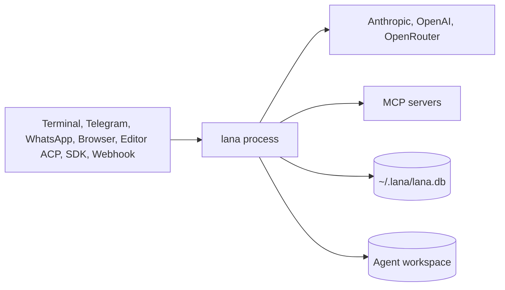

# lana-harness Architecture

This document describes the target architecture of `lana-harness`: modules, services, and hooks; profiles;
turns and steps; the session event log; multi-agent and subagents; permissions; storage; extensions;
the scheduler; and all entry points (channels, HTTP, ACP, SDK).

> **Status**: plan. The code does not exist yet. The contents of this document follow the ADRs with status `Accepted`. When the
> implementation differs from the plan, update this document and the related ADRs in the same change.

Architectural decisions are recorded in [`docs/adr/`](adr/). Detailed diagrams are in [`docs/diagram/`](diagram/).

## 1. Overview

`lana-harness` is a lightweight personal agent harness for three roles:

- **Coding assistant**: read and edit files, run shell commands, git.
- **Personal assistant**: notes, memory, web research, reminders.
- **Automation/ops**: scheduled tasks and reports to chat.

References:

| Reference | What is taken |
|---|---|
| **deepseek-harness (`dsh`)** | How it works: modules with services and hooks, sessions as an append-only event log, turns and steps, fail-closed approval, profiles and patches, subagents, ACP and SDK |
| **zeroclaw** | One binary, TOML config, SQLite memory |
| **nouride** | One multi-agent daemon, chat channels, scheduled work, web dashboard, data in one folder |

Technology summary:

| Area | Choice | ADR |
|---|---|---|
| Language and runtime | Go, one static binary and library at the same time (`CGO_ENABLED=0`) | [0013](adr/0013-use-go-as-single-binary.md) (supersedes [0001](adr/0001-use-rust-single-binary-daemon.md)) |
| Core structure | Compile-in modules, services in `Context`, typed hooks | [0002](adr/0002-core-from-modules-services-and-hooks.md) |
| Agents | Multi-agent in one process, routing from channels | [0003](adr/0003-multi-agent-with-channel-routing.md) |
| Permissions | Policy `trust`/`ask`/`never`, `allow`/`deny` rules, fail-closed approval | [0004](adr/0004-permission-mode-per-agent.md) |
| Storage | One SQLite file, FTS5 memory | [0005](adr/0005-sqlite-as-single-storage.md) |
| Extensions | MCP client (`modelcontextprotocol/go-sdk`) and Skills (`SKILL.md`) | [0006](adr/0006-extend-via-mcp-client-and-skills.md) |
| Scheduler | Cron inside the process, state in SQLite | [0007](adr/0007-cron-scheduler-inside-daemon.md) |
| Interfaces | CLI/TUI, Telegram, WhatsApp, HTTP API, web dashboard | [0008](adr/0008-cli-channel-http-and-web-dashboard-interfaces.md) |
| Session | Append-only event log, fork, resume | [0009](adr/0009-session-as-append-only-event-log.md) |
| Composition | Layered profiles and config patches | [0010](adr/0010-profile-and-config-patch.md) |
| Subagents | Child sessions through the `task` tool | [0011](adr/0011-subagent-as-child-session.md) |
| Protocols | ACP server and SDK JSON-RPC | [0012](adr/0012-acp-and-sdk-json-rpc.md) |
| Agentic tool integration | Go library, MCP server, REST + SSE API, A2A | [0014](adr/0014-integration-as-agentic-tool.md) |
| Embeddable runtime | Swappable store (SQLite, Postgres, memory), agents in code, per-run budget, OpenTelemetry | [0015](adr/0015-embeddable-runtime-for-services.md) |



Full diagram: [0001. System Context and Roadmap](diagram/0001-system-context-and-roadmap.md).

## 2. Modules, services, and hooks

Principle from `dsh`: **there is no privileged core that needs patching**. The agent loop, model adapter,
tool registry, and session log are all modules. The difference is that in `lana` all modules are compiled into the
binary. Runtime plugins (dynamic library, WASM, external processes) are not part of v1.

- A **module** implements `Module`: it has an `id`, a list of required services, and `install()`.
- A **service** is a typed object in `Context` that other modules use through a trait.
- A **hook** is a typed intercept point. The `waterfall` mode means middleware with `next`:
  a listener can modify the input, pass it on, or stop it. The `observe` mode only listens.

Services:

| Service | Responsibility |
|---|---|
| `ctx.llm` | Registry of provider adapters |
| `ctx.tools` | Tool registry and execution pipeline |
| `ctx.sessions` | Session event log and projections |
| `ctx.agents` | Live agents, inbox, creation of children and forks |
| `ctx.approval` | Approval requests and session policy |
| `ctx.prompt` | System prompt sections and tool schemas |

Hooks:

| Hook | Mode | Example listeners |
|---|---|---|
| `agent.pre_step` | waterfall | compaction, context injection |
| `agent.request` | waterfall | set max tokens |
| `llm.stream` | waterfall | retry, provider fallback, token metering |
| `tools.pre_execute` | waterfall | permission |
| `tools.execute` | waterfall | timeout, sandbox later |
| `tools.post_execute` | waterfall | truncate or spill large output |
| `approval.request` | waterfall | responders for channel, ACP, SDK |
| `agent.turn_stopping` | serial | continue the turn if the task is not done |
| `session.event` | observe | channels, web, ACP, SDK read durable events |

Where new behavior goes:

| Goal | Mechanism |
|---|---|
| Add a model provider | Register the adapter in `ctx.llm` |
| Add a tool for the model | Register in `ctx.tools`. The schema enters the prompt automatically |
| Intercept a request, tool, or turn | Listener on the `agent.*` or `tools.*` hooks |
| Add a new entry point | A module that sends to `ctx.agents`, reads `session.event`, and answers `approval.request` |
| Add state that must survive | Add an event kind to the session log |
| Add context for the model | Inject as `user/message` through `agent.pre_step` |
| Integrate an external service | MCP server or skill, before writing a builtin tool |

## 3. Profiles and subcommands

One binary, many roles. A profile selects which modules are active. The contents of the base and module names are in `API-CONF-009` (spec #2). The effective configuration is built from
ordered layers: base, built-in profile, `~/.lana/profiles/<profile>.toml`, `~/.lana/config.toml`,
then `--patch`. `[[modules]]` rows are merged by `id`, and a row with the same `id` replaces its entire `config`.

| Profile | Subcommand | Contents |
|---|---|---|
| `daemon` | `lana daemon` | base + HTTP, web, Telegram, WhatsApp, scheduler, router |
| `headless` | `lana run --agent X "prompt"` | base + one-shot runner (`cli_runner`, spec #1). Policy `never` unless `--ask` |
| `acp` | `lana acp --agent X` | base + ACP server over stdio |
| `sdk` | `lana sdk` | base + JSON-RPC server over stdio or unix socket |
| `mcp` | `lana mcp [--http <addr>]` | base + lana as an MCP server (stdio or streamable HTTP) |
| `minimal` | `lana --profile minimal` | base: provider (`llm`), tools, store, agent loop, permission, approval, compaction. Same as base |

Other subcommands:

| Subcommand | Function |
|---|---|
| `lana init` | Create `~/.lana/`, sample config, dashboard token |
| `lana chat [--agent X] [--yolo]` | Terminal chat. Attaches to the daemon, or runs with `minimal` + CLI |
| `lana --profile <p> --dump-config` | Print the effective configuration and the origin of each row |
| `lana config check` | Validate all layers |
| `lana session list/export/fork` | Manage sessions from the terminal |
| `lana cron add/list/rm` | Manage scheduled jobs |
| `lana db prune --older-than 90d` | Delete old sessions as whole units |
| `lana service install` | Install a LaunchAgent (macOS) or systemd user unit (Linux) |

Diagram: [0004. Profile, Fork, Subagent, and Protocols](diagram/0004-profile-fork-subagent-and-protocols.md).

## 4. Module structure

One Go module `github.com/ridhomujizat/lana-harness` (ADR 0013):

```text
flake.nix             Go and dev tools via Nix
go.mod
cmd/lana/             main: subcommands and wiring
lana.go               package lana: public API for embedding
core/                 Context, Module, generic hooks, message and event types, service interfaces
agent/                Agent loop (turn and step), inbox, subagents, compaction
store/                SQLite (modernc): event log, projections, memory, cron, lease
config/               Layered profile loader
providers/openai/     openai_compat (OpenAI, OpenRouter, Ollama)
providers/anthropic/  Native Anthropic
tools/                Builtin tools and the permission module
mcp/                  MCP client
channels/cli/         TUI (Bubble Tea) and one-shot runner
channels/telegram/    Telegram
protocol/acp/         ACP server
protocol/sdk/         SDK JSON-RPC server
protocol/mcpserver/   lana as an MCP server
protocol/a2a/         A2A
web/                  REST + SSE API, dashboard (embed.FS)
internal/             Private helpers
docs/
  adr/  diagram/  specs/
```

Dependency rule: `core` does not import other packages in this module. Implementation packages import `core`
and do not import each other except through interfaces in `core`. Only `cmd/lana` and the `lana` package
assemble everything. This rule is tested with `go list -deps`.

Public API for embedding: the `lana` and `core` packages. Other packages are not guaranteed stable before `v1.0.0`.

Library packages (`lana`, `core`, `agent`, `providers/*`, `tools`, `store/*`, `observability/*`) must not
import `channels/`, `web/`, or `protocol/`, so that a service embedding `lana` does not also pull in the TUI, Telegram, or web (ADR 0015). Stores are available in `store/sqlite`, `store/postgres`,
and `store/memstore`.

Deploy modes:

| Mode | Where the load runs | Suitable for |
|---|---|---|
| Embedded in a service (`lana.New`) | The service process, scales with its replicas | Service jobs with domain tools |
| `lana` daemon or `lana mcp` | One lana process | Personal use, Claude Code via MCP, lightweight shared tools |

Build tags for large modules:

| Build tag | Contents | Default |
|---|---|---|
| `nowhatsapp` | Without the WhatsApp channel | WhatsApp included |
| `noweb` | Without the embedded dashboard | Dashboard included |
| `noa2a` | Without A2A | A2A included |

## 5. Turns and steps

- **Step** = one request to the model plus the tools it calls.
- **Turn** = zero or more steps. A turn closes when there is no `tool_result` or inbox message left to answer.

```text
turn/start
  claim input from inbox
  agent.pre_step
  step/start -> agent.request -> user/message -> derive history -> llm.stream
    assistant/message | assistant/attempt
    tool/call -> tools.pre_execute -> tools.execute -> tools.post_execute -> tool/result
  step/end
  repeat if there is still something to answer
  agent.turn_stopping
turn/end
```

Invariants:

- **Model-visible means logged**: every model request can be reconstructed from the session log.
- Every `tool/call` always has a `tool/result`, including when rejected, cancelled, or errored.
- A session has one active turn and one inbox. New messages are claimed at the start of the next step,
  so the user can correct the agent in the middle of a turn.
- `max_steps` defaults to 25 per turn.
- Independent `Read` tools may run in parallel. `Write` and `Exec` tools run sequentially. Exception: `task` calls in one step run in parallel (see section 8).

Diagram: [0002. Agent Loop and Approval](diagram/0002-agent-loop-and-approval.md).

## 6. Session event log

A session is an append-only sequence of events in the table `session_events (session_id, seq, kind, payload)`.
The history for the model is computed by the pure function `derive_messages(events)`.

| Group | Events |
|---|---|
| Lifecycle | `session/created`, `turn/start`, `turn/end`, `step/start`, `step/end` |
| Model content | `system/message`, `user/message`, `assistant/message`, `tool/call`, `tool/result` |
| Log only | `assistant/attempt` (failed attempts, not part of the model history) |
| Approval | `approval/asked`, `approval/decided`, `approval/policy` |
| Other | `model/selection`, `compaction/summary` |

- Token streaming is sent as temporary frames. The log only stores final messages.
- **Compaction** writes `compaction/summary { upto_seq }`. Old events are not deleted.
- **Fork** creates a session with `parent_session_id` and `inherited_seq`. Parent events are read, not copied. Fork only at turn boundaries.
- **Resume**: if the last event is not `turn/end`, the store writes an error `tool/result` for orphaned calls and then `turn/end { reason: "interrupted" }`.
- The `sessions` table is a projection that can be rebuilt from events.

## 7. Configuration and multi-agent

Agents are data, not processes. Example `~/.lana/config.toml`:

```toml
[providers.anthropic]
kind = "anthropic"
api_key_env = "ANTHROPIC_API_KEY"

[providers.openrouter]
kind = "openai_compat"
base_url = "https://openrouter.ai/api/v1"
api_key_env = "OPENROUTER_API_KEY"

[agents.coder]
provider = "anthropic"
model = "claude-sonnet-5-5"
fallback = ["openrouter:anthropic/claude-haiku-5-5"]
prompt_file = "agents/coder.md"
workspace = "~/coding"
tools = ["read_file", "write_file", "edit_file", "glob", "grep", "bash", "task"]
subagents = ["explorer"]
mcp = ["github"]
skills = ["git-workflow"]
permission = "ask"

[agents.coder.rules]
allow = ["bash(git status*)", "bash(go test*)"]
deny  = ["bash(rm -rf*)", "bash(sudo*)"]

[agents.explorer]
provider = "openrouter"
model = "openai/gpt-5-mini"
tools = ["read_file", "glob", "grep"]
permission = "ask"

[agents.assistant]
provider = "openrouter"
model = "openai/gpt-5-mini"
prompt_file = "agents/assistant.md"
tools = ["web_fetch", "memory_search", "memory_save", "cron_create"]
permission = "trust"

[channels.telegram]
token_env = "TELEGRAM_BOT_TOKEN"

[mcp.github]
command = "github-mcp-server"
args = ["stdio"]

[[modules]]
id = "channel.whatsapp"
disabled = true

[[routes]]
channel = "telegram"
match = { chat_id = 123456789 }
agent = "assistant"

[[routes]]
channel = "cli"
agent = "coder"
```

Routing: the first matching route wins. With no matching route, the message is rejected. `/agent <name>`
switches the agent for that session. Session key = `(channel, address, agent)`.

## 8. Subagents

The tool `task(agent, prompt, title)` creates a **child session** with `parent_session_id` and
`parent_call_id`, runs one turn, and returns the final answer as a `tool_result`.
`task_continue(session_id, prompt)` continues an existing child.

- A child does not inherit the parent's history. Its context comes only from `prompt`.
- The child agent must be listed in the parent agent's `subagents`.
- The child's permission is the intersection of the parent's and the child agent's permission.
- Approvals from a child are sent through the parent's channel, labeled with the child's name.
- Maximum depth 2, at most 3 concurrent children, child `max_steps` 15.
- Cancelling the parent cancels all children.
- `task` calls in one step run in parallel. This is the one exception to the sequential `Exec` rule in section 5. Approvals still run one at a time.
- Child sessions are hidden from the top-level session list. Their approvals are labelled with the child agent and go to the parent's channel.

**Teams** ([ADR 0017](adr/0017-agent-teams-as-roster-over-subagents.md)). `[teams.<name>]` declares a `lead` agent and
`members`. A session whose agent is a team runs the lead, with the members (plus the lead's own `subagents`) as its
subagents. The lead's prompt gets a roster section, and `task` and `task_continue` are enabled for the lead
automatically. Teams do not nest, and there is no peer messaging or shared task board in v1.

## 9. Permissions and approval

Session policy: `trust`, `ask`, or `never`. The initial value comes from the agent's `permission`; changes are written as
`approval/policy`. The `permission` module on the `tools.pre_execute` hook evaluates:

1. Matches `deny` → reject (also applies under `trust`).
2. Path outside the workspace → reject.
3. Matches `allow` or a session grant → run.
4. `trust` → run.
5. Risk `Read` → run.
6. `never` → reject.
7. `ask` → `ctx.approval.request`.

Outcomes are closed and **fail-closed**: `allowed_once`, `allowed_session`, `rejected`, `cancelled`,
`unavailable`. Only the first two run the tool. A missing responder, an error, or a 10-minute timeout
produces `unavailable`. Requests do not copy tool arguments; the responder displays them from
`tool/call` via `call_id`.

Risk per tool: `Read` (`read_file`, `glob`, `grep`, `memory_search`), `Write` (`write_file`,
`edit_file`, `memory_save`, `cron_create`), `Exec` (`bash`, all MCP tools, `task`), `Network` (`web_fetch`).

v1 does not use an OS sandbox. An allowed `bash` has full access as the user running `lana`.

## 10. Storage

One SQLite file at `~/.lana/lana.db`, WAL mode, one writer task, migrations as SQL embedded in the binary.

| Table | Contents |
|---|---|
| `session_events` | Append-only event log, source of truth |
| `sessions` | Projection: agent, channel, title, status, parent, `last_seq` |
| `memories` + `memories_fts` | Long-term memory, FTS5. `embedding` column for later |
| `cron_jobs`, `cron_runs` | Scheduled jobs and run history |

```text
~/.lana/
  config.toml
  profiles/<profile>.toml
  secrets.env            permission 0600, never enters the DB
  lana.db
  lana.sock              SDK socket, permission 0600
  agents/<name>.md
  skills/<name>/SKILL.md
  workspaces/<agent>/
  logs/lana.log
```

Diagram: [0003. Data Model and Scheduler](diagram/0003-data-model-and-scheduler.md).

## 11. Extensions: MCP and Skills

The **MCP client** uses `modelcontextprotocol/go-sdk` (stdio and streamable HTTP). A server starts when the agent that uses it
becomes active and stops after 10 minutes of idleness. MCP tools are named `mcp__<server>__<tool>` with risk `Exec`.
MCP output is treated as data, not instructions.

**Skills** live in `~/.lana/skills/<name>/SKILL.md`. Only `name` and `description` enter the
system prompt. The model calls `skill_load(name)` for the full content. Skill scripts run through
`bash`, so they still go through permissions.

## 12. Scheduler

One task reads `cron_jobs`. Schedules are a 5-field cron or a one-shot ISO 8601 timestamp, with a timezone
per job. Each run creates a new session with channel `cron` and policy `never`, and its result is sent to
`target_channel`. Missed runs are executed once if they are within 1 hour. A job does not overlap with itself.

## 13. Entry points

| Entry point | How it works | Approval |
|---|---|---|
| CLI/TUI | `lana chat` (inline Bubble Tea), embedded; attaching to the daemon comes later | Prompt `[y] / [a] / [n]` |
| Telegram | Bot API through `net/http`, long polling | Inline keyboard |
| WhatsApp | Official WhatsApp Cloud API, requires a public URL | Reply button |
| REST + SSE API | `POST /v1/runs`, `/v1/sessions`, `/v1/sessions/{id}/messages`, `GET /v1/sessions/{id}/events?from_seq=`, `POST /v1/webhooks/{hook}` | `POST /v1/approvals/{id}` |
| Web dashboard | Preact + `htm` with no build step, `embed.FS` | Modal |
| ACP | `lana acp`: `initialize`, `session/new`, `session/load`, `session/prompt`, `session/cancel`, `session/update` | `session/request_permission` |
| SDK | `lana sdk`: `session.create`, `session.send`, `session.subscribe`, `session.fork`, `session.cancel` | `approval.respond` |
| Go library | `lana.New(...)`, `rt.Run`, `rt.Stream`, custom tools from the service | Responder function owned by the service |
| MCP server | `lana mcp`: tools `lana_run`, `lana_agents`, `lana_sessions` | MCP elicitation, or `never` |
| A2A | Agent card `/.well-known/agent-card.json`, task = session | Status `input-required` |

All entry points read events from the `session.event` hook. Reconnects use `from_seq`, so events
are not lost. SDK methods and HTTP endpoints are built from one handler definition.

## 14. Security

- HTTP binds to `127.0.0.1` by default. A public bind requires `api_token`.
- Telegram and WhatsApp only accept IDs registered in `[[routes]]`.
- WhatsApp webhooks are verified with `X-Hub-Signature-256`.
- The SDK socket uses permission `0600`. There is no TCP port for the SDK.
- Stdio protocols (ACP, SDK) write logs to stderr or a file, never to stdout.
- Secrets come from env or `secrets.env`, and never enter the DB, logs, or event payloads.
- Approval is fail-closed. File tools are restricted to the agent's workspace.
- `--yolo` is only for CLI sessions and displays a warning banner.

## 15. Resource targets

| Metric | v1 target |
|---|---|
| Release binary size | < 40 MB |
| Idle RAM (`daemon` profile) | < 30 MB |
| Cold start | < 150 ms |
| Platforms | `darwin/arm64`, `linux/amd64`, `linux/arm64` (static) |

Targets are recorded in CI and do not fail the build. Release build:
`CGO_ENABLED=0 go build -trimpath -ldflags="-s -w" ./cmd/lana`.

## 16. Roadmap

| Milestone | Contents |
|---|---|
| M0 | Foundation (spec #2): `flake.nix`, Go module, layered profile loader, `core` (Context, Module, hooks), CI |
| M1 | Agent loop (spec #3): turn/step, `openai_compat` provider, builtin tools, `MockLlm`, `headless` profile, **Go library** (`lana.New`, `Run`, `Stream`) |
| M2 | Sessions and permissions (spec #4): event log, derive, resume, fork, lock, compaction, permission, approval |
| M2.5 | Embeddable runtime (spec #5, not yet written): `store/postgres` with advisory lock, `lana.Agent` in code, `Budget` per run, `MaxConcurrentRuns`, `observability/otel` |
| M3 | CLI/TUI (spec #1): `lana chat`, `lana run`, `lana init`, `lana config` |
| M4 | MCP client, skills, subagents, Anthropic adapter, **MCP server** (`lana mcp`) |
| M5 | Daemon: **REST + SSE API**, Telegram, multi-agent routing, scheduler, FTS5 memory |
| M6 | ACP, SDK JSON-RPC, web dashboard, **A2A** |
| M7 | WhatsApp, `lana service install`, Docker image, measure resource targets |

Detailed checklist: [0001. System Context and Roadmap](diagram/0001-system-context-and-roadmap.md#implementation-checklist).
