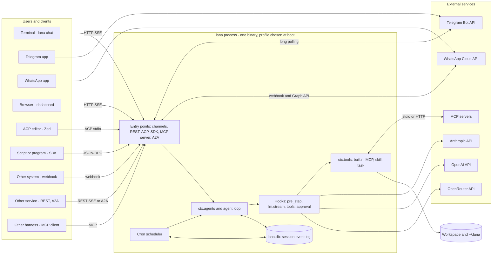
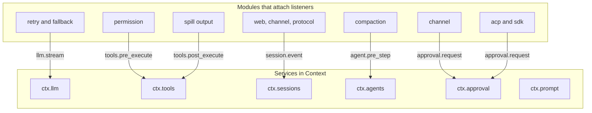
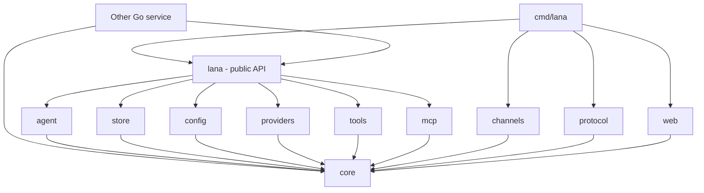
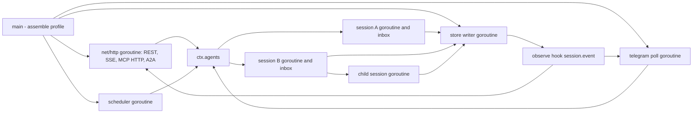
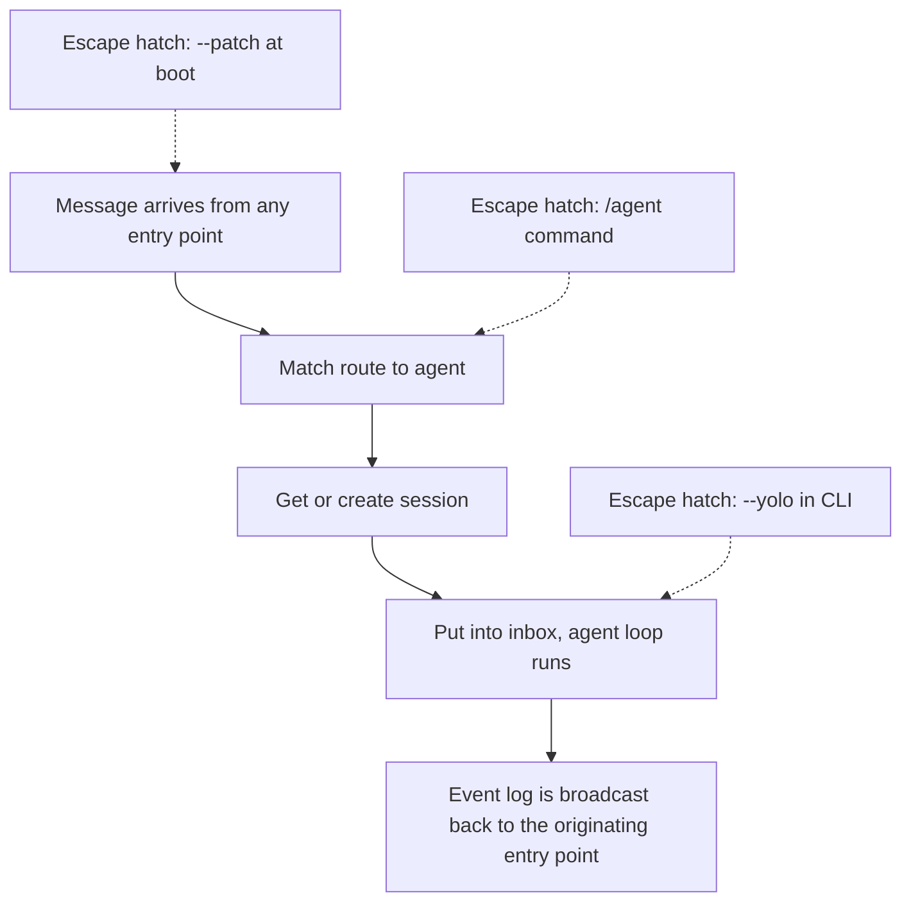
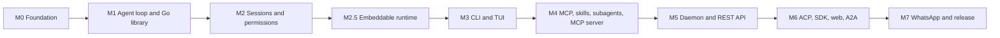

# 0001. System Context and Roadmap

- **ADR reference**: [0013. Use Go](../adr/0013-use-go-as-single-binary.md), [0014. Agentic tool integration](../adr/0014-integration-as-agentic-tool.md), [0015. Embeddable runtime](../adr/0015-embeddable-runtime-for-services.md), [0002. Core from modules, services, and hooks](../adr/0002-core-from-modules-services-and-hooks.md), [0008. Interfaces](../adr/0008-cli-channel-http-and-web-dashboard-interfaces.md), [0012. ACP and SDK](../adr/0012-acp-and-sdk-json-rpc.md)
- **Related diagram**: [0002. Agent Loop and Approval](0002-agent-loop-and-approval.md), [0003. Data Model and Scheduler](0003-data-model-and-scheduler.md), [0004. Profile, Fork, Subagent, and Protocols](0004-profile-fork-subagent-and-protocols.md), [0005. Agentic Tool Integration](0005-agentic-tool-integration.md)
- **Purpose**: system context, map of services and hooks, dependencies between packages, runtime topology, and the implementation roadmap.

This diagram shows the process boundary of `lana`, what lives inside it, and the external systems it contacts. For the
flow of a single agent turn, see diagram 0002.

> Keep this diagram in sync with the related ADRs. If an ADR and this diagram disagree, update both in the same change.

## System Context

## Service and Hook Map

Following the deepseek-harness pattern: modules register services with `Context`, and policies are attached
as hook listeners.

## Dependencies Between Packages

Arrow direction = "imports". `core` does not import other packages in this module. A Go service that embeds `lana`
only imports the `lana` and `core` packages.

## Runtime Topology

Topology for the `daemon` profile. Other profiles run a subset of these goroutines.

Rules:

- One goroutine per active session, with one inbox. A session idle for 15 minutes is stopped; its state stays in the log.
- All writes to SQLite go through the single store writer goroutine.
- All goroutines receive a `context.Context` from the root and stop on shutdown.
- MCP server child processes only live while they are needed.

## KISS Default Path

KISS defaults:

- One binary, one DB file. Modules are compiled into the binary; there are no runtime plugins in v1.
- A Go service that needs an agent embeds the `lana` package instead of running a separate process.
- Telegram long polling, not webhooks.
- FTS5 memory, not vectors.
- No OS sandbox. The workspace boundary and fail-closed approval are the v1 lines of defense.

## Implementation Roadmap

## Implementation Checklist

1. **M0 Foundation (spec #2)** — `flake.nix` with Go from nixpkgs and `GOTOOLCHAIN=local`, Go module, package layout, import-rule test, GitHub Actions CI (macOS arm64 and Linux x86_64). Layered profile loader, `core` (Context, Module, generic hooks).
2. **M1 Agent loop and Go library (spec #3)** — `openai_compat` adapter with streaming, turn and step agent loop with an inbox, builtin tools, `MockLlm`, `minimal` and `headless` profiles. Public `lana` package: `New`, `Run`, `Stream`, custom tools.
3. **M2 Sessions and permissions (spec #4)** — append-only `session_events` on `modernc.org/sqlite`, projections, derive, resume, fork, lease, automatic and manual compaction. Permission on `tools.pre_execute`, fail-closed `ctx.approval`.
4. **M2.5 Embeddable runtime (spec #5)** — `store/postgres` (append-only, `pg_try_advisory_lock`), `lana.Agent` in code, `Budget` per run with `turn/end` reason `budget`, `MaxConcurrentRuns`, `observability/otel`. The same store contract tests for SQLite, Postgres, and memory (ADR 0015).
5. **M3 CLI and TUI (spec #1)** — `lana chat` (inline Bubble Tea), `lana run`, `lana init`, `lana config`.
6. **M4 MCP, skills, subagents, MCP server** — `go-sdk` MCP client with lazy start, `skill_load`, the `task` tool, Anthropic adapter, `lana mcp` (stdio and streamable HTTP, elicitation for approval).
7. **M5 Daemon and REST API** — `daemon` profile, REST + SSE (`/v1/runs`, `/v1/sessions`, per-client tokens, OpenAPI), Telegram, routing, scheduler, FTS5 memory.
8. **M6 ACP, SDK, web, A2A** — `lana acp`, `lana sdk`, dashboard (`embed.FS`), A2A server (agent card, task = session).
9. **M7 WhatsApp and release** — WhatsApp channel, `lana service install`, `distroless/static` Docker image. Measure targets: binary < 40 MB, idle RAM < 30 MB.
10. **Tests at every milestone** — `MockLlm`, golden `derive_messages`, resume from a truncated log, permission matcher, OpenAI format contract, profile merge, `testscript` for the CLI.
11. **Observability** — `log/slog` with an optional JSON handler. Redaction of API keys and tokens in logs and event payloads.
