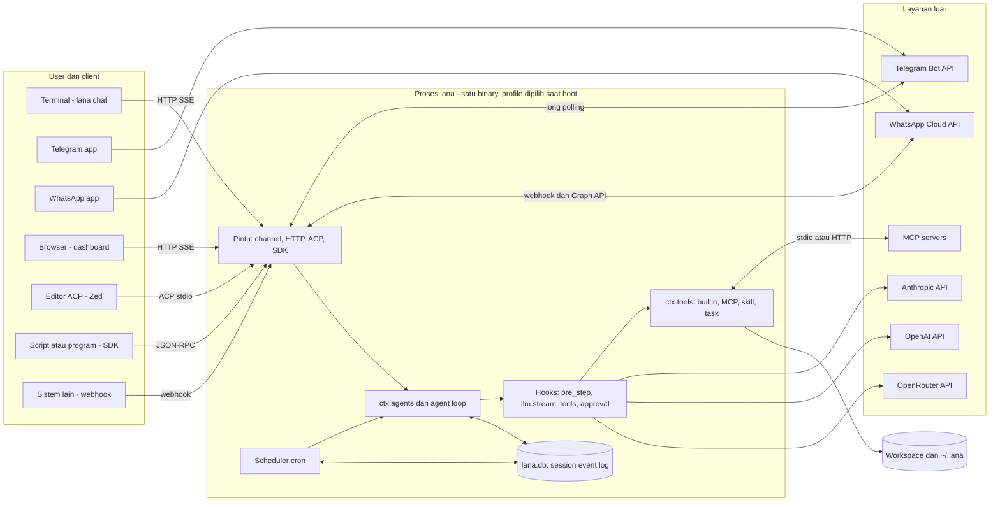
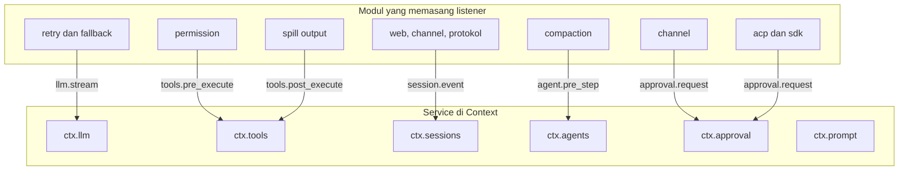
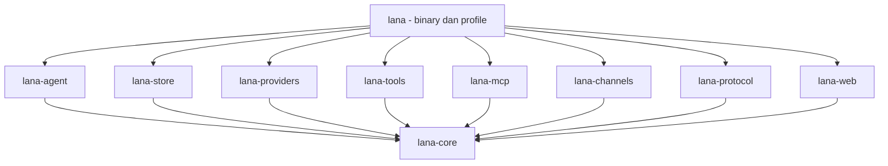
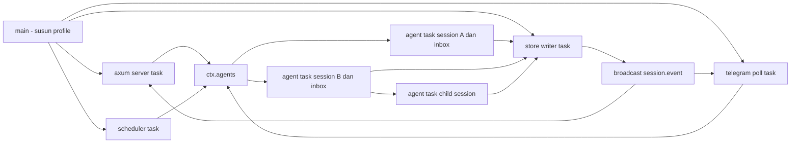
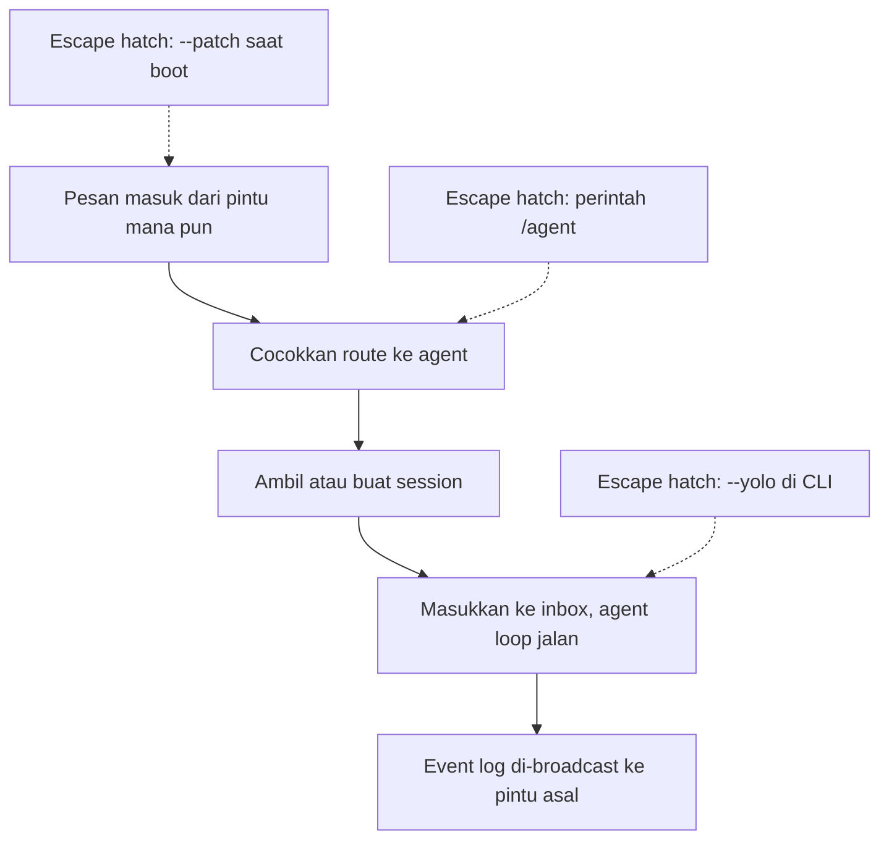
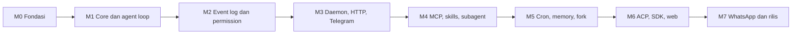

# 0001. System Context Dan Roadmap

- **ADR reference**: [0001. Gunakan Rust single binary daemon](../adr/0001-gunakan-rust-single-binary-daemon.md), [0002. Core dari modul, service, dan hook](../adr/0002-core-dari-modul-service-dan-hook.md), [0008. Interface](../adr/0008-interface-cli-channel-http-dan-web-dashboard.md), [0012. ACP dan SDK](../adr/0012-acp-dan-sdk-json-rpc.md)
- **Related diagram**: [0002. Agent Loop Dan Approval](0002-agent-loop-dan-approval.md), [0003. Data Model Dan Scheduler](0003-data-model-dan-scheduler.md), [0004. Profile, Fork, Subagent, Dan Protokol](0004-profile-fork-subagent-dan-protokol.md)
- **Purpose**: system context, peta service dan hook, dependency antar crate, topologi runtime, dan roadmap implementasi.

Diagram ini menunjukkan batas proses `lana`, apa yang ada di dalamnya, dan sistem luar yang
dihubungi. Untuk alur satu turn agent, lihat diagram 0002.

> Jaga diagram ini sinkron dengan ADR terkait. Jika ADR dan diagram berbeda, perbarui keduanya dalam satu perubahan.

## System Context

## Peta Service Dan Hook

Mengikuti pola deepseek-harness: modul mendaftarkan service ke `Context`, dan kebijakan dipasang
sebagai listener hook.

## Dependency Antar Crate

Arah panah = "bergantung pada". `lana-core` tidak bergantung pada crate lain di workspace.

## Topologi Runtime Tokio

Topologi untuk profile `daemon`. Profile lain menjalankan subset task ini.

Aturan:

- Satu agent task per session aktif, dengan satu inbox. Session idle 15 menit dihentikan; state tetap di log.
- Semua tulis ke SQLite lewat satu store writer task.
- MCP server child process hanya hidup saat dibutuhkan.

## KISS Default Path

KISS defaults:

- Satu binary, satu file DB. Modul dikompilasi ke binary; tidak ada plugin runtime di v1.
- Telegram long polling, bukan webhook.
- Memory FTS5, bukan vektor.
- Tanpa sandbox OS. Batas workspace dan approval fail-closed adalah garis pertahanan v1.

## Roadmap Implementasi

## Implementation Checklist

1. **M0 Fondasi** — `flake.nix` (Rust stable, `cargo-nextest`, `sqlite`), Cargo workspace, profil release kecil, CI build `aarch64-darwin` dan `x86_64-linux-musl`. Loader profile berlapis dengan merge `[[modules]]` per `id`, `--dump-config`, `lana config check`.
2. **M1 Core dan agent loop** — `Context`, `Module`, `Hooks` waterfall dan observe. Adapter `anthropic` dan `openai_compat` (OpenAI, OpenRouter) dengan streaming. Agent loop turn dan step dengan inbox. Builtin tools file dan `bash`. Profile `minimal` dan `headless` (`lana run`).
3. **M2 Event log dan permission** — `session_events` append-only, projection `sessions`, `derive_messages`, resume setelah crash. Modul `permission` di `tools.pre_execute`, `ctx.approval` dengan outcome fail-closed, `approval/policy`. Compaction lewat `compaction/summary`.
4. **M3 Daemon, HTTP, Telegram** — profile `daemon`, axum API dan SSE, channel Telegram long polling dengan inline keyboard, routing multi-agent, `/agent`, `lana chat` attach ke daemon.
5. **M4 MCP, skills, subagent** — `rmcp` stdio dan HTTP dengan lazy start, `skill_load`, tool `task` dan `task_continue` sebagai child session.
6. **M5 Cron, memory, fork** — scheduler dengan policy `never`, tool `cron_*`, `lana cron`, memory FTS5, `fork` di batas turn, `lana session export`.
7. **M6 ACP, SDK, web** — profile `acp` dengan crate `agent-client-protocol`, profile `sdk` JSON-RPC di stdio dan unix socket, dashboard Preact + `htm` embedded.
8. **M7 WhatsApp dan rilis** — channel WhatsApp Cloud API, `lana service install`, Docker image `distroless`. Ukur target: binary < 15 MB, RAM idle < 20 MB.
9. **Test di setiap milestone** — `MockLlm` untuk agent loop, test golden `derive_messages` dari event, test resume dari log terpotong, test permission matcher, test kontrak format OpenAI, test merge profile.
10. **Observability** — `tracing` dengan output JSON opsional. Redaksi API key dan token di log dan payload event.
