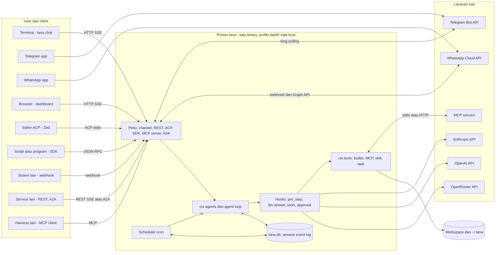
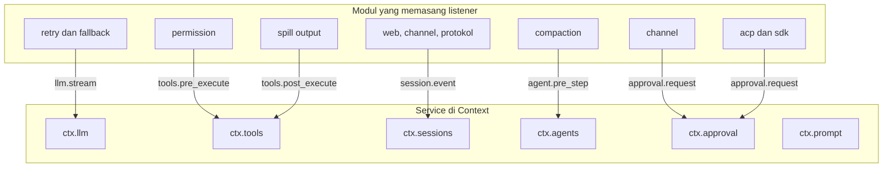
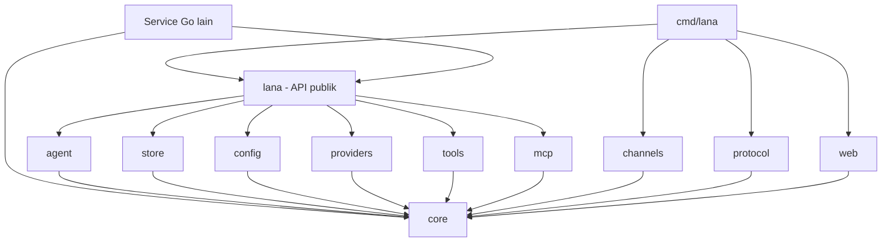
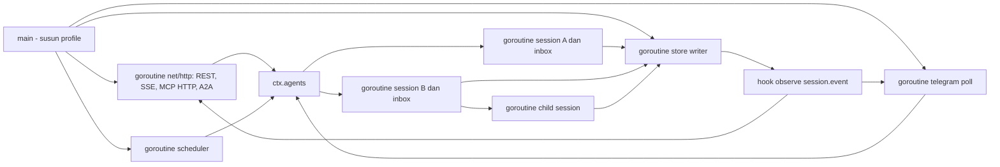
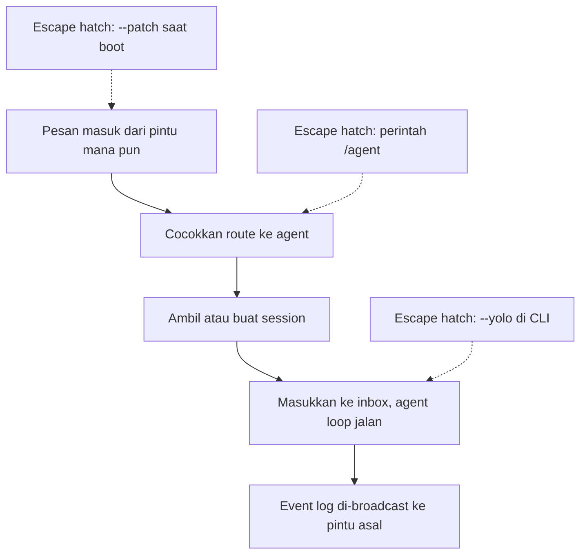
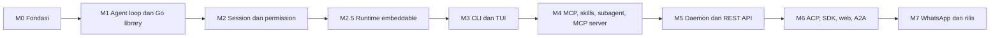

# 0001. System Context Dan Roadmap

- **ADR reference**: [0013. Gunakan Go](../adr/0013-gunakan-go-sebagai-single-binary.md), [0014. Integrasi agentic tool](../adr/0014-integrasi-sebagai-agentic-tool.md), [0015. Runtime embeddable](../adr/0015-runtime-embeddable-untuk-service.md), [0002. Core dari modul, service, dan hook](../adr/0002-core-dari-modul-service-dan-hook.md), [0008. Interface](../adr/0008-interface-cli-channel-http-dan-web-dashboard.md), [0012. ACP dan SDK](../adr/0012-acp-dan-sdk-json-rpc.md)
- **Related diagram**: [0002. Agent Loop Dan Approval](0002-agent-loop-dan-approval.md), [0003. Data Model Dan Scheduler](0003-data-model-dan-scheduler.md), [0004. Profile, Fork, Subagent, Dan Protokol](0004-profile-fork-subagent-dan-protokol.md), [0005. Integrasi Agentic Tool](0005-integrasi-agentic-tool.md)
- **Purpose**: system context, peta service dan hook, dependency antar package, topologi runtime, dan roadmap implementasi.

Diagram ini menunjukkan batas proses `lana`, apa yang ada di dalamnya, dan sistem luar yang
dihubungi. Untuk alur satu turn agent, lihat diagram 0002.

> Jaga diagram ini sinkron dengan ADR terkait. Jika ADR dan diagram berbeda, perbarui keduanya dalam satu perubahan.

## System Context

## Peta Service Dan Hook

Mengikuti pola deepseek-harness: modul mendaftarkan service ke `Context`, dan kebijakan dipasang
sebagai listener hook.

## Dependency Antar Package

Arah panah = "meng-import". `core` tidak meng-import package lain di module ini. Service Go yang
meng-embed `lana` hanya meng-import package `lana` dan `core`.

## Topologi Runtime

Topologi untuk profile `daemon`. Profile lain menjalankan subset goroutine ini.

Aturan:

- Satu goroutine per session aktif, dengan satu inbox. Session idle 15 menit dihentikan; state tetap di log.
- Semua tulis ke SQLite lewat satu goroutine store writer.
- Semua goroutine menerima `context.Context` dari root dan berhenti saat shutdown.
- MCP server child process hanya hidup saat dibutuhkan.

## KISS Default Path

KISS defaults:

- Satu binary, satu file DB. Modul dikompilasi ke binary; tidak ada plugin runtime di v1.
- Service Go yang butuh agent meng-embed package `lana`, bukan menjalankan proses terpisah.
- Telegram long polling, bukan webhook.
- Memory FTS5, bukan vektor.
- Tanpa sandbox OS. Batas workspace dan approval fail-closed adalah garis pertahanan v1.

## Roadmap Implementasi

## Implementation Checklist

1. **M0 Fondasi (spec #2)** — `flake.nix` dengan Go dari nixpkgs dan `GOTOOLCHAIN=local`, Go module, layout package, test aturan import, CI GitHub Actions (macOS arm64 dan Linux x86_64). Loader profile berlapis, `core` (Context, Module, hook generik).
2. **M1 Agent loop dan Go library (spec #3)** — adapter `openai_compat` dengan streaming, agent loop turn dan step dengan inbox, builtin tools, `MockLlm`, profile `minimal` dan `headless`. Package `lana` publik: `New`, `Run`, `Stream`, tool kustom.
3. **M2 Session dan permission (spec #4)** — `session_events` append-only di `modernc.org/sqlite`, projection, derive, resume, fork, lease, compaction otomatis dan manual. Permission di `tools.pre_execute`, `ctx.approval` fail-closed.
4. **M2.5 Runtime embeddable (spec #5)** — `store/postgres` (append-only, `pg_try_advisory_lock`), `lana.Agent` di kode, `Budget` per run dengan `turn/end` reason `budget`, `MaxConcurrentRuns`, `observability/otel`. Test kontrak store yang sama untuk SQLite, Postgres, dan memori (ADR 0015).
5. **M3 CLI dan TUI (spec #1)** — `lana chat` (Bubble Tea inline), `lana run`, `lana init`, `lana config`.
6. **M4 MCP, skills, subagent, MCP server** — MCP client `go-sdk` dengan lazy start, `skill_load`, tool `task`, adapter Anthropic, `lana mcp` (stdio dan streamable HTTP, elicitation untuk approval).
7. **M5 Daemon dan REST API** — profile `daemon`, REST + SSE (`/v1/runs`, `/v1/sessions`, token per client, OpenAPI), Telegram, routing, scheduler, memory FTS5.
8. **M6 ACP, SDK, web, A2A** — `lana acp`, `lana sdk`, dashboard (`embed.FS`), A2A server (agent card, task = session).
9. **M7 WhatsApp dan rilis** — channel WhatsApp, `lana service install`, Docker image `distroless/static`. Ukur target: binary < 40 MB, RAM idle < 30 MB.
10. **Test di setiap milestone** — `MockLlm`, golden `derive_messages`, resume dari log terpotong, permission matcher, kontrak format OpenAI, merge profile, `testscript` untuk CLI.
11. **Observability** — `log/slog` dengan handler JSON opsional. Redaksi API key dan token di log dan payload event.
