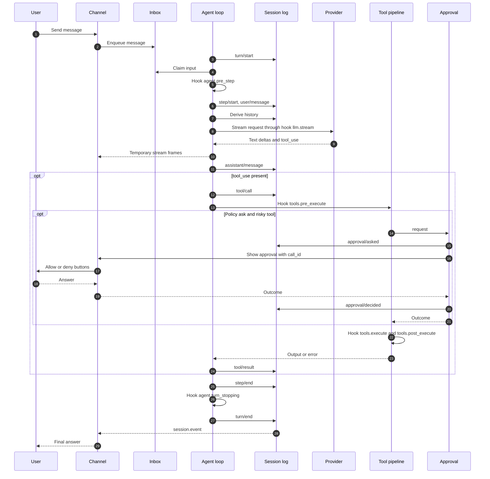
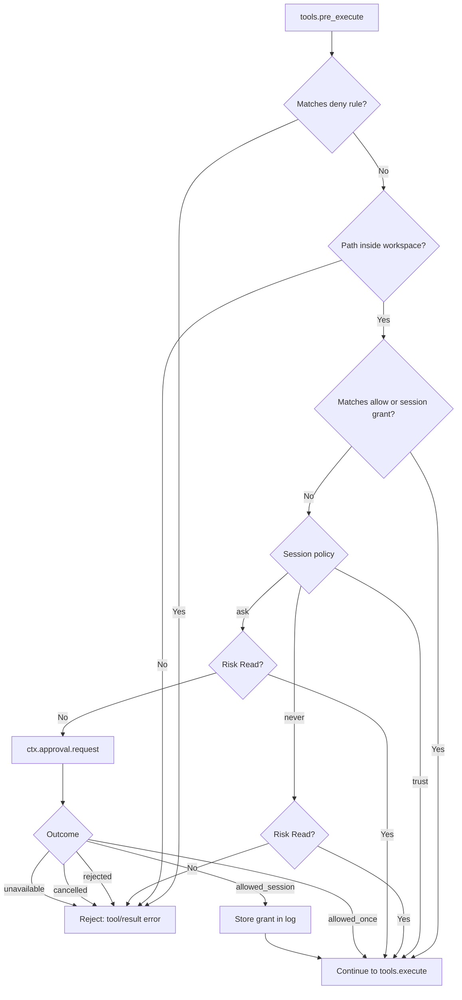
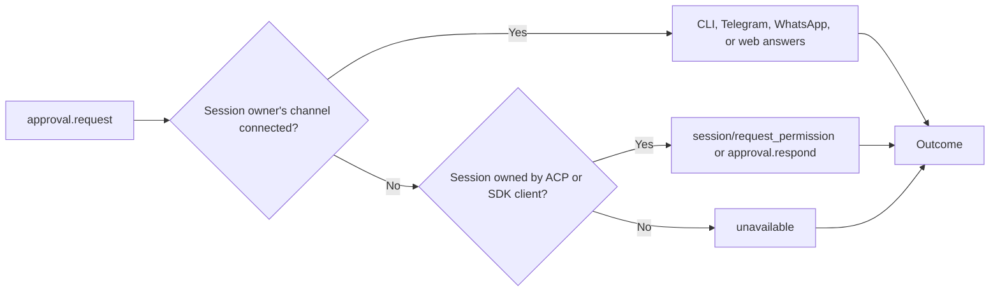
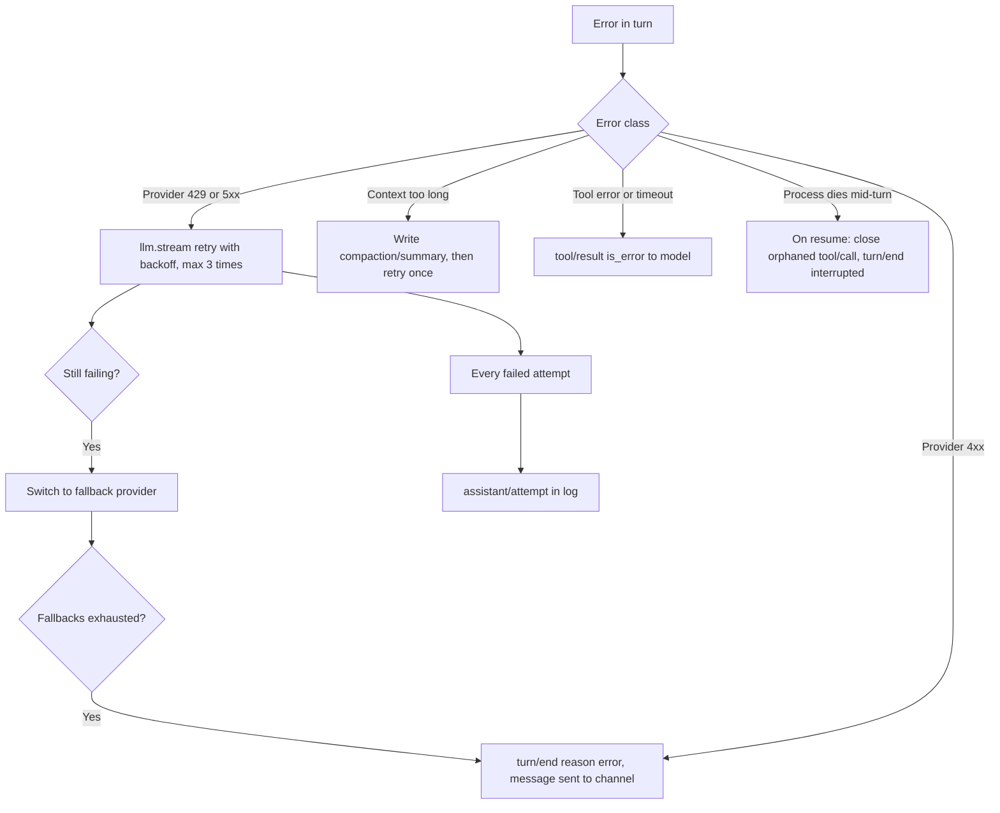

# 0002. Agent Loop and Approval

- **ADR reference**: [0002. Core from modules, services, and hooks](../adr/0002-core-from-modules-services-and-hooks.md), [0004. Permissions and approval](../adr/0004-permission-mode-per-agent.md), [0009. Session event log](../adr/0009-session-as-append-only-event-log.md)
- **Related diagram**: [0001. System Context and Roadmap](0001-system-context-and-roadmap.md), [0004. Profile, Fork, Subagent, and Protocols](0004-profile-fork-subagent-and-protocols.md)
- **Purpose**: model of turns and steps, hook positions, the sequence of a single turn, the approval chain, and failure handling.

This diagram is for people implementing the `agent` package. The turn, step, and hook pattern follows
deepseek-harness (`dsh`).

> Keep this diagram in sync with the related ADRs. If an ADR and this diagram disagree, update both in the same change.

## Turns and Steps

- **Step** = one request to the model plus the tools it calls.
- **Turn** = zero or more steps. A turn opens before the first input is claimed and closes when nothing is left to answer.

```text
turn/start
  claim input from inbox (initial message, plus one queued message per step)
  hook agent.pre_step         accept, modify, or reject input
    rejected in the first step -> turn/end without a step
  step/start
    assemble system prompt and tool schemas
    hook agent.request        modify request controls
    write system/message if changed, write user/message
    derive history from log, freeze request
    hook llm.stream           retry, fallback, metering
      temporary stream frames to channel
      assistant/message | assistant/attempt
    for each tool_use:
      tool/call
      hook tools.pre_execute  permission and approval
      hook tools.execute
      hook tools.post_execute truncate or spill output
      tool/result
  step/end
  still a tool_result or new inbox message -> next step
  hook agent.turn_stopping
turn/end
```

Names with `/` are durable events in the session log. Names with `.` are live hooks.

## Turn Sequence



Invariants:

- *Model-visible means logged*: every model request can be reconstructed from the log.
- Every `tool/call` always has a `tool/result`, including when rejected, cancelled, or errored.
- A session has only one active turn. New messages enter the inbox and are claimed at the next step.
- `max_steps` defaults to 25 per turn, and to 15 for subagents.
- Independent `Read` tools may run in parallel. `Write` and `Exec` tools run sequentially.

## Permission and Approval Decision



## Approval Responder Chain

The `approval.request` hook is a waterfall. The first responder that owns the session answers. If no one
answers, the outcome is `unavailable` (fail-closed).



## Failure Handling


