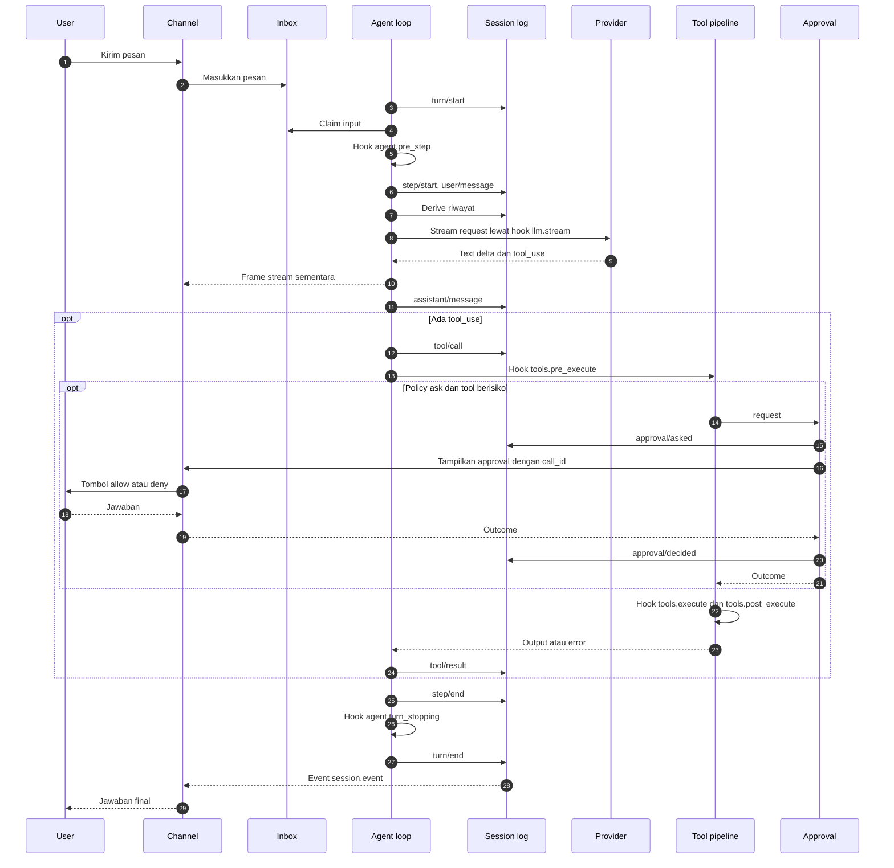
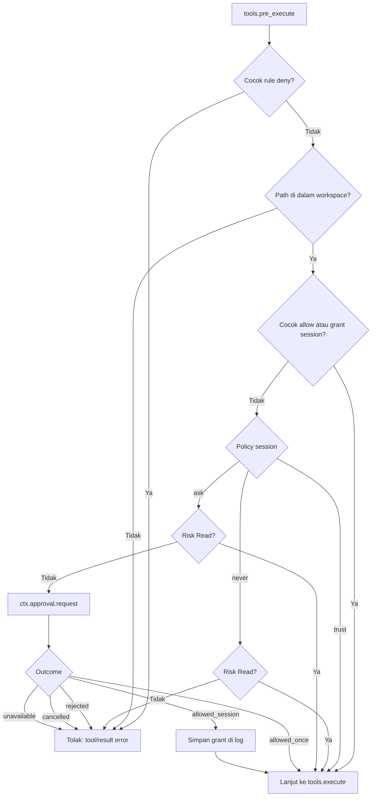
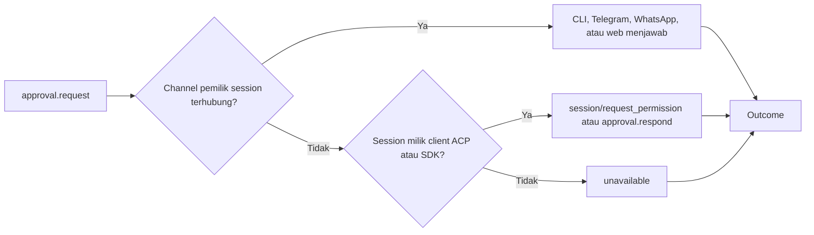
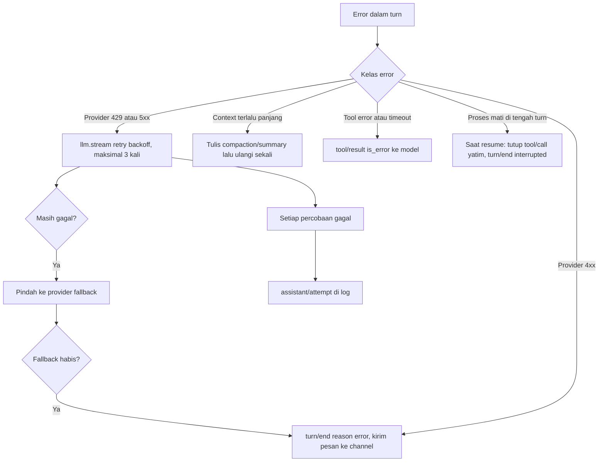

# 0002. Agent Loop Dan Approval

- **ADR reference**: [0002. Core dari modul, service, dan hook](../adr/0002-core-dari-modul-service-dan-hook.md), [0004. Permission dan approval](../adr/0004-permission-mode-per-agent.md), [0009. Session event log](../adr/0009-session-sebagai-event-log-append-only.md)
- **Related diagram**: [0001. System Context Dan Roadmap](0001-system-context-dan-roadmap.md), [0004. Profile, Fork, Subagent, Dan Protokol](0004-profile-fork-subagent-dan-protokol.md)
- **Purpose**: model turn dan step, posisi hook, sequence satu turn, rantai approval, dan failure handling.

Diagram ini untuk orang yang mengimplementasi `lana-agent`. Pola turn, step, dan hook mengikuti
deepseek-harness (`dsh`).

> Jaga diagram ini sinkron dengan ADR terkait. Jika ADR dan diagram berbeda, perbarui keduanya dalam satu perubahan.

## Turn Dan Step

- **Step** = satu request ke model ditambah tool yang dipanggilnya.
- **Turn** = nol atau lebih step. Turn dibuka sebelum input pertama di-claim dan ditutup saat tidak ada lagi yang harus dijawab.

```text
turn/start
  claim input dari inbox (pesan awal, plus satu pesan antre per step)
  hook agent.pre_step         terima, ubah, atau tolak input
    tolak di step pertama  -> turn/end tanpa step
  step/start
    susun system prompt dan schema tool
    hook agent.request        ubah kontrol request
    tulis system/message jika berubah, tulis user/message
    derive riwayat dari log, bekukan request
    hook llm.stream           retry, fallback, metering
      frame stream sementara ke channel
      assistant/message | assistant/attempt
    untuk setiap tool_use:
      tool/call
      hook tools.pre_execute  permission dan approval
      hook tools.execute
      hook tools.post_execute potong atau spill output
      tool/result
  step/end
  masih ada tool_result atau pesan baru di inbox -> step berikutnya
  hook agent.turn_stopping
turn/end
```

Nama dengan `/` adalah event durable di session log. Nama dengan `.` adalah hook hidup.

## Sequence Satu Turn



Invariant:

- *Model-visible means logged*: setiap request model bisa direkonstruksi dari log.
- Setiap `tool/call` selalu punya `tool/result`, termasuk saat ditolak, dibatalkan, atau error.
- Satu session hanya punya satu turn aktif. Pesan baru masuk inbox dan di-claim di step berikutnya.
- `max_steps` default 25 per turn, 15 untuk subagent.
- Tool `Read` yang independen boleh jalan paralel. Tool `Write` dan `Exec` jalan berurutan.

## Keputusan Permission Dan Approval



## Rantai Penjawab Approval

Hook `approval.request` adalah waterfall. Penjawab pertama yang memiliki session menjawab. Jika
tidak ada yang menjawab, hasilnya `unavailable` (fail-closed).



## Failure Handling


