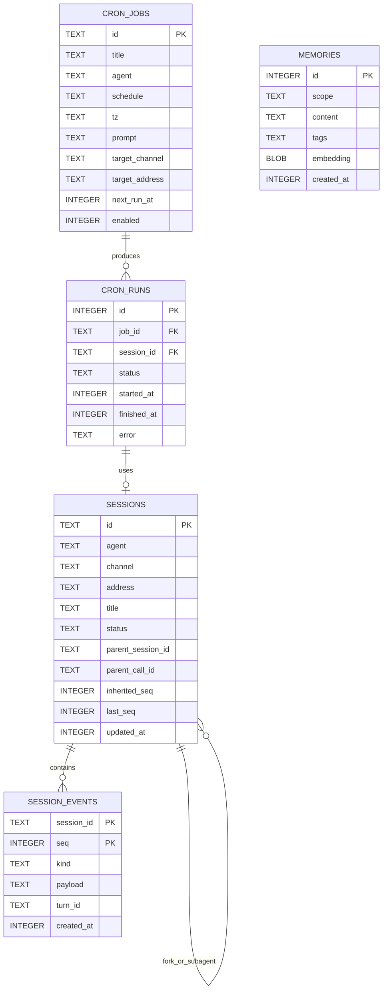
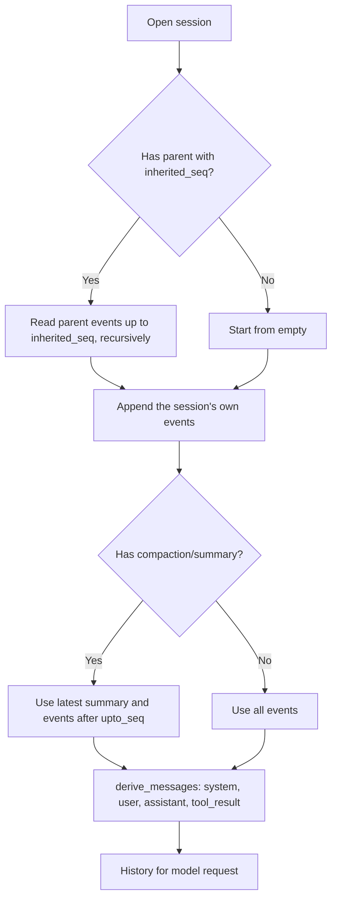
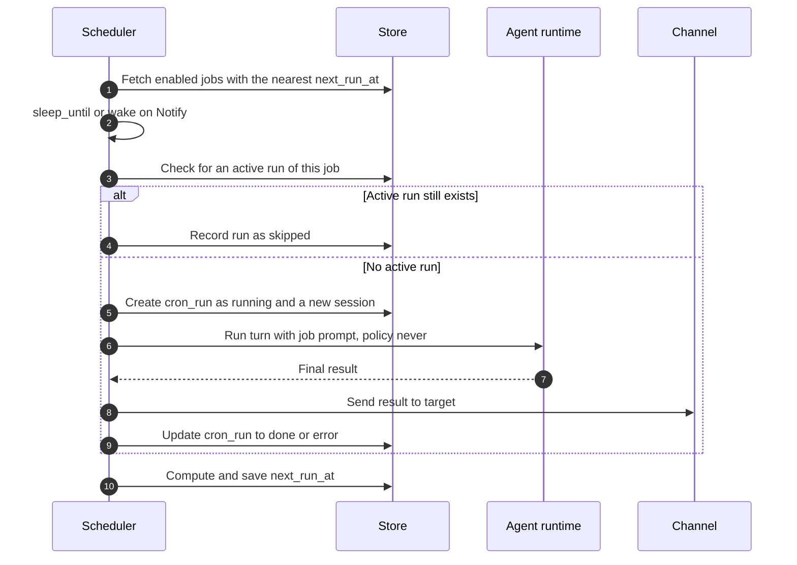
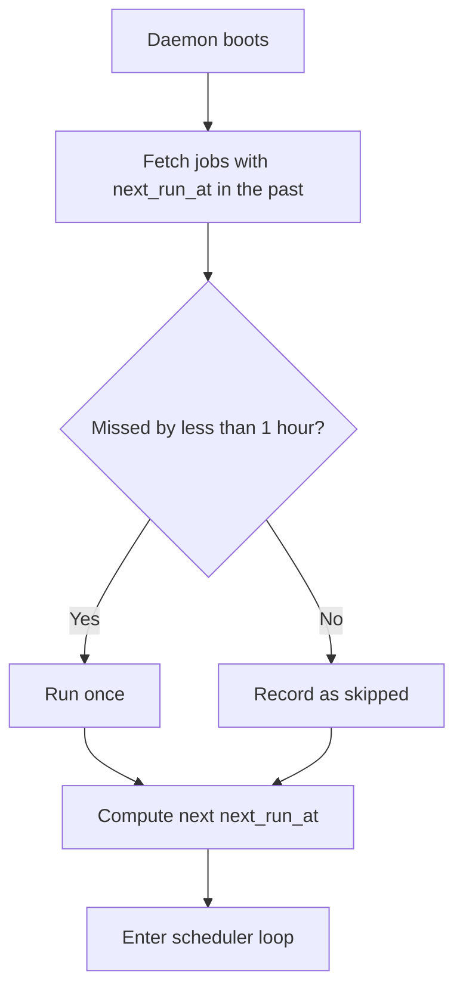

# 0003. Data Model and Scheduler

- **ADR reference**: [0005. SQLite as the single storage](../adr/0005-sqlite-as-single-storage.md), [0009. Session event log](../adr/0009-session-as-append-only-event-log.md), [0007. Cron scheduler inside the daemon](../adr/0007-cron-scheduler-inside-daemon.md)
- **Related diagram**: [0002. Agent Loop and Approval](0002-agent-loop-and-approval.md)
- **Purpose**: SQLite schema, data folder layout, deriving history from the event log, and the cron scheduler flow.

> Keep this diagram in sync with the related ADRs. If an ADR and this diagram disagree, update both in the same change.

## Data Folder Layout

```text
~/.lana/                 (override: LANA_HOME)
  config.toml            providers, agents, routes, mcp, channels, modules
  profiles/<profile>.toml patch per profile
  secrets.env            API keys and bot tokens, permission 0600
  lana.db                SQLite WAL: session event log, memory, cron
  agents/<name>.md       system prompt per agent
  skills/<name>/SKILL.md skills and supporting scripts
  workspaces/<agent>/    default workspace if the agent does not set one
  logs/lana.log          tracing log, daily rotation
```

## Data Model



Notes:

- `SESSION_EVENTS` is the source of truth. Triggers reject `UPDATE` and `DELETE` (except for `lana db prune`, which deletes whole sessions).
- `SESSIONS` is a projection that can be rebuilt from events. `parent_session_id` is used by forks (with `inherited_seq`) and by subagents (with `parent_call_id`).
- Approval audit = `approval/asked` and `approval/decided` events. An index on `(kind, created_at)` serves the audit page.
- `MEMORIES` has a companion virtual table `memories_fts` (FTS5), kept in sync with triggers. `scope` is `global` or `agent:<name>`.
- `embedding` is empty in v1. It is prepared for later vector search.
- Secrets never enter the DB. The source of truth for secrets is the env or `secrets.env`.

## Deriving Model History



## Scheduler Loop



## Catch-up at Boot


