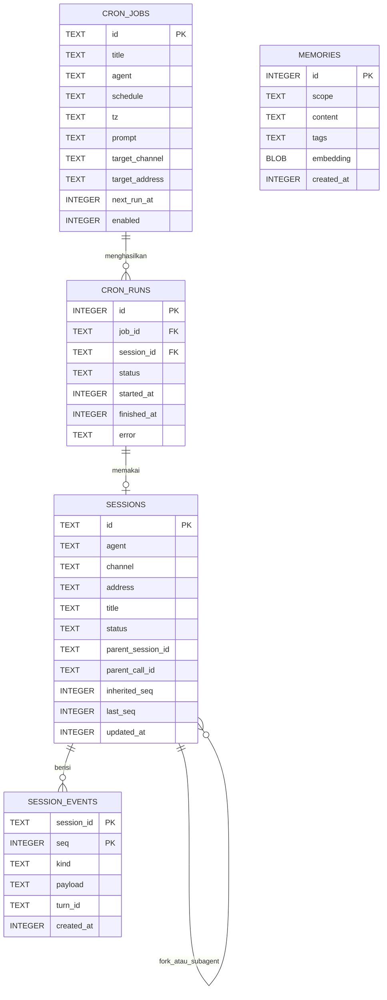
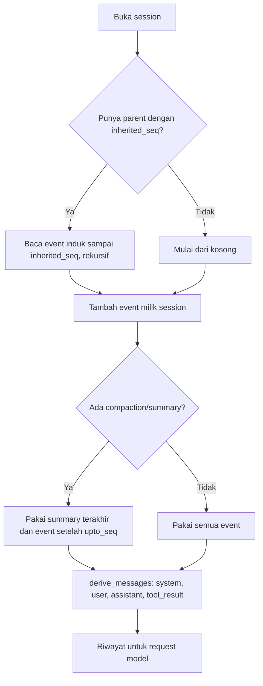
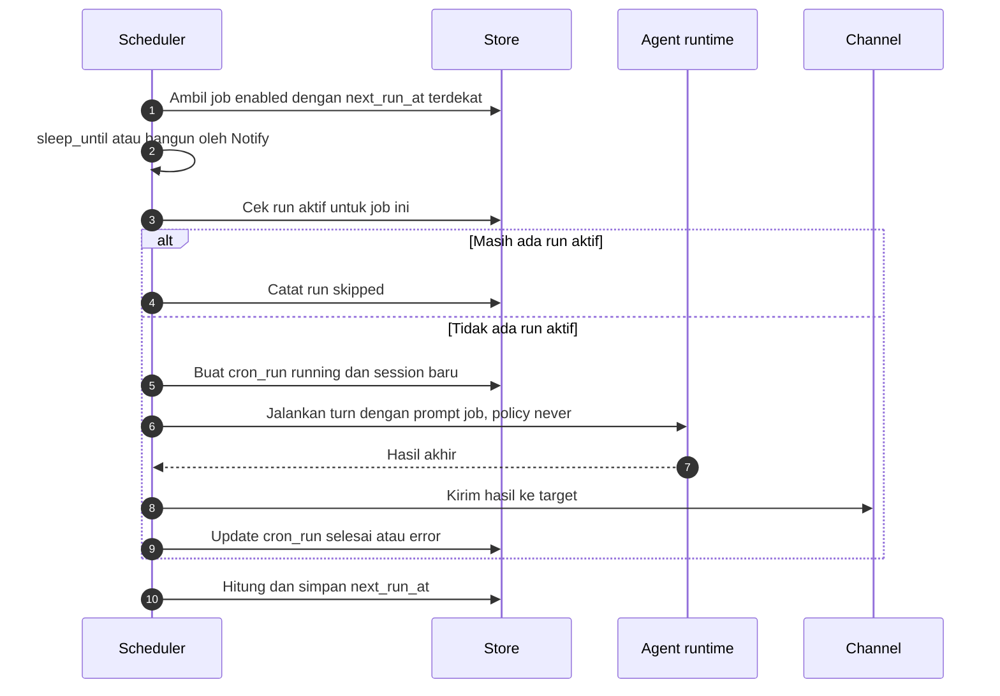
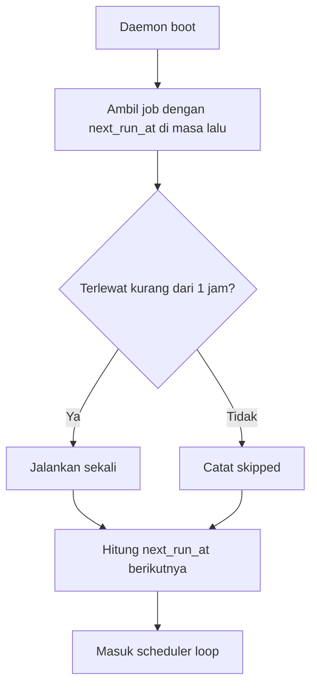

# 0003. Data Model Dan Scheduler

- **ADR reference**: [0005. SQLite sebagai storage tunggal](../adr/0005-sqlite-sebagai-storage-tunggal.md), [0009. Session event log](../adr/0009-session-sebagai-event-log-append-only.md), [0007. Scheduler cron di dalam daemon](../adr/0007-scheduler-cron-di-dalam-daemon.md)
- **Related diagram**: [0002. Agent Loop Dan Approval](0002-agent-loop-dan-approval.md)
- **Purpose**: skema SQLite, layout folder data, derive riwayat dari event log, dan alur scheduler cron.

> Jaga diagram ini sinkron dengan ADR terkait. Jika ADR dan diagram berbeda, perbarui keduanya dalam satu perubahan.

## Layout Folder Data

```text
~/.lana/                 (override: LANA_HOME)
  config.toml            providers, agents, routes, mcp, channels, modules
  profiles/<profile>.toml patch per profile
  secrets.env            API key dan token bot, permission 0600
  lana.db                SQLite WAL: session event log, memory, cron
  agents/<nama>.md       system prompt per agent
  skills/<nama>/SKILL.md skill dan script pendukung
  workspaces/<agent>/    workspace default jika agent tidak set workspace
  logs/lana.log          log tracing, rotasi harian
```

## Data Model



Catatan:

- `SESSION_EVENTS` adalah source of truth. Trigger menolak `UPDATE` dan `DELETE` (kecuali `lana db prune` yang menghapus session utuh).
- `SESSIONS` adalah projection yang bisa dibangun ulang dari event. `parent_session_id` dipakai oleh fork (dengan `inherited_seq`) dan subagent (dengan `parent_call_id`).
- Audit approval = event `approval/asked` dan `approval/decided`. Index `(kind, created_at)` untuk halaman audit.
- `MEMORIES` punya tabel virtual pasangan `memories_fts` (FTS5) yang disinkronkan dengan trigger. `scope` bernilai `global` atau `agent:<nama>`.
- `embedding` kosong di v1. Disiapkan untuk pencarian vektor nanti.
- Secret tidak pernah masuk DB. Source of truth secret adalah env atau `secrets.env`.

## Derive Riwayat Model



## Scheduler Loop



## Catchup Saat Boot


