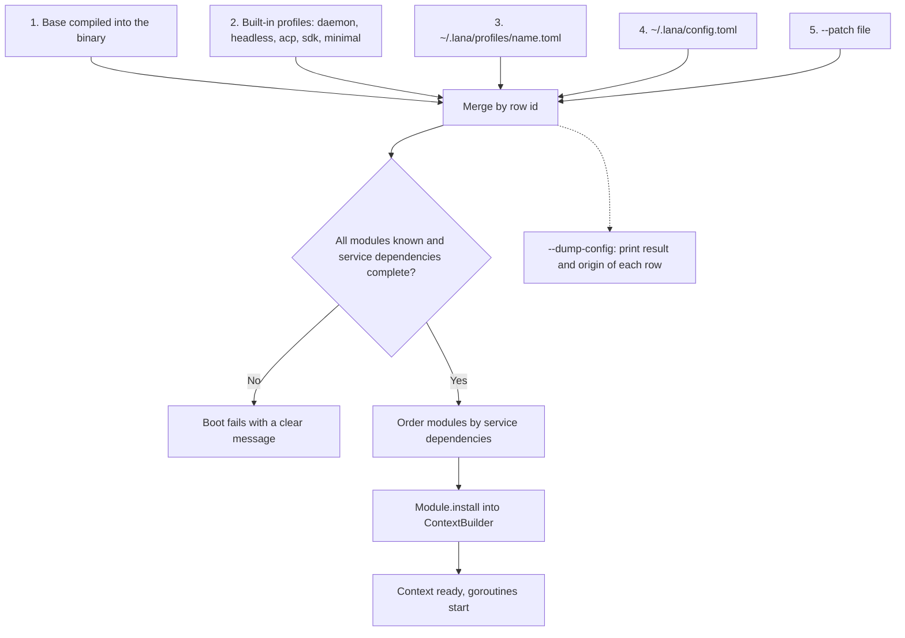
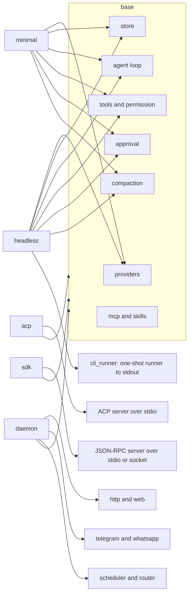
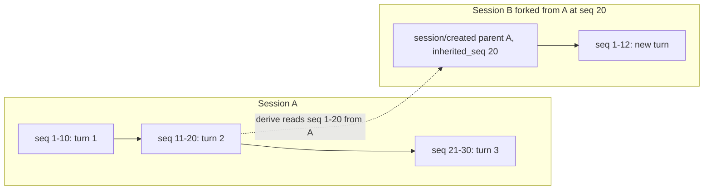
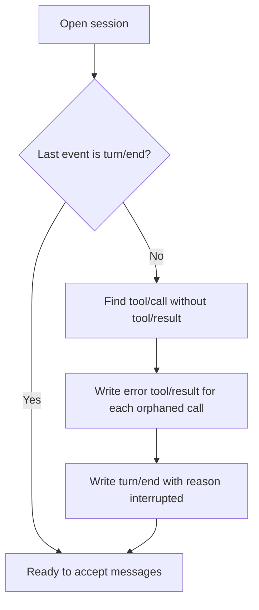
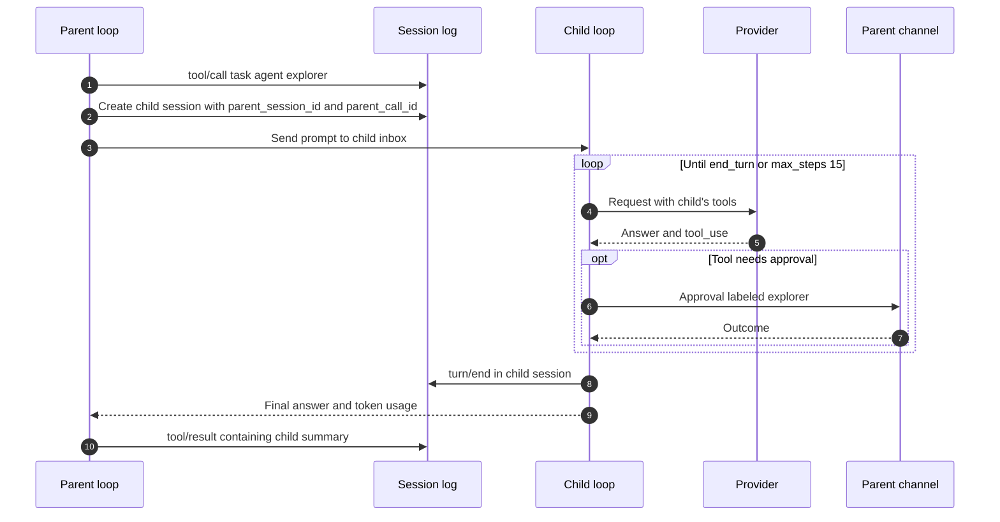
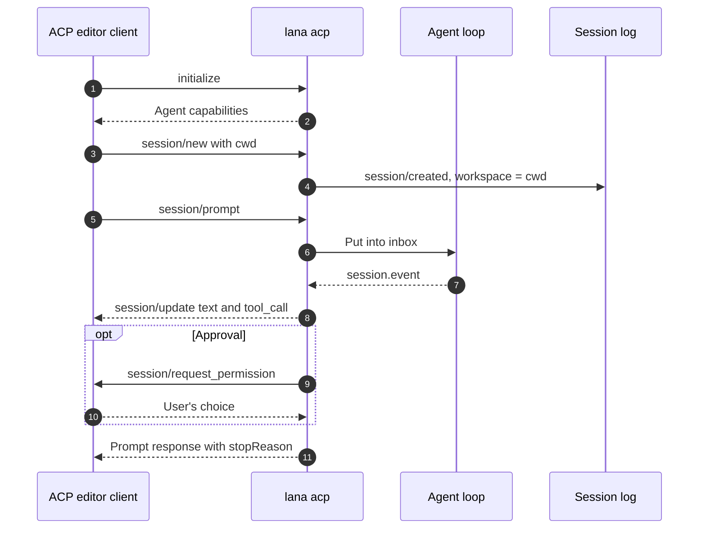

# 0004. Profile, Fork, Subagent, and Protocols

- **ADR reference**: [0010. Profiles and config patch](../adr/0010-profile-and-config-patch.md), [0009. Session event log](../adr/0009-session-as-append-only-event-log.md), [0011. Subagent](../adr/0011-subagent-as-child-session.md), [0012. ACP and SDK](../adr/0012-acp-and-sdk-json-rpc.md)
- **Related diagram**: [0002. Agent Loop and Approval](0002-agent-loop-and-approval.md), [0003. Data Model and Scheduler](0003-data-model-and-scheduler.md)
- **Purpose**: profile composition at boot, session fork and resume, subagent flow, and ACP flow.

> Keep this diagram in sync with the related ADRs. If an ADR and this diagram disagree, update both in the same change.

## Profile Composition at Boot

Merge rules:

- `[[modules]]` are merged by `id`. A matching row replaces its entire `config`.
- `disabled = true` turns a row off.
- The tables `providers`, `agents`, `mcp`, and `channels` are merged recursively per key.
- `[[routes]]` from the last layer replaces the entire list.

## Modules per Profile

## Fork Session

Fork does not copy events. The child session reads the parent's events up to `inherited_seq`, then its own events.

Fork rules:

- Fork is only allowed at a turn boundary (the `seq` of a `turn/end`).
- Session approval grants and the policy carry over, because they live in inherited events.

## Resume After a Crash

## Subagent

Subagent limits:

- Maximum depth 2. At most 3 children running concurrently per parent.
- The child's permission is the intersection of the parent's permission and the child agent's.
- Cancelling the parent cancels all children.

## ACP with an Editor

