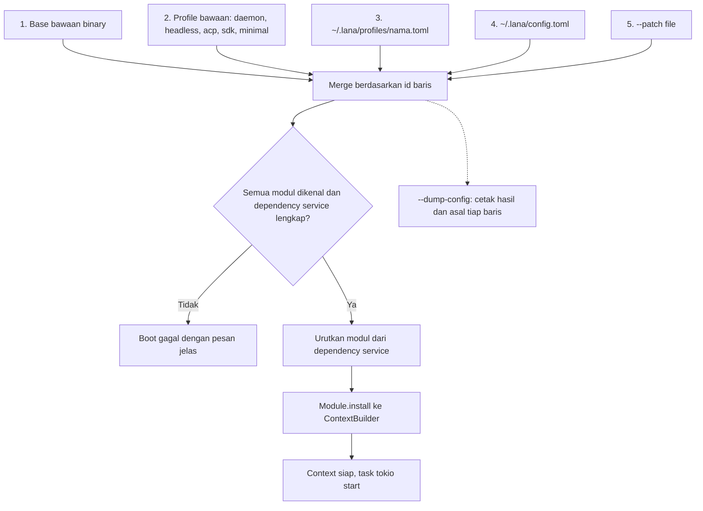
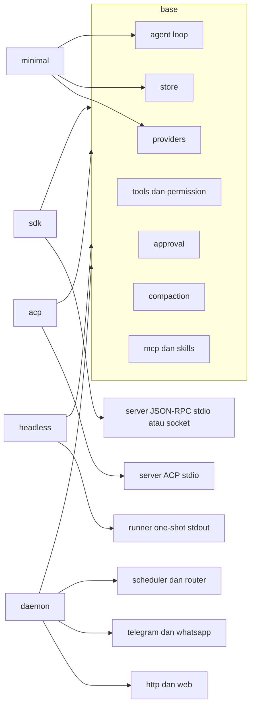
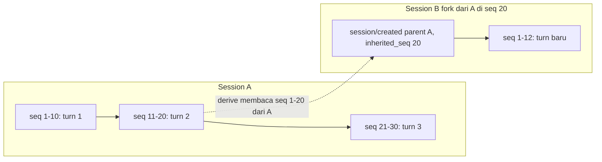
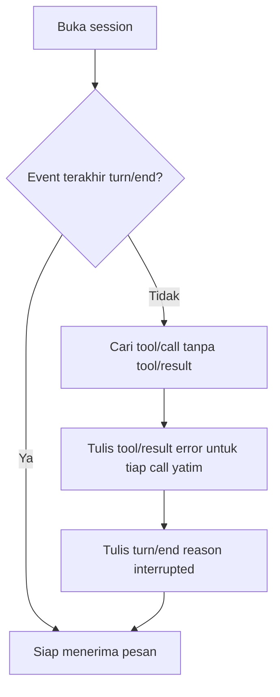
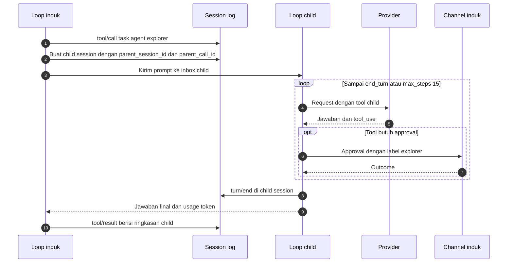
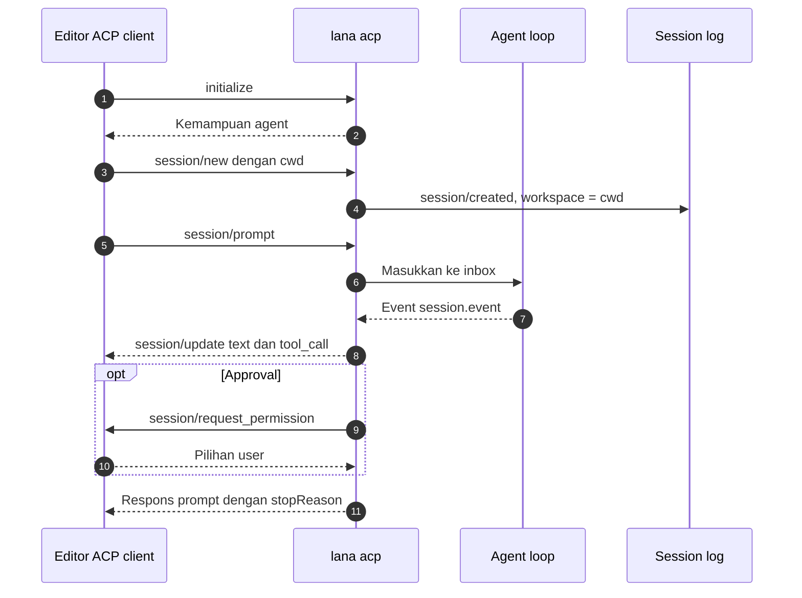

# 0004. Profile, Fork, Subagent, Dan Protokol

- **ADR reference**: [0010. Profile dan config patch](../adr/0010-profile-dan-config-patch.md), [0009. Session event log](../adr/0009-session-sebagai-event-log-append-only.md), [0011. Subagent](../adr/0011-subagent-sebagai-child-session.md), [0012. ACP dan SDK](../adr/0012-acp-dan-sdk-json-rpc.md)
- **Related diagram**: [0002. Agent Loop Dan Approval](0002-agent-loop-dan-approval.md), [0003. Data Model Dan Scheduler](0003-data-model-dan-scheduler.md)
- **Purpose**: komposisi profile saat boot, fork dan resume session, alur subagent, dan alur ACP.

> Jaga diagram ini sinkron dengan ADR terkait. Jika ADR dan diagram berbeda, perbarui keduanya dalam satu perubahan.

## Komposisi Profile Saat Boot

Aturan merge:

- `[[modules]]` digabung per `id`. Baris yang sama mengganti seluruh `config`.
- `disabled = true` mematikan baris.
- Tabel `providers`, `agents`, `mcp`, `channels` digabung rekursif per key.
- `[[routes]]` dari lapisan terakhir menggantikan seluruh daftar.

## Modul Per Profile

## Fork Session

Fork tidak menyalin event. Session anak membaca event induk sampai `inherited_seq`, lalu event miliknya.

Aturan fork:

- Fork hanya di batas turn (`seq` sebuah `turn/end`).
- Grant approval session dan policy ikut terbawa karena berada di event yang diwarisi.

## Resume Setelah Crash

## Subagent

Batas subagent:

- Kedalaman maksimal 2. Paling banyak 3 child berjalan bersamaan per induk.
- Permission child adalah irisan permission induk dan agent child.
- Batal di induk membatalkan semua child.

## ACP Dengan Editor

