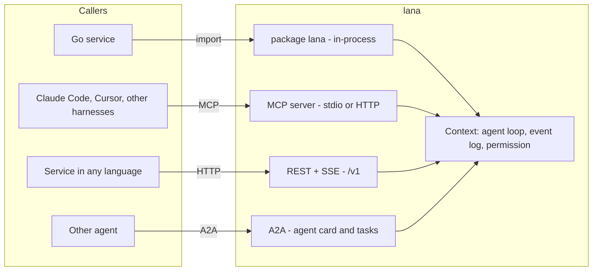
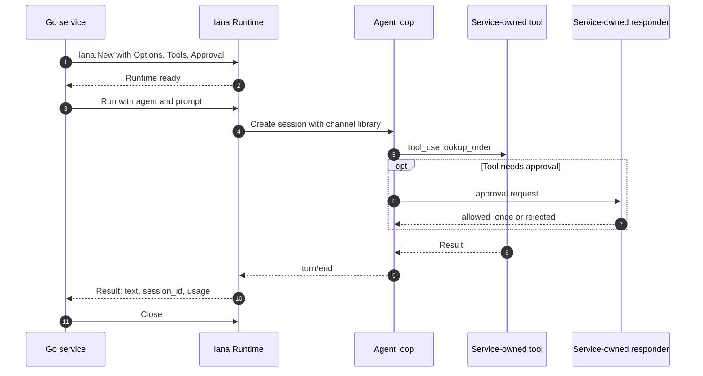
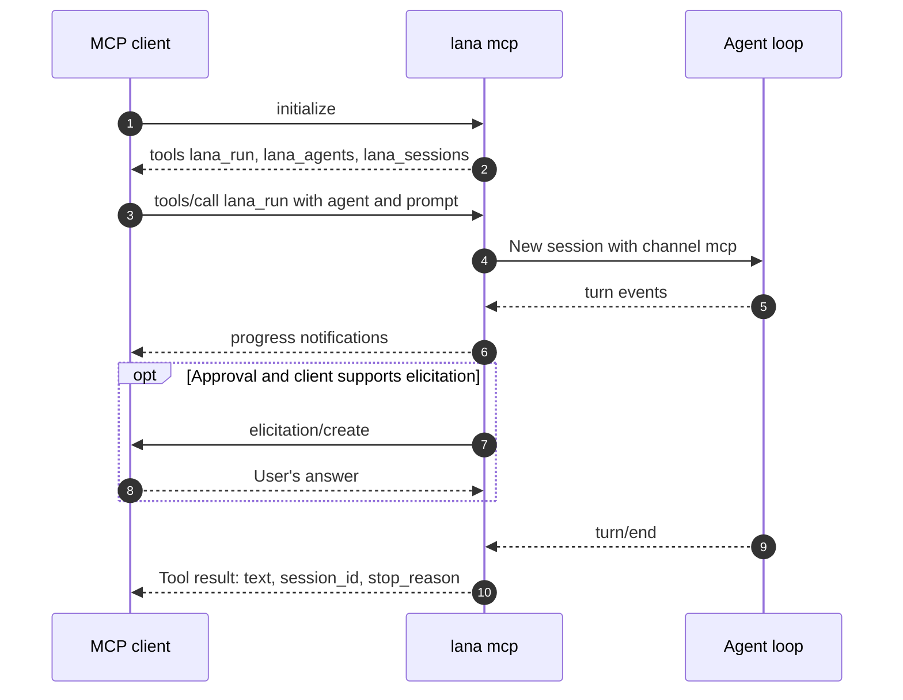
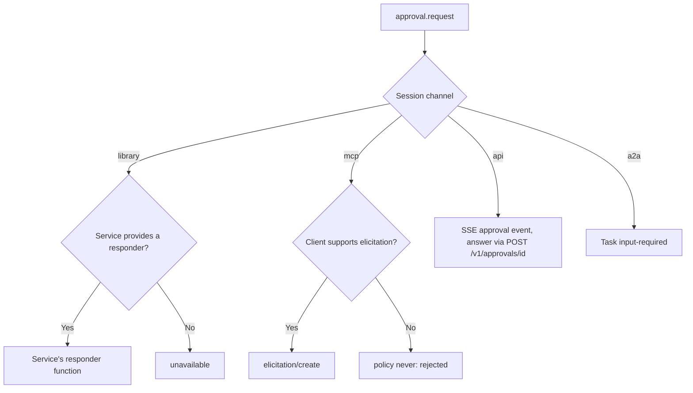

# 0005. Agentic Tool Integration

- **ADR reference**: [0014. Provide lana as an agentic tool](../adr/0014-integration-as-agentic-tool.md), [0013. Use Go](../adr/0013-use-go-as-single-binary.md)
- **Related diagram**: [0001. System Context and Roadmap](0001-system-context-and-roadmap.md), [0002. Agent Loop and Approval](0002-agent-loop-and-approval.md)
- **Purpose**: the four integration surfaces, the Go library embedding flow, the MCP server flow, and the approval mapping per surface.

For people integrating `lana` into other services. The agent loop, event log, and permissions
are the same for all surfaces; this diagram only shows the entry points.

> Keep this diagram in sync with the related ADRs. If an ADR and this diagram disagree, update both in the same change.

## Four Surfaces

## Embedding as a Go Library

## Called Through MCP

## Approval Mapping

Rules:

- Integration surfaces cannot raise a policy above the agent's policy.
- An agent outside a surface's allowlist cannot be called through that surface.
- The workspace for network surfaces always comes from the agent's config.
