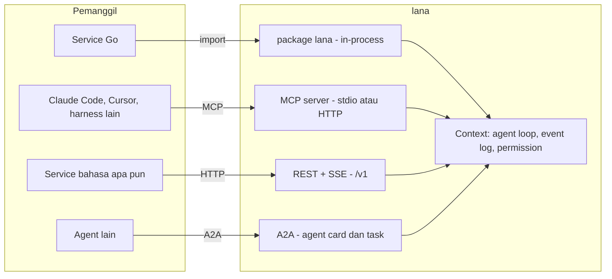
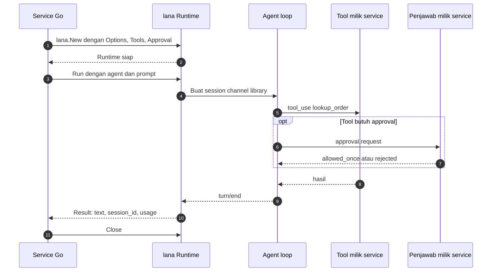
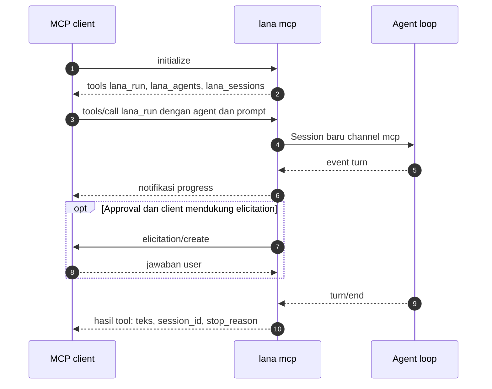
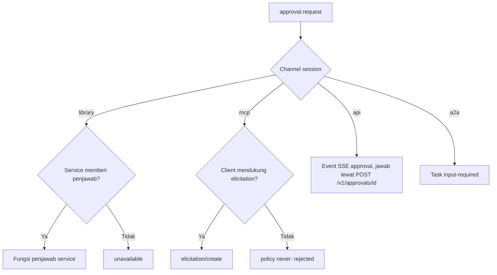

# 0005. Integrasi Agentic Tool

- **ADR reference**: [0014. Sediakan lana sebagai agentic tool](../adr/0014-integrasi-sebagai-agentic-tool.md), [0013. Gunakan Go](../adr/0013-gunakan-go-sebagai-single-binary.md)
- **Related diagram**: [0001. System Context Dan Roadmap](0001-system-context-dan-roadmap.md), [0002. Agent Loop Dan Approval](0002-agent-loop-dan-approval.md)
- **Purpose**: empat permukaan integrasi, alur embed Go library, alur MCP server, dan pemetaan approval per permukaan.

Untuk orang yang mengintegrasikan `lana` ke service lain. Agent loop, event log, dan permission
sama untuk semua permukaan; diagram ini hanya menunjukkan pintunya.

> Jaga diagram ini sinkron dengan ADR terkait. Jika ADR dan diagram berbeda, perbarui keduanya dalam satu perubahan.

## Empat Permukaan

## Embed Sebagai Go Library

## Dipanggil Lewat MCP

## Pemetaan Approval

Aturan:

- Permukaan integrasi tidak bisa menaikkan policy di atas policy agent.
- Agent di luar allowlist permukaan tidak bisa dipanggil lewat permukaan itu.
- Workspace untuk permukaan jaringan selalu dari config agent.
