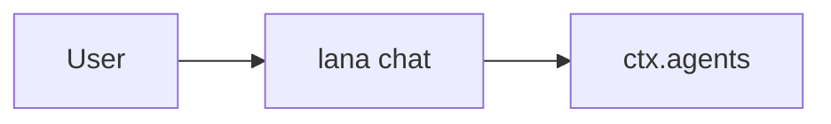

# Design: <Feature Name>

- **Issue**: `#<number>`
- **Requirements**: [requirements.md](requirements.md)
- **Contract**: [api-contract.md](api-contract.md) — Required / Not required
- **Requirements revision**: <integer>
- **Contract revision**: <integer or `Not required`>
- **Requirements status**: Draft
- **Contract status**: Draft / Not required
- **Status**: Draft
- **Design revision**: <integer, starting at 1>

Do not write a design against requirements or a contract that are not yet approved.

## Architecture references

- **ADR index**: [docs/adr](../../adr/README.md)
- **Diagram index**: [docs/diagram](../../diagram/README.md)
- **ADR**: <link or `—`>
- **Feature-local diagram**: <link to the section below or `Not required — <reason>`>
- **Durable diagram**: <link or `—`>

## Architecture decision scan

| Topic | Existing authority | Decision location | Action |
|---|---|---|---|
| Public interface | <contract/ADR/none> | requirements or ADR | reuse/create/none |
| Persistence | <ADR/none> | ADR or design | reuse/create/local |
| State and lifecycle | <diagram/none> | requirements or diagram | reuse/create/none |
| Concurrency | <ADR/none> | ADR or design | reuse/create/local |
| Dependency direction | <ADR/none> | ADR | reuse/create/none |

## Visual Architecture Check

| Trigger | Present? | Required view |
|---|---:|---|
| Module or crate boundary | Yes/No | boundary/context |
| Interaction with an actor or external system | Yes/No | context/sequence |
| Multi-component flow | Yes/No | sequence/flowchart |
| Lifecycle or state transition | Yes/No | state/flowchart |
| Entity relation | Yes/No | ERD |
| Concurrency, retry, or failure flow | Yes/No | sequence/flowchart |
| Dependency direction or runtime topology | Yes/No | boundary/topology |

If any trigger is `Yes`, include the smallest useful Mermaid view below.

## Feature-local view

## Repository fit

Describe how the feature follows the existing crate, module, service, hook, and profile structure.
Link the ADR, do not repeat its contents.

## Proposed design

### Components

- **<Component>** — <responsibility and invariant>.

### Contract mapping

| Contract operation | Component | Input | Result | Requirements |
|---|---|---|---|---|
| `API-...` | <component> | <input> | <result> | `REQ-...` |

### Persistence

- <new event, table, migration, or `Unchanged`>

### Failure handling

| Failure | Internal error | Observable result |
|---|---|---|
| <failure> | <error type> | <exit code or message> |

### Concurrency

- <task, cancel, lock, or `Not applicable`>

### Security

- <permission enforcement and data exposure>

### Observability

- <log, redaction, or `Unchanged`>

## Requirement traceability

| Requirement | Contract operation | Design component | Verification level |
|---|---|---|---|
| `REQ-...` | `API-...` or `Not applicable` | <component> | unit/integration/runtime |

## Acceptance verification map

| Acceptance criterion | Verification method | Planned evidence |
|---|---|---|
| `AC-...` | unit/integration/runtime/manual | <test name or probe> |

## Verification strategy

- **Unit**: <pure logic>
- **Integration**: <SQLite, processes, pseudo-terminal>
- **Runtime**: <manual smoke test or script>

## Risks and tradeoffs

- <cost or risk local to the feature>

## Blocking Design Questions

| ID | Question | Controls | Requested reference | Owner | Status | Resolution |
|---|---|---|---|---|---|---|
| `DQ-001` | <technical decision> | <component> | <example or direction> | <name> | Open | — |

## Approval

- [ ] Requirements are Approved and their revision is recorded.
- [ ] Contract is Approved or `Not required`.
- [ ] Architecture decision scan and Visual Architecture Check are complete.
- [ ] Required ADRs are Accepted.
- [ ] Every requirement maps to one design component.
- [ ] Every acceptance criterion has a verification method.
- [ ] Blocking Design Questions is `None`.
- **Approved by**: —
- **Approved on**: —
