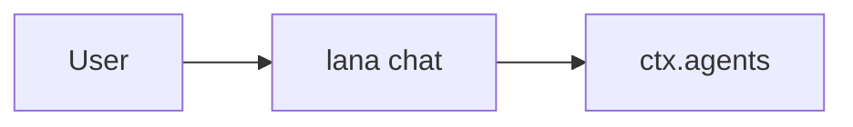

# Design: <Nama Fitur>

- **Issue**: `#<nomor>`
- **Requirements**: [requirements.md](requirements.md)
- **Contract**: [api-contract.md](api-contract.md) — Diperlukan / Tidak diperlukan
- **Revisi requirements**: <integer>
- **Revisi contract**: <integer atau `Tidak diperlukan`>
- **Status requirements**: Draft
- **Status contract**: Draft / Tidak diperlukan
- **Status**: Draft
- **Revisi design**: <integer, mulai 1>

Jangan membuat design terhadap requirements atau contract yang belum di-approve.

## Referensi arsitektur

- **Index ADR**: [docs/adr](../../adr/README.md)
- **Index diagram**: [docs/diagram](../../diagram/README.md)
- **ADR**: <link atau `—`>
- **Diagram lokal fitur**: <link bagian di bawah atau `Tidak diperlukan — <alasan>`>
- **Diagram tahan lama**: <link atau `—`>

## Scan keputusan arsitektur

| Topik | Otoritas yang ada | Lokasi keputusan | Aksi |
|---|---|---|---|
| Antarmuka publik | <contract/ADR/tidak ada> | requirements atau ADR | pakai ulang/buat/tidak ada |
| Persistence | <ADR/tidak ada> | ADR atau design | pakai ulang/buat/lokal |
| State dan lifecycle | <diagram/tidak ada> | requirements atau diagram | pakai ulang/buat/tidak ada |
| Konkurensi | <ADR/tidak ada> | ADR atau design | pakai ulang/buat/lokal |
| Arah dependency | <ADR/tidak ada> | ADR | pakai ulang/buat/tidak ada |

## Visual Architecture Check

| Pemicu | Ada? | Tampilan yang dibutuhkan |
|---|---:|---|
| Batas modul atau crate | Ya/Tidak | boundary/context |
| Interaksi dengan aktor atau sistem luar | Ya/Tidak | context/sequence |
| Alur multi-komponen | Ya/Tidak | sequence/flowchart |
| Lifecycle atau transisi state | Ya/Tidak | state/flowchart |
| Relasi entity | Ya/Tidak | ERD |
| Konkurensi, retry, atau alur gagal | Ya/Tidak | sequence/flowchart |
| Arah dependency atau topologi runtime | Ya/Tidak | boundary/topology |

Jika ada pemicu `Ya`, sertakan tampilan Mermaid terkecil yang berguna di bawah.

## Tampilan lokal fitur

## Kesesuaian dengan repository

Jelaskan bagaimana fitur mengikuti struktur crate, modul, service, hook, dan profile yang ada.
Tautkan ADR, jangan ulangi isinya.

## Design yang diusulkan

### Komponen

- **<Komponen>** — <tanggung jawab dan invariant>.

### Pemetaan contract

| Operasi contract | Komponen | Input | Hasil | Requirements |
|---|---|---|---|---|
| `API-...` | <komponen> | <input> | <hasil> | `REQ-...` |

### Persistence

- <event baru, tabel, migration, atau `Tidak berubah`>

### Failure handling

| Kegagalan | Error internal | Hasil yang terlihat |
|---|---|---|
| <kegagalan> | <tipe error> | <exit code atau pesan> |

### Konkurensi

- <task, cancel, lock, atau `Tidak berlaku`>

### Keamanan

- <penegakan izin dan paparan data>

### Observability

- <log, redaksi, atau `Tidak berubah`>

## Traceability requirement

| Requirement | Operasi contract | Komponen design | Level verifikasi |
|---|---|---|---|
| `REQ-...` | `API-...` atau `Tidak berlaku` | <komponen> | unit/integrasi/runtime |

## Peta verifikasi acceptance

| Acceptance criterion | Metode verifikasi | Bukti yang direncanakan |
|---|---|---|
| `AC-...` | unit/integrasi/runtime/manual | <nama test atau probe> |

## Strategi verifikasi

- **Unit**: <logika murni>
- **Integrasi**: <SQLite, proses, terminal semu>
- **Runtime**: <smoke test manual atau script>

## Risiko dan tradeoff

- <biaya atau risiko lokal fitur>

## Blocking Design Questions

| ID | Pertanyaan | Mengendalikan | Referensi yang diminta | Pemilik | Status | Resolusi |
|---|---|---|---|---|---|---|
| `DQ-001` | <keputusan teknis> | <komponen> | <contoh atau arah> | <nama> | Open | — |

## Approval

- [ ] Requirements sudah Approved dan revisinya dicatat.
- [ ] Contract sudah Approved atau `Tidak diperlukan`.
- [ ] Scan keputusan arsitektur dan Visual Architecture Check selesai.
- [ ] ADR yang dibutuhkan sudah Accepted.
- [ ] Setiap requirement terpetakan ke satu komponen design.
- [ ] Setiap acceptance criterion punya metode verifikasi.
- [ ] Blocking Design Questions bernilai `None`.
- **Di-approve oleh**: —
- **Di-approve pada**: —
