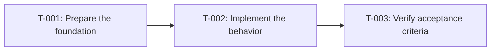

# Tasks: <Feature Name>

- **Issue**: `#<number>`
- **Requirements**: [requirements.md](requirements.md)
- **Contract**: [api-contract.md](api-contract.md) — Required / Not required
- **Design**: [design.md](design.md)
- **Requirements revision**: <integer>
- **Contract revision**: <integer or `Not required`>
- **Design revision**: <integer>
- **Status**: Draft

Do not create a task plan before requirements, contract (if applicable), and design are approved.

## Execution rules

- Implement only the requirements and acceptance criteria assigned to the task.
- Stop if requirements, design, ADR, diagrams, or contract conflict with each other.
- Do not answer product or architecture questions only in code.
- Every acceptance criterion has exactly one evidence owner.
- Required verification is never optional.
- Mark a task complete only after verification evidence has been recorded.

## Coverage

| Acceptance criterion | Contract operation | Evidence owner | Issue/PR | Verification | Evidence |
|---|---|---|---|---|---|
| `AC-...` | `API-...` or `Not applicable` | `T-001` | `#<number>` or `—` | <test or probe> | Pending |

## Task graph

## Tasks

- [ ] `T-001` <task title as an imperative sentence>
  - Issue/PR: `—`
  - Depends on: `None`
  - Requirements: `REQ-...`
  - Acceptance criteria: `AC-...`
  - Contract operations: `API-...` or `Not applicable`
  - Scope:
    - <small implementation slice>
  - Verification:
    - `<command or test name>`
  - Completion evidence:
    - Status: Pending
    - Command/test: —
    - Result: —
    - PR/commit: —
    - Deviation: None

## Final verification

- [ ] Every acceptance criterion has passing evidence.
- [ ] No observable behavior exists without a requirement ID.
- [ ] No behavior is outside scope.
- [ ] ADRs and diagrams match the implementation.
- [ ] `gofmt -l .` is empty, `golangci-lint run ./...`, `go test -race ./...`, and the release build pass.
- [ ] Deviations are resolved in requirements or design, not only recorded here.

## Approval

- [ ] Requirements and design are Approved and their revisions are recorded.
- [ ] Contract is Approved or `Not required`.
- [ ] Every acceptance criterion has exactly one evidence owner.
- [ ] Every task has a limited scope, dependencies, and verification.
- [ ] No task introduces new behavior.
- **Approved by**: —
- **Approved on**: —
