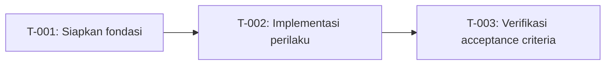

# Tasks: <Nama Fitur>

- **Issue**: `#<nomor>`
- **Requirements**: [requirements.md](requirements.md)
- **Contract**: [api-contract.md](api-contract.md) — Diperlukan / Tidak diperlukan
- **Design**: [design.md](design.md)
- **Revisi requirements**: <integer>
- **Revisi contract**: <integer atau `Tidak diperlukan`>
- **Revisi design**: <integer>
- **Status**: Draft

Jangan membuat rencana task sebelum requirements, contract (jika berlaku), dan design di-approve.

## Aturan eksekusi

- Implementasi hanya requirement dan acceptance criteria yang ditugaskan ke task.
- Berhenti jika requirements, design, ADR, diagram, atau contract saling bertentangan.
- Jangan menjawab pertanyaan produk atau arsitektur hanya di kode.
- Satu acceptance criterion punya tepat satu pemilik bukti.
- Verifikasi yang diwajibkan tidak pernah opsional.
- Tandai task selesai hanya setelah bukti verifikasi dicatat.

## Cakupan

| Acceptance criterion | Operasi contract | Pemilik bukti | Issue/PR | Verifikasi | Bukti |
|---|---|---|---|---|---|
| `AC-...` | `API-...` atau `Tidak berlaku` | `T-001` | `#<nomor>` atau `—` | <test atau probe> | Pending |

## Graf task

## Tasks

- [ ] `T-001` <judul task dalam kalimat perintah>
  - Issue/PR: `—`
  - Bergantung pada: `None`
  - Requirements: `REQ-...`
  - Acceptance criteria: `AC-...`
  - Operasi contract: `API-...` atau `Tidak berlaku`
  - Scope:
    - <slice implementasi kecil>
  - Verifikasi:
    - `<perintah atau nama test>`
  - Bukti penyelesaian:
    - Status: Pending
    - Perintah/test: —
    - Hasil: —
    - PR/commit: —
    - Deviasi: Tidak ada

## Verifikasi akhir

- [ ] Setiap acceptance criterion punya bukti lulus.
- [ ] Tidak ada perilaku terlihat tanpa ID requirement.
- [ ] Tidak ada perilaku di luar scope.
- [ ] ADR dan diagram sesuai implementasi.
- [ ] `cargo fmt --check`, `cargo clippy -- -D warnings`, `cargo nextest run`, dan build release lulus.
- [ ] Deviasi diselesaikan di requirements atau design, tidak hanya dicatat di sini.

## Approval

- [ ] Requirements dan design sudah Approved dan revisinya dicatat.
- [ ] Contract sudah Approved atau `Tidak diperlukan`.
- [ ] Setiap acceptance criterion punya tepat satu pemilik bukti.
- [ ] Setiap task punya scope terbatas, dependency, dan verifikasi.
- [ ] Tidak ada task yang memperkenalkan perilaku baru.
- **Di-approve oleh**: —
- **Di-approve pada**: —
