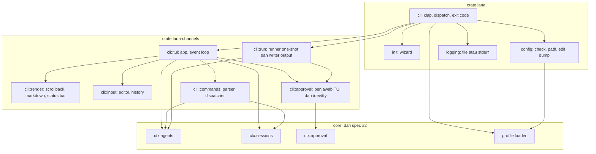
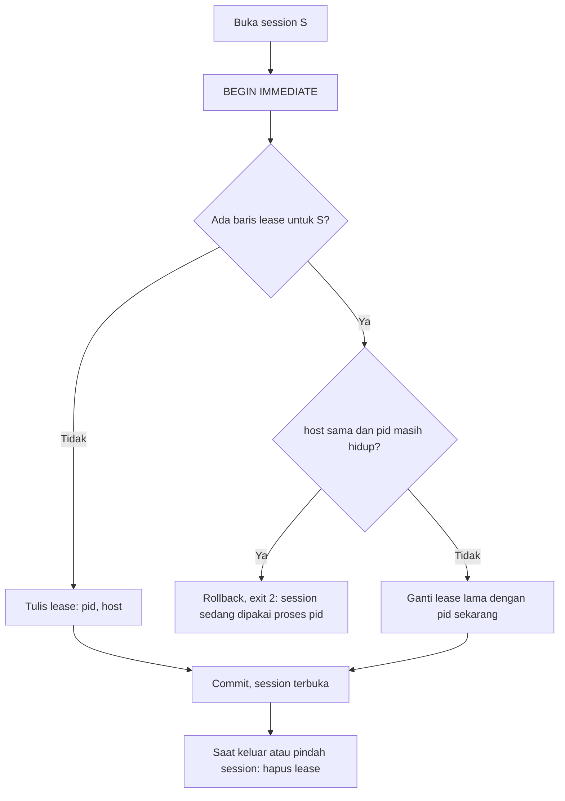
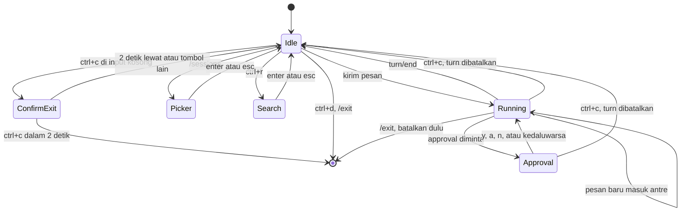
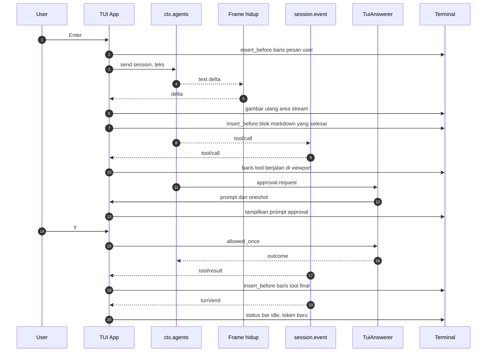

# Design: CLI dan TUI chat

- **Issue**: [`#1`](https://github.com/ridhomujizat/lana-harness/issues/1)
- **Requirements**: [requirements.md](requirements.md)
- **Contract**: [api-contract.md](api-contract.md) — Diperlukan
- **Revisi requirements**: 5
- **Revisi contract**: 2
- **Status requirements**: Approved
- **Status contract**: Approved
- **Status**: Approved
- **Revisi design**: 1

## Referensi arsitektur

- **Index ADR**: [docs/adr](../../adr/README.md)
- **Index diagram**: [docs/diagram](../../diagram/README.md)
- **ADR**: [0002](../../adr/0002-core-dari-modul-service-dan-hook.md), [0003](../../adr/0003-multi-agent-dengan-routing-channel.md), [0004](../../adr/0004-permission-mode-per-agent.md), [0008](../../adr/0008-interface-cli-channel-http-dan-web-dashboard.md), [0009](../../adr/0009-session-sebagai-event-log-append-only.md), [0010](../../adr/0010-profile-dan-config-patch.md) — semua Accepted
- **Diagram lokal fitur**: [Komponen](#komponen-dan-dependency), [State chat](#state-chat), [Satu turn di TUI](#satu-turn-di-tui), [Lock session](#lock-session)
- **Diagram tahan lama**: [0002. Agent Loop Dan Approval](../../diagram/0002-agent-loop-dan-approval.md), [0004. Profile, Fork, Subagent, Dan Protokol](../../diagram/0004-profile-fork-subagent-dan-protokol.md)

## Scan keputusan arsitektur

| Topik | Otoritas yang ada | Lokasi keputusan | Aksi |
|---|---|---|---|
| Antarmuka publik | Contract `API-CLI-*` | contract | Pakai ulang |
| Bentuk interface CLI | ADR 0008 (TUI inline ratatui, revisi bersama spec ini) | ADR | Pakai ulang |
| Persistence session | ADR 0009 | ADR | Pakai ulang. Tambah tabel `session_leases` (lokal, lihat Persistence) |
| Komposisi profile | ADR 0010 | ADR | Pakai ulang: `chat` = `minimal` + modul `channel.cli`; `run` = `headless` |
| Approval | ADR 0004 | ADR | Pakai ulang: CLI memasang penjawab di hook `approval.request` |
| Arah dependency | ADR 0002 | ADR | Pakai ulang: TUI di `lana-channels`, subcommand di `lana` |
| Core yang dibutuhkan | Belum ada spec | Spec #2 (core) | Dependency. Tasks CLI menunggu spec #2 (`DQ-001`) |

## Visual Architecture Check

| Pemicu | Ada? | Tampilan |
|---|---:|---|
| Batas modul atau crate | Ya | Komponen dan dependency |
| Interaksi dengan aktor atau sistem luar | Ya | Satu turn di TUI |
| Alur multi-komponen | Ya | Satu turn di TUI |
| Lifecycle atau transisi state | Ya | State chat |
| Relasi entity | Tidak | Tabel `session_leases` berdiri sendiri; cukup tabel di Persistence |
| Konkurensi, retry, atau alur gagal | Ya | Lock session |
| Arah dependency atau topologi runtime | Ya | Komponen dan dependency |

## Kesesuaian dengan repository

- Subcommand, parsing flag, exit code, `init`, dan `config` ada di crate binary `lana` (ADR 0002).
- TUI, penjawab approval CLI, dan penulis output `run` adalah modul di `lana-channels`, dipasang lewat
  profile (ADR 0010). Modul membaca `session.event`, mengirim ke `ctx.agents`, dan menjawab
  `approval.request`, sama seperti channel lain (ADR 0008).
- Semua perubahan state (policy, model, fork, compaction) lewat service core, sehingga tercatat di
  event log (ADR 0009). CLI tidak menulis ke SQLite secara langsung, kecuali lewat `ctx.sessions`.

## Komponen dan dependency

## Design yang diusulkan

### Komponen

- **`lana::cli`** — definisi `clap` derive untuk flag global (`API-CLI-001`) dan subcommand. Setiap
  handler mengembalikan `Result<(), LanaError>`. `main` memetakan error ke exit code lewat
  `LanaError::exit_code()`.
- **`lana::logging`** — `tracing-subscriber` dengan `EnvFilter` dari `-v` atau `LANA_LOG` (flag
  menang). `chat` memakai `tracing-appender` ke `$LANA_HOME/logs/lana.log` (rotasi harian). Subcommand
  lain menulis ke stderr.
- **`lana::init`** — wizard dengan `dialoguer`. File ditulis atomik (file sementara lalu `rename`).
  Tanpa `--force`, semua path diperiksa dulu; jika satu saja sudah ada, tidak ada file yang ditulis.
  `secrets.env` dibuat dengan mode `0600` sejak `open`, bukan `chmod` setelahnya.
- **`lana::config`** — `check` mem-parse setiap lapisan dengan `toml_edit` (menyimpan span untuk
  nomor baris), menjalankan validasi semantik dari profile loader, dan mengumpulkan semua error
  sebelum melapor. `dump` meminta config efektif dan peta asal dari loader, lalu me-redact field
  bertipe `Secret`. `edit` memecah `$VISUAL`/`$EDITOR` dengan `shell-words`.
- **`cli::tui::App`** — state machine chat (lihat [State chat](#state-chat)). Event loop `tokio::select!`
  atas: `crossterm::EventStream`, stream event session (`session.event`), stream frame hidup
  (text delta), channel permintaan approval, dan timer 100 ms untuk spinner serta jendela `Ctrl+C`
  dua kali.
- **`cli::render::Scrollback`** — menulis baris final ke scrollback lewat
  `Terminal::insert_before` (ratatui `Viewport::Inline`). Viewport berisi: area teks yang sedang
  di-stream, area prompt (approval, picker, pencarian), banner YOLO, input, dan status bar. Tinggi
  viewport menyesuaikan isi (3 sampai 15 baris); saat berubah, viewport dibersihkan lalu dibuat ulang.
- **`cli::render::Markdown`** — `pulldown-cmark` ke `ratatui::text::Line`. Teks yang di-stream
  ditampung per blok. Blok dianggap selesai saat ada baris kosong di luar code fence, atau saat
  code fence ditutup. Blok selesai dirender dan dipindah ke scrollback. Blok yang belum selesai
  tampil mentah di area stream, sehingga setiap delta langsung terlihat (`AC-CHAT-009`).
- **`cli::render::ToolLine`** — format ringkas dan verbose (`API-CLI-003`). Pemetaan argumen utama
  per tool adalah tabel statis; tool lain memakai 60 karakter pertama input JSON.
- **`cli::input::Editor`** — `tui-textarea` untuk input multi-baris. Saat start, terminal diminta
  `PushKeyboardEnhancementFlags(DISAMBIGUATE_ESCAPE_CODES)` agar `Shift+Enter` terbaca di terminal
  yang mendukung, dan `EnableBracketedPaste` agar paste tidak mengirim pesan. Semua flag di-pop
  saat keluar, termasuk saat panic (hook panic mengembalikan terminal).
- **`cli::input::History`** — file `$LANA_HOME/history` berformat JSON Lines (satu string per baris,
  sehingga baris baru di dalam pesan aman). Append dengan `O_APPEND`; jika lebih dari 1000 entri,
  file ditulis ulang atomik dengan 1000 entri terakhir. Mode `0600`.
- **`cli::commands`** — `SlashCommand::parse(&str) -> Result<SlashCommand, CmdError>` dan
  `SlashCommand::allowed_while_running()`. Dispatcher memanggil service core; output memakai teks
  dari `API-CLI-006`.
- **`cli::approval::TuiAnswerer`** — listener `approval.request` yang mengambil alih request untuk
  session milik proses ini (channel `cli`). Request dikirim ke `App` bersama `oneshot::Sender`.
  Timeout 10 menit dimiliki `ctx.approval` (ADR 0004); saat timeout, prompt ditutup dan pesan
  kedaluwarsa dicetak.
- **`cli::approval::TtyAnswerer`** — untuk `run --ask`: membuka `/dev/tty` baca-tulis dan memakai
  prompt mode baris. Jika `/dev/tty` gagal dibuka, listener tidak mengambil alih sehingga hasilnya
  `unavailable` (fail-closed).
- **`cli::run::Runner`** — membuka session baru, mengirim prompt, menunggu `turn/end`. Writer output
  (`TextWriter`, `JsonWriter`, `StreamJsonWriter`) membaca event dan frame yang sama. SIGINT lewat
  `tokio::signal::ctrl_c` membatalkan turn, lalu exit 130.
- **`cli::session::CliSessions`** — aturan session CLI di atas `ctx.sessions`: address = cwd
  canonical, cari terakhir per cwd, resolusi prefix ULID, cek cwd asal, dan lock.

### Pemetaan contract

| Operasi contract | Komponen | Input | Hasil | Requirements |
|---|---|---|---|---|
| `API-CLI-001` | `lana::cli`, `lana::config`, `lana::logging` | argv, env | config efektif, level log | `REQ-CONF-001`, `REQ-EXIT-001` |
| `API-CLI-002` | `lana::cli`, `CliSessions`, `App` | flag chat, cwd | session terbuka, TUI jalan | `REQ-CHAT-001`, `REQ-CHAT-002`, `REQ-CHAT-010`, `REQ-CHAT-011`, `REQ-SESS-001`, `REQ-SESS-002` |
| `API-CLI-003` | `Scrollback`, `Markdown`, `ToolLine` | event dan frame | baris terminal | `REQ-CHAT-003`, `REQ-CHAT-004`, `REQ-CHAT-005` |
| `API-CLI-004` | `App`, `Editor`, `History` | key event | aksi | `REQ-CHAT-006` sampai `REQ-CHAT-009` |
| `API-CLI-005` | `TuiAnswerer`, `App` | `ApprovalRequest` | `ApprovalOutcome` | `REQ-APPR-001` |
| `API-CLI-006` | `commands` | teks input | aksi service core | `REQ-CMD-001`, `REQ-APPR-002` |
| `API-CLI-007` | `Runner`, writer, `TtyAnswerer` | argv, stdin | stdout, exit code | `REQ-RUN-001` sampai `REQ-RUN-003` |
| `API-CLI-008` | `lana::init` | jawaban wizard | file di `LANA_HOME` | `REQ-INIT-001` |
| `API-CLI-009` sampai `011` | `lana::config` | file config | laporan, exit code | `REQ-CONF-001` |

### Interface core yang dibutuhkan (dari spec #2)

Spec #2 wajib menyediakan interface berikut. Nama final ditetapkan di spec #2; CLI hanya bergantung pada bentuknya.

| Interface | Dipakai untuk |
|---|---|
| `ProfileLoader::load(profile, patches) -> EffectiveConfig` dengan peta asal dan error ber-span | `config`, `--dump-config`, boot |
| `ctx.sessions.create(agent, channel, address)`, `open(id)`, `list(channel, address, limit)`, `find_prefix(prefix)` | Session CLI |
| `ctx.sessions.try_lease(id, owner) -> Lease` | `REQ-SESS-002` |
| `ctx.sessions.fork(id, at_seq)` | `/fork` |
| `ctx.agents.send(session, content)`, `cancel(session)` | Input dan batal |
| `ctx.agents.set_agent`, `set_model`, `compact_now` | `/agent`, `/model`, `/compact` |
| `ctx.approval.set_policy(session, policy)` | `/permission`, `/yolo`, `--yolo`, `run` |
| Hook `approval.request` | Penjawab CLI |
| `session.event` dan stream frame hidup per session | Render dan writer output |

### Persistence

- Tidak ada event baru. CLI memakai event dari ADR 0009 (`approval/policy`, `model/selection`,
  `compaction/summary`, `session/created` dengan `parent_session_id`).
- `session/created` untuk channel `cli` menyimpan `address = cwd canonical`. Projection `sessions`
  sudah punya kolom `channel` dan `address`; index `(channel, address, updated_at DESC)` dipakai
  untuk `--continue` dan `/sessions`.
- Tabel baru di `lana-store` (dibuat oleh spec #2, kebutuhannya dari spec ini):

| Kolom | Tipe | Arti |
|---|---|---|
| `session_id` | TEXT PK | Session yang dikunci |
| `pid` | INTEGER | PID pemegang |
| `host` | TEXT | Hostname pemegang |
| `acquired_at` | INTEGER | Waktu kunci diambil |

Tabel ini bukan bagian event log; isinya state proses yang boleh dihapus kapan saja.

### Lock session

- Cek proses hidup: `kill(pid, 0)` lewat `rustix`. Host berbeda dianggap hidup (tidak ada cara memeriksa).
- Lease dilepas saat `/new`, `/sessions`, `/fork` (session lama), dan saat proses keluar (`Drop` dan hook panic).

### State chat

### Satu turn di TUI

### Failure handling

| Kegagalan | Error internal | Hasil yang terlihat |
|---|---|---|
| Flag salah, agent tidak ada, config salah, tanpa TTY, lock dipegang | `LanaError::Usage` / `Config` | Exit 2, pesan dari contract |
| Env API key kosong | `LanaError::Provider(MissingKey)` | Exit 3 |
| Provider gagal setelah retry dan fallback | `turn/end { reason: error }` | Chat: baris `✗ error provider`. Run: exit 3 |
| `max_steps` | `turn/end { reason: max_steps }` | Chat: baris info. Run: exit 4 |
| SIGINT di `run` | `LanaError::Cancelled` | Exit 130 |
| Terminal gagal di-render (I/O error) | `LanaError::Runtime` | Terminal dikembalikan normal, exit 1, detail di log |
| Panic | hook panic | Terminal dikembalikan normal, lease dilepas, pesan panic ke stderr, exit 1 |
| File history rusak (baris bukan JSON) | Diabaikan per baris, peringatan di log | Riwayat lain tetap terbaca |

`LanaError::exit_code()`: `Usage`/`Config` = 2, `Provider` = 3, `MaxSteps` = 4, `Cancelled` = 130, lainnya = 1.

### Konkurensi

- Satu task `App` memiliki terminal. Task lain hanya mengirim pesan ke `App` lewat channel.
- Input saat turn berjalan dikirim ke `ctx.agents.send` (masuk inbox, ADR 0003). Perintah yang
  ditolak saat turn berjalan dicek oleh `allowed_while_running()` sebelum dispatch.
- Lock session lewat `session_leases` dalam transaksi `BEGIN IMMEDIATE` (lihat diagram).
- `/permission` saat turn berjalan memanggil `ctx.approval.set_policy`; permission engine membaca
  policy terbaru di setiap evaluasi tool (`AC-CMD-014`).

### Keamanan

- Workspace = `canonicalize(current_dir())`, diteruskan ke session sebagai override workspace agent.
- Approval fail-closed: `TtyAnswerer` tidak mengambil alih jika `/dev/tty` gagal dibuka.
- Redaksi: `--dump-config` memakai tipe `Secret` di config (Serialize menulis `"***"`). Log tidak mencetak nilai env yang namanya ada di `api_key_env` atau `token_env`.
- File yang dibuat CLI dengan data pribadi (`history`, `secrets.env`, log) memakai mode `0600`; folder `logs/` `0700`.

### Observability

- Log `info` saat session dibuka (id, agent, cwd), turn mulai dan selesai (reason, durasi, token), dan perintah slash yang dijalankan.
- Tidak ada isi pesan atau output tool di log level `info`. Level `debug` boleh mencatat ukuran, tidak isi.

### Dependency crate baru

| Crate | Dipakai di | Alasan |
|---|---|---|
| `clap` (derive) | `lana` | Parsing flag dan help |
| `ratatui`, `crossterm` (fitur `event-stream`) | `lana-channels` | TUI inline |
| `tui-textarea` (versi yang kompatibel dengan `ratatui`) | `lana-channels` | Editor multi-baris |
| `pulldown-cmark` | `lana-channels` | Render Markdown |
| `dialoguer` | `lana` | Wizard `init` |
| `toml_edit` | `lana` | Span untuk nomor baris di `config check` |
| `shell-words` | `lana` | Memecah `$EDITOR` |
| `ulid` | core | ID session |
| `rustix` (fitur `process`) | `lana-store` | Cek PID hidup |
| `tracing-appender` | `lana` | File log |

Syntax highlighting di code block tidak termasuk v1 (`syntect` menambah beberapa MB).

## Traceability requirement

| Requirement | Operasi contract | Komponen design | Level verifikasi |
|---|---|---|---|
| `REQ-CHAT-001` | `API-CLI-002` | `lana::cli`, `CliSessions` | integrasi |
| `REQ-CHAT-002` | `API-CLI-002` | `App` | integrasi |
| `REQ-CHAT-003` | `API-CLI-003` | `Scrollback` | unit (snapshot) |
| `REQ-CHAT-004` | `API-CLI-003` | `Markdown`, `Scrollback` | unit |
| `REQ-CHAT-005` | `API-CLI-003`, `API-CLI-004` | `ToolLine`, `App` | unit |
| `REQ-CHAT-006` | `API-CLI-004` | `App` | integrasi |
| `REQ-CHAT-007` | `API-CLI-004` | `Editor` | unit |
| `REQ-CHAT-008` | `API-CLI-004` | `App` | unit |
| `REQ-CHAT-009` | `API-CLI-004` | `History` | unit |
| `REQ-CHAT-010` | `API-CLI-002` | `CliSessions` | integrasi |
| `REQ-CHAT-011` | `API-CLI-002` | `lana::cli` | integrasi |
| `REQ-SESS-001` | `API-CLI-002` | `CliSessions` | integrasi |
| `REQ-SESS-002` | `API-CLI-002` | `CliSessions`, `session_leases` | integrasi |
| `REQ-APPR-001` | `API-CLI-005` | `TuiAnswerer` | unit |
| `REQ-APPR-002` | `API-CLI-002`, `API-CLI-006` | `commands`, `App` | integrasi |
| `REQ-CMD-001` | `API-CLI-006` | `commands` | unit dan integrasi |
| `REQ-RUN-001` | `API-CLI-007` | `Runner` | integrasi |
| `REQ-RUN-002` | `API-CLI-007` | writer output | integrasi |
| `REQ-RUN-003` | `API-CLI-007` | `TtyAnswerer` | integrasi |
| `REQ-EXIT-001` | `API-CLI-001` | `LanaError` | unit dan integrasi |
| `REQ-INIT-001` | `API-CLI-008` | `lana::init` | integrasi |
| `REQ-CONF-001` | `API-CLI-009` sampai `011` | `lana::config` | integrasi |

## Peta verifikasi acceptance

Alat bantu test:

- **`MockLlm`** dari spec #2: provider palsu yang memutar skrip delta dan tool call.
- **`assert_cmd`** + `LANA_HOME` di direktori sementara untuk test subcommand.
- **`TestBackend` ratatui** dan snapshot `insta` untuk render.
- **Harness PTY** (`portable-pty`) untuk test end-to-end `lana chat` dengan tombol sungguhan.

| Acceptance criterion | Metode | Bukti yang direncanakan |
|---|---|---|
| `AC-CHAT-001` sampai `004` | integrasi | `tests/chat_agent_select.rs` (PTY) |
| `AC-CHAT-005` | integrasi | `tests/chat_embedded.rs` (PTY) |
| `AC-CHAT-006`, `007` | integrasi | PTY: baca scrollback emulator setelah keluar |
| `AC-CHAT-008` | unit | snapshot status bar |
| `AC-CHAT-009` | unit | `Markdown` stream: delta tampil di area stream sebelum blok selesai |
| `AC-CHAT-010`, `011`, `024` | unit | snapshot `ToolLine` ringkas dan verbose, toggle `Ctrl+O` |
| `AC-CHAT-012` | integrasi | PTY + `MockLlm` lambat: pesan kedua tercatat `user/message` di step berikutnya |
| `AC-CHAT-013` sampai `015` | unit | key event ke `Editor` |
| `AC-CHAT-016` sampai `019` | unit | key event ke `App` dengan jam palsu |
| `AC-CHAT-020`, `021` | unit | `History` di direktori sementara |
| `AC-CHAT-022` | integrasi | PTY: tool `read_file` di luar cwd ditolak |
| `AC-CHAT-023` | integrasi | `assert_cmd` tanpa TTY: exit 2 |
| `AC-SESS-001` sampai `005` | integrasi | `tests/chat_sessions.rs` |
| `AC-SESS-006`, `007` | integrasi | dua proses; proses mati di-`kill -9` |
| `AC-APPR-001` sampai `005` | unit | `TuiAnswerer` dengan request palsu |
| `AC-APPR-006`, `007` | integrasi | log session berisi `approval/policy`; rule deny tetap menolak |
| `AC-CMD-001` sampai `014` | unit dan integrasi | `commands` parser; dispatcher dengan core in-memory |
| `AC-RUN-001` sampai `010` | integrasi | `tests/run.rs` dengan `MockLlm`; validasi JSON per baris |
| `AC-EXIT-001` sampai `003` | integrasi | `tests/run_exit_codes.rs` |
| `AC-INIT-001` sampai `004` | integrasi | `tests/init.rs`; cek mode file `0600` |
| `AC-CONF-001` sampai `006` | integrasi | `tests/config.rs`; `EDITOR` diganti script palsu |

## Strategi verifikasi

- **Unit**: parser slash command, state machine `App`, `Editor`, `History`, `Markdown` streaming, `ToolLine`, pemetaan exit code.
- **Integrasi**: subcommand lewat `assert_cmd`, session dan lock lewat SQLite sementara, chat lewat harness PTY dengan `MockLlm`.
- **Runtime**: smoke manual di Ghostty, iTerm2, dan Terminal.app (cek `Shift+Enter`, paste, scrollback, `NO_COLOR`), dengan provider OpenAI sungguhan.

## Risiko dan tradeoff

- `Shift+Enter` tidak terbaca di terminal tanpa keyboard protocol (Terminal.app). `Alt+Enter`, `Ctrl+J`, dan `\` + `Enter` tetap tersedia.
- Membuat ulang viewport inline saat tinggi berubah bisa berkedip di terminal lambat.
- Markdown per blok berarti blok panjang (misalnya code block besar) tampil mentah sampai selesai.
- Harness PTY lebih lambat dan lebih rapuh dibanding unit test. Dipakai hanya untuk alur end-to-end.
- Lock dengan host berbeda (misalnya `LANA_HOME` di disk jaringan) tidak bisa memeriksa PID dan dianggap hidup.

## Blocking Design Questions

| ID | Pertanyaan | Mengendalikan | Pemilik | Status | Resolusi |
|---|---|---|---|---|---|
| `DQ-001` | Core belum punya spec | Urutan kerja | Ridho | Resolved | Spec core terpisah (#2) dulu; tasks CLI menunggu |
| `DQ-002` | Dua proses membuka session yang sama | `REQ-SESS-002` | Ridho | Resolved | Tolak proses kedua, lock proses mati dilepas |
| `DQ-003` | ADR harus Accepted | Approval design | Ridho | Resolved | ADR 0001–0012 Accepted, ADR 0008 direvisi untuk TUI inline |

None yang masih Open.

## Approval

- [x] Requirements sudah Approved dan revisinya dicatat.
- [x] Contract sudah Approved.
- [x] Scan keputusan arsitektur dan Visual Architecture Check selesai.
- [x] ADR yang dibutuhkan sudah Accepted.
- [x] Setiap requirement terpetakan ke satu komponen design.
- [x] Setiap acceptance criterion punya metode verifikasi.
- [x] Blocking Design Questions bernilai `None`.
- **Di-approve oleh**: Ridho
- **Di-approve pada**: 2026-10-29 (revisi 1)
