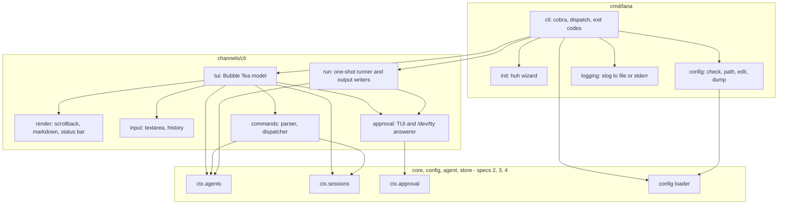
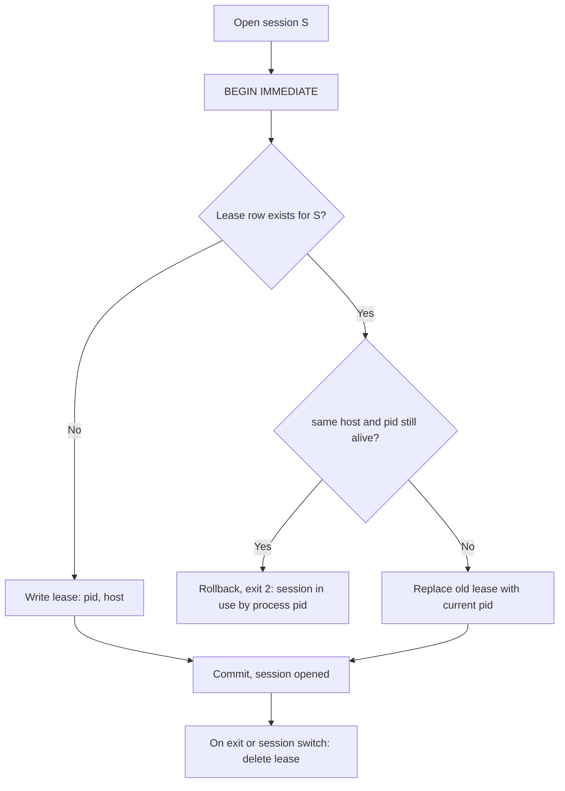
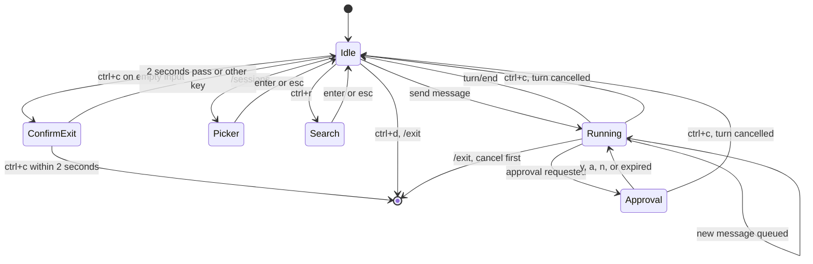
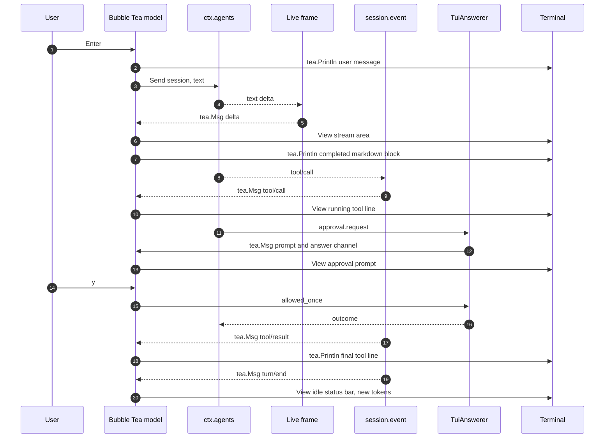

# Design: CLI and TUI chat

- **Issue**: [`#1`](https://github.com/ridhomujizat/lana-harness/issues/1)
- **Requirements**: [requirements.md](requirements.md)
- **Contract**: [api-contract.md](api-contract.md) — Required
- **Requirements revision**: 6
- **Contract revision**: 4
- **Requirements status**: Approved
- **Contract status**: Approved
- **Status**: Approved
- **Design revision**: 3 (revision 2: moved from Rust to Go, ADR 0013; revision 3: reconciliation of `DQ-004` through `DQ-006`)

## Architecture references

- **ADR index**: [docs/adr](../../adr/README.md)
- **Diagram index**: [docs/diagram](../../diagram/README.md)
- **ADR**: [0002](../../adr/0002-core-from-modules-services-and-hooks.md), [0003](../../adr/0003-multi-agent-with-channel-routing.md), [0004](../../adr/0004-permission-mode-per-agent.md), [0008](../../adr/0008-cli-channel-http-and-web-dashboard-interfaces.md), [0009](../../adr/0009-session-as-append-only-event-log.md), [0010](../../adr/0010-profile-and-config-patch.md), [0013](../../adr/0013-use-go-as-single-binary.md) — all Accepted
- **Feature-local diagrams**: [Components](#components-and-dependencies), [Chat state](#chat-state), [One turn in the TUI](#one-turn-in-the-tui), [Session lock](#session-lock)
- **Durable diagrams**: [0002. Agent Loop and Approval](../../diagram/0002-agent-loop-and-approval.md), [0004. Profile, Fork, Subagent, and Protocol](../../diagram/0004-profile-fork-subagent-and-protocols.md)

## Architecture decision scan

| Topic | Existing authority | Decision location | Action |
|---|---|---|---|
| Public interface | Contract `API-CLI-*` | contract | Reuse |
| Language and libraries | ADR 0013 (Go, Bubble Tea, cobra, slog) | ADR | Reuse |
| CLI interface shape | ADR 0008 (inline TUI) | ADR | Reuse |
| Session persistence | ADR 0009 | ADR | Reuse. Table `session_leases` (see Persistence) |
| Profile composition | ADR 0010 | ADR | `chat` = `minimal` + module `channel.cli`; `run` = `headless` |
| Approval | ADR 0004 | ADR | CLI installs the answerer on the `approval.request` hook |
| Dependency direction | ADR 0013 (package layout) | ADR | TUI in `channels/cli`, subcommands in `cmd/lana` |
| Required core | Specs #2, #3, #4 | Spec | Dependency. CLI tasks wait for those specs |

## Visual Architecture Check

| Trigger | Present? | View |
|---|---:|---|
| Module or package boundary | Yes | Components and dependencies |
| Interaction with an actor or external system | Yes | One turn in the TUI |
| Multi-component flow | Yes | One turn in the TUI |
| Lifecycle or state transition | Yes | Chat state |
| Entity relation | No | The `session_leases` table stands alone |
| Concurrency, retry, or failure flow | Yes | Session lock |
| Dependency direction or runtime topology | Yes | Components and dependencies |

## Repository fit

- Subcommands, flag parsing, exit codes, `init`, and `config` live in `cmd/lana` (ADR 0013).
- The TUI, the CLI approval answerer, and the `run` output writer live in the package `channels/cli`, installed
  as modules through the profile (ADR 0010). The module reads `session.event`, sends to `ctx.agents`, and
  answers `approval.request`, the same way other channels do (ADR 0008).
- All state changes (policy, model, fork, compaction) go through the core services, so they are recorded in the
  event log (ADR 0009). The CLI does not write to SQLite directly.

## Components and dependencies

## Proposed design

### Components

- **`cmd/lana` (cli)** — `cobra` commands for the global flags (`API-CLI-001`) and the subcommands. Each handler
  returns an `error`. `main` maps the error to an exit code with `errors.As` to `*ExitError` (field `Code`).
  Other errors = exit 1.
- **logging** — `log/slog`. Level comes from `-v` or `LANA_LOG` (the flag wins). `chat` writes to
  `$LANA_HOME/logs/lana.log` through a small writer in `internal/logfile` that rotates the file daily.
  Other subcommands write to stderr with `slog.TextHandler`.
- **init** — `charmbracelet/huh` wizard. Provider choices are limited to the kinds supported by the build
  (M3: `openai`, `openrouter`; `anthropic` after M4, `DQ-004`). Files are written atomically (`os.CreateTemp` in the
  destination folder, then `os.Rename`). Without `--force`, all paths are checked first; if one already exists, no
  file is written. `secrets.env` is created with `os.OpenFile(..., 0o600)`.
- **config** — uses the loader from spec #2: effective config, origin map, and positioned errors. `check` prints all
  errors. `dump` redacts values of the `core.Secret` type. `edit` splits `$VISUAL`/`$EDITOR` with
  `github.com/google/shlex`.
- **`channels/cli/tui`** — Bubble Tea model (`tea.Model`) without alt screen (see [Chat state](#chat-state)).
  Messages reach `Update` from: keys and paste, session events (`session.event` is forwarded as a `tea.Msg` by a
  subscriber goroutine), text delta frames, approval requests, and a 100 ms tick for the spinner and the
  `Ctrl+C` double-press window.
- **`channels/cli/render`** — final lines are printed to the scrollback with `tea.Println`, so they appear above the
  program area and remain in the scrollback after exit. `View()` only contains: the text area currently being
  streamed, the prompt area (approval, picker, search), the YOLO banner, the input, and the status bar. The height
  of `View()` follows its content.
- **Markdown streaming** — text is buffered per block. A block is considered complete when there is an empty line
  outside a code fence, or when a code fence is closed. A completed block is rendered by `charmbracelet/glamour`
  (style automatically dark/light, off when `NO_COLOR` is set) and then printed to the scrollback. A block that is
  not yet complete is shown raw in the stream area, so every delta is visible immediately (`AC-CHAT-009`).
- **ToolLine** — compact and verbose format (`API-CLI-003`). The mapping of main arguments per tool is a static
  `map`; other tools use the first 60 characters of the JSON input.
- **input** — `charmbracelet/bubbles/textarea`. The program runs with keyboard enhancement support (Bubble Tea v2) so
  that `Shift+Enter` is recognized in terminals that support it, and bracketed paste is enabled so that a paste does
  not send the message. Bubble Tea restores the terminal on exit, including after a panic caught in `Update`.
- **History** — `$LANA_HOME/history` in JSON Lines format. Appends use `O_APPEND`; if there are more than 1000
  entries, the file is rewritten atomically with the last 1000 entries. Mode `0600`.
- **commands** — `ParseSlash(string) (SlashCommand, error)` and `SlashCommand.AllowedWhileRunning() bool`. The
  dispatcher calls the core services; output uses the text from `API-CLI-006`.
- **TuiAnswerer** — an `approval.request` listener that takes over requests for sessions owned by this process
  (channel `cli`). A request is sent to the program as a `tea.Msg` together with an answer channel
  (`chan core.ApprovalOutcome`, buffer 1). The 10-minute timeout is owned by `ctx.approval` (ADR 0004); when the
  request's `ctx` completes, the prompt is closed and the expiry message is printed.
- **TtyAnswerer** — for `run --ask`: opens `/dev/tty` with `os.OpenFile(..., O_RDWR)` and uses a line-mode prompt.
  If it cannot be opened, the listener does not take over, so the result is `unavailable` (fail-closed).
- **Runner** — opens a new session, sends the prompt, and waits for `turn/end`. The output writers (`TextWriter`,
  `JSONWriter`, `StreamJSONWriter`, `encoding/json`) read the same events and frames. `signal.NotifyContext(ctx,
  os.Interrupt)` cancels the turn, then exit 130.
- **CliSessions** — CLI session rules on top of `ctx.sessions`: address = cwd after `filepath.EvalSymlinks`, find the
  last session per cwd, resolve ULID prefixes, check the original cwd, and the lock.

### Contract mapping

| Contract operation | Component | Input | Result | Requirements |
|---|---|---|---|---|
| `API-CLI-001` | cli, config, logging | argv, env | effective config, log level | `REQ-CONF-001`, `REQ-EXIT-001` |
| `API-CLI-002` | cli, `CliSessions`, tui | chat flags, cwd | session opened, TUI running | `REQ-CHAT-001`, `REQ-CHAT-002`, `REQ-CHAT-010`, `REQ-CHAT-011`, `REQ-SESS-001`, `REQ-SESS-002` |
| `API-CLI-003` | render, Markdown streaming, ToolLine | events and frames | terminal lines | `REQ-CHAT-003`, `REQ-CHAT-004`, `REQ-CHAT-005` |
| `API-CLI-004` | tui, input, History | key event | actions | `REQ-CHAT-006` through `REQ-CHAT-009` |
| `API-CLI-005` | `TuiAnswerer`, tui | `core.ApprovalRequest` | `core.ApprovalOutcome` | `REQ-APPR-001` |
| `API-CLI-006` | commands | input text | core service actions | `REQ-CMD-001`, `REQ-APPR-002` |
| `API-CLI-007` | Runner, writers, `TtyAnswerer` | argv, stdin | stdout, exit code | `REQ-RUN-001` through `REQ-RUN-003` |
| `API-CLI-008` | init | wizard answers | files in `LANA_HOME` | `REQ-INIT-001` |
| `API-CLI-009` through `011` | config | config files | reports, exit codes | `REQ-CONF-001` |

### Core interfaces required (from specs #2, #3, #4)

The final names are set in those specs; the CLI depends only on their shape.

| Interface | Spec | Used for |
|---|---|---|
| `config.Load(ctx, config.Options{Home, Profile, Patches}) (*config.Result, error)` with `Result.Origins`, `Result.Warnings`, and the `config.Errors` error | #2 | `config`, `--dump-config`, boot |
| `core.Context`, `core.Module`, hooks `approval.request` and `session.event` | #2 | CLI module wiring |
| `ctx.Agents.Send(ctx, session, content)`, `Cancel(ctx, session)`, `SetAgent(ctx, session, agent)`, `SetModel(ctx, session, provider:model)` (`API-CORE-010`) | #3 | Input, cancel, `/agent`, `/model` |
| `core.Compactor.CompactNow(ctx, session)` | #4 | `/compact` |
| Live frame stream per session (text deltas) | #3 | Streaming |
| `ctx.Sessions.Create`, `Open`, `List(ctx, SessionFilter{Channel, Address, Limit})`, `FindPrefix` then `core.ResolvePrefix`, `Fork`, `TryLease` (returns `release`) (`API-CORE-009`, `API-CORE-015`) | #4 | CLI sessions and lock |
| `ctx.Approval.SetPolicy(session, policy)` | #4 | `/permission`, `/yolo`, `--yolo`, `run` |

### Persistence

- No new events. The CLI uses the events from ADR 0009 (`approval/policy`, `model/selection`,
  `compaction/summary`, `session/created` with `parent_session_id`).
- `session/created` for channel `cli` stores `address = cwd`. The index
  `(channel, address, updated_at DESC)` is used for `--continue` and `/sessions`.
- Table `session_leases` in `store` (created by spec #4, its requirements come from this spec):

| Column | Type | Meaning |
|---|---|---|
| `session_id` | TEXT PK | Locked session |
| `pid` | INTEGER | PID of the holder |
| `host` | TEXT | Hostname of the holder |
| `acquired_at` | INTEGER | Time the lock was acquired |

### Session lock

- Process liveness check: `syscall.Kill(pid, 0)`. `nil` or `EPERM` = alive, `ESRCH` = dead. A different host is
  treated as alive.
- The lease is released on `/new`, `/sessions`, `/fork` (old session), and when the process exits (`defer` in
  `main` and the signal handler).

### Chat state

### One turn in the TUI

### Failure handling

| Failure | Internal error | Observable result |
|---|---|---|
| Wrong flag, agent not found, invalid config, no TTY, lock held | `&ExitError{Code: 2}` | Exit 2, message from the contract |
| Provider API key env is empty | `&ExitError{Code: 3}` | Exit 3 |
| Provider fails after retry and fallback | `turn/end { reason: error }` | Chat: `✗ provider error` line. Run: exit 3 |
| `max_steps` | `turn/end { reason: max_steps }` | Chat: info line. Run: exit 4 |
| SIGINT during `run` | `&ExitError{Code: 130}` | Exit 130 |
| Terminal fails to render | error from `tea.Program.Run` | Terminal restored, exit 1, details in the log |
| Panic | `recover` in `main` after the program stops | Terminal restored, lease released, panic message to stderr, exit 1 |
| History file corrupt (a line is not JSON) | Skipped per line, warning in the log | Other history entries still readable |

### Concurrency

- Only the Bubble Tea goroutine draws to the terminal. Other goroutines send `tea.Msg` through `program.Send`.
- Input while a turn is running is sent to `ctx.Agents.Send` (goes into the inbox, ADR 0003). Commands that are
  rejected while a turn is running are checked by `AllowedWhileRunning()` before dispatch.
- Session locks use `session_leases` inside a `BEGIN IMMEDIATE` transaction.
- `/permission` while a turn is running calls `ctx.Approval.SetPolicy`; the permission engine reads the latest policy
  on every tool evaluation (`AC-CMD-014`).
- `/model` is rejected in the CLI while a turn is running. This is a UI choice (`DQ-006`). Spec #3 allows `SetModel`
  during a turn; the change applies from the next step. No contract change is needed.

### Security

- Workspace = cwd after `filepath.EvalSymlinks`, passed to the session as the agent's workspace override.
- Approval fails closed: `TtyAnswerer` does not take over if `/dev/tty` cannot be opened.
- Redaction: `core.Secret` implements `fmt.Formatter`, `slog.LogValuer`, and `json.Marshaler`, all of which write `***`.
- Files containing personal data (`history`, `secrets.env`, logs) have mode `0600`; the `logs/` folder is `0700`.

### Observability

- `slog` level `info` when a session opens (id, agent, cwd), when a turn starts and ends (reason, duration, tokens),
  and for slash commands that are run.
- No message content or tool output at level `info`. Level `debug` may record sizes, not content.

### New dependencies

| Module | Used in | Reason |
|---|---|---|
| `github.com/spf13/cobra` | `cmd/lana` | Subcommands, flags, help |
| `github.com/charmbracelet/bubbletea` (v2) | `channels/cli` | Inline TUI, keyboard enhancement, bracketed paste |
| `github.com/charmbracelet/bubbles` | `channels/cli` | `textarea` |
| `github.com/charmbracelet/glamour` | `channels/cli` | Markdown rendering |
| `github.com/charmbracelet/lipgloss` | `channels/cli` | Status bar and prompt styling |
| `github.com/charmbracelet/huh` | `cmd/lana` | `init` wizard |
| `github.com/google/shlex` | `cmd/lana` | Splitting `$EDITOR` |
| `github.com/oklog/ulid/v2` | core (spec #4) | Session IDs |

Testing: `github.com/rogpeppe/go-internal/testscript`, `github.com/creack/pty`,
`github.com/charmbracelet/x/exp/teatest`, and the terminal emulator `github.com/hinshun/vt10x` for reading the
scrollback in PTY tests.

## Requirement traceability

| Requirement | Contract operation | Design component | Verification level |
|---|---|---|---|
| `REQ-CHAT-001` | `API-CLI-002` | cli, `CliSessions` | integration |
| `REQ-CHAT-002` | `API-CLI-002` | tui | integration |
| `REQ-CHAT-003` | `API-CLI-003` | render | unit (golden) |
| `REQ-CHAT-004` | `API-CLI-003` | Markdown streaming | unit |
| `REQ-CHAT-005` | `API-CLI-003`, `API-CLI-004` | ToolLine, tui | unit |
| `REQ-CHAT-006` | `API-CLI-004` | tui | integration |
| `REQ-CHAT-007` | `API-CLI-004` | input | unit |
| `REQ-CHAT-008` | `API-CLI-004` | tui | unit |
| `REQ-CHAT-009` | `API-CLI-004` | History | unit |
| `REQ-CHAT-010` | `API-CLI-002` | `CliSessions` | integration |
| `REQ-CHAT-011` | `API-CLI-002` | cli | integration |
| `REQ-SESS-001` | `API-CLI-002` | `CliSessions` | integration |
| `REQ-SESS-002` | `API-CLI-002` | `CliSessions`, `session_leases` | integration |
| `REQ-APPR-001` | `API-CLI-005` | `TuiAnswerer` | unit |
| `REQ-APPR-002` | `API-CLI-002`, `API-CLI-006` | commands, tui | integration |
| `REQ-CMD-001` | `API-CLI-006` | commands | unit and integration |
| `REQ-RUN-001` | `API-CLI-007` | Runner | integration |
| `REQ-RUN-002` | `API-CLI-007` | output writers | integration |
| `REQ-RUN-003` | `API-CLI-007` | `TtyAnswerer` | integration |
| `REQ-EXIT-001` | `API-CLI-001` | `ExitError` | unit and integration |
| `REQ-INIT-001` | `API-CLI-008` | init | integration |
| `REQ-CONF-001` | `API-CLI-009` through `011` | config | integration |

## Acceptance verification map

Test tools:

- **`MockLlm`** from spec #3: a fake provider that plays back a script of deltas and tool calls.
- **`testscript`** with `LANA_HOME` in `$WORK` for subcommand tests (files `testdata/script/*.txtar`).
- **`teatest`** and golden files in `testdata/` (flag `-update`) for the model and rendering.
- **PTY harness** (`creack/pty` + `vt10x`) for end-to-end tests of `lana chat` with real key presses.

| Acceptance criterion | Method | Planned evidence |
|---|---|---|
| `AC-CHAT-001` through `004` | integration | `TestChatAgentSelect` (PTY) |
| `AC-CHAT-005` | integration | `TestChatEmbedded` (PTY) |
| `AC-CHAT-006`, `007` | integration | PTY: read the emulator's scrollback after exit |
| `AC-CHAT-008` | unit | golden status bar |
| `AC-CHAT-009` | unit | Markdown streaming: deltas appear in the stream area before the block completes |
| `AC-CHAT-010`, `011`, `024` | unit | golden compact and verbose ToolLine, `Ctrl+O` toggle |
| `AC-CHAT-012` | integration | PTY + slow `MockLlm`: the second message is recorded as `user/message` in the next step |
| `AC-CHAT-013` through `015` | unit | key events into the input model |
| `AC-CHAT-016` through `019` | unit | `teatest` with a fake clock |
| `AC-CHAT-020`, `021` | unit | History in `t.TempDir()` |
| `AC-CHAT-022` | integration | PTY: `read_file` outside the cwd is rejected |
| `AC-CHAT-023` | integration | `testscript` without TTY: exit 2 |
| `AC-SESS-001` through `005` | integration | `TestChatSessions` |
| `AC-SESS-006`, `007` | integration | two processes; the first process is `SIGKILL`ed |
| `AC-APPR-001` through `005` | unit | `TuiAnswerer` with fake requests |
| `AC-APPR-006`, `007` | integration | session log contains `approval/policy`; a `deny` rule still rejects |
| `AC-CMD-001` through `014` | unit and integration | command parser; dispatcher with in-memory core |
| `AC-RUN-001` through `010` | integration | `testscript` `run_*.txtar` with `MockLlm`; per-line JSON validation |
| `AC-EXIT-001` through `003` | integration | `testscript` `run_exit_codes.txtar` |
| `AC-INIT-001` through `004` | integration | `testscript` `init_*.txtar`; check file mode `0600` |
| `AC-CONF-001` through `006` | integration | `testscript` `config_*.txtar`; `EDITOR` replaced by a fake script |

## Verification strategy

- **Unit**: slash command parser, Bubble Tea model, input, History, Markdown streaming, ToolLine, exit code mapping.
- **Integration**: subcommands through `testscript`, sessions and locks through a temporary SQLite database, chat
  through the PTY harness with `MockLlm`.
- **Runtime**: manual smoke test in Ghostty, iTerm2, and Terminal.app (check `Shift+Enter`, paste, scrollback,
  `NO_COLOR`), with a real OpenAI provider.

## Risks and tradeoffs

- `Shift+Enter` is not recognized in terminals without keyboard enhancement (Terminal.app). `Alt+Enter`, `Ctrl+J`,
  and `\` + `Enter` remain available.
- Bubble Tea v2 is still relatively new; its API may change in minor releases. The version is pinned in `go.mod`.
- Per-block Markdown rendering means long blocks are shown raw until they complete.
- `glamour` adds several MB to the binary.
- The PTY harness is slower and more fragile than unit tests. It is used only for end-to-end flows.
- A lock held by a different host cannot be checked for its PID and is treated as alive.

## Blocking Design Questions

| ID | Question | Controls | Owner | Status | Resolution |
|---|---|---|---|---|---|
| `DQ-001` | Core has no spec | Work order | Ridho | Resolved | Separate core specs (#2, #3, #4); CLI tasks wait for them |
| `DQ-002` | Two processes open the same session | `REQ-SESS-002` | Ridho | Resolved | Reject the second process; the lock of a dead process is released |
| `DQ-003` | ADRs must be Accepted | Design approval | Ridho | Resolved | ADRs 0002–0014 Accepted |
| `DQ-004` | Providers in the `init` wizard | `API-CLI-008`, `REQ-INIT-001`, `CQ-009` | Ridho | Resolved | Agent recommendation (reconciliation): the wizard only offers kinds supported by the build. M3: `openai`, `openrouter`. `anthropic` after the M4 adapter (spec #3). Requirements and contract revised. |
| `DQ-005` | Which service `/compact` calls | `API-CLI-006`, `CQ-010` | Ridho | Resolved | Agent recommendation (reconciliation): `core.Compactor.CompactNow` from spec #4 (`API-COMP-001`). Spec #3 has no `CompactNow`. |
| `DQ-006` | `/model` while a turn is running | `API-CLI-006`, `AC-CMD-013`, `CQ-011` | Ridho | Resolved | Agent recommendation (reconciliation): rejected in the CLI as a UI choice. No contract change for spec #3 (`SetModel` is allowed during a turn). |

None still Open.

## Approval

- [x] Requirements are Approved and their revision is recorded.
- [x] Contract is Approved.
- [x] Architecture decision scan and Visual Architecture Check are complete.
- [x] Required ADRs are Accepted.
- [x] Every requirement maps to one design component.
- [x] Every acceptance criterion has a verification method.
- [x] Blocking Design Questions is `None`.
- **Approved by**: Ridho
- **Approved on**: 2026-10-29 (revisions 1 and 2; revision 3 is a reconciliation by the agent on behalf of the owner, gate lifted 2026-10-29)
