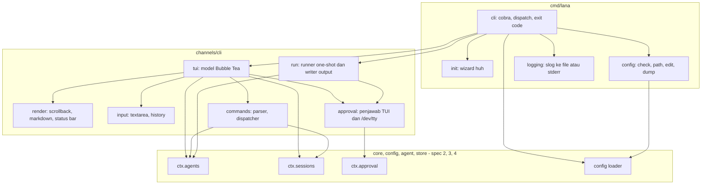
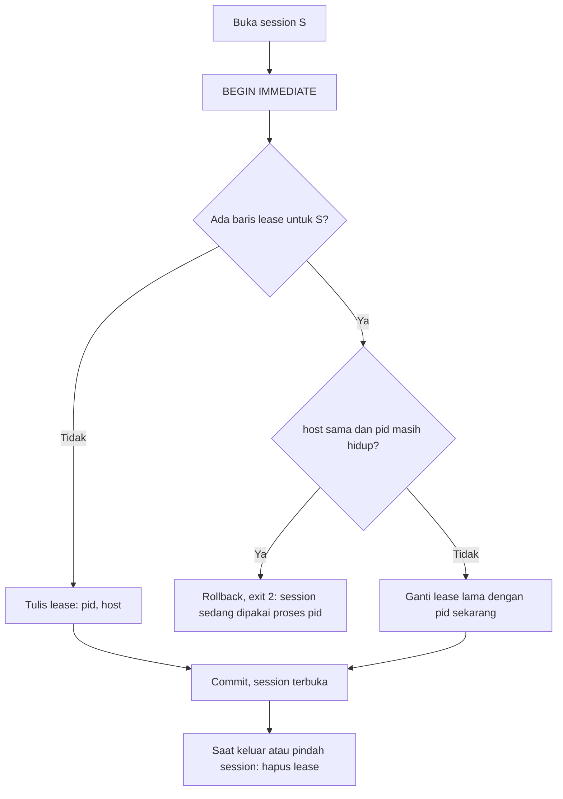
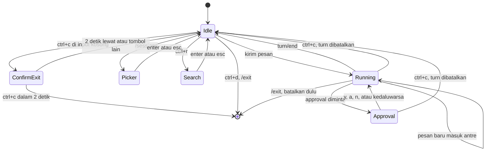
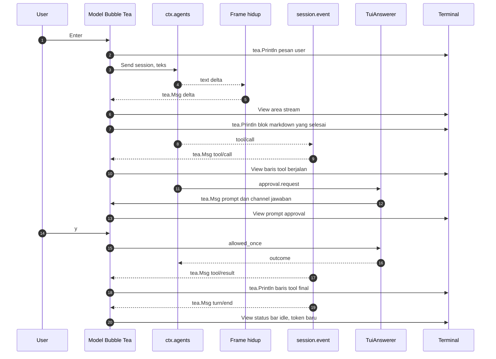

# Design: CLI dan TUI chat

- **Issue**: [`#1`](https://github.com/ridhomujizat/lana-harness/issues/1)
- **Requirements**: [requirements.md](requirements.md)
- **Contract**: [api-contract.md](api-contract.md) — Diperlukan
- **Revisi requirements**: 5
- **Revisi contract**: 3
- **Status requirements**: Approved
- **Status contract**: Draft
- **Status**: Draft
- **Revisi design**: 2 (pindah dari Rust ke Go, ADR 0013)

## Referensi arsitektur

- **Index ADR**: [docs/adr](../../adr/README.md)
- **Index diagram**: [docs/diagram](../../diagram/README.md)
- **ADR**: [0002](../../adr/0002-core-dari-modul-service-dan-hook.md), [0003](../../adr/0003-multi-agent-dengan-routing-channel.md), [0004](../../adr/0004-permission-mode-per-agent.md), [0008](../../adr/0008-interface-cli-channel-http-dan-web-dashboard.md), [0009](../../adr/0009-session-sebagai-event-log-append-only.md), [0010](../../adr/0010-profile-dan-config-patch.md), [0013](../../adr/0013-gunakan-go-sebagai-single-binary.md) — semua Accepted
- **Diagram lokal fitur**: [Komponen](#komponen-dan-dependency), [State chat](#state-chat), [Satu turn di TUI](#satu-turn-di-tui), [Lock session](#lock-session)
- **Diagram tahan lama**: [0002. Agent Loop Dan Approval](../../diagram/0002-agent-loop-dan-approval.md), [0004. Profile, Fork, Subagent, Dan Protokol](../../diagram/0004-profile-fork-subagent-dan-protokol.md)

## Scan keputusan arsitektur

| Topik | Otoritas yang ada | Lokasi keputusan | Aksi |
|---|---|---|---|
| Antarmuka publik | Contract `API-CLI-*` | contract | Pakai ulang |
| Bahasa dan library | ADR 0013 (Go, Bubble Tea, cobra, slog) | ADR | Pakai ulang |
| Bentuk interface CLI | ADR 0008 (TUI inline) | ADR | Pakai ulang |
| Persistence session | ADR 0009 | ADR | Pakai ulang. Tabel `session_leases` (lihat Persistence) |
| Komposisi profile | ADR 0010 | ADR | `chat` = `minimal` + modul `channel.cli`; `run` = `headless` |
| Approval | ADR 0004 | ADR | CLI memasang penjawab di hook `approval.request` |
| Arah dependency | ADR 0013 (layout package) | ADR | TUI di `channels/cli`, subcommand di `cmd/lana` |
| Core yang dibutuhkan | Spec #2, #3, #4 | Spec | Dependency. Tasks CLI menunggu spec tersebut |

## Visual Architecture Check

| Pemicu | Ada? | Tampilan |
|---|---:|---|
| Batas modul atau package | Ya | Komponen dan dependency |
| Interaksi dengan aktor atau sistem luar | Ya | Satu turn di TUI |
| Alur multi-komponen | Ya | Satu turn di TUI |
| Lifecycle atau transisi state | Ya | State chat |
| Relasi entity | Tidak | Tabel `session_leases` berdiri sendiri |
| Konkurensi, retry, atau alur gagal | Ya | Lock session |
| Arah dependency atau topologi runtime | Ya | Komponen dan dependency |

## Kesesuaian dengan repository

- Subcommand, parsing flag, exit code, `init`, dan `config` ada di `cmd/lana` (ADR 0013).
- TUI, penjawab approval CLI, dan penulis output `run` ada di package `channels/cli`, dipasang
  sebagai modul lewat profile (ADR 0010). Modul membaca `session.event`, mengirim ke `ctx.agents`,
  dan menjawab `approval.request`, sama seperti channel lain (ADR 0008).
- Semua perubahan state (policy, model, fork, compaction) lewat service core, sehingga tercatat di
  event log (ADR 0009). CLI tidak menulis ke SQLite secara langsung.

## Komponen dan dependency

## Design yang diusulkan

### Komponen

- **`cmd/lana` (cli)** — perintah `cobra` untuk flag global (`API-CLI-001`) dan subcommand. Setiap
  handler mengembalikan `error`. `main` memetakan error ke exit code dengan `errors.As` ke
  `*ExitError` (field `Code`). Error lain = exit 1.
- **logging** — `log/slog`. Level dari `-v` atau `LANA_LOG` (flag menang). `chat` menulis ke
  `$LANA_HOME/logs/lana.log` lewat writer kecil di `internal/logfile` yang berganti file per hari.
  Subcommand lain menulis ke stderr dengan `slog.TextHandler`.
- **init** — wizard `charmbracelet/huh`. File ditulis atomik (`os.CreateTemp` di folder tujuan lalu
  `os.Rename`). Tanpa `--force`, semua path diperiksa dulu; jika satu sudah ada, tidak ada file yang
  ditulis. `secrets.env` dibuat dengan `os.OpenFile(..., 0o600)`.
- **config** — memakai loader dari spec #2: config efektif, peta asal, dan error ber-posisi.
  `check` mencetak semua error. `dump` me-redact tipe `core.Secret`. `edit` memecah
  `$VISUAL`/`$EDITOR` dengan `github.com/google/shlex`.
- **`channels/cli/tui`** — model Bubble Tea (`tea.Model`) tanpa alt screen (lihat [State chat](#state-chat)).
  Pesan masuk ke `Update` dari: key dan paste, event session (`session.event` diteruskan sebagai
  `tea.Msg` oleh goroutine subscriber), frame text delta, permintaan approval, dan tick 100 ms untuk
  spinner serta jendela `Ctrl+C` dua kali.
- **`channels/cli/render`** — baris final dicetak ke scrollback dengan `tea.Println`, sehingga
  muncul di atas area program dan tetap di scrollback setelah keluar. `View()` hanya berisi: area
  teks yang sedang di-stream, area prompt (approval, picker, pencarian), banner YOLO, input, dan
  status bar. Tinggi `View()` mengikuti isinya.
- **Markdown streaming** — teks ditampung per blok. Blok dianggap selesai saat ada baris kosong di
  luar code fence, atau saat code fence ditutup. Blok selesai dirender `charmbracelet/glamour`
  (style otomatis gelap/terang, mati saat `NO_COLOR`) lalu dicetak ke scrollback. Blok yang belum
  selesai tampil mentah di area stream, sehingga setiap delta langsung terlihat (`AC-CHAT-009`).
- **ToolLine** — format ringkas dan verbose (`API-CLI-003`). Pemetaan argumen utama per tool adalah
  `map` statis; tool lain memakai 60 karakter pertama input JSON.
- **input** — `charmbracelet/bubbles/textarea`. Program dijalankan dengan dukungan keyboard
  enhancement (Bubble Tea v2) agar `Shift+Enter` terbaca di terminal yang mendukung, dan bracketed
  paste aktif agar paste tidak mengirim pesan. Bubble Tea mengembalikan terminal saat keluar,
  termasuk saat panic yang ditangkap di `Update`.
- **History** — `$LANA_HOME/history` berformat JSON Lines. Append dengan `O_APPEND`; jika lebih dari
  1000 entri, file ditulis ulang atomik dengan 1000 entri terakhir. Mode `0600`.
- **commands** — `ParseSlash(string) (SlashCommand, error)` dan
  `SlashCommand.AllowedWhileRunning() bool`. Dispatcher memanggil service core; output memakai teks
  dari `API-CLI-006`.
- **TuiAnswerer** — listener `approval.request` yang mengambil alih request untuk session milik
  proses ini (channel `cli`). Request dikirim ke program sebagai `tea.Msg` bersama channel jawaban
  (`chan core.ApprovalOutcome`, buffer 1). Timeout 10 menit dimiliki `ctx.approval` (ADR 0004);
  saat `ctx` request selesai, prompt ditutup dan pesan kedaluwarsa dicetak.
- **TtyAnswerer** — untuk `run --ask`: membuka `/dev/tty` dengan `os.OpenFile(..., O_RDWR)` dan
  memakai prompt mode baris. Jika gagal dibuka, listener tidak mengambil alih sehingga hasilnya
  `unavailable` (fail-closed).
- **Runner** — membuka session baru, mengirim prompt, menunggu `turn/end`. Writer output
  (`TextWriter`, `JSONWriter`, `StreamJSONWriter`, `encoding/json`) membaca event dan frame yang sama.
  `signal.NotifyContext(ctx, os.Interrupt)` membatalkan turn, lalu exit 130.
- **CliSessions** — aturan session CLI di atas `ctx.sessions`: address = cwd yang sudah
  `filepath.EvalSymlinks`, cari terakhir per cwd, resolusi prefix ULID, cek cwd asal, dan lock.

### Pemetaan contract

| Operasi contract | Komponen | Input | Hasil | Requirements |
|---|---|---|---|---|
| `API-CLI-001` | cli, config, logging | argv, env | config efektif, level log | `REQ-CONF-001`, `REQ-EXIT-001` |
| `API-CLI-002` | cli, `CliSessions`, tui | flag chat, cwd | session terbuka, TUI jalan | `REQ-CHAT-001`, `REQ-CHAT-002`, `REQ-CHAT-010`, `REQ-CHAT-011`, `REQ-SESS-001`, `REQ-SESS-002` |
| `API-CLI-003` | render, Markdown streaming, ToolLine | event dan frame | baris terminal | `REQ-CHAT-003`, `REQ-CHAT-004`, `REQ-CHAT-005` |
| `API-CLI-004` | tui, input, History | key event | aksi | `REQ-CHAT-006` sampai `REQ-CHAT-009` |
| `API-CLI-005` | `TuiAnswerer`, tui | `core.ApprovalRequest` | `core.ApprovalOutcome` | `REQ-APPR-001` |
| `API-CLI-006` | commands | teks input | aksi service core | `REQ-CMD-001`, `REQ-APPR-002` |
| `API-CLI-007` | Runner, writer, `TtyAnswerer` | argv, stdin | stdout, exit code | `REQ-RUN-001` sampai `REQ-RUN-003` |
| `API-CLI-008` | init | jawaban wizard | file di `LANA_HOME` | `REQ-INIT-001` |
| `API-CLI-009` sampai `011` | config | file config | laporan, exit code | `REQ-CONF-001` |

### Interface core yang dibutuhkan (dari spec #2, #3, #4)

Nama final ditetapkan di spec tersebut; CLI hanya bergantung pada bentuknya.

| Interface | Spec | Dipakai untuk |
|---|---|---|
| `config.Load(profile, patches) (Effective, Origins, []ConfigError)` | #2 | `config`, `--dump-config`, boot |
| `core.Context`, `core.Module`, hook `approval.request` dan `session.event` | #2 | Wiring modul CLI |
| `ctx.Agents.Send(ctx, session, content)`, `Cancel(session)`, `SetAgent`, `SetModel`, `CompactNow` | #3 | Input, batal, `/agent`, `/model`, `/compact` |
| Stream frame hidup per session (text delta) | #3 | Streaming |
| `ctx.Sessions.Create`, `Open`, `List(channel, address, limit)`, `FindPrefix`, `Fork`, `TryLease` | #4 | Session CLI dan lock |
| `ctx.Approval.SetPolicy(session, policy)` | #4 | `/permission`, `/yolo`, `--yolo`, `run` |

### Persistence

- Tidak ada event baru. CLI memakai event dari ADR 0009 (`approval/policy`, `model/selection`,
  `compaction/summary`, `session/created` dengan `parent_session_id`).
- `session/created` untuk channel `cli` menyimpan `address = cwd`. Index
  `(channel, address, updated_at DESC)` dipakai untuk `--continue` dan `/sessions`.
- Tabel `session_leases` di `store` (dibuat spec #4, kebutuhannya dari spec ini):

| Kolom | Tipe | Arti |
|---|---|---|
| `session_id` | TEXT PK | Session yang dikunci |
| `pid` | INTEGER | PID pemegang |
| `host` | TEXT | Hostname pemegang |
| `acquired_at` | INTEGER | Waktu kunci diambil |

### Lock session

- Cek proses hidup: `syscall.Kill(pid, 0)`. `nil` atau `EPERM` = hidup, `ESRCH` = mati. Host berbeda dianggap hidup.
- Lease dilepas saat `/new`, `/sessions`, `/fork` (session lama), dan saat proses keluar (`defer` di
  `main` dan handler sinyal).

### State chat

### Satu turn di TUI

### Failure handling

| Kegagalan | Error internal | Hasil yang terlihat |
|---|---|---|
| Flag salah, agent tidak ada, config salah, tanpa TTY, lock dipegang | `&ExitError{Code: 2}` | Exit 2, pesan dari contract |
| Env API key kosong | `&ExitError{Code: 3}` | Exit 3 |
| Provider gagal setelah retry dan fallback | `turn/end { reason: error }` | Chat: baris `✗ error provider`. Run: exit 3 |
| `max_steps` | `turn/end { reason: max_steps }` | Chat: baris info. Run: exit 4 |
| SIGINT di `run` | `&ExitError{Code: 130}` | Exit 130 |
| Terminal gagal di-render | error dari `tea.Program.Run` | Terminal dikembalikan, exit 1, detail di log |
| Panic | `recover` di `main` setelah program berhenti | Terminal dikembalikan, lease dilepas, pesan panic ke stderr, exit 1 |
| File history rusak (baris bukan JSON) | Diabaikan per baris, peringatan di log | Riwayat lain tetap terbaca |

### Konkurensi

- Hanya goroutine Bubble Tea yang menggambar terminal. Goroutine lain mengirim `tea.Msg` lewat `program.Send`.
- Input saat turn berjalan dikirim ke `ctx.Agents.Send` (masuk inbox, ADR 0003). Perintah yang
  ditolak saat turn berjalan dicek oleh `AllowedWhileRunning()` sebelum dispatch.
- Lock session lewat `session_leases` dalam transaksi `BEGIN IMMEDIATE`.
- `/permission` saat turn berjalan memanggil `ctx.Approval.SetPolicy`; permission engine membaca
  policy terbaru di setiap evaluasi tool (`AC-CMD-014`).

### Keamanan

- Workspace = cwd setelah `filepath.EvalSymlinks`, diteruskan ke session sebagai override workspace agent.
- Approval fail-closed: `TtyAnswerer` tidak mengambil alih jika `/dev/tty` gagal dibuka.
- Redaksi: `core.Secret` mengimplementasikan `fmt.Formatter`, `slog.LogValuer`, dan
  `json.Marshaler` yang semuanya menulis `***`.
- File berisi data pribadi (`history`, `secrets.env`, log) mode `0600`; folder `logs/` `0700`.

### Observability

- `slog` level `info` saat session dibuka (id, agent, cwd), turn mulai dan selesai (reason, durasi,
  token), dan perintah slash yang dijalankan.
- Tidak ada isi pesan atau output tool di level `info`. Level `debug` boleh mencatat ukuran, tidak isi.

### Dependency baru

| Module | Dipakai di | Alasan |
|---|---|---|
| `github.com/spf13/cobra` | `cmd/lana` | Subcommand, flag, help |
| `github.com/charmbracelet/bubbletea` (v2) | `channels/cli` | TUI inline, keyboard enhancement, bracketed paste |
| `github.com/charmbracelet/bubbles` | `channels/cli` | `textarea` |
| `github.com/charmbracelet/glamour` | `channels/cli` | Render Markdown |
| `github.com/charmbracelet/lipgloss` | `channels/cli` | Style status bar dan prompt |
| `github.com/charmbracelet/huh` | `cmd/lana` | Wizard `init` |
| `github.com/google/shlex` | `cmd/lana` | Memecah `$EDITOR` |
| `github.com/oklog/ulid/v2` | core (spec #4) | ID session |

Uji: `github.com/rogpeppe/go-internal/testscript`, `github.com/creack/pty`,
`github.com/charmbracelet/x/exp/teatest`, dan emulator terminal `github.com/hinshun/vt10x` untuk
membaca scrollback di test PTY.

## Traceability requirement

| Requirement | Operasi contract | Komponen design | Level verifikasi |
|---|---|---|---|
| `REQ-CHAT-001` | `API-CLI-002` | cli, `CliSessions` | integrasi |
| `REQ-CHAT-002` | `API-CLI-002` | tui | integrasi |
| `REQ-CHAT-003` | `API-CLI-003` | render | unit (golden) |
| `REQ-CHAT-004` | `API-CLI-003` | Markdown streaming | unit |
| `REQ-CHAT-005` | `API-CLI-003`, `API-CLI-004` | ToolLine, tui | unit |
| `REQ-CHAT-006` | `API-CLI-004` | tui | integrasi |
| `REQ-CHAT-007` | `API-CLI-004` | input | unit |
| `REQ-CHAT-008` | `API-CLI-004` | tui | unit |
| `REQ-CHAT-009` | `API-CLI-004` | History | unit |
| `REQ-CHAT-010` | `API-CLI-002` | `CliSessions` | integrasi |
| `REQ-CHAT-011` | `API-CLI-002` | cli | integrasi |
| `REQ-SESS-001` | `API-CLI-002` | `CliSessions` | integrasi |
| `REQ-SESS-002` | `API-CLI-002` | `CliSessions`, `session_leases` | integrasi |
| `REQ-APPR-001` | `API-CLI-005` | `TuiAnswerer` | unit |
| `REQ-APPR-002` | `API-CLI-002`, `API-CLI-006` | commands, tui | integrasi |
| `REQ-CMD-001` | `API-CLI-006` | commands | unit dan integrasi |
| `REQ-RUN-001` | `API-CLI-007` | Runner | integrasi |
| `REQ-RUN-002` | `API-CLI-007` | writer output | integrasi |
| `REQ-RUN-003` | `API-CLI-007` | `TtyAnswerer` | integrasi |
| `REQ-EXIT-001` | `API-CLI-001` | `ExitError` | unit dan integrasi |
| `REQ-INIT-001` | `API-CLI-008` | init | integrasi |
| `REQ-CONF-001` | `API-CLI-009` sampai `011` | config | integrasi |

## Peta verifikasi acceptance

Alat bantu test:

- **`MockLlm`** dari spec #3: provider palsu yang memutar skrip delta dan tool call.
- **`testscript`** dengan `LANA_HOME` di `$WORK` untuk test subcommand (file `testdata/script/*.txtar`).
- **`teatest`** dan golden file di `testdata/` (flag `-update`) untuk model dan render.
- **Harness PTY** (`creack/pty` + `vt10x`) untuk test end-to-end `lana chat` dengan tombol sungguhan.

| Acceptance criterion | Metode | Bukti yang direncanakan |
|---|---|---|
| `AC-CHAT-001` sampai `004` | integrasi | `TestChatAgentSelect` (PTY) |
| `AC-CHAT-005` | integrasi | `TestChatEmbedded` (PTY) |
| `AC-CHAT-006`, `007` | integrasi | PTY: baca scrollback emulator setelah keluar |
| `AC-CHAT-008` | unit | golden status bar |
| `AC-CHAT-009` | unit | Markdown streaming: delta tampil di area stream sebelum blok selesai |
| `AC-CHAT-010`, `011`, `024` | unit | golden ToolLine ringkas dan verbose, toggle `Ctrl+O` |
| `AC-CHAT-012` | integrasi | PTY + `MockLlm` lambat: pesan kedua tercatat `user/message` di step berikutnya |
| `AC-CHAT-013` sampai `015` | unit | key event ke model input |
| `AC-CHAT-016` sampai `019` | unit | `teatest` dengan jam palsu |
| `AC-CHAT-020`, `021` | unit | History di `t.TempDir()` |
| `AC-CHAT-022` | integrasi | PTY: `read_file` di luar cwd ditolak |
| `AC-CHAT-023` | integrasi | `testscript` tanpa TTY: exit 2 |
| `AC-SESS-001` sampai `005` | integrasi | `TestChatSessions` |
| `AC-SESS-006`, `007` | integrasi | dua proses; proses pertama di-`SIGKILL` |
| `AC-APPR-001` sampai `005` | unit | `TuiAnswerer` dengan request palsu |
| `AC-APPR-006`, `007` | integrasi | log session berisi `approval/policy`; rule deny tetap menolak |
| `AC-CMD-001` sampai `014` | unit dan integrasi | parser commands; dispatcher dengan core in-memory |
| `AC-RUN-001` sampai `010` | integrasi | `testscript` `run_*.txtar` dengan `MockLlm`; validasi JSON per baris |
| `AC-EXIT-001` sampai `003` | integrasi | `testscript` `run_exit_codes.txtar` |
| `AC-INIT-001` sampai `004` | integrasi | `testscript` `init_*.txtar`; cek mode file `0600` |
| `AC-CONF-001` sampai `006` | integrasi | `testscript` `config_*.txtar`; `EDITOR` diganti script palsu |

## Strategi verifikasi

- **Unit**: parser slash command, model Bubble Tea, input, History, Markdown streaming, ToolLine, pemetaan exit code.
- **Integrasi**: subcommand lewat `testscript`, session dan lock lewat SQLite sementara, chat lewat harness PTY dengan `MockLlm`.
- **Runtime**: smoke manual di Ghostty, iTerm2, dan Terminal.app (cek `Shift+Enter`, paste, scrollback, `NO_COLOR`), dengan provider OpenAI sungguhan.

## Risiko dan tradeoff

- `Shift+Enter` tidak terbaca di terminal tanpa keyboard enhancement (Terminal.app). `Alt+Enter`, `Ctrl+J`, dan `\` + `Enter` tetap tersedia.
- Bubble Tea v2 masih relatif baru; API bisa berubah di minor release. Versi dipin di `go.mod`.
- Markdown per blok berarti blok panjang tampil mentah sampai selesai.
- `glamour` menambah beberapa MB ke binary.
- Harness PTY lebih lambat dan lebih rapuh dibanding unit test. Dipakai hanya untuk alur end-to-end.
- Lock dengan host berbeda tidak bisa memeriksa PID dan dianggap hidup.

## Blocking Design Questions

| ID | Pertanyaan | Mengendalikan | Pemilik | Status | Resolusi |
|---|---|---|---|---|---|
| `DQ-001` | Core belum punya spec | Urutan kerja | Ridho | Resolved | Spec core terpisah (#2, #3, #4); tasks CLI menunggu |
| `DQ-002` | Dua proses membuka session yang sama | `REQ-SESS-002` | Ridho | Resolved | Tolak proses kedua, lock proses mati dilepas |
| `DQ-003` | ADR harus Accepted | Approval design | Ridho | Resolved | ADR 0002–0014 Accepted |

None yang masih Open.

## Approval

- [x] Requirements sudah Approved dan revisinya dicatat.
- [ ] Contract sudah Approved (revisi 3 menunggu approval).
- [x] Scan keputusan arsitektur dan Visual Architecture Check selesai.
- [x] ADR yang dibutuhkan sudah Accepted.
- [x] Setiap requirement terpetakan ke satu komponen design.
- [x] Setiap acceptance criterion punya metode verifikasi.
- [x] Blocking Design Questions bernilai `None`.
- **Di-approve oleh**: — (revisi 1 di-approve Ridho; revisi 2 menunggu)
- **Di-approve pada**: —
