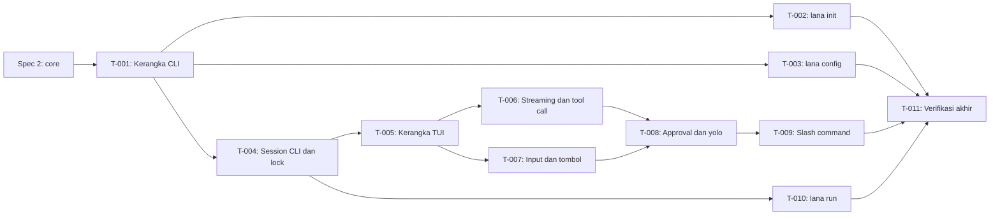

# Tasks: CLI dan TUI chat

- **Issue**: [`#1`](https://github.com/ridhomujizat/lana-harness/issues/1)
- **Requirements**: [requirements.md](requirements.md)
- **Contract**: [api-contract.md](api-contract.md) — Diperlukan
- **Design**: [design.md](design.md)
- **Revisi requirements**: 5
- **Revisi contract**: 2
- **Revisi design**: 1
- **Status**: Draft

> **Diblokir oleh spec #2 (core).** Semua task di bawah memakai interface core yang tercantum di
> [design: Interface core yang dibutuhkan](design.md#interface-core-yang-dibutuhkan-dari-spec-2).
> Task boleh mulai setelah task spec #2 yang menyediakan interface tersebut berstatus Completed.

## Aturan eksekusi

- Implementasi hanya requirement dan acceptance criteria yang ditugaskan ke task.
- Berhenti jika requirements, design, ADR, diagram, atau contract saling bertentangan.
- Jangan menjawab pertanyaan produk atau arsitektur hanya di kode.
- Satu acceptance criterion punya tepat satu pemilik bukti.
- Verifikasi yang diwajibkan tidak pernah opsional.
- Tandai task selesai hanya setelah bukti verifikasi dicatat.
- Semua perintah dijalankan di dalam `nix develop`.

## Cakupan

| Acceptance criterion | Operasi contract | Pemilik bukti | Verifikasi | Bukti |
|---|---|---|---|---|
| `AC-INIT-001` sampai `AC-INIT-004` | `API-CLI-008` | `T-002` | `tests/init.rs` | Pending |
| `AC-CONF-001` sampai `AC-CONF-006` | `API-CLI-001`, `009`, `010`, `011` | `T-003` | `tests/config.rs` | Pending |
| `AC-SESS-001` sampai `AC-SESS-007` | `API-CLI-002` | `T-004` | `tests/chat_sessions.rs` | Pending |
| `AC-CHAT-022` | `API-CLI-002` | `T-004` | `tests/chat_sessions.rs::workspace_is_cwd` | Pending |
| `AC-CHAT-001` sampai `AC-CHAT-008` | `API-CLI-002`, `API-CLI-003` | `T-005` | `tests/chat_agent_select.rs`, `tests/chat_embedded.rs`, snapshot status bar | Pending |
| `AC-CHAT-023` | `API-CLI-002` | `T-005` | `tests/chat_agent_select.rs::requires_tty` | Pending |
| `AC-CHAT-009`, `AC-CHAT-010`, `AC-CHAT-011`, `AC-CHAT-024` | `API-CLI-003`, `API-CLI-004` | `T-006` | unit `render::markdown`, snapshot `ToolLine` | Pending |
| `AC-CHAT-012` sampai `AC-CHAT-021` | `API-CLI-004` | `T-007` | unit `input`, `App`; PTY untuk `AC-CHAT-012` | Pending |
| `AC-APPR-001` sampai `AC-APPR-007` | `API-CLI-002`, `API-CLI-005` | `T-008` | unit `TuiAnswerer`, `tests/chat_policy.rs` | Pending |
| `AC-CMD-001` sampai `AC-CMD-014` | `API-CLI-006` | `T-009` | unit `commands`, `tests/chat_commands.rs` | Pending |
| `AC-RUN-001` sampai `AC-RUN-010` | `API-CLI-007` | `T-010` | `tests/run.rs` | Pending |
| `AC-EXIT-001` sampai `AC-EXIT-003` | `API-CLI-001`, `API-CLI-007` | `T-010` | `tests/run_exit_codes.rs` | Pending |

## Graf task

## Tasks

- [ ] `T-001` Buat kerangka CLI, error, dan logging
  - Issue/PR: `—`
  - Bergantung pada: spec #2 (workspace Cargo dan profile loader)
  - Requirements: `REQ-EXIT-001` (sebagian)
  - Acceptance criteria: — (pendukung; bukti `AC-EXIT-*` dimiliki `T-010`)
  - Operasi contract: `API-CLI-001`
  - Scope:
    - Definisi `clap` untuk flag global dan subcommand `chat`, `run`, `init`, `config`.
    - `LanaError` dan `exit_code()` sesuai design.
    - `lana::logging`: file untuk `chat`, stderr untuk lainnya, `-v` dan `LANA_LOG`.
    - Pesan error diawali `error: ` di stderr.
  - Verifikasi:
    - `cargo nextest run -p lana cli::` (unit pemetaan exit code dan parsing flag)
    - `lana --help` dan `lana --version` exit 0
  - Bukti penyelesaian:
    - Status: Pending
    - Perintah/test: —
    - Hasil: —
    - PR/commit: —
    - Deviasi: Tidak ada

- [ ] `T-002` Implementasi `lana init`
  - Issue/PR: `—`
  - Bergantung pada: `T-001`
  - Requirements: `REQ-INIT-001`
  - Acceptance criteria: `AC-INIT-001`, `AC-INIT-002`, `AC-INIT-003`, `AC-INIT-004`
  - Operasi contract: `API-CLI-008`
  - Scope:
    - Wizard `dialoguer` dengan tiga pertanyaan dan default per provider.
    - Penulisan atomik; cek semua path dulu tanpa `--force`.
    - `secrets.env` dengan mode `0600` sejak dibuat.
    - Isi `agents/default.md`.
  - Verifikasi:
    - `cargo nextest run -p lana --test init`
  - Bukti penyelesaian:
    - Status: Pending
    - Perintah/test: —
    - Hasil: —
    - PR/commit: —
    - Deviasi: Tidak ada

- [ ] `T-003` Implementasi `lana config` dan `--dump-config`
  - Issue/PR: `—`
  - Bergantung pada: `T-001`
  - Requirements: `REQ-CONF-001`
  - Acceptance criteria: `AC-CONF-001` sampai `AC-CONF-006`
  - Operasi contract: `API-CLI-001`, `API-CLI-009`, `API-CLI-010`, `API-CLI-011`
  - Scope:
    - `check` dengan span `toml_edit` dan semua error sekaligus.
    - `path`, `edit` (`$VISUAL` lalu `$EDITOR`, dipecah `shell-words`).
    - `--dump-config=toml|json` dengan komentar asal dan redaksi `Secret`.
  - Verifikasi:
    - `cargo nextest run -p lana --test config`
  - Bukti penyelesaian:
    - Status: Pending
    - Perintah/test: —
    - Hasil: —
    - PR/commit: —
    - Deviasi: Tidak ada

- [ ] `T-004` Implementasi session CLI dan lock
  - Issue/PR: `—`
  - Bergantung pada: `T-001`, spec #2 (`ctx.sessions`, `session_leases`)
  - Requirements: `REQ-SESS-001`, `REQ-SESS-002`, `REQ-CHAT-010`
  - Acceptance criteria: `AC-SESS-001` sampai `AC-SESS-007`, `AC-CHAT-022`
  - Operasi contract: `API-CLI-002`
  - Scope:
    - `CliSessions`: address = cwd canonical, `--continue`, `--resume` dengan prefix ULID, cek cwd asal.
    - Lease dengan `BEGIN IMMEDIATE`, cek PID lewat `rustix`, lepas saat `Drop` dan panic.
    - Workspace session = cwd.
  - Verifikasi:
    - `cargo nextest run -p lana-channels --test chat_sessions`
    - Test dua proses dengan `kill -9` untuk `AC-SESS-007`
  - Bukti penyelesaian:
    - Status: Pending
    - Perintah/test: —
    - Hasil: —
    - PR/commit: —
    - Deviasi: Tidak ada

- [ ] `T-005` Buat kerangka TUI inline
  - Issue/PR: `—`
  - Bergantung pada: `T-004`
  - Requirements: `REQ-CHAT-001`, `REQ-CHAT-002`, `REQ-CHAT-003`, `REQ-CHAT-011`
  - Acceptance criteria: `AC-CHAT-001` sampai `AC-CHAT-008`, `AC-CHAT-023`
  - Operasi contract: `API-CLI-002`, `API-CLI-003`
  - Scope:
    - `App` dengan event loop `tokio::select!` dan state machine dari design.
    - `Viewport::Inline` dengan tinggi dinamis, `insert_before`, header, status bar, banner YOLO.
    - Pemilihan agent dari `--agent` atau route `cli`; cek TTY.
    - Hook panic yang mengembalikan terminal.
    - Harness PTY (`portable-pty`) untuk test end-to-end.
  - Verifikasi:
    - `cargo nextest run -p lana-channels --test chat_agent_select --test chat_embedded`
    - Snapshot `insta` status bar
  - Bukti penyelesaian:
    - Status: Pending
    - Perintah/test: —
    - Hasil: —
    - PR/commit: —
    - Deviasi: Tidak ada

- [ ] `T-006` Implementasi streaming Markdown dan tampilan tool call
  - Issue/PR: `—`
  - Bergantung pada: `T-005`
  - Requirements: `REQ-CHAT-004`, `REQ-CHAT-005`
  - Acceptance criteria: `AC-CHAT-009`, `AC-CHAT-010`, `AC-CHAT-011`, `AC-CHAT-024`
  - Operasi contract: `API-CLI-003`, `API-CLI-004` (`Ctrl+O`)
  - Scope:
    - `Markdown`: buffer per blok, render `pulldown-cmark`, blok belum selesai di area stream.
    - `ToolLine` ringkas dan verbose, tabel argumen utama.
    - Toggle verbose dengan `Ctrl+O` dan cetak ulang tool call terakhir.
  - Verifikasi:
    - `cargo nextest run -p lana-channels render::`
  - Bukti penyelesaian:
    - Status: Pending
    - Perintah/test: —
    - Hasil: —
    - PR/commit: —
    - Deviasi: Tidak ada

- [ ] `T-007` Implementasi input, tombol, dan riwayat
  - Issue/PR: `—`
  - Bergantung pada: `T-005`
  - Requirements: `REQ-CHAT-006`, `REQ-CHAT-007`, `REQ-CHAT-008`, `REQ-CHAT-009`
  - Acceptance criteria: `AC-CHAT-012` sampai `AC-CHAT-021`
  - Operasi contract: `API-CLI-004`
  - Scope:
    - `Editor` dengan `tui-textarea`, keyboard enhancement flags, bracketed paste.
    - Baris baru: `Shift+Enter`, `Alt+Enter`, `Ctrl+J`, `\` + `Enter`.
    - `Ctrl+C` batal/kosongkan/keluar dua kali, `Ctrl+D` keluar.
    - Pesan saat turn berjalan dikirim ke inbox dengan label `(antre)`.
    - `History` JSON Lines, 1000 entri, `0600`, `Ctrl+R`.
  - Verifikasi:
    - `cargo nextest run -p lana-channels input:: app::keys`
    - PTY: `tests/chat_inbox.rs` untuk `AC-CHAT-012`
  - Bukti penyelesaian:
    - Status: Pending
    - Perintah/test: —
    - Hasil: —
    - PR/commit: —
    - Deviasi: Tidak ada

- [ ] `T-008` Implementasi approval TUI dan mode yolo
  - Issue/PR: `—`
  - Bergantung pada: `T-006`, `T-007`, spec #2 (`ctx.approval`, hook `approval.request`)
  - Requirements: `REQ-APPR-001`, `REQ-APPR-002`
  - Acceptance criteria: `AC-APPR-001` sampai `AC-APPR-007`
  - Operasi contract: `API-CLI-002` (`--yolo`), `API-CLI-005`
  - Scope:
    - `TuiAnswerer` sebagai listener `approval.request` untuk session CLI milik proses ini.
    - Prompt `[y]/[a]/[n]`, alasan opsional setelah `n`, `Ctrl+C` = `cancelled`, pesan kedaluwarsa.
    - Label subagent dan input JSON saat verbose.
    - `--yolo` memanggil `set_policy(trust)` dan menampilkan banner.
  - Verifikasi:
    - `cargo nextest run -p lana-channels approval::`
    - `cargo nextest run -p lana-channels --test chat_policy`
  - Bukti penyelesaian:
    - Status: Pending
    - Perintah/test: —
    - Hasil: —
    - PR/commit: —
    - Deviasi: Tidak ada

- [ ] `T-009` Implementasi slash command
  - Issue/PR: `—`
  - Bergantung pada: `T-008`
  - Requirements: `REQ-CMD-001`
  - Acceptance criteria: `AC-CMD-001` sampai `AC-CMD-014`
  - Operasi contract: `API-CLI-006`
  - Scope:
    - Parser `SlashCommand`, `//` sebagai escape, `allowed_while_running()`.
    - Dispatcher ke service core untuk semua perintah di contract.
    - Picker `/sessions` di viewport.
  - Verifikasi:
    - `cargo nextest run -p lana-channels commands::`
    - `cargo nextest run -p lana-channels --test chat_commands`
  - Bukti penyelesaian:
    - Status: Pending
    - Perintah/test: —
    - Hasil: —
    - PR/commit: —
    - Deviasi: Tidak ada

- [ ] `T-010` Implementasi `lana run`
  - Issue/PR: `—`
  - Bergantung pada: `T-004`, spec #2 (profile `headless`, `MockLlm`)
  - Requirements: `REQ-RUN-001`, `REQ-RUN-002`, `REQ-RUN-003`, `REQ-EXIT-001`
  - Acceptance criteria: `AC-RUN-001` sampai `AC-RUN-010`, `AC-EXIT-001` sampai `AC-EXIT-003`
  - Operasi contract: `API-CLI-007`
  - Scope:
    - `Runner`: prompt dari argumen dan stdin, pemilihan agent, policy `never` atau `ask`.
    - `TextWriter`, `JsonWriter`, `StreamJsonWriter`.
    - `TtyAnswerer` lewat `/dev/tty`, fail-closed.
    - SIGINT ke exit 130.
  - Verifikasi:
    - `cargo nextest run -p lana --test run --test run_exit_codes`
  - Bukti penyelesaian:
    - Status: Pending
    - Perintah/test: —
    - Hasil: —
    - PR/commit: —
    - Deviasi: Tidak ada

- [ ] `T-011` Jalankan verifikasi akhir dan smoke manual
  - Issue/PR: `—`
  - Bergantung pada: `T-002`, `T-003`, `T-009`, `T-010`
  - Requirements: semua (verifikasi)
  - Acceptance criteria: — (memeriksa bukti semua task)
  - Operasi contract: semua
  - Scope:
    - Jalankan seluruh test, clippy, fmt, dan build release.
    - Smoke manual di Ghostty, iTerm2, dan Terminal.app: `Shift+Enter`, paste, scrollback setelah keluar, `NO_COLOR`, approval, `/fork`.
    - Smoke dengan provider OpenAI sungguhan: `lana init --yes`, `lana chat`, `lana run --output json`.
    - Ukur ukuran binary release dan catat.
  - Verifikasi:
    - `cargo fmt --check && cargo clippy --workspace -- -D warnings && cargo nextest run --workspace && cargo build --release`
  - Bukti penyelesaian:
    - Status: Pending
    - Perintah/test: —
    - Hasil: —
    - PR/commit: —
    - Deviasi: Tidak ada

## Verifikasi akhir

- [ ] Setiap acceptance criterion punya bukti lulus.
- [ ] Tidak ada perilaku terlihat tanpa ID requirement.
- [ ] Tidak ada perilaku di luar scope.
- [ ] ADR dan diagram sesuai implementasi.
- [ ] `cargo fmt --check`, `cargo clippy -- -D warnings`, `cargo nextest run`, dan build release lulus.
- [ ] Deviasi diselesaikan di requirements atau design, tidak hanya dicatat di sini.

## Approval

- [x] Requirements dan design sudah Approved dan revisinya dicatat.
- [x] Contract sudah Approved.
- [x] Setiap acceptance criterion punya tepat satu pemilik bukti.
- [x] Setiap task punya scope terbatas, dependency, dan verifikasi.
- [x] Tidak ada task yang memperkenalkan perilaku baru.
- **Di-approve oleh**: —
- **Di-approve pada**: —
