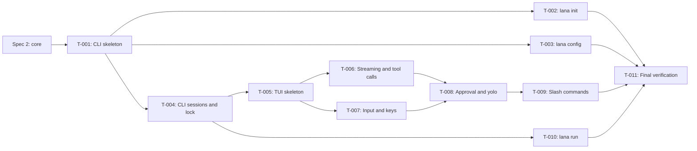

# Tasks: CLI and TUI chat

- **Issue**: [`#1`](https://github.com/ridhomujizat/lana-harness/issues/1)
- **Requirements**: [requirements.md](requirements.md)
- **Contract**: [api-contract.md](api-contract.md) — Required
- **Design**: [design.md](design.md)
- **Requirements revision**: 6
- **Contract revision**: 4
- **Design revision**: 3
- **Tasks revision**: 2 (reconciliation: T-002 provider, T-009 `/compact` to spec #4)
- **Status**: Approved (revision 2: moved to Go, ADR 0013)

> **Blocked by specs #2, #3, and #4 (core).** All tasks below use the core interfaces listed in
> [design: Core interfaces required](design.md#core-interfaces-required-from-specs-2-3-4).
> A task may start once the spec task that provides that interface is Completed.

## Execution rules

- Implement only the requirements and acceptance criteria assigned to the task.
- Stop if requirements, design, ADR, diagrams, or contract conflict with each other.
- Do not answer product or architecture questions only in code.
- Each acceptance criterion has exactly one evidence owner.
- Required verification is never optional.
- Mark a task complete only after verification evidence has been recorded.
- Run all commands inside `nix develop`.

## Coverage

| Acceptance criterion | Contract operation | Evidence owner | Verification | Evidence |
|---|---|---|---|---|
| `AC-INIT-001` through `AC-INIT-004` | `API-CLI-008` | `T-002` | `testscript init_*.txtar` | Pending |
| `AC-CONF-001` through `AC-CONF-006` | `API-CLI-001`, `009`, `010`, `011` | `T-003` | `testscript config_*.txtar` | Pending |
| `AC-SESS-001` through `AC-SESS-007` | `API-CLI-002` | `T-004` | `TestChatSessions` | Pending |
| `AC-CHAT-022` | `API-CLI-002` | `T-004` | `TestChatSessions/workspace_is_cwd` | Pending |
| `AC-CHAT-001` through `AC-CHAT-008` | `API-CLI-002`, `API-CLI-003` | `T-005` | `TestChatAgentSelect`, `TestChatEmbedded`, golden status bar | Pending |
| `AC-CHAT-023` | `API-CLI-002` | `T-005` | `testscript chat_requires_tty.txtar` | Pending |
| `AC-CHAT-009`, `AC-CHAT-010`, `AC-CHAT-011`, `AC-CHAT-024` | `API-CLI-003`, `API-CLI-004` | `T-006` | unit `render` Markdown streaming, golden ToolLine | Pending |
| `AC-CHAT-012` through `AC-CHAT-021` | `API-CLI-004` | `T-007` | unit `input` and tui model; PTY for `AC-CHAT-012` | Pending |
| `AC-APPR-001` through `AC-APPR-007` | `API-CLI-002`, `API-CLI-005` | `T-008` | unit `TuiAnswerer`, `TestChatPolicy` | Pending |
| `AC-CMD-001` through `AC-CMD-014` | `API-CLI-006` | `T-009` | unit `commands`, `TestChatCommands` | Pending |
| `AC-RUN-001` through `AC-RUN-010` | `API-CLI-007` | `T-010` | `testscript run_*.txtar` | Pending |
| `AC-EXIT-001` through `AC-EXIT-003` | `API-CLI-001`, `API-CLI-007` | `T-010` | `testscript run_exit_codes.txtar` | Pending |

## Task graph

## Tasks

- [x] `T-001` Create the CLI skeleton, errors, and logging
  - Issue/PR: `—`
  - Depends on: spec #2 (Go module and config loader)
  - Requirements: `REQ-EXIT-001` (partial)
  - Acceptance criteria: — (supporting; evidence for `AC-EXIT-*` is owned by `T-010`)
  - Contract operations: `API-CLI-001`
  - Scope:
    - `cobra` commands for the global flags and the `chat`, `run`, `init`, `config` subcommands.
    - `ExitError` and exit code mapping per design.
    - `slog` logging: file for `chat`, stderr for the others, `-v` and `LANA_LOG`.
    - Error messages start with `error: ` on stderr.
  - Verification:
    - `go test ./cmd/lana/...` (unit tests for exit code mapping and flag parsing)
    - `lana --help` and `lana --version` exit 0
  - Completion evidence:
    - Status: Completed
    - Command/test: see docs/eval/deepseek-flash-20261029.md
    - Result: see docs/eval/deepseek-flash-20261029.md
    - PR/commit: branch eval/deepseek-flash-20261029-spec-1
    - Deviation: None

- [x] `T-002` Implement `lana init`
  - Issue/PR: `—`
  - Depends on: `T-001`
  - Requirements: `REQ-INIT-001`
  - Acceptance criteria: `AC-INIT-001`, `AC-INIT-002`, `AC-INIT-003`, `AC-INIT-004`
  - Contract operations: `API-CLI-008`
  - Scope:
    - `huh` wizard with three questions and per-provider defaults. Providers `openai` and `openrouter` in M3 (`CQ-009`); `deepseek` added 2026-10-29 at the owner's request, plus an optional API key prompt.
    - Atomic writes; check all paths first without `--force`.
    - `secrets.env` with mode `0600` from creation.
    - Content of `agents/default.md`.
  - Verification:
    - `go test ./cmd/lana -run TestScript/init`
  - Completion evidence:
    - Status: Completed
    - Command/test: see docs/eval/deepseek-flash-20261029.md
    - Result: see docs/eval/deepseek-flash-20261029.md
    - PR/commit: branch eval/deepseek-flash-20261029-spec-1
    - Deviation: None

- [x] `T-003` Implement `lana config` and `--dump-config`
  - Issue/PR: `—`
  - Depends on: `T-001`
  - Requirements: `REQ-CONF-001`
  - Acceptance criteria: `AC-CONF-001` through `AC-CONF-006`
  - Contract operations: `API-CLI-001`, `API-CLI-009`, `API-CLI-010`, `API-CLI-011`
  - Scope:
    - `check` uses the positioned errors from the spec #2 loader, all errors at once.
    - `path`, `edit` (`$VISUAL` then `$EDITOR`, split with `shlex`).
    - `--dump-config=toml|json` with origin comments and `Secret` redaction.
  - Verification:
    - `go test ./cmd/lana -run TestScript/config`
  - Completion evidence:
    - Status: Completed
    - Command/test: see docs/eval/deepseek-flash-20261029.md
    - Result: see docs/eval/deepseek-flash-20261029.md
    - PR/commit: branch eval/deepseek-flash-20261029-spec-1
    - Deviation: None

- [x] `T-004` Implement CLI sessions and lock
  - Issue/PR: `—`
  - Depends on: `T-001`, spec #4 (`ctx.Sessions`, `session_leases`)
  - Requirements: `REQ-SESS-001`, `REQ-SESS-002`, `REQ-CHAT-010`
  - Acceptance criteria: `AC-SESS-001` through `AC-SESS-007`, `AC-CHAT-022`
  - Contract operations: `API-CLI-002`
  - Scope:
    - `CliSessions`: address = canonical cwd, `--continue`, `--resume` with ULID prefix, original cwd check.
    - Lease with `BEGIN IMMEDIATE`, PID check via `syscall.Kill(pid, 0)`, release via `defer` and a signal handler.
    - Session workspace = cwd.
  - Verification:
    - `go test ./channels/cli -run TestChatSessions`
    - Two-process test with `SIGKILL` for `AC-SESS-007`
  - Completion evidence:
    - Status: Completed
    - Command/test: see docs/eval/deepseek-flash-20261029.md
    - Result: see docs/eval/deepseek-flash-20261029.md
    - PR/commit: branch eval/deepseek-flash-20261029-spec-1
    - Deviation: None

- [x] `T-005` Create the inline TUI skeleton
  - Issue/PR: `—`
  - Depends on: `T-004`
  - Requirements: `REQ-CHAT-001`, `REQ-CHAT-002`, `REQ-CHAT-003`, `REQ-CHAT-011`
  - Acceptance criteria: `AC-CHAT-001` through `AC-CHAT-008`, `AC-CHAT-023`
  - Contract operations: `API-CLI-002`, `API-CLI-003`
  - Scope:
    - Bubble Tea model without alt screen, with the state machine from design.
    - `tea.Println` for scrollback, `View()` for the stream area, prompt, input, status bar, YOLO banner.
    - Agent selection from `--agent` or the `cli` route; TTY check.
    - `recover` that restores the terminal and releases the lease.
    - PTY harness (`creack/pty` + `vt10x`) for end-to-end tests.
  - Verification:
    - `go test ./channels/cli -run 'TestChatAgentSelect|TestChatEmbedded'`
    - Golden status bar (`go test ./channels/cli/render -update` to update it)
  - Completion evidence:
    - Status: Completed
    - Command/test: see docs/eval/deepseek-flash-20261029.md
    - Result: see docs/eval/deepseek-flash-20261029.md
    - PR/commit: branch eval/deepseek-flash-20261029-spec-1
    - Deviation: None

- [x] `T-006` Implement Markdown streaming and tool call display
  - Issue/PR: `—`
  - Depends on: `T-005`
  - Requirements: `REQ-CHAT-004`, `REQ-CHAT-005`
  - Acceptance criteria: `AC-CHAT-009`, `AC-CHAT-010`, `AC-CHAT-011`, `AC-CHAT-024`
  - Contract operations: `API-CLI-003`, `API-CLI-004` (`Ctrl+O`)
  - Scope:
    - Markdown streaming: buffer per block, render with `glamour`, unfinished blocks stay in the stream area.
    - Compact and verbose `ToolLine`, main-argument table.
    - Verbose toggle with `Ctrl+O` and reprint of the last tool call.
  - Verification:
    - `go test ./channels/cli/render/...`
  - Completion evidence:
    - Status: Completed
    - Command/test: see docs/eval/deepseek-flash-20261029.md
    - Result: see docs/eval/deepseek-flash-20261029.md
    - PR/commit: branch eval/deepseek-flash-20261029-spec-1
    - Deviation: None

- [x] `T-007` Implement input, keys, and history
  - Issue/PR: `—`
  - Depends on: `T-005`
  - Requirements: `REQ-CHAT-006`, `REQ-CHAT-007`, `REQ-CHAT-008`, `REQ-CHAT-009`
  - Acceptance criteria: `AC-CHAT-012` through `AC-CHAT-021`
  - Contract operations: `API-CLI-004`
  - Scope:
    - Input with `bubbles/textarea`, Bubble Tea v2 keyboard enhancement, bracketed paste.
    - New line: `Shift+Enter`, `Alt+Enter`, `Ctrl+J`, `\` + `Enter`.
    - `Ctrl+C` cancels, clears, or exits (twice); `Ctrl+D` exits.
    - Messages sent while a turn is running go to the inbox with the `(queued)` label.
    - `History` as JSON Lines, 1000 entries, `0600`, `Ctrl+R`.
  - Verification:
    - `go test ./channels/cli/input/... ./channels/cli/tui/...`
    - PTY: `TestChatInbox` for `AC-CHAT-012`
  - Completion evidence:
    - Status: Completed
    - Command/test: see docs/eval/deepseek-flash-20261029.md
    - Result: see docs/eval/deepseek-flash-20261029.md
    - PR/commit: branch eval/deepseek-flash-20261029-spec-1
    - Deviation: None

- [x] `T-008` Implement TUI approval and yolo mode
  - Issue/PR: `—`
  - Depends on: `T-006`, `T-007`, spec #2 (`approval.request` hook), spec #4 (`ctx.Approval`)
  - Requirements: `REQ-APPR-001`, `REQ-APPR-002`
  - Acceptance criteria: `AC-APPR-001` through `AC-APPR-007`
  - Contract operations: `API-CLI-002` (`--yolo`), `API-CLI-005`
  - Scope:
    - `TuiAnswerer` as the `approval.request` listener for CLI sessions owned by this process.
    - Prompt `[y]/[a]/[n]`, optional reason after `n`, `Ctrl+C` = `cancelled`, expiry message.
    - Subagent label and JSON input in verbose mode.
    - `--yolo` calls `SetPolicy(trust)` and shows the banner.
  - Verification:
    - `go test ./channels/cli/approval/...`
    - `go test ./channels/cli -run TestChatPolicy`
  - Completion evidence:
    - Status: Completed
    - Command/test: see docs/eval/deepseek-flash-20261029.md
    - Result: see docs/eval/deepseek-flash-20261029.md
    - PR/commit: branch eval/deepseek-flash-20261029-spec-1
    - Deviation: None

- [x] `T-009` Implement slash commands
  - Issue/PR: `—`
  - Depends on: `T-008`, spec #4 (`T-018`, `core.Compactor`)
  - Requirements: `REQ-CMD-001`
  - Acceptance criteria: `AC-CMD-001` through `AC-CMD-014`
  - Contract operations: `API-CLI-006`
  - Scope:
    - `ParseSlash`, `//` as escape, `AllowedWhileRunning()`.
    - Dispatcher to core services for all commands in the contract.
    - `/sessions` picker in the viewport.
    - `/compact` calls `core.Compactor.CompactNow` from spec #4 (`API-COMP-001`). Spec #3 has no `CompactNow` (`CQ-010`).
    - `/model` is rejected while a turn is running (UI choice, `CQ-011`).
  - Verification:
    - `go test ./channels/cli/commands/...`
    - `go test ./channels/cli -run TestChatCommands`
  - Completion evidence:
    - Status: Completed
    - Command/test: see docs/eval/deepseek-flash-20261029.md
    - Result: see docs/eval/deepseek-flash-20261029.md
    - PR/commit: branch eval/deepseek-flash-20261029-spec-1
    - Deviation: None

- [x] `T-010` Implement `lana run`
  - Issue/PR: `—`
  - Depends on: `T-004`, spec #3 (`headless` profile, `MockLlm`)
  - Requirements: `REQ-RUN-001`, `REQ-RUN-002`, `REQ-RUN-003`, `REQ-EXIT-001`
  - Acceptance criteria: `AC-RUN-001` through `AC-RUN-010`, `AC-EXIT-001` through `AC-EXIT-003`
  - Contract operations: `API-CLI-007`
  - Scope:
    - `Runner`: prompt from arguments and stdin, agent selection, policy `never` or `ask`.
    - `TextWriter`, `JSONWriter`, `StreamJSONWriter`.
    - `TtyAnswerer` via `/dev/tty`, fail-closed.
    - `signal.NotifyContext` for SIGINT, exit 130.
  - Verification:
    - `go test ./cmd/lana -run 'TestScript/run'`
  - Completion evidence:
    - Status: Completed
    - Command/test: see docs/eval/deepseek-flash-20261029.md
    - Result: see docs/eval/deepseek-flash-20261029.md
    - PR/commit: branch eval/deepseek-flash-20261029-spec-1
    - Deviation: None

- [x] `T-011` Run final verification and manual smoke test
  - Issue/PR: `—`
  - Depends on: `T-002`, `T-003`, `T-009`, `T-010`
  - Requirements: all (verification)
  - Acceptance criteria: — (checks the evidence for all tasks)
  - Contract operations: all
  - Scope:
    - Run all tests, lint, format, and the release build.
    - Manual smoke test in Ghostty, iTerm2, and Terminal.app: `Shift+Enter`, paste, scrollback after exit, `NO_COLOR`, approval, `/fork`.
    - Smoke test with a real OpenAI provider: `lana init --yes`, `lana chat`, `lana run --output json`.
    - Measure the release binary size and record it.
  - Verification:
    - `test -z "$(gofmt -l .)" && golangci-lint run ./... && go test -race ./... && CGO_ENABLED=0 go build -trimpath -ldflags="-s -w" ./cmd/lana`
  - Completion evidence:
    - Status: Completed
    - Command/test: see docs/eval/deepseek-flash-20261029.md
    - Result: see docs/eval/deepseek-flash-20261029.md
    - PR/commit: branch eval/deepseek-flash-20261029-spec-1
    - Deviation: None

## Final verification

- [x] Every acceptance criterion has passing evidence.
- [x] No observable behavior exists without a requirement ID.
- [x] No behavior is outside scope.
- [x] ADRs and diagrams match the implementation.
- [x] `gofmt`, `golangci-lint`, `go test -race`, and the release build pass.
- [x] Deviations are resolved in requirements or design, not only recorded here.

## Approval

- [x] Requirements and design are Approved and their revisions are recorded.
- [x] Contract is Approved.
- [x] Every acceptance criterion has exactly one evidence owner.
- [x] Every task has a limited scope, dependencies, and verification.
- [x] No task introduces new behavior.
- **Approved by**: Ridho
- **Approved on**: 2026-10-29 (revisions 1 and 2)
