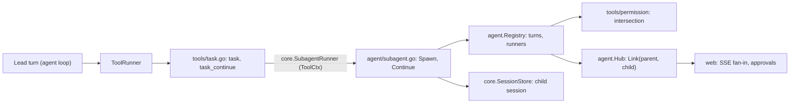
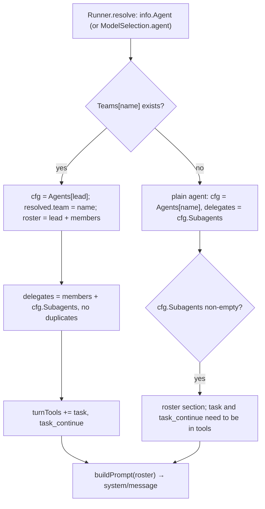
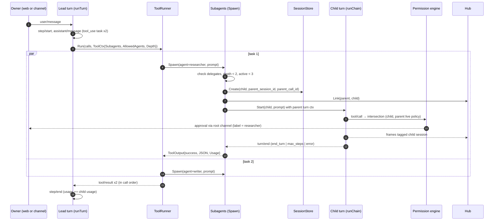
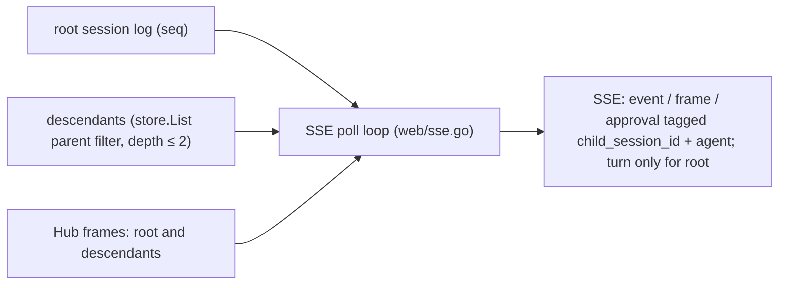

# Design: Agent teams

- **Issue**: `—`
- **Requirements**: [requirements.md](requirements.md)
- **Contract**: [api-contract.md](api-contract.md) — Required
- **Requirements revision**: 1
- **Contract revision**: 1
- **Requirements status**: Approved
- **Contract status**: Approved
- **Status**: Approved
- **Design revision**: 1

Do not write a design against requirements or a contract that are not yet approved. Both are approved (2026-10-30).

## Architecture references

- **ADR index**: [docs/adr](../../adr/README.md)
- **Diagram index**: [docs/diagram](../../diagram/README.md)
- **ADR**: [0017](../../adr/0017-agent-teams-as-roster-over-subagents.md) teams as a roster over subagents; [0011](../../adr/0011-subagent-as-child-session.md) child sessions; [0004](../../adr/0004-permission-mode-per-agent.md) policy and approvals; [0009](../../adr/0009-session-as-append-only-event-log.md) event log; [0010](../../adr/0010-profile-and-config-patch.md) config
- **Feature-local diagram**: [Team resolution](#team-resolution), [Delegation sequence](#delegation-sequence), [Stream fan-in](#stream-fan-in)
- **Durable diagram**: [0002. Agent Loop and Approval](../../diagram/0002-agent-loop-and-approval.md) and [0004. Profile, Fork, Subagent, and Protocols](../../diagram/0004-profile-fork-subagent-and-protocols.md) — no change in this spec. The parallel `task` batch is the one difference from the subagent flow in 0004 and is recorded in ARCHITECTURE §8.

## Architecture decision scan

| Topic | Existing authority | Decision location | Action |
|---|---|---|---|
| Public interface | ADR 0011 (tool names), spec #9 rev 2 (`/v1` style, `expected_version`) | contract | reuse the style; add `API-TEAM-*` |
| Persistence | ADR 0009 (event log), ADR 0005 (one SQLite) | design (no table, no event kind) | reuse; child sessions use `sessions.parent_session_id` already present |
| State and lifecycle | ADR 0011 (child turn), ADR 0004 (approval outcomes) | requirements state matrix | reuse |
| Concurrency | ADR 0011 (3 children), ARCHITECTURE §5 (sequential `Exec`) | ADR 0017 and ARCHITECTURE §8 (exception) | create the batch rule locally in `ToolRunner` |
| Dependency direction | ADR 0002 (modules, services, hooks), ADR 0015 (library packages do not import web) | design (core port) | reuse: the `task` tool reaches the runner through `core.SubagentRunner` in `ToolCtx` |
| Permissions | ADR 0004 (`tools.pre_execute`), `tools/permission` | design | local change in `tools/permission/evaluator.go` |

## Visual Architecture Check

| Trigger | Present? | Required view |
|---|---:|---|
| Module or crate boundary | Yes | boundary (flowchart below) |
| Interaction with an actor or external system | Yes | sequence (owner, providers, channels) |
| Multi-component flow | Yes | sequence |
| Lifecycle or state transition | No | Child session states are the existing turn states (ADR 0009); no new state machine |
| Entity relation | No | No new table, no new entity |
| Concurrency, retry, or failure flow | Yes | sequence (cancel and limits) |
| Dependency direction or runtime topology | Yes | boundary |

## Feature-local view

### Boundary



`tools/task.go` depends on `core` only. The runner (`agent`) implements `core.SubagentRunner` and is injected through
`ToolCtx`. This is the same direction as `tools` → `core` today; `agent` already imports `core`.

### Team resolution



### Delegation sequence



Cancel: the owner cancels the root turn. Its context ends. Every child context is derived from the root turn context,
so each child `turn/end` has `reason = "cancelled"`. `Spawn` returns `error: cancelled` and the lead's turn ends
`cancelled`. A cancel of one child only ends that child's turn.

### Stream fan-in



## Repository fit

- The feature is an extension of the agent package (`agent/`), the tools package (`tools/`), the config package
  (`config/`), and the web package (`web/`). It adds no package. `tools/task.go` is the one new file under `tools/`, and
  `agent/subagent.go` is the one new file under `agent/`.
- It follows the existing hook and port style: `ToolCtx` already carries `SessionID`, `AgentName`, `Workspace`,
  `Home`, and `Skills`. A subagent port is one more field, with an interface in `core`.
- Config tables follow `[agents.<name>]`: `Config` map, `validateX` function, `validateEffective` cross-check.
- Web handlers follow `web/config.go` and `web/skills.go`: `expected_version`, `config.Check`, audit line.

## Gaps in the current code

These facts were found in the code on 2026-10-30. Each one shapes a component below.

| # | Gap | Where | Effect on this design |
|---|---|---|---|
| G-1 | `task` and `task_continue` are not registered. `tools/permission/evaluator.go` (`buildArgument`) and `internal/toolfmt/toolfmt.go` already know the names. A config that lists `task` loads, and the turn fails with `tool 'task' is not registered` | `tools/module.go` builtins; `tools/registry.go` `Specs` | Register both in `tools/module.go`; no config check of tool names is added in this spec |
| G-2 | `ToolRunner.Run` pre-checks every call in order, then runs `Exec` calls one by one. Only `RiskRead` calls are batched | `agent/toolrunner.go` | `ParallelSafe` batch for `task` calls (`REQ-TEAM-012`) |
| G-3 | `ToolOutput` has only `Status` and `Output`. The step's usage comes only from the stream | `core/tool.go`, `agent/turn.go` (`consumeStream`, `StepEnd`) | Add `Usage` to `ToolOutput`; the runner adds it to the step's usage before `step/end` (`REQ-TEAM-013`) |
| G-4 | `ToolCtx` has no way to start a child turn | `core/tool.go` | Add `Subagents core.SubagentRunner` and `AllowedAgents`, `Depth` to `ToolCtx` |
| G-5 | `SessionFilter` (core) has `Channel`, `Address`, `Limit` only. `store.List` cannot exclude or select children | `core/session.go`, `store/store.go` `List` | Add `ParentSessionID` and `TopLevelOnly` (additive) |
| G-6 | `Hub` is keyed by session id; a parent does not see a child's frames | `agent/hub.go` | Add `Link(parent, child)`; `Publish` for a child also fans out to the parent's subscribers |
| G-7 | `LiveFrame` has no agent name | `core/session.go` (`LiveFrame`) | Add `Agent string` (additive); the web layer tags frames with it |
| G-8 | Approvals are routed by the session's channel (`ApprovalRequest` hook uses `info.Channel`) and kept in a broker keyed by session id (`web/approvals.go` `subscribe(sessionID)`) | `lana.go` (`ApproveWith`), `web/approvals.go` | A child inherits the root channel, so the hook works. The broker must fan in child approvals to the root stream (`REQ-TEAM-010`) |
| G-9 | The SSE loop reads one session: `backend.Events(ctx, id, lastSeq)` and `frames` from one subscription. Child logs are never read | `web/sse.go` `handleSessionStream` | Poll descendants in the same loop; tag items; no `turn` for children (`API-TEAM-011`) |
| G-10 | The dashboard dedupes events by `seq` alone, and handles `turn/end` as the root's end. A child `turn/end` would switch the root's running state off | `web/assets/views/session.js` (`onEvent`, `turn/end` branch; `onTurn`) | Dedupe by (`child_session_id`, `seq`); ignore child `turn/end` for root state (`AC-TEAM-034`) |
| G-11 | Agent resolution is agent-only: `resolve` (`agent/turn.go`), `SetAgent` (`agent/registry.go`), `routeAgent` (`lana.go`), `AgentNames` and `CreateSession` (`lana.go`), `Agents()` (`cmd/lana/web.go`), `ConfigSettings` (`web/config.go`) | several | Team branch in each (see Components) |
| G-12 | `Config` has no team table; `validateEffective` checks `subagents` only against agents | `core/config.go`, `config/validate.go` | Add `Teams` and the checks in `API-TEAM-001` |
| G-13 | The roster is not in the prompt. `agenthome.PromptInput` has no roster field | `internal/agenthome/prompt.go` | Add `Roster []RosterEntry`; `Build` writes a section |
| G-14 | Default `max_steps` is 25 for every agent (`resolve`) | `agent/turn.go` `resolve` | Child default 15 when the agent's `max_steps` is 0 (`REQ-TEAM-008`) |
| G-15 | Agent names are not checked by `config` (no `ValidName` call); `agenthome.ValidName` is used by the agent file endpoints only | `config/validate.go`, `internal/agenthome/agenthome.go` | Team names use `ValidName`. Agent-name validation in config is noted as a follow-up, not changed here |
| G-16 | `writeEventLines` sends a `turn` item for every `turn/end` of the replayed log | `web/sse.go` | For children the stream sends `event` only (`API-TEAM-011`) |
| G-17 | The sessions list `agent` filter and facets, and the `team` field, do not exist. They come from spec #9 rev 2 | `web/sessions.go` `handleListSessions` | Built on spec #9 rev 2 filters; `team` is added here |

## Proposed design

### Components

- **Team config** (`core.TeamConfig`, `core.Config.Teams`) — the parsed `[teams.<name>]` table. Invariant: `lead` is an
  agent, `members` are agents, the lead is not in `members`, names share one namespace.
- **Team validation** (`config/validate.go`: `validateTeam`, plus additions in `validateEffective` and `validateAgent`) —
  produces the messages of `API-TEAM-001`. Team keys are added to `topKeys`; the team table is `teamKeys = {description, lead, members}`.
- **Team resolution** (`agent/turn.go` `Runner.resolve`) — a team name is looked up in `config.Teams`. The result is a
  `resolvedAgent` with `name = lead`, `team = <team>`, `delegates` (members plus lead's subagents, without duplicates),
  `roster` (lead's own entry is not listed; each allowed agent with description), and `maxSteps` as before.
  `resolvedAgent` gains the fields `team`, `delegates`, `roster`, `child`.
- **Turn tools** (`agent/turn.go` where `turnTools` is built, near line 361) — when `resolved.team != ""` or a plain agent
  has a non-empty `subagents`, `task` and `task_continue` are appended to `turnTools` (for a team, always).
- **Roster prompt** (`internal/agenthome/prompt.go`) — `PromptInput.Roster []RosterEntry{Name, Description}`; `Build`
  adds a section after the persona when the list is not empty. Lines: `- <name>: <description>`; the last line names the
  `task` and `task_continue` tools.
- **Subagent runner** (`agent/subagent.go`, new) — implements `core.SubagentRunner`. `Spawn` and `Continue` carry out
  the rules of `REQ-TEAM-006` to `REQ-TEAM-008`: check the delegation list, depth, and active count; create the child
  with `store.Create`; `Hub.Link`; start the child turn through the registry (`startTurnLocked`-like helper that takes the
  parent's turn context); `Registry.Wait`; compose the result JSON; return `ToolOutput{Status, Output, Usage}`.
  Active child counts are kept in a `map[parentID]int` under `Registry.mu`.
- **Task tools** (`tools/task.go`, new; registered in `tools/module.go`) — `task` and `task_continue` implement `core.Tool`.
  `Risk` returns `RiskExec`. They implement the new optional `ParallelSafe() bool` returning true. `Call` validates the
  input and forwards to `tc.Subagents`.
- **Parallel batch** (`agent/toolrunner.go`) — `Run` batches consecutive ready calls whose tool implements `ParallelSafe`
  or whose risk is `RiskRead`. The batch uses the existing semaphore (8). The pre-execute loop stays sequential, so approvals
  are one at a time.
- **Usage carry** (`agent/turn.go`) — after `ToolRunner.Run`, the sum of `ToolOutput.Usage` of the step's calls is added
  to `usage` before `step/end` is written.
- **Permission intersection** (`tools/permission/evaluator.go` `Engine.Handle`) — when `info.ParentSessionID != ""`:
  the parent's effective policy is read (`EffectivePolicy` of the parent's events, with the parent's agent permission as
  fallback). The effective policy is the stricter one (`never` < `ask` < `trust`). The parent agent's `deny` patterns are
  checked in addition to the child's own. The parent's `allow` and grants are not read.
- **Hub link** (`agent/hub.go`) — `Link(parent, child)` records the child id under the parent. `Publish(child, frame)`
  also publishes to the parent's subscribers. `Subscribe(parent)` therefore receives descendant frames, each with its own `SessionID`.
- **Session list filter** (`core/session.go` `SessionFilter`, `store/store.go` `List`) — `ParentSessionID` selects
  children; `TopLevelOnly` excludes them (`parent_session_id IS NULL`). Web list uses `TopLevelOnly`.
- **Team info** (`cmd/lana/web.go` backend, `web/sessions.go`) — a session whose `Agent` is a team gets `team = {name, lead, members}`
  from the config. `Agents()` returns the teams with `Kind = "team"`, `Lead`, `Members`, `Policy` (lead's), no skills, no MCP.
- **Stream fan-in** (`web/sse.go` `handleSessionStream`) — each poll reads the root events and then each descendant's events
  (`store.List` with `ParentSessionID` recursively, depth ≤ 2). Child items are sent as `event` with `child_session_id`
  and `agent`, with no SSE `id`. Child `turn/end` is not sent as `turn`. Frames from `backend.Subscribe` keep their
  `SessionID`, and the handler adds the tags.
- **Approval fan-in** (`web/approvals.go`) — `Ask` stores the root session id of the request (walk `ParentSessionID`), and
  `subscribe(rootID)` receives those requests. The `approval` item carries `child_session_id` and `agent`.
- **Team endpoints** (`web/teams.go`, new) — `POST /v1/teams`, `GET`, `PUT`, `DELETE /v1/teams/{name}`. They use the
  `ConfigStore` port (`ConfigFile`, `ConfigCheck`, `ConfigWrite`) and a new section rewriter for `[teams.<name>]`.
  The rewriter is the one of spec #9 rev 2 (`API-WEB-014` section rewrite) applied to the team header. This spec does
  not write a second rewriter.
- **Dashboard** (`web/assets/views/session.js`, `web/assets/format.js`, new `web/assets/views/team.js`) — `TeamBlock`
  component (see UI reference). `buildHistory` groups child events by `child_session_id` (children of the open turn) and
  builds the steps (see Proposed design: Team work model).

### Team work model

The panel is built from two sources:

- **Root log only (collapsed view and reloads)**: for each `tool/call` with `name = task` or `task_continue` in the root
  turn, and its `tool/result`. Each completed call gives two delegation steps (outgoing: `from = lead`, `to = agent`, text
  = `input.prompt`; return: `from = agent`, `to = lead`, text = `answer` of the result JSON, cut to 400 characters). The
  badge text (`Done · N steps · S s`) uses N = 2 × completed calls and S = `turn/end` time minus `turn/start` time.
  `tool_calls` is taken from the result JSON.
- **Child logs (expanded view)**: for each child, `GET /v1/sessions/{child}/events` on expand (`Q-011`). Tool rows are its
  `tool/call` and `tool/result` pairs in order. Live, the same rows come from the stream items with `child_session_id`.

`Working · step N` (live) = the number of delegation steps so far, with an outgoing step that has no return yet counted as its own step.

### Contract mapping

| Contract operation | Component | Input | Result | Requirements |
|---|---|---|---|---|
| `API-TEAM-001` | Team config and validation | `[teams.<name>]` | `Config.Teams` or issues | `REQ-TEAM-001`, `REQ-TEAM-002` |
| `API-TEAM-002` | `tools/task.go` + `agent/subagent.go` | `agent`, `prompt`, `title` | JSON output, usage | `REQ-TEAM-005`, `REQ-TEAM-006`, `REQ-TEAM-008`, `REQ-TEAM-012`, `REQ-TEAM-013` |
| `API-TEAM-003` | same | `session_id`, `prompt` | JSON output | `REQ-TEAM-007` |
| `API-TEAM-004` | `agent/turn.go`, `tools/permission` | — | fields in existing events | `REQ-TEAM-006`, `REQ-TEAM-010`, `REQ-TEAM-013` |
| `API-TEAM-005` | `web/sessions.go`, `cmd/lana/web.go`, `store/store.go` | query | rows with `team` | `REQ-TEAM-014`, `REQ-TEAM-016` |
| `API-TEAM-006` | `web/sessions.go` `handleAgents` | — | rows with `kind` | `REQ-TEAM-017` |
| `API-TEAM-007` to `010` | `web/teams.go` | body or path | config write | `REQ-TEAM-018` |
| `API-TEAM-011` | `web/sse.go`, `web/approvals.go` | stream | tagged items | `REQ-TEAM-015` |

### Persistence

- **Unchanged schema**. No table and no event kind is added. Child sessions use `sessions.parent_session_id` and
  `session_events` as they are.
- Payload fields: `session/created` (child) already has `parent_session_id`, `parent_call_id`, `agent`; `approval/asked`
  has `label`; `step/end` `usage` includes children (`API-TEAM-004`).
- **Config**: `config.toml` gains `[teams.*]` tables only (written by `API-TEAM-007` to `010` or by hand).
- **Format version**: `version = 1` unchanged. Payloads keep `v = 1`.

### Failure handling

| Failure | Internal error | Observable result |
|---|---|---|
| Delegation list does not have the agent | `ErrNotSubagent` (new, `agent` package) | `task` tool error: `agent 'x' is not a subagent of this agent (allowed: …)` |
| Depth 2 | `ErrSubagentDepth` | tool error `maximum subagent depth reached` |
| Active count 3 | `ErrSubagentLimit` | tool error `3 subagents are already running` |
| Child busy | `ErrSessionBusy` (existing) | tool error `subagent is busy` |
| Parent or child cancelled | context cancelled | tool error `cancelled`; child `turn/end cancelled` |
| Store write fails when creating the child | store error | tool error `internal error`; nothing else runs |
| Child provider error | `core.ProviderError` (existing) | child `turn/end error`; tool status `success`, JSON `status = "error"` |
| Config save fails `config.Check` | `config.Errors` | `422 validation_failed`; nothing written |

### Concurrency

- **Child start and count**: the active count and the check are done under `Registry.mu`; the count is decremented when
  `Spawn` returns (defer).
- **Parallel batch**: `ToolRunner.runBatch` runs `executeOne` in goroutines with the existing semaphore (8). The
  `task` limit (3) is enforced in `Spawn`, not by the semaphore.
- **Cancel**: child turn contexts derive from the parent turn context; `Registry.Close` waits for child goroutines through
  the same `wg`.
- **Lease**: a child runs in the process that runs the parent. It needs no lease of its own. The web view's lease set holds the root session only.
- **Write lock**: team config writes use the spec #9 write lock.

### Security

- **Permission**: child tool calls go through `tools.pre_execute` with the child's agent name. The intersection and the
  deny union are applied in `Engine.Handle` (`REQ-TEAM-009`).
- **Delegation list**: the model cannot name an agent outside the list; the check is in `Spawn` before the child exists.
- **Approvals**: labels come from the child's agent name; the approval shows the child's tool input from its `tool/call`, as today.
- **Secrets**: team tables hold no secret. Team responses carry names and descriptions only.
- **Limits as safety**: depth, the active count, and `max_steps` bound the cost of a delegation.

### Observability

- `info`: `subagent: started` and `subagent: finished` with parent id, child id, agent, status, steps, tool calls, duration (no prompt, no answer text).
- `warn`: child log read error in the stream; limit refusal (depth, count).
- `debug`: roster size and delegation list in the system prompt build.
- Team config save: the spec #9 audit line (`teams.<name>.lead`, … key names only).

## Requirement traceability

| Requirement | Contract operation | Design component | Verification level |
|---|---|---|---|
| `REQ-TEAM-001`, `REQ-TEAM-002` | `API-TEAM-001` | Team config, `validateTeam`, `validateEffective` | unit (`config`) |
| `REQ-TEAM-003` | `API-WEB-005`, `API-TEAM-001` (routes) | `Registry.SetAgent`, `Runner.resolve`, `routeAgent`, `CreateSession` | integration (`agent`, root package) |
| `REQ-TEAM-004`, `REQ-TEAM-005` | `API-TEAM-002`, `API-TEAM-004` (roster) | `resolve`, `turnTools`, `PromptInput.Roster` | unit (`internal/agenthome`) and integration |
| `REQ-TEAM-006`, `REQ-TEAM-007` | `API-TEAM-002`, `API-TEAM-003` | `tools/task.go`, `agent/subagent.go` | integration with `MockLlm` |
| `REQ-TEAM-008` | `API-TEAM-002`, `API-TEAM-003` | `agent/subagent.go` (limits), `resolve` (child `max_steps`) | integration |
| `REQ-TEAM-009` | — | `tools/permission/evaluator.go` | unit (`tools/permission`) |
| `REQ-TEAM-010` | `API-TEAM-004`, `API-TEAM-011` | `ApprovalRequest.Label`, `web/approvals.go` | integration (`web`, `tools/permission`) |
| `REQ-TEAM-011` | `API-TEAM-002` | context derivation, `Registry.Close` | integration with leak check |
| `REQ-TEAM-012` | `API-TEAM-002` | `agent/toolrunner.go` batch | integration with timing |
| `REQ-TEAM-013` | `API-TEAM-004` | `ToolOutput.Usage`, `agent/turn.go` | unit (step usage sum) and integration |
| `REQ-TEAM-014` | `API-TEAM-005` | `store.List` filter, `handleListSessions` | integration (`store`, `web`) |
| `REQ-TEAM-015` | `API-TEAM-011` | `agent/hub.go`, `web/sse.go` | integration (`web/sse_test.go`) and dashboard check |
| `REQ-TEAM-016` | `API-TEAM-005` | `web/sessions.go`, `cmd/lana/web.go` | integration |
| `REQ-TEAM-017` | `API-TEAM-006` | `web/sessions.go` `handleAgents`, `Agents()` | integration |
| `REQ-TEAM-018` | `API-TEAM-007` to `API-TEAM-010` | `web/teams.go` | integration (`web`, `config`) |
| `REQ-TEAM-019` to `REQ-TEAM-023` | `API-TEAM-005`, `API-TEAM-006`, `API-TEAM-011` | `team.js`, `session.js`, `format.js` | dashboard check against the mockup |
| `REQ-TEAM-024` | — | Telegram `/agent`, CLI `lana chat` | integration (`channels/telegram`, `cmd/lana`) |
| `REQ-TEAM-025` | — | unchanged paths | regression (existing suite) |

## UI reference

Visual source of truth: `design/export/screens/sessions-team-chat.layout.txt`,
`design/export/screens/team-message-states.layout.txt`, `design/export/screens/sessions-new-session-agent-picker.layout.txt`,
`design/export/screens/agents-list.layout.txt`, `design/export/screens/skills-editor-add-agents.layout.txt`, and
`design/export/screens/sessions-filter.layout.txt`. PNG renders are next to each file. Components are in
`design/export/components/components.layout.txt` (`Agent avatar`, `Badge`, `Button`, `Icon`). Tokens are in
`design/export/tokens.css`. The design file is `design/lana-design-system.figcraft`.

Component tree of one turn:

```text
TeamBlock (team_name, members, lead, status, steps, turn_time)
  AvatarGroup (lead first, max 3, 32 px, overlap -8)   // Agent avatar/Color=Brand|Success|Warning
  Meta: name · Badge(Team) · "N agents" · time
  WorkPanel (collapsed | expanded)
    Header: "Team work" · Badge(status) · spacer · Toggle("Show work ▾" | "Hide work ▴")
    Thread (when expanded)
      Step (lead → member, prompt)            // rail avatar 24 px, head, body text
        ToolRow (name, argument, Badge Done|Running|Error|Cancelled)
      Step (member → lead, answer, cut 400)
  FinalAnswer: By(avatar 20 px, "lead · answer") + text (16/24)
```

| Element | Token or component | Note from the mockup |
|---|---|---|
| Team badge | `Badge/Color=Brand` (`--bg-brand-primary`, `--border-brand`, `--text-brand-secondary`) | label `Team` |
| Working badge | `Badge/Color=Warning` (`--bg-warning-primary`, `--text-warning-primary`) | `Working · step 3` |
| Done badge | `Badge/Color=Success` (`--bg-success-primary`, `--text-success-primary`) | `Done · 4 steps · 38 s` |
| Work panel | `--bg-secondary`, border `--border-secondary`, radius 12 | |
| Tool row | `--bg-primary`, border `--border-secondary`, radius 8; name in 12/18 semibold, argument 12/18 regular | argument in `Menlo` in the chip style of the activity list |
| Final answer | `--bg-primary`, border `--border-secondary`, radius `0 8 8 8` | |
| Avatar colours | `Agent avatar/Color=Brand|Success|Warning|Error|Gray` | Team and member colours in the mockup are examples; the agent identity colour rule is spec #9 decision 7 |

Picker and list rows follow spec #9 decisions 6, 7, and 8. The new-session picker shows the team row with the second line
`Team · N agents`. The agents list shows the team row with the columns in `REQ-TEAM-023`.

Layout and copy follow the mockup exactly. Strings are English (as in spec #9).

## Verification strategy

- **Unit**: config validation table (`config/validate_test.go`, `config/teams_test.go`), roster build (`internal/agenthome/prompt_test.go`),
  permission intersection and deny union (`tools/permission/permission_test.go`), step usage sum (`agent/turn` test),
  JSON output of `task` (`tools/task_test.go`), team work model (`web/assets` test or pure JS test if a harness exists;
  otherwise the dashboard check).
- **Integration**: `agent/subagent_test.go` with `MockLlm` (child creation, limits, cancel cascade, leak check, parallel
  timing, approval label); `web/sessions_test.go`, `web/sse_test.go`, `web/approvals_test.go` (team fields, child
  exclusion, stream tags, approval fan-in); `web/teams_test.go` (write rules, `expected_version`, route-in-use delete);
  `cmd/lana` (Telegram `/agent` path with the fake Bot API; CLI `/agent`).
- **Runtime**: a two-agent team against `MockLlm` in the daemon, opened in the browser: panel live, collapsed after end,
  reload rebuilds the collapsed badge; one approval from a member answered in the root chat.
- **Commands**: `nix develop -c go test -count=1 ./config/ ./core/ ./agent/ ./tools/... ./internal/agenthome/ ./store/ ./web/ ./cmd/lana/ .`
  and `nix develop -c go test -count=1 ./internal/archtest/` (import rules: `tools` imports `core` only for the new task tool).

## Risks and tradeoffs

- **Approval storms**: each `task` call is an approval under `ask`, and each member tool call too. The owner can allow
  `task(<agent>)` in `rules.allow` (ADR 0017). The UI shows the child name on each card.
- **Large answers**: a child's answer enters the parent's context unchanged. No size cap is added in v1 (requirements
  do not ask for one). Revisit with the usage data.
- **Replay cost**: children replay from `seq` 1 for the current turn on each reconnect. Bounded by depth 2 and the
  per-turn steps; acceptable for a loopback view.
- **Usage display**: a parent step's usage includes children (`API-TEAM-004`). Any cost screen must say so; the spec #9
  cost view has none yet.
- **Mockup gaps**: no team form and no team detail page (`Q-013`); the owner confirms the config-file path is acceptable.
- **Restart**: team changes need a daemon restart (spec #9 `Q-008`). A running team turn keeps its roster.
- **Same name in two kinds**: prevented by the shared namespace check; a route that names a removed team fails the save.

## Blocking Design Questions

None. The interface and behavior questions were answered in `requirements.md`. The technical choices of this design
(a `ToolOutput.Usage` field, `Hub.Link`, a `ParallelSafe` optional interface, approval fan-in by root id, the team
endpoints reusing spec #9 rev 2 writer) follow from the approved requirements and the code (see Gaps). If a choice
conflicts with spec #9 rev 2 when that spec is finished, stop and record it here.

## Approval

- [x] Requirements are Approved and their revision is recorded.
- [x] Contract is Approved.
- [x] Architecture decision scan and Visual Architecture Check are complete.
- [x] Required ADRs are Accepted (ADR 0017).
- [x] Every requirement maps to one design component.
- [x] Every acceptance criterion has a verification method (`tasks.md` coverage table).
- [x] Blocking Design Questions is `None`.
- **Approved by**: Ridho, on behalf of the owner (lifted gate, 2026-10-30)
- **Approved on**: 2026-10-30
