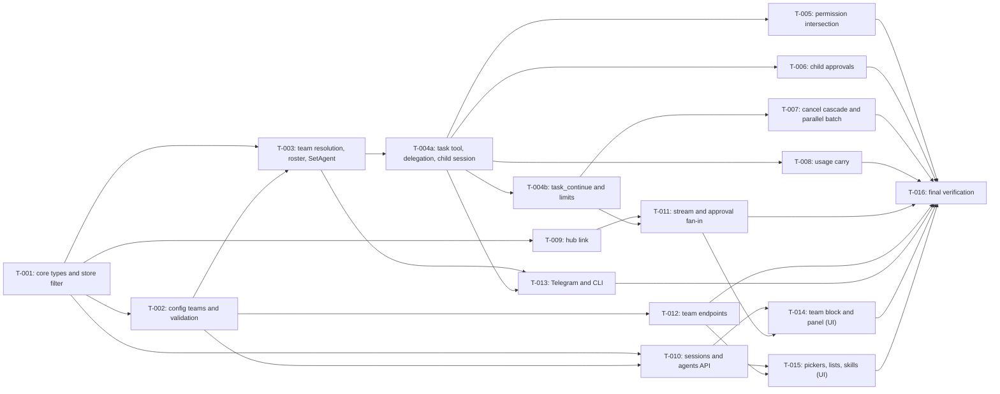

# Tasks: Agent teams

- **Issue**: `—`
- **Requirements**: [requirements.md](requirements.md)
- **Contract**: [api-contract.md](api-contract.md) — Required
- **Design**: [design.md](design.md)
- **Requirements revision**: 1
- **Contract revision**: 1
- **Design revision**: 1
- **Status**: Approved (tasks not started)

Requirements, contract, and design are Approved on behalf of the owner (lifted gate, 2026-10-30).

## Execution rules

- Implement only the requirements and acceptance criteria assigned to the task.
- Stop if requirements, design, ADR, diagrams, or contract conflict with each other.
- Do not answer product or architecture questions only in code.
- Every acceptance criterion has exactly one evidence owner.
- Required verification is never optional.
- Mark a task complete only after verification evidence has been recorded.
- Code is written through the `dsh-coder` subagent (`dsh --profile headless`, see the project `CLAUDE.md`). Give it one
  slice per call, with the target files and the acceptance criteria listed here. The main session plans, reviews the diff,
  and verifies.
- Go tooling runs inside `nix develop -c`. No global installs.
- Slices marked **Needs spec #9 rev 2** start only after the spec #9 rev 2 pieces they reuse are merged (noted per slice).
  Do not copy those pieces into this spec's code.
- Backend slices (`T-001` to `T-013`) come before UI slices (`T-014`, `T-015`). UI is Preact + htm, no build step, files under `web/assets/`.

## Coverage

| Acceptance criterion | Contract operation | Evidence owner | Issue/PR | Verification | Evidence |
|---|---|---|---|---|---|
| `AC-TEAM-001` | `API-TEAM-001` | `T-002` | — | `config/teams_test.go` valid team | Pass |
| `AC-TEAM-002` | `API-TEAM-001` | `T-002` | — | `config/teams_test.go` name clash | Pass |
| `AC-TEAM-003` | `API-TEAM-001` | `T-002` | — | `config/teams_test.go` validation table | Pass |
| `AC-TEAM-004` | `API-TEAM-001` | `T-002` | — | `config/teams_test.go` subagent names a team | Pass |
| `AC-TEAM-005` | `API-TEAM-001` | `T-002` | — | `config/teams_test.go` route names team or unknown | Pass |
| `AC-TEAM-006` | — | `T-003` | — | `agent/team_test.go` lead provider and roster | Pass |
| `AC-TEAM-007` | `API-TEAM-004` | `T-003` | — | `agent/team_test.go` SetAgent event | Pass |
| `AC-TEAM-008` | `API-TEAM-002` | `T-003` | — | `agent/team_test.go` tool list and delegation list | Pass |
| `AC-TEAM-009` | `API-TEAM-004` | `T-003` | — | `internal/agenthome/prompt_test.go` roster; `agent/team_test.go` system/message | Pass |
| `AC-TEAM-010` | `API-TEAM-002` | `T-004a` | — | `agent/subagent_test.go` plain agent with subagents | Pass |
| `AC-TEAM-011` | `API-TEAM-002` | `T-004a` | — | `agent/subagent_test.go` no subagents configured | Pass |
| `AC-TEAM-012` | `API-TEAM-002`, `API-TEAM-004` | `T-004a` | — | `agent/subagent_test.go` child session fields and log | Pass |
| `AC-TEAM-013` | `API-TEAM-002` | `T-004a` | — | `agent/subagent_test.go` result JSON | Pass |
| `AC-TEAM-014` | `API-TEAM-002` | `T-004a` | — | `agent/subagent_test.go` not in delegation list | Pass |
| `AC-TEAM-015` | `API-TEAM-003` | `T-004b` | — | `agent/subagent_test.go` continue keeps history | Pass |
| `AC-TEAM-016` | `API-TEAM-003` | `T-004b` | — | `agent/subagent_test.go` not a child | Pass |
| `AC-TEAM-017` | `API-TEAM-003` | `T-004b` | — | `agent/subagent_test.go` busy child | Pass |
| `AC-TEAM-018` | `API-TEAM-002` | `T-004b` | — | `agent/subagent_test.go` depth chain | Pass |
| `AC-TEAM-019` | `API-TEAM-002` | `T-004b` | — | `agent/subagent_test.go` fourth child refused | Pass |
| `AC-TEAM-020` | `API-TEAM-002` | `T-004b` | — | `agent/subagent_test.go` max_steps 15 and 5 | Pass |
| `AC-TEAM-021` | — | `T-005` | — | `tools/permission/permission_test.go` both directions | Pass |
| `AC-TEAM-022` | — | `T-005` | — | `tools/permission/permission_test.go` deny union, allow not inherited | Pass |
| `AC-TEAM-023` | — | `T-005` | — | `tools/permission/permission_test.go` live parent policy | Pass |
| `AC-TEAM-024` | — | `T-005` | — | `tools/permission/permission_test.go` grant not inherited | Pass |
| `AC-TEAM-025` | `API-TEAM-004` | `T-006` | — | `tools/permission/approval_test.go` label in log; web part in `web/approvals_test.go` (`T-011`) | Pass |
| `AC-TEAM-026` | `API-TEAM-004` | `T-006` | — | `agent/subagent_test.go` approval answer resolves child call | Pass |
| `AC-TEAM-027` | `API-TEAM-002` | `T-007` | — | `agent/subagent_test.go` parent cancel and leak check (`-race`) | Pass |
| `AC-TEAM-028` | `API-TEAM-002` | `T-007` | — | `agent/subagent_test.go` child-only cancel | Pass |
| `AC-TEAM-029` | `API-TEAM-002` | `T-007` | — | `agent/toolrunner_test.go` parallel batch timing | Pass |
| `AC-TEAM-030` | `API-TEAM-002` | `T-007` | — | `agent/toolrunner_test.go` approvals sequential | Pass |
| `AC-TEAM-031` | `API-TEAM-004` | `T-008` | — | `agent/turn_usage_test.go` step usage sum | Pass |
| `AC-TEAM-032` | `API-TEAM-005` | `T-010` | — | `web/sessions_test.go` children excluded, detail readable | Pass |
| `AC-TEAM-033` | `API-TEAM-011` | `T-011` | — | `web/sse_test.go` tagged frames | Pass |
| `AC-TEAM-034` | `API-TEAM-011` | `T-011` | — | `web/sse_test.go` child turn not a root turn item | Pass |
| `AC-TEAM-035` | `API-TEAM-011` | `T-011` | — | `web/sse_test.go` reconnect replay; client dedupe in `T-014` | Pass |
| `AC-TEAM-036` | `API-TEAM-005` | `T-010` | — | `web/sessions_test.go` team object | Pass |
| `AC-TEAM-037` | `API-TEAM-005` | `T-010` | — | `web/sessions_test.go` agent filter and facets | Pass |
| `AC-TEAM-038` | `API-TEAM-006` | `T-010` | — | `web/sessions_test.go` agents list kinds | Pass |
| `AC-TEAM-039` | `API-TEAM-007`, `API-TEAM-008`, `API-TEAM-009` | `T-012` | — | `web/teams_test.go` comments kept, restart flag | Pass |
| `AC-TEAM-040` | `API-TEAM-009` | `T-012` | — | `web/teams_test.go` stale version | Pass |
| `AC-TEAM-041` | `API-TEAM-009` | `T-012` | — | `web/teams_test.go` check fails, nothing written | Pass |
| `AC-TEAM-042` | `API-TEAM-010` | `T-012` | — | `web/teams_test.go` delete with route | Pass |
| `AC-TEAM-043` | `API-TEAM-005` | `T-014` | — | dashboard check against `team-message-states` | Pass |
| `AC-TEAM-044` | — | `T-014` | — | dashboard check: single agent block | Pass |
| `AC-TEAM-045` | `API-TEAM-011` | `T-014` | — | `web/assets` test of panel status (pure function) and dashboard check | Pass |
| `AC-TEAM-046` | — | `T-014` | — | pure function test: collapsed badge from root log | Pass |
| `AC-TEAM-047` | `API-TEAM-011`, `API-TEAM-004` | `T-014` | — | dashboard check: expand after reload loads child logs | Pass |
| `AC-TEAM-048` | `API-TEAM-011` | `T-014` | — | pure function test: tool rows and cut 60 | Pass |
| `AC-TEAM-049` | — | `T-014` | — | pure function test: answer cut 400 | Pass |
| `AC-TEAM-050` | — | `T-015` | — | dashboard check: disabled model pill, policy works | Pass |
| `AC-TEAM-051` | `API-TEAM-006` | `T-015` | — | dashboard check: picker row | Pass |
| `AC-TEAM-052` | `API-TEAM-006` | `T-015` | — | dashboard check: agents list row | Pass |
| `AC-TEAM-053` | — | `T-015` | — | `web/skills_test.go` team expanded to members | Pass |
| `AC-TEAM-054` | — | `T-013` | — | `channels/telegram/telegram_test.go` `/agent` team; approval label | Pass |
| `AC-TEAM-055` | — | `T-016` | — | full suite, unchanged tests | — |

## Task graph

## Tasks

- [x] `T-001` Core types and session filter
  - Issue/PR: `—`
  - Depends on: `None`
  - Requirements: enabler for `REQ-TEAM-006`, `REQ-TEAM-009`, `REQ-TEAM-014`, `REQ-TEAM-015`
  - Acceptance criteria: none (no acceptance criterion owned)
  - Contract operations: `API-TEAM-002` (types), `API-TEAM-005` (filter)
  - Scope:
    - `core/config.go`: `TeamConfig{Lead string; Members []string; Description string}` with toml tags, and `Config.Teams map[string]TeamConfig \`toml:"teams"\``.
    - `core/tool.go`: `ToolCtx` gains `Subagents SubagentRunner`, `AllowedAgents []string`, `Depth int`. New interface `SubagentRunner` with `Spawn(ctx, SpawnRequest) (ToolOutput, error)` and `Continue(ctx, ContinueRequest) (ToolOutput, error)`, and the request structs. `ToolOutput` gains `Usage *Usage` (JSON-less). New optional interface `ParallelTool{ ParallelSafe() bool }`.
    - `core/session.go`: `LiveFrame.Agent string`; `SessionFilter.ParentSessionID string` and `TopLevelOnly bool`.
    - `store/store.go` `List`: apply `ParentSessionID` (`parent_session_id = ?`) and `TopLevelOnly` (`parent_session_id IS NULL OR parent_session_id = ''`).
    - No behavior change for existing callers (zero values).
  - Verification:
    - `nix develop -c go test -count=1 ./core/ ./store/`
    - `nix develop -c go build ./...`
    - `nix develop -c go test -count=1 ./internal/archtest/`
  - Completion evidence:
    - Status: Not started
    - Command/test: `go test -count=1 ./core/ ./store/... . ./internal/archtest/`, `golangci-lint run ./core/... ./store/...` (store_test.go parent and top-level filters)
    - Result: pass, 0 lint issues
    - PR/commit: —

- [x] `T-002` Config: `[teams.<name>]` keys and validation
  - Issue/PR: `—`
  - Depends on: `T-001`
  - Requirements: `REQ-TEAM-001`, `REQ-TEAM-002`, `REQ-TEAM-005` (config part)
  - Acceptance criteria: `AC-TEAM-001` to `AC-TEAM-005`
  - Contract operations: `API-TEAM-001`
  - Scope:
    - `config/validate.go`: add `"teams"` to `topKeys`; `teamKeys = []string{"description", "lead", "members"}`; `validateTeam(v, path, add)` for the messages of `API-TEAM-001` (type, unknown key with suggestion, name rule via `agenthome.ValidName`, lead, members count 1 to 8, duplicates, lead in members, description length).
    - `validateLayer`: iterate `teams` like `agents` (each entry must be a table).
    - `validateEffective`: team name clash with an agent (`teams.<name>`); lead must be an agent and not a team; members must be agents, not teams; `agents.<a>.subagents.<i>` naming a team gets `is a team; subagents must be agents`; routes accept agents or teams (message lists both).
    - Confirm `config/merge.go` and `config/load.go` merge `teams` tables across layers like `agents` (add a case if they list keys explicitly).
    - New tests in `config/teams_test.go`: one case per row of the validation table in `API-TEAM-001`, plus the valid example.
  - Verification:
    - `nix develop -c go test -count=1 ./config/ -run 'Team'`
    - `nix develop -c go test -count=1 ./config/`
  - Completion evidence:
    - Status: Not started
    - Command/test: `go test -count=1 ./config/ ./core/ .`, `golangci-lint run ./config/... ./core/...` (config/teams_test.go: valid, boundaries, validation table, subagent and route names, layer merge)
    - Result: pass, 0 lint issues
    - PR/commit: —

- [x] `T-003` Team resolution, roster, and team sessions
  - Issue/PR: `—`
  - Depends on: `T-002`
  - Requirements: `REQ-TEAM-003`, `REQ-TEAM-004`
  - Acceptance criteria: `AC-TEAM-006` to `AC-TEAM-009`
  - Contract operations: `API-TEAM-002` (delegation list), `API-TEAM-004` (roster in `system/message`, `model/selection`)
  - Scope:
    - `agent/turn.go` `Runner.resolve`: if `Teams[info.Agent]` (or the `ModelSelection.Agent`) exists, use the lead's `AgentConfig` and set `resolvedAgent.team`, `delegates` (members plus lead's `Subagents`, no duplicates), `roster` (entries for each delegate with description), keep provider, model, workspace, permission, rules from the lead.
    - `agent/turn.go` `turnTools` build: for a team, append `task` and `task_continue` (once each).
    - `internal/agenthome/prompt.go`: `PromptInput.Roster []RosterEntry{Name, Description string}`; `Build` adds a "Your team" section after the persona when non-empty: one line per entry (`- name: description`, the colon part omitted when empty), then one line naming `task` and `task_continue`. Test in `internal/agenthome/prompt_test.go`.
    - `agent/turn.go` `buildPrompt`: pass the roster.
    - `agent/registry.go` `SetAgent`: accept team names (`Teams` lookup), write `ModelSelection{Provider, Model of lead, Agent: team}`.
    - `agent/registry.go` `SetModel`: refuse a team session with a new error `ErrTeamModel` (wrapping `ErrInvalidModel` text "teams use each agent's model").
    - `lana.go` `routeAgent`, `CreateSession`, `openSession`: accept a team name. Add `TeamNames()` and `IsTeam(name)` helpers; `AgentPolicy(team)` returns the lead's policy.
    - Tests: `agent/team_test.go` with `MockLlm`: lead provider used, roster in system prompt, `SetAgent` event.
  - Verification:
    - `nix develop -c go test -count=1 ./agent/ -run 'Team'`
    - `nix develop -c go test -count=1 ./internal/agenthome/`
    - `nix develop -c go test -count=1 . -run 'Team'`
  - Completion evidence:
    - Status: Not started
    - Command/test: `go test -count=1 ./agent/... . ./cmd/lana/ ./internal/agenthome/`, `golangci-lint run ./agent/... .` (agent/team_test.go, lana_team_test.go, internal/agenthome/prompt_test.go)
    - Result: pass, 0 lint issues
    - PR/commit: —

- [x] `T-004a` `task` tool: delegation list, child session, result
  - Issue/PR: `—`
  - Depends on: `T-003`
  - Requirements: `REQ-TEAM-005`, `REQ-TEAM-006`
  - Acceptance criteria: `AC-TEAM-010` to `AC-TEAM-014`
  - Contract operations: `API-TEAM-002`, `API-TEAM-004`
  - Scope:
    - `tools/task.go` (new): `task` tool. `Spec` with the static schema of the contract (`agent`, `prompt`, `title`). `Risk` returns `RiskExec`. `ParallelSafe` returns true. `Call` validates the input (agent non-empty, prompt not blank, 8,000 characters, title 80 characters), then calls `tc.Subagents.Spawn`.
    - `tools/module.go`: register `NewTask()` among the builtins.
    - `agent/subagent.go` (new): type implementing `core.SubagentRunner`. `Spawn`: check `AllowedAgents` (message with `(allowed: …)`), empty list (`no subagents are configured for this agent`), create the child with `store.Create` (`Agent`, `Channel`, `Address`, `Workspace` from the parent session info, `ParentSessionID`, `ParentCallID`), start the child turn through a registry helper that takes the parent's turn context, `Wait`, and build the result JSON from `TurnResult` and the child's log (`steps`, `tool_calls` from the turn's events, `duration_ms`).
    - `agent/turn.go`: fill `ToolCtx.Subagents`, `AllowedAgents = resolved.delegates`, `Depth` (the depth is computed by the runner; depth checks are in T-004b).
    - Child agent name in the child's `session/created`; child `max_steps` default 15 when the child agent's `max_steps` is 0 (`resolve` gets a `child` flag).
    - Tests in `agent/subagent_test.go` (`MockLlm`): AC-010 to AC-014.
  - Verification:
    - `nix develop -c go test -count=1 ./agent/ -run 'Subagent'`
    - `nix develop -c go test -count=1 ./tools/ -run 'Task'`
  - Completion evidence:
    - Status: Not started
    - Command/test: `go test -count=1 ./agent/... ./tools/... . ./internal/archtest/`, `golangci-lint run ./agent/... ./tools/...` (agent/subagent_test.go AC-TEAM-010..014, tools/task_test.go)
    - Result: pass, 0 lint issues
    - PR/commit: —

- [x] `T-004b` `task_continue` and limits
  - Issue/PR: `—`
  - Depends on: `T-004a`
  - Requirements: `REQ-TEAM-007`, `REQ-TEAM-008`
  - Acceptance criteria: `AC-TEAM-015` to `AC-TEAM-020`
  - Contract operations: `API-TEAM-002`, `API-TEAM-003`
  - Scope:
    - `tools/task.go`: `task_continue` tool (`session_id`, `prompt`), `Risk` `RiskExec`, `ParallelSafe` true.
    - `agent/subagent.go` `Continue`: owner check (`ParentSessionID == caller`), busy check (`ErrSessionBusy` → `subagent is busy`), start a turn with the prompt, `Wait`, same result JSON.
    - Depth: `Spawn` and `Continue` refuse when the caller's depth is 2 (`maximum subagent depth reached`). Depth = count of parent links (walk `Info` up to 2 links).
    - Concurrency: `Registry` keeps `activeChildren map[string]int` under `mu`; refuse with `<n> subagents are already running` when the count is 3; decrement on return.
    - Child `max_steps`: from `AgentConfig.MaxSteps`, default 15 for children.
    - Tests in `agent/subagent_test.go`: AC-015 to AC-020 (depth chain uses three sessions; fourth child; max_steps 15 and 5).
  - Verification:
    - `nix develop -c go test -count=1 ./agent/ -run 'Subagent|Continue|Depth|Limit'`
  - Completion evidence:
    - Status: Not started
    - Command/test: `go test -count=1 ./agent/... ./tools/... . ./internal/archtest/`, `golangci-lint run ./agent/... ./tools/...` (agent/subagent_test.go AC-TEAM-015..020; tools/task_test.go)
    - Result: pass, 0 lint issues
    - PR/commit: —

- [x] `T-005` Permission intersection for child sessions
  - Issue/PR: `—`
  - Depends on: `T-004a`
  - Requirements: `REQ-TEAM-009`
  - Acceptance criteria: `AC-TEAM-021` to `AC-TEAM-024`
  - Contract operations: none (internal rule; `API-TEAM-002` side effects)
  - Scope:
    - `tools/permission/evaluator.go` `Engine.Handle`: when `info.ParentSessionID != ""`, read the parent's events and info; compute the parent's effective policy (`EffectivePolicy(parentEvents, parentAgentPermission)`); effective = stricter of the child's policy and the parent's (`never` < `ask` < `trust`). Read the parent agent's `Rules.Deny` and check them with the child's deny list. Do not read the parent's allow rules or grants.
    - Keep every existing path for root sessions unchanged.
    - Tests in `tools/permission/permission_test.go`: AC-021 to AC-024, including a mid-run policy change to `never` on the parent.
  - Verification:
    - `nix develop -c go test -count=1 ./tools/permission/`
  - Completion evidence:
    - Status: Not started
    - Command/test: `go test -count=1 ./agent/... ./tools/... . ./internal/archtest/`, `golangci-lint run` (permission_test.go AC-TEAM-021..024)
    - Result: pass, 0 lint issues
    - PR/commit: —

- [x] `T-006` Child approvals labelled with the child agent
  - Issue/PR: `—`
  - Depends on: `T-004a`
  - Requirements: `REQ-TEAM-010`
  - Acceptance criteria: `AC-TEAM-025` (log part), `AC-TEAM-026`
  - Contract operations: `API-TEAM-004`
  - Scope:
    - `tools/permission/evaluator.go`: the `ApprovalRequest` built for a child sets `Label` to the child's agent name (`AgentName`). Root sessions keep an empty label.
    - `tools/permission/approval.go`: no change beyond passing `Label` (already written to `approval/asked`).
    - Tests: `tools/permission/approval_test.go` (label in `approval/asked` of the child log); `agent/subagent_test.go` (an answered child approval lets the child's call run once; `allowed_once` only affects the child's log).
  - Verification:
    - `nix develop -c go test -count=1 ./tools/permission/ -run 'Approval|Label'`
    - `nix develop -c go test -count=1 ./agent/ -run 'Subagent.*Approval'`
  - Completion evidence:
    - Status: Not started
    - Command/test: `go test -count=1 ./agent/... ./tools/... . ./cmd/lana/ ./channels/telegram/`, `golangci-lint run` (approval_test.go TestChildApprovalLabel AC-TEAM-025 log part; TestSubagentApprovalAllowedOnce AC-TEAM-026)
    - Result: pass, 0 lint issues
    - PR/commit: —

- [x] `T-007` Cancel cascade and the parallel `task` batch
  - Issue/PR: `—`
  - Depends on: `T-004b`
  - Requirements: `REQ-TEAM-011`, `REQ-TEAM-012`
  - Acceptance criteria: `AC-TEAM-027` to `AC-TEAM-030`
  - Contract operations: `API-TEAM-002`
  - Scope:
    - `agent/toolrunner.go` `Run`: batch consecutive ready calls whose tool implements `core.ParallelTool` with `ParallelSafe() == true` (and `RiskRead` calls, as today). Use `runBatch`. The pre-execute loop stays sequential.
    - `agent/subagent.go`: child contexts derive from the parent turn context (no `context.Background`); `Spawn` returns `cancelled` when the parent context ends; `Registry.Close` waits for child goroutines through `wg`.
    - Tests: `agent/toolrunner_test.go` (two `task` calls: both children start before either ends; approvals one after another); `agent/subagent_test.go` (AC-027 with a goroutine count check; AC-028 child-only cancel). Run the cancel tests with `-race`.
  - Verification:
    - `nix develop -c go test -count=1 -race ./agent/ -run 'Subagent|Parallel|Cancel'`
    - `nix develop -c go test -count=1 ./agent/`
  - Completion evidence:
    - Status: Not started
    - Command/test: `go test -race -count=1 ./agent/...`, `go test ./tools/... . ./internal/archtest/`, `golangci-lint run` (TestSubagentParentCancelCascade AC-TEAM-027, TestSubagentChildCancelOnly AC-TEAM-028, TestTaskCallsBatchInParallel AC-TEAM-029, TestTaskApprovalsSequential AC-TEAM-030)
    - Result: pass, 0 lint issues
    - PR/commit: —

- [x] `T-008` Child usage in the parent's step
  - Issue/PR: `—`
  - Depends on: `T-004a`
  - Requirements: `REQ-TEAM-013`
  - Acceptance criteria: `AC-TEAM-031`
  - Contract operations: `API-TEAM-004` (`step/end` usage)
  - Scope:
    - `agent/turn.go` `runTurn`: before writing `step/end`, add the `Usage` of each `ToolOutput` of the step (sum, nil ignored) to the step's usage. Child `step/end` events are not changed.
    - `agent/subagent.go`: set `ToolOutput.Usage` from the child's `TurnResult.Usage` (summed over `task_continue` turns too).
    - Test: `agent/turn_usage_test.go`: parent model usage 100/20, child 50/10 → parent `step/end` 150/30, child 50/10.
  - Verification:
    - `nix develop -c go test -count=1 ./agent/ -run 'Usage'`
  - Completion evidence:
    - Status: Not started
    - Command/test: `go test -race -count=1 ./agent/...`, `go test ./tools/... . ./internal/archtest/`, `golangci-lint run` (TestStepUsageIncludesChildUsage AC-TEAM-031)
    - Result: pass, 0 lint issues
    - PR/commit: —

- [x] `T-009` Hub: child frames reach the parent subscriber
  - Issue/PR: `—`
  - Depends on: `T-001`
  - Requirements: enabler for `REQ-TEAM-015`
  - Acceptance criteria: none (owned by `T-011`)
  - Contract operations: `API-TEAM-011` (source)
  - Scope:
    - `agent/hub.go`: `Link(parentID, childID string)` records the child under the parent (idempotent). `Publish(childID, frame)` also publishes to the parent's subscribers (and to the grandparent, for depth 2). `Close` unchanged.
    - `agent/subagent.go` calls `Link` when it creates the child.
    - Test: `agent/hub_test.go` for `Link` and fan-out, with the existing `Hub` tests unchanged.
  - Verification:
    - `nix develop -c go test -count=1 ./agent/ -run 'Hub|Link'`
  - Completion evidence:
    - Status: Not started
    - Command/test: `go test -race -count=1 ./agent/... .`, `go test ./internal/archtest/`, `golangci-lint run ./agent/... .` (agent/hub_test.go; TestSubagentSpawnLinksChildToParent)
    - Result: pass, 0 lint issues
    - PR/commit: —

- [x] `T-010` Sessions and agents API: team information and child exclusion
  - Issue/PR: `—`
  - Depends on: `T-001`, `T-002`
  - Requirements: `REQ-TEAM-014`, `REQ-TEAM-016`, `REQ-TEAM-017`
  - Acceptance criteria: `AC-TEAM-032`, `AC-TEAM-036`, `AC-TEAM-037`, `AC-TEAM-038`
  - Contract operations: `API-TEAM-005`, `API-TEAM-006`
  - Needs spec #9 rev 2: the `agent` filter, `facets`, and `kind` conventions of its sessions and agents endpoints.
  - Scope:
    - `web/sessions.go`: `sessionJSON`/`sessionDetailJSON` gain `team` (object or null; from a `Team` field the backend fills). `handleListSessions` sets `TopLevelOnly`. `agentJSON` gains `kind`, `lead`, `members`; `handleAgents` writes team rows (`model` null, `policy` from the backend).
    - `web/sessions.go` `Agent` (backend type): add `Kind`, `Lead`, `Members`, `Description`.
    - `cmd/lana/web.go`: `webBackend.Sessions` and `Session` fill `Team` for sessions whose agent is a team; `Agents()` returns teams with `Kind = "team"`; `Agents` agent rows get `Kind = "agent"`.
    - `web/sessions_test.go`: AC-032 (children excluded, detail with `parent_session_id`), AC-036, AC-037, AC-038.
  - Verification:
    - `nix develop -c go test -count=1 ./web/ -run 'Session|Agents'`
    - `nix develop -c go test -count=1 ./cmd/lana/ -run 'Web'`
  - Completion evidence:
    - Status: Not started
    - Command/test: `go test -count=1 . ./web/ ./cmd/lana/ ./internal/archtest/`, `golangci-lint run` (web/sessions_test.go AC-TEAM-032, 036, 037, 038; ErrTeamModel mapping)
    - Result: pass, 0 lint issues
    - PR/commit: —

- [x] `T-011` Stream and approval fan-in for children
  - Issue/PR: `—`
  - Depends on: `T-004b`, `T-009`
  - Requirements: `REQ-TEAM-010` (web part), `REQ-TEAM-015`
  - Acceptance criteria: `AC-TEAM-033`, `AC-TEAM-034`, `AC-TEAM-035`, and the web part of `AC-TEAM-025`
  - Contract operations: `API-TEAM-011`, `API-TEAM-004`
  - Scope:
    - `web/sse.go` `handleSessionStream`: each poll reads the root events, then the events of every descendant (`store.List` with `ParentSessionID`, depth ≤ 2) from a per-child `lastSeq` map. Child events are written as `event` with `child_session_id` and `agent` and no `id` line. `writeEventLines` sends `turn` only for root events.
    - `frameJSON` gains `child_session_id` and `agent` (omitempty). Frames from `backend.Subscribe` are tagged when their `SessionID` is not the root's.
    - `web/approvals.go`: `Ask` stores the root session id (walk `ParentSessionID`); `subscribe(root)` returns those requests; the `approval` item gains `child_session_id` and `agent`.
    - Replay on connect: children of the root's current turn from `seq` 1.
    - `web/sse_test.go`, `web/approvals_test.go`: AC-033, AC-034, AC-035, the web part of AC-025 (approval item shows the child's agent).
  - Verification:
    - `nix develop -c go test -count=1 ./web/ -run 'SSE|Stream|Approval'`
  - Completion evidence:
    - Status: Not started
    - Command/test: `go test -race -count=1 ./web/ ./cmd/lana/`, `golangci-lint run` (sse_test.go AC-TEAM-033..035; approvals_test.go AC-TEAM-025 web part)
    - Result: pass, 0 lint issues
    - PR/commit: —

- [x] `T-012` Team endpoints: create, read, replace, delete
  - Issue/PR: `—`
  - Depends on: `T-002`
  - Requirements: `REQ-TEAM-018`
  - Acceptance criteria: `AC-TEAM-039` to `AC-TEAM-042`
  - Contract operations: `API-TEAM-007`, `API-TEAM-008`, `API-TEAM-009`, `API-TEAM-010`
  - Needs spec #9 rev 2: the config section-rewrite writer, `expected_version`, `config.Check` before write, audit line, and the `ConfigStore` port as spec #9 rev 2 defines them. Do not write a second rewriter. If the writer is not merged, stop.
  - Scope:
    - `web/teams.go` (new): handlers for `POST /v1/teams`, `GET`, `PUT`, `DELETE /v1/teams/{name}` through `s.Handle` (auth, CSRF, `expected_version`). Error codes as the contract table.
    - `web/config.go`: `ConfigSettings` gains `Teams map[string]ConfigTeam` (`lead`, `members`, `description`). `cmd/lana/web.go` fills it from `cfg.Teams`.
    - The section rewriter (from spec #9 rev 2) is called with the table name `teams.<name>`; DELETE removes the table and the blank line before it.
    - DELETE with a route naming the team returns `422` through `config.Check`.
    - `web/teams_test.go`: AC-039 (comments kept, `restart_required`), AC-040 (stale version), AC-041 (check fails, nothing written), AC-042 (delete with route).
  - Verification:
    - `nix develop -c go test -count=1 ./web/ -run 'Team'`
    - `nix develop -c go test -count=1 ./config/`
  - Completion evidence:
    - Status: Not started
    - Command/test: `go test -count=1 ./web/ ./internal/archtest/`, `golangci-lint run ./web/...` (web/teams_test.go AC-TEAM-039..042)
    - Result: pass, 0 lint issues
    - PR/commit: —

- [x] `T-013` Telegram and CLI: teams as the agent of a chat
  - Issue/PR: `—`
  - Depends on: `T-003`, `T-004a`
  - Requirements: `REQ-TEAM-024`
  - Acceptance criteria: `AC-TEAM-054`
  - Contract operations: `API-TEAM-004` (approval label)
  - Scope:
    - `channels/telegram`: `/agent <name>` accepts a team name (through `routeAgent` / `SetAgent`); the approval text uses `req.Label` (already) and shows the child name; the reply to a team turn is the lead's final answer.
    - `lana chat` (`channels/cli/tui`): the `/agent` command accepts teams; child tool lines are printed with the agent name as prefix (`researcher · read_file …`).
    - Tests: `channels/telegram/telegram_test.go` (`/agent research-squad`; child approval text contains the child name); `cmd/lana/agent_test.go` (CLI `/agent` with a team).
  - Verification:
    - `nix develop -c go test -count=1 ./channels/... ./cmd/lana/ -run 'Agent|Team|Approve'`
  - Completion evidence:
    - Status: Not started
    - Command/test: `go test -count=1 ./channels/... ./cmd/lana/ ./internal/archtest/`, `golangci-lint run ./channels/...` (telegram_test.go `/agent research-squad`, child approval label AC-TEAM-054; cmd/lana/agent_test.go CLI team)
    - Result: pass, 0 lint issues
    - PR/commit: —

- [x] `T-014` Dashboard: team message block and Team work panel
  - Issue/PR: `—`
  - Depends on: `T-010`, `T-011`
  - Requirements: `REQ-TEAM-019`, `REQ-TEAM-020`, `REQ-TEAM-021`
  - Acceptance criteria: `AC-TEAM-043` to `AC-TEAM-049`
  - Contract operations: `API-TEAM-005`, `API-TEAM-011`, `API-TEAM-004`
  - Needs spec #9 rev 2: the chat view with turn blocks and the activity summary. This slice adds the team block to it; if the chat view is still the v1 history list, stop and ask.
  - Scope:
    - `web/assets/views/team.js` (new): `TeamBlock`, `TeamWorkPanel`, `DelegationStep`, `ToolRow`, and pure helpers `teamSteps(rootEvents)`, `panelStatus(...)`, `badgeText(...)`, `cut(...)`.
    - `web/assets/views/session.js`: render `TeamBlock` for turns of team sessions; `onEvent` dedupes by (`child_session_id`, `seq`); child `turn/end` does not change `turnRunning`; child items go to the child's list, not to the root history.
    - `web/assets/api.js` / `format.js`: `buildHistory` groups the root events of a turn for the block; expanded view loads children with `GET /v1/sessions/{child}/events` (`Q-011`).
    - Live state from frames with `child_session_id`; expanded while the turn runs; collapsed after `turn/end`.
    - Accessibility: button with `aria-expanded`; one polite announcement at turn end.
    - Tests: pure-function tests for the helpers (`web/assets/test/team.test.mjs` if a harness exists; otherwise a Go test that loads the file is not required; use the dashboard check).
  - Verification:
    - `nix develop -c go test -count=1 ./web/ -run 'Assets|Render'`
    - Dashboard check: a two-agent team in the daemon against `MockLlm`, compared with `design/export/screens/team-message-states.png` (live and collapsed) and `sessions-team-chat.png`.
  - Completion evidence:
    - Status: Not started
    - Command/test: `go test -count=1 ./web/`, `node --check` (views/team.js, turn.js, session.js)
    - Result: pass, 0 lint issues
    - PR/commit: —

- [x] `T-015` Dashboard: pickers, lists, and the skills dialog for teams
  - Issue/PR: `—`
  - Depends on: `T-010`, `T-012`
  - Requirements: `REQ-TEAM-022`, `REQ-TEAM-023`
  - Acceptance criteria: `AC-TEAM-050` to `AC-TEAM-053`
  - Contract operations: `API-TEAM-006`, `API-TEAM-005`
  - Needs spec #9 rev 2: the new-session picker, composer, sessions filter, agents list, and skills editor it extends.
  - Scope:
    - Composer: team sessions show `per agent` (disabled, with the explanation) for the model control; policy control works.
    - New-session picker: team rows with `Team · N agents` and stacked avatars (up to 3, lead first), in RECENT and AGENTS; search includes teams.
    - Sessions filter: the agent facet lists teams with counts.
    - Agents list: team rows with the columns of `REQ-TEAM-023`; the row opens Settings › Config file at the team table (`Q-013`).
    - Skills `Add agent` dialog: a team choice expands to its members and calls the skill write for each member (no duplicates); helper text `Adds it to all N agents in the team`.
    - `web/skills_test.go` for the expansion helper if the expansion is server-side; otherwise dashboard check.
  - Verification:
    - `nix develop -c go test -count=1 ./web/ -run 'Skills|Sessions|Agents'`
    - Dashboard check against `design/export/screens/sessions-new-session-agent-picker.png`, `agents-list.png`, `skills-editor-add-agents.png`, `sessions-filter.png`.
  - Completion evidence:
    - Status: Not started
    - Command/test: `go test -count=1 ./web/`, `node --check` (session.js, new-session.js, sessions.js, agents.js, skills.js)
    - Result: pass, 0 lint issues
    - PR/commit: —

- [ ] `T-016` Final verification
  - Issue/PR: `—`
  - Depends on: `T-005` to `T-015`
  - Requirements: `REQ-TEAM-025`
  - Acceptance criteria: `AC-TEAM-055`
  - Contract operations: none
  - Scope:
    - Run the full suite and lint. No test is changed to pass.
    - Confirm that a config without `[teams]` and without `task` gives the same events as before (compare a recorded session log from `main`).
    - Architecture rules: `tools` imports `core` only for the task tool.
    - Update the Status of this file and the coverage evidence column.
  - Verification:
    - `nix develop -c go test -count=1 ./...`
    - `nix develop -c golangci-lint run ./...`
    - `nix develop -c go test -count=1 ./internal/archtest/`
  - Completion evidence:
    - Status: Not started
    - Command/test: —
    - Result: Automated gate passed on 2026-10-30: `gofmt` clean, `go build ./...`, `go test -count=1 ./...`, `go test -race` (web, cmd/lana, agent, channels, store, internal/question), `golangci-lint run ./...` 0 issues, `make release` (3 platforms); headless Chrome screenshots of every page compared with design/export/screens. Pending: keyboard-only walk-through and VoiceOver run by the owner
    - PR/commit: —

## Final verification

- All tasks above are `[x]` with evidence.
- `AC-TEAM-001` to `AC-TEAM-055` have evidence in the coverage table.
- The dashboard check in `T-014` and `T-015` is recorded with screenshots next to the mockup PNGs.
- The spec index (`docs/specs/README.md`) lists spec #10 with its status. That file is not edited by this spec's tasks.

## Approval

- [x] Requirements, contract, and design are Approved.
- [x] Every task has target files, requirements, acceptance criteria, and verification commands.
- [x] Every acceptance criterion has exactly one evidence owner.
- [x] Backend slices come before UI slices.
- **Approved by**: Ridho, on behalf of the owner (lifted gate, 2026-10-30)
- **Approved on**: 2026-10-30
