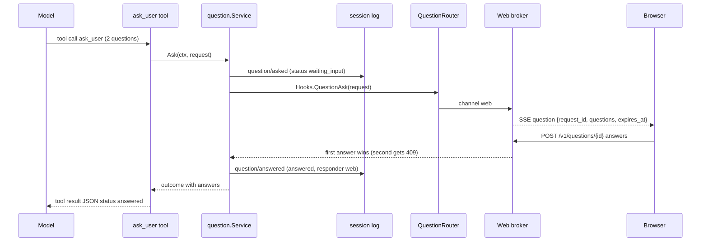
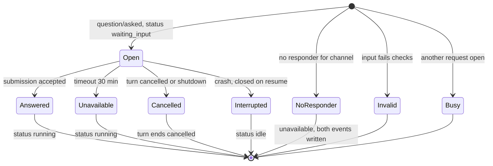

# Design: Ask-user questions

- **Issue**: `—`
- **Requirements**: [requirements.md](requirements.md)
- **Contract**: [api-contract.md](api-contract.md) — Required
- **Requirements revision**: 1
- **Contract revision**: 1
- **Requirements status**: Approved
- **Contract status**: Approved
- **Status**: Approved
- **Design revision**: 1

Requirements and contract are approved (2026-10-30, Ridho, lifted gate). Every open question was answered with the agent's
recommendation (`Rekomendasi agent:`), see the requirements file.

## Architecture references

- **ADR index**: [docs/adr](../../adr/README.md)
- **Diagram index**: [docs/diagram](../../diagram/README.md)
- **ADR**: [0004](../../adr/0004-permission-mode-per-agent.md) (responder chain, outcomes, audit pair; copied for questions), [0009](../../adr/0009-session-as-append-only-event-log.md) (event log, projection, resume), [0008](../../adr/0008-cli-channel-http-and-web-dashboard-interfaces.md) (web surface), [0016](../../adr/0016-owner-auth-for-browser.md) (owner login and CSRF)
- **Feature-local diagram**: [Components](#components), [Ask and answer](#ask-and-answer), [Request lifecycle](#request-lifecycle)
- **Durable diagram**: [0002. Agent loop and approval](../../diagram/0002-agent-loop-and-approval.md) — the question flow is the same shape as the approval flow there. No change to the diagram in this spec.

No new ADR is required. The question responder is ADR 0004's responder chain with one more event pair. Two existing
documents need a small update when they are next edited (owned by their own specs, not changed here): the durable event
list of ADR 0009 gets `question/asked` and `question/answered`, and the approval section of spec #9 gets a pointer to
this spec for the card layout. See [Documentation follow-ups](#documentation-follow-ups).

## Architecture decision scan

| Topic | Existing authority | Decision location | Action |
|---|---|---|---|
| Public interface | ADR 0008 (web), ADR 0004 (responder) | contract `API-ASK-*` | reuse the approval shape for the broker and the POST |
| Persistence | ADR 0009 (events), ADR 0005 (one SQLite) | design (two kinds, one CHECK change) | migration `0003` rebuilds `sessions`; `schemaVersion` 3 |
| State and lifecycle | ADR 0004 outcomes, ADR 0009 resume | requirements state matrix | reuse; add `waiting_input` projection |
| Concurrency | Approval broker lock and `ApprovalService` ordering | design | reuse the pattern; one open request per session |
| Dependency direction | ADR 0015 and `internal/archtest` (library packages do not import `channels/`, `web/`) | design | the question service lives in `internal/question`; responders import it, not the reverse |

## Visual Architecture Check

| Trigger | Present? | Required view |
|---|---:|---|
| Module or crate boundary | Yes | components |
| Interaction with an actor or external system | Yes | sequence |
| Multi-component flow | Yes | sequence |
| Lifecycle or state transition | Yes | state |
| Entity relation | No | — (no new table) |
| Concurrency, retry, or failure flow | Yes | sequence (answer races) and state |
| Dependency direction or runtime topology | Yes | components |

## Feature-local view

### Components

```mermaid
flowchart LR
  subgraph Model["agent loop"]
    TOOL["tools: ask_user (Read)"]
    RUN["agent/turn.go: ToolRunner"]
  end
  subgraph Core["core and internal/question"]
    SVC["question.Service (core.QuestionService)"]
    HOOK["Hooks.QuestionAsk"]
    LOG[("session_events")]
  end
  subgraph Responders["responders (routed by session channel)"]
    ROUTER["cmd/lana: QuestionRouter"]
    WEB["web: Questions broker"]
    TG["channels/telegram: ask.go"]
    TUI["channels/cli/tui: asker.go"]
    LINE["cmd/lana: line prompt on /dev/tty"]
  end
  RUN --> TOOL
  TOOL -->|ToolCtx.Questions| SVC
  SVC -->|question/asked, question/answered| LOG
  SVC --> HOOK --> ROUTER
  ROUTER -->|channel web| WEB
  ROUTER -->|channel telegram| TG
  ROUTER -->|channel cli| TUI
  ROUTER -->|lana run --ask| LINE
  WEB -->|SSE question| BROWSER["browser card"]
  BROWSER -->|POST /v1/questions/{id}| WEB
```

### Ask and answer



### Request lifecycle



## Repository fit

What the feature builds on, with the real names:

| Existing piece | Where | Use |
|---|---|---|
| Approval outcome and request types | `core/approval.go` | pattern for `core.QuestionOutcome` and `core.QuestionRequest` |
| Tool interface, `ToolCtx`, `ToolOutput` | `core/tool.go` | `ToolCtx` gains `Questions QuestionService`; the tool returns `ToolOutput` |
| Event kinds and payload structs | `core/event.go` | two constants and two payload structs with `V` |
| Built-in tool list | `tools/module.go` (`builtins`) | add `NewAskUser(...)` |
| Tool spec and input decoding | `tools/bash.go`, `tools/input.go` (`decodeInput`, `inputErrorOutput`) | same style; `DisallowUnknownFields` |
| Tool gate | `tools/permission/evaluator.go` (`Engine.Handle`) | risk `read` is allowed before policy; no change |
| Turn tool execution | `agent/turn.go` (`ToolCtx{...}` at the `pipeline.Run` call) | add `Questions: rn.reg.questions` |
| Agent registry fields | `agent/registry.go` (`type Registry struct`) | add `questions` and a setter |
| Responder hook wiring | `lana.go` (`ApproveWith`, `ApproveChannels`, `coreCtx.Hooks.ApprovalRequest.Use`) | copy as `AskWith`, `AskChannels`, `Hooks.QuestionAsk.Use` |
| Daemon router | `cmd/lana/daemon.go` (`ApprovalRouter`, `runtimeFor(..., router.Approve, ...)`) | copy as `QuestionRouter`; pass as extra options |
| Web broker | `web/approvals.go` (`Approvals`, `Ask`, `answer`, `subscribe`, `handleAnswerApproval`) | copy as `Questions` broker |
| SSE stream | `web/sse.go` (`handleSessionStream`, `approvalReplay`, `case event := <-approvalEvents`) | add a `question` branch next to `approval` |
| Telegram approval | `channels/telegram/approve.go` (`Approve`, `answerApproval`), `chat.go` (`handleCallback` with prefix `a:`) | add prefix `q:` and `ask.go` |
| Telegram text routing | `channels/telegram/chat.go` (`handleText`, `running` branch sends to inbox) | intercept when `Something else` is armed |
| CLI approval | `channels/cli/tui/approver.go` (`Approver.Ask`), `model.go` (`approvalMsg`, `handleApprovalKey`, `renderApproval`) | copy as `Asker` and `questionMsg` |
| Line prompt | `cmd/lana/main.go` (`lineAnswerer`, `/dev/tty`, used when `--ask`) | copy as `lineQuestioner` |
| Session projection | `store/store.go` (`validKinds`, `appendLocked` status switch, `Open`, `RebuildProjections`), `store/memstore/memstore.go` | add kinds and the `waiting_input` rule |
| Resume closing | `store/store.go` (`Open`: orphaned approval and orphaned call loops) | add orphan question loop |
| Module and Context keys | `core/context.go` (`ServiceApproval`), `core/boot.go` (`{ServiceApproval, &c.Approval}`) | add `ServiceQuestion` and `Context.Questions` |

## Gaps in the current code

| Gap | Where | Fix in this design |
|---|---|---|
| `ToolCtx` has no way to reach a service | `core/tool.go` | `ToolCtx.Questions` filled by the turn runner |
| No question kinds in the log | `core/event.go`, `store/store.go` `validKinds` | two kinds and payloads |
| Status projection knows only `running` and `idle` | `store/store.go` `appendLocked`, `RebuildProjections`, `store/memstore/memstore.go` `appendLocked` | `waiting_input` set and cleared by the new events |
| Turn-start guard compares with `running` | `store/store.go` `appendLocked` (`ErrTurnActive` check) | compare with `running` or `waiting_input` |
| Resume only closes orphaned calls and approvals | `store/store.go` `Open` | close orphaned requests with `interrupted` |
| `Open` only resumes when status is `running` | `store/store.go` `Open` | treat `waiting_input` as running |
| Other `running` checks | `agent/compaction/compaction.go` (`compact`, `info.Status == "running"`), `cmd/lana/web.go` (`TurnRunning` at about lines 788 and 848) | treat `waiting_input` as running |
| Telegram plain text always goes to the inbox while a turn runs | `channels/telegram/chat.go` `handleText` | take the answer first while `Something else` is armed |
| Status display maps only `running` | `web/render.go`, `channels/cli/tui/model.go`, `channels/telegram/chat.go` | map `waiting_input` to a word (`waiting for you`) |
| Approval routing only knows `telegram` and `web` | `cmd/lana/daemon.go` `ApprovalRouter.Approve` | `QuestionRouter` with the same switch |
| Templates list no question tool | `internal/agenthome/templates.go` (`allTools`) | add `ask_user` for new agents (`Q-006`) |
| `toolfmt.PrimaryArg` has no case for `ask_user` | `internal/toolfmt/toolfmt.go` | first question text, cut to 60 characters |

## Proposed design

### Components

| Component | Package and files | Responsibility |
|---|---|---|
| Types | `core/question.go` (new) | `Question`, `QuestionOption`, `QuestionRequest`, `QuestionAnswer`, `QuestionOutcome`, `QuestionService` |
| Events | `core/event.go` | `KindQuestionAsked`, `KindQuestionAnswered`, `QuestionAsked`, `QuestionAnswered` |
| Hook | `core/hooks.go` (`Hooks.QuestionAsk` in struct and `newHooks`) | responder waterfall, like `ApprovalRequest` |
| Service key | `core/context.go`, `core/boot.go` | `ServiceQuestion`, `Context.Questions` |
| Question service | `internal/question/service.go` (new) | validates, opens and closes requests, writes events, runs the timeout, calls the hook, owns the one-open-per-session rule |
| Tool | `tools/ask_user.go` (new) | `ask_user` spec, input checks, calls `tc.Questions.Ask`, returns the JSON output |
| Tool wiring | `tools/module.go` | add to `builtins` |
| Turn wiring | `agent/registry.go`, `agent/turn.go` | `Registry.questions`, `SetQuestions`; `ToolCtx.Questions` |
| Runtime facade | `lana.go`, `lana_channel.go` | `AskWith`, `AskChannels`, install the hook, pass the service to the registry |
| Daemon router | `cmd/lana/daemon.go` | `QuestionRouter` by session channel |
| Line prompt | `cmd/lana/main.go` | `lineQuestioner` for `lana run --ask` |
| Web broker | `web/questions.go` (new), `web/server.go` (field, `Questions()`, route registration), `web/sse.go` | open requests, subscribe, answer, endpoint, `question` SSE |
| Web UI | `web/assets/views/question.js` (new), `web/assets/views/session.js` (mount point above the composer), `web/assets/api.js` (POST helper), `web/assets/app.css` (card styles) | card, keyboard, live region |
| Telegram | `channels/telegram/ask.go` (new), `channels/telegram/chat.go` (`q:` callbacks, armed text capture), `channels/telegram/channel.go` (`QuestionTimeout`, `questions` map) | keyboard, texts, capture |
| CLI | `channels/cli/tui/asker.go` (new), `channels/cli/tui/model.go` (message, keys, render), `cmd/lana/chat.go` (wiring) | TUI prompt |
| Store | `store/store.go`, `store/memstore/memstore.go` | valid kinds, status projection, turn guard, resume closing |
| Other status checks | `agent/compaction/compaction.go`, `cmd/lana/web.go` | `waiting_input` counts as running |

### Contract mapping

| Contract operation | Implemented by |
|---|---|
| `API-ASK-001` | `tools/ask_user.go` (`Spec`, `Risk` returns `core.RiskRead`, `Call`) |
| `API-ASK-002` | `internal/question/service.go` (writes both events), `store/store.go` (valid kinds, projection, orphan closing) |
| `API-ASK-003` | `lana.go` (`AskWith`, `AskChannels`, hook install), `core/hooks.go` |
| `API-ASK-004` | `web/questions.go` (`subscribe`, replay), `web/sse.go` (`case question`) |
| `API-ASK-005` | `web/questions.go` (`registerQuestionRoutes`, `handleAnswerQuestion`) |
| `API-ASK-006` | `channels/telegram/ask.go` (keyboard, texts, `answerQuestion`), `chat.go` (`handleCallback` case `q`) |
| `API-ASK-007` | `channels/cli/tui/asker.go`, `model.go`, `cmd/lana/main.go` (`lineQuestioner`) |
| `API-ASK-008` | `store/store.go` (`appendLocked`), `store/memstore/memstore.go` |

### Ask and answer

**Opening (`internal/question`).** `Service.Ask` runs in this order:

1. Check the request against the limits again, so a direct library call cannot skip the tool. An invalid request returns an error, with no event.
2. Take the service lock and check the one-open-per-session map (`openBySession[sessionID]`). If another request is open, return the busy error.
3. Create the request ID (`crypto/rand`, 32 bytes, base64url, as `newApprovalRequestID`). Add the request to the open map.
4. Append `question/asked` with the request ID, call ID, and `expires_at`. Use `context.WithoutCancel`, as `tools/permission/approval.go` does, so a cancelled turn still gets its audit line.
5. Call `Hooks.QuestionAsk.Call(ctx, req)` with a context that has the 30-minute deadline (`context.WithTimeout`). A session with no responder gets `unavailable` `no_responder` at once from the router, so the service does not need to know in advance.
6. Map the result to an outcome. Remove the request from the open map. Append `question/answered` with the outcome, responder, reason, and answers. Both events are written for every request, including `no_responder`, so the audit pair always exists (ADR 0004 rule).

**Closing paths.** The question service records the close. The paths are the submission (web or Telegram or CLI returns a result on the hook), the timeout (context deadline), the turn cancel or daemon shutdown (context cancel), and resume (`Store.Open`). Each responder returns its result through the hook; the service writes the event once. For the web broker, the first accepted POST resolves the broker's pending reply channel and the service then writes the event. A timeout inside the broker returns `unavailable` `timeout`, so the broker never writes the log by itself.

**Result mapping.** The service turns `QuestionOutcome` into the tool output (`status` `answered` or `unavailable`, with `reason`). Skipped entries are built from `QuestionAnswer.Skipped`.

**Tool (`tools/ask_user.go`).** `Call` decodes the input with `decodeInput`, applies the Go checks (unique labels, non-empty text), and calls `tc.Questions.Ask(ctx, req)` with `tc.SessionID`, `tc.TurnID`, `tc.CallID`, and `tc.AgentName`. If `tc.Questions` is nil (a runtime without the service), it returns `unavailable` `no_responder` without events. `Risk` returns `core.RiskRead` for every input.

### Turns on the daemon context

The web and Telegram turns run on the daemon context, so a request opened by a turn is cancelled when the turn is cancelled
(`Cancel`) or when the daemon stops (spec #9 `REQ-WEB-029`). The service returns `cancelled` in that case, and the
`question/answered` event is written with `context.WithoutCancel` so the log stays complete.

### Responder routing

`cmd/lana/daemon.go` gets a `QuestionRouter` with the same shape as `ApprovalRouter`:

- `sessionInfo` returns the session's channel.
- `telegram` is `channel.Ask` (nil when Telegram is not configured).
- `web` is `webServer.Questions().Ask` (nil when the web view is off).
- Any other channel, a nil responder, or a lookup error returns `unavailable` `no_responder`.

`runtimeFor` gets the router through the extra options: `lana.AskWith(router.Ask)` and `lana.AskChannels("telegram", "web")`. `cmd/lana/chat.go` passes `lana.AskWith(asker.Ask)` and `lana.AskChannels("cli")` through the same extra option. `lana run --ask` passes `lana.AskWith(lineQuestioner)` and `lana.AskChannels("cli")` when `--ask` is set; without `--ask`, no question option is passed and the hook returns `no_responder`.

When `AskChannels` is not given, the default is `library` and `cli`, the same default as `ApproveChannels` (`lana.go` `approveChannels`).

### Web broker

`web/questions.go` copies the design of `web/approvals.go`:

- `Questions` struct: `mu`, `clock`, `open map[string]*pendingQuestion`, `closed map[string]time.Time`, `subs map[string]map[chan questionEvent]struct{}`.
- `pendingQuestion` holds the request ID, session ID, the SSE payload (`questionEvent`: `request_id`, `questions`, `expires_at`), a reply channel, and a timer.
- `Ask(ctx, req)` (signature `func(context.Context, core.QuestionRequest) core.QuestionOutcome`) registers the request, publishes it to the session's subscribers, and waits for the reply, the timer (30 minutes, a constant `questionTimeout`), or `ctx.Done()`. It returns `unavailable` `timeout` or `cancelled`.
- `answer(id, body)` validates the body against the request's questions (the rules of `API-ASK-005`), maps indexes to labels, and resolves the first accepted answer. A closed ID returns `errQuestionClosed` (`409`). An unknown ID returns `errQuestionNotFound` (`404`).
- `subscribe(sessionID)` returns the open requests of the session (replay) and a channel for new ones, as `Approvals.subscribe`.
- `registerQuestionRoutes` registers `POST /v1/questions/{id}` through `s.Handle`, so the auth, `Host`, `Origin`, and CSRF checks apply.
- `maxQuestionBody` is 64 KiB. Body parsing uses `decodeJSONObject`, which returns `400 invalid_request` for malformed JSON.

The answer goes to the question service through the reply channel. The service writes `question/answered`. The POST returns `200` after the reply is accepted. The broker does not write the log.

**SSE (`web/sse.go`).** `handleSessionStream` subscribes to questions next to approvals. Open questions of the session are replayed after the handshake, and new ones are written as `event: question` in the `case` loop. The card closes when the log shows `question/answered`, which the existing poll delivers.

**Other channels in the web view.** The session detail (`API-WEB-004`) already carries the log. The UI reads `question/asked` without `question/answered` and shows the read-only card (`REQ-ASK-015`) with the responder name. The responder name comes from the session's channel and, for `cli`, from the lease holder PID (`LeaseHolder`).

### Telegram

`channels/telegram/ask.go` mirrors `approve.go`:

- `Ask(ctx, req)` finds the chat with `chatForSession(req.SessionID)`. No chat returns `unavailable` `no_responder`.
- It creates a 12-hex token, stores `questions[token]` (a struct with the request, the chat, the per-question state, the reply channel, the message IDs), and sends one message per question with `SendMessage` and `SendOptions{Keyboard: ...}`. A send error ends the request as `no_responder`.
- It waits for the reply, the timer (`QuestionTimeout`, default 30 minutes, set in `New`), or `ctx.Done()`. It then edits every question message with the outcome text from `API-ASK-006` through `EditMessageText`.
- `answerQuestion(ctx, q, data, owner)` parses `q:<tok>:<qi>:<act>[:<oi>]`, checks the owner, updates the per-question state, edits the keyboard for toggles, and sends the next question or submits. A submission sends the result on the reply channel once.
- In `chat.go`, `handleCallback` gets a case `q`, next to `a`. In `handleText`, before the running branch, a check runs: if a question of this chat has `Something else` armed, the text becomes the answer and is not sent to `backend.Send`.

Telegram uses the same answer rule as the web view: the first accepted answer wins. A closed token gets the closed text.

### CLI

- `channels/cli/tui/asker.go`: `Asker` copies `Approver`. `Ask` sends a `questionMsg` to the program and waits on a reply channel or `ctx.Done()`.
- `model.go`: a `questionState` (request, reply, per-question index, answers, highlight index, `Something else` input state) and `handleQuestionKey` for the keys in `API-ASK-007`. `renderQuestion` renders the prompt in the transcript area, the same place `renderApproval` uses.
- The line prompt in `cmd/lana/main.go` copies `lineAnswerer`: it opens `/dev/tty`, writes the prompt lines, reads one line per prompt, and returns `unavailable` `no_responder` if the terminal cannot be opened.

### Persistence

No new table and no new column. The `sessions.status` CHECK of migration `0001` allows only `idle` and `running`, so migration `0003_session_status_waiting_input.sql` rebuilds the `sessions` table with `waiting_input` added and `schemaVersion` becomes 3. Applied migrations are never edited (found during implementation, 2026-10-30). Two kinds are added to `validKinds`. Payloads use `V` and are decoded by the existing rules (ADR 0009).

**Status projection.** In `appendLocked` (`store/store.go`), the status switch gets:

- `KindQuestionAsked` sets `waiting_input`.
- `KindQuestionAnswered` sets `running`.

The `ErrTurnActive` check for `KindTurnStart` changes from `status == "running"` to `status == "running" || status == "waiting_input"`. `RebuildProjections` (about line 754) applies the same rules. `store/memstore/memstore.go` (`appendLocked`) gets the same switch.

**Resume (`Store.Open`).** `Open` closes a session only when its status is `running`. It now also closes when the status is `waiting_input`. The loop that closes orphaned approvals gets a sibling loop for orphaned requests: each `question/asked` without a `question/answered` gets `question/answered` with outcome `unavailable`, reason `interrupted`, responder `none`. The loop writes before the `turn/end { interrupted }` event, as the other orphan loops do.

**Other status checks.** `agent/compaction/compaction.go` (`compact`, the check `info.Status == "running" && !allowActive`) and `cmd/lana/web.go` (`TurnRunning` and the status check near lines 788 and 848) treat `waiting_input` as running. A compaction while a question is open is refused with `ErrTurnActive`.

**Display.** `web/render.go` (status word), `channels/cli/tui/model.go`, and `channels/telegram/chat.go` map `waiting_input` to the words `waiting for you`. The web list label is `Waiting for you` (`Q-009`).

### Failure handling

| Failure | Handling |
|---|---|
| Event write for `question/asked` fails | No request opens. Tool returns an error. Nothing is sent to a responder |
| Responder panics | The hook's recover (as `lana.go` for approvals) turns it into `unavailable` `no_responder` |
| Responder returns unknown status | Treated as `unavailable` `no_responder` |
| Responder returns answers that do not match | Treated as `unavailable` `no_responder`; a log line is written |
| Event write for `question/answered` fails | Logged. The tool still returns the answers it has. Resume closes the orphan on the next open |
| Daemon crash with a request open | Resume closes it as `interrupted` (`AC-ASK-015`) |
| Telegram API error when editing | Logged with `apiErr` as approvals do. The log is still correct |

### Concurrency

- **Service lock.** `internal/question` holds one mutex for the open map and the one-open-per-session check. The mutex is not held while calling the responder.
- **One close.** A request is removed from the open map under the lock before the close event is written. A second closing path finds nothing in the map and does nothing.
- **Broker lock.** `web/questions.go` holds its own mutex, as `Approvals`. `answer` and `resolve` both delete the pending entry under the lock, so only one reply is sent.
- **Telegram.** Each chat has one worker goroutine (`chat.run`). Callback handling and text handling both run there, so the armed-text state needs no extra lock beyond the chat mutex.
- **Tool batching.** `ask_user` is risk `read`, so `ToolRunner.runBatch` may run it next to other read tools. The batch waits for it. Other read calls in the same step finish first. This is accepted; a long question delays the step, not other sessions.

### Security

- Web: owner login, `Host` and `Origin` checks, CSRF, as every `/v1` `POST` (spec #9 `REQ-WEB-005` to `REQ-WEB-007`).
- Request IDs are random: 32 bytes for the web, 12 hex characters for Telegram tokens (mapped only while open, as approvals).
- Telegram: owner check on every callback. Group members are refused.
- The question text is in `tool/call` and the SSE event only. `question/asked` has no question text, following ADR 0004.
- Callback data and tokens are not logged. The configuration audit file of spec #9 rev 2 (`logs/audit.jsonl`) does not get question events, because they are session events, not configuration changes.

### Observability

- Log lines with `slog`: `question opened` (session, request ID, questions count), `question closed` (outcome, responder, reason). No answers in the log line; the answers are in the session log.
- Events in the session log are the source of truth for audits. The session history (`ChainEvents` and the web view) shows them.

## Web UI reference

The card follows `design/export/screens/sessions-question.layout.txt` and `sessions-question-multi-select.layout.txt`, with
PNG renders beside them in `design/export/screens/`. Tokens are in `design/export/tokens.css`. The mockup source is
`design/lana-design-system.figcraft` (FigCraft file; read it with the design tool, not as text).

Mapping from the layout to the card:

| Layout frame | Element | Notes |
|---|---|---|
| `Question` (720 wide, radius 16, shadow, `bg-primary`, `border-primary`) | Card root | `role="group"`, `aria-labelledby` the title |
| `Header` | Title (18/28 semibold), pager (`1 of 3`, chevrons), close | Pager buttons `Previous question`, `Next question`. Close `Skip all questions` |
| `Options` | Option list | Single-select: radio group, dividers between rows. Multi-select: checkbox group, rows on `bg-secondary` |
| `Option N` | Row with key box and text | Key box shows the digit. A selected multi-select option shows a checked box in place of the digit |
| `Something else` | Row with pencil icon box, placeholder text, Skip, and Next or Submit | Row turns into a text field when used. Next is multi-select only |
| `Composer` | Composer textarea | Disabled with `Answer the question above`. Stop button stays enabled |
| `Agent turn` header | `waiting for you` | Replaces the working time |

Color and state rules come from the tokens in the layout: selected state uses `--bg-brand-solid` and white check, unselected key box
uses `--bg-primary` with `--border-secondary`. No state relies on colour alone: the checked box shape and the native checkbox or radio state carry it. The check mark uses `--fg-white`.

The card is placed in the messages column (`Messages`, 800 wide, padding 32 sides), directly above the composer frame.
The card is not modal. It does not trap focus.

### Interaction states

| State | Card shows |
|---|---|
| Open, single select | Title, `1 of 3`, options 1 to N, `Something else`, `Skip` |
| Open, multi select | Title, `Select all that apply`, checkboxes, `Skip`, `Next` (disabled until a selection or text) |
| `Something else` in use | Text field with placeholder `Type your answer`; Enter keeps, Escape closes the field |
| Submitting | Buttons disabled; text `Sending…` in the live region |
| Submit failed (422) | Inline text `Check your answers`; card stays |
| Submit failed (500, network) | Inline text `Could not send. Try again.`; card stays |
| Closed by this tab | Card replaced by a one-line summary in the turn: `Answered` or `Skipped` |
| Closed elsewhere (409, or `question/answered` from the stream) | Card closes with `Already answered elsewhere` in the live region |
| Expired or cancelled | Card closes with `Question expired` or `Question cancelled` |
| Another channel (read-only) | Card with no controls and text `Waiting for an answer in Telegram` (or `lana chat (PID n)`) |

### Keyboard and focus

- Tab order: options (roving with Up and Down), `Something else`, `Skip`, `Next` or `Submit`. The pager and close are reachable by Tab after the header.
- Digits 1 to 9 pick or toggle the option with that number.
- On a single-select question, a pick moves focus to the next question's first option. On the last question it submits, and focus moves to the turn summary.
- The card does not take focus when it opens. The live region announces `Question 1 of 3: <title>`.
- A `Something else` text field takes focus when opened. Escape returns focus to the row.

### Screen reader

- The live region is `aria-live="polite"`. It announces the progress on each change, the outcome after submit, and errors.
- Options are native `input type="radio"` or `input type="checkbox"` with labels and `aria-describedby` for the description.
- Disabled composer uses `aria-describedby` pointing at the text `Answer the question above`.

## Requirement traceability

| Requirement | Design section |
|---|---|
| `REQ-ASK-001`, `REQ-ASK-002` | Components (tool), Ask and answer (tool) |
| `REQ-ASK-003` | Responder routing |
| `REQ-ASK-004` | Ask and answer (step 2), Concurrency |
| `REQ-ASK-005`, `REQ-ASK-006` | Ask and answer (result mapping), Web UI (states) |
| `REQ-ASK-007`, `REQ-ASK-008` | Ask and answer (closing paths), Persistence (resume), Turns on the daemon context |
| `REQ-ASK-009` | Persistence (status projection, other status checks) |
| `REQ-ASK-010` | Ask and answer (step 4), Persistence |
| `REQ-ASK-011` | Web broker, SSE |
| `REQ-ASK-012`, `REQ-ASK-013`, `REQ-ASK-014` | Web UI reference |
| `REQ-ASK-015` | Web broker (other channels), Web UI states |
| `REQ-ASK-016` | Telegram |
| `REQ-ASK-017` | CLI |
| `REQ-ASK-018` | Responder routing (`lana run --ask`) |
| `REQ-ASK-019` | Security |
| `REQ-ASK-020` | `internal/toolfmt` (`PrimaryArg` for `ask_user`); status words in each channel |

## Documentation follow-ups

These are outside this spec's scope and must be done by their owners:

- ADR 0009, durable event table: add `question/asked` and `question/answered`.
- Spec #9 approval section: point the card layout to this spec, and note that the question card uses the same inline slot as the approval card above the composer.
- Spec #9 `API-WEB-003` status enum: `waiting_input` is already listed in its rev 2 decision 6; the projection rule in this design must match it.
- ADR 0004: no change. The question routing is an application of its responder chain.
