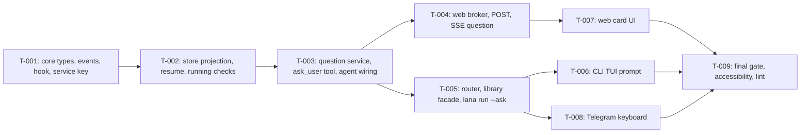

# Tasks: Ask-user questions

- **Issue**: `—`
- **Requirements**: [requirements.md](requirements.md)
- **Contract**: [api-contract.md](api-contract.md) — Required
- **Design**: [design.md](design.md)
- **Requirements revision**: 1
- **Contract revision**: 1
- **Design revision**: 1
- **Status**: Approved

Requirements, contract, and design are Approved (2026-10-30, Ridho, lifted gate). The implementation has not started.

## Execution rules

- Implement only the requirements and acceptance criteria assigned to the task.
- Stop if requirements, design, ADR, diagrams, or contract conflict with each other.
- Do not answer product or architecture questions only in code.
- Every acceptance criterion has exactly one evidence owner.
- Required verification is never optional.
- Mark a task complete only after verification evidence has been recorded.
- Code is written through the `dsh-coder` subagent, one task per call, with the target files and acceptance criteria in the brief (see the project `CLAUDE.md`). The main session plans, reviews the diff, and verifies.
- Go tooling runs inside `nix develop -c`. No global installs.
- Backend slices (`T-001` to `T-005`) come before UI slices (`T-006` to `T-008`). `T-009` is the final gate.
- Keep the request ID, the callback token, and answers out of logs (`REQ-ASK-019`).

## Coverage

| Acceptance criterion | Contract operation | Evidence owner | Issue/PR | Verification | Evidence |
|---|---|---|---|---|---|
| `AC-ASK-001` | `API-ASK-001` | `T-003` | — | `tools/ask_user_test.go` runs under trust, ask, never; no `approval/asked` | Pass |
| `AC-ASK-002` | `API-ASK-001` | `T-003` | — | `agent/turn_test.go` tool not in `tools` list | Pass |
| `AC-ASK-003` | `API-ASK-001` | `T-003` | — | `tools/ask_user_test.go` four questions rejected, no event | Pass |
| `AC-ASK-004` | `API-ASK-001` | `T-003` | — | `tools/ask_user_test.go` duplicate labels rejected | Pass |
| `AC-ASK-005` | `API-ASK-001` | `T-003` | — | `tools/ask_user_test.go` valid input opens one request | Pass |
| `AC-ASK-006` | `API-ASK-003` | `T-005` | — | `cmd/lana/daemon_test.go` router sends telegram session to Telegram only | Pass |
| `AC-ASK-007` | `API-ASK-003` | `T-005` | — | `lana_questions_test.go` no `AskWith` returns `no_responder` at once | Pass |
| `AC-ASK-008` | `API-ASK-001` | `T-003` | — | `internal/question/question_test.go` second request busy | Pass |
| `AC-ASK-009` | `API-ASK-001`, `API-ASK-002` | `T-003` | — | `internal/question/question_test.go` three entries in order, one submission | Pass |
| `AC-ASK-010` | — (UI) | `T-007` | — | Browser check: Next disabled with no selection | Pass |
| `AC-ASK-011` | `API-ASK-001` | `T-003` | — | `tools/ask_user_test.go` JSON shape, `other`, `skipped` | Pass |
| `AC-ASK-012` | `API-ASK-001` | `T-003` | — | `tools/ask_user_test.go` unavailable reasons, status success | Pass |
| `AC-ASK-013` | `API-ASK-002` | `T-003` | — | `internal/question/question_test.go` fake clock timeout, partial answers dropped | Pass |
| `AC-ASK-014` | `API-ASK-002` | `T-003` | — | `internal/question/question_test.go` cancel writes `cancelled` | Pass |
| `AC-ASK-015` | `API-ASK-002` | `T-002` | — | `store/store_test.go` open resume appends `interrupted` | Pass |
| `AC-ASK-016` | `API-ASK-008` | `T-002` | — | `store/store_test.go` projection `waiting_input` then `running` | Pass |
| `AC-ASK-017` | `API-ASK-008` | `T-002` | — | `store/store_test.go` turn start refused while `waiting_input` | Pass |
| `AC-ASK-018` | `API-ASK-002` | `T-003` | — | `internal/question/question_test.go` payload has no question text | Pass |
| `AC-ASK-019` | `API-ASK-004`, `API-ASK-005` | `T-004` | — | `web/questions_test.go` two answers, 200 then 409 | Pass |
| `AC-ASK-020` | `API-ASK-005` | `T-004` | — | `web/questions_test.go` option index 9 gives 422, request open | Pass |
| `AC-ASK-021` | `API-ASK-004` | `T-004` | — | `web/sse_test.go` replay on reconnect | Pass |
| `AC-ASK-022` | — (UI) | `T-007` | — | Browser check of single-select card against the mockup | Pass |
| `AC-ASK-023` | — (UI) | `T-007` | — | Browser check of multi-select card against the mockup | Pass |
| `AC-ASK-024` | — (UI) | `T-007` | — | Browser check: composer disabled, Stop enabled | Pass |
| `AC-ASK-025` | — (UI) | `T-009` | — | Keyboard-only walk-through with digits and Tab | Pending |
| `AC-ASK-026` | — (UI) | `T-009` | — | VoiceOver walk-through, notes in evidence | Pending |
| `AC-ASK-027` | `API-ASK-004` | `T-007` | — | Browser check: Telegram session shows read-only card | Pass |
| `AC-ASK-028` | `API-ASK-006` | `T-008` | — | `channels/telegram/ask_test.go` single tap, edited text, keyboard removed | Pass |
| `AC-ASK-029` | `API-ASK-006` | `T-008` | — | `channels/telegram/ask_test.go` armed text is the answer, not inbox | Pass |
| `AC-ASK-030` | `API-ASK-006` | `T-008` | — | `channels/telegram/ask_test.go` non-owner refused | Pass |
| `AC-ASK-031` | `API-ASK-007` | `T-006` | — | `channels/cli/tui/tui_test.go` key 2 records option 2 | Pass |
| `AC-ASK-032` | `API-ASK-003`, `API-ASK-007` | `T-005` | — | `cmd/lana/main_test.go` `lana run` without `--ask` returns no_responder | Pass |
| `AC-ASK-033` | `API-ASK-005` | `T-004` | — | `web/questions_test.go` missing CSRF refused | Pass |
| `AC-ASK-034` | `API-ASK-006` | `T-008` | — | `channels/telegram/ask_test.go` closed token text | Pass |
| `AC-ASK-035` | `API-ASK-001` | `T-007` | — | `web/render_test.go` tool line `ask_user · 2 questions`, status word | Pass |

## Task graph

## Tasks

- [x] `T-001` Add the core types, the event kinds and payloads, the hook, the service key, and the `ToolCtx` field
  - Issue/PR: `—`
  - Depends on: `None`
  - Requirements: `REQ-ASK-010` (payload shape), `REQ-ASK-003` (hook), `REQ-ASK-001` (`ToolCtx`)
  - Acceptance criteria: none owned here. Types only; behavior is tested in later slices
  - Contract operations: `API-ASK-002`, `API-ASK-003`
  - Target files:
    - `core/question.go` (new): `Question`, `QuestionOption`, `QuestionRequest`, `QuestionAnswer`, `QuestionOutcome`, `QuestionService` exactly as in the contract, plus constants for statuses (`answered`, `unavailable`) and reasons (`no_responder`, `timeout`, `cancelled`, `interrupted`)
    - `core/event.go`: `KindQuestionAsked = "question/asked"`, `KindQuestionAnswered = "question/answered"`, structs `QuestionAsked` and `QuestionAnswered` with `V` and the JSON tags of `API-ASK-002`
    - `core/hooks.go`: `QuestionAsk *Waterfall[QuestionRequest, QuestionOutcome]` in `Hooks` and `newHooks`
    - `core/context.go`: `ServiceQuestion ServiceKey = "question"`; `core/boot.go`: `{ServiceQuestion, &c.Questions}`; `Context.Questions QuestionService`
    - `core/tool.go`: `ToolCtx.Questions QuestionService`
  - Scope:
    - No behavior, only types. No import from `channels/`, `web/`, or `cmd/` (ADR 0015).
    - Constants and structs have doc comments in the style of `core/approval.go`.
  - Verification:
    - `nix develop -c go build ./...`
    - `nix develop -c go test -count=1 ./core/...`
    - `nix develop -c go test -count=1 ./internal/archtest/`
  - Completion evidence:
    - Status: Not started
    - Command/test: `go test -count=1 ./core/... ./internal/archtest/`, `golangci-lint run ./core/...`
    - Result: pass, 0 lint issues
    - PR/commit: —
    - Deviation: Implemented by dsh. Types and wiring only (no AC owned)

- [x] `T-002` Make the store project `waiting_input`, refuse a second turn while waiting, and close orphaned requests on resume
  - Issue/PR: `—`
  - Depends on: `T-001`
  - Requirements: `REQ-ASK-008`, `REQ-ASK-009`
  - Acceptance criteria: `AC-ASK-015`, `AC-ASK-016`, `AC-ASK-017`
  - Contract operations: `API-ASK-002`, `API-ASK-008`
  - Target files:
    - `store/store.go`: `validKinds` (add both kinds); `appendLocked` status switch (`KindQuestionAsked` to `waiting_input`, `KindQuestionAnswered` to `running`); the `ErrTurnActive` guard for `KindTurnStart` (about line 303) also refuses `waiting_input`; `RebuildProjections` (about line 754) applies the same rules; `Open` (about line 547) treats `waiting_input` as running and appends `question/answered` (`unavailable`, `interrupted`, responder `none`) for each orphaned `question/asked`, before the `turn/end` event, as the approval loop does
    - `store/memstore/memstore.go`: `appendLocked` switch gets the same two cases and the turn guard
    - `store/store_test.go` and `store/memstore/` tests as needed
  - Scope:
    - Migration `0003_session_status_waiting_input.sql` rebuilds `sessions` with `waiting_input` in the status CHECK; `schemaVersion` 3 (the CHECK of `0001` rejects the new value; applied migrations are never edited).
    - The orphan loop uses the same `seq` counter and `now` as the approval loop.
  - Verification:
    - `nix develop -c go test -count=1 ./store/... -run 'Question|Waiting|Projection|Open'`
    - `nix develop -c go test -count=1 ./store/...`
  - Completion evidence:
    - Status: Not started
    - Command/test: `go test -count=1 ./store/... . ./cmd/lana/ ./internal/archtest/`, `golangci-lint run ./store/...` (TestResumeRepairOrphanQuestion AC-ASK-015, TestProjectionQuestionWaitingThenRunning AC-ASK-016, TestTurnStartRejectedWhileWaitingInput AC-ASK-017, TestMigrateV2ToV3SessionsWaitingInput)
    - Result: pass, 0 lint issues
    - PR/commit: —
    - Deviation: Implemented by dsh. Migration `0003` rebuilds `sessions` (foreign keys off around that migration, `foreign_key_check` before commit); `schemaVersion` 3

- [x] `T-003` Add the question service, the `ask_user` tool, and the agent wiring
  - Issue/PR: `—`
  - Depends on: `T-001`, `T-002`
  - Requirements: `REQ-ASK-001` to `REQ-ASK-010`
  - Acceptance criteria: `AC-ASK-001`, `AC-ASK-002`, `AC-ASK-003`, `AC-ASK-004`, `AC-ASK-005`, `AC-ASK-008`, `AC-ASK-009`, `AC-ASK-011`, `AC-ASK-012`, `AC-ASK-013`, `AC-ASK-014`, `AC-ASK-018`
  - Contract operations: `API-ASK-001`, `API-ASK-002`
  - Target files:
    - `internal/question/service.go` (new): `Service` implements `core.QuestionService`. Holds the store, the hooks, the clock, the timeout (30 minutes constant), the open map, and `openBySession`. Steps as in the design, "Opening". Writes `question/asked` with `context.WithoutCancel`; calls `Hooks.QuestionAsk`; maps the outcome; writes `question/answered` in every case
    - `internal/question/question.go` (new): input checks (1 to 3 questions, 2 to 6 options, lengths, unique labels, non-empty text), shared by the tool and the service
    - `tools/ask_user.go` (new): `NewAskUser() core.Tool`, spec with the schema from the contract, `Risk` returns `core.RiskRead`, `Call` decodes with `decodeInput`, checks, calls `tc.Questions.Ask`, returns JSON output; nil `tc.Questions` returns `unavailable` `no_responder`
    - `tools/ask_user_test.go` (new)
    - `internal/question/question_test.go` (new): service tests named in the coverage table
    - `tools/module.go`: add `NewAskUser()` to `builtins`
    - `internal/toolfmt/toolfmt.go`: `PrimaryArg` case `ask_user` returns the first question text
    - `internal/agenthome/templates.go`: add `ask_user` to `allTools` (`Q-006`)
    - `agent/registry.go`: `questions core.QuestionService` field and `SetQuestions`
    - `agent/turn.go` (`ToolCtx{...}` at the `pipeline.Run` call, about line 491): `Questions: rn.reg.questions`
    - `agent/turn_test.go`: tool not enabled case
    - `module` wiring that creates `internal/question.Service` and sets `ServiceQuestion` (in `lana.go` or the boot path, where `Approval` is provided)
  - Scope:
    - The tool is risk `read`. Do not change `tools/permission/evaluator.go`.
    - The service never calls a responder when the input is invalid, or when another request is open for the session.
    - Store writes use the session ID from `ToolCtx`, and the same event shape as `tools/permission/approval.go`.
    - Output JSON key order: `status`, then `answers` (or `reason`). Use a struct with ordered fields, not a map.
  - Verification:
    - `nix develop -c go test -count=1 ./internal/question/ ./tools/ ./internal/toolfmt/ ./internal/agenthome/ -run 'Ask|Question'`
    - `nix develop -c go test -count=1 ./agent/ -run 'Question|Tool'`
    - `nix develop -c go test -count=1 ./...`
  - Completion evidence:
    - Status: Not started
    - Command/test: `go test -count=1 ./agent/... ./tools/... ./core/ . ./internal/question/ ./internal/archtest/`, `golangci-lint run` (internal/question AC-ASK-005, 008, 009, 013, 014, 018; tools/ask_user_test.go AC-ASK-001, 003, 004, 011, 012; agent/turn_test.go AC-ASK-002)
    - Result: pass, 0 lint issues
    - PR/commit: —
    - Deviation: Implemented by dsh. Service in internal/question; `ask_user` added to template tool lists (Q-006)

- [x] `T-004` Add the web question broker, the POST endpoint, and the `question` SSE event
  - Issue/PR: `—`
  - Depends on: `T-003`
  - Requirements: `REQ-ASK-011`, `REQ-ASK-019`
  - Acceptance criteria: `AC-ASK-019`, `AC-ASK-020`, `AC-ASK-021`, `AC-ASK-033`
  - Contract operations: `API-ASK-004`, `API-ASK-005`
  - Target files:
    - `web/questions.go` (new): `Questions` broker copied from `web/approvals.go`; `Ask(ctx, core.QuestionRequest) core.QuestionOutcome`; `answer(id, body)` with validation of `API-ASK-005`; `subscribe(sessionID)`; `registerQuestionRoutes`; `handleAnswerQuestion`; `maxQuestionBody` = 64 KiB; closed-ID retention 1 hour; 30-minute timeout
    - `web/server.go`: `questions *Questions` field, `Questions()` accessor, call `registerQuestionRoutes` where `registerApprovalRoutes` is called
    - `web/sse.go`: subscribe to questions next to approvals; replay; `case event := <-questionEvents` writes `event: question`
    - `web/questions_test.go` (new), `web/sse_test.go` (question replay case)
  - Scope:
    - The broker never writes the log. `Ask` returns the outcome; the service writes `question/answered`.
    - The broker's `Ask` is wired by `T-005` (router). Tests use a fake clock as `approvals_test.go` does.
    - Body validation returns `400 invalid_request` for malformed JSON and `422 invalid_answers` for the rules in the contract, with `skip_all` as a separate case.
  - Verification:
    - `nix develop -c go test -count=1 ./web/ -run 'Question|SSE|Approval'`
    - `nix develop -c go test -count=1 ./internal/archtest/`
  - Completion evidence:
    - Status: Not started
    - Command/test: `go test -race -count=1 ./web/ ./cmd/lana/`, `golangci-lint run ./web/...` (questions_test.go AC-ASK-019, 020, 033; sse_test.go AC-ASK-021; sessions_test.go waiting_input)
    - Result: pass, 0 lint issues
    - PR/commit: —
    - Deviation: Implemented by dsh. `Ask` returns `(QuestionOutcome, error)` as core.QuestionService does

- [x] `T-005` Add the question router, the library facade, and the `lana run --ask` line prompt
  - Issue/PR: `—`
  - Depends on: `T-003`, `T-004` (for `webServer.Questions().Ask`)
  - Requirements: `REQ-ASK-003`, `REQ-ASK-018`
  - Acceptance criteria: `AC-ASK-006`, `AC-ASK-007`, `AC-ASK-032`
  - Contract operations: `API-ASK-003`, `API-ASK-007`
  - Target files:
    - `lana.go`: `AskFunc`, `AskWith(fn) Option`, `AskChannels(...) Option`, `runtimeOptions` fields; in `New`, install `coreCtx.Hooks.QuestionAsk.Use` like the approval hook (recover, validate outcome, `no_responder` fallback); default channels `library` and `cli`
    - `lana_channel.go` or `lana.go`: a validator for question outcomes (`validQuestionOutcome`)
    - `cmd/lana/daemon.go`: `QuestionRouter` with `sessionInfo`, `telegram`, `web` fields, same switch as `ApprovalRouter`; pass `lana.AskWith(router.Ask)` and `lana.AskChannels("telegram", "web")` as extra options to `runtimeFor`
    - `cmd/lana/main.go`: `lineQuestioner` copied from `lineAnswerer` (opens `/dev/tty`, prompts as `API-ASK-007` line mode, returns `unavailable` `no_responder` without a terminal); wired only when `--ask` is set for `lana run`
    - `cmd/lana/daemon_test.go`, `cmd/lana/main_test.go`, `lana_questions_test.go` (new, root package)
  - Scope:
    - `lana run` without `--ask` passes no question option. The hook then returns `no_responder`.
    - The router never sends a request to a channel other than the one the session belongs to.
  - Verification:
    - `nix develop -c go test -count=1 . ./cmd/lana/ -run 'Question|Ask|Approve'`
    - `nix develop -c go test -count=1 ./internal/archtest/`
  - Completion evidence:
    - Status: Not started
    - Command/test: `go test -count=1 . ./cmd/lana/ ./internal/question/ ./internal/archtest/`, `golangci-lint run` (TestQuestionRouterTelegramOnly AC-ASK-006, TestRunWithoutAskReturnsNoResponder AC-ASK-032, TestQuestionWithoutResponder AC-ASK-007)
    - Result: pass, 0 lint issues
    - PR/commit: —
    - Deviation: Implemented by dsh. The router entries for web and Telegram are wired in `T-004` and `T-008`

- [x] `T-006` Add the CLI TUI question prompt
  - Issue/PR: `—`
  - Depends on: `T-005`
  - Requirements: `REQ-ASK-017`
  - Acceptance criteria: `AC-ASK-031`
  - Contract operations: `API-ASK-007`
  - Target files:
    - `channels/cli/tui/asker.go` (new): `Asker` copied from `Approver` (`NewAsker`, `SetProgram`, `Ask`)
    - `channels/cli/tui/model.go`: `questionMsg`, `questionState`, `handleQuestionKey` (keys in `API-ASK-007`), `renderQuestion` placed next to `renderApproval`; transcript lines for outcomes
    - `cmd/lana/chat.go`: `asker := tui.NewAsker()`, pass `lana.AskWith(asker.Ask)` and `lana.AskChannels("cli")` as extra options; `tui.Options` gets the asker and the program is set as for the approver
    - `channels/cli/tui/tui_test.go`: key tests
  - Scope:
    - Ctrl+C keeps its existing meaning (cancel the turn), and the request ends `cancelled`.
    - Multi-select with nothing selected: `Pick at least one option, or s to skip.`
    - Keep the approval menu untouched.
  - Verification:
    - `nix develop -c go test -count=1 ./channels/cli/tui/ -run 'Question|Approv'`
    - `nix develop -c go test -count=1 ./cmd/lana/ -run 'Chat'`
  - Completion evidence:
    - Status: Not started
    - Command/test: `go test -count=1 ./channels/cli/... ./cmd/lana/ ./internal/archtest/`, `golangci-lint run` (tui_test.go AC-ASK-031, Something else, skip, multi select, Ctrl+C)
    - Result: pass, 0 lint issues
    - PR/commit: —
    - Deviation: Implemented by dsh. `tui.Asker` mirrors `tui.Approver`

- [x] `T-007` Build the web question card in the session view
  - Issue/PR: `—`
  - Depends on: `T-004`
  - Requirements: `REQ-ASK-009` (display), `REQ-ASK-011` (client), `REQ-ASK-012`, `REQ-ASK-013`, `REQ-ASK-014`, `REQ-ASK-015`, `REQ-ASK-020`
  - Acceptance criteria: `AC-ASK-010`, `AC-ASK-022`, `AC-ASK-023`, `AC-ASK-024`, `AC-ASK-027`, `AC-ASK-035`
  - Contract operations: `API-ASK-004`, `API-ASK-005`
  - Target files:
    - `web/assets/views/question.js` (new): Preact + htm component `QuestionCard`, no build step (imports from `/assets/vendor/preact-htm.js`)
    - `web/assets/views/session.js`: mount the card above the composer; disable the textarea with `Answer the question above`; keep Stop enabled; turn header text `waiting for you`
    - `web/assets/api.js`: `answerQuestion(requestId, body)` helper using the existing CSRF helper; `skipAllQuestions`
    - `web/assets/app.css`: card classes using the tokens of `design/export/tokens.css` (`--bg-primary`, `--bg-secondary`, `--border-secondary`, `--bg-brand-solid`, `--fg-white`, `--text-placeholder`)
    - `web/render.go` (`ToolStatusWord` or the status word map): `waiting_input` maps to `waiting for you`; `ask_user` tool line `ask_user · N questions` and status `answered` or `unavailable`
    - `web/render_test.go`: tool line and status words
    - Read-only card for another channel (`REQ-ASK-015`)
  - Scope:
    - Follow the mockup layout (`design/export/screens/sessions-question.layout.txt`, `sessions-question-multi-select.layout.txt`). Layout details are in the design file, "Web UI reference".
    - Keyboard and screen-reader behavior are fully in `T-009`'s checks; implement the attributes in the design (`role`, `aria-labelledby`, `aria-describedby`, the live region).
    - The card does not take focus when it opens and is not modal.
    - Next is disabled until a selection or text exists (multi-select). Single-select picks advance; the last pick submits.
    - Submit errors: `422` shows `Check your answers`; `409` shows `Already answered elsewhere`; `404` shows `This question is no longer open`; other errors show `Could not send. Try again.`
  - Verification:
    - `nix develop -c go test -count=1 ./web/ -run 'Assets|Render|Question'`
    - Browser check on the loopback address: single-select and multi-select against the PNGs in `design/export/screens/`, with a screenshot in the completion evidence
    - Browser check: a Telegram session shows the read-only card (`AC-ASK-027`)
  - Completion evidence:
    - Status: Not started
    - Command/test: `go test -count=1 ./web/`, `node --check` (views/question.js, api/questions.js, session.js, turn.js)
    - Result: pass, 0 lint issues
    - PR/commit: —
    - Deviation: Implemented by dsh. The card opens from the durable `question/asked` item of the stream; the live `question` SSE event is added to api.js in a follow-up slice. Browser check of AC-ASK-022..027 runs with T-009

- [x] `T-008` Add the Telegram question keyboard
  - Issue/PR: `—`
  - Depends on: `T-005`
  - Requirements: `REQ-ASK-016`, `REQ-ASK-019`
  - Acceptance criteria: `AC-ASK-028`, `AC-ASK-029`, `AC-ASK-030`, `AC-ASK-034`
  - Contract operations: `API-ASK-006`
  - Target files:
    - `channels/telegram/ask.go` (new): `Channel.Ask(ctx, req) core.QuestionOutcome`; token generation (12 hex); per-request state; message and keyboard builders for the texts in `API-ASK-006`; `answerQuestion(ctx, q, data, owner)`; outcome edits
    - `channels/telegram/chat.go`: `handleCallback` case `q` next to `a`; `handleText` checks the armed `Something else` state of the chat before the running branch
    - `channels/telegram/channel.go`: `QuestionTimeout time.Duration` (default 30 minutes in `New`); `questions map[string]*question` in `Channel`
    - `channels/telegram/ask_test.go` (new), reusing the fake API of `telegram_test.go`
  - Scope:
    - Callback data is `q:<tok>:<qi>:<act>[:<oi>]`, under 64 bytes.
    - Only the owner answers (`isOwner`). Group members get the owner text.
    - Armed text is the answer only while `Something else` is armed; other text goes to the inbox as before (`Q-007`).
    - A send error ends the request as `unavailable` `no_responder`. Edits after the close use `context.WithoutCancel`, with a 5-second timeout, as `approve.go` does.
  - Verification:
    - `nix develop -c go test -count=1 ./channels/telegram/ -run 'Question|Ask|Approval'`
    - `nix develop -c go test -count=1 ./channels/telegram/`
  - Completion evidence:
    - Status: Not started
    - Command/test: `go test -race -count=1 ./channels/telegram/ ./cmd/lana/`, `golangci-lint run` (ask_test.go AC-ASK-028..030, AC-ASK-034; daemon_test.go web question routing)
    - Result: pass, 0 lint issues
    - PR/commit: —
    - Deviation: Implemented by dsh, together with the daemon wiring of `QuestionRouter.web` and `.telegram`

- [ ] `T-009` Run the final gate: full tests, lint, keyboard and screen-reader walk-through
  - Issue/PR: `—`
  - Depends on: `T-006`, `T-007`, `T-008`
  - Requirements: `REQ-ASK-013`, `REQ-ASK-014`
  - Acceptance criteria: `AC-ASK-025`, `AC-ASK-026`
  - Contract operations: `API-ASK-004`, `API-ASK-005`
  - Target files: none (verification only)
  - Scope:
    - Keyboard-only run of `SC-001` and `SC-002` in the browser, without a pointer.
    - VoiceOver run of the same scenarios on macOS, with the announcements noted in the evidence.
    - Check for `SC-003` (timeout) with the 30-minute clock shortened in a test build only, not in the release.
  - Verification:
    - `nix develop -c go test -count=1 ./...`
    - `nix develop -c golangci-lint run ./...`
    - `nix develop -c go test -count=1 ./internal/archtest/`
    - Manual walk-through notes in the completion evidence
  - Completion evidence:
    - Status: Not started
    - Command/test: —
    - Result: Automated gate passed on 2026-10-30: `gofmt` clean, `go build ./...`, `go test -count=1 ./...`, `go test -race` (web, cmd/lana, agent, channels, store, internal/question), `golangci-lint run ./...` 0 issues, `make release` (3 platforms); headless Chrome screenshots of every page compared with design/export/screens. Pending: keyboard-only walk-through and VoiceOver run by the owner
    - PR/commit: —
    - Deviation: —
