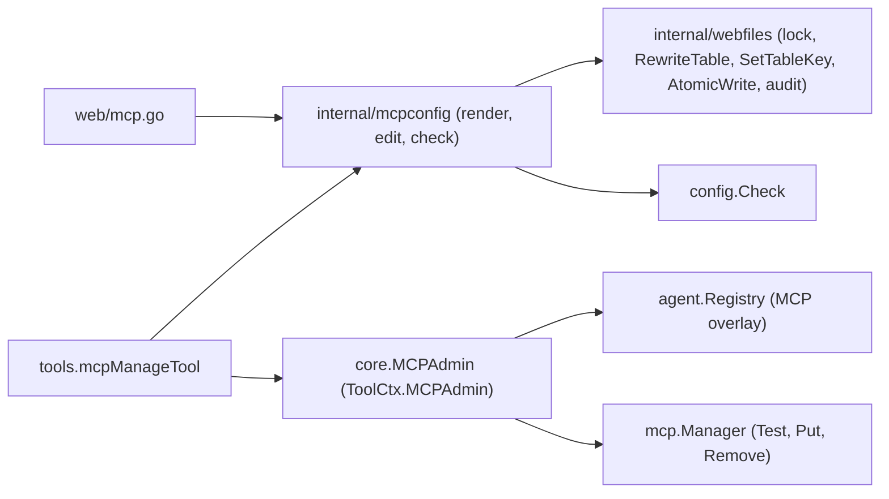

# Design: Agent MCP self-configuration and workspace repair

- **Issue**: —
- **Requirements**: [requirements.md](requirements.md)
- **Contract**: [api-contract.md](api-contract.md) — Required
- **Requirements revision**: 1
- **Contract revision**: 1
- **Requirements status**: Approved
- **Contract status**: Approved
- **Status**: Approved
- **Design revision**: 1

## Architecture references

- **ADR**: [0004](../../adr/0004-permission-mode-per-agent.md), [0006](../../adr/0006-extend-via-mcp-client-and-skills.md)
- **Feature-local diagram**: below
- **Durable diagram**: [0002](../../diagram/0002-agent-loop-and-approval.md) — unchanged; `admin` is one more branch in the permission engine

## Architecture decision scan

| Topic | Existing authority | Decision location | Action |
|---|---|---|---|
| Public interface | spec #7 contract (`[mcp.*]`, tool names) | this contract | create `mcp_manage`, risk `admin` |
| Persistence | spec #9 (`config.toml` atomic write, audit) | this design | reuse |
| State and lifecycle | spec #7 (lazy start, idle stop) | this design | extend manager with `Put` and `Remove` |
| Concurrency | `web.configWriteMu` | this design | move the lock to `internal/webfiles` |
| Dependency direction | `tools` imports `core`, `internal/*` only | this design | `tools` gets `config` and `internal/webfiles`; never `web` or `mcp` |

## Visual Architecture Check

| Trigger | Present? | Required view |
|---|---:|---|
| Module or crate boundary | Yes | flowchart |
| Interaction with an actor or external system | Yes | sequence |
| Multi-component flow | Yes | sequence |
| Lifecycle or state transition | No | — |
| Entity relation | No | — |
| Concurrency, retry, or failure flow | Yes | in sequence |
| Dependency direction or runtime topology | Yes | flowchart |

## Feature-local view



```mermaid
sequenceDiagram
  participant M as Model
  participant P as Permission engine
  participant O as Owner
  participant T as mcp_manage
  participant A as MCPAdmin
  M->>P: mcp_manage add (risk admin)
  P->>O: approval prompt (always)
  O-->>P: allowed_once
  P->>T: Call
  T->>T: lock, read config.toml, build candidate
  T->>T: config.Check(candidate) -> resolved MCPConfig
  T->>A: TestServer(resolved)
  A-->>T: n tools / error (stop, nothing written)
  T->>T: AtomicWrite, audit, unlock
  T->>A: PutServer(name, resolved); SetAgentServers(agent, list)
  T-->>M: "added ... n tools ... from the next turn"
```

## Repository fit

- The tool lives in `tools/mcp_manage.go` and is registered in `tools/module.go` like `skill_write`.
- TOML rendering and parsing for MCP tables move from `web/mcp.go` to a new `internal/mcpconfig` package so `web` and `tools` share them. `web/mcp.go` keeps its HTTP handling and calls the package.
- The hot apply goes through a new core interface on `ToolCtx`, the same pattern as `Questions` and `Subagents`. `tools` never imports `mcp` or `agent`.

## Proposed design

### Components

- **`internal/webfiles.ConfigWriteMu`** — an exported `sync.Mutex`. `web` replaces its package `configWriteMu` with `&webfiles.ConfigWriteMu` and keeps every call site.
- **`internal/webfiles.SetTableKey(data []byte, header, key, value string) ([]byte, error)`** — replaces the full value of `key` inside the table `header` (a multi-line array ends at the matching `]` outside strings), or appends `key = value` at the end of the table. Returns an error if the table does not exist. Comments and other keys stay byte-identical.
- **`internal/webfiles.DeleteTable(data []byte, header string) []byte`** — removes a table span, using the existing span finder. Reuse what `handleDeleteMCP` does today if it already has this; move it, do not copy it.
- **`internal/mcpconfig`** — `Definition` (moved `web.MCPDefinition`), `Parse(raw) (Document, error)`, `Render(name, def) string`, `Usage(doc) map[string][]string`, `AgentList(doc, agent) []string`, `RenderList([]string) string`, and the name regexp `^[a-z0-9-]+$`. `web/mcp.go` uses these instead of its private copies.
- **`core.MCPAdmin`** —

  ```go
  // MCPAdmin changes MCP servers while the runtime runs.
  type MCPAdmin interface {
      TestServer(ctx context.Context, cfg MCPConfig) (tools int, err error)
      PutServer(name string, cfg MCPConfig)
      RemoveServer(name string)
      SetAgentServers(agent string, servers []string)
  }
  ```

  `ToolCtx` gets `MCPAdmin MCPAdmin`. `agent/turn.go` sets it for root sessions only.
- **`mcp.Manager.Put` / `Remove`** — `Put` adds a server or replaces its definition. A replaced running server is closed and its tools are unregistered, using the existing stop path. `Remove` closes and forgets a server. The `servers` map gets a `sync.RWMutex`; `Ensure`, `Status`, `Restart`, `ReapIdle`, and `Close` take the read or write lock around map access.
- **`agent.Registry` MCP overlay** — `map[string][]string` with a mutex. `resolve` uses the overlay list for the agent when present, else `cfg.MCP`. The registry implements `core.MCPAdmin` by forwarding to its manager and the overlay. If the registry has no manager, `ToolCtx.MCPAdmin` is nil.
- **`tools.mcpManageTool`** — validates input, then runs `list`, `add`, or `remove` (see contract). `Risk` returns `read` for `list` and `admin` otherwise, including unparseable input.
- **Permission engine** — `core.RiskAdmin = "admin"`. In `Engine.Handle`, after deny rules: if risk is `admin`, reject child sessions (`info.ParentSessionID != ""`), reject policy `never`, then ask the owner, skipping allow rules, grants, and `trust`. Any allowed outcome allows only this call.
- **Turn tool list** — `agent/turn.go` appends `mcp_manage` for root sessions next to `skill_load`, before `filterDisabledTools`. `lana.go` adds `mcp_manage` to the `toolCatalogGroupOrder` group `mcp-admin` (label `MCP`), and the risk label switch at `lana.go:919` shows `admin` as needing approval.
- **Workspace** — in `agent/turn.go`, after `resolve`, `os.MkdirAll(resolved.workspace, 0o700)` when the path is set and missing. A failure is logged and not fatal. In `tools/guard.go`, a helper `checkWorkspace(ws) error` returns `workspace does not exist: <path>` or `workspace is not a directory: <path>`; `bash`, `glob`, and `grep` call it before they start.

### Contract mapping

| Contract operation | Component | Input | Result | Requirements |
|---|---|---|---|---|
| `API-AMCP-001` | `tools.mcpManageTool` | tool input JSON | text output | `REQ-AMCP-001` through `REQ-AMCP-005`, `REQ-AMCP-007` |
| `API-AMCP-002` | Permission engine | risk `admin` | ask or reject | `REQ-AMCP-006` |
| `API-AMCP-003` | `internal/mcpconfig`, `internal/webfiles` | candidate bytes | `config.toml`, audit | `REQ-AMCP-008` |
| `API-WS-001` | `agent/turn.go`, `tools/guard.go` | workspace path | folder or error text | `REQ-WS-001`, `REQ-WS-002` |

### Add algorithm

1. Reject if `tc.Home == ""` or `tc.MCPAdmin == nil`.
2. Lock `webfiles.ConfigWriteMu`; read `config.toml`; parse with `mcpconfig.Parse`.
3. If `command` and `url` are empty: the server must exist; the candidate changes only the agent list.
4. Else build the definition. If `[mcp.<name>]` exists, differs, and `Usage` names an agent other than the caller, fail with `conflict:`.
5. Candidate = `RewriteTable([mcp.<name>])` when the definition is new or different, then `SetTableKey([agents.<agent>], "mcp", RenderList(list + name))`.
6. `config.Check(ctx, home, candidate)`. Map a `variable ${X} not found` error to the secret message. Other errors give `config.toml is not valid:`.
7. If the definition is new or different: `MCPAdmin.TestServer(ctx, checked.Config.MCP[name])`. On error, stop with `connection test failed:` (value-redacted).
8. `AtomicWrite`; append audit entries; unlock.
9. `PutServer(name, checked.Config.MCP[name])` and `SetAgentServers(agent, checked.Config.Agents[agent].MCP)`.

`remove` runs steps 1–2, checks the server is attached, removes it from the list, deletes the table when `Usage` has no other agent, then steps 6, 8, and 9 with `RemoveServer` only when the table was deleted.

### Persistence

- `config.toml`: `[mcp.<name>]` and `agents.<agent>.mcp`. No database change.
- `$LANA_HOME/logs/audit.jsonl` through `webfiles.AppendAudit`: `mcp.save`, `mcp.delete`, `agent.save`.

### Failure handling

| Failure | Internal error | Observable result |
|---|---|---|
| Unresolved secret | `config.Check` error | `secret NAME is not set; ask the owner to add it in Settings → Secrets` |
| Test fails | `Manager.Test` error | `connection test failed: <redacted reason>` |
| Write fails | `AtomicWrite` error | `failed to write config.toml: <error>`; no in-memory change |
| Workspace create fails | `os.MkdirAll` error | log warning; tools then return `workspace does not exist:` |

### Concurrency

- `ConfigWriteMu` covers read, check, test, write. The test can take up to `ConnectTimeout`; web saves wait for it. Accepted: changes are rare and owner-approved.
- `PutServer` closes a replaced running session under the server mutex, so an in-flight `tools/call` on the old session fails like an idle stop does today.

### Security

- `admin` ignores `trust`, allow rules, and grants. Deny rules still apply.
- The tool output and logs show env and header keys only. Error text goes through `redactMCPValues` (moved to `internal/mcpconfig`) with the resolved values.

### Observability

- `slog.Info("mcp_manage", "action", ..., "agent", ..., "server", ...)` without values.

## Requirement traceability

| Requirement | Contract operation | Design component | Verification level |
|---|---|---|---|
| `REQ-AMCP-001` | `API-AMCP-001` | turn tool list | unit |
| `REQ-AMCP-002` | `API-AMCP-001` | `mcpManageTool` list | unit |
| `REQ-AMCP-003` | `API-AMCP-001` | add algorithm | unit with fake `MCPAdmin` |
| `REQ-AMCP-004` | `API-AMCP-001` | remove algorithm | unit |
| `REQ-AMCP-005` | `API-AMCP-001` | `agent.Registry` overlay, `Manager.Put/Remove` | integration (agent turn with fake MCP server) |
| `REQ-AMCP-006` | `API-AMCP-002` | permission engine | unit |
| `REQ-AMCP-007` | `API-AMCP-001` | add step 6 | unit |
| `REQ-AMCP-008` | `API-AMCP-003` | `internal/webfiles`, `internal/mcpconfig` | unit |
| `REQ-WS-001` | `API-WS-001` | `agent/turn.go` | integration |
| `REQ-WS-002` | `API-WS-001` | `tools/guard.go` | unit |

## Acceptance verification map

| Acceptance criterion | Verification method | Planned evidence |
|---|---|---|
| `AC-AMCP-001`, `AC-AMCP-002` | unit | `agent` turn test on offered tools |
| `AC-AMCP-003` | unit | `tools/mcp_manage_test.go` list |
| `AC-AMCP-004` through `AC-AMCP-009` | unit | `tools/mcp_manage_test.go` with temp `LANA_HOME` and fake `MCPAdmin` |
| `AC-AMCP-010`, `AC-AMCP-011` | integration | `agent` test: add in turn 1, offered tools in turn 2 |
| `AC-AMCP-012` through `AC-AMCP-015` | unit | `tools/permission` tests |
| `AC-AMCP-016` | unit | `tools/mcp_manage_test.go` |
| `AC-AMCP-017`, `AC-AMCP-018` | unit | `tools/mcp_manage_test.go` audit file and invalid candidate |
| `AC-WS-001` | integration | `agent` turn test with missing workspace + `bash pwd` |
| `AC-WS-002` | unit | `tools/bash_test.go` |

## Verification strategy

- **Unit**: `internal/webfiles` (`SetTableKey`, `DeleteTable`), `internal/mcpconfig`, `tools`, `tools/permission`, `mcp` (`Put`, `Remove`, map lock under `-race`).
- **Integration**: `agent` turn tests, existing `web` MCP tests stay green after the move.
- **Runtime**: `lana web` → chat "add the filesystem MCP for ~/notes" → approve → next message lists `mcp__filesystem__*`.

## Risks and tradeoffs

- The web settings page and `/mcp` read the loaded config, so they lag until a restart. Accepted for this revision.
- A slow `npx` first download can exceed `ConnectTimeout`; the agent then sees `connection test failed:` and can retry.

## Blocking Design Questions

None.

## Approval

- [x] Requirements are Approved and their revision is recorded.
- [x] Contract is Approved or `Not required`.
- [x] Architecture decision scan and Visual Architecture Check are complete.
- [x] Required ADRs are Accepted.
- [x] Every requirement maps to one design component.
- [x] Every acceptance criterion has a verification method.
- [x] Blocking Design Questions is `None`.
- **Approved by**: Ridho
- **Approved on**: 2026-10-30
