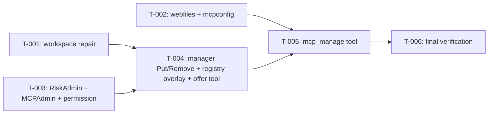

# Tasks: Agent MCP self-configuration and workspace repair

- **Issue**: —
- **Requirements**: [requirements.md](requirements.md)
- **Contract**: [api-contract.md](api-contract.md) — Required
- **Design**: [design.md](design.md)
- **Requirements revision**: 1
- **Contract revision**: 1
- **Design revision**: 1
- **Status**: In Progress

## Execution rules

- `T-001`, `T-002`, and `T-003` touch separate files and may run in parallel.
- Each task keeps `nix develop -c go build ./...` and the tests of the touched packages green.
- Required verification is never optional.
- Mark a task complete only after verification evidence has been recorded.

## Coverage

| Acceptance criterion | Contract operation | Evidence owner | Issue/PR | Verification | Evidence |
|---|---|---|---|---|---|
| `AC-WS-001`, `AC-WS-002` | `API-WS-001` | `T-001` | — | `agent`, `tools` tests | Pass |
| `AC-AMCP-018` | `API-AMCP-003` | `T-002` | — | `internal/webfiles`, `internal/mcpconfig`, `web` tests | Pass |
| `AC-AMCP-012` through `AC-AMCP-015` | `API-AMCP-002` | `T-003` | — | `tools/permission` tests | Pass |
| `AC-AMCP-001`, `AC-AMCP-002`, `AC-AMCP-010`, `AC-AMCP-011` | `API-AMCP-001` | `T-004` | — | `agent`, `mcp` tests | Pass |
| `AC-AMCP-003` through `AC-AMCP-009`, `AC-AMCP-016`, `AC-AMCP-017` | `API-AMCP-001`, `API-AMCP-003` | `T-005` | — | `tools/mcp_manage_test.go` | Pass |

## Task graph

## Tasks

- [x] `T-001` Create a missing workspace at turn start and report workspace errors clearly
  - Depends on: `None`
  - Requirements: `REQ-WS-001`, `REQ-WS-002`
  - Acceptance criteria: `AC-WS-001`, `AC-WS-002`
  - Contract operations: `API-WS-001`
  - Scope:
    - `agent/turn.go`: after `rn.resolve`, `os.MkdirAll(resolved.workspace, 0o700)` when set and missing; log failure with `slog.Warn`, do not fail the turn.
    - `tools/guard.go`: `checkWorkspace(ws string) error` with the contract texts.
    - `tools/bash.go`, `tools/search.go` (`glob`, `grep`): call `checkWorkspace` before work; return `errorOutput(err.Error())`.
  - Verification:
    - `nix develop -c go test ./agent/... ./tools/...`
  - Completion evidence:
    - Status: Done
    - Command/test: `go test ./agent/... ./tools/...` (TestTurnCreatesMissingWorkspace, TestBashMissingWorkspace, TestBashWorkspaceNotCreatable, TestCheckWorkspace, Test{Glob,Grep}MissingWorkspace)
    - Result: pass
    - PR/commit: —
    - Deviation: Extra error text `workspace is not accessible: <path>: <error>`, added to the contract

- [x] `T-002` Share the config write lock and MCP TOML helpers
  - Depends on: `None`
  - Requirements: `REQ-AMCP-008`
  - Acceptance criteria: `AC-AMCP-018`
  - Contract operations: `API-AMCP-003`
  - Scope:
    - `internal/webfiles`: exported `ConfigWriteMu sync.Mutex`; `SetTableKey(data, header, key, value)`; `DeleteTable(data, header)` unless an equivalent exists.
    - New `internal/mcpconfig`: move `MCPDefinition`, parse, render, usage, name regexp, value redaction, and the TOML key/string helpers they need from `web/mcp.go` (and `web/providers.go` only if those helpers must move; otherwise copy the two small helpers and note it).
    - `web/mcp.go`, `web/skills.go`, and other `configWriteMu` users: use `webfiles.ConfigWriteMu` and `internal/mcpconfig`. No HTTP behavior change.
  - Verification:
    - `nix develop -c go test ./internal/... ./web/... ./cmd/...`
  - Completion evidence:
    - Status: Done
    - Command/test: `go test ./internal/... ./web/... ./cmd/...` (tomlkey_test.go, mcpconfig_test.go, web MCP tests unchanged)
    - Result: pass
    - PR/commit: —
    - Deviation: None

- [x] `T-003` Add risk `admin`, `core.MCPAdmin`, and the permission rule
  - Depends on: `None`
  - Requirements: `REQ-AMCP-006`
  - Acceptance criteria: `AC-AMCP-012` through `AC-AMCP-015`
  - Contract operations: `API-AMCP-002`
  - Scope:
    - `core/tool.go`: `RiskAdmin`; `ToolCtx.MCPAdmin`.
    - `core/mcp.go`: `MCPAdmin` interface from the design.
    - `tools/permission/evaluator.go`: `admin` branch per the contract order; skip allow rules, grants, and `trust`.
    - `lana.go` risk label switch near line 919 and any other `core.Risk` switch: handle `admin` as needing approval.
  - Verification:
    - `nix develop -c go test ./core/... ./tools/permission/... .`
  - Completion evidence:
    - Status: Done
    - Command/test: `go test ./core/... ./tools/permission/... .` (tools/permission/admin_test.go)
    - Result: pass
    - PR/commit: —
    - Deviation: None

- [x] `T-004` Hot-apply MCP changes and offer `mcp_manage` to root sessions
  - Depends on: `T-001`, `T-003`
  - Requirements: `REQ-AMCP-001`, `REQ-AMCP-005`
  - Acceptance criteria: `AC-AMCP-001`, `AC-AMCP-002`, `AC-AMCP-010`, `AC-AMCP-011`
  - Contract operations: `API-AMCP-001`
  - Scope:
    - `mcp/manager.go`: `sync.RWMutex` on the `servers` map; `Put`, `Remove`.
    - `agent/registry.go`: overlay map; implement `core.MCPAdmin`.
    - `agent/turn.go`: overlay in `resolve`; offer `mcp_manage` for root sessions before `filterDisabledTools`; set `ToolCtx.MCPAdmin` for root sessions when the registry has a manager.
    - `lana.go`: `toolCatalogGroupOrder` entry `{ID: "mcp-admin", Label: "MCP", Names: []string{"mcp_manage"}}`.
  - Verification:
    - `nix develop -c go test -race ./mcp/... ./agent/... .`
  - Completion evidence:
    - Status: Done
    - Command/test: `go test -race ./mcp/... ./agent/... .` (manager_put_test.go, turn_mcp_test.go, lana_tool_asks_test.go)
    - Result: pass
    - PR/commit: —
    - Deviation: `mcp/tool.go` changed to read the server map under the new lock

- [x] `T-005` Implement the `mcp_manage` tool
  - Depends on: `T-002`, `T-004`
  - Requirements: `REQ-AMCP-002`, `REQ-AMCP-003`, `REQ-AMCP-004`, `REQ-AMCP-007`, `REQ-AMCP-008`
  - Acceptance criteria: `AC-AMCP-003` through `AC-AMCP-009`, `AC-AMCP-016`, `AC-AMCP-017`
  - Contract operations: `API-AMCP-001`, `API-AMCP-003`
  - Scope:
    - `tools/mcp_manage.go`, `tools/mcp_manage_test.go`; register in `tools/module.go`.
    - Follow the add and remove algorithms in the design exactly.
  - Verification:
    - `nix develop -c go test ./tools/...`
  - Completion evidence:
    - Status: Done
    - Command/test: `go test ./...` (tools/mcp_manage_test.go)
    - Result: pass
    - PR/commit: —
    - Deviation: `internal/archtest` allows `tools` → `config` for `config.Check`, as the design requires

- [x] `T-006` Final verification
  - Depends on: `T-005`
  - Scope:
    - `gofmt -l .`, `golangci-lint run ./...`, `go test -race ./...`, `go build ./...`.
    - Runtime smoke: web chat, ask the agent to add the filesystem MCP, approve, check the next turn has `mcp__filesystem__*`.
  - Completion evidence:
    - Status: Done — `gofmt -l` empty, `golangci-lint run ./...` 0 issues, `go test -race ./...` pass, `go build ./...` pass. Runtime smoke on 2026-10-30 with a temp `LANA_HOME`, DeepSeek `deepseek-chat`, `lana run --ask` under a pty: missing workspace created (0700) and `bash pwd` ran; `add` without an approver returned `approval unavailable` under `trust`; approved `add` of `@modelcontextprotocol/server-filesystem` returned 14 tools and wrote `[mcp.filesystem]`, `agents.lana.mcp`, and `mcp.save` + `agent.save` audit lines; a new run used `mcp__filesystem__*` to read a file; a `remove` answered with EOF returned `approval rejected` with no change; approved `remove` deleted the table and wrote `mcp.delete` + `agent.save`. Same-process hot apply is covered by `agent/turn_mcp_test.go`, not by the smoke.

## Final verification

- [ ] Every acceptance criterion has passing evidence.
- [ ] No observable behavior exists without a requirement ID.
- [ ] No behavior is outside scope.
- [ ] ADRs and diagrams match the implementation.
- [ ] `gofmt -l .` is empty, `golangci-lint run ./...`, `go test -race ./...`, and the release build pass.
- [ ] Deviations are resolved in requirements or design, not only recorded here.

## Approval

- [x] Requirements and design are Approved and their revisions are recorded.
- [x] Contract is Approved or `Not required`.
- [x] Every acceptance criterion has exactly one evidence owner.
- [x] Every task has a limited scope, dependencies, and verification.
- [x] No task introduces new behavior.
- **Approved by**: Ridho
- **Approved on**: 2026-10-30
