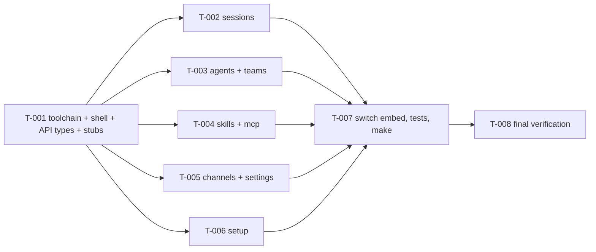

# Tasks: Web dashboard on React and TypeScript

- **Requirements**: revision 1 · **Contract**: Not required · **Design**: revision 1
- **Status**: In Progress

The old `web/assets` dashboard keeps serving until `T-007`. `T-002` through `T-006` run in parallel after `T-001`; each owns only its listed files.

- [x] `T-001` Toolchain, shell, API client, and view stubs
  - Files: `flake.nix`, `web/ui/**` (package files, configs, `index.html`, `public/`, `src/main.tsx`, `src/app/**`, `src/api/**`, `src/lib/**`, `src/ui/**`, `src/styles/**`, stub `src/views/**`), `.gitignore` (`web/ui/node_modules`).
  - Port: `app.js`, `api.js`, `api/*.js`, `ui.js`, `format.js`, `markdown.js`, `theme.js`, `avatar.js`, `components/*`, `views/login.js`, `views/home.js`, `views/placeholder.js`.
  - Vitest: route table, theme and sidebar persistence, home empty state, markdown, API error mapping.
  - Verification: `npm ci && npm run typecheck && npm test && npm run build` in `web/ui`.
  - Evidence: npm ci, typecheck, lint, build pass; 23 Vitest tests pass; `any` grep only in src/lib/any.ts. CSS restored byte-identical after a dsh edit. vitest pinned to 5.0.5 (npm audit: 0 vulnerabilities). Note for T-007: `.gitignore` has `dist/`, so `web/dist` needs an exception.

- [x] `T-002` Sessions views — `sessions`, `session`, `new-session`, `turn`, `question`, `approval` (+ `src/api/sessions.ts`, `turns.ts`, `questions.ts`, `approvals.ts`)
  - Evidence: whole project after all view tasks: typecheck, lint, 14 test files / 53 tests, and build pass; no `any`. Forced React changes are listed in the task reports (controlled inputs, useId, attribute casing). Follow-up: scoped `react-hooks` lint disables on legacy load effects.
- [x] `T-003` Agents and teams views — `agents`, `agent-detail`, `agent-common`, `agent-tabs/*`, `team` (+ `src/api/agents.ts`, `teams.ts`, `tools.ts`)
  - Evidence: whole project after all view tasks: typecheck, lint, 14 test files / 53 tests, and build pass; no `any`. Forced React changes are listed in the task reports (controlled inputs, useId, attribute casing). Follow-up: scoped `react-hooks` lint disables on legacy load effects.
- [x] `T-004` Skills and MCP views — `skills`, `mcp` (+ `src/api/skills.ts`, `mcp.ts`)
  - Evidence: whole project after all view tasks: typecheck, lint, 14 test files / 53 tests, and build pass; no `any`. Forced React changes are listed in the task reports (controlled inputs, useId, attribute casing). Follow-up: scoped `react-hooks` lint disables on legacy load effects.
- [x] `T-005` Channels and settings views — `channels`, `settings-general`, `settings-pages` (+ `src/api/channels.ts`, `settings.ts`, `secrets.ts`, `daemon.ts`, `audit.ts`)
  - Evidence: whole project after all view tasks: typecheck, lint, 14 test files / 53 tests, and build pass; no `any`. Forced React changes are listed in the task reports (controlled inputs, useId, attribute casing). Follow-up: scoped `react-hooks` lint disables on legacy load effects.
- [x] `T-006` Setup view — `setup` (+ `src/api/setup.ts`)
  - Evidence: whole project after all view tasks: typecheck, lint, 14 test files / 53 tests, and build pass; no `any`. Forced React changes are listed in the task reports (controlled inputs, useId, attribute casing). Follow-up: scoped `react-hooks` lint disables on legacy load effects.

  Each of `T-002`–`T-006`: verification `npm run typecheck && npm test && npm run build`; report every behavior change React forced.

- [x] `T-007` Switch the binary to the new dashboard
  - Files: `web/server.go`, `web/assets_test.go`, `web/server_test.go`, other Go tests that read `assets/`, `Makefile`, `web/dist/**` (built), delete `web/assets/**`.
  - Verification: `make web && make web-check && nix develop -c go test ./...`
  - Evidence: `make web-check` clean (and fails after touching main.tsx without rebuild), `go build ./...`, `go test ./...`, gofmt, web/ui typecheck/test/lint pass; web/assets removed; binary serves web/dist (daemon restarted 2026-10-30 23:59, `/` returns hashed index-*.js/css). Shared types cleaned (onLoadChildren single signature, onCreated(name), isTeam/rosterNames imported).

- [ ] `T-008` Final verification
  - `gofmt -l`, `golangci-lint run ./...`, `go test -race ./...`, `npm run typecheck`, `npm test`, `npm run lint`, `make web-check`; owner walks the parity checklist; no CSP errors in the console.
  - Evidence: Pending
