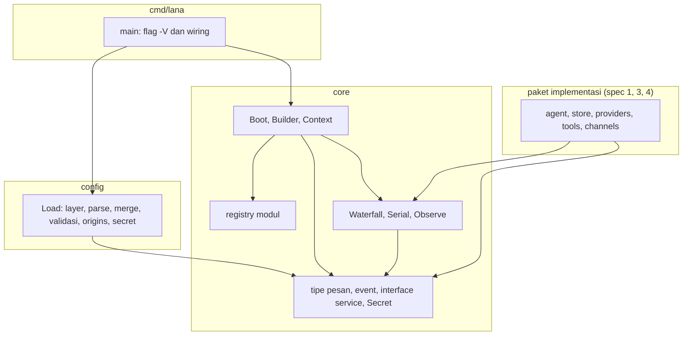
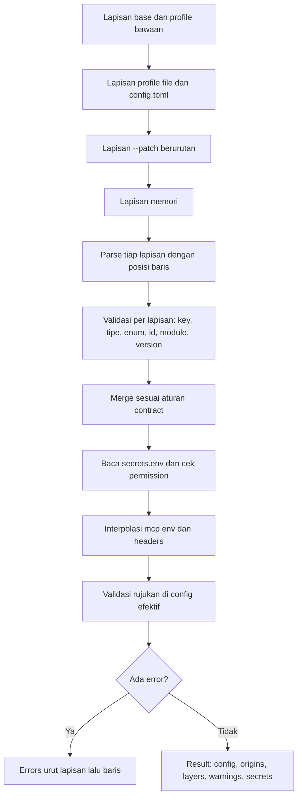
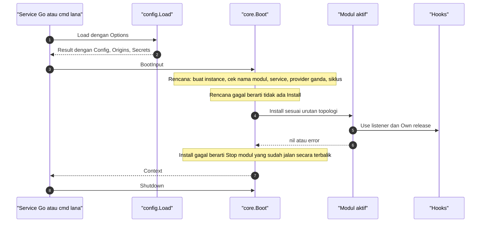
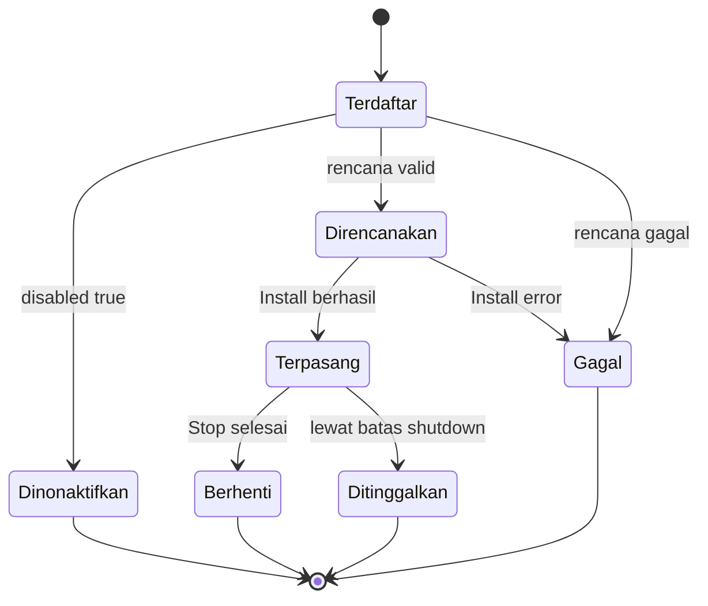
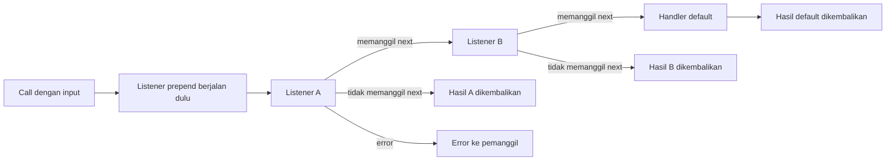
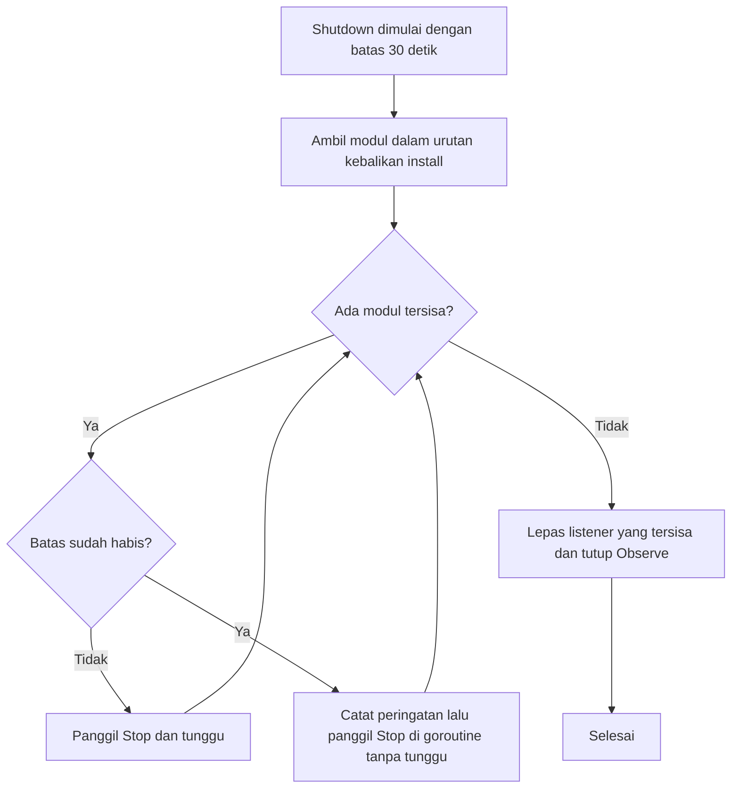

# Design: Fondasi (workspace, profile loader, Context/modul/hook)

- **Issue**: `#2`
- **Requirements**: [requirements.md](requirements.md)
- **Contract**: [api-contract.md](api-contract.md) — Diperlukan
- **Revisi requirements**: 4
- **Revisi contract**: 2 (rekonsiliasi, `CQ-016` sampai `CQ-032`)
- **Status requirements**: Approved
- **Status contract**: Approved
- **Status**: Approved
- **Revisi design**: 2 (rekonsiliasi lintas spec #2 sampai #4: tipe gabungan `core`, `DeriveMessages` dan `ResolvePrefix` di `core`, profile `base`, validasi key tambahan, `ProviderError`, lihat `DQ-015` sampai `DQ-020`)

## Referensi arsitektur

- **Index ADR**: [docs/adr](../../adr/README.md)
- **Index diagram**: [docs/diagram](../../diagram/README.md)
- **ADR**: [0002](../../adr/0002-core-dari-modul-service-dan-hook.md), [0009](../../adr/0009-session-sebagai-event-log-append-only.md), [0010](../../adr/0010-profile-dan-config-patch.md), [0013](../../adr/0013-gunakan-go-sebagai-single-binary.md), [0014](../../adr/0014-integrasi-sebagai-agentic-tool.md) — semua Accepted
- **Diagram lokal fitur**: [Komponen dan dependency](#komponen-dan-dependency), [Pipeline loader](#pipeline-loader-config), [Boot](#boot-dan-install), [Lifecycle modul](#lifecycle-modul), [Waterfall](#waterfall), [Shutdown](#shutdown)
- **Diagram tahan lama**: [0001. System Context Dan Roadmap](../../diagram/0001-system-context-dan-roadmap.md), [0004. Profile, Fork, Subagent, Dan Protokol](../../diagram/0004-profile-fork-subagent-dan-protokol.md)

## Scan keputusan arsitektur

| Topik | Otoritas yang ada | Lokasi keputusan | Aksi |
|---|---|---|---|
| Antarmuka publik | Contract `API-CONF-*` dan `API-CORE-*` | contract | Pakai ulang |
| Bahasa, layout package, dan library | ADR 0013 | ADR | Pakai ulang. Hanya package `core`, `config`, `cmd/lana`, dan `internal/archtest` yang dibuat di spec ini |
| Modul, service, hook | ADR 0002 | ADR | Pakai ulang. Bentuk Go mengikuti ADR 0013 |
| Config berlapis dan profile | ADR 0010 | ADR | Pakai ulang. Aturan merge di contract `API-CONF-008` dan `API-CONF-013` |
| Config tanpa file untuk embed | ADR 0014 | ADR | Pakai ulang lewat `Options.Layers` |
| Event dan payload | ADR 0009 | ADR | Tipe dan kind di `core`. Penyimpanan di spec #4 |
| Riwayat model dan prefix session | ADR 0009, spec #3 dan #4 | design | Fungsi murni di `core` (`DeriveMessages`, `ResolvePrefix`). Tanpa I/O |
| Persistence | ADR 0005 | Tidak ada tabel di spec ini | Tidak berlaku |
| Konkurensi hook | Tidak ada ADR | design | Lokal: copy-on-write dan mutex (lihat Konkurensi) |
| Arah dependency | ADR 0013 | ADR | Pakai ulang. Test di `internal/archtest` |
| State dan lifecycle modul | Tidak ada diagram | design | Lokal: diagram lifecycle modul di bawah |

## Visual Architecture Check

| Pemicu | Ada? | Tampilan yang dibutuhkan |
|---|---:|---|
| Batas modul atau package | Ya | Komponen dan dependency |
| Interaksi dengan aktor atau sistem luar | Ya | Boot (service Go yang meng-embed `lana`) |
| Alur multi-komponen | Ya | Pipeline loader, boot |
| Lifecycle atau transisi state | Ya | Lifecycle modul |
| Relasi entity | Tidak | Tidak ada tabel atau entity baru |
| Konkurensi, retry, atau alur gagal | Ya | Waterfall (error dan next), shutdown dengan batas waktu |
| Arah dependency atau topologi runtime | Ya | Komponen dan dependency |

## Tampilan lokal fitur

### Komponen dan dependency

- Panah dari `core` ke paket lain tidak ada. Paket `config` hanya meng-import `core`.
- Paket implementasi hanya meng-import `core`. Mereka tidak meng-import `config`.

### Pipeline loader config

### Boot dan install

### Lifecycle modul

### Waterfall

### Shutdown

## Kesesuaian dengan repository

- Repository belum punya kode. Spec ini membuat fondasi: `go.mod`, `flake.nix`, `Makefile`, `.github/workflows/ci.yml`, paket `core`, `config`, `cmd/lana`, dan `internal/archtest`.
- Layout mengikuti ADR 0013. Paket `agent`, `store`, `providers`, `tools`, `mcp`, `channels`, `protocol`, `web`, dan `lana.go` dibuat spec #1, #3, dan #4 sesuai kebutuhan. Spec ini tidak membuat paket kosong.
- `cmd/lana` di spec ini hanya mencetak versi (`-V`, `--version`). Subcommand dan flag lain dari spec #1.
- Arah dependency mengikuti ADR 0013. Tidak ada paket baru yang meng-import `config`.

### Layout file yang dibuat

| Path | Isi | Requirements |
|---|---|---|
| `go.mod` | Module `github.com/ridhomujizat/lana-harness`, direktif `go 1.24`, dependency `github.com/pelletier/go-toml/v2` | `REQ-DEV-001`, `REQ-BUILD-001` |
| `flake.nix` | Dev shell (lihat Failure handling dan Keamanan) | `REQ-DEV-001` |
| `Makefile` | Target `release` | `REQ-BUILD-002` |
| `.github/workflows/ci.yml` | Job CI | `REQ-CI-001` |
| `core/*.go` | Tipe, hook, registry, boot | `REQ-MOD-*`, `REQ-HOOK-*`, `REQ-PROF-001` (nama) |
| `config/*.go` | Loader | `REQ-CONF-*`, `REQ-PROF-001` |
| `cmd/lana/main.go` | Entry point, `-V` | `REQ-BUILD-002` |
| `internal/archtest/arch_test.go` | Test aturan import | `REQ-BUILD-001` |

## Design yang diusulkan

### Komponen

- **`core` registry modul** — map nama ke factory. `RegisterModule` mengisi map saat `init`. Nama duplikat memicu panic. Map dikunci `sync.Mutex`.
- **`core` Builder** — dipakai modul saat `Install`. Menyimpan registry service (`map[ServiceKey]entry{provider string, value any}`) dan daftar release listener per baris. Tidak dipakai setelah boot.
- **`core` boot** — membuat rencana (instance, provider, graf), mengurutkan topologi, meng-install, dan merakit `Context` (lihat Boot algorithm).
- **`core` hook generik** — `Waterfall`, `Serial`, `Observe`. Listener disimpan sebagai slice yang tidak pernah diubah di tempat (copy-on-write) dengan `sync.RWMutex` (lihat Konkurensi).
- **`core` tipe** — pesan, `ChatRequest`, `ChatEvent`, interface service, event dan payload (ADR 0009), `Config` schema, `Secret`, dan tipe gabungan (`API-CORE-015`). Tidak ada I/O dan tidak ada import paket lain di module. Fungsi murni `DeriveMessages` dan `ResolvePrefix` juga di `core`.
- **`config` loader** — pipeline di bawah. Memakai `github.com/pelletier/go-toml/v2` (parser biasa untuk nilai, parser `unstable` untuk posisi node).
- **`config` origins** — `map[string]string` dari path key ke nama lapisan. Diisi saat merge.
- **`config` secrets** — membaca `secrets.env` dan memberi `core.Secrets` yang melihat env proses lebih dulu.
- **`cmd/lana`** — `main` mencetak versi. Nilai `version` di-set lewat `-X main.version` (`REQ-BUILD-002`).

### Pipeline loader config

Langkah tetap dalam `config.Load`:

| Langkah | Kerja | Kegagalan |
|---|---|---|
| 1. Susun lapisan | Base, profile bawaan, file profile, `config.toml`, `Patches`, `Layers` (urutan `API-CONF-001`). File yang tidak ada dilewati, kecuali `Patches` (`CQ-015`) | Patch hilang: error `file patch tidak ditemukan` |
| 2. Parse | Tiap lapisan diparse. Nilai diambil dengan `go-toml/v2`. Posisi node diambil dari `unstable` parser lalu dihitung baris dan kolom dari offset byte | Sintaks TOML: error dengan baris dan kolom. Lapisan itu tidak dilanjutkan, tetapi lapisan lain tetap diparse |
| 3. Validasi per lapisan | Walk tree dengan tabel skema (`API-CONF-002` sampai `008`). Cek key tidak dikenal, tipe, enum, `id` kosong atau duplikat, `module` dikenal registry, `version` | Error dikumpulkan dengan lapisan dan baris |
| 4. Merge | Aturan contract. Setiap leaf menyimpan lapisan dan posisi penulis terakhir | Error `after` atau `before` tidak ada |
| 5. Secrets | Baca `secrets.env` (cek mode file). Perbedaan mode memberi `Warning` | Baris tidak valid: error dengan baris |
| 6. Interpolasi | Hanya `mcp.*.env` dan `mcp.*.headers`. Lookup env proses lalu secrets | Nama tidak ditemukan: error dengan key |
| 7. Validasi rujukan | `providers`, `routes.agent`, `subagents`, `mcp`, dan `permission` pada config efektif. Error memakai posisi penulis key yang merujuk | Rujukan rusak: error per rujukan |
| 8. Hasil | Jika ada error, kembalikan `Errors` terurut. Jika tidak, bangun `Result` | — |

Catatan implementasi:

- Validasi walk menggunakan `map[string]any` dan tabel skema. Decode struct dengan `DisallowUnknownFields` tidak dipakai karena hanya mengembalikan error pertama (`DQ-001`).
- Saran key terdekat memakai Levenshtein kecil di `config` (fungsi internal, tanpa dependency baru).
- Validasi `rules.allow` dan `rules.deny` memakai `internal/pattern.ParsePattern` (grammar spec #4). `config` boleh meng-import `internal/...` (matriks di bawah). Sebelum spec #4 selesai, nilainya hanya array string (`DQ-015`).
- Setiap lapisan memakai `Name` sebagai `File` di error. Path file absolut.
- Base dan profile bawaan memakai `Layer` sendiri dengan `Line` 0. Error di sana hanya terjadi jika tabel bawaan rusak, dan itu dianggap bug.

### Boot algorithm

Input: `BootInput{Config, Secrets, Profile}`. Output: `*Context` atau error.

| Langkah | Kerja |
|---|---|
| 1. Filter | Ambil baris dengan `Disabled = false`, urut sesuai `Config.Modules` |
| 2. Factory | Setiap baris: cari `Module` di registry. Tidak ada: error `modul '<nama>' ... tidak dikenal`. Panggil factory, simpan instance |
| 3. Provider | Untuk setiap `Provides()`: jika key sudah ada, error `service ... lebih dari satu modul` dengan kedua `id` |
| 4. Requires | Untuk setiap `Requires()`: jika tidak ada provider, error `membutuhkan service ... yang tidak dipasang`. Edge: baris X ke baris Y jika X membutuhkan key yang dipasang Y |
| 5. Siklus | DFS dengan stack. Jika ketemu node di stack, error `siklus dependency: A → B → A` dengan jalur dari node itu. Self-loop juga siklus |
| 6. Urutan | Kahn's algorithm. Dari node yang siap, pilih indeks baris terkecil. Hasilnya stabil menurut urutan baris (`AC-MOD-001`, `AC-MOD-002`) |
| 7. Install | Untuk tiap baris: set `Builder.current = baris`, panggil `Install(b, ModuleConfig{...})`. Error: `Stop` modul yang sudah jalan secara terbalik, lalu error `modul <id> gagal dipasang` |
| 8. Context | Ambil service dari registry. Lima key inti diisi ke field typed. Tipe tidak cocok: error `service '<key>' bukan tipe ...` |
| 9. Hook default | `ApprovalRequest` diberi default `unavailable` jika modul approval belum menyetelnya (fail-closed) |

Catatan:

- Langkah 1 sampai 6 tidak memanggil `Install`. Jadi rencana gagal berarti tidak ada modul yang di-install (`REQ-MOD-002`).
- Langkah 7 bisa gagal setelah beberapa modul jalan. Rollback memakai `Stop` yang sama dengan shutdown.

### Lifecycle modul

- Setiap baris melewati state di diagram. State tidak diekspor. Transisi penting dicatat di `slog` (install, gagal, berhenti, ditinggalkan).
- Shutdown memanggil `Stop` modul dalam urutan kebalikan install.

### Shutdown algorithm

- Total budget `min(ShutdownTimeout, sisa deadline ctx)`.
- Modul yang sudah diminta `Stop` tetapi belum kembali saat budget habis dicatat sebagai peringatan `slog` level `warn`. Goroutine `Stop` dibiarkan berjalan.
- Modul berikutnya tetap dipanggil `Stop` dengan `ctx` yang sudah habis. Pemanggilan itu tidak ditunggu.
- Setelah semua `Stop` dipanggil, `Context` melepas listener yang masih terdaftar lewat release di `Builder.Own`, lalu menutup `Observe`.

### Hook: copy-on-write

- `Waterfall` menyimpan `listeners []entry` dan `def`. `entry` memiliki `id uint64`.
- `Use` mengambil `Lock`, membuat slice baru (`[e] + old` untuk prepend, `old + [e]` untuk biasa), menukar slice, dan `Unlock`.
- `release` mengambil `Lock`, membuat slice baru tanpa `id` itu, dan menukar. Idempoten.
- `Call` mengambil `RLock`, menyalin header slice, lalu `RUnlock`. Slice tidak pernah diubah sehingga snapshot aman. Rantai dibangun dari snapshot.
- `Serial` sama, tanpa default.
- `Observe.Publish` mengunci tiap subscriber sebentar. Buffer `[1024]T` berupa ring buffer. Jika penuh, event tertua dibuang dan `dropped++`. Setelah itu kirim sinyal non-blocking ke `notify` (buffer 1).
- `Subscription.Recv`: jika `dropped > 0`, kembalikan `Received{Lagged: dropped}` dan reset. Jika ada event, ambil dari depan. Jika tidak, tunggu `notify`, `ctx.Done()`, atau `closed`.

### Pemetaan contract

| Operasi contract | Komponen | Input | Hasil | Requirements |
|---|---|---|---|---|
| `API-CONF-001` | Loader langkah 1 | Options, env, file | Daftar lapisan | `REQ-CONF-001`, `REQ-CONF-006` |
| `API-CONF-002` sampai `API-CONF-008` | Validasi dan merge | Lapisan terparse | Config efektif, origins | `REQ-CONF-002`, `REQ-CONF-003`, `REQ-CONF-008` |
| `API-CONF-009` | Tabel profile bawaan | Nama profile | Lapisan `profile:<nama>` | `REQ-PROF-001` |
| `API-CONF-010` | Secrets | `secrets.env`, env | `core.Secrets`, warning | `REQ-CONF-005` |
| `API-CONF-011` | Interpolasi | Nilai mcp | `core.Secret` | `REQ-CONF-007` |
| `API-CONF-012` | Error | Error internal | `config.Error` | `REQ-CONF-003` |
| `API-CONF-013` | Origins | Writer per leaf | `Origins` | `REQ-CONF-004` |
| `API-CONF-014` | `config.Load` | Options | `Result` atau `Errors` | `REQ-CONF-009` |
| `API-CORE-001` | Registry | nama, factory | `Module` | `REQ-MOD-001`, `REQ-MOD-004` |
| `API-CORE-002` | Boot dan Shutdown | `BootInput` | `*Context` | `REQ-MOD-001` sampai `REQ-MOD-004` |
| `API-CORE-003` | Context | Service | Field typed, `Lookup` | `REQ-MOD-001`, `REQ-MOD-004` |
| `API-CORE-004` | Hook generik | Listener, input | Output, error | `REQ-HOOK-001` sampai `REQ-HOOK-004` |
| `API-CORE-005` | Hook bernama | Field `Hooks` | Tipe I dan O | `REQ-HOOK-001` sampai `REQ-HOOK-003` |
| `API-CORE-012` | `Secret` | Nilai | Format `***` | `REQ-CONF-005` |
| `API-CORE-013` | `Config` | Struct | Marshal dengan tag | `REQ-CONF-003` |
| `API-CORE-014` | Error | — | Sentinel | `REQ-MOD-002`, `REQ-HOOK-001` |
| `API-CORE-015` | Tipe gabungan, `DeriveMessages`, `ResolvePrefix` | — | Tipe dan fungsi murni | Tidak berlaku |

Tipe lain di contract (`API-CORE-006` sampai `011`, dan `015`) hanya didefinisikan di `core`. Implementasi perilaku dimiliki spec #3 dan #4 (`DeriveMessages` dibagi, `ResolvePrefix` di spec #4).

### Persistence

- Tidak berubah. Spec ini tidak punya tabel, migration, atau event tulis. `core.SessionEvent` dan `SessionStore` hanya tipe dan interface.

### Failure handling

| Kegagalan | Error internal | Hasil yang terlihat |
|---|---|---|
| File config tidak bisa dibaca | `*fs.PathError` | `config.Error` dengan file dan alasan OS (tabel kasus gagal di requirements) |
| TOML tidak valid | Error parser | `config.Error` dengan baris dan kolom |
| Tipe, enum, key, id, module, referensi, version | `config.Error` | Semua dikumpulkan. `Errors` |
| `${NAMA}` tidak ditemukan | `config.Error` | Error dengan key |
| Permission `secrets.env` longgar | `config.Warning` | Peringatan. File tetap dibaca |
| Modul tidak dikenal, service hilang, siklus, service ganda | `error` dengan pesan contract | `Boot` gagal sebelum `Install` |
| `Install` gagal | `error` | Rollback `Stop` terbalik, `Boot` gagal |
| `Stop` gagal atau lewat batas | `error` atau timeout | `slog` warn. Shutdown lanjut |
| `Waterfall` tanpa default dan tanpa next | `ErrNoDefault` | Error ke pemanggil |
| Listener `ToolsPreExecute` menolak | `ToolDecision{Allowed: false}` | Pemanggil menulis `tool/result` status `rejected` (spec #3) |
| Subscriber lambat | `Lagged` | Subscriber melanjutkan dari event terbaru |

### Konkurensi

- `Load` tidak memakai goroutine. Hasil hanya bergantung pada isi lapisan dan env (tabel integritas data di requirements).
- `Boot` dan `Shutdown` berjalan di satu goroutine pemanggil. `Stop` yang melewati batas berjalan di goroutine sendiri.
- `Hooks` aman dipakai banyak goroutine (copy-on-write, lihat di atas).
- `Context` tidak diubah setelah `Boot`. Field tidak bisa diganti. Tidak ada mutex untuk field itu.
- `Builder` tidak aman dipakai setelah `Boot` selesai. Modul yang menyimpan referensi ke `Builder` dan memakainya di goroutine lain setelah boot melanggar kontrak.

### Keamanan

- `Secret` menulis `***` untuk `String`, `GoString`, `Format` (semua verb), `LogValue`, `MarshalJSON`, dan `MarshalText`. Nilai asli hanya lewat `Reveal`.
- Setiap nilai `mcp.*.env` dan `mcp.*.headers` bertipe `Secret` (`CQ-006`).
- `Load` tidak menjalankan kode dari config. TOML statis (ADR 0010).
- Mode `secrets.env` dicek. Mode yang tidak `0600` memberi peringatan dengan perintah `chmod 600`.
- Env proses menang atas `secrets.env` (`AC-CONF-012`).
- Dev shell memakai `GOTOOLCHAIN=local` dan `CGO_ENABLED=0` (`REQ-DEV-001`). Pengecualian untuk `go test -race` ada di Risiko dan `DQ-010`.

### Observability

- `Load` tidak menulis ke stdout atau stderr. Peringatan masuk `Result.Warnings` dan `slog.Warn`.
- `Boot` mencatat `slog.Info` per modul yang di-install: id, nama modul, dan durasi.
- `Shutdown` mencatat `slog.Warn` untuk modul yang melewati batas.
- Nilai secret tidak pernah masuk log (`AC-CONF-014`).

### Dependency baru

| Module | Dipakai di | Alasan |
|---|---|---|
| `github.com/pelletier/go-toml/v2` | `config`, `core` (tag) | Parse TOML dengan posisi (ADR 0013) |

- Tidak ada dependency lain di spec ini. `log/slog`, `sync`, `iter`, `errors`, dan `encoding/json` dari stdlib.
- `cobra`, `bubbletea`, dan lainnya dari spec #1, `modernc.org/sqlite` dari spec #4.

### Dev shell dan build

- `flake.nix` di root repository. Tidak ada `flake.nix` di folder induk (`self-tool/`, `project/`, `coding/`, `~`) saat spec ini ditulis, jadi flake baru dibuat (aturan `nix-development.md`).
- Dev shell memakai `pkgs.go` (versi dari `flake.lock`), `gopls`, `golangci-lint`, `sqlite`, dan `gnumake`. `env` men-set `GOTOOLCHAIN = "local"` dan `CGO_ENABLED = "0"`.
- Sistem yang didukung: `aarch64-darwin`, `x86_64-linux`, `aarch64-linux`, `x86_64-darwin`.
- `go.mod` memakai `go 1.24`. Toolchain dari nixpkgs harus lebih baru atau sama.
- `Makefile`:

| Target | Perintah | Catatan |
|---|---|---|
| `release` | Untuk tiap `GOOS/GOARCH` (`darwin/arm64`, `linux/amd64`, `linux/arm64`): `CGO_ENABLED=0 go build -trimpath -ldflags="-s -w -X main.version=$(VERSION)" -o dist/lana-$(GOOS)-$(GOARCH) ./cmd/lana` | `VERSION` default `dev`. Setelah build, cetak ukuran dengan `wc -c`. Ukuran di atas 40 MB dicetak sebagai catatan, tidak gagal |

- Binary `dist/lana-linux-amd64` diperiksa `file` di CI. Output harus memuat `statically linked` (`AC-BUILD-004`).

### CI

- File: `.github/workflows/ci.yml`. Trigger: `push` dan `pull_request`.
- Matriks: `macos-14` (arm64) dan `ubuntu-24.04` (x86_64). `fail-fast: false`.
- Langkah:

| Langkah | Perintah | Lulus jika |
|---|---|---|
| Install Nix | action installer Nix (versi dipin di implementasi) | Nix tersedia |
| Format | `test -z "$(nix develop -c gofmt -l .)"` | Output kosong |
| Lint | `nix develop -c golangci-lint run ./...` | Exit 0 |
| Test | `CGO_ENABLED=1 nix develop -c go test -race ./...` | Exit 0 |
| Release | `nix develop -c make release` | Exit 0 |
| Cek statis Linux | `file dist/lana-linux-amd64` | Memuat `statically linked`. Hanya di job Linux |
| Ringkasan | Tulis tabel ukuran binary ke `$GITHUB_STEP_SUMMARY` | Selalu, jika langkah sebelumnya lulus |

- Setiap langkah gagal membuat job gagal (`AC-CI-001`).

### Layout test import

- File: `internal/archtest/arch_test.go`.
- Fungsi `checkRules(imports map[string][]string) []string` murni. Input: import langsung per paket dalam module. Output: pelanggaran dengan nama paket.
- Matriks aturan (paket dalam module):

| Paket | Boleh meng-import dalam module |
|---|---|
| `core` | tidak ada |
| `config` | `core`, `internal/...` |
| `cmd/lana` | semua |
| `internal/...` | `core`, `internal/...` |
| paket lain (implementasi) | `core`, `internal/...` |

- Test `TestImportRules` menjalankan `go list -f '{{.ImportPath}} {{join .Imports " "}}' ./...`, memfilter import dengan prefix module, dan memanggil `checkRules`.
- Test `TestCoreTransitive` menjalankan `go list -deps ./core`, memfilter prefix module, dan memastikan hasilnya kosong.
- Test `TestRuleViolationMessage` memberi input `core` yang meng-import `config` dan memastikan pesan menyebut `core` dan `config` (`AC-BUILD-002`).

### Tipe dan format error config

- `config.Error.Error()` mengikuti `API-CONF-012`.
- `config.Errors` diurutkan: lapisan sesuai urutan `API-CONF-001`, lalu baris, lalu key.
- Pesan validasi memakai teks tetap dari contract. Setiap pesan dibuat dari fungsi di package `config` dengan satu tempat untuk teks.

## Traceability requirement

| Requirement | Operasi contract | Komponen design | Level verifikasi |
|---|---|---|---|
| `REQ-DEV-001` | Tidak berlaku | `flake.nix` | runtime |
| `REQ-CI-001` | Tidak berlaku | `.github/workflows/ci.yml` | runtime |
| `REQ-BUILD-001` | Tidak berlaku | Layout paket, `internal/archtest` | integrasi |
| `REQ-BUILD-002` | Tidak berlaku | `Makefile`, `cmd/lana` | runtime |
| `REQ-CONF-001` | `API-CONF-001`, `API-CONF-009` | Loader langkah 1 | integrasi |
| `REQ-CONF-002` | `API-CONF-004`, `API-CONF-005`, `API-CONF-007`, `API-CONF-008` | Loader langkah 4 | unit |
| `REQ-CONF-003` | `API-CONF-002` sampai `API-CONF-006`, `API-CONF-012`, `API-CORE-013` | Loader langkah 3 dan 7 | unit |
| `REQ-CONF-004` | `API-CONF-013` | Origins | unit |
| `REQ-CONF-005` | `API-CONF-010`, `API-CORE-012` | Secrets, `Secret` | unit |
| `REQ-CONF-006` | `API-CONF-001` | Loader langkah 1 | unit |
| `REQ-CONF-007` | `API-CONF-006`, `API-CONF-011` | Loader langkah 6 | unit |
| `REQ-CONF-008` | `API-CONF-002` | Loader langkah 3 | unit |
| `REQ-CONF-009` | `API-CONF-014` | `Load` dengan `Layers` | integrasi |
| `REQ-MOD-001` | `API-CORE-001`, `API-CORE-002` | Boot langkah 6 dan 7 | unit |
| `REQ-MOD-002` | `API-CORE-002`, `API-CORE-014` | Boot langkah 2 sampai 5 | unit |
| `REQ-MOD-003` | `API-CORE-002` | Shutdown | unit |
| `REQ-MOD-004` | `API-CORE-001`, `API-CORE-003` | Boot langkah 3 | unit |
| `REQ-HOOK-001` | `API-CORE-004`, `API-CORE-005`, `API-CORE-014` | `Waterfall` | unit |
| `REQ-HOOK-002` | `API-CORE-004` | `Serial` | unit |
| `REQ-HOOK-003` | `API-CORE-004` | `Observe`, `Subscription` | unit |
| `REQ-HOOK-004` | `API-CORE-002`, `API-CORE-004` | `Use` release, `Builder.Own` | unit |
| `REQ-PROF-001` | `API-CONF-009` | Tabel profile bawaan | unit |

## Peta verifikasi acceptance

Nama test di kolom terakhir adalah nama yang direncanakan. Implementasi boleh mengubah nama, tetapi tidak boleh menghapus cakupan.

| Acceptance criterion | Metode verifikasi | Bukti yang direncanakan |
|---|---|---|
| `AC-DEV-001` | runtime | `nix develop -c go version` sesuai `go.mod` |
| `AC-DEV-002` | runtime | `nix develop -c golangci-lint version` |
| `AC-DEV-003` | runtime | `GOOS=linux GOARCH=amd64 CGO_ENABLED=0 go build ./cmd/lana` di dalam `nix develop` |
| `AC-CI-001` | runtime | Run CI pada commit dengan test sengaja gagal (branch uji) |
| `AC-CI-002` | runtime | Ringkasan job memuat ukuran dua platform |
| `AC-BUILD-001` | integrasi | `go build ./...` |
| `AC-BUILD-002` | unit | `TestRuleViolationMessage`, `TestImportRules` |
| `AC-BUILD-005` | unit | `TestRuleViolationMessage`, `TestImportRules` |
| `AC-BUILD-003` | runtime | `make release` menghasilkan tiga file di `dist/` dan mencetak ukuran |
| `AC-BUILD-004` | runtime | `file dist/lana-linux-amd64` memuat `statically linked` |
| `AC-CONF-001` | integrasi | `TestLayerPatchWins` |
| `AC-CONF-002` | integrasi | `TestMissingProfileSkipped` |
| `AC-CONF-003` | unit | `TestMergeModuleRowReplacesConfig` |
| `AC-CONF-004` | integrasi | `TestBootDisabledRowNotInstalled` |
| `AC-CONF-005` | unit | `TestMergeModuleAfter` |
| `AC-CONF-006` | unit | `TestMergeAgentTablesRecursive` |
| `AC-CONF-007` | unit | `TestMergeRoutesReplaced` |
| `AC-CONF-008` | unit | `TestMergeAfterUnknownID` |
| `AC-CONF-009` | unit | `TestErrorsCollectAllLayers` |
| `AC-CONF-010` | unit | `TestRefErrorLocation` |
| `AC-CONF-011` | unit | `TestOriginsTableAndLeaf` |
| `AC-CONF-012` | unit | `TestSecretEnvWins` |
| `AC-CONF-013` | unit | `TestEffectiveConfigRedacted` (TOML dan JSON) |
| `AC-CONF-014` | unit | `TestSecretFormatting` (`%v`, `%#v`, `slog`) |
| `AC-CONF-015` | integrasi | `TestLanaHomeEnv` dengan `t.TempDir()` |
| `AC-CONF-016` | unit | `TestUnknownKeySuggestion` |
| `AC-CONF-017` | unit | `TestSecretsPermWarning` (mode `0644`) |
| `AC-CONF-018` | unit | `TestMCPEnvInterpolationSecret` |
| `AC-CONF-019` | unit | `TestNonMCPFieldNotInterpolated` |
| `AC-CONF-020` | unit | `TestMissingVarError` |
| `AC-CONF-021` | unit | `TestVersionTooHigh` |
| `AC-CONF-022` | integrasi | `TestMemoryLayerNoFiles` (`Home` kosong, origin `myservice`) |
| `AC-CONF-023` | unit | `TestMemoryLayerRefError` |
| `AC-MOD-001` | unit | `TestBootOrderDependency` |
| `AC-MOD-002` | unit | `TestBootOrderRowStable` |
| `AC-MOD-003` | unit | `TestBootMissingService` |
| `AC-MOD-004` | unit | `TestBootCycleMessage` |
| `AC-MOD-005` | unit | `TestShutdownReverseOrder` |
| `AC-MOD-006` | unit | `TestShutdownStuckModule` (budget diperkecil lewat variabel uji) |
| `AC-MOD-007` | unit | `TestBootDuplicateProvider` |
| `AC-HOOK-001` | unit | `TestWaterfallOrder` |
| `AC-HOOK-002` | unit | `TestWaterfallStopsWithoutNext` |
| `AC-HOOK-003` | unit | `TestWaterfallInputChanged` |
| `AC-HOOK-004` | unit | `TestWaterfallPrepend` |
| `AC-HOOK-005` | unit | `TestWaterfallErrorStops` |
| `AC-HOOK-006` | unit | `TestSerialResultsInOrder` |
| `AC-HOOK-007` | unit | `TestObserveNonBlocking` (10.000 event) |
| `AC-HOOK-008` | unit | `TestReleaseHandle` |
| `AC-HOOK-009` | unit | `TestModuleStopReleasesListeners` |
| `AC-HOOK-010` | unit | `TestObserveLagged` (1500 event, `Lagged(476)`) |
| `AC-PROF-001` | unit | `TestBuiltinProfileRows` (dengan modul palsu bernama sama) |
| `AC-PROF-002` | unit | `TestUnknownProfileError` |

## Strategi verifikasi

- **Unit**: parser dan validator config, merge, origins, interpolasi, secrets dan `Secret`, boot planner, shutdown, hook generik, `Observe`. Semua test di `go test -race`.
- **Integrasi**: `config.Load` dengan `t.TempDir()` sebagai `LANA_HOME`, `Boot` dengan modul palsu yang didaftarkan dengan nama uji (`test.*`).
- **Runtime**: `nix develop -c` untuk dev shell, `make release` untuk build, `file` untuk binary Linux, CI untuk matriks.

## Risiko dan tradeoff

- **Profil bawaan belum bisa dimuat di binary.** Nama modul di `API-CONF-009` baru dibuat oleh spec #3 dan #4. Sampai itu, `config.Load` untuk profile bawaan gagal validasi `module`. Test memakai modul palsu dengan nama yang sama. `lana -V` tetap jalan.
- **Hook payload bisa berubah** sebelum v1.0.0 saat spec #3 dan #4 mengisi perilakunya. Perubahan wajib dicatat di CHANGELOG (ADR 0014).
- **Registry modul global.** Test memakai nama `test.*` dan tidak menghapus registri. Ini tradeoff untuk API sederhana (`RegisterModule` sesuai sheet).
- **Modul yang macet di `Stop`** membuat goroutine tertinggal sampai proses keluar (`DQ-003`).
- **`go test -race` butuh cgo.** Dev shell men-set `CGO_ENABLED=0`, sehingga langkah test di CI men-set `CGO_ENABLED=1` hanya untuk perintah itu (`DQ-010`). Build release tetap `CGO_ENABLED=0`.
- **Schema v1 menolak key dari ADR 0014** (`[protocol.mcpserver]`, `[[api.tokens]]`) sampai spec yang membawanya menambah skema. Ini sengaja: key tak dikenal adalah error (`REQ-CONF-003`).
- **Satu dependency eksternal** (`go-toml/v2`). Levenshtein dan parser `.env` ditulis sendiri agar dependency tetap minimal.
- **`Secret` untuk nilai literal** (`CQ-006`) menyembunyikan lebih banyak dari yang perlu. Tradeoff ini dipilih karena aman dan sederhana.
- **Spec #1 mengutip `config.Load(profile, patches)`** dan `ctx.prompt`, `core.Compactor`. Sheet menggantikan bentuk `Load` dan service lain dipasang lewat `Provide` dan `Lookup`. Spec #1 perlu diperbarui saat revisi berikutnya. Spec ini tidak mengubah file spec #1.

## Catatan untuk requirements

Catatan ini tidak mengubah perilaku `requirements.md` (revisi 3). Setiap item dipilih lewat `CQ` atau `DQ` di atas. Pemilik bisa menyetujui atau meminta revisi requirements.

| No | Celah | Dampak | Pilihan di spec ini |
|---|---|---|---|
| 1 | `REQ-CONF-001` menulis "lapisan yang filenya tidak ada dilewati", tetapi `API-CLI-001` (spec #1) mewajibkan exit 2 untuk `--patch` yang hilang | Perilaku patch hilang | Error untuk `--patch` (`CQ-015`) |
| 2 | `REQ-MOD-003` menulis "modul yang melewati batas dicatat dan dilewati", `AC-MOD-006` menulis "modul lain tetap dihentikan" | Arti "dilewati" tidak jelas | Stop dipanggil untuk semua modul, dengan `ctx` habis setelah batas (`DQ-003`) |
| 3 | `AC-CONF-017` meminta peringatan "tampil di log dan stderr", sementara library tidak boleh menulis stderr | Tempat cetak peringatan | `Result.Warnings` dan `slog`, stderr dicetak spec #1 (`CQ-007`) |
| 4 | `REQ-DEV-001` menetapkan `CGO_ENABLED=0`, `REQ-CI-001` meminta `go test -race` | `-race` butuh cgo | Test di CI memakai `CGO_ENABLED=1` (`DQ-010`) |
| 5 | Isi lapisan `base` dan profile bawaan tidak ditulis di requirements | Modul apa yang aktif | Tabel di `API-CONF-009`. Pemilik perlu meninjau |
| 6 | `REQ-CONF-002` tidak menyebut `after` atau `before` untuk `id` yang sudah ada | Posisi baris lama | Diabaikan, tetap divalidasi (`CQ-011`) |
| 7 | Nilai env yang ada tetapi kosong tidak disebut | Lookup secret | Dianggap tidak ada (`CQ-005`) |
| 8 | Format origin untuk baris modul tidak disebut (`REQ-CONF-004`) | Kunci peta asal | `modules.<id>` (`API-CONF-013`) |
| 9 | Default `permission` agent tidak disebut | Keamanan default | `ask` (`CQ-009`) |
| 10 | Baris `secrets.env` tidak valid tidak disebut | Error atau lewati | Error dengan baris (`CQ-010`) |
| 11 | Format `id` tidak dibatasi | Karakter yang diizinkan | Tidak kosong, unik per lapisan |
| 12 | `REQ-CONF-005` menyebut nilai secret tidak boleh tercetak, tidak menyebut literal di `mcp.*.env` | Cakupan `Secret` | Semua nilai `env` dan `headers` (`CQ-006`) |

## Blocking Design Questions

| ID | Pertanyaan | Mengendalikan | Pemilik | Status | Resolusi |
|---|---|---|---|---|---|
| `DQ-001` | Validasi config: walk tree atau decode struct ketat | `REQ-CONF-003`, `API-CONF-012` | Ridho | Resolved | Rekomendasi agent: walk tree dengan tabel skema. Decode ketat hanya mengembalikan error pertama, sedangkan `AC-CONF-009` meminta semua error. |
| `DQ-002` | `Install` gagal di tengah boot | `REQ-MOD-002`, `API-CORE-002` | Ridho | Resolved | Rekomendasi agent: `Stop` modul yang sudah jalan secara terbalik, lalu `Boot` gagal dengan pesan `modul <id> gagal dipasang`. |
| `DQ-003` | Modul yang macet di `Stop` saat shutdown | `REQ-MOD-003`, `AC-MOD-006` | Ridho | Resolved | Rekomendasi agent: budget total 30 detik. Modul yang macet ditinggalkan dan dicatat. Modul berikutnya tetap dipanggil `Stop` dengan `ctx` habis. |
| `DQ-004` | `Serial` dan error listener | `REQ-HOOK-002`, `API-CORE-004` | Ridho | Resolved | Rekomendasi agent: error pertama menghentikan rantai dan dikembalikan. Hasil listener sebelumnya tidak dikembalikan. |
| `DQ-005` | Handler default hook | `API-CORE-004`, `API-CORE-005` | Ridho | Resolved | Rekomendasi agent: `NewWaterfall` tanpa argumen, default diset `SetDefault`. Tanpa default, `Call` mengembalikan `ErrNoDefault`. `ApprovalRequest` diberi default `unavailable` oleh `Boot`. |
| `DQ-006` | Bentuk pembacaan `Subscription` untuk `Lagged` | `REQ-HOOK-003`, `AC-HOOK-010` | Ridho | Resolved | Rekomendasi agent: `Recv` mengembalikan `Received[T]`. Jika `Lagged > 0`, panggil `Recv` lagi untuk event. |
| `DQ-007` | Registry modul global dan `Module.ID` | `API-CORE-001`, `REQ-MOD-004` | Ridho | Resolved | Rekomendasi agent: registry global dengan `sync.Mutex`. Nama duplikat panic. `ID()` mengembalikan nama implementasi. Pesan error memakai `id` baris. |
| `DQ-008` | Pustaka tambahan | Dependency | Ridho | Resolved | Rekomendasi agent: hanya `go-toml/v2`. Levenshtein, parser `secrets.env`, dan ring buffer ditulis sendiri. |
| `DQ-009` | Uji profil bawaan dan `cmd/lana` sebelum modul ada | `AC-PROF-001`, `REQ-BUILD-002` | Ridho | Resolved | Rekomendasi agent: test mendaftarkan modul palsu dengan nama bawaan. `cmd/lana` di spec ini hanya `-V`. |
| `DQ-010` | `go test -race` dengan `CGO_ENABLED=0` | `REQ-CI-001`, `REQ-DEV-001` | Ridho | Resolved | Rekomendasi agent: langkah test di CI dan perintah `go test -race` di tasks memakai `CGO_ENABLED=1` hanya untuk perintah itu. |
| `DQ-011` | Versi Go dan pin | `REQ-DEV-001`, `AC-DEV-001` | Ridho | Resolved | Rekomendasi agent: `go 1.24` di `go.mod`. Toolchain dari `pkgs.go` di `flake.lock`. `GOTOOLCHAIN=local`. |
| `DQ-012` | Cakupan test aturan import | `REQ-BUILD-001`, `AC-BUILD-002` | Ridho | Resolved | Rekomendasi agent: impor langsung tiap paket, plus `go list -deps` untuk `core`. Test di `internal/archtest`. |
| `DQ-013` | Target release, versi, dan ukuran | `REQ-BUILD-002`, `AC-BUILD-003` | Ridho | Resolved | Rekomendasi agent: target `release` di `Makefile`. `VERSION` default `dev`. Ukuran dengan `wc -c`. |
| `DQ-014` | Runner CI | `REQ-CI-001`, `AC-CI-002` | Ridho | Resolved | Rekomendasi agent: `macos-14` (arm64) dan `ubuntu-24.04` (x86_64) dengan Nix. Versi action dipin di implementasi. |
| `DQ-015` | Di mana validasi pola `rules` berada | `API-CONF-004`, `CQ-030` | Ridho | Resolved | Rekomendasi agent (rekonsiliasi): paket `internal/pattern` berisi `ParsePattern` (grammar dari spec #4). `config` memakainya, dan `tools/permission` juga. Aturan impor `config` mengizinkan `internal/...`. Sebelum spec #4 selesai, hanya array string. |
| `DQ-016` | Baris `store` pada profile dan library | `API-CONF-009`, `CQ-031` | Ridho | Resolved | Rekomendasi agent (rekonsiliasi): profile memakai `sqlite_store`. `lana.New` (spec #3) memakai `memstore` jika `Home` kosong dan `Options.Store` nil. Jika `Options.Store` diisi, baris `store` diganti `provided_store`, modul di package `lana`. Spec #2 tidak mengubah mekanisme ini. |
| `DQ-017` | Tempat `ProviderError` dan `DeriveMessages` | `API-CORE-015`, `CQ-026`, `CQ-028` | Ridho | Resolved | Rekomendasi agent (rekonsiliasi): keduanya di `core`. `ProviderError` berupa tipe data dengan `Is`, tanpa I/O. `DeriveMessages` fungsi murni atas `[]SessionEvent`. Keduanya tetap mematuhi aturan impor `core` (tidak meng-import paket lain). |
| `DQ-018` | Aturan prefix session: di mana dan bagaimana | `API-CORE-009`, `API-CORE-015`, `CQ-023` | Ridho | Resolved | Rekomendasi agent (rekonsiliasi): `FindPrefix` mengembalikan daftar. `core.ResolvePrefix` menerapkan aturan minimal 6 karakter dan tepat satu cocok. Spec #1 dan #4 memakai fungsi yang sama. |
| `DQ-019` | Bentuk lease di `core` | `API-CORE-009`, `CQ-023` | Ridho | Resolved | Rekomendasi agent (rekonsiliasi): `TryLease` mengembalikan `release func() error`. Tidak ada tipe `Lease`. Error pemegang lain memakai `LeaseHeldError`. |
| `DQ-020` | Pemilik struct payload event | `API-CORE-008`, `CQ-029` | Ridho | Resolved | Rekomendasi agent (rekonsiliasi): `API-CORE-008` adalah tabel tunggal field payload. Spec #3 dan #4 merujuk ke sana. Field tambahan dari spec #3 dan #4 dimasukkan ke tabel ini. |

None yang masih Open.

## Approval

- [x] Requirements sudah Approved dan revisinya dicatat.
- [x] Contract sudah Approved.
- [x] Scan keputusan arsitektur dan Visual Architecture Check selesai.
- [x] ADR yang dibutuhkan sudah Accepted.
- [x] Setiap requirement terpetakan ke satu komponen design.
- [x] Setiap acceptance criterion punya metode verifikasi.
- [x] Blocking Design Questions bernilai `None`.
- **Di-approve oleh**: Ridho (gate dilepas 2026-10-29)
- **Di-approve pada**: 2026-10-29 (revisi 1). Revisi 2 rekonsiliasi oleh agent atas nama pemilik.
