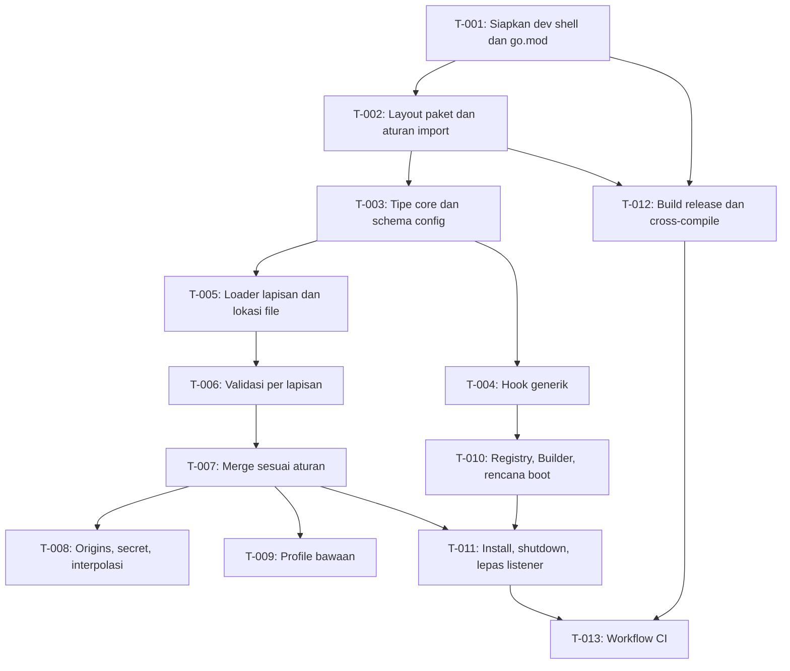

# Tasks: Fondasi (workspace, profile loader, Context/modul/hook)

- **Issue**: `#2`
- **Requirements**: [requirements.md](requirements.md)
- **Contract**: [api-contract.md](api-contract.md) — Diperlukan
- **Design**: [design.md](design.md)
- **Revisi requirements**: 4
- **Revisi contract**: 2
- **Revisi design**: 2
- **Revisi tasks**: 2 (rekonsiliasi: tipe gabungan `core` di T-003 dan T-004, validasi key tambahan di T-006, profile `base` di T-009)
- **Status**: Approved
- **Di-approve oleh**: Ridho (gate dilepas 2026-10-29)
- **Di-approve pada**: 2026-10-29

## Aturan eksekusi

- Implementasi hanya requirement dan acceptance criteria yang ditugaskan ke task.
- Berhenti jika requirements, design, ADR, diagram, atau contract saling bertentangan.
- Jangan menjawab pertanyaan produk atau arsitektur hanya di kode.
- Satu acceptance criterion punya tepat satu pemilik bukti.
- Verifikasi yang diwajibkan tidak pernah opsional.
- Tandai task selesai hanya setelah bukti verifikasi dicatat.
- Perintah `go test -race` dijalankan dengan `CGO_ENABLED=1` (`DQ-010`). Perintah lain dalam dev shell memakai `CGO_ENABLED=0`.

## Cakupan

| Acceptance criterion | Operasi contract | Pemilik bukti | Issue/PR | Verifikasi | Bukti |
|---|---|---|---|---|---|
| `AC-DEV-001` | Tidak berlaku | `T-001` | `—` | `nix develop -c go version` | Pending |
| `AC-DEV-002` | Tidak berlaku | `T-001` | `—` | `nix develop -c golangci-lint version` | Pending |
| `AC-DEV-003` | Tidak berlaku | `T-012` | `—` | `GOOS=linux GOARCH=amd64 CGO_ENABLED=0 go build ./cmd/lana` | Pending |
| `AC-CI-001` | Tidak berlaku | `T-013` | `—` | Run CI dengan test sengaja gagal di branch uji | Pending |
| `AC-CI-002` | Tidak berlaku | `T-013` | `—` | Ringkasan job memuat ukuran dua platform | Pending |
| `AC-BUILD-001` | Tidak berlaku | `T-002` | `—` | `nix develop -c go build ./...` | Pending |
| `AC-BUILD-002` | Tidak berlaku | `T-002` | `—` | `go test ./internal/archtest/...` (`TestRuleViolationMessage`, `TestImportRules`) | Pending |
| `AC-BUILD-005` | Tidak berlaku | `T-002` | `—` | `go test ./internal/archtest/...` (`TestRuleViolationMessage`, `TestImportRules`) | Pending |
| `AC-BUILD-003` | Tidak berlaku | `T-012` | `—` | `nix develop -c make release` | Pending |
| `AC-BUILD-004` | Tidak berlaku | `T-012` | `—` | `file dist/lana-linux-amd64` | Pending |
| `AC-CONF-001` | `API-CONF-001` | `T-005` | `—` | `go test ./config -run TestLayerPatchWins` | Pending |
| `AC-CONF-002` | `API-CONF-001`, `API-CONF-009` | `T-005` | `—` | `go test ./config -run TestMissingProfileSkipped` | Pending |
| `AC-CONF-003` | `API-CONF-008` | `T-007` | `—` | `go test ./config -run TestMergeModuleRowReplacesConfig` | Pending |
| `AC-CONF-004` | `API-CONF-008` | `T-011` | `—` | `go test ./core -run TestBootDisabledRowNotInstalled` | Pending |
| `AC-CONF-005` | `API-CONF-008` | `T-007` | `—` | `go test ./config -run TestMergeModuleAfter` | Pending |
| `AC-CONF-006` | `API-CONF-004` | `T-007` | `—` | `go test ./config -run TestMergeAgentTablesRecursive` | Pending |
| `AC-CONF-007` | `API-CONF-005` | `T-007` | `—` | `go test ./config -run TestMergeRoutesReplaced` | Pending |
| `AC-CONF-008` | `API-CONF-008` | `T-007` | `—` | `go test ./config -run TestMergeAfterUnknownID` | Pending |
| `AC-CONF-009` | `API-CONF-002`, `API-CONF-012` | `T-006` | `—` | `go test ./config -run TestErrorsCollectAllLayers` | Pending |
| `AC-CONF-010` | `API-CONF-003`, `API-CONF-012` | `T-006` | `—` | `go test ./config -run TestRefErrorLocation` | Pending |
| `AC-CONF-011` | `API-CONF-013` | `T-008` | `—` | `go test ./config -run TestOriginsTableAndLeaf` | Pending |
| `AC-CONF-012` | `API-CONF-010` | `T-008` | `—` | `go test ./config -run TestSecretEnvWins` | Pending |
| `AC-CONF-013` | `API-CORE-012` | `T-008` | `—` | `go test ./config -run TestEffectiveConfigRedacted` | Pending |
| `AC-CONF-014` | `API-CORE-012` | `T-008` | `—` | `go test ./core -run TestSecretFormatting` | Pending |
| `AC-CONF-015` | `API-CONF-001` | `T-005` | `—` | `go test ./config -run TestLanaHomeEnv` | Pending |
| `AC-CONF-016` | `API-CONF-004`, `API-CONF-012` | `T-006` | `—` | `go test ./config -run TestUnknownKeySuggestion` | Pending |
| `AC-CONF-017` | `API-CONF-010` | `T-008` | `—` | `go test ./config -run TestSecretsPermWarning` | Pending |
| `AC-CONF-018` | `API-CONF-006`, `API-CONF-011` | `T-008` | `—` | `go test ./config -run TestMCPEnvInterpolationSecret` | Pending |
| `AC-CONF-019` | `API-CONF-011` | `T-008` | `—` | `go test ./config -run TestNonMCPFieldNotInterpolated` | Pending |
| `AC-CONF-020` | `API-CONF-011`, `API-CONF-012` | `T-008` | `—` | `go test ./config -run TestMissingVarError` | Pending |
| `AC-CONF-021` | `API-CONF-002` | `T-006` | `—` | `go test ./config -run TestVersionTooHigh` | Pending |
| `AC-CONF-022` | `API-CONF-014` | `T-005` | `—` | `go test ./config -run TestMemoryLayerNoFiles` | Pending |
| `AC-CONF-023` | `API-CONF-014` | `T-006` | `—` | `go test ./config -run TestMemoryLayerRefError` | Pending |
| `AC-MOD-001` | `API-CORE-002` | `T-010` | `—` | `go test ./core -run TestBootOrderDependency` | Pending |
| `AC-MOD-002` | `API-CORE-002` | `T-010` | `—` | `go test ./core -run TestBootOrderRowStable` | Pending |
| `AC-MOD-003` | `API-CORE-002` | `T-010` | `—` | `go test ./core -run TestBootMissingService` | Pending |
| `AC-MOD-004` | `API-CORE-002` | `T-010` | `—` | `go test ./core -run TestBootCycleMessage` | Pending |
| `AC-MOD-005` | `API-CORE-002` | `T-011` | `—` | `go test ./core -run TestShutdownReverseOrder` | Pending |
| `AC-MOD-006` | `API-CORE-002` | `T-011` | `—` | `go test ./core -run TestShutdownStuckModule` | Pending |
| `AC-MOD-007` | `API-CORE-001`, `API-CORE-003` | `T-010` | `—` | `go test ./core -run TestBootDuplicateProvider` | Pending |
| `AC-HOOK-001` | `API-CORE-004` | `T-004` | `—` | `go test -race ./core -run TestWaterfallOrder` | Pending |
| `AC-HOOK-002` | `API-CORE-004` | `T-004` | `—` | `go test -race ./core -run TestWaterfallStopsWithoutNext` | Pending |
| `AC-HOOK-003` | `API-CORE-004` | `T-004` | `—` | `go test -race ./core -run TestWaterfallInputChanged` | Pending |
| `AC-HOOK-004` | `API-CORE-004` | `T-004` | `—` | `go test -race ./core -run TestWaterfallPrepend` | Pending |
| `AC-HOOK-005` | `API-CORE-004`, `API-CORE-014` | `T-004` | `—` | `go test -race ./core -run TestWaterfallErrorStops` | Pending |
| `AC-HOOK-006` | `API-CORE-004` | `T-004` | `—` | `go test -race ./core -run TestSerialResultsInOrder` | Pending |
| `AC-HOOK-007` | `API-CORE-004` | `T-004` | `—` | `go test -race ./core -run TestObserveNonBlocking` | Pending |
| `AC-HOOK-008` | `API-CORE-004` | `T-004` | `—` | `go test -race ./core -run TestReleaseHandle` | Pending |
| `AC-HOOK-009` | `API-CORE-002`, `API-CORE-004` | `T-011` | `—` | `go test -race ./core -run TestModuleStopReleasesListeners` | Pending |
| `AC-HOOK-010` | `API-CORE-004` | `T-004` | `—` | `go test -race ./core -run TestObserveLagged` | Pending |
| `AC-PROF-001` | `API-CONF-009` | `T-009` | `—` | `go test ./config -run TestBuiltinProfileRows` | Pending |
| `AC-PROF-002` | `API-CONF-009` | `T-009` | `—` | `go test ./config -run TestUnknownProfileError` | Pending |

Setiap AC di atas muncul tepat sekali. Total 51 AC.

## Graf task

## Tasks

- [x] `T-001` Siapkan dev shell Nix dan `go.mod`
  - Issue/PR: `—`
  - Bergantung pada: `None`
  - Requirements: `REQ-DEV-001`
  - Acceptance criteria: `AC-DEV-001`, `AC-DEV-002`
  - Operasi contract: `Tidak berlaku`
  - Scope:
    - Buat `flake.nix` dengan dev shell (`pkgs.go`, `gopls`, `golangci-lint`, `sqlite`, `gnumake`). Set `GOTOOLCHAIN = "local"` dan `CGO_ENABLED = "0"`.
    - Buat `go.mod` dengan module `github.com/ridhomujizat/lana-harness` dan direktif `go 1.24`.
    - Jalankan `nix flake lock` agar `flake.lock` dibuat.
    - Tambahkan `dist/` ke `.gitignore`.
  - Verifikasi:
    - `nix develop -c go version` (versi memenuhi `go.mod`)
    - `nix develop -c golangci-lint version`
  - Bukti penyelesaian:
    - Status: Completed
    - Perintah/test: `XDG_CACHE_HOME=$PWD/.nix-cache nix develop -c sh -c 'go version && golangci-lint version'`
    - Hasil: `go version go1.26.10 darwin/arm64`; `golangci-lint has version 2.15.0 built with go1.27.3`; exit 0. `flake.lock` dibuat. `go.mod` memakai `go 1.24`, sehingga toolchain 1.26.10 memenuhi.
    - PR/commit: commit T-001
    - Deviasi: Perintah Nix memakai `XDG_CACHE_HOME` lokal karena sandbox menolak tulisan ke `~/.cache/nix` (dicatat di docs/eval).

- [x] `T-002` Buat layout paket dan test aturan import
  - Issue/PR: `—`
  - Bergantung pada: `T-001`
  - Requirements: `REQ-BUILD-001`
  - Acceptance criteria: `AC-BUILD-001`, `AC-BUILD-002`, `AC-BUILD-005`
  - Operasi contract: `Tidak berlaku`
  - Scope:
    - Buat `core/doc.go`, `config/doc.go`, dan `cmd/lana/main.go` (hanya `-V` dan `--version`, nilai `version` dari `main.version`).
    - Buat `internal/archtest/arch_test.go` dengan `checkRules`, `TestImportRules`, `TestCoreTransitive`, dan `TestRuleViolationMessage` (design: Layout test import).
  - Verifikasi:
    - `nix develop -c go build ./...`
    - `nix develop -c go test ./internal/archtest/...`
  - Bukti penyelesaian:
    - Status: Completed
    - Perintah/test: `XDG_CACHE_HOME=$PWD/.nix-cache GOCACHE=$PWD/.gocache GOMODCACHE=$PWD/.gomodcache nix develop -c sh -c 'go build ./... && go test ./internal/archtest/...'`
    - Hasil: `ok github.com/ridhomujizat/lana-harness/internal/archtest`; exit 0. `TestImportRules`, `TestCoreTransitive`, `TestRuleViolationMessage` lulus.
    - PR/commit: commit T-002
    - Deviasi: Perintah memakai cache Go lokal karena sandbox menolak tulisan ke cache pengguna (dicatat di docs/eval).

- [ ] `T-003` Tulis tipe `core` dan schema `Config`
  - Issue/PR: `—`
  - Bergantung pada: `T-002`
  - Requirements: `REQ-CONF-003`, `REQ-MOD-001`, `REQ-HOOK-001`
  - Acceptance criteria: Tidak ada AC yang dimiliki task ini. Task ini hanya menyediakan tipe untuk task lain.
  - Operasi contract: `API-CORE-006`, `API-CORE-007`, `API-CORE-008`, `API-CORE-009`, `API-CORE-010`, `API-CORE-011`, `API-CORE-013`, `API-CORE-014`, `API-CORE-015`
  - Scope:
    - Tulis tipe pesan, `ChatRequest`, `ChatEvent`, `Provider`, `LLMRegistry`, `Tool`, `Risk`, `ToolRegistry`, `SessionEvent`, konstanta kind, payload struct, `SessionStore`, `AgentRegistry`, `ApprovalService`, `Policy`, `ApprovalOutcome`.
    - Tulis tipe tambahan dari `API-CORE-015` (gabungan spec #3 dan #4): `PreStepInput`, `PreStepDecision`, `RequestControl`, `LLMTarget`, `LLMStreamInput`, `ToolStatus`, `ToolDecision`, `ToolsPreExecuteInput`, `ToolsExecuteInput`, `ToolsPostExecuteInput`, `TurnStopInput`, `StopVote`, `PayloadError`, `ProviderError`, `CompactionResult`, `Compactor`, `AmbiguousPrefixError`, dan field baru di `NewSession`, `SessionInfo`, `ToolOutput`, `ApprovalRequest`.
    - Tulis sentinel `ErrContextTooLong`, `ErrPrefixTooShort`, `ErrAmbiguousPrefix`, `ErrUnknownPayloadVersion`, dan konstanta `ServiceCompaction`.
    - Fungsi `DeriveMessages` dan `ResolvePrefix` tidak diimplementasikan di task ini. Owner-nya: `DeriveMessages` di spec #3 `T-012` (subset) dan spec #4 `T-007` (compaction). `ResolvePrefix` di spec #4 `T-005`.
    - Tulis `Config` dan turunannya dengan tag `toml`. Tulis `ModuleRow`.
    - Tulis error sentinel dan `LeaseHeldError`.
    - Tulis `Secret` sebagai tipe dengan `NewSecret` dan `Reveal`. Format dan redaksi dikerjakan di `T-008`.
  - Verifikasi:
    - `nix develop -c go build ./core/...`
    - `nix develop -c go vet ./core/...`
  - Bukti penyelesaian:
    - Status: Pending
    - Perintah/test: —
    - Hasil: —
    - PR/commit: —
    - Deviasi: Tidak ada

- [ ] `T-004` Implementasi hook generik `Waterfall`, `Serial`, `Observe`
  - Issue/PR: `—`
  - Bergantung pada: `T-003`
  - Requirements: `REQ-HOOK-001`, `REQ-HOOK-002`, `REQ-HOOK-003`, `REQ-HOOK-004`
  - Acceptance criteria: `AC-HOOK-001` sampai `AC-HOOK-008`, `AC-HOOK-010`
  - Operasi contract: `API-CORE-004`, `API-CORE-005`
  - Scope:
    - Implementasi `Waterfall` dengan copy-on-write, `WithPrepend`, `SetDefault`, `ErrNoDefault`.
    - Implementasi `Serial` tanpa default. Error pertama menghentikan rantai.
    - Implementasi `Observe`, `Subscription`, `Received`, ring buffer 1024, `Lagged`.
    - Tulis struct `Hooks` dengan tipe I/O sesuai `API-CORE-005`. Tipe input hook ada di `T-003`.
  - Verifikasi:
    - `CGO_ENABLED=1 nix develop -c go test -race ./core -run 'TestWaterfall|TestSerial|TestObserve|TestReleaseHandle'`
  - Bukti penyelesaian:
    - Status: Pending
    - Perintah/test: —
    - Hasil: —
    - PR/commit: —
    - Deviasi: Tidak ada

- [ ] `T-005` Loader lapisan dan lokasi file
  - Issue/PR: `—`
  - Bergantung pada: `T-003`
  - Requirements: `REQ-CONF-001`, `REQ-CONF-006`, `REQ-CONF-009`
  - Acceptance criteria: `AC-CONF-001`, `AC-CONF-002`, `AC-CONF-015`, `AC-CONF-022`
  - Operasi contract: `API-CONF-001`, `API-CONF-009` (lapisan base dan profile), `API-CONF-014`
  - Scope:
    - Implementasi `Options`, `Layer`, `Load`, `HomeDir`, `LayerInfo`, urutan lapisan (`API-CONF-001`).
    - Lapisan `Layers` memori setelah `Patches` (`CQ-001`). Lapisan memori dari `TOML` atau `Value` (marshal).
    - Lapisan file yang tidak ada dilewati. `--patch` yang tidak ada: error (`CQ-015`).
    - Parse dasar dengan `go-toml/v2` (belum validasi, belum merge).
  - Verifikasi:
    - `CGO_ENABLED=0 nix develop -c go test ./config -run 'TestLayerPatchWins|TestMissingProfileSkipped|TestLanaHomeEnv|TestMemoryLayerNoFiles'`
  - Bukti penyelesaian:
    - Status: Pending
    - Perintah/test: —
    - Hasil: —
    - PR/commit: —
    - Deviasi: Tidak ada

- [ ] `T-006` Validasi per lapisan dengan posisi
  - Issue/PR: `—`
  - Bergantung pada: `T-005`
  - Requirements: `REQ-CONF-003`, `REQ-CONF-008`
  - Acceptance criteria: `AC-CONF-009`, `AC-CONF-010`, `AC-CONF-016`, `AC-CONF-021`, `AC-CONF-023`
  - Operasi contract: `API-CONF-002`, `API-CONF-003`, `API-CONF-004`, `API-CONF-012`
  - Scope:
    - Parser `unstable` untuk posisi baris dan kolom.
    - Walk tree dengan tabel skema. Cek key tidak dikenal (dengan saran Levenshtein), tipe, enum, `id` duplikat, `module` dikenal registry, `version`.
    - Cek rujukan di config efektif dengan posisi penulis key (`AC-CONF-010`, `AC-CONF-023`). Rujukan dilakukan di `T-007` setelah merge, tetapi error ditulis di sini.
    - Kumpulkan semua error (`Errors`).
    - Validasi key tambahan (`API-CONF-004`): `max_steps` integer 1 sampai 200, `context_window` integer lebih dari 0, `workspace` string, `permission` enum. Validasi `headers` (tabel string), `timeout` (durasi Go). Validasi pola `rules` ditunda sampai spec #4 (`CQ-030`).
  - Verifikasi:
    - `CGO_ENABLED=0 nix develop -c go test ./config -run 'TestErrorsCollectAllLayers|TestRefErrorLocation|TestUnknownKeySuggestion|TestVersionTooHigh|TestMemoryLayerRefError'`
  - Bukti penyelesaian:
    - Status: Pending
    - Perintah/test: —
    - Hasil: —
    - PR/commit: —
    - Deviasi: Tidak ada

- [ ] `T-007` Merge sesuai aturan contract
  - Issue/PR: `—`
  - Bergantung pada: `T-006`
  - Requirements: `REQ-CONF-002`
  - Acceptance criteria: `AC-CONF-003`, `AC-CONF-005`, `AC-CONF-006`, `AC-CONF-007`, `AC-CONF-008`
  - Operasi contract: `API-CONF-004`, `API-CONF-005`, `API-CONF-007`, `API-CONF-008`, `API-CONF-013` (penulisan origins)
  - Scope:
    - Merge tabel rekursif (`providers`, `agents`, `mcp`, `channels`).
    - Merge `modules` per `id`: ganti `config`, timpa `module` dan `disabled`, `after` dan `before` untuk `id` baru, abaikan untuk `id` lama (`CQ-011`).
    - `routes` diganti seluruhnya oleh lapisan terakhir.
    - Simpan origin untuk setiap leaf, tabel, dan baris modul.
  - Verifikasi:
    - `CGO_ENABLED=0 nix develop -c go test ./config -run 'TestMerge'`
  - Bukti penyelesaian:
    - Status: Pending
    - Perintah/test: —
    - Hasil: —
    - PR/commit: —
    - Deviasi: Tidak ada

- [ ] `T-008` Origins, secret, interpolasi, dan format `Secret`
  - Issue/PR: `—`
  - Bergantung pada: `T-007`
  - Requirements: `REQ-CONF-004`, `REQ-CONF-005`, `REQ-CONF-007`
  - Acceptance criteria: `AC-CONF-011`, `AC-CONF-012`, `AC-CONF-013`, `AC-CONF-014`, `AC-CONF-017`, `AC-CONF-018`, `AC-CONF-019`, `AC-CONF-020`
  - Operasi contract: `API-CONF-006`, `API-CONF-010`, `API-CONF-011`, `API-CONF-013`, `API-CORE-012`
  - Scope:
    - Baca `secrets.env` (format dan kutip, `CQ-010`), cek mode file dan tulis `Warning`.
    - Lookup secret: env proses (kosong dianggap tidak ada, `CQ-005`), lalu `secrets.env`.
    - Interpolasi `${NAMA}` hanya di `mcp.*.env` dan `mcp.*.headers`. Hasil `Secret` (`CQ-006`).
    - Implementasi format `Secret`: `String`, `GoString`, `Format`, `LogValue`, `MarshalJSON`, `MarshalText`.
    - Origins API `Of`.
    - Redaksi di `config` TOML dan JSON untuk `--dump-config` (spec #1 memakai nilai `***`).
  - Verifikasi:
    - `CGO_ENABLED=0 nix develop -c go test ./config -run 'TestOriginsTableAndLeaf|TestSecretEnvWins|TestEffectiveConfigRedacted|TestSecretsPermWarning|TestMCPEnvInterpolationSecret|TestNonMCPFieldNotInterpolated|TestMissingVarError'`
    - `CGO_ENABLED=0 nix develop -c go test ./core -run TestSecretFormatting`
  - Bukti penyelesaian:
    - Status: Pending
    - Perintah/test: —
    - Hasil: —
    - PR/commit: —
    - Deviasi: Tidak ada

- [ ] `T-009` Profile bawaan `minimal` dan `headless`
  - Issue/PR: `—`
  - Bergantung pada: `T-007`
  - Requirements: `REQ-PROF-001`
  - Acceptance criteria: `AC-PROF-001`, `AC-PROF-002`
  - Operasi contract: `API-CONF-009`
  - Scope:
    - Tabel lapisan `base` (`llm`, `tools`, `store`, `agent`, `permission`, `approval`, `compaction`) dan profile `minimal` dan `headless` sesuai `API-CONF-009` (`CQ-031`).
    - `ProfileNames` dan error `profile tidak dikenal: <nama> (tersedia: ...)`.
    - Test memakai modul palsu dengan nama bawaan (`DQ-009`).
  - Verifikasi:
    - `CGO_ENABLED=0 nix develop -c go test ./config -run 'TestBuiltinProfileRows|TestUnknownProfileError'`
  - Bukti penyelesaian:
    - Status: Pending
    - Perintah/test: —
    - Hasil: —
    - PR/commit: —
    - Deviasi: Tidak ada

- [ ] `T-010` Registry modul, `Builder`, dan rencana boot
  - Issue/PR: `—`
  - Bergantung pada: `T-004`
  - Requirements: `REQ-MOD-001`, `REQ-MOD-002`, `REQ-MOD-004`
  - Acceptance criteria: `AC-MOD-001`, `AC-MOD-002`, `AC-MOD-003`, `AC-MOD-004`, `AC-MOD-007`
  - Operasi contract: `API-CORE-001`, `API-CORE-002`, `API-CORE-003`
  - Scope:
    - `RegisterModule` dengan panic untuk nama duplikat. Tipe `Module`, `ModuleConfig`, `Decode`.
    - `Builder`: `Provide`, `Lookup`, `Own`, `Hooks`, `Config`.
    - Rencana boot: factory, provider ganda, service hilang, siklus (DFS), urutan Kahn stabil menurut urutan baris.
    - Install berurutan. Rollback `Stop` terbalik jika `Install` gagal (`DQ-002`).
    - Bangun `Context` dan field typed. Default `ApprovalRequest` = `unavailable`.
  - Verifikasi:
    - `CGO_ENABLED=0 nix develop -c go test ./core -run 'TestBoot'`
  - Bukti penyelesaian:
    - Status: Pending
    - Perintah/test: —
    - Hasil: —
    - PR/commit: —
    - Deviasi: Tidak ada

- [ ] `T-011` Install lengkap, shutdown berurutan, dan lepas listener
  - Issue/PR: `—`
  - Bergantung pada: `T-010`, `T-007`
  - Requirements: `REQ-MOD-003`, `REQ-HOOK-004`, `REQ-CONF-002`
  - Acceptance criteria: `AC-CONF-004`, `AC-MOD-005`, `AC-MOD-006`, `AC-HOOK-009`
  - Operasi contract: `API-CORE-002`, `API-CONF-008`
  - Scope:
    - Baris `disabled = true` tidak dibuat instance (`AC-CONF-004`).
    - `Shutdown` terbalik, budget `min(ShutdownTimeout, sisa ctx)`. Modul macet dicatat dan ditinggalkan. Modul berikutnya dipanggil `Stop` dengan `ctx` habis (`DQ-003`). Variabel uji untuk budget.
    - Lepas listener yang dimiliki modul (`Builder.Own`) setelah `Stop`. Tutup `Observe`.
  - Verifikasi:
    - `CGO_ENABLED=1 nix develop -c go test -race ./core -run 'TestShutdown|TestModuleStopReleasesListeners|TestBootDisabledRowNotInstalled'`
  - Bukti penyelesaian:
    - Status: Pending
    - Perintah/test: —
    - Hasil: —
    - PR/commit: —
    - Deviasi: Tidak ada

- [ ] `T-012` Build release dan cross-compile
  - Issue/PR: `—`
  - Bergantung pada: `T-001`, `T-002`
  - Requirements: `REQ-DEV-001`, `REQ-BUILD-002`
  - Acceptance criteria: `AC-DEV-003`, `AC-BUILD-003`, `AC-BUILD-004`
  - Operasi contract: `Tidak berlaku`
  - Scope:
    - `Makefile` dengan target `release` (`DQ-013`). `VERSION` default `dev`. Ukuran dengan `wc -c`. Catatan jika di atas 40 MB.
    - Binary `darwin/arm64`, `linux/amd64`, `linux/arm64` di `dist/`.
  - Verifikasi:
    - `nix develop -c make release`
    - `file dist/lana-linux-amd64` (memuat `statically linked`)
    - `GOOS=linux GOARCH=amd64 CGO_ENABLED=0 nix develop -c go build ./cmd/lana`
  - Bukti penyelesaian:
    - Status: Pending
    - Perintah/test: —
    - Hasil: —
    - PR/commit: —
    - Deviasi: Tidak ada

- [ ] `T-013` Workflow CI GitHub Actions
  - Issue/PR: `—`
  - Bergantung pada: `T-012`, `T-011`
  - Requirements: `REQ-CI-001`
  - Acceptance criteria: `AC-CI-001`, `AC-CI-002`
  - Operasi contract: `Tidak berlaku`
  - Scope:
    - `.github/workflows/ci.yml` dengan matriks `macos-14` dan `ubuntu-24.04` (`DQ-014`).
    - Langkah: format, lint, test (`CGO_ENABLED=1`), release, cek statis Linux, ringkasan ukuran di `$GITHUB_STEP_SUMMARY`.
  - Verifikasi:
    - Push branch uji dengan test sengaja gagal: job merah (`AC-CI-001`).
    - Push branch normal: ringkasan job memuat ukuran dua platform (`AC-CI-002`).
  - Bukti penyelesaian:
    - Status: Pending
    - Perintah/test: —
    - Hasil: —
    - PR/commit: —
    - Deviasi: Tidak ada

## Verifikasi akhir

- [ ] Setiap acceptance criterion punya bukti lulus.
- [ ] Tidak ada perilaku terlihat tanpa ID requirement.
- [ ] Tidak ada perilaku di luar scope.
- [ ] ADR dan diagram sesuai implementasi.
- [ ] `gofmt -l .` kosong, `golangci-lint run ./...`, `go test -race ./...` (dengan `CGO_ENABLED=1`), dan build release lulus.
- [ ] Deviasi diselesaikan di requirements atau design, tidak hanya dicatat di sini.

## Approval

- [x] Requirements dan design sudah Approved dan revisinya dicatat.
- [x] Contract sudah Approved.
- [x] Setiap acceptance criterion punya tepat satu pemilik bukti.
- [x] Setiap task punya scope terbatas, dependency, dan verifikasi.
- [x] Tidak ada task yang memperkenalkan perilaku baru.
- **Di-approve oleh**: Ridho (gate dilepas 2026-10-29)
- **Di-approve pada**: 2026-10-29
