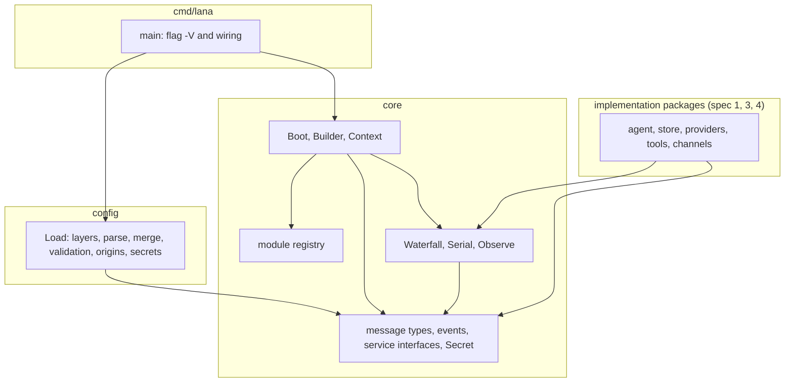
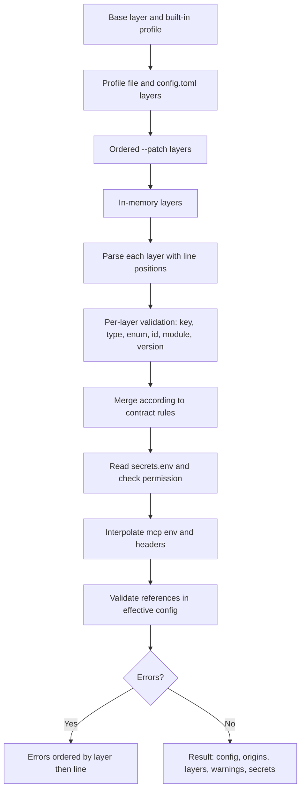
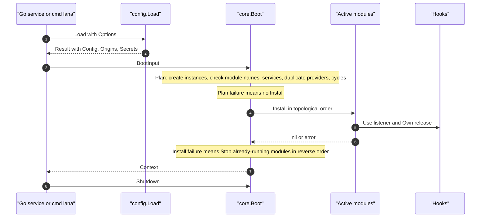
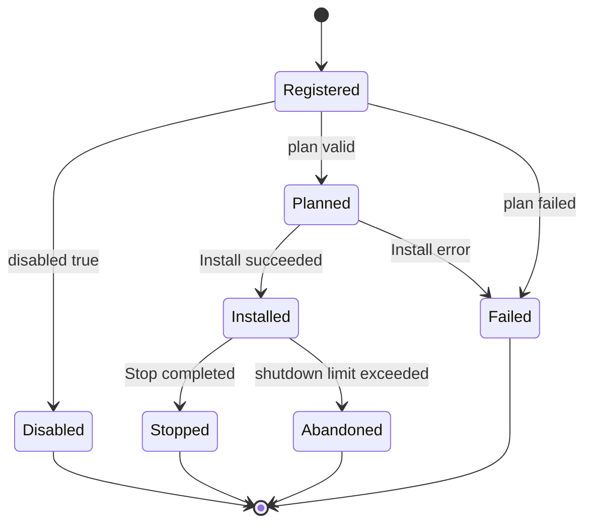
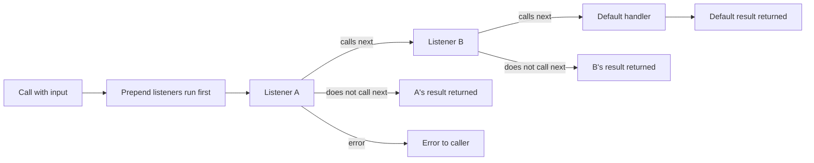
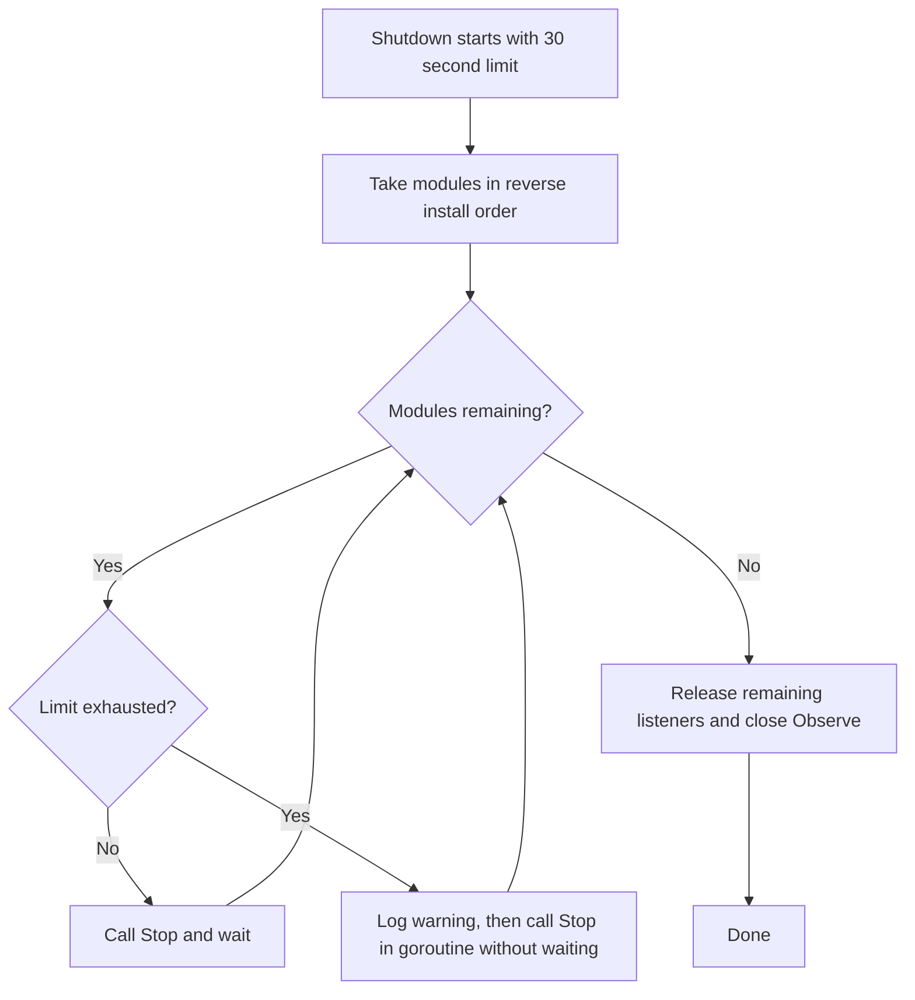

# Design: Foundation (workspace, profile loader, Context/module/hook)

- **Issue**: `#2`
- **Requirements**: [requirements.md](requirements.md)
- **Contract**: [api-contract.md](api-contract.md) — Required
- **Requirements revision**: 4
- **Contract revision**: 2 (reconciliation, `CQ-016` through `CQ-032`)
- **Requirements status**: Approved
- **Contract status**: Approved
- **Status**: Approved
- **Design revision**: 2 (cross-spec reconciliation #2 through #4: combined `core` types, `DeriveMessages` and `ResolvePrefix` in `core`, profile `base`, additional key validation, `ProviderError`, see `DQ-015` through `DQ-020`)

## Architecture references

- **ADR Index**: [docs/adr](../../adr/README.md)
- **Diagram Index**: [docs/diagram](../../diagram/README.md)
- **ADRs**: [0002](../../adr/0002-core-from-modules-services-and-hooks.md), [0009](../../adr/0009-session-as-append-only-event-log.md), [0010](../../adr/0010-profile-and-config-patch.md), [0013](../../adr/0013-use-go-as-single-binary.md), [0014](../../adr/0014-integration-as-agentic-tool.md) — all Accepted
- **Local feature diagrams**: [Components and dependencies](#components-and-dependencies), [Config loader pipeline](#config-loader-pipeline), [Boot](#boot-and-install), [Module lifecycle](#module-lifecycle), [Waterfall](#waterfall), [Shutdown](#shutdown)
- **Durable diagrams**: [0001. System Context and Roadmap](../../diagram/0001-system-context-and-roadmap.md), [0004. Profile, Fork, Subagent, and Protocol](../../diagram/0004-profile-fork-subagent-and-protocols.md)

## Architecture decision scan

| Topic | Existing authority | Decision location | Action |
|---|---|---|---|
| Public interfaces | Contract `API-CONF-*` and `API-CORE-*` | contract | Reuse |
| Language, package layout, and library | ADR 0013 | ADR | Reuse. Only packages `core`, `config`, `cmd/lana`, and `internal/archtest` are created in this spec |
| Module, service, hook | ADR 0002 | ADR | Reuse. Go form follows ADR 0013 |
| Layered config and profile | ADR 0010 | ADR | Reuse. Merge rules in contract `API-CONF-008` and `API-CONF-013` |
| Config without file for embedding | ADR 0014 | ADR | Reuse via `Options.Layers` |
| Events and payloads | ADR 0009 | ADR | Types and kinds in `core`. Storage in spec #4 |
| Message history and session prefix | ADR 0009, spec #3 and #4 | design | Pure functions in `core` (`DeriveMessages`, `ResolvePrefix`). No I/O |
| Persistence | ADR 0005 | No tables in this spec | Not applicable |
| Hook concurrency | No ADR | design | Local: copy-on-write and mutex (see Concurrency) |
| Dependency direction | ADR 0013 | ADR | Reuse. Tests in `internal/archtest` |
| Module state and lifecycle | No diagram | design | Local: module lifecycle diagram below |

## Visual Architecture Check

| Trigger | Present? | Required view |
|---|---:|---|
| Module or package boundary | Yes | Components and dependencies |
| Interaction with external actor or system | Yes | Boot (Go service embedding `lana`) |
| Multi-component flow | Yes | Loader pipeline, boot |
| Lifecycle or state transition | Yes | Module lifecycle |
| Entity relationship | No | No new tables or entities |
| Concurrency, retry, or failure flow | Yes | Waterfall (error and next), shutdown with time limit |
| Dependency direction or runtime topology | Yes | Components and dependencies |

## Local feature views

### Components and dependencies

- No arrows from `core` to other packages exist. Package `config` only imports `core`.
- Implementation packages only import `core`. They do not import `config`.

### Config loader pipeline

### Boot and install

### Module lifecycle

### Waterfall

### Shutdown

## Repository conformance

- The repository has no code yet. This spec creates the foundation: `go.mod`, `flake.nix`, `Makefile`, `.github/workflows/ci.yml`, packages `core`, `config`, `cmd/lana`, and `internal/archtest`.
- The layout follows ADR 0013. Packages `agent`, `store`, `providers`, `tools`, `mcp`, `channels`, `protocol`, `web`, and `lana.go` are created by specs #1, #3, and #4 as needed. This spec does not create empty packages.
- `cmd/lana` in this spec only prints the version (`-V`, `--version`). Other subcommands and flags come from spec #1.
- Dependency direction follows ADR 0013. No new package imports `config`.

### Layout of created files

| Path | Contents | Requirements |
|---|---|---|
| `go.mod` | Module `github.com/ridhomujizat/lana-harness`, directive `go 1.24`, dependency `github.com/pelletier/go-toml/v2` | `REQ-DEV-001`, `REQ-BUILD-001` |
| `flake.nix` | Dev shell (see Failure handling and Security) | `REQ-DEV-001` |
| `Makefile` | Target `release` | `REQ-BUILD-002` |
| `.github/workflows/ci.yml` | CI job | `REQ-CI-001` |
| `core/*.go` | Types, hooks, registry, boot | `REQ-MOD-*`, `REQ-HOOK-*`, `REQ-PROF-001` (names) |
| `config/*.go` | Loader | `REQ-CONF-*`, `REQ-PROF-001` |
| `cmd/lana/main.go` | Entry point, `-V` | `REQ-BUILD-002` |
| `internal/archtest/arch_test.go` | Import rule tests | `REQ-BUILD-001` |

## Proposed design

### Components

- **`core` module registry** — map from name to factory. `RegisterModule` fills the map during `init`. A duplicate name triggers a panic. The map is guarded by `sync.Mutex`.
- **`core` Builder** — used by modules during `Install`. Stores the service registry (`map[ServiceKey]entry{provider string, value any}`) and the list of listener releases per row. Not used after boot.
- **`core` boot** — builds the plan (instances, providers, graph), sorts by topology, installs, and assembles the `Context` (see Boot algorithm).
- **`core` generic hooks** — `Waterfall`, `Serial`, `Observe`. Listeners are stored as a slice that is never modified in place (copy-on-write) with `sync.RWMutex` (see Concurrency).
- **`core` types** — messages, `ChatRequest`, `ChatEvent`, service interfaces, events and payloads (ADR 0009), `Config` schema, `Secret`, and combined types (`API-CORE-015`). No I/O and no import of other packages in the module. Pure functions `DeriveMessages` and `ResolvePrefix` are also in `core`.
- **`config` loader** — the pipeline below. Uses `github.com/pelletier/go-toml/v2` (regular parser for values, `unstable` parser for node positions).
- **`config` origins** — `map[string]string` from key path to layer name. Filled during merge.
- **`config` secrets** — reads `secrets.env` and provides a `core.Secrets` that looks at the process env first.
- **`cmd/lana`** — `main` prints the version. The `version` value is set via `-X main.version` (`REQ-BUILD-002`).

### Config loader pipeline

Fixed steps in `config.Load`:

| Step | Work | Failure |
|---|---|---|
| 1. Assemble layers | Base, built-in profile, profile file, `config.toml`, `Patches`, `Layers` (order `API-CONF-001`). Missing files are skipped, except `Patches` (`CQ-015`) | Missing patch: error `patch file not found` |
| 2. Parse | Each layer is parsed. Values are read with `go-toml/v2`. Node positions are taken from the `unstable` parser, then line and column are computed from the byte offset | TOML syntax: error with line and column. That layer is not continued, but other layers are still parsed |
| 3. Per-layer validation | Walk the tree with schema tables (`API-CONF-002` through `008`). Check unknown keys, types, enums, empty or duplicate `id`, `module` known to the registry, `version` | Errors are collected with layer and line |
| 4. Merge | Contract rules. Every leaf stores the layer and position of its last writer | Error: `after` or `before` does not exist |
| 5. Secrets | Read `secrets.env` (check file mode). A mode mismatch yields a `Warning` | Invalid row: error with line |
| 6. Interpolation | Only `mcp.*.env` and `mcp.*.headers`. Lookup in process env, then secrets | Name not found: error with key |
| 7. Reference validation | `providers`, `routes.agent`, `subagents`, `mcp`, and `permission` on the effective config. Errors use the position of the writer of the referring key | Broken reference: error per reference |
| 8. Result | If there are errors, return sorted `Errors`. Otherwise build `Result` | — |

Implementation notes:

- The validation walk uses `map[string]any` and schema tables. Struct decoding with `DisallowUnknownFields` is not used because it only returns the first error (`DQ-001`).
- The closest-key suggestion uses a small Levenshtein in `config` (internal function, no new dependency).
- Validation of `rules.allow` and `rules.deny` uses `internal/pattern.ParsePattern` (grammar from spec #4). `config` may import `internal/...` (matrix below). Until spec #4 is done, the values are only arrays of strings (`DQ-015`).
- Every layer uses `Name` as `File` in errors. File paths are absolute.
- Base and built-in profiles use their own `Layer` with `Line` 0. Errors there only occur if the built-in table is broken, which is treated as a bug.

### Boot algorithm

Input: `BootInput{Config, Secrets, Profile}`. Output: `*Context` or error.

| Step | Work |
|---|---|
| 1. Filter | Take rows with `Disabled = false`, in order of `Config.Modules` |
| 2. Factory | For each row: look up the `Module` in the registry. Not found: error `module '<name>' ... not known`. Call the factory and keep the instance |
| 3. Provider | For each `Provides()`: if the key already exists, error `service ... provided by more than one module` with both `id`s |
| 4. Requires | For each `Requires()`: if there is no provider, error `requires service ... which is not installed`. Edge: row X to row Y if X requires a key that Y provides |
| 5. Cycle | DFS with a stack. If a node already on the stack is found, error `dependency cycle: A → B → A` with the path from that node. A self-loop is also a cycle |
| 6. Order | Kahn's algorithm. From the ready nodes, pick the smallest row index. The result is stable by row order (`AC-MOD-001`, `AC-MOD-002`) |
| 7. Install | For each row: set `Builder.current = row`, call `Install(b, ModuleConfig{...})`. On error: `Stop` already-running modules in reverse order, then error `module <id> failed to install` |
| 8. Context | Get services from the registry. The five core keys are filled into typed fields. Type mismatch: error `service '<key>' is not of type ...` |
| 9. Default hook | `ApprovalRequest` gets default `unavailable` if the approval module has not set it (fail-closed) |

Notes:

- Steps 1 through 6 do not call `Install`. So a failed plan means no module is installed (`REQ-MOD-002`).
- Step 7 can fail after some modules have started. Rollback uses the same `Stop` as shutdown.

### Module lifecycle

- Every row goes through the states in the diagram. States are not exported. Important transitions are logged with `slog` (install, failed, stopped, abandoned).
- Shutdown calls `Stop` of modules in reverse install order.

### Shutdown algorithm

- Total budget `min(ShutdownTimeout, remaining ctx deadline)`.
- A module that has been asked to `Stop` but has not returned when the budget runs out is logged as a warning with `slog` level `warn`. The `Stop` goroutine is left running.
- The next modules are still called `Stop` with the already-expired `ctx`. That call is not waited on.
- After all `Stop` calls are made, `Context` releases listeners that are still registered via the release in `Builder.Own`, then closes `Observe`.

### Hook: copy-on-write

- `Waterfall` stores `listeners []entry` and `def`. `entry` has `id uint64`.
- `Use` takes `Lock`, creates a new slice (`[e] + old` for prepend, `old + [e]` for regular), swaps the slice, and `Unlock`.
- `release` takes `Lock`, creates a new slice without that `id`, and swaps. Idempotent.
- `Call` takes `RLock`, copies the slice header, then `RUnlock`. The slice is never modified, so the snapshot is safe. The chain is built from the snapshot.
- `Serial` is the same, without default.
- `Observe.Publish` locks each subscriber briefly. The buffer `[1024]T` is a ring buffer. If full, the oldest event is dropped and `dropped++`. After that, a non-blocking signal is sent to `notify` (buffer 1).
- `Subscription.Recv`: if `dropped > 0`, return `Received{Lagged: dropped}` and reset. If there is an event, take it from the front. Otherwise wait on `notify`, `ctx.Done()`, or `closed`.

### Contract mapping

| Contract operation | Component | Input | Result | Requirements |
|---|---|---|---|---|
| `API-CONF-001` | Loader step 1 | Options, env, files | List of layers | `REQ-CONF-001`, `REQ-CONF-006` |
| `API-CONF-002` through `API-CONF-008` | Validation and merge | Parsed layers | Effective config, origins | `REQ-CONF-002`, `REQ-CONF-003`, `REQ-CONF-008` |
| `API-CONF-009` | Built-in profile table | Profile name | Layer `profile:<name>` | `REQ-PROF-001` |
| `API-CONF-010` | Secrets | `secrets.env`, env | `core.Secrets`, warning | `REQ-CONF-005` |
| `API-CONF-011` | Interpolation | mcp values | `core.Secret` | `REQ-CONF-007` |
| `API-CONF-012` | Errors | Internal error | `config.Error` | `REQ-CONF-003` |
| `API-CONF-013` | Origins | Writer per leaf | `Origins` | `REQ-CONF-004` |
| `API-CONF-014` | `config.Load` | Options | `Result` or `Errors` | `REQ-CONF-009` |
| `API-CORE-001` | Registry | name, factory | `Module` | `REQ-MOD-001`, `REQ-MOD-004` |
| `API-CORE-002` | Boot and Shutdown | `BootInput` | `*Context` | `REQ-MOD-001` through `REQ-MOD-004` |
| `API-CORE-003` | Context | Service | Typed fields, `Lookup` | `REQ-MOD-001`, `REQ-MOD-004` |
| `API-CORE-004` | Generic hook | Listener, input | Output, error | `REQ-HOOK-001` through `REQ-HOOK-004` |
| `API-CORE-005` | Named hook | `Hooks` field | Types I and O | `REQ-HOOK-001` through `REQ-HOOK-003` |
| `API-CORE-012` | `Secret` | Value | `***` format | `REQ-CONF-005` |
| `API-CORE-013` | `Config` | Struct | Marshal with tags | `REQ-CONF-003` |
| `API-CORE-014` | Error | — | Sentinel | `REQ-MOD-002`, `REQ-HOOK-001` |
| `API-CORE-015` | Combined types, `DeriveMessages`, `ResolvePrefix` | — | Pure types and functions | Not applicable |

The other types in the contract (`API-CORE-006` through `011`, and `015`) are only defined in `core`. Behavior is owned by specs #3 and #4 (`DeriveMessages` is shared, `ResolvePrefix` is in spec #4).

### Persistence

- Unchanged. This spec has no tables, migrations, or write events. `core.SessionEvent` and `SessionStore` are types and interfaces only.

### Failure handling

| Failure | Internal error | Visible result |
|---|---|---|
| Config file cannot be read | `*fs.PathError` | `config.Error` with file and OS reason (failure case table in requirements) |
| Invalid TOML | Parser error | `config.Error` with line and column |
| Type, enum, key, id, module, reference, version | `config.Error` | All collected. `Errors` |
| `${NAME}` not found | `config.Error` | Error with key |
| Loose `secrets.env` permission | `config.Warning` | Warning. File is still read |
| Unknown module, missing service, cycle, duplicate service | `error` with contract message | `Boot` fails before `Install` |
| `Install` fails | `error` | Reverse `Stop` rollback, `Boot` fails |
| `Stop` fails or exceeds limit | `error` or timeout | `slog` warn. Shutdown continues |
| `Waterfall` with no default and no next | `ErrNoDefault` | Error to caller |
| `ToolsPreExecute` listener rejects | `ToolDecision{Allowed: false}` | Caller writes `tool/result` with status `rejected` (spec #3) |
| Slow subscriber | `Lagged` | Subscriber continues from the latest event |

### Concurrency

- `Load` does not use goroutines. The result depends only on the contents of the layers and env (data integrity table in requirements).
- `Boot` and `Shutdown` run on one calling goroutine. A `Stop` that exceeds the limit runs on its own goroutine.
- `Hooks` are safe for use by many goroutines (copy-on-write, see above).
- `Context` is not changed after `Boot`. Fields cannot be replaced. There is no mutex for those fields.
- `Builder` is not safe to use after `Boot` completes. A module that keeps a reference to `Builder` and uses it in another goroutine after boot violates the contract.

### Security

- `Secret` writes `***` for `String`, `GoString`, `Format` (all verbs), `LogValue`, `MarshalJSON`, and `MarshalText`. The original value is only available through `Reveal`.
- Every value of `mcp.*.env` and `mcp.*.headers` is of type `Secret` (`CQ-006`).
- `Load` does not run code from config. Static TOML (ADR 0010).
- The `secrets.env` mode is checked. A mode other than `0600` produces a warning with the `chmod 600` command.
- The process env wins over `secrets.env` (`AC-CONF-012`).
- The dev shell uses `GOTOOLCHAIN=local` and `CGO_ENABLED=0` (`REQ-DEV-001`). The exception for `go test -race` is in Risks and `DQ-010`.

### Observability

- `Load` does not write to stdout or stderr. Warnings go to `Result.Warnings` and `slog.Warn`.
- `Boot` logs `slog.Info` for each installed module: id, module name, and duration.
- `Shutdown` logs `slog.Warn` for modules that exceed the limit.
- Secret values never enter logs (`AC-CONF-014`).

### New dependencies

| Module | Used in | Reason |
|---|---|---|
| `github.com/pelletier/go-toml/v2` | `config`, `core` (tag) | Parse TOML with positions (ADR 0013) |

- There are no other dependencies in this spec. `log/slog`, `sync`, `iter`, `errors`, and `encoding/json` come from stdlib.
- `cobra`, `bubbletea`, and others come from spec #1, `modernc.org/sqlite` from spec #4.

### Dev shell and build

- `flake.nix` is at the repository root. No `flake.nix` exists in parent folders (`self-tool/`, `project/`, `coding/`, `~`) when this spec was written, so a new flake is created (per the `nix-development.md` rule).
- The dev shell uses `pkgs.go` (version from `flake.lock`), `gopls`, `golangci-lint`, `sqlite`, and `gnumake`. `env` sets `GOTOOLCHAIN = "local"` and `CGO_ENABLED = "0"`.
- Supported systems: `aarch64-darwin`, `x86_64-linux`, `aarch64-linux`, `x86_64-darwin`.
- `go.mod` uses `go 1.24`. The nixpkgs toolchain must be newer or equal.
- `Makefile`:

| Target | Command | Notes |
|---|---|---|
| `release` | For each `GOOS/GOARCH` (`darwin/arm64`, `linux/amd64`, `linux/arm64`): `CGO_ENABLED=0 go build -trimpath -ldflags="-s -w -X main.version=$(VERSION)" -o dist/lana-$(GOOS)-$(GOARCH) ./cmd/lana` | `VERSION` defaults to `dev`. After build, print the size with `wc -c`. Size above 40 MB is printed as a note, does not fail |

- The binary `dist/lana-linux-amd64` is checked with `file` in CI. Output must contain `statically linked` (`AC-BUILD-004`).

### CI

- File: `.github/workflows/ci.yml`. Triggers: `push` and `pull_request`.
- Matrix: `macos-14` (arm64) and `ubuntu-24.04` (x86_64). `fail-fast: false`.
- Steps:

| Step | Command | Passes if |
|---|---|---|
| Install Nix | Nix installer action (version pinned in implementation) | Nix is available |
| Format | `test -z "$(nix develop -c gofmt -l .)"` | Output is empty |
| Lint | `nix develop -c golangci-lint run ./...` | Exit 0 |
| Test | `CGO_ENABLED=1 nix develop -c go test -race ./...` | Exit 0 |
| Release | `nix develop -c make release` | Exit 0 |
| Linux static check | `file dist/lana-linux-amd64` | Contains `statically linked`. Linux job only |
| Summary | Write binary size table to `$GITHUB_STEP_SUMMARY` | Always, if previous steps pass |

- Any failing step fails the job (`AC-CI-001`).

### Import test layout

- File: `internal/archtest/arch_test.go`.
- Function `checkRules(imports map[string][]string) []string` is pure. Input: direct imports per package in the module. Output: violations with package names.
- Rule matrix (packages in the module):

| Package | May import within the module |
|---|---|
| `core` | none |
| `config` | `core`, `internal/...` |
| `cmd/lana` | all |
| `internal/...` | `core`, `internal/...` |
| other packages (implementation) | `core`, `internal/...` |

- Test `TestImportRules` runs `go list -f '{{.ImportPath}} {{join .Imports " "}}' ./...`, filters imports with the module prefix, and calls `checkRules`.
- Test `TestCoreTransitive` runs `go list -deps ./core`, filters the module prefix, and checks that the result is empty.
- Test `TestRuleViolationMessage` gives input where `core` imports `config` and checks that the message names `core` and `config` (`AC-BUILD-002`).

### Config error types and format

- `config.Error.Error()` follows `API-CONF-012`.
- `config.Errors` is sorted: by layer in the order of `API-CONF-001`, then by line, then by key.
- Validation messages use fixed text from the contract. Each message is produced by a function in package `config` with one place for the text.

## Requirement traceability

| Requirement | Contract operation | Design component | Verification level |
|---|---|---|---|
| `REQ-DEV-001` | Not applicable | `flake.nix` | runtime |
| `REQ-CI-001` | Not applicable | `.github/workflows/ci.yml` | runtime |
| `REQ-BUILD-001` | Not applicable | Package layout, `internal/archtest` | integration |
| `REQ-BUILD-002` | Not applicable | `Makefile`, `cmd/lana` | runtime |
| `REQ-CONF-001` | `API-CONF-001`, `API-CONF-009` | Loader step 1 | integration |
| `REQ-CONF-002` | `API-CONF-004`, `API-CONF-005`, `API-CONF-007`, `API-CONF-008` | Loader step 4 | unit |
| `REQ-CONF-003` | `API-CONF-002` through `API-CONF-006`, `API-CONF-012`, `API-CORE-013` | Loader steps 3 and 7 | unit |
| `REQ-CONF-004` | `API-CONF-013` | Origins | unit |
| `REQ-CONF-005` | `API-CONF-010`, `API-CORE-012` | Secrets, `Secret` | unit |
| `REQ-CONF-006` | `API-CONF-001` | Loader step 1 | unit |
| `REQ-CONF-007` | `API-CONF-006`, `API-CONF-011` | Loader step 6 | unit |
| `REQ-CONF-008` | `API-CONF-002` | Loader step 3 | unit |
| `REQ-CONF-009` | `API-CONF-014` | `Load` with `Layers` | integration |
| `REQ-MOD-001` | `API-CORE-001`, `API-CORE-002` | Boot steps 6 and 7 | unit |
| `REQ-MOD-002` | `API-CORE-002`, `API-CORE-014` | Boot steps 2 through 5 | unit |
| `REQ-MOD-003` | `API-CORE-002` | Shutdown | unit |
| `REQ-MOD-004` | `API-CORE-001`, `API-CORE-003` | Boot step 3 | unit |
| `REQ-HOOK-001` | `API-CORE-004`, `API-CORE-005`, `API-CORE-014` | `Waterfall` | unit |
| `REQ-HOOK-002` | `API-CORE-004` | `Serial` | unit |
| `REQ-HOOK-003` | `API-CORE-004` | `Observe`, `Subscription` | unit |
| `REQ-HOOK-004` | `API-CORE-002`, `API-CORE-004` | `Use` release, `Builder.Own` | unit |
| `REQ-PROF-001` | `API-CONF-009` | Built-in profile table | unit |

## Acceptance verification map

The test names in the last column are planned names. The implementation may rename them, but must not drop coverage.

| Acceptance criterion | Verification method | Planned evidence |
|---|---|---|
| `AC-DEV-001` | runtime | `nix develop -c go version` matches `go.mod` |
| `AC-DEV-002` | runtime | `nix develop -c golangci-lint version` |
| `AC-DEV-003` | runtime | `GOOS=linux GOARCH=amd64 CGO_ENABLED=0 go build ./cmd/lana` inside `nix develop` |
| `AC-CI-001` | runtime | CI run on a commit with a deliberately failing test (test branch) |
| `AC-CI-002` | runtime | Job summary contains the sizes for both platforms |
| `AC-BUILD-001` | integration | `go build ./...` |
| `AC-BUILD-002` | unit | `TestRuleViolationMessage`, `TestImportRules` |
| `AC-BUILD-005` | unit | `TestRuleViolationMessage`, `TestImportRules` |
| `AC-BUILD-003` | runtime | `make release` produces three files in `dist/` and prints sizes |
| `AC-BUILD-004` | runtime | `file dist/lana-linux-amd64` contains `statically linked` |
| `AC-CONF-001` | integration | `TestLayerPatchWins` |
| `AC-CONF-002` | integration | `TestMissingProfileSkipped` |
| `AC-CONF-003` | unit | `TestMergeModuleRowReplacesConfig` |
| `AC-CONF-004` | integration | `TestBootDisabledRowNotInstalled` |
| `AC-CONF-005` | unit | `TestMergeModuleAfter` |
| `AC-CONF-006` | unit | `TestMergeAgentTablesRecursive` |
| `AC-CONF-007` | unit | `TestMergeRoutesReplaced` |
| `AC-CONF-008` | unit | `TestMergeAfterUnknownID` |
| `AC-CONF-009` | unit | `TestErrorsCollectAllLayers` |
| `AC-CONF-010` | unit | `TestRefErrorLocation` |
| `AC-CONF-011` | unit | `TestOriginsTableAndLeaf` |
| `AC-CONF-012` | unit | `TestSecretEnvWins` |
| `AC-CONF-013` | unit | `TestEffectiveConfigRedacted` (TOML and JSON) |
| `AC-CONF-014` | unit | `TestSecretFormatting` (`%v`, `%#v`, `slog`) |
| `AC-CONF-015` | integration | `TestLanaHomeEnv` with `t.TempDir()` |
| `AC-CONF-016` | unit | `TestUnknownKeySuggestion` |
| `AC-CONF-017` | unit | `TestSecretsPermWarning` (mode `0644`) |
| `AC-CONF-018` | unit | `TestMCPEnvInterpolationSecret` |
| `AC-CONF-019` | unit | `TestNonMCPFieldNotInterpolated` |
| `AC-CONF-020` | unit | `TestMissingVarError` |
| `AC-CONF-021` | unit | `TestVersionTooHigh` |
| `AC-CONF-022` | integration | `TestMemoryLayerNoFiles` (`Home` empty, origin `myservice`) |
| `AC-CONF-023` | unit | `TestMemoryLayerRefError` |
| `AC-MOD-001` | unit | `TestBootOrderDependency` |
| `AC-MOD-002` | unit | `TestBootOrderRowStable` |
| `AC-MOD-003` | unit | `TestBootMissingService` |
| `AC-MOD-004` | unit | `TestBootCycleMessage` |
| `AC-MOD-005` | unit | `TestShutdownReverseOrder` |
| `AC-MOD-006` | unit | `TestShutdownStuckModule` (budget reduced via test variable) |
| `AC-MOD-007` | unit | `TestBootDuplicateProvider` |
| `AC-HOOK-001` | unit | `TestWaterfallOrder` |
| `AC-HOOK-002` | unit | `TestWaterfallStopsWithoutNext` |
| `AC-HOOK-003` | unit | `TestWaterfallInputChanged` |
| `AC-HOOK-004` | unit | `TestWaterfallPrepend` |
| `AC-HOOK-005` | unit | `TestWaterfallErrorStops` |
| `AC-HOOK-006` | unit | `TestSerialResultsInOrder` |
| `AC-HOOK-007` | unit | `TestObserveNonBlocking` (10,000 events) |
| `AC-HOOK-008` | unit | `TestReleaseHandle` |
| `AC-HOOK-009` | unit | `TestModuleStopReleasesListeners` |
| `AC-HOOK-010` | unit | `TestObserveLagged` (1500 events, `Lagged(476)`) |
| `AC-PROF-001` | unit | `TestBuiltinProfileRows` (with fake modules of the same name) |
| `AC-PROF-002` | unit | `TestUnknownProfileError` |

## Verification strategy

- **Unit**: config parser and validator, merge, origins, interpolation, secrets and `Secret`, boot planner, shutdown, generic hooks, `Observe`. All tests run with `go test -race`.
- **Integration**: `config.Load` with `t.TempDir()` as `LANA_HOME`, `Boot` with fake modules registered under test names (`test.*`).
- **Runtime**: `nix develop -c` for the dev shell, `make release` for the build, `file` for the Linux binary, CI for the matrix.

## Risks and tradeoffs

- **Built-in profiles cannot be loaded in the binary yet.** Module names in `API-CONF-009` are only created by specs #3 and #4. Until then, `config.Load` for built-in profiles fails `module` validation. Tests use fake modules with the same names. `lana -V` still works.
- **Hook payloads may change** before v1.0.0 when specs #3 and #4 fill in their behavior. Changes must be recorded in the CHANGELOG (ADR 0014).
- **Global module registry.** Tests use names `test.*` and do not remove from the registry. This is a tradeoff for a simple API (`RegisterModule` per the sheet).
- **A module stuck in `Stop`** leaves a goroutine behind until the process exits (`DQ-003`).
- **`go test -race` requires cgo.** The dev shell sets `CGO_ENABLED=0`, so the test step in CI sets `CGO_ENABLED=1` only for that command (`DQ-010`). The release build stays `CGO_ENABLED=0`.
- **Schema v1 rejects keys from ADR 0014** (`[protocol.mcpserver]`, `[[api.tokens]]`) until the spec that brings them adds them to the schema. This is intentional: unknown keys are errors (`REQ-CONF-003`).
- **One external dependency** (`go-toml/v2`). Levenshtein and the `.env` parser are written by hand to keep dependencies minimal.
- **`Secret` for literal values** (`CQ-006`) hides more than necessary. This tradeoff was chosen because it is safe and simple.
- **Spec #1 cites `config.Load(profile, patches)`** and `ctx.prompt`, `core.Compactor`. The sheet replaces the form of `Load`, and other services are installed through `Provide` and `Lookup`. Spec #1 needs updating in the next revision. This spec does not change the spec #1 file.

## Notes for requirements

These notes do not change the behavior of `requirements.md` (revision 3). Each item is resolved through `CQ` or `DQ` above. The owner can approve or request a revision of the requirements.

| No | Gap | Impact | Choice in this spec |
|---|---|---|---|
| 1 | `REQ-CONF-001` says "layers whose file does not exist are skipped", but `API-CLI-001` (spec #1) requires exit 2 for a missing `--patch` | Behavior for missing patch | Error for `--patch` (`CQ-015`) |
| 2 | `REQ-MOD-003` says "modules that exceed the limit are logged and skipped", `AC-MOD-006` says "other modules are still stopped" | Meaning of "skipped" is unclear | `Stop` is called for all modules, with `ctx` expired after the limit (`DQ-003`) |
| 3 | `AC-CONF-017` requires the warning to "appear in the log and stderr", while the library must not write to stderr | Where the warning is printed | `Result.Warnings` and `slog`, stderr is printed by spec #1 (`CQ-007`) |
| 4 | `REQ-DEV-001` sets `CGO_ENABLED=0`, `REQ-CI-001` requires `go test -race` | `-race` requires cgo | Tests in CI use `CGO_ENABLED=1` (`DQ-010`) |
| 5 | Contents of the `base` layer and built-in profiles are not written in requirements | Which modules are active | Table in `API-CONF-009`. Owner needs to review |
| 6 | `REQ-CONF-002` does not mention `after` or `before` for an existing `id` | Position of old row | Ignored, still validated (`CQ-011`) |
| 7 | An env value that exists but is empty is not mentioned | Secret lookup | Treated as not present (`CQ-005`) |
| 8 | Origin format for module rows is not mentioned (`REQ-CONF-004`) | Origin map key | `modules.<id>` (`API-CONF-013`) |
| 9 | Default agent `permission` is not mentioned | Default security | `ask` (`CQ-009`) |
| 10 | Invalid `secrets.env` rows are not mentioned | Error or skip | Error with line (`CQ-010`) |
| 11 | Format of `id` is not restricted | Allowed characters | Not empty, unique per layer |
| 12 | `REQ-CONF-005` says secret values must not be printed, does not mention literals in `mcp.*.env` | Scope of `Secret` | All `env` and `headers` values (`CQ-006`) |

## Blocking Design Questions

| ID | Question | Controls | Owner | Status | Resolution |
|---|---|---|---|---|---|
| `DQ-001` | Config validation: walk tree or strict struct decode | `REQ-CONF-003`, `API-CONF-012` | Ridho | Resolved | Agent recommendation: walk tree with schema tables. Strict decode only returns the first error, while `AC-CONF-009` requires all errors. |
| `DQ-002` | `Install` fails in the middle of boot | `REQ-MOD-002`, `API-CORE-002` | Ridho | Resolved | Agent recommendation: `Stop` already-running modules in reverse order, then `Boot` fails with message `module <id> failed to install`. |
| `DQ-003` | Module stuck in `Stop` during shutdown | `REQ-MOD-003`, `AC-MOD-006` | Ridho | Resolved | Agent recommendation: total budget of 30 seconds. A stuck module is abandoned and logged. The next modules are still called `Stop` with an expired `ctx`. |
| `DQ-004` | `Serial` and listener errors | `REQ-HOOK-002`, `API-CORE-004` | Ridho | Resolved | Agent recommendation: the first error stops the chain and is returned. Results of earlier listeners are not returned. |
| `DQ-005` | Default hook handler | `API-CORE-004`, `API-CORE-005` | Ridho | Resolved | Agent recommendation: `NewWaterfall` takes no arguments, default is set with `SetDefault`. Without a default, `Call` returns `ErrNoDefault`. `ApprovalRequest` is given default `unavailable` by `Boot`. |
| `DQ-006` | Read shape of `Subscription` for `Lagged` | `REQ-HOOK-003`, `AC-HOOK-010` | Ridho | Resolved | Agent recommendation: `Recv` returns `Received[T]`. If `Lagged > 0`, call `Recv` again for the event. |
| `DQ-007` | Global module registry and `Module.ID` | `API-CORE-001`, `REQ-MOD-004` | Ridho | Resolved | Agent recommendation: global registry with `sync.Mutex`. Duplicate names panic. `ID()` returns the implementation name. Error messages use the row `id`. |
| `DQ-008` | Additional libraries | Dependencies | Ridho | Resolved | Agent recommendation: only `go-toml/v2`. Levenshtein, `secrets.env` parser, and ring buffer are written by hand. |
| `DQ-009` | Testing built-in profiles and `cmd/lana` before modules exist | `AC-PROF-001`, `REQ-BUILD-002` | Ridho | Resolved | Agent recommendation: tests register fake modules with built-in names. `cmd/lana` in this spec is only `-V`. |
| `DQ-010` | `go test -race` with `CGO_ENABLED=0` | `REQ-CI-001`, `REQ-DEV-001` | Ridho | Resolved | Agent recommendation: the test step in CI and the `go test -race` command in tasks use `CGO_ENABLED=1` only for that command. |
| `DQ-011` | Go version and pin | `REQ-DEV-001`, `AC-DEV-001` | Ridho | Resolved | Agent recommendation: `go 1.24` in `go.mod`. Toolchain from `pkgs.go` in `flake.lock`. `GOTOOLCHAIN=local`. |
| `DQ-012` | Scope of import rule tests | `REQ-BUILD-001`, `AC-BUILD-002` | Ridho | Resolved | Agent recommendation: direct imports of each package, plus `go list -deps` for `core`. Tests in `internal/archtest`. |
| `DQ-013` | Release target, version, and size | `REQ-BUILD-002`, `AC-BUILD-003` | Ridho | Resolved | Agent recommendation: `release` target in `Makefile`. `VERSION` defaults to `dev`. Size with `wc -c`. |
| `DQ-014` | CI runner | `REQ-CI-001`, `AC-CI-002` | Ridho | Resolved | Agent recommendation: `macos-14` (arm64) and `ubuntu-24.04` (x86_64) with Nix. Action versions pinned in implementation. |
| `DQ-015` | Where the `rules` pattern validation lives | `API-CONF-004`, `CQ-030` | Ridho | Resolved | Agent recommendation (reconciliation): package `internal/pattern` contains `ParsePattern` (grammar from spec #4). `config` uses it, and so does `tools/permission`. The import rule for `config` allows `internal/...`. Until spec #4 is done, only arrays of strings. |
| `DQ-016` | `store` row in profile and library | `API-CONF-009`, `CQ-031` | Ridho | Resolved | Agent recommendation (reconciliation): the profile uses `sqlite_store`. `lana.New` (spec #3) uses `memstore` if `Home` is empty and `Options.Store` is nil. If `Options.Store` is set, the `store` row is replaced with `provided_store`, a module in package `lana`. Spec #2 does not change this mechanism. |
| `DQ-017` | Location of `ProviderError` and `DeriveMessages` | `API-CORE-015`, `CQ-026`, `CQ-028` | Ridho | Resolved | Agent recommendation (reconciliation): both are in `core`. `ProviderError` is a data type with `Is`, without I/O. `DeriveMessages` is a pure function over `[]SessionEvent`. Both still follow the `core` import rule (no import of other packages). |
| `DQ-018` | Session prefix rule: where and how | `API-CORE-009`, `API-CORE-015`, `CQ-023` | Ridho | Resolved | Agent recommendation (reconciliation): `FindPrefix` returns a list. `core.ResolvePrefix` applies the rule of minimum 6 characters and exactly one match. Specs #1 and #4 use the same function. |
| `DQ-019` | Shape of the lease in `core` | `API-CORE-009`, `CQ-023` | Ridho | Resolved | Agent recommendation (reconciliation): `TryLease` returns `release func() error`. No `Lease` type. Errors from another holder use `LeaseHeldError`. |
| `DQ-020` | Owner of the event payload struct | `API-CORE-008`, `CQ-029` | Ridho | Resolved | Agent recommendation (reconciliation): `API-CORE-008` is the single table of payload fields. Specs #3 and #4 refer to it. Additional fields from specs #3 and #4 are added to this table. |

None remaining open.

## Approval

- [x] Requirements are Approved and their revision is recorded.
- [x] Contract is Approved.
- [x] Architecture decision scan and Visual Architecture Check are complete.
- [x] Required ADRs are Accepted.
- [x] Every requirement maps to one design component.
- [x] Every acceptance criterion has a verification method.
- [x] Blocking Design Questions is `None`.
- **Approved by**: Ridho (gate released 2026-10-29)
- **Approved on**: 2026-10-29 (revision 1). Revision 2 reconciled by the agent on behalf of the owner.
