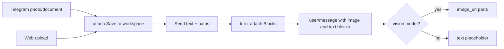

# Design: Images and file attachments

- **Requirements**: revision 1 · **Contract**: revision 1
- **Status**: Approved

## 1. Core types (REQ-ATT-002, -004; API-ATT-004)

`core/chat.go` `ContentBlock` gains:

```go
Path   string         `json:"path,omitempty"`   // workspace-relative path of an image block
Images []ContentBlock `json:"images,omitempty"` // image blocks of a tool_result block
```

`core.ToolOutput` gains `Images []ContentBlock` (persisted, unlike `Usage`). `core.ToolResultPayload`
gains `Images []ContentBlock \`json:"images,omitempty"\``. The turn copies `ToolOutput.Images` into
the `tool/result` event; `DeriveMessages` (`store/store.go`, `store/memstore/memstore.go`) puts them
on the `tool_result` block. Image blocks in `user/message` pass through unchanged.

## 2. `internal/attach` (new package; REQ-ATT-001, -002, -004)

```go
const (
    MaxFileBytes = 20 << 20
    MaxFiles     = 10
    MaxImageEdge = 1568
    InlineChars  = 16000
    Dir          = "attachments"
)
type Info struct{ Path, Name, MediaType string; Size int64 }
// Save writes r to <workspace>/attachments/<YYYY-MM-DD>/<clean name>, mode 0600, with -1, -2 on a
// clash; it stops with ErrTooLarge past MaxFileBytes and removes the partial file.
func Save(workspace, name string, r io.Reader, now time.Time) (Info, error)
// Resolve checks that rel is a regular file under <workspace>/attachments and returns its absolute path.
func Resolve(workspace, rel string) (string, error)
// Blocks builds the REQ-ATT-002 parts for the given attachment paths, in order. A file that cannot
// be read becomes a text block that says so; Blocks fails only on a path Resolve rejects.
func Blocks(workspace string, paths []string) ([]core.ContentBlock, error)
// Image decodes, scales (long edge ≤ MaxImageEdge, never up), re-encodes (JPEG q85, PNG when any
// pixel is not opaque; GIF first frame), and returns the block plus the original size.
func Image(abs, rel string) (core.ContentBlock, int, int, error)
// PDFText returns one string per page; all empty means a scanned PDF.
func PDFText(abs string) ([]string, error)
// Kind sniffs with http.DetectContentType and the extension: image, pdf, text, or other.
func Kind(head []byte, name string) string
// Placeholder is "[image <path>]" (REQ-ATT-007).
func Placeholder(b core.ContentBlock) string
```

Dependencies (pure Go, keeps the static Linux build): `golang.org/x/image` (`webp` decode,
`draw.CatmullRom` scaling) and `github.com/ledongthuc/pdf` (text per page). Text files: valid
UTF-8, `text/*`, `application/json`, or a source extension list (`.go .py .js .ts .tsx .java .rb
.rs .c .h .cpp .cs .php .sh .sql .yaml .yml .toml .xml .html .css .md .csv .txt .log`).

## 3. Provider wire (REQ-ATT-002, -004)

`providers/openai/wire.go`:
- User message with any image block: `content` becomes an array of parts in block order —
  `{"type":"text","text":…}` for text blocks, `{"type":"image_url","image_url":{"url":"data:<media type>;base64,<data>"}}`
  for image blocks. Without images the current string form stays (prefix bytes unchanged for old
  sessions).
- Tool result with `Images`: the `role: tool` message `content` becomes
  `[{"type":"text","text":<output>}, image parts…]`.
- Assistant image blocks keep `ErrUnsupported`.

## 4. Vision flag (REQ-ATT-003; API-ATT-005)

`internal/models.Model` gains `Vision bool`: true for `deepseek-flash` and `deepseek-v4-flash`.
`core.AgentConfig` gains `Vision *bool \`toml:"vision"\``; `config/validate.go` adds `vision` to
`agentKeys` (boolean). The agent resolver sets `resolved.vision` = agent value, else catalog, else
false. `agent/turn.go`, right after `DeriveMessages`: when `!resolved.vision`, replace each image
block (top level and inside `tool_result.Images`) with a text block
`[image <path>: the current model cannot see images]` (a new helper in `agent/attachments.go`).

## 5. Sending with attachments (REQ-ATT-002, -008; API-ATT-006)

- `agent/turn.go`: `inbox []string` → `inbox []inboxItem{text string; attachments []string}`;
  `popInbox`/`pushFrontInbox` carry the item.
- `Registry.Start(ctx, id, text string, attachments ...string)` and
  `Registry.Send(ctx, id, text string, attachments ...string)` (variadic, so current callers
  compile). `lana.Runtime.Send` and `lana.Request.Attachments` pass them on; `Run` validates every
  path with `attach.Resolve` against the session workspace before starting and accepts an empty
  prompt when attachments are present (prompt becomes `(attachments)`).
- Where the turn builds the owner message from the claimed item, it appends
  `attach.Blocks(resolved.workspace, item.attachments)` after the text block.

## 6. Other consumers (REQ-ATT-007)

- `agent/compaction`: the summary request and the prune step replace image blocks (top level and in
  tool results) with `attach.Placeholder`.
- `agent/memcapture`: the capture transcript uses the placeholder.
- TUI history (`channels/cli/tui`): an image block renders as a muted `[image <path>]` line.

## 7. `read_file` (REQ-ATT-004)

`tools/files.go` `readFileTool.Call`, before the binary check: `attach.Kind` on the first 512 bytes.
Image → `attach.Image`, output `Image <path> (<w>x<h>).`, `ToolOutput.Images` = the block. PDF →
`attach.PDFText`, join pages with `--- page <k> ---` lines, then the existing numbering and
`offset`/`limit`; all pages empty → error with the scanned-PDF text. Update the description.

## 8. Telegram (REQ-ATT-005)

- `channels/telegram/api.go`: `Message.Photo []PhotoSize{FileID, Width, Height, FileSize}`,
  `Document *Document{FileID, FileName, MimeType, FileSize}`, `Caption`, `MediaGroupID`;
  `Client.GetFile(ctx, fileID) (File{FilePath, FileSize})` and
  `Client.Download(ctx, filePath, w io.Writer, limit int64)` from `https://api.telegram.org/file/bot<token>/<path>`.
- `channels/telegram/chat.go`: a message with a photo or document goes to a media path that
  downloads into the session workspace (`attach.Save`; the session's workspace comes from
  `SessionInfo`) and then sends `text` = caption with the paths. Album: a per-chat buffer keyed by
  `media_group_id`, flushed 1.5 s after its last message. Other media get the new unsupported text.
- `Backend.Send(ctx, sessionID, text string, attachments ...string)`; `cmd/lana/daemon.go` passes
  them to the runtime.

## 9. Web (REQ-ATT-006; API-ATT-001–004)

- `web/attachments.go`: upload (multipart, `http.MaxBytesReader`, per-file limit), serve (path
  checked with `attach.Resolve`). `web/turns.go` send body gains `attachments`.
- Backend interface: `SaveAttachment(ctx, id, name string, r io.Reader) (attach.Info, error)`,
  `AttachmentPath(ctx, id, rel string) (string, error)`, `Send(ctx, id, text string, attachments []string)`;
  implemented in `cmd/lana/web.go` with the session workspace.
- Event payloads served to the UI drop `data` from image blocks.
- UI (`web/ui/src/views/session.tsx`, `api/turns.ts`, new `api/attachments.ts`): paperclip button
  (`<input type=file multiple>`), paste of images, drop on the session view, chips with remove and
  thumbnails, upload then send; owner message bubbles show thumbnails
  (`GET /v1/sessions/{id}/attachments/{path}`) and file chips. Rebuild `web/dist`.

## Visual Architecture Check

| Trigger | Present? | Required view |
|---|---:|---|
| Multi-component flow | Yes | below |
| All others | No | — |



## Verification

- `internal/attach` unit tests: save naming and limits, resolve rejects `..` and paths outside
  `attachments/`, image scaling and PNG/JPEG choice, WebP and GIF decode, PDF text and scanned PDF
  (fixtures generated in the test), text cut at 16 000 characters.
- Wire tests: user message parts in order; tool message with images; no-image messages unchanged.
- Agent tests: AC-ATT-001–005 with the mock provider (request inspection).
- Telegram tests with the fake API: photo, album (AC-ATT-006), document, too large, unsupported.
- Web handler tests and a UI test for attach and send (AC-ATT-007).
- Real model: one `deepseek-flash` run with 3 images and a PDF.

## Implementation notes (deviations)

- `Registry.Send` keeps its 3-argument signature because `core.AgentRegistry` pins it and boot
  type-checks it; attachments go through `Registry.SendWithAttachments`. `Runtime.Send` is variadic.
- The tool-result image copy lives in `core/derive.go` (both stores delegate to it); a pruned tool
  result drops its images (the pruned output holds the placeholder lines).
- The attachment URL is `/v1/sessions/{id}/attachments/<path below attachments/>`; the handler
  prepends `attachments/`.
- Telegram: if every file of a message is skipped (too large), no turn starts even with a caption.
  An album flush first drains updates already queued so a busy worker cannot split an album.
- CLI: `pump` in `channels/cli/tui/model.go` now waits for the turn result after a cancel; before,
  the TUI could stay in "Thinking…" after ctrl+c (found by the cancel tests).
