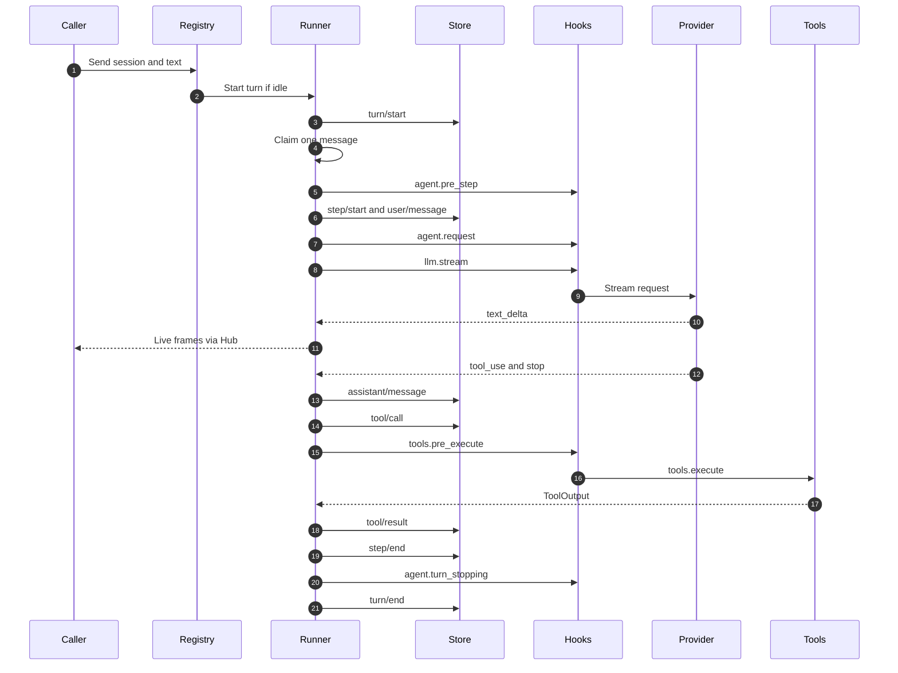
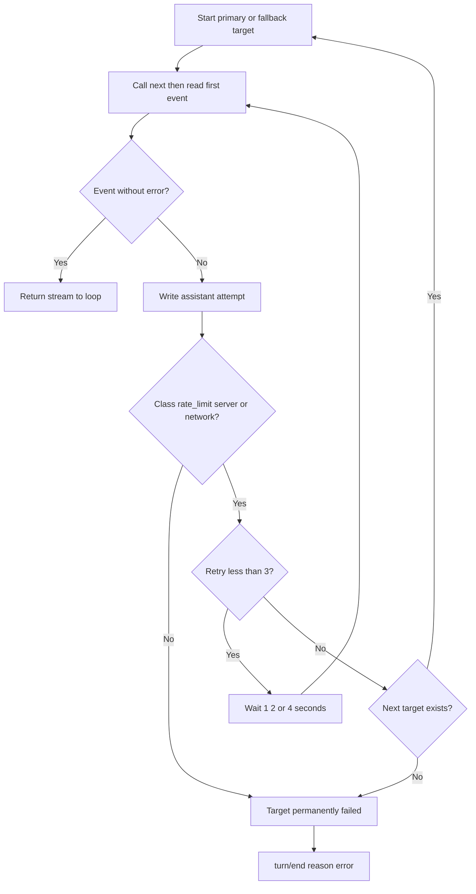
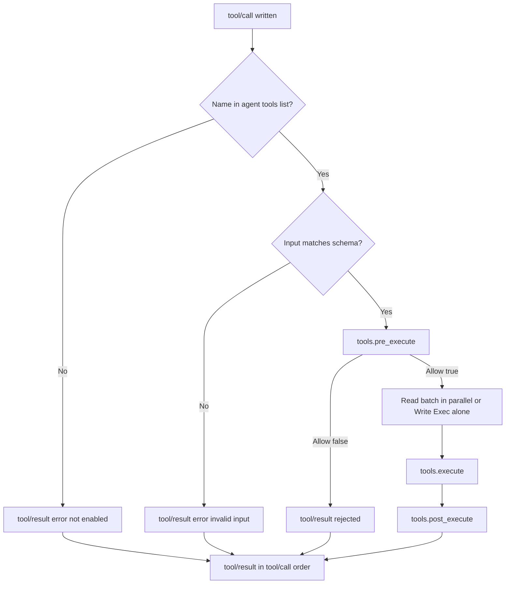
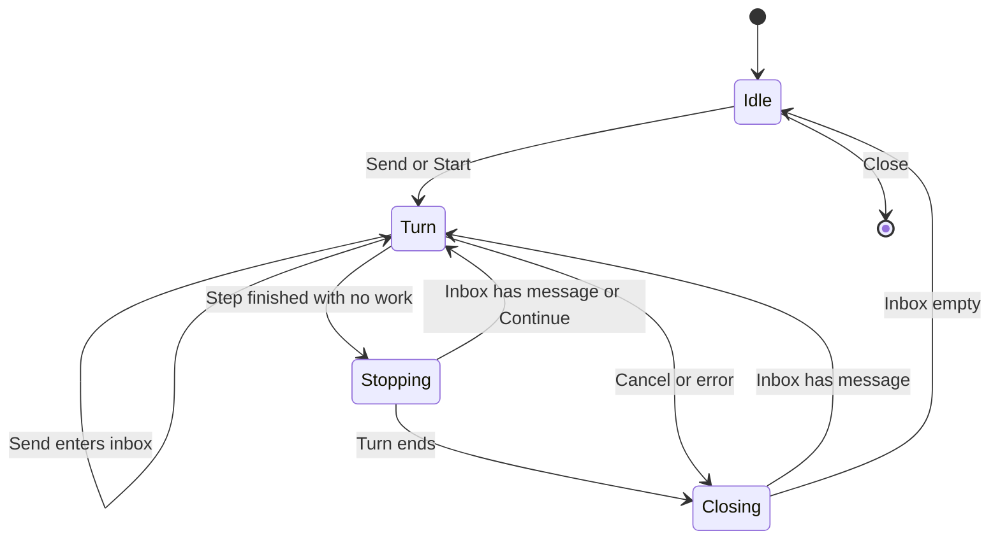

# Design: Agent loop, provider, tools, Go library

- **Issue**: [`#3`](https://github.com/ridhomujizat/lana-harness/issues/3)
- **Requirements**: [requirements.md](requirements.md)
- **Contract**: [api-contract.md](api-contract.md) — Required
- **Requirements revision**: 2
- **Contract revision**: 2
- **Requirements status**: Approved
- **Contract status**: Approved
- **Status**: Approved
- **Design revision**: 2 (reconciliation: `core.DeriveMessages`, core types in `API-CORE-015`, `ProviderError`, base profile, `ApproveWith`, see `DQ-009` through `DQ-014`)

Do not create a design against requirements or a contract that has not been approved.

## Architecture references

- **ADR index**: [docs/adr](../../adr/README.md)
- **Diagram index**: [docs/diagram](../../diagram/README.md)
- **ADRs**: [0002](../../adr/0002-core-from-modules-services-and-hooks.md), [0003](../../adr/0003-multi-agent-with-channel-routing.md), [0004](../../adr/0004-permission-mode-per-agent.md), [0006](../../adr/0006-extend-via-mcp-client-and-skills.md), [0009](../../adr/0009-session-as-append-only-event-log.md), [0010](../../adr/0010-profile-and-config-patch.md), [0013](../../adr/0013-use-go-as-single-binary.md), [0014](../../adr/0014-integration-as-agentic-tool.md) — all Accepted
- **Local feature diagrams**: [Components](#components-and-dependencies), [One turn](#one-turn), [Retry and fallback](#retry-and-fallback), [Tool pipeline](#tool-pipeline), [Session runner state](#concurrency)
- **Durable diagrams**: [0002. Agent Loop and Approval](../../diagram/0002-agent-loop-and-approval.md), [0005. Agentic Tool Integration](../../diagram/0005-agentic-tool-integration.md)

## Architecture decision scan

| Topic | Existing authority | Decision location | Action |
|---|---|---|---|
| Public interface | Contract `API-LIB-*`, `API-AGENT-*` | contract | Reuse |
| Turn and step model | ADR 0002, diagram 0002 | ADR and diagram | Reuse |
| Inbox and routing | ADR 0003 | ADR | Reuse |
| Tool gate and risk | ADR 0004, ADR 0006 | ADR | Reuse. Default gate in this spec, full permission in spec #4 |
| Event log and live frames | ADR 0009 | ADR | Reuse. Payloads in contract `API-AGENT-008` |
| Retry and fallback | Diagram 0002 (`llm.stream`) | diagram | Reuse. Implemented as a listener |
| Profile and module rows | ADR 0010, spec #2 | ADR | Reuse. Row data in contract `API-LIB-005` |
| Package layout and dependencies | ADR 0013 | ADR | Reuse |
| Library embedding | ADR 0014 | ADR | Reuse for `lana.go`. `ApproveWith` in spec #4 (`API-APPR-005`) |
| Core types and history | Spec #2 `API-CORE-015` | spec #2 | Reuse. `core.DeriveMessages` in `core` |
| Concurrency per session | ADR 0003 (one turn, one inbox) | ADR | Local: goroutine per session with a lock (see [Concurrency](#concurrency)) |
| Tool library | Spec #2 `core.Tool` | spec #2 | Reuse |
| Persistence | ADR 0009 | ADR | Use `core.SessionStore`. No new tables |

## Visual Architecture Check

| Trigger | Present? | Required view |
|---|---:|---|
| Module or package boundary | Yes | Components and dependencies |
| Interaction with an actor or external system | Yes | One turn (sequence) |
| Multi-component flow | Yes | One turn (sequence) and tool pipeline (flowchart) |
| Lifecycle or state transitions | Yes | Session runner state (state) |
| Entity relationships | No | No new entities. Payloads in contract |
| Concurrency, retry, or failure flow | Yes | Retry and fallback (flowchart), turn (sequence) |
| Dependency direction or runtime topology | Yes | Components and dependencies |

## Repository fit

- Packages follow ADR 0013: `agent/`, `providers/openai/`, `providers/mock/`, `tools/`, `store/memstore/`, and `lana.go` in the root module.
- `agent` imports only `core`. The provider is used through `core.LLMRegistry` and `core.Provider`. `agent` does not import `providers/openai`.
- `tools` imports only `core`. `tools` does not import `agent`.
- `providers/openai` and `providers/mock` import only `core`.
- `store/memstore` imports only `core`.
- `lana` (root) imports all packages above and `config`. Only `lana` and `cmd/lana` assemble everything (ADR 0013).
- This rule is tested by the import test from spec #2 (`AC-BUILD-002`).
- Installed modules: `store` (memstore or `provided_store`), `llm` (`providers/openai`), `tools`, `agent`. Row IDs match the profile IDs (`API-LIB-005`). Other base rows from spec #4 (`sqlite_store`, `permission`, `approval`, `compaction`) exist only when their modules are installed.

## Components and dependencies

## Proposed design

### Components

- **Registry** (`agent.Registry`) — implementation of `core.AgentRegistry`. Stores a map from session to `Runner`, the runtime root context, and references to the store, `LLMRegistry`, `ToolRegistry`, hooks, and `Hub`. Invariant: one `Runner` per session, created on first use.
- **Runner** (`agent.Runner`) — state of one session: `inbox` (slice of text messages and IDs), `running` (bool), `cancel` (function that cancels the active turn), `turnID`. Protected by `sync.Mutex`. Invariant: `running = true` while the turn goroutine is active, including while writing `turn/end`.
- **TurnLoop** (`agent.TurnLoop`) — runs one turn: claim, pre_step, step, model call, tools, stopping. One goroutine per turn chain (see [Concurrency](#concurrency)).
- **Derive** (`core.DeriveMessages`, file `core/derive.go`) — pure function `DeriveMessages(events []core.SessionEvent) ([]core.Message, error)` (`API-CORE-015`). Called through `SessionStore.DeriveMessages`. Reads `user/message`, `assistant/message`, and `tool/result`. Ignores `system/message`, `assistant/attempt`, and `tool/call`. The last `system/message` is used as `ChatRequest.System`. Compaction is added by spec #4 (`Q-024`, `CQ-028` of spec #2).
- **Events** (`agent.Events`) — wrapper around `core.SessionStore.Append` that fills in the payload `v: 1` and sends it to the store. The only place that writes turn events.
- **Retry** (`agent.Retry`) — `llm.stream` listener that provides retry and fallback (see [Retry and fallback](#retry-and-fallback)). Installed by the `agent` module in waterfall mode.
- **Hub** (`agent.Hub`) — map from session to `core.Observe[core.LiveFrame]`. Each subscriber uses a `core.ObserveBuffer` buffer (1024). Non-blocking delivery: if full, the oldest frame is dropped, `Lagged` is recorded, and a warning is written (`Q-019`, `DQ-013`).
- **Hooks** (`agent.Hooks`) — installs the default handlers and the listeners of this spec into `core.Hooks` on `Install`, and removes them on `Stop` (spec #2 `REQ-HOOK-004`).
- **ToolRunner** (`agent.ToolRunner`) — executes the batch of tool calls in one step: parallel `Read` batch (max 8), `Write` and `Exec` run alone.
- **Tool registry** (`tools.Registry`) — implementation of `core.ToolRegistry`. Stores built-in and custom tools. Rejects duplicate names (`AC-LIB-002`).
- **Tool pipeline** (`tools.Pipeline`) — runs `ToolsPreExecute`, `ToolsExecute`, `ToolsPostExecute` in order for one call, with the default handlers (see contract `API-AGENT-009`).
- **Guard** (`tools.Guard`) — `ResolveInWorkspace(workspace, path string) (string, error)`. Uses `filepath.Abs`, then `filepath.EvalSymlinks` on an existing path, or on the parent directory for a new path. Error `ErrOutsideWorkspace`.
- **Built-in tools** (`tools/readfile.go`, `writefile.go`, `editfile.go`, `glob.go`, `grep.go`, `bash.go`, `webfetch.go`) — each tool implements `core.Tool`: `Spec()`, `Risk(input)`, `Call(ctx, ToolCtx, input)`.
- **OpenAI adapter** (`providers/openai`) — `Adapter` implementing `core.Provider` for one `[providers.<name>]`. Contains `client` (`net/http`, timeout from config), `sse.go` (stream parser), `wire.go` (converts `core.Message` to a request and chunks to `ChatEvent`), `classify.go` (error class).
- **`llm` module** (`providers/openai/module.go`) — builds the `LLMRegistry` (map from name to adapter) from the `providers` config. Checks the env `api_key_env` for providers used by agents (`missing_secret`) and rejects kinds other than `openai_compat`.
- **MockLlm** (`providers/mock`) — implementation of `core.Provider` that plays a `Script`. No network.
- **memstore** (`store/memstore`) — implementation of `core.SessionStore` with a mutex and a slice per session. Implements `Info`, `ChainEvents` (truncated at `inherited_seq`), and `DeriveMessages` (calls `core.DeriveMessages`) in the same way as spec #4. `Fork` returns `ErrNotSupported`.
- **Runtime** (`lana.Runtime`, `lana.go`) — builds the config (`config.Load`), creates `core.Builder`, installs the profile modules (`store`, `llm`, `tools`, `agent`, and spec #4 modules when present) and custom tools, then provides `Run`, `Stream`, `Close`. `ApproveWith` is handled by spec #4.

### Contract mapping

| Contract operation | Component | Input | Result | Requirements |
|---|---|---|---|---|
| `API-LIB-001` | Runtime, config, Builder | `Options` | `*Runtime` | `REQ-LIB-001`, `REQ-LIB-006`, `REQ-LIB-008` |
| `API-LIB-002` | Runtime, Registry, Events | `Request` | `Result` from log | `REQ-LIB-002`, `REQ-LIB-007` |
| `API-LIB-003` | Runtime, Hub, `SessionEvent` hook | `Request` | `Event` iterator | `REQ-LIB-003` |
| `API-LIB-004` | Runtime, Registry | — | closed runtime | `REQ-LIB-004` |
| `API-LIB-005` | config (profile data) | profile name | module rows | `REQ-LIB-008` |
| `API-AGENT-001` | Registry, Runner | session, text | new turn or inbox | `REQ-LOOP-001`, `REQ-LOOP-002` |
| `API-AGENT-002` | Registry, Runner | session, text | `turnID` | `REQ-LOOP-002`, `REQ-LIB-002` |
| `API-AGENT-003` | Runner | session | cancelled turn | `REQ-LOOP-007` |
| `API-AGENT-004` | Registry, Events | session, agent | `model/selection` | `REQ-LOOP-010` |
| `API-AGENT-005` | Registry, Events | session, `provider:model` | `model/selection` | `REQ-LOOP-010` |
| `API-AGENT-006` | Hub | session | frame channel | `REQ-LOOP-009` |
| `API-AGENT-007` | config, Registry | agent key | registered agent | `REQ-LOOP-004`, `REQ-LOOP-005`, `REQ-LOOP-008`, `REQ-LOOP-010` |
| `API-AGENT-008` | Events | turn event | payload `v: 1` | `REQ-LOOP-001`, `REQ-LOOP-003`, `REQ-LOOP-004`, `REQ-LOOP-008`, `REQ-LOOP-010` |
| `API-AGENT-009` | Hooks, Pipeline | hook input | hook output | `REQ-TOOL-009`, `REQ-LOOP-003`, `REQ-LOOP-006`, `REQ-LIB-005` |
| `API-PROV-001` | `providers/openai` (Adapter, `llm` module) | `[providers.<name>]` | registered adapter | `REQ-PROV-001` |
| `API-PROV-002` | Adapter (wire, sse) | `ChatRequest` | `ChatStream` | `REQ-PROV-002`, `REQ-PROV-003` |
| `API-PROV-003` | Adapter (classify), Retry | HTTP status, error | class | `REQ-PROV-004`, `REQ-LOOP-008` |
| `API-PROV-004` | `providers/mock` | `Script` | `ChatStream` | `REQ-MOCK-001` |
| `API-TOOL-001` through `007` | `tools/*`, Guard | JSON input | `ToolOutput` | `REQ-TOOL-001` through `REQ-TOOL-008` |

### Persistence

- No new tables. All data is written through `core.SessionStore.Append` with kinds from ADR 0009 and payloads from `API-AGENT-008`.
- Model history is retrieved through `SessionStore.DeriveMessages`: `ChainEvents` then `core.DeriveMessages`. For memstore, reads are done in memory.
- There is no `interrupted` event in this spec. Resume is the task of spec #4.

### One turn

`TurnLoop` algorithm (within one goroutine per turn chain):

1. Write `turn/start`. Determine `turnID`.
2. For each step (numbering starts at 1):
   1. Claim: the first step uses the initial message. Subsequent steps take one message from the inbox if there is one. If there is none and there is no tool result, skip to the stopping step.
   2. If a message was claimed: run `agent.pre_step`. Rejection means: the message is not written, the turn ends `end_turn` (`Q-008`).
   3. Check the limit: if the number of `step/start` already equals `max_steps` and this step must run, write `turn/end` `max_steps`.
   4. Resolve agent, provider, model, and workspace from the log (`model/selection`, `session/created`, config).
   5. Write `step/start` with `step`, `provider`, `model`.
   6. Read the prompt file and write `system/message` if it changed.
   7. Write `user/message` if a message was claimed.
   8. Build the `ChatRequest`: `System` from the last `system/message`, `Messages` from `DeriveMessages`, `Tools` from the agent's `ToolSpec`.
   9. Run `agent.request` (waterfall). Read `MaxTokens` and `Temperature`.
   10. Run `llm.stream` with `Targets` = primary then fallbacks. Each delta goes to `Hub`. Keep the text and tool calls.
   11. Write `assistant/message` with the text block and `tool_use` blocks.
   12. For each `tool_use`: write `tool/call` (in order), then `ToolRunner` runs the batch through `Pipeline`. `tool/result` is written in the order of the calls.
   13. Write `step/end` with usage.
   14. If there are tool calls: continue to the next step.
   15. If not: run `agent.turn_stopping` (serial). If there is a `Continue`, continue without a new message. If the inbox contains a message, continue. Otherwise, exit the loop.
3. Write `turn/end` with the reason and, if error, `error` (`class`, `message`).
4. Under the runner lock: if the inbox contains a message, start a new turn in the same goroutine (step 1). Otherwise, set `running = false` and finish.

Cancellation: the turn `ctx` is cancelled. The stream stops and the partial attempt is written as `assistant/attempt` with class `cancelled`. Running tools are stopped. Every `tool/call` without a result gets a `tool/result` with status `error` and output `cancelled`. Then `turn/end` with reason `cancelled`. Messages in the inbox remain (`Q-007`).

Reason consistency: `turn/end` with reason `error` writes the class and message. Class `runtime` is used for non-provider failures (store, prompt file, hooks).

### Retry and fallback

The `llm.stream` listener is installed by the `agent` module. The listener receives `LLMStreamInput` with `Targets` containing one or more targets. Each target is tried with the following rules:

- Call `next` with `Targets` containing only that target, then read the first event.
- If it fails before the first event, classify it. If the class is `rate_limit`, `server`, or `network` and retries are below 3, wait 1, 2, or 4 seconds, then repeat the same target.
- If the class is different or retries are exhausted, move to the next target. If there are none left, return the error.
- Each failed attempt writes `assistant/attempt` (before the delay).
- A failure after the first event is not retried (`Q-006`). The stream is passed to the loop, and the loop writes `assistant/attempt` and then `turn/end` error.
- The delay uses `time.NewTimer` and `select` with `ctx.Done()`, so cancellation stops the delay.

Note: `Targets` has the primary at index 0. Fallback targets are built from the agent's `fallback` (format `provider:model`). A primary or fallback provider that is not registered fails at boot, with a message naming the provider. There is no silent fallback (ADR 0010).

### Tool pipeline

For each `tool_use` in one step:

1. The name must exist in the agent's `tools` list. If not, a `tool/result` error is written without running anything.
2. The input is checked against the tool schema (JSON types and required fields). If it fails, a `tool/result` error is written.
3. `ToolsPreExecute` with `Risk` from `Tool.Risk(input)`. Default: `Read` allow. Otherwise deny `default fail-closed`. A deny becomes a `tool/result` `rejected`.
4. Batch: adjacent `Read` tools are collected. The `Read` batch runs in parallel with a semaphore of 8. `Write` and `Exec` (including `Network`) run alone.
5. `ToolsExecute` calls `Tool.Call` with `ToolCtx`. Panics are caught with `recover` and become `ToolOutput{error}`.
6. `ToolsPostExecute` receives the output (default: as-is).
7. `tool/result` is written in the order of the `tool/call` after the batch finishes.

### Concurrency

- One `Runner` per session. All changes to `inbox`, `running`, and `cancel` happen under the runner's `sync.Mutex`.
- One goroutine per turn chain. The goroutine starts when `Send` or `Start` finds the session idle, and ends when the inbox is empty after `turn/end`.
- A message that arrives while a turn is closing is not lost. The inbox check after `turn/end` happens under the same lock as `running = false` (see step 4).
- The turn `ctx` comes from the runtime root context (not from the caller's `ctx` to `Send`). `Send` does not cancel the turn when it returns.
- `Cancel` calls `cancel` of the active turn under the lock. If there is no active turn, nothing happens.
- The `Read` batch uses a `sync.WaitGroup` and a semaphore with capacity 8. Results are written to a slice indexed by `call`, then written to the store in order.
- The store is called only from the turn goroutine. Memstore remains safe for parallel access across sessions (mutex).
- Hub uses a mutex for the subscriber map. Frame delivery is non-blocking.
- `Close` cancels the root context, waits for all turn goroutines to finish, or 30 seconds (`API-LIB-004`).

### Failure handling

| Failure | Internal error | Visible result |
|---|---|---|
| Provider 401, 403, 400, 404, 422 | `*ProviderError{auth}` or `{client}` | `turn/end` `error`. Library: `StopReason` error and `*ProviderError`. CLI: exit 3 |
| Provider 429, 5xx, connection failure, timeout | `*ProviderError` after retries are exhausted | `assistant/attempt` for each attempt, then `turn/end` `error` |
| Context too long | `*core.ProviderError{context_length}` where `errors.Is(err, core.ErrContextTooLong)` | `turn/end` `error` if compaction is not active (`Q-005`). With spec #4, compaction then one retry (`AC-COMP-006`) |
| Stream broken after first delta | `*ProviderError{network}` or `{server}` | `assistant/attempt`, `turn/end` `error`, no retry (`Q-006`) |
| Tool not enabled, bad input | Internal error in loop | `tool/result` status `error` |
| Default gate rejects | `ToolDecision{Allowed: false}` | `tool/result` status `rejected` |
| Tool fails or times out | `ToolOutput{error}` | `tool/result` status `error` |
| Panic inside a tool | `recover` in `ToolsExecute` | `tool/result` status `error` with `panic: <value>`. Runtime keeps running |
| Path outside workspace | `ErrOutsideWorkspace` | `tool/result` status `rejected` |
| Store fails to write an event | error from `Append` | Turn is stopped. Runtime error to the caller. Log records it. No retry |
| `prompt_file` cannot be read | I/O error | `turn/end` `error` class `runtime` |
| Key `api_key_env` empty at boot | `missing_secret` | Boot fails (`API-PROV-001`) |
| `Cancel` while idle | — | No event |
| `SetModel` provider does not exist | `ErrUnknownProvider` | No event |

### Security

- The default gate and `PolicyTrust` are the only permissions in this spec. After spec #4, `tools.pre_execute` is filled with permission listeners.
- Guard runs `EvalSymlinks` on every file path before access. Symlinks pointing outside the workspace are rejected.
- `bash` uses `exec.CommandContext` with `Setpgid`. Timeout and cancellation stop the process group (`kill -pgid`).
- `bash` inherits the process env. Secrets in the env can be seen by commands (risk, see [Risks](#risks-and-tradeoffs)).
- `web_fetch` does not restrict hosts. Access to the local network and private addresses is not blocked in this spec (risk).
- The `Authorization` header is sent only to the provider's `base_url`. No cross-host redirects for provider requests (`http.Client` with a `CheckRedirect` that rejects other hosts).
- Tool output and web content are treated as data (ADR 0006).

### Observability

- `slog` level `info`: turn started and finished (`session_id`, `turn_id`, `reason`, `steps`, `duration`), step started and finished (`provider`, `model`, usage).
- `slog` level `warn`: provider retry (`class`, `attempt`, `delay`), frame dropped, fallback used.
- `slog` level `debug`: tool name and size of input and output. No text content.
- Secrets never enter logs. `core.Secret` uses the redaction from spec #2.

## Requirement traceability

| Requirement | Contract operation | Design component | Verification level |
|---|---|---|---|
| `REQ-LOOP-001` | `API-AGENT-001`, `API-AGENT-008` | Registry, Runner, TurnLoop, Events | integration (MockLlm) |
| `REQ-LOOP-002` | `API-AGENT-001`, `API-AGENT-002` | Runner | unit and integration (race) |
| `REQ-LOOP-003` | `API-AGENT-008`, `API-AGENT-009` | `core.DeriveMessages`, TurnLoop, Hooks | unit and integration |
| `REQ-LOOP-004` | `API-AGENT-007`, `API-AGENT-008`, `API-AGENT-009` | ToolRunner, Pipeline | integration |
| `REQ-LOOP-005` | `API-AGENT-007` | TurnLoop | integration |
| `REQ-LOOP-006` | `API-AGENT-009` | TurnLoop, Hooks | integration |
| `REQ-LOOP-007` | `API-AGENT-003` | Runner, ToolRunner | integration |
| `REQ-LOOP-008` | `API-AGENT-007`, `API-AGENT-008`, `API-PROV-003` | Retry | unit (table) and integration |
| `REQ-LOOP-009` | `API-AGENT-006` | Hub | unit |
| `REQ-LOOP-010` | `API-AGENT-004`, `API-AGENT-005`, `API-AGENT-007`, `API-AGENT-008` | Registry, Derive, Events | integration |
| `REQ-PROV-001` | `API-PROV-001` | Adapter, `llm` module | unit |
| `REQ-PROV-002` | `API-PROV-002` | sse.go, Adapter | unit with httptest |
| `REQ-PROV-003` | `API-PROV-002` | wire.go | unit (golden) |
| `REQ-PROV-004` | `API-PROV-003` | classify.go | unit (table) |
| `REQ-MOCK-001` | `API-PROV-004` | `providers/mock` | unit |
| `REQ-TOOL-001` | `API-TOOL-001` | readfile.go | unit |
| `REQ-TOOL-002` | `API-TOOL-002` | writefile.go | unit |
| `REQ-TOOL-003` | `API-TOOL-003` | editfile.go | unit |
| `REQ-TOOL-004` | `API-TOOL-004` | glob.go, gitignore | unit |
| `REQ-TOOL-005` | `API-TOOL-005` | grep.go | unit |
| `REQ-TOOL-006` | `API-TOOL-006` | bash.go | unit |
| `REQ-TOOL-007` | `API-TOOL-007` | webfetch.go | unit with httptest |
| `REQ-TOOL-008` | `API-TOOL-001` through `API-TOOL-005` | Guard | unit |
| `REQ-TOOL-009` | `API-AGENT-009` | Pipeline (default), tools.Registry | unit |
| `REQ-MEM-001` | `API-LIB-*` (not directly applicable) | memstore | unit |
| `REQ-LIB-001` | `API-LIB-001` | Runtime, Builder | integration |
| `REQ-LIB-002` | `API-LIB-002`, `API-AGENT-002` | Runtime, Registry | integration |
| `REQ-LIB-003` | `API-LIB-003` | Runtime, Hub | integration |
| `REQ-LIB-004` | `API-LIB-004` | Runtime, Registry | integration |
| `REQ-LIB-005` | `API-AGENT-009` | Pipeline | integration |
| `REQ-LIB-006` | `API-LIB-001`, `API-AGENT-009` | Runtime (PolicyTrust) | integration |
| `REQ-LIB-007` | `API-LIB-002` | Runtime, config route | integration |
| `REQ-LIB-008` | `API-LIB-005` | config (profile) | unit |

## Acceptance verification map

Each AC has one primary method. Test names are used as evidence in `tasks.md`.

| Acceptance criterion | Verification method | Planned evidence |
|---|---|---|
| `AC-LOOP-001` through `AC-LOOP-003` | integration | `TestTurnPlainAnswer`, `TestPreStepReject`, `TestOneClaimPerStep` (MockLlm) |
| `AC-LOOP-004` through `AC-LOOP-006` | integration with race | `TestSendWhileRunning`, `TestSessionsParallel`, `TestSendDuringClose` |
| `AC-LOOP-007` through `AC-LOOP-009` | unit and integration | `TestAgentRequestHook`, `TestSystemMessageOnChange`, `TestAssistantMessageBlocks` |
| `AC-LOOP-010` through `AC-LOOP-014` | integration | `TestToolResultPerCall`, `TestToolNotEnabled`, `TestReadBatchParallel`, `TestWriteSerial`, `TestInvalidToolInput` |
| `AC-LOOP-015`, `AC-LOOP-016` | integration | `TestMaxStepsDefault`, `TestMaxStepsConfigured` |
| `AC-LOOP-017`, `AC-LOOP-018` | integration | `TestTurnStopNoListener`, `TestTurnStopContinue` |
| `AC-LOOP-019` through `AC-LOOP-021` | integration | `TestCancelBashProcess`, `TestCancelIdleNoop`, `TestCancelKeepsInbox` |
| `AC-LOOP-022` through `AC-LOOP-025` | unit (table) and integration | `TestRetryBackoff`, `TestFallbackOrder`, `TestNoRetryClasses` (httptest or MockLlm) |
| `AC-LOOP-026`, `AC-LOOP-027` | unit | `TestLiveFrameOrder`, `TestLiveFrameDropWarn` |
| `AC-LOOP-028` through `AC-LOOP-031` | integration | `TestSetAgentEvent`, `TestSetModelMidTurn`, `TestSetModelUnknownProvider`, `TestWorkspacePrecedence` |
| `AC-PROV-001` through `AC-PROV-004` | unit and integration | `TestConfigOpenAICompat`, `TestNoAuthHeaderWithoutEnv`, `TestAnthropicKindRejected`, `TestMissingSecretAtBoot` |
| `AC-PROV-005` through `AC-PROV-007` | unit with httptest | `TestSSETextDeltas`, `TestSSEToolCallAccumulate`, `TestSSEUsage` (fixture `testdata/*.sse`) |
| `AC-PROV-008`, `AC-PROV-009` | unit (golden) | `TestWireConvert`, `TestWireImageUnsupported` |
| `AC-PROV-010` through `AC-PROV-012` | unit (table) | `TestClassify` |
| `AC-MOCK-001`, `AC-MOCK-002` | unit | `TestMockScriptOrder`, `TestMockScriptExhausted` |
| `AC-TOOL-001`, `AC-TOOL-002` | unit | `TestReadFileLines`, `TestReadFileBinary` |
| `AC-TOOL-003` through `AC-TOOL-005` | unit | `TestWriteFileCreate`, `TestWriteFileOverwrite`, `TestWriteFileNoParent` |
| `AC-TOOL-006` through `AC-TOOL-008` | unit | `TestEditFileOnce`, `TestEditFileCount`, `TestEditFileEmpty` |
| `AC-TOOL-009`, `AC-TOOL-010` | unit | `TestGlobDoublestar`, `TestGlobLimit` (temp repo) |
| `AC-TOOL-011` through `AC-TOOL-013` | unit | `TestGrepMatches`, `TestGrepInvalidRegex`, `TestGrepSkipBinaryAndLarge` |
| `AC-TOOL-014` through `AC-TOOL-017` | unit | `TestBashCwd`, `TestBashTimeoutKillsGroup`, `TestBashTimeoutMax`, `TestBashExitCode` |
| `AC-TOOL-018` through `AC-TOOL-020` | unit with httptest | `TestWebFetchHTML`, `TestWebFetchContentType`, `TestWebFetchLimits` |
| `AC-TOOL-021`, `AC-TOOL-022` | unit | `TestGuardOutside`, `TestGuardSymlinkOut` |
| `AC-TOOL-023`, `AC-TOOL-024` | unit | `TestDefaultGate`, `TestDenyListenerStopsChain` |
| `AC-MEM-001` through `AC-MEM-003` | unit | `TestMemstoreSeq`, `TestMemstoreForkUnsupported`, `TestMemstoreNotDurable` |
| `AC-LIB-001` through `AC-LIB-003` | integration | `TestNewMinimal`, `TestNewToolConflict`, `TestNewUnknownAgentTool` |
| `AC-LIB-004` through `AC-LIB-008` | integration | `TestRunResult`, `TestRunBusy`, `TestRunStopReasons`, `TestRunProviderError`, `TestRunEmptyPrompt` |
| `AC-LIB-009`, `AC-LIB-010` | integration | `TestStreamEvents`, `TestStreamCancel` |
| `AC-LIB-011` | integration | `TestCloseCancelsTurn` |
| `AC-LIB-012` | integration | `TestCustomToolPipeline` |
| `AC-LIB-013`, `AC-LIB-014` | integration | `TestApprovalNeverDefault`, `TestApprovalTrust` |
| `AC-LIB-015`, `AC-LIB-016` | integration | `TestRouteLibrary`, `TestNoRoute`, `TestSessionChannel` |
| `AC-LIB-017` | unit | `TestProfileRows` |

## Verification strategy

- **Unit**: SSE parser, wire conversion, error classification, each tool, guard, gitignore, memstore, mock, derive, hub.
- **Integration**: loop with `providers/mock`. `lana.New` with in-memory layers and memstore. Tools with a temporary directory (`t.TempDir()`). Provider with an `httptest.Server` that plays SSE fixtures from `testdata/`.
- **Golden**: event payloads and OpenAI request shapes are stored in `testdata/*.golden`. The `-update` flag replaces the golden files (used across the repo, `ADR 0013`).
- **Race**: all packages `agent`, `lana`, and `memstore` are run with `go test -race`.
- **Non-optional verification**: `gofmt -l .`, `golangci-lint run ./...`, `go test -race ./...`, release build (spec #2).
- **Runtime**: smoke test with a real OpenAI provider is recorded in `tasks.md` (optional, outside CI).

## New dependencies

Stdlib is preferred (ADR 0013). The following dependencies are only for functionality the stdlib does not have.

| Module | Used in | Reason | Rejected alternative |
|---|---|---|---|
| `github.com/oklog/ulid/v2` | `agent` (turn IDs), `providers/openai` (tool call IDs if empty) | Already decided in ADR 0013 | Manual `crypto/rand`: more code for the same format |
| `github.com/bmatcuk/doublestar/v4` | `tools` (`glob`, `grep` filter) | `filepath.Glob` does not support `**`. This library supports `**` and standard patterns | Walk with `path.Match`: not correct for `**` |
| `github.com/sabhiram/go-gitignore` | `tools` (root `.gitignore`) | Small gitignore pattern parser (including `!` and `/`) | Own parser: risk of errors in negation. `go-git` is too large for one function |
| `github.com/JohannesKaufmann/html-to-markdown/v2` | `tools` (`web_fetch`) | Basic HTML to markdown conversion | Own converter: many HTML edge cases |
| `golang.org/x/net/html` | `tools` (`web_fetch`) | Official HTML tokenizer to remove `script`, `style`, `noscript` before conversion | Regex: not safe for HTML |

Versions are pinned in `go.mod` at `T-004` and `T-008`. Module paths and versions are verified with `go get` when that task is done.

## Risks and tradeoffs

- `bash` without a sandbox. Allowed commands have full access as the user (ADR 0004). Mitigation in spec #4 and a later sandbox.
- `bash` inherits the process env, including API keys. Commands can read secrets. There is no env filter in this spec yet.
- `web_fetch` does not block private hosts. This opens access to local services. This decision must be reviewed before daemon mode.
- Retries add latency (up to 7 seconds per target) and token cost when a provider partially fails.
- The default gate makes write tools and `bash` unusable without `PolicyTrust` or spec #4. This is intentional (fail-closed).
- Memstore is not durable. Data is lost when the process stops.
- Minimal derive. Long history is not trimmed until compaction in spec #4 exists.
- Dropped live frames can leave the displayed text incomplete. The final answer remains complete in the log.
- The OpenAI conversion rejects images. Image input waits for a later spec.
- One goroutine per active session. Many parallel sessions use many goroutines, but each goroutine lives only for the duration of a turn.

## Blocking Design Questions

| ID | Question | Controls | Owner | Status | Resolution |
|---|---|---|---|---|---|
| `DQ-001` | Choice of dependencies for glob, gitignore, HTML, and ULID | New dependencies section | Ridho | Resolved | Agent recommendation: five dependencies in the New dependencies table. Stdlib for the rest. |
| `DQ-002` | Where retry and fallback are placed | `REQ-LOOP-008`, `API-PROV-003` | Ridho | Resolved | Agent recommendation: `llm.stream` listener in the `agent` module, per diagram 0002. The adapter only classifies errors and does not retry on its own. |
| `DQ-003` | Goroutine model and lock per session | `REQ-LOOP-002`, `API-AGENT-001` | Ridho | Resolved | Agent recommendation: one goroutine per turn chain, lock per `Runner`, `running` changed after `turn/end` and inbox check under the same lock (see [Concurrency](#concurrency)). |
| `DQ-004` | Who builds history from the log | `REQ-LOOP-003`, `Q-024` | Ridho | Resolved | Agent recommendation: minimal `Derive` in `agent`. Spec #4 replaces or extends this function with compaction and `inherited_seq`. Revised: see `DQ-009`. |
| `DQ-005` | Where the built-in profile rows are written | `API-LIB-005`, `REQ-LIB-008` | Ridho | Resolved | Agent recommendation: profile mechanism belongs to spec #2. Row data is added to the built-in profile file of spec #2. This spec only adds rows for `minimal` and `headless`. |
| `DQ-006` | Which spec owns `ChatRequest`, `ChatEvent`, `ToolSpec`, and `ToolCtx` | `API-PROV-002`, `API-TOOL-*`, Additional types | Ridho | Resolved | Agent recommendation: types in the Additional types section are added by spec #3. If spec #2 already defines the same name, spec #2 is used (`CQ-010`). Revised: see `DQ-010`. |
| `DQ-007` | Location of the `tools.Registry` and `core.LLMRegistry` implementations | `REQ-TOOL-009`, `REQ-PROV-001` | Ridho | Resolved | Agent recommendation: `tools.Registry` in `tools/`. `LLMRegistry` in `providers/openai/module.go` because there is only one adapter kind. Tests use a registry created directly. |
| `DQ-008` | Host restriction for `web_fetch` | `REQ-TOOL-007`, `API-TOOL-007` | Ridho | Resolved | Agent recommendation: no host restriction in this spec. Risk recorded. Restriction is reviewed when daemon mode is designed (another spec). |
| `DQ-009` | Location of `Derive` and `system/message` | `REQ-LOOP-003`, `Q-024`, `CQ-013` | Ridho | Resolved | Agent recommendation (reconciliation): `core.DeriveMessages` in `core` (`API-CORE-015`, `CQ-028` of spec #2). This spec implements the subset without compaction (`T-012`). The store wraps it with `ChainEvents`. Memstore uses the same pattern. Spec #4 adds compaction without changing results for logs without compaction. `system/message` is not part of `DeriveMessages`. That message is used as `ChatRequest.System` (spec #4 `CQ-029` follows this rule). |
| `DQ-010` | `ProviderError` type and `ErrContextTooLong` | `API-PROV-003`, `CQ-014`, `CQ-026` of spec #2 | Ridho | Resolved | Agent recommendation (reconciliation): `core.ProviderError` (`API-CORE-015`). The adapter creates it. `agent.Retry` reads `Class`. `lana.ProviderError` becomes an alias. `Is(core.ErrContextTooLong)` is true for class `context_length`. |
| `DQ-011` | Built-in profile and tests before specs #4 and #1 | `API-LIB-005`, `REQ-LIB-008`, `CQ-032` of spec #2 | Ridho | Resolved | Agent recommendation (reconciliation): profile from spec #2. Until spec #4 and `cli_runner` are done, tests in this spec use `Layers` without built-in profiles and `memstore` through `Options.Store`. Without a permission module, the default fail-closed behavior (`ToolDecision` rejected, `Risk` other than `Read`) still applies. |
| `DQ-012` | `ApproveWith` option in the library API | `REQ-LIB-006`, `Q-001`, `CQ-016` | Ridho | Resolved | Agent recommendation (reconciliation): `lana.New(ctx, opts, ...Option)`. `ApproveWith(fn)` is an `Option` and its implementation is in spec #4 (`API-APPR-005`). This spec only provides `PolicyNever` and `PolicyTrust`. |
| `DQ-013` | Shape of the live frame hub | `REQ-LOOP-009`, `API-AGENT-006` | Ridho | Resolved | Agent recommendation (reconciliation): the hub uses `core.Observe[core.LiveFrame]` and `core.Subscription` (spec #2 `API-CORE-004`). Buffer `core.ObserveBuffer`. Custom channels are not used. |
| `DQ-014` | `AgentRegistry` signature | `API-AGENT-003`, `API-AGENT-005`, `API-AGENT-006`, `CQ-012` | Ridho | Resolved | Agent recommendation (reconciliation): signatures from spec #2 (`API-CORE-010`). `Cancel(ctx, sessionID)`, `SetModel(ctx, sessionID, model)`, `SubscribeLive` returns `*core.Subscription`. |

None.

## Approval

- [x] Requirements are Approved and their revisions are recorded.
- [x] Contract is Approved.
- [x] Architecture decision scan and Visual Architecture Check are complete.
- [x] Required ADRs are Accepted.
- [x] Every requirement maps to one design component.
- [x] Every acceptance criterion has a verification method.
- [x] Blocking Design Questions are set to `None`.
- **Approved by**: Ridho (gate released 2026-10-29)
- **Approved on**: 2026-10-29 (revision 1). Revision 2 reconciliation by the agent on behalf of the owner (gate released 2026-10-29).
