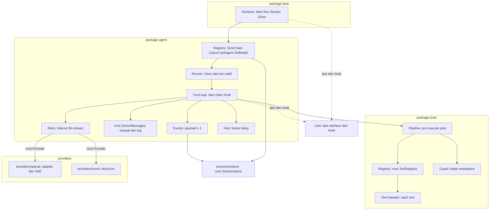
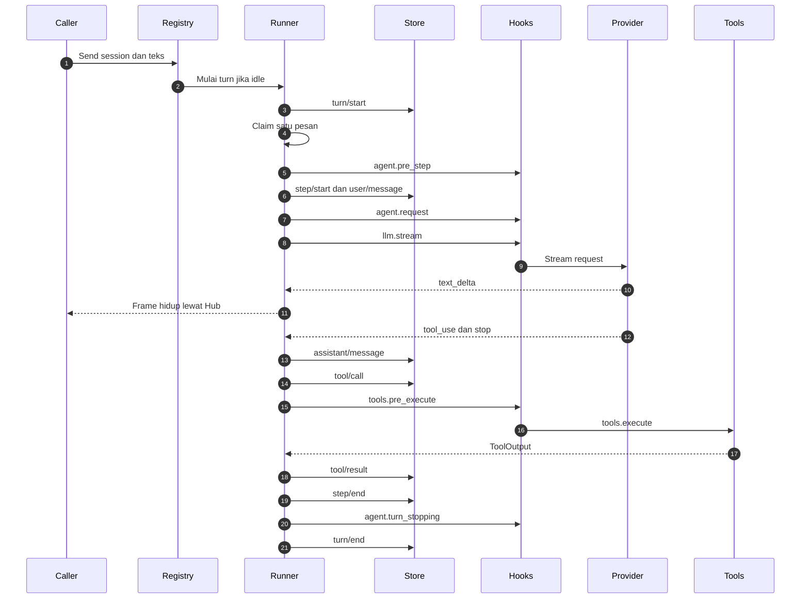
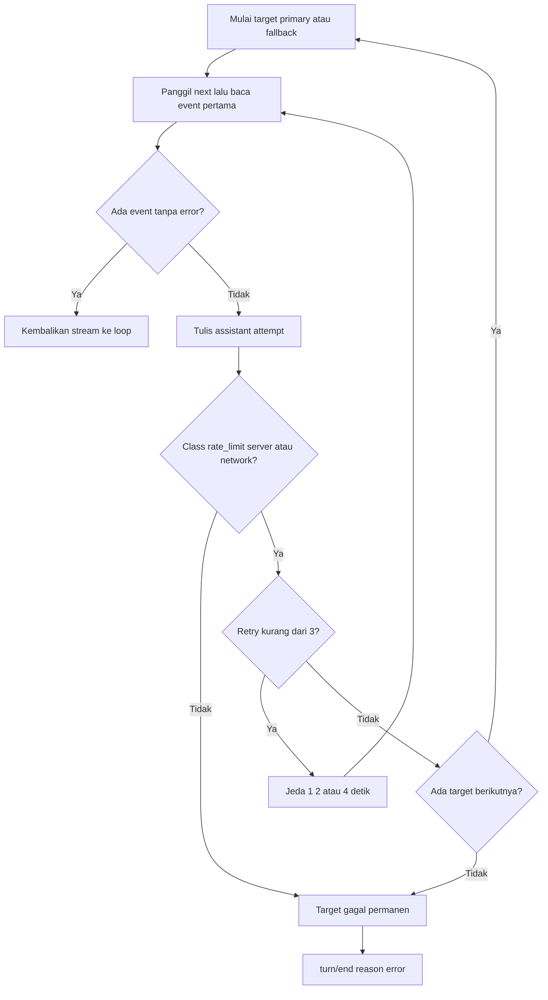
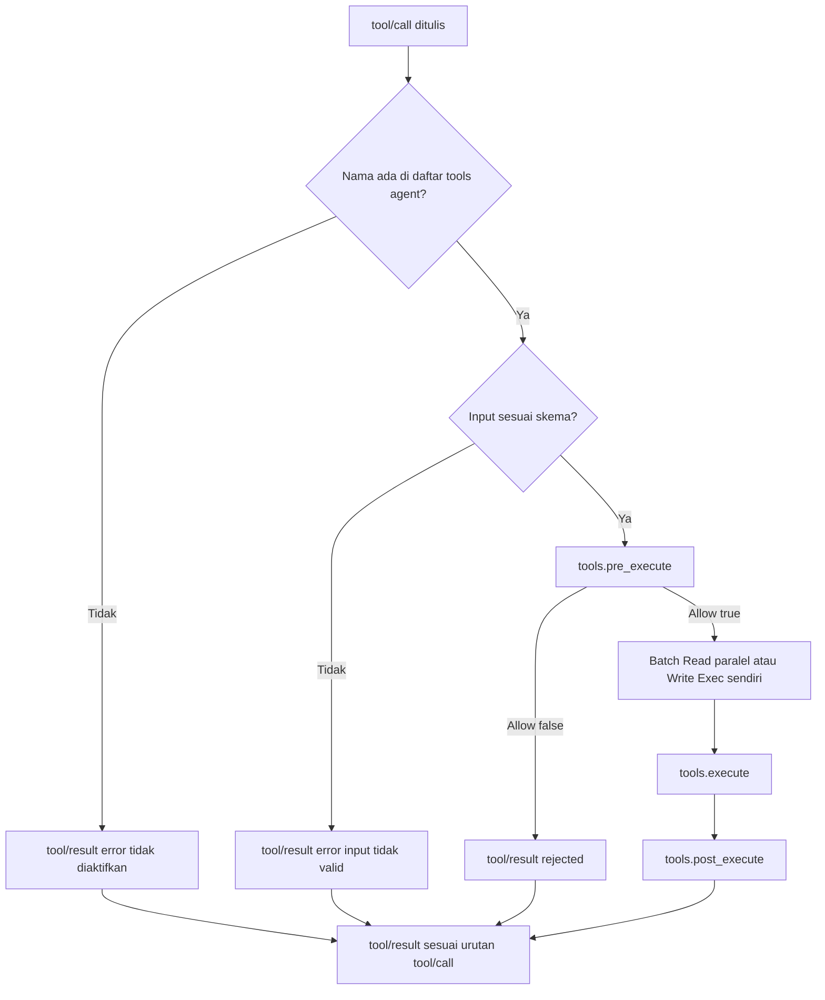
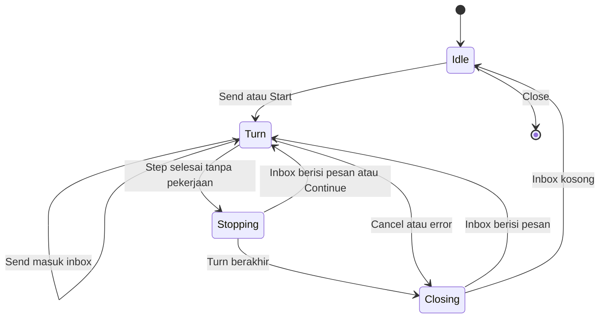

# Design: Agent loop, provider, tools, Go library

- **Issue**: [`#3`](https://github.com/ridhomujizat/lana-harness/issues/3)
- **Requirements**: [requirements.md](requirements.md)
- **Contract**: [api-contract.md](api-contract.md) — Diperlukan
- **Revisi requirements**: 2
- **Revisi contract**: 2
- **Status requirements**: Approved
- **Status contract**: Approved
- **Status**: Approved
- **Revisi design**: 2 (rekonsiliasi: `core.DeriveMessages`, tipe core di `API-CORE-015`, `ProviderError`, profile base, `ApproveWith`, lihat `DQ-009` sampai `DQ-014`)

Jangan membuat design terhadap requirements atau contract yang belum di-approve.

## Referensi arsitektur

- **Index ADR**: [docs/adr](../../adr/README.md)
- **Index diagram**: [docs/diagram](../../diagram/README.md)
- **ADR**: [0002](../../adr/0002-core-dari-modul-service-dan-hook.md), [0003](../../adr/0003-multi-agent-dengan-routing-channel.md), [0004](../../adr/0004-permission-mode-per-agent.md), [0006](../../adr/0006-ekstensi-lewat-mcp-client-dan-skills.md), [0009](../../adr/0009-session-sebagai-event-log-append-only.md), [0010](../../adr/0010-profile-dan-config-patch.md), [0013](../../adr/0013-gunakan-go-sebagai-single-binary.md), [0014](../../adr/0014-integrasi-sebagai-agentic-tool.md) — semua Accepted
- **Diagram lokal fitur**: [Komponen](#komponen-dan-dependency), [Satu turn](#satu-turn), [Retry dan fallback](#retry-dan-fallback), [Pipeline tool](#pipeline-tool), [State session runner](#konkurensi)
- **Diagram tahan lama**: [0002. Agent Loop Dan Approval](../../diagram/0002-agent-loop-dan-approval.md), [0005. Integrasi Agentic Tool](../../diagram/0005-integrasi-agentic-tool.md)

## Scan keputusan arsitektur

| Topik | Otoritas yang ada | Lokasi keputusan | Aksi |
|---|---|---|---|
| Antarmuka publik | Contract `API-LIB-*`, `API-AGENT-*` | contract | Pakai ulang |
| Model turn dan step | ADR 0002, diagram 0002 | ADR dan diagram | Pakai ulang |
| Inbox dan routing | ADR 0003 | ADR | Pakai ulang |
| Gerbang tool dan risk | ADR 0004, ADR 0006 | ADR | Pakai ulang. Gerbang default di spec ini, izin penuh di spec #4 |
| Event log dan frame hidup | ADR 0009 | ADR | Pakai ulang. Payload di contract `API-AGENT-008` |
| Retry dan fallback | Diagram 0002 (`llm.stream`) | diagram | Pakai ulang. Implementasi sebagai listener |
| Profile dan baris modul | ADR 0010, spec #2 | ADR | Pakai ulang. Baris data di contract `API-LIB-005` |
| Layout package dan dependency | ADR 0013 | ADR | Pakai ulang |
| Library embed | ADR 0014 | ADR | Pakai ulang untuk `lana.go`. `ApproveWith` di spec #4 (`API-APPR-005`) |
| Tipe core dan riwayat | Spec #2 `API-CORE-015` | spec #2 | Pakai ulang. `core.DeriveMessages` di `core` |
| Konkurensi per session | ADR 0003 (satu turn, satu inbox) | ADR | Lokal: goroutine per session dengan kunci (lihat [Konkurensi](#konkurensi)) |
| Library tool | Spec #2 `core.Tool` | spec #2 | Pakai ulang |
| Persistence | ADR 0009 | ADR | Pakai `core.SessionStore`. Tidak ada tabel baru |

## Visual Architecture Check

| Pemicu | Ada? | Tampilan yang dibutuhkan |
|---|---:|---|
| Batas modul atau package | Ya | Komponen dan dependency |
| Interaksi dengan aktor atau sistem luar | Ya | Satu turn (sequence) |
| Alur multi-komponen | Ya | Satu turn (sequence) dan pipeline tool (flowchart) |
| Lifecycle atau transisi state | Ya | State session runner (state) |
| Relasi entity | Tidak | Tidak ada entity baru. Payload di contract |
| Konkurensi, retry, atau alur gagal | Ya | Retry dan fallback (flowchart), turn (sequence) |
| Arah dependency atau topologi runtime | Ya | Komponen dan dependency |

## Kesesuaian dengan repository

- Package sesuai ADR 0013: `agent/`, `providers/openai/`, `providers/mock/`, `tools/`, `store/memstore/`, dan `lana.go` di root module.
- `agent` hanya meng-import `core`. Provider dipakai lewat `core.LLMRegistry` dan `core.Provider`. `agent` tidak meng-import `providers/openai`.
- `tools` hanya meng-import `core`. `tools` tidak meng-import `agent`.
- `providers/openai` dan `providers/mock` hanya meng-import `core`.
- `store/memstore` hanya meng-import `core`.
- `lana` (root) meng-import semua package di atas dan `config`. Hanya `lana` dan `cmd/lana` yang merakit semuanya (ADR 0013).
- Aturan ini diuji oleh test impor dari spec #2 (`AC-BUILD-002`).
- Modul yang dipasang: `store` (memstore atau `provided_store`), `llm` (`providers/openai`), `tools`, `agent`. Id baris sama dengan id di profile (`API-LIB-005`). Baris base lain dari spec #4 (`sqlite_store`, `permission`, `approval`, `compaction`) hanya ada jika modulnya terpasang.

## Komponen dan dependency

## Design yang diusulkan

### Komponen

- **Registry** (`agent.Registry`) — implementasi `core.AgentRegistry`. Menyimpan map session ke `Runner`, root context runtime, dan referensi ke store, `LLMRegistry`, `ToolRegistry`, hook, dan `Hub`. Invariant: satu `Runner` per session, dibuat saat pertama kali dipakai.
- **Runner** (`agent.Runner`) — status satu session: `inbox` (slice pesan teks dan id), `running` (bool), `cancel` (fungsi batal turn aktif), `turnID`. Dilindungi `sync.Mutex`. Invariant: `running = true` selama goroutine turn aktif, termasuk saat menulis `turn/end`.
- **TurnLoop** (`agent.TurnLoop`) — menjalankan satu turn: claim, pre_step, step, pemanggilan model, tool, penghentian. Satu goroutine per rantai turn (lihat [Konkurensi](#konkurensi)).
- **Derive** (`core.DeriveMessages`, file `core/derive.go`) — fungsi murni `DeriveMessages(events []core.SessionEvent) ([]core.Message, error)` (`API-CORE-015`). Dipanggil lewat `SessionStore.DeriveMessages`. Membaca `user/message`, `assistant/message`, dan `tool/result`. Mengabaikan `system/message`, `assistant/attempt`, dan `tool/call`. `system/message` terakhir dipakai sebagai `ChatRequest.System`. Compaction ditambahkan spec #4 (`Q-024`, `CQ-028` spec #2).
- **Events** (`agent.Events`) — pembungkus `core.SessionStore.Append` yang mengisi payload `v: 1` dan mengirim ke store. Satu-satunya tempat yang menulis event turn.
- **Retry** (`agent.Retry`) — listener `llm.stream` yang memberi retry dan fallback (lihat [Retry dan fallback](#retry-dan-fallback)). Dipasang oleh modul `agent` dengan mode waterfall.
- **Hub** (`agent.Hub`) — map session ke `core.Observe[core.LiveFrame]`. Setiap subscriber memakai buffer `core.ObserveBuffer` (1024). Pengiriman non-blok: jika penuh, frame lama dibuang, `Lagged` dicatat, dan peringatan ditulis (`Q-019`, `DQ-013`).
- **Hooks** (`agent.Hooks`) — memasang handler default dan listener spec ini ke `core.Hooks` saat `Install`, dan melepasnya saat `Stop` (spec #2 `REQ-HOOK-004`).
- **ToolRunner** (`agent.ToolRunner`) — mengeksekusi batch tool call dalam satu step: batch `Read` paralel (maks 8), `Write` dan `Exec` sendiri.
- **Registry tool** (`tools.Registry`) — implementasi `core.ToolRegistry`. Menyimpan tool bawaan dan kustom. Menolak nama ganda (`AC-LIB-002`).
- **Pipeline tool** (`tools.Pipeline`) — menjalankan `ToolsPreExecute`, `ToolsExecute`, `ToolsPostExecute` berurutan untuk satu call, dengan handler default (lihat contract `API-AGENT-009`).
- **Guard** (`tools.Guard`) — `ResolveInWorkspace(workspace, path string) (string, error)`. Memakai `filepath.Abs`, lalu `filepath.EvalSymlinks` pada path yang ada, atau pada direktori induk untuk path baru. Error `ErrOutsideWorkspace`.
- **Tool bawaan** (`tools/readfile.go`, `writefile.go`, `editfile.go`, `glob.go`, `grep.go`, `bash.go`, `webfetch.go`) — tiap tool implement `core.Tool`: `Spec()`, `Risk(input)`, `Call(ctx, ToolCtx, input)`.
- **Adapter OpenAI** (`providers/openai`) — `Adapter` implementasi `core.Provider` untuk satu `[providers.<name>]`. Berisi `client` (`net/http`, timeout dari config), `sse.go` (parser stream), `wire.go` (konversi `core.Message` ke request dan chunk ke `ChatEvent`), `classify.go` (error class).
- **Modul `llm`** (`providers/openai/module.go`) — membangun `LLMRegistry` (map nama ke adapter) dari `providers` config. Memeriksa env `api_key_env` untuk provider yang dipakai agent (`missing_secret`) dan menolak kind selain `openai_compat`.
- **MockLlm** (`providers/mock`) — implementasi `core.Provider` yang memutar `Script`. Tidak ada jaringan.
- **memstore** (`store/memstore`) — implementasi `core.SessionStore` dengan mutex dan slice per session. Implementasi `Info`, `ChainEvents` (potong di `inherited_seq`), dan `DeriveMessages` (memanggil `core.DeriveMessages`) dengan cara yang sama seperti spec #4. `Fork` mengembalikan `ErrNotSupported`.
- **Runtime** (`lana.Runtime`, `lana.go`) — membangun config (`config.Load`), membuat `core.Builder`, memasang modul profile (`store`, `llm`, `tools`, `agent`, dan modul spec #4 bila ada) dan tool kustom, lalu menyediakan `Run`, `Stream`, `Close`. `ApproveWith` ditangani spec #4.

### Pemetaan contract

| Operasi contract | Komponen | Input | Hasil | Requirements |
|---|---|---|---|---|
| `API-LIB-001` | Runtime, config, Builder | `Options` | `*Runtime` | `REQ-LIB-001`, `REQ-LIB-006`, `REQ-LIB-008` |
| `API-LIB-002` | Runtime, Registry, Events | `Request` | `Result` dari log | `REQ-LIB-002`, `REQ-LIB-007` |
| `API-LIB-003` | Runtime, Hub, hook `SessionEvent` | `Request` | iterator `Event` | `REQ-LIB-003` |
| `API-LIB-004` | Runtime, Registry | — | runtime tertutup | `REQ-LIB-004` |
| `API-LIB-005` | config (data profile) | nama profile | baris modul | `REQ-LIB-008` |
| `API-AGENT-001` | Registry, Runner | session, teks | turn baru atau inbox | `REQ-LOOP-001`, `REQ-LOOP-002` |
| `API-AGENT-002` | Registry, Runner | session, teks | `turnID` | `REQ-LOOP-002`, `REQ-LIB-002` |
| `API-AGENT-003` | Runner | session | turn batal | `REQ-LOOP-007` |
| `API-AGENT-004` | Registry, Events | session, agent | `model/selection` | `REQ-LOOP-010` |
| `API-AGENT-005` | Registry, Events | session, `provider:model` | `model/selection` | `REQ-LOOP-010` |
| `API-AGENT-006` | Hub | session | channel frame | `REQ-LOOP-009` |
| `API-AGENT-007` | config, Registry | key agent | agent terdaftar | `REQ-LOOP-004`, `REQ-LOOP-005`, `REQ-LOOP-008`, `REQ-LOOP-010` |
| `API-AGENT-008` | Events | event turn | payload `v: 1` | `REQ-LOOP-001`, `REQ-LOOP-003`, `REQ-LOOP-004`, `REQ-LOOP-008`, `REQ-LOOP-010` |
| `API-AGENT-009` | Hooks, Pipeline | input hook | output hook | `REQ-TOOL-009`, `REQ-LOOP-003`, `REQ-LOOP-006`, `REQ-LIB-005` |
| `API-PROV-001` | `providers/openai` (Adapter, modul `llm`) | `[providers.<name>]` | adapter terdaftar | `REQ-PROV-001` |
| `API-PROV-002` | Adapter (wire, sse) | `ChatRequest` | `ChatStream` | `REQ-PROV-002`, `REQ-PROV-003` |
| `API-PROV-003` | Adapter (classify), Retry | status HTTP, error | class | `REQ-PROV-004`, `REQ-LOOP-008` |
| `API-PROV-004` | `providers/mock` | `Script` | `ChatStream` | `REQ-MOCK-001` |
| `API-TOOL-001` sampai `007` | `tools/*`, Guard | JSON input | `ToolOutput` | `REQ-TOOL-001` sampai `REQ-TOOL-008` |

### Persistence

- Tidak ada tabel baru. Semua data ditulis lewat `core.SessionStore.Append` dengan kind dari ADR 0009 dan payload dari `API-AGENT-008`.
- Riwayat model diambil lewat `SessionStore.DeriveMessages`: `ChainEvents` lalu `core.DeriveMessages`. Untuk memstore, pembacaan dilakukan di memori.
- Tidak ada event `interrupted` di spec ini. Resume menjadi tugas spec #4.

### Satu turn

Algoritma `TurnLoop` (dalam satu goroutine per rantai turn):

1. Tulis `turn/start`. Tentukan `turnID`.
2. Untuk setiap step (nomor mulai dari 1):
   1. Claim: step pertama memakai pesan awal. Step berikutnya mengambil satu pesan dari inbox jika ada. Jika tidak ada dan tidak ada tool result, lewati ke langkah penghentian.
   2. Jika ada pesan yang di-claim: jalankan `agent.pre_step`. Tolak berarti: pesan tidak ditulis, turn berakhir `end_turn` (`Q-008`).
   3. Cek batas: jika jumlah `step/start` sudah sama dengan `max_steps` dan step ini perlu dijalankan, tulis `turn/end` `max_steps`.
   4. Resolve agent, provider, model, dan workspace dari log (`model/selection`, `session/created`, config).
   5. Tulis `step/start` dengan `step`, `provider`, `model`.
   6. Baca prompt file dan tulis `system/message` jika berubah.
   7. Tulis `user/message` jika ada pesan yang di-claim.
   8. Susun `ChatRequest`: `System` dari `system/message` terakhir, `Messages` dari `DeriveMessages`, `Tools` dari `ToolSpec` agent.
   9. Jalankan `agent.request` (waterfall). Ambil `MaxTokens` dan `Temperature`.
   10. Jalankan `llm.stream` dengan `Targets` = primary lalu fallback. Setiap delta ke `Hub`. Simpan teks dan tool call.
   11. Tulis `assistant/message` dengan blok teks dan `tool_use`.
   12. Untuk setiap `tool_use`: tulis `tool/call` (urut), lalu `ToolRunner` menjalankan batch lewat `Pipeline`. `tool/result` ditulis sesuai urutan call.
   13. Tulis `step/end` dengan usage.
   14. Jika ada tool call: lanjut ke step berikutnya.
   15. Jika tidak: jalankan `agent.turn_stopping` (serial). Jika ada `Continue`, lanjut tanpa pesan baru. Jika inbox berisi pesan, lanjut. Jika tidak, keluar dari loop.
3. Tulis `turn/end` dengan reason dan, jika error, `error` (`class`, `message`).
4. Di bawah kunci runner: jika inbox berisi pesan, mulai turn baru di goroutine yang sama (langkah 1). Jika tidak, set `running = false` dan selesai.

Pembatalan: `ctx` turn dibatalkan. Stream berhenti dan percobaan parsial ditulis sebagai `assistant/attempt` dengan class `cancelled`. Tool yang berjalan dihentikan. Setiap `tool/call` tanpa hasil mendapat `tool/result` status `error` dengan output `dibatalkan`. Lalu `turn/end` reason `cancelled`. Pesan di inbox tetap ada (`Q-007`).

Konsistensi reason: `turn/end` dengan reason `error` menulis class dan message. Class `runtime` dipakai untuk kegagalan non-provider (store, prompt file, hook).

### Retry dan fallback

Listener `llm.stream` dipasang oleh modul `agent`. Listener menerima `LLMStreamInput` dengan `Targets` berisi satu atau lebih target. Setiap target dicoba dengan aturan berikut:

- Panggil `next` dengan `Targets` hanya berisi target itu, lalu baca event pertama.
- Jika gagal sebelum event pertama, klasifikasikan. Jika class `rate_limit`, `server`, atau `network` dan retry kurang dari 3, tunggu 1, 2, atau 4 detik, lalu ulangi target yang sama.
- Jika class lain atau retry habis, pindah ke target berikutnya. Jika tidak ada lagi, kembalikan error.
- Setiap percobaan gagal menulis `assistant/attempt` (sebelum jeda).
- Gagal setelah event pertama tidak di-retry (`Q-006`). Stream diteruskan ke loop, dan loop menulis `assistant/attempt` lalu `turn/end` error.
- Jeda memakai `time.NewTimer` dan `select` dengan `ctx.Done()`, sehingga pembatalan menghentikan jeda.

Catatan: `Targets` berisi primary di indeks 0. Target fallback disusun dari `fallback` agent (format `provider:model`). Provider primary dan fallback yang tidak terdaftar gagal saat boot, dengan pesan yang menyebut provider. Tidak ada fallback diam-diam (ADR 0010).

### Pipeline tool

Untuk setiap `tool_use` dalam satu step:

1. Nama harus ada di daftar `tools` agent. Jika tidak, `tool/result` error tanpa menjalankan apa pun.
2. Input dicek ke skema tool (tipe JSON dan field wajib). Jika gagal, `tool/result` error.
3. `ToolsPreExecute` dengan `Risk` dari `Tool.Risk(input)`. Default: `Read` allow. Selain itu deny `default fail-closed`. Deny menjadi `tool/result` `rejected`.
4. Batch: tool `Read` yang berdampingan dikumpulkan. Batch `Read` berjalan paralel dengan semafor 8. Tool `Write` dan `Exec` (termasuk `Network`) berjalan sendiri.
5. `ToolsExecute` memanggil `Tool.Call` dengan `ToolCtx`. Panic ditangkap dengan `recover` dan menjadi `ToolOutput{error}`.
6. `ToolsPostExecute` menerima output (default: apa adanya).
7. `tool/result` ditulis sesuai urutan `tool/call` setelah batch selesai.

### Konkurensi

- Satu `Runner` per session. Semua perubahan `inbox`, `running`, dan `cancel` dilakukan di bawah `sync.Mutex` milik runner.
- Satu goroutine per rantai turn. Goroutine dimulai saat `Send` atau `Start` menemukan session idle, dan berakhir saat inbox kosong setelah `turn/end`.
- Pesan yang datang saat turn menutup tidak hilang. Pengecekan inbox setelah `turn/end` dilakukan di bawah kunci yang sama dengan `running = false` (lihat langkah 4).
- `ctx` turn berasal dari root context runtime (bukan dari `ctx` pemanggil `Send`). `Send` tidak membatalkan turn saat kembali.
- `Cancel` memanggil `cancel` turn aktif di bawah kunci. Jika tidak ada turn aktif, tidak ada yang terjadi.
- Batch `Read` memakai `sync.WaitGroup` dan semafor berkapasitas 8. Hasil ditulis ke slice indeks `call`, lalu ditulis ke store berurutan.
- Store dipanggil hanya dari goroutine turn. Memstore tetap aman untuk akses paralel lintas session (mutex).
- Hub memakai mutex untuk peta subscriber. Pengiriman frame non-blok.
- `Close` membatalkan root context, menunggu semua goroutine turn selesai, atau 30 detik (`API-LIB-004`).

### Failure handling

| Kegagalan | Error internal | Hasil yang terlihat |
|---|---|---|
| Provider 401, 403, 400, 404, 422 | `*ProviderError{auth}` atau `{client}` | `turn/end` `error`. Library: `StopReason` error dan `*ProviderError`. CLI: exit 3 |
| Provider 429, 5xx, koneksi gagal, timeout | `*ProviderError` setelah retry habis | `assistant/attempt` tiap percobaan, lalu `turn/end` `error` |
| Context terlalu panjang | `*core.ProviderError{context_length}` yang `errors.Is(err, core.ErrContextTooLong)` | `turn/end` `error` jika compaction tidak aktif (`Q-005`). Dengan spec #4, compaction lalu retry sekali (`AC-COMP-006`) |
| Stream rusak setelah delta pertama | `*ProviderError{network}` atau `{server}` | `assistant/attempt`, `turn/end` `error`, tanpa retry (`Q-006`) |
| Tool tidak diaktifkan, input salah | Error internal di loop | `tool/result` status `error` |
| Gerbang default menolak | `ToolDecision{Allowed: false}` | `tool/result` status `rejected` |
| Tool gagal atau timeout | `ToolOutput{error}` | `tool/result` status `error` |
| Panic dalam tool | `recover` di `ToolsExecute` | `tool/result` status `error` dengan `panic: <nilai>`. Runtime tetap jalan |
| Path di luar workspace | `ErrOutsideWorkspace` | `tool/result` status `rejected` |
| Store gagal menulis event | error dari `Append` | Turn dihentikan. Error runtime ke pemanggil. Log mencatat. Tidak ada retry |
| `prompt_file` tidak bisa dibaca | error I/O | `turn/end` `error` class `runtime` |
| Key `api_key_env` kosong saat boot | `missing_secret` | Boot gagal (`API-PROV-001`) |
| `Cancel` saat idle | — | Tidak ada event |
| `SetModel` provider tidak ada | `ErrUnknownProvider` | Tidak ada event |

### Keamanan

- Gerbang default dan `PolicyTrust` adalah satu-satunya izin di spec ini. Setelah spec #4, `tools.pre_execute` diisi listener permission.
- Guard menjalankan `EvalSymlinks` pada setiap path file sebelum akses. Symlink keluar workspace ditolak.
- `bash` memakai `exec.CommandContext` dengan `Setpgid`. Timeout dan pembatalan menghentikan grup proses (`kill -pgid`).
- `bash` mewarisi env proses. Secret di env bisa terlihat oleh perintah (risiko, lihat [Risiko](#risiko-dan-tradeoff)).
- `web_fetch` tidak membatasi host. Akses ke jaringan lokal dan alamat privat tidak diblokir di spec ini (risiko).
- Header `Authorization` hanya dikirim ke `base_url` provider. Tidak ada redirect lintas host untuk request provider (`http.Client` dengan `CheckRedirect` yang menolak host lain).
- Output tool dan isi web diperlakukan sebagai data (ADR 0006).

### Observability

- `slog` level `info`: turn mulai dan selesai (`session_id`, `turn_id`, `reason`, `steps`, `durasi`), step mulai dan selesai (`provider`, `model`, usage).
- `slog` level `warn`: retry provider (`class`, `attempt`, `jeda`), frame dibuang, fallback dipakai.
- `slog` level `debug`: nama tool dan ukuran input dan output. Tidak ada isi teks.
- Secret tidak pernah masuk log. `core.Secret` memakai redaksi dari spec #2.

## Traceability requirement

| Requirement | Operasi contract | Komponen design | Level verifikasi |
|---|---|---|---|
| `REQ-LOOP-001` | `API-AGENT-001`, `API-AGENT-008` | Registry, Runner, TurnLoop, Events | integrasi (MockLlm) |
| `REQ-LOOP-002` | `API-AGENT-001`, `API-AGENT-002` | Runner | unit dan integrasi (race) |
| `REQ-LOOP-003` | `API-AGENT-008`, `API-AGENT-009` | `core.DeriveMessages`, TurnLoop, Hooks | unit dan integrasi |
| `REQ-LOOP-004` | `API-AGENT-007`, `API-AGENT-008`, `API-AGENT-009` | ToolRunner, Pipeline | integrasi |
| `REQ-LOOP-005` | `API-AGENT-007` | TurnLoop | integrasi |
| `REQ-LOOP-006` | `API-AGENT-009` | TurnLoop, Hooks | integrasi |
| `REQ-LOOP-007` | `API-AGENT-003` | Runner, ToolRunner | integrasi |
| `REQ-LOOP-008` | `API-AGENT-007`, `API-AGENT-008`, `API-PROV-003` | Retry | unit (tabel) dan integrasi |
| `REQ-LOOP-009` | `API-AGENT-006` | Hub | unit |
| `REQ-LOOP-010` | `API-AGENT-004`, `API-AGENT-005`, `API-AGENT-007`, `API-AGENT-008` | Registry, Derive, Events | integrasi |
| `REQ-PROV-001` | `API-PROV-001` | Adapter, modul `llm` | unit |
| `REQ-PROV-002` | `API-PROV-002` | sse.go, Adapter | unit dengan httptest |
| `REQ-PROV-003` | `API-PROV-002` | wire.go | unit (golden) |
| `REQ-PROV-004` | `API-PROV-003` | classify.go | unit (tabel) |
| `REQ-MOCK-001` | `API-PROV-004` | `providers/mock` | unit |
| `REQ-TOOL-001` | `API-TOOL-001` | readfile.go | unit |
| `REQ-TOOL-002` | `API-TOOL-002` | writefile.go | unit |
| `REQ-TOOL-003` | `API-TOOL-003` | editfile.go | unit |
| `REQ-TOOL-004` | `API-TOOL-004` | glob.go, gitignore | unit |
| `REQ-TOOL-005` | `API-TOOL-005` | grep.go | unit |
| `REQ-TOOL-006` | `API-TOOL-006` | bash.go | unit |
| `REQ-TOOL-007` | `API-TOOL-007` | webfetch.go | unit dengan httptest |
| `REQ-TOOL-008` | `API-TOOL-001` sampai `API-TOOL-005` | Guard | unit |
| `REQ-TOOL-009` | `API-AGENT-009` | Pipeline (default), tools.Registry | unit |
| `REQ-MEM-001` | `API-LIB-*` (tidak berlaku langsung) | memstore | unit |
| `REQ-LIB-001` | `API-LIB-001` | Runtime, Builder | integrasi |
| `REQ-LIB-002` | `API-LIB-002`, `API-AGENT-002` | Runtime, Registry | integrasi |
| `REQ-LIB-003` | `API-LIB-003` | Runtime, Hub | integrasi |
| `REQ-LIB-004` | `API-LIB-004` | Runtime, Registry | integrasi |
| `REQ-LIB-005` | `API-AGENT-009` | Pipeline | integrasi |
| `REQ-LIB-006` | `API-LIB-001`, `API-AGENT-009` | Runtime (PolicyTrust) | integrasi |
| `REQ-LIB-007` | `API-LIB-002` | Runtime, config route | integrasi |
| `REQ-LIB-008` | `API-LIB-005` | config (profile) | unit |

## Peta verifikasi acceptance

Setiap AC punya satu metode utama. Nama test dipakai sebagai bukti di `tasks.md`.

| Acceptance criterion | Metode verifikasi | Bukti yang direncanakan |
|---|---|---|
| `AC-LOOP-001` sampai `AC-LOOP-003` | integrasi | `TestTurnPlainAnswer`, `TestPreStepReject`, `TestOneClaimPerStep` (MockLlm) |
| `AC-LOOP-004` sampai `AC-LOOP-006` | integrasi dengan race | `TestSendWhileRunning`, `TestSessionsParallel`, `TestSendDuringClose` |
| `AC-LOOP-007` sampai `AC-LOOP-009` | unit dan integrasi | `TestAgentRequestHook`, `TestSystemMessageOnChange`, `TestAssistantMessageBlocks` |
| `AC-LOOP-010` sampai `AC-LOOP-014` | integrasi | `TestToolResultPerCall`, `TestToolNotEnabled`, `TestReadBatchParallel`, `TestWriteSerial`, `TestInvalidToolInput` |
| `AC-LOOP-015`, `AC-LOOP-016` | integrasi | `TestMaxStepsDefault`, `TestMaxStepsConfigured` |
| `AC-LOOP-017`, `AC-LOOP-018` | integrasi | `TestTurnStopNoListener`, `TestTurnStopContinue` |
| `AC-LOOP-019` sampai `AC-LOOP-021` | integrasi | `TestCancelBashProcess`, `TestCancelIdleNoop`, `TestCancelKeepsInbox` |
| `AC-LOOP-022` sampai `AC-LOOP-025` | unit (tabel) dan integrasi | `TestRetryBackoff`, `TestFallbackOrder`, `TestNoRetryClasses` (httptest atau MockLlm) |
| `AC-LOOP-026`, `AC-LOOP-027` | unit | `TestLiveFrameOrder`, `TestLiveFrameDropWarn` |
| `AC-LOOP-028` sampai `AC-LOOP-031` | integrasi | `TestSetAgentEvent`, `TestSetModelMidTurn`, `TestSetModelUnknownProvider`, `TestWorkspacePrecedence` |
| `AC-PROV-001` sampai `AC-PROV-004` | unit dan integrasi | `TestConfigOpenAICompat`, `TestNoAuthHeaderWithoutEnv`, `TestAnthropicKindRejected`, `TestMissingSecretAtBoot` |
| `AC-PROV-005` sampai `AC-PROV-007` | unit dengan httptest | `TestSSETextDeltas`, `TestSSEToolCallAccumulate`, `TestSSEUsage` (fixture `testdata/*.sse`) |
| `AC-PROV-008`, `AC-PROV-009` | unit (golden) | `TestWireConvert`, `TestWireImageUnsupported` |
| `AC-PROV-010` sampai `AC-PROV-012` | unit (tabel) | `TestClassify` |
| `AC-MOCK-001`, `AC-MOCK-002` | unit | `TestMockScriptOrder`, `TestMockScriptExhausted` |
| `AC-TOOL-001`, `AC-TOOL-002` | unit | `TestReadFileLines`, `TestReadFileBinary` |
| `AC-TOOL-003` sampai `AC-TOOL-005` | unit | `TestWriteFileCreate`, `TestWriteFileOverwrite`, `TestWriteFileNoParent` |
| `AC-TOOL-006` sampai `AC-TOOL-008` | unit | `TestEditFileOnce`, `TestEditFileCount`, `TestEditFileEmpty` |
| `AC-TOOL-009`, `AC-TOOL-010` | unit | `TestGlobDoublestar`, `TestGlobLimit` (repo temp) |
| `AC-TOOL-011` sampai `AC-TOOL-013` | unit | `TestGrepMatches`, `TestGrepInvalidRegex`, `TestGrepSkipBinaryAndLarge` |
| `AC-TOOL-014` sampai `AC-TOOL-017` | unit | `TestBashCwd`, `TestBashTimeoutKillsGroup`, `TestBashTimeoutMax`, `TestBashExitCode` |
| `AC-TOOL-018` sampai `AC-TOOL-020` | unit dengan httptest | `TestWebFetchHTML`, `TestWebFetchContentType`, `TestWebFetchLimits` |
| `AC-TOOL-021`, `AC-TOOL-022` | unit | `TestGuardOutside`, `TestGuardSymlinkOut` |
| `AC-TOOL-023`, `AC-TOOL-024` | unit | `TestDefaultGate`, `TestDenyListenerStopsChain` |
| `AC-MEM-001` sampai `AC-MEM-003` | unit | `TestMemstoreSeq`, `TestMemstoreForkUnsupported`, `TestMemstoreNotDurable` |
| `AC-LIB-001` sampai `AC-LIB-003` | integrasi | `TestNewMinimal`, `TestNewToolConflict`, `TestNewUnknownAgentTool` |
| `AC-LIB-004` sampai `AC-LIB-008` | integrasi | `TestRunResult`, `TestRunBusy`, `TestRunStopReasons`, `TestRunProviderError`, `TestRunEmptyPrompt` |
| `AC-LIB-009`, `AC-LIB-010` | integrasi | `TestStreamEvents`, `TestStreamCancel` |
| `AC-LIB-011` | integrasi | `TestCloseCancelsTurn` |
| `AC-LIB-012` | integrasi | `TestCustomToolPipeline` |
| `AC-LIB-013`, `AC-LIB-014` | integrasi | `TestApprovalNeverDefault`, `TestApprovalTrust` |
| `AC-LIB-015`, `AC-LIB-016` | integrasi | `TestRouteLibrary`, `TestNoRoute`, `TestSessionChannel` |
| `AC-LIB-017` | unit | `TestProfileRows` |

## Strategi verifikasi

- **Unit**: parser SSE, konversi wire, klasifikasi error, setiap tool, guard, gitignore, memstore, mock, derive, hub.
- **Integrasi**: loop dengan `providers/mock`. `lana.New` dengan layer memori dan memstore. Tool dengan direktori sementara (`t.TempDir()`). Provider dengan `httptest.Server` yang memutar fixture SSE dari `testdata/`.
- **Golden**: payload event dan bentuk request OpenAI disimpan di `testdata/*.golden`. Flag `-update` mengganti golden (dipakai di seluruh repo, `ADR 0013`).
- **Race**: semua paket `agent`, `lana`, dan `memstore` dijalankan dengan `go test -race`.
- **Verifikasi tidak opsional**: `gofmt -l .`, `golangci-lint run ./...`, `go test -race ./...`, build release (spec #2).
- **Runtime**: smoke dengan provider OpenAI sungguhan dicatat di `tasks.md` (opsional, di luar CI).

## Dependency baru

Prioritas stdlib (ADR 0013). Dependency berikut hanya untuk fungsi yang stdlib tidak punya.

| Module | Dipakai di | Alasan | Alternatif yang ditolak |
|---|---|---|---|
| `github.com/oklog/ulid/v2` | `agent` (id turn), `providers/openai` (id tool call jika kosong) | Sudah ditetapkan ADR 0013 | `crypto/rand` manual: lebih banyak kode untuk format yang sama |
| `github.com/bmatcuk/doublestar/v4` | `tools` (`glob`, filter `grep`) | `filepath.Glob` tidak mendukung `**`. Library ini mendukung `**` dan pola standar | Walk dengan `path.Match`: tidak benar untuk `**` |
| `github.com/sabhiram/go-gitignore` | `tools` (`.gitignore` root) | Parser pola gitignore (termasuk `!` dan `/`) yang kecil | Parser sendiri: risiko salah di negasi. `go-git` terlalu besar untuk satu fungsi |
| `github.com/JohannesKaufmann/html-to-markdown/v2` | `tools` (`web_fetch`) | Konversi HTML ke markdown dasar | Converter sendiri: banyak kasus tepi HTML |
| `golang.org/x/net/html` | `tools` (`web_fetch`) | Tokenizer HTML resmi untuk membuang `script`, `style`, `noscript` sebelum konversi | Regex: tidak aman untuk HTML |

Versi dipin di `go.mod` saat `T-004` dan `T-008`. Path modul dan versi diverifikasi dengan `go get` saat task itu dikerjakan.

## Risiko dan tradeoff

- `bash` tanpa sandbox. Perintah yang diizinkan punya akses penuh sebagai user (ADR 0004). Mitigasi di spec #4 dan sandbox nanti.
- `bash` mewarisi env proses, termasuk API key. Perintah bisa membaca secret. Belum ada filter env di spec ini.
- `web_fetch` tidak memblokir host privat. Ini membuka akses ke layanan lokal. Keputusan ini perlu ditinjau sebelum mode daemon.
- Retry menambah latensi (sampai 7 detik per target) dan biaya token saat provider gagal sebagian.
- Gerbang default membuat tool tulis dan `bash` tidak bisa dipakai tanpa `PolicyTrust` atau spec #4. Ini sengaja (fail-closed).
- Memstore tidak durable. Data hilang saat proses berhenti.
- Derive minimal. Riwayat panjang tidak dipangkas sampai compaction spec #4 ada.
- Frame hidup yang dibuang bisa membuat teks di tampilan tidak lengkap. Jawaban final tetap utuh di log.
- Konversi OpenAI menolak gambar. Input gambar menunggu spec berikutnya.
- Satu goroutine per session aktif. Banyak session paralel memakai banyak goroutine, tetapi setiap goroutine hanya hidup selama turn.

## Blocking Design Questions

| ID | Pertanyaan | Mengendalikan | Pemilik | Status | Resolusi |
|---|---|---|---|---|---|
| `DQ-001` | Pilihan dependency untuk glob, gitignore, HTML, dan ULID | Bagian Dependency baru | Ridho | Resolved | Rekomendasi agent: lima dependency di tabel Dependency baru. Stdlib untuk sisanya. |
| `DQ-002` | Di mana retry dan fallback diletakkan | `REQ-LOOP-008`, `API-PROV-003` | Ridho | Resolved | Rekomendasi agent: listener `llm.stream` di modul `agent`, sesuai diagram 0002. Adapter hanya mengklasifikasi error dan tidak retry sendiri. |
| `DQ-003` | Model goroutine dan kunci per session | `REQ-LOOP-002`, `API-AGENT-001` | Ridho | Resolved | Rekomendasi agent: satu goroutine per rantai turn, kunci per `Runner`, `running` diubah setelah `turn/end` dan cek inbox di kunci yang sama (lihat [Konkurensi](#konkurensi)). |
| `DQ-004` | Siapa yang membuat riwayat dari log | `REQ-LOOP-003`, `Q-024` | Ridho | Resolved | Rekomendasi agent: `Derive` minimal di `agent`. Spec #4 mengganti atau memperluas fungsi ini dengan compaction dan `inherited_seq`. Direvisi: lihat `DQ-009`. |
| `DQ-005` | Di mana baris profile bawaan ditulis | `API-LIB-005`, `REQ-LIB-008` | Ridho | Resolved | Rekomendasi agent: mekanisme profile milik spec #2. Data baris ditambahkan di file profile bawaan spec #2. Spec ini hanya menambah baris untuk `minimal` dan `headless`. |
| `DQ-006` | Tipe `ChatRequest`, `ChatEvent`, `ToolSpec`, dan `ToolCtx` dimiliki spec mana | `API-PROV-002`, `API-TOOL-*`, Tipe tambahan | Ridho | Resolved | Rekomendasi agent: tipe di bagian Tipe tambahan ditambahkan oleh spec #3. Jika spec #2 sudah mendefinisikan nama yang sama, spec #2 yang dipakai (`CQ-010`). Direvisi: lihat `DQ-010`. |
| `DQ-007` | Lokasi implementasi `tools.Registry` dan `core.LLMRegistry` | `REQ-TOOL-009`, `REQ-PROV-001` | Ridho | Resolved | Rekomendasi agent: `tools.Registry` di `tools/`. `LLMRegistry` di `providers/openai/module.go` karena hanya ada satu adapter kind. Test memakai registry yang dibuat langsung. |
| `DQ-008` | Batas host `web_fetch` | `REQ-TOOL-007`, `API-TOOL-007` | Ridho | Resolved | Rekomendasi agent: tidak membatasi host di spec ini. Risiko dicatat. Pembatasan ditinjau saat mode daemon (spec lain). |
| `DQ-009` | Lokasi `Derive` dan `system/message` | `REQ-LOOP-003`, `Q-024`, `CQ-013` | Ridho | Resolved | Rekomendasi agent (rekonsiliasi): `core.DeriveMessages` di `core` (`API-CORE-015`, `CQ-028` spec #2). Spec ini mengimplementasikan subset tanpa compaction (`T-012`). Store membungkus dengan `ChainEvents`. Memstore memakai pola yang sama. Spec #4 menambah compaction tanpa mengubah hasil untuk log tanpa compaction. `system/message` tidak masuk `DeriveMessages`. Pesan itu dipakai sebagai `ChatRequest.System` (spec #4 `CQ-029` mengikuti aturan ini). |
| `DQ-010` | Tipe `ProviderError` dan `ErrContextTooLong` | `API-PROV-003`, `CQ-014`, `CQ-026` spec #2 | Ridho | Resolved | Rekomendasi agent (rekonsiliasi): `core.ProviderError` (`API-CORE-015`). Adapter membuatnya. `agent.Retry` membaca `Class`. `lana.ProviderError` menjadi alias. `Is(core.ErrContextTooLong)` benar untuk class `context_length`. |
| `DQ-011` | Profile bawaan dan tes sebelum spec #4 dan #1 | `API-LIB-005`, `REQ-LIB-008`, `CQ-032` spec #2 | Ridho | Resolved | Rekomendasi agent (rekonsiliasi): profile dari spec #2. Sampai spec #4 dan `cli_runner` selesai, tes spec ini memakai `Layers` tanpa profile bawaan dan `memstore` lewat `Options.Store`. Tanpa modul permission, default fail-closed (`ToolDecision` ditolak, `Risk` selain `Read`) tetap berlaku. |
| `DQ-012` | Opsi `ApproveWith` di API library | `REQ-LIB-006`, `Q-001`, `CQ-016` | Ridho | Resolved | Rekomendasi agent (rekonsiliasi): `lana.New(ctx, opts, ...Option)`. `ApproveWith(fn)` adalah `Option` dan implementasinya di spec #4 (`API-APPR-005`). Spec ini hanya menyediakan `PolicyNever` dan `PolicyTrust`. |
| `DQ-013` | Bentuk hub frame hidup | `REQ-LOOP-009`, `API-AGENT-006` | Ridho | Resolved | Rekomendasi agent (rekonsiliasi): hub memakai `core.Observe[core.LiveFrame]` dan `core.Subscription` (spec #2 `API-CORE-004`). Buffer `core.ObserveBuffer`. Channel buatan tidak dipakai. |
| `DQ-014` | Signature `AgentRegistry` | `API-AGENT-003`, `API-AGENT-005`, `API-AGENT-006`, `CQ-012` | Ridho | Resolved | Rekomendasi agent (rekonsiliasi): signature spec #2 (`API-CORE-010`). `Cancel(ctx, sessionID)`, `SetModel(ctx, sessionID, model)`, `SubscribeLive` mengembalikan `*core.Subscription`. |

None.

## Approval

- [x] Requirements sudah Approved dan revisinya dicatat.
- [x] Contract sudah Approved.
- [x] Scan keputusan arsitektur dan Visual Architecture Check selesai.
- [x] ADR yang dibutuhkan sudah Accepted.
- [x] Setiap requirement terpetakan ke satu komponen design.
- [x] Setiap acceptance criterion punya metode verifikasi.
- [x] Blocking Design Questions bernilai `None`.
- **Di-approve oleh**: Ridho (gate dilepas 2026-10-29)
- **Di-approve pada**: 2026-10-29 (revisi 1). Revisi 2 rekonsiliasi oleh agent atas nama pemilik (gate dilepas 2026-10-29).
