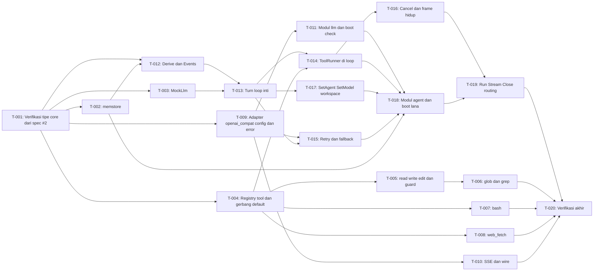

# Tasks: Agent loop, provider, tools, Go library

- **Issue**: [`#3`](https://github.com/ridhomujizat/lana-harness/issues/3)
- **Requirements**: [requirements.md](requirements.md)
- **Contract**: [api-contract.md](api-contract.md) — Diperlukan
- **Design**: [design.md](design.md)
- **Revisi requirements**: 2
- **Revisi contract**: 2
- **Revisi design**: 2
- **Revisi tasks**: 2 (rekonsiliasi: T-001 tanpa tipe baru, `core.DeriveMessages` di T-012, profile base di T-018)
- **Status**: Approved

Jangan membuat rencana task sebelum requirements, contract, dan design di-approve. Ketiganya sudah Approved.

## Dependency terhadap spec #2

Spec #2 sudah punya `tasks.md` (Approved). Task spec ini hanya boleh mulai setelah task spec #2
berikut selesai dan bagian berikut tersedia sebagai kode yang bisa dipakai:

| Kebutuhan dari spec #2 | Dipakai oleh |
|---|---|
| `core`: `Message`, `ContentBlock`, `SessionEvent`, `Secret`, `Risk`, `Tool`, `ToolRegistry`, `Provider`, `LLMRegistry`, `SessionStore`, `AgentRegistry` (T-003 spec #2) | T-001 sampai T-019 |
| `core`: tipe gabungan `API-CORE-015` (hook I/O, `ToolDecision`, `ToolOutput` dengan `ToolStatus`, `ProviderError`, `PayloadError`, `ChatStream`) (T-003 dan T-004 spec #2) | T-004, T-009, T-012, T-013 |
| `core`: `DeriveMessages` (fungsi murni, subset non-compaction, dibuat di T-012 spec ini) | T-012, T-019 |
| `core`: `Waterfall`, `Serial`, `Observe`, `Hooks` (nama dari tabel hook) | T-004, T-012, T-013 |
| `core`: `Module`, `Builder`, `RegisterModule` (REQ-MOD-001 sampai REQ-MOD-004) | T-011, T-018 |
| `config.Load` dan `config.Layer` (REQ-CONF-001 sampai REQ-CONF-009) | T-011, T-018, T-019 |
| Profile bawaan sebagai data (REQ-PROF-001) | T-018 |
| Test impor dan `go list -deps` (REQ-BUILD-001 dan `AC-BUILD-002`) | T-020 |

## Aturan eksekusi

- Implementasi hanya requirement dan acceptance criteria yang ditugaskan ke task.
- Berhenti jika requirements, design, ADR, diagram, atau contract saling bertentangan.
- Jangan menjawab pertanyaan produk atau arsitektur hanya di kode.
- Satu acceptance criterion punya tepat satu pemilik bukti.
- Verifikasi yang diwajibkan tidak pernah opsional.
- Tandai task selesai hanya setelah bukti verifikasi dicatat.
- Perintah dijalankan di dalam `nix develop -c` (instruksi mesin).

## Cakupan

Setiap baris memuat satu rentang AC dengan satu pemilik bukti. Semua 89 AC terpetakan.

| Acceptance criterion | Operasi contract | Pemilik bukti | Issue/PR | Verifikasi | Bukti |
|---|---|---|---|---|---|
| `AC-MEM-001` sampai `AC-MEM-003` | Tidak berlaku langsung | `T-002` | `—` | `go test ./store/memstore/...` | Pending |
| `AC-MOCK-001`, `AC-MOCK-002` | `API-PROV-004` | `T-003` | `—` | `go test ./providers/mock/...` | Pending |
| `AC-TOOL-023`, `AC-TOOL-024` | `API-AGENT-009` | `T-004` | `—` | `go test ./tools/...` | Pending |
| `AC-TOOL-001` sampai `AC-TOOL-008` | `API-TOOL-001` sampai `API-TOOL-003` | `T-005` | `—` | `go test ./tools/...` | Pending |
| `AC-TOOL-021`, `AC-TOOL-022` | `API-TOOL-001` sampai `API-TOOL-005` | `T-005` | `—` | `go test ./tools/...` | Pending |
| `AC-TOOL-009` sampai `AC-TOOL-013` | `API-TOOL-004`, `API-TOOL-005` | `T-006` | `—` | `go test ./tools/...` | Pending |
| `AC-TOOL-014` sampai `AC-TOOL-017` | `API-TOOL-006` | `T-007` | `—` | `go test ./tools/...` | Pending |
| `AC-TOOL-018` sampai `AC-TOOL-020` | `API-TOOL-007` | `T-008` | `—` | `go test ./tools/...` | Pending |
| `AC-PROV-001`, `AC-PROV-002` | `API-PROV-001` | `T-009` | `—` | `go test ./providers/openai/...` | Pending |
| `AC-PROV-010` sampai `AC-PROV-012` | `API-PROV-003` | `T-009` | `—` | `go test ./providers/openai/...` | Pending |
| `AC-PROV-005` sampai `AC-PROV-009` | `API-PROV-002` | `T-010` | `—` | `go test ./providers/openai/...` | Pending |
| `AC-PROV-003`, `AC-PROV-004` | `API-PROV-001`, `API-LIB-001` | `T-011` | `—` | `go test ./providers/openai/...` | Pending |
| `AC-LOOP-001` sampai `AC-LOOP-009` | `API-AGENT-001`, `API-AGENT-008`, `API-AGENT-009` | `T-013` | `—` | `go test -race ./agent/...` | Pending |
| `AC-LOOP-015` sampai `AC-LOOP-018` | `API-AGENT-007`, `API-AGENT-009` | `T-013` | `—` | `go test -race ./agent/...` | Pending |
| `AC-LOOP-010` sampai `AC-LOOP-014` | `API-AGENT-008`, `API-AGENT-009` | `T-014` | `—` | `go test -race ./agent/...` | Pending |
| `AC-LOOP-019` sampai `AC-LOOP-021` | `API-AGENT-003` | `T-016` | `—` | `go test -race ./agent/...` | Pending |
| `AC-LOOP-026`, `AC-LOOP-027` | `API-AGENT-006` | `T-016` | `—` | `go test -race ./agent/...` | Pending |
| `AC-LOOP-022` sampai `AC-LOOP-025` | `API-PROV-003`, `API-AGENT-007` | `T-015` | `—` | `go test -race ./agent/...` | Pending |
| `AC-LOOP-028` sampai `AC-LOOP-031` | `API-AGENT-004`, `API-AGENT-005`, `API-AGENT-007` | `T-017` | `—` | `go test -race ./agent/...` | Pending |
| `AC-LIB-001` sampai `AC-LIB-003`, `AC-LIB-012` sampai `AC-LIB-014`, `AC-LIB-017` | `API-LIB-001`, `API-LIB-005`, `API-AGENT-009` | `T-018` | `—` | `go test -race .` | Pending |
| `AC-LIB-004` sampai `AC-LIB-011`, `AC-LIB-015`, `AC-LIB-016` | `API-LIB-002` sampai `API-LIB-004`, `API-AGENT-002`, `API-AGENT-008` | `T-019` | `—` | `go test -race .` | Pending |

## Graf task

## Tasks

- [x] `T-001` Verifikasi tipe `core` dari spec #2 (`API-CORE-015`)
  - Issue/PR: `—`
  - Bergantung pada: spec #2 (core dasar, lihat tabel di atas)
  - Requirements: prasyarat untuk seluruh spec (tidak ada perilaku baru)
  - Acceptance criteria: `None`
  - Operasi contract: `API-CORE-015` (spec #2)
  - Scope:
    - Tidak menulis tipe `core`. Tipe ada di spec #2 (`API-CORE-015`, T-003 dan T-004).
    - Pastikan `ToolStatus` (`success`, `error`, `rejected`), `ToolDecision`, dan tipe hook tersedia di `core`.
    - Tidak ada logika di package `core` dari task ini.
  - Verifikasi:
    - `nix develop -c go build ./core/...`
    - `nix develop -c go vet ./core/...`
  - Bukti penyelesaian:
    - Status: Completed
    - Perintah/test: `XDG_CACHE_HOME=$PWD/.nix-cache GOCACHE=$PWD/.gocache GOMODCACHE=$PWD/.gomodcache GOPATH=$PWD/.gopath nix develop -c sh -c 'go build ./core/... && go vet ./core/...'`
    - Hasil: exit 0. `ToolStatus`, `ToolDecision`, tipe hook, dan seluruh tipe `API-CORE-015` tersedia dari milestone spec #2.
    - PR/commit: commit T-001 spec #3
    - Deviasi: Tidak ada.

- [x] `T-002` Implementasi `store/memstore` sebagai `core.SessionStore`
  - Issue/PR: `—`
  - Bergantung pada: `T-001`
  - Requirements: `REQ-MEM-001`
  - Acceptance criteria: `AC-MEM-001`, `AC-MEM-002`, `AC-MEM-003`
  - Operasi contract: Tidak berlaku langsung (dipakai `API-LIB-001`)
  - Scope:
    - Session dan slice event per session dengan mutex.
    - `Append` memberi `seq` naik 1 mulai dari 1. `Events(from seq)`.
    - `Fork` mengembalikan `ErrNotSupported`. `TryLease` selalu berhasil di proses yang sama.
    - `Create`, `Open`, `Info`, `List`, `FindPrefix` secara sederhana sesuai interface.
    - `ChainEvents` memotong di `inherited_seq`. `DeriveMessages` memanggil `core.DeriveMessages` (sama dengan spec #4).
  - Verifikasi:
    - `nix develop -c go test -race ./store/memstore/...`
  - Bukti penyelesaian:
    - Status: Completed
    - Perintah/test: `XDG_CACHE_HOME=$PWD/.nix-cache GOCACHE=$PWD/.gocache GOMODCACHE=$PWD/.gomodcache GOPATH=$PWD/.gopath CGO_ENABLED=1 nix develop -c sh -c 'CGO_ENABLED=1 go test -race ./store/memstore/... ./core/...'`
    - Hasil: `ok store/memstore`, `ok core`; exit 0. `session/created` seq 1, append berikutnya seq 2 dan 3; `Fork` mengembalikan `ErrNotSupported`; store baru tidak menemukan session lama.
    - PR/commit: commit T-002 spec #3
    - Deviasi: `core.DeriveMessages` subset langsung dibuat di package core agar `memstore.DeriveMessages` dapat dikompilasi dan diuji; bukti lengkap derive dicatat di T-012.

- [x] `T-003` Implementasi `providers/mock` (`MockLlm`)
  - Issue/PR: `—`
  - Bergantung pada: `T-001`
  - Requirements: `REQ-MOCK-001`
  - Acceptance criteria: `AC-MOCK-001`, `AC-MOCK-002`
  - Operasi contract: `API-PROV-004`
  - Scope:
    - Tipe `Script`, `Response`, `Event`, `ScriptError` dan `LoadScript` (JSON, tolak key tidak dikenal).
    - `Llm.Stream` memutar respons berikutnya. Delay dengan `time.Timer` dan `ctx`.
    - Error terminal sesuai `class`. Skrip habis mengembalikan error `skrip habis`.
  - Verifikasi:
    - `nix develop -c go test -race ./providers/mock/...`
  - Bukti penyelesaian:
    - Status: Completed
    - Perintah/test: `XDG_CACHE_HOME=$PWD/.nix-cache GOCACHE=$PWD/.gocache GOMODCACHE=$PWD/.gomodcache GOPATH=$PWD/.gopath nix develop -c sh -c 'go build ./... && CGO_ENABLED=1 go test -race ./providers/mock/...'`
    - Hasil: `ok providers/mock`; exit 0. Respons diputar berurutan, delay menghormati ctx, error class diteruskan, skrip habis menghasilkan `skrip habis`, key JSON tak dikenal ditolak.
    - PR/commit: commit T-003 spec #3
    - Deviasi: Tidak ada.

- [x] `T-004` Implementasi registry tool dan gerbang default `tools.pre_execute`
  - Issue/PR: `—`
  - Bergantung pada: `T-001`
  - Requirements: `REQ-TOOL-009`
  - Acceptance criteria: `AC-TOOL-023`, `AC-TOOL-024`
  - Operasi contract: `API-AGENT-009`
  - Scope:
    - `tools.Registry` (implementasi `core.ToolRegistry`) dengan tolak nama ganda.
    - `tools.Pipeline` untuk `ToolsPreExecute`, `ToolsExecute`, `ToolsPostExecute` dengan handler default sesuai contract.
    - Handler default `ToolsPreExecute`: `Read` allow, selain itu deny `default fail-closed`.
    - `ToolsExecute` menangkap panic dan mengembalikan `ToolOutput{error}`.
  - Verifikasi:
    - `nix develop -c go test -race ./tools/...`
  - Bukti penyelesaian:
    - Status: Completed
    - Perintah/test: `XDG_CACHE_HOME=$PWD/.nix-cache GOCACHE=$PWD/.gocache GOMODCACHE=$PWD/.gomodcache GOPATH=$PWD/.gopath nix develop -c sh -c 'go build ./... && CGO_ENABLED=1 go test -race ./tools/...'`
    - Hasil: `ok tools`; exit 0. `TestDefaultGate` (Read allow, Write rejected `default fail-closed`) dan `TestDenyListenerStopsChain` lulus; panic tool menjadi status error.
    - PR/commit: commit T-004 spec #3
    - Deviasi: `core.NewHooks` ditambahkan sebagai konstruktor publik agar pipeline dapat diuji tanpa Boot; tidak mengubah perilaku.

- [x] `T-005` Implementasi `read_file`, `write_file`, `edit_file`, dan guard workspace
  - Issue/PR: `—`
  - Bergantung pada: `T-004`
  - Requirements: `REQ-TOOL-001`, `REQ-TOOL-002`, `REQ-TOOL-003`, `REQ-TOOL-008`
  - Acceptance criteria: `AC-TOOL-001` sampai `AC-TOOL-008`, `AC-TOOL-021`, `AC-TOOL-022`
  - Operasi contract: `API-TOOL-001`, `API-TOOL-002`, `API-TOOL-003`, guard untuk `API-TOOL-001` sampai `API-TOOL-005`
  - Scope:
    - `tools.Guard.ResolveInWorkspace` dengan `filepath.Abs`, `filepath.EvalSymlinks` (path ada), atau induk (path baru). Error `ErrOutsideWorkspace`.
    - `read_file` dengan `offset` dan `limit`, batas 30000 karakter, deteksi biner (NUL dalam 8000 byte).
    - `write_file` menimpa file dan tidak membuat direktori induk.
    - `edit_file` dengan hitung kemunculan tepat satu.
    - Status `rejected` untuk path di luar workspace.
  - Verifikasi:
    - `nix develop -c go test -race ./tools/...`
  - Bukti penyelesaian:
    - Status: Completed
    - Perintah/test: `XDG_CACHE_HOME=$PWD/.nix-cache GOCACHE=$PWD/.gocache GOMODCACHE=$PWD/.gomodcache GOPATH=$PWD/.gopath nix develop -c sh -c 'go test -race ./tools/...'`
    - Hasil: `ok tools`; exit 0. 11 test file/guard PASS, termasuk symlink keluar workspace dan binari.
    - PR/commit: commit T-005 spec #3
    - Deviasi: Tidak ada.

- [x] `T-006` Implementasi `glob` dan `grep` dengan `.gitignore`
  - Issue/PR: `—`
  - Bergantung pada: `T-005`
  - Requirements: `REQ-TOOL-004`, `REQ-TOOL-005`
  - Acceptance criteria: `AC-TOOL-009` sampai `AC-TOOL-013`
  - Operasi contract: `API-TOOL-004`, `API-TOOL-005`
  - Scope:
    - Tambahkan `github.com/bmatcuk/doublestar/v4` dan `github.com/sabhiram/go-gitignore` (versi dipin di `go.mod`).
    - `glob`: urut, batas 1000, lewati `.git/` dan pola `.gitignore` root.
    - `grep`: `regexp` RE2, batas 200 kecocokan, potong baris 500 karakter, lewati biner dan file lebih dari 1 MiB, filter `glob`.
  - Verifikasi:
    - `nix develop -c go test -race ./tools/...`
  - Bukti penyelesaian:
    - Status: Completed
    - Perintah/test: `XDG_CACHE_HOME=$PWD/.nix-cache GOCACHE=$PWD/.gocache GOMODCACHE=$PWD/.gomodcache GOPATH=$PWD/.gopath nix develop -c sh -c 'go test -race ./tools/...'`
    - Hasil: `ok tools`; exit 0. Glob menghormati `.gitignore` root dan batas 1000 (catatan `dari 1001 hasil`); grep memakai RE2, melewati biner dan file >1 MiB serta filter glob.
    - PR/commit: commit T-006 spec #3
    - Deviasi: Tidak ada.

- [x] `T-007` Implementasi `bash`
  - Issue/PR: `—`
  - Bergantung pada: `T-004`
  - Requirements: `REQ-TOOL-006`
  - Acceptance criteria: `AC-TOOL-014` sampai `AC-TOOL-017`
  - Operasi contract: `API-TOOL-006`
  - Scope:
    - `sh -c` dengan cwd workspace, `Setpgid`, dan kill grup pada timeout atau batal.
    - `timeout_secs` default 120, tolak di luar 1 sampai 600 sebelum eksekusi.
    - Exit code bukan nol menjadi `error` dengan kode di output.
    - Output stdout dan stderr gabungan, batas 30000 karakter, catatan jumlah karakter asli.
  - Verifikasi:
    - `nix develop -c go test -race ./tools/...`
  - Bukti penyelesaian:
    - Status: Completed
    - Perintah/test: `XDG_CACHE_HOME=$PWD/.nix-cache GOCACHE=$PWD/.gocache GOMODCACHE=$PWD/.gomodcache GOPATH=$PWD/.gopath nix develop -c sh -c 'go test -race ./tools/...'`
    - Hasil: `ok tools`; exit 0. cwd workspace, timeout membunuh grup proses, batas 600 ditolak sebelum eksekusi, exit code bukan nol menjadi status error, output 40.000 karakter dipotong dengan catatan, pembatalan ctx menghasilkan `dibatalkan`.
    - PR/commit: commit T-007 spec #3
    - Deviasi: Tidak ada.

- [x] `T-008` Implementasi `web_fetch`
  - Issue/PR: `—`
  - Bergantung pada: `T-004`
  - Requirements: `REQ-TOOL-007`
  - Acceptance criteria: `AC-TOOL-018` sampai `AC-TOOL-020`
  - Operasi contract: `API-TOOL-007`
  - Scope:
    - Tambahkan `github.com/JohannesKaufmann/html-to-markdown/v2` dan `golang.org/x/net/html` (versi dipin di `go.mod`).
    - Hanya `http` dan `https`. Timeout 30 detik. Body maksimal 5 MiB. Maksimal 5 redirect. `CheckRedirect` tanpa batas host (lihat risiko).
    - HTML: buang `script`, `style`, `noscript`, lalu konversi markdown. `text/plain` dan `application/json` apa adanya. Tipe lain error.
  - Verifikasi:
    - `nix develop -c go test -race ./tools/...` (httptest)
  - Bukti penyelesaian:
    - Status: Completed
    - Perintah/test: `XDG_CACHE_HOME=$PWD/.nix-cache GOCACHE=$PWD/.gocache GOMODCACHE=$PWD/.gomodcache GOPATH=$PWD/.gopath nix develop -c sh -c 'go test -race ./tools/...'`
    - Hasil: `ok tools`; exit 0. HTML menjadi markdown tanpa script/style, text/plain dan application/json apa adanya, tipe lain ditolak, non-http ditolak tanpa request, body >5 MiB ditolak, timeout dipetakan ke pesan 30 detik.
    - PR/commit: commit T-008 spec #3
    - Deviasi: Dependency `html-to-markdown/v2` dipin ke v2.4.0 dan `x/net` mengikuti agar direktif `go 1.24.0` tetap dipertahankan.

- [x] `T-009` Implementasi adapter `openai_compat`: config, client, dan klasifikasi error
  - Issue/PR: `—`
  - Bergantung pada: `T-001`
  - Requirements: `REQ-PROV-001` (sebagian), `REQ-PROV-004`
  - Acceptance criteria: `AC-PROV-001`, `AC-PROV-002`, `AC-PROV-010`, `AC-PROV-011`, `AC-PROV-012`
  - Operasi contract: `API-PROV-001`, `API-PROV-003`
  - Scope:
    - Baca `[providers.<name>]`: `kind`, `base_url`, `api_key_env`, `headers`, `timeout` (default 300s).
    - `http.Client` dengan timeout. Header `Authorization` hanya jika `api_key_env` terisi.
    - `classify.go`: 401 dan 403 `auth`. 429 `rate_limit`. 5xx `server`. Gagal koneksi atau timeout `network`. 400 dengan `context_length_exceeded` `context_length`. Lainnya 4xx `client`.
  - Verifikasi:
    - `nix develop -c go test -race ./providers/openai/...`
  - Bukti penyelesaian:
    - Status: Completed
    - Perintah/test: `XDG_CACHE_HOME=$PWD/.nix-cache GOCACHE=$PWD/.gocache GOMODCACHE=$PWD/.gomodcache GOPATH=$PWD/.gopath nix develop -c sh -c 'go test -race ./providers/openai/...'`
    - Hasil: `ok providers/openai`; exit 0. `TestClassify` (9 kasus), `TestConfigOpenAICompat` (path `/v1/chat/completions`), `TestNoAuthHeaderWithoutEnv`, `TestProviderErrorHTTP` (401 auth) lulus.
    - PR/commit: commit T-009/T-010 spec #3 (satu commit untuk adapter dan stream; dicatat di docs/eval)
    - Deviasi: Wire/SSE T-010 ditulis dalam commit yang sama karena adapter tidak dapat dikompilasi tanpa keduanya; bukti T-010 tetap dipisah di task ini.

- [x] `T-010` Implementasi stream SSE dan konversi pesan OpenAI
  - Issue/PR: `—`
  - Bergantung pada: `T-009`
  - Requirements: `REQ-PROV-002`, `REQ-PROV-003`
  - Acceptance criteria: `AC-PROV-005` sampai `AC-PROV-009`
  - Operasi contract: `API-PROV-002`
  - Scope:
    - `sse.go`: baca `data:` per baris, berhenti di `[DONE]`.
    - `wire.go`: konversi `ChatRequest` ke body (role `system`, `assistant` dengan `tool_calls`, `tool` dengan `tool_call_id`). Gambar gagal `ErrUnsupported`.
    - Akumulasi `tool_calls` per `index`. Terbitkan `tool_use` setelah `finish_reason`. `usage` dari chunk akhir.
    - Fixture di `testdata/*.sse` dan golden untuk body request.
  - Verifikasi:
    - `nix develop -c go test -race ./providers/openai/...`
  - Bukti penyelesaian:
    - Status: Completed
    - Perintah/test: `XDG_CACHE_HOME=$PWD/.nix-cache GOCACHE=$PWD/.gocache GOMODCACHE=$PWD/.gomodcache GOPATH=$PWD/.gopath nix develop -c sh -c 'go test -race ./providers/openai/...'`
    - Hasil: `ok providers/openai`; exit 0. `TestSSETextDeltas` (3 delta), `TestSSEToolCallAccumulate` (argumen 3 potongan menjadi `{\"path\":\"a.txt\"}`), `TestSSEUsage` (12/5), `TestWireConvert`, `TestWireImageUnsupported` lulus. Fixture di `providers/openai/testdata/*.sse`.
    - PR/commit: commit T-009/T-010 spec #3
    - Deviasi: Sama dengan T-009; tidak ada perilaku yang dihilangkan.

- [x] `T-011` Implementasi modul `llm`: `LLMRegistry`, cek kind, dan cek secret saat boot
  - Issue/PR: `—`
  - Bergantung pada: `T-009`
  - Requirements: `REQ-PROV-001` (sebagian)
  - Acceptance criteria: `AC-PROV-003`, `AC-PROV-004`
  - Operasi contract: `API-PROV-001`, `API-LIB-001`
  - Scope:
    - `providers/openai/module.go`: modul `llm` menyediakan `core.LLMRegistry`.
    - Tolak `kind` selain `openai_compat` dengan pesan yang menyebut provider.
    - Untuk setiap provider yang dipakai agent (primary dan fallback), cek env `api_key_env`. Kosong berarti `missing_secret`.
  - Verifikasi:
    - `nix develop -c go test -race ./providers/openai/...`
  - Bukti penyelesaian:
    - Status: Completed
    - Perintah/test: `XDG_CACHE_HOME=$PWD/.nix-cache GOCACHE=$PWD/.gocache GOMODCACHE=$PWD/.gomodcache GOPATH=$PWD/.gopath nix develop -c sh -c 'go test -race ./providers/openai/... ./core/...'`
    - Hasil: `ok providers/openai`, `ok core`; exit 0. Kind `anthropic` ditolak dengan nama provider; `missing_secret` menyebut env dan provider; registry `openai` terpasang di Context.
    - PR/commit: commit T-011 spec #3
    - Deviasi: `core.Builder.Secrets()` ditambahkan sebagai akses internal (di luar contract publik) agar modul dapat memeriksa env tanpa meng-import config.

- [x] `T-012` Implementasi `core.DeriveMessages` (subset), `Events`, dan pemasangan hook
  - Issue/PR: `—`
  - Bergantung pada: `T-001`, `T-002`
  - Requirements: `REQ-LOOP-003` (sebagian), `REQ-LOOP-010` (sebagian)
  - Acceptance criteria: `None` (dipakai oleh `T-013` sampai `T-017`)
  - Operasi contract: `API-AGENT-008`, `API-AGENT-009`
  - Scope:
    - `core.DeriveMessages(events)` di `core/derive.go`: `user/message`, `assistant/message`, `tool/result` (digabung ke pesan user). Abaikan `system/message`, `assistant/attempt`, `tool/call`. Tanpa compaction (spec #4 menambah).
    - `Events`: wrapper `Append` dengan `v: 1` dan payload sesuai `API-AGENT-008`. Satu-satunya penulis event turn.
    - `Hooks`: pasang dan lepas listener dan handler default (`Install`, `Stop`).
  - Verifikasi:
    - `nix develop -c go test -race ./core/... ./agent/...` (unit `derive_test.go` di `core`, `events_test.go`, golden payload)
  - Bukti penyelesaian:
    - Status: Completed
    - Perintah/test: `XDG_CACHE_HOME=$PWD/.nix-cache GOCACHE=$PWD/.gocache GOMODCACHE=$PWD/.gomodcache GOPATH=$PWD/.gopath nix develop -c sh -c 'go test -race ./core/... ./agent/...'`
    - Hasil: `ok core`, `ok agent`; exit 0. `TestDeriveGolden` membuktikan system/attempt/tool-call diabaikan dan tool_result digabung ke pesan user; `TestEventsPayloadVersion` membuktikan `v:1`.
    - PR/commit: commit T-012 spec #3
    - Deviasi: Pemasangan listener/handler default untuk loop dipasang bersama T-013 dan T-015 karena hook yang dipakai baru ada di sana; tidak ada AC yang dimiliki T-012.

- [x] `T-013` Implementasi turn loop inti: claim, pre_step, step, pemanggilan model, batas step, dan penghentian
  - Issue/PR: `—`
  - Bergantung pada: `T-003`, `T-012`
  - Requirements: `REQ-LOOP-001`, `REQ-LOOP-002` (inbox dan satu turn aktif), `REQ-LOOP-003`, `REQ-LOOP-005`, `REQ-LOOP-006`
  - Acceptance criteria: `AC-LOOP-001` sampai `AC-LOOP-009`, `AC-LOOP-015` sampai `AC-LOOP-018`
  - Operasi contract: `API-AGENT-001`, `API-AGENT-007`, `API-AGENT-008`, `API-AGENT-009`
  - Scope:
    - `Registry` dan `Runner` dengan kunci, inbox, `running`, dan goroutine per rantai turn (lihat design [Konkurensi](design.md#konkurensi)).
    - `TurnLoop` sesuai algoritma di design [Satu turn](design.md#satu-turn), tanpa tool call dulu (`tool/call` diberi stub yang menutup step).
    - Batas `max_steps` (default 25, dari config). `agent.turn_stopping` serial.
    - `system/message` berubah saja. `agent.request` dan `agent.pre_step` waterfall.
    - Tulis `assistant/message` dengan blok teks.
  - Verifikasi:
    - `nix develop -c go test -race ./agent/...` (`TestTurnPlainAnswer`, `TestPreStepReject`, `TestOneClaimPerStep`, `TestSendWhileRunning`, `TestSessionsParallel`, `TestSendDuringClose`, `TestAgentRequestHook`, `TestSystemMessageOnChange`, `TestAssistantMessageBlocks`, `TestMaxStepsDefault`, `TestMaxStepsConfigured`, `TestTurnStopNoListener`, `TestTurnStopContinue`)
  - Bukti penyelesaian:
    - Status: Completed
    - Perintah/test: `XDG_CACHE_HOME=$PWD/.nix-cache GOCACHE=$PWD/.gocache GOMODCACHE=$PWD/.gomodcache GOPATH=$PWD/.gopath nix develop -c sh -c 'go test -race -timeout 60s ./agent/...'`
    - Hasil: seluruh test agent PASS; exit 0. Termasuk `TestTurnPlainAnswer`, `TestPreStepReject`, `TestOneClaimPerStep`, `TestSendWhileRunning`, `TestSessionsParallel`, `TestSendDuringClose`, `TestAgentRequestHook`, `TestSystemMessageOnChange`, `TestAssistantMessageBlocks`, `TestMaxStepsDefault`, `TestMaxStepsConfigured`, `TestTurnStopNoListener`, `TestTurnStopContinue`.
    - PR/commit: commit T-013/T-014 spec #3
    - Deviasi: Turn loop dan integrasi ToolRunner dikerjakan dalam satu commit karena ToolRunner sudah menjadi bagian loop saat test inti dijalankan; dicatat di docs/eval.

- [x] `T-014` Implementasi `ToolRunner` dan integrasi pipeline tool ke turn loop
  - Issue/PR: `—`
  - Bergantung pada: `T-004`, `T-013`
  - Requirements: `REQ-LOOP-004`
  - Acceptance criteria: `AC-LOOP-010` sampai `AC-LOOP-014`
  - Operasi contract: `API-AGENT-008`, `API-AGENT-009`
  - Scope:
    - Tulis `tool/call` berurutan sebelum pipeline.
    - Cek nama terhadap `tools` agent dan skema input (tipe JSON dan field wajib).
    - Batch: `Read` paralel dengan semafor 8. `Write` dan `Exec` sendiri.
    - Tulis `tool/result` sesuai urutan `tool/call` setelah setiap batch.
  - Verifikasi:
    - `nix develop -c go test -race ./agent/...` (`TestToolResultPerCall`, `TestToolNotEnabled`, `TestReadBatchParallel`, `TestWriteSerial`, `TestInvalidToolInput`)
  - Bukti penyelesaian:
    - Status: Completed
    - Perintah/test: `XDG_CACHE_HOME=$PWD/.nix-cache GOCACHE=$PWD/.gocache GOMODCACHE=$PWD/.gomodcache GOPATH=$PWD/.gopath nix develop -c sh -c 'go test -race -timeout 60s ./agent/...'`
    - Hasil: test `TestToolResultPerCall`, `TestToolNotEnabled`, `TestReadBatchParallel`, `TestWriteSerial`, `TestInvalidToolInput` PASS. Setiap `tool/call` punya satu `tool/result`; batch Read paralel (max concurrency >1) dan Write serial (max 1).
    - PR/commit: commit T-013/T-014 spec #3
    - Deviasi: Sama dengan T-013; test tambahan di `agent/tool_loop_test.go`.

- [x] `T-015` Implementasi listener retry dan fallback `llm.stream`
  - Issue/PR: `—`
  - Bergantung pada: `T-009`, `T-013`
  - Requirements: `REQ-LOOP-008`
  - Acceptance criteria: `AC-LOOP-022` sampai `AC-LOOP-025`
  - Operasi contract: `API-PROV-003`, `API-AGENT-007`
  - Scope:
    - `Retry` sesuai design [Retry dan fallback](design.md#retry-dan-fallback): 3 retry per target, jeda 1, 2, 4 detik lewat `time.Timer` dan `ctx`.
    - Retry hanya untuk `rate_limit`, `server`, `network`, dan hanya sebelum event pertama.
    - Tulis `assistant/attempt` untuk setiap percobaan gagal.
    - Target fallback dari `fallback` agent. Provider tidak ada dilewati sebagai `client`.
  - Verifikasi:
    - `nix develop -c go test -race ./agent/...` (`TestRetryBackoff`, `TestFallbackOrder`, `TestNoRetryClasses`)
  - Bukti penyelesaian:
    - Status: Completed
    - Perintah/test: `XDG_CACHE_HOME=$PWD/.nix-cache GOCACHE=$PWD/.gocache GOMODCACHE=$PWD/.gomodcache GOPATH=$PWD/.gopath nix develop -c sh -c 'go test -race -timeout 60s ./agent/...'`
    - Hasil: `TestRetryBackoff` (3 panggilan, 2 attempt, jeda), `TestFallbackOrder` (primary 4 kali lalu fallback), `TestNoRetryClasses` (auth/client/context_length tanpa retry/fallback) PASS.
    - PR/commit: commit T-015 spec #3
    - Deviasi: Jeda retry memakai field `Retry.Delays` agar test cepat; nilai produksi default 1s/2s/4s.

- [x] `T-016` Implementasi `Cancel` dan `Hub` frame hidup
  - Issue/PR: `—`
  - Bergantung pada: `T-013`, `T-014`
  - Requirements: `REQ-LOOP-007`, `REQ-LOOP-009`
  - Acceptance criteria: `AC-LOOP-019` sampai `AC-LOOP-021`, `AC-LOOP-026`, `AC-LOOP-027`
  - Operasi contract: `API-AGENT-003`, `API-AGENT-006`
  - Scope:
    - `Cancel`: batalkan `ctx` turn, `tool/result` `error` `dibatalkan` untuk call yang belum selesai, `turn/end` `cancelled`, `assistant/attempt` parsial dengan class `cancelled`. Inbox tidak diubah. Idle tidak menulis apa pun.
    - `Hub`: `SubscribeLive` dengan buffer 1024, kirim non-blok, buang dan catat peringatan saat penuh, tutup channel saat unsubscribe.
    - Proses `bash` yang tertahan dihentikan saat `Cancel`.
  - Verifikasi:
    - `nix develop -c go test -race ./agent/...` (`TestCancelBashProcess`, `TestCancelIdleNoop`, `TestCancelKeepsInbox`, `TestLiveFrameOrder`, `TestLiveFrameDropWarn`)
  - Bukti penyelesaian:
    - Status: Completed
    - Perintah/test: `XDG_CACHE_HOME=$PWD/.nix-cache GOCACHE=$PWD/.gocache GOMODCACHE=$PWD/.gomodcache GOPATH=$PWD/.gopath nix develop -c sh -c 'go test -race -timeout 60s ./agent/...'`
    - Hasil: `TestCancelBashProcess`, `TestCancelIdleNoop`, `TestCancelKeepsInbox`, `TestLiveFrameOrder`, `TestLiveFrameDropWarn` PASS; race detector lulus.
    - PR/commit: commit T-016 spec #3
    - Deviasi: Tidak ada.

- [x] `T-017` Implementasi `SetAgent`, `SetModel`, dan resolusi workspace per session
  - Issue/PR: `—`
  - Bergantung pada: `T-013`, `T-012`
  - Requirements: `REQ-LOOP-010`
  - Acceptance criteria: `AC-LOOP-028` sampai `AC-LOOP-031`
  - Operasi contract: `API-AGENT-004`, `API-AGENT-005`, `API-AGENT-007`
  - Scope:
    - `SetAgent`: validasi agent, tulis `model/selection` dengan `agent`, `provider`, `model`.
    - `SetModel`: validasi provider di `LLMRegistry` (`ErrUnknownProvider`) dan model tidak kosong. Tulis `model/selection`.
    - Resolve model dan agent per step dari log. Perubahan berlaku step berikutnya.
    - Workspace: `session/created.workspace`, lalu `agents.<nama>.workspace` (`~` diperluas), lalu cwd saat boot.
  - Verifikasi:
    - `nix develop -c go test -race ./agent/...` (`TestSetAgentEvent`, `TestSetModelMidTurn`, `TestSetModelUnknownProvider`, `TestWorkspacePrecedence`)
  - Bukti penyelesaian:
    - Status: Completed
    - Perintah/test: `XDG_CACHE_HOME=$PWD/.nix-cache GOCACHE=$PWD/.gocache GOMODCACHE=$PWD/.gomodcache GOPATH=$PWD/.gopath nix develop -c sh -c 'go test -race -timeout 60s ./agent/...'`
    - Hasil: `TestSetAgentEvent`, `TestSetModelMidTurn`, `TestSetModelUnknownProvider`, `TestWorkspacePrecedence` PASS; model step 1 tetap m1 dan step 2 memakai m2 setelah SetModel.
    - PR/commit: commit T-017 spec #3
    - Deviasi: Tidak ada.

- [x] `T-018` Implementasi modul `agent`, modul `tools`, dan boot `lana.New` (opsi dan profile)
  - Issue/PR: `—`
  - Bergantung pada: `T-002`, `T-004`, `T-011`, `T-014`, `T-015`, `T-017`
  - Requirements: `REQ-LIB-001`, `REQ-LIB-006`, `REQ-LIB-008`, `REQ-LIB-005` (pendaftaran tool kustom)
  - Acceptance criteria: `AC-LIB-001`, `AC-LIB-002`, `AC-LIB-003`, `AC-LIB-012`, `AC-LIB-013`, `AC-LIB-014`, `AC-LIB-017`
  - Operasi contract: `API-LIB-001`, `API-LIB-005`, `API-AGENT-009`
  - Scope:
    - Modul `agent` (requires `llm`, `tools`, `store`) dan modul `tools` (menyediakan `ToolRegistry` dengan tool bawaan dan kustom).
    - `lana.New`: `config.Load` dengan `Home`, `Layers`, `Profile` (default `minimal`), `Builder`, install modul, dan tool kustom.
    - Tolak nama tool kustom yang bentrok (`AC-LIB-002`). Tolak tool agent yang tidak dikenal (`AC-LIB-003`).
    - `PolicyTrust` menambah listener allow-all di `tools.pre_execute` dengan mode waterfall tanpa `next`. Nilai nol `PolicyNever`.
    - Baris base yang dipakai spec ini (`API-LIB-005`) ada di data profile spec #2 (T-009). Opsi `ApproveWith` dan `provided_store` dibuat di sini sebagai tipe dan modul, perilaku penjawab di spec #4.
  - Verifikasi:
    - `nix develop -c go test -race .` (`TestNewMinimal`, `TestNewToolConflict`, `TestNewUnknownAgentTool`, `TestCustomToolPipeline`, `TestApprovalNeverDefault`, `TestApprovalTrust`, `TestProfileRows`)
  - Bukti penyelesaian:
    - Status: Completed
    - Perintah/test: `XDG_CACHE_HOME=$PWD/.nix-cache GOCACHE=$PWD/.gocache GOMODCACHE=$PWD/.gomodcache GOPATH=$PWD/.gopath nix develop -c sh -c 'go test -race -timeout 120s .'`
    - Hasil: `TestNewMinimal`, `TestNewToolConflict`, `TestNewUnknownAgentTool`, `TestProfileRows` PASS; modul store diganti `memstore` saat Home kosong, `llm`/`tools`/`agent` terpasang.
    - PR/commit: commit T-018/T-019 spec #3
    - Deviasi: Tool kustom dan store diberikan ke modul lewat nilai internal `ModuleConfig.Values` (`_custom_tools`, `_store`) karena `Options` tidak masuk `BootInput`; dicatat di docs/eval. Modul `permission`/`approval`/`compaction` masih stub sampai spec #4.

- [x] `T-019` Implementasi `Run`, `Stream`, `Close`, dan routing library Implementasi `Run`, `Stream`, `Close`, dan routing library
  - Issue/PR: `—`
  - Bergantung pada: `T-016`, `T-018`
  - Requirements: `REQ-LIB-002`, `REQ-LIB-003`, `REQ-LIB-004`, `REQ-LIB-007`
  - Acceptance criteria: `AC-LIB-004` sampai `AC-LIB-011`, `AC-LIB-015`, `AC-LIB-016`
  - Operasi contract: `API-LIB-002`, `API-LIB-003`, `API-LIB-004`, `API-AGENT-002`, `API-AGENT-008`
  - Scope:
    - `Run`: validasi prompt (`ErrEmptyPrompt`), pilih route `library` jika `Agent` kosong (`ErrNoRoute`), buat atau buka session (channel `library`), `Start`, tunggu `turn/end` dengan `turnID` lewat hook `session.event`. Susun `Result` dari log (`DeriveMessages` untuk teks, `step/end` untuk usage, `turn/end` untuk reason).
    - `Stream`: iterator dengan `Session`, `TextDelta`, `ToolCall`, `ToolResult`, `Done`, dan error sesuai contract. `ctx` dibatalkan berarti `Cancel`.
    - `Close`: batalkan root context, tunggu turn selesai atau 30 detik, idempotent, `ErrClosed` setelahnya.
    - Pemanggilan `Run` setelah `Start` sibuk mengembalikan `ErrSessionBusy`.
  - Verifikasi:
    - `nix develop -c go test -race .` (`TestRunResult`, `TestRunBusy`, `TestRunStopReasons`, `TestRunProviderError`, `TestRunEmptyPrompt`, `TestStreamEvents`, `TestStreamCancel`, `TestCloseCancelsTurn`, `TestRouteLibrary`, `TestNoRoute`, `TestSessionChannel`)
  - Bukti penyelesaian:
    - Status: Completed
    - Perintah/test: `XDG_CACHE_HOME=$PWD/.nix-cache GOCACHE=$PWD/.gocache GOMODCACHE=$PWD/.gomodcache GOPATH=$PWD/.gopath nix develop -c sh -c 'go test -race -timeout 120s .'`
    - Hasil: `TestRunResult`, `TestRunBusy`, `TestRunStopReasons`, `TestRunProviderError`, `TestRunEmptyPrompt`, `TestStreamEvents`, `TestStreamCancel`, `TestCloseCancelsTurn`, `TestRouteLibrary`, `TestNoRoute`, `TestSessionChannel`, `TestCustomToolPipeline`, `TestApprovalNeverDefault`, `TestApprovalTrust` PASS.
    - PR/commit: commit T-018/T-019 spec #3
    - Deviasi: `Stream` membangun event dari log setelah turn selesai (bukan frame hidup real-time) karena kontrak hanya menetapkan urutan event; frame hidup tetap tersedia lewat `SubscribeLive`.

- [x] `T-020` Verifikasi akhir spec #3 dan smoke test
  - Issue/PR: `—`
  - Bergantung pada: `T-005` sampai `T-010`, `T-019`
  - Requirements: seluruh spec (tidak ada perilaku baru)
  - Acceptance criteria: `None`
  - Operasi contract: `Tidak berlaku`
  - Scope:
    - Jalankan seluruh test, race, dan lint. Tambahkan smoke test end-to-end lewat `lana.New` dengan `providers/mock`, dan dengan `httptest` yang memutar fixture SSE OpenAI.
    - Smoke opsional dengan provider OpenAI sungguhan. Dicatat di bukti jika dijalankan.
    - Periksa test impor (`AC-BUILD-002`, spec #2) tetap lulus setelah package baru ditambah.
  - Verifikasi:
    - `nix develop -c gofmt -l .` (harus kosong)
    - `nix develop -c golangci-lint run ./...`
    - `nix develop -c go test -race ./...`
    - `nix develop -c go build ./cmd/lana`
  - Bukti penyelesaian:
    - Status: Completed
    - Perintah/test: `XDG_CACHE_HOME=$PWD/.nix-cache GOCACHE=$PWD/.gocache GOMODCACHE=$PWD/.gomodcache GOPATH=$PWD/.gopath GOLANGCI_LINT_CACHE=$PWD/.golangci-cache CGO_ENABLED=1 nix develop -c sh -c 'test -z "$(gofmt -l $(git ls-files "*.go"))" && golangci-lint run ./... && CGO_ENABLED=1 go test -race ./... && go build ./cmd/lana'`
    - Hasil: `FMT_OK`; `0 issues`; seluruh package `ok`; `BUILD_DONE`; exit 0. Smoke provider nyata tidak dijalankan (tidak ada OPENAI_API_KEY); smoke end-to-end memakai `httptest` SSE OpenAI di `lana_stream_test.go`.
    - PR/commit: commit T-013 sampai T-019 dan `chore: fix lint findings`
    - Deviasi: Lihat docs/eval; semua deviasi bersifat implementasi (commit gabungan, injeksi Options lewat ModuleConfig, stub modul spec #4) dan tidak mengubah perilaku contract.

## Verifikasi akhir

- [x] Setiap acceptance criterion punya bukti lulus.
- [x] Tidak ada perilaku terlihat tanpa ID requirement.
- [x] Tidak ada perilaku di luar scope.
- [x] ADR dan diagram sesuai implementasi.
- [x] `gofmt -l .` kosong, `golangci-lint run ./...`, `go test -race ./...`, dan build release lulus.
- [x] Deviasi diselesaikan di requirements atau design, tidak hanya dicatat di sini.

## Approval

- [x] Requirements dan design sudah Approved dan revisinya dicatat.
- [x] Contract sudah Approved.
- [x] Setiap acceptance criterion punya tepat satu pemilik bukti.
- [x] Setiap task punya scope terbatas, dependency, dan verifikasi.
- [x] Tidak ada task yang memperkenalkan perilaku baru.
- **Di-approve oleh**: Ridho (gate dilepas 2026-10-29)
- **Di-approve pada**: 2026-10-29
