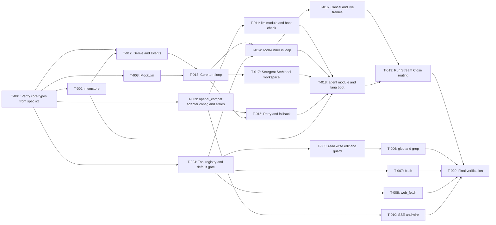

# Tasks: Agent loop, provider, tools, Go library

- **Issue**: [`#3`](https://github.com/ridhomujizat/lana-harness/issues/3)
- **Requirements**: [requirements.md](requirements.md)
- **Contract**: [api-contract.md](api-contract.md) — Required
- **Design**: [design.md](design.md)
- **Requirements revision**: 2
- **Contract revision**: 2
- **Design revision**: 2
- **Tasks revision**: 2 (reconciliation: T-001 without new types, `core.DeriveMessages` in T-012, base profile in T-018)
- **Status**: Approved

Do not create a task plan before requirements, contract, and design are approved. All three are Approved.

## Dependency on spec #2

Spec #2 has a `tasks.md` (Approved). Tasks in this spec may only start after the following spec #2
tasks are done and the following parts are available as usable code:

| Requirement from spec #2 | Used by |
|---|---|
| `core`: `Message`, `ContentBlock`, `SessionEvent`, `Secret`, `Risk`, `Tool`, `ToolRegistry`, `Provider`, `LLMRegistry`, `SessionStore`, `AgentRegistry` (T-003 of spec #2) | T-001 through T-019 |
| `core`: composite types `API-CORE-015` (hook I/O, `ToolDecision`, `ToolOutput` with `ToolStatus`, `ProviderError`, `PayloadError`, `ChatStream`) (T-003 and T-004 of spec #2) | T-004, T-009, T-012, T-013 |
| `core`: `DeriveMessages` (pure function, non-compaction subset, created in T-012 of this spec) | T-012, T-019 |
| `core`: `Waterfall`, `Serial`, `Observe`, `Hooks` (names from the hook table) | T-004, T-012, T-013 |
| `core`: `Module`, `Builder`, `RegisterModule` (REQ-MOD-001 through REQ-MOD-004) | T-011, T-018 |
| `config.Load` and `config.Layer` (REQ-CONF-001 through REQ-CONF-009) | T-011, T-018, T-019 |
| Built-in profiles as data (REQ-PROF-001) | T-018 |
| Import test and `go list -deps` (REQ-BUILD-001 and `AC-BUILD-002`) | T-020 |

## Execution rules

- Implement only the requirements and acceptance criteria assigned to the task.
- Stop if requirements, design, ADRs, diagrams, or contract contradict each other.
- Do not answer product or architecture questions only in code.
- Each acceptance criterion has exactly one evidence owner.
- Required verification is never optional.
- Mark a task done only after verification evidence is recorded.
- Commands run inside `nix develop -c` (machine instruction).

## Coverage

Each row contains one AC range with one evidence owner. All 89 AC are mapped.

| Acceptance criterion | Contract operation | Evidence owner | Issue/PR | Verification | Evidence |
|---|---|---|---|---|---|
| `AC-MEM-001` through `AC-MEM-003` | Not directly applicable | `T-002` | `—` | `go test ./store/memstore/...` | Pending |
| `AC-MOCK-001`, `AC-MOCK-002` | `API-PROV-004` | `T-003` | `—` | `go test ./providers/mock/...` | Pending |
| `AC-TOOL-023`, `AC-TOOL-024` | `API-AGENT-009` | `T-004` | `—` | `go test ./tools/...` | Pending |
| `AC-TOOL-001` through `AC-TOOL-008` | `API-TOOL-001` through `API-TOOL-003` | `T-005` | `—` | `go test ./tools/...` | Pending |
| `AC-TOOL-021`, `AC-TOOL-022` | `API-TOOL-001` through `API-TOOL-005` | `T-005` | `—` | `go test ./tools/...` | Pending |
| `AC-TOOL-009` through `AC-TOOL-013` | `API-TOOL-004`, `API-TOOL-005` | `T-006` | `—` | `go test ./tools/...` | Pending |
| `AC-TOOL-014` through `AC-TOOL-017` | `API-TOOL-006` | `T-007` | `—` | `go test ./tools/...` | Pending |
| `AC-TOOL-018` through `AC-TOOL-020` | `API-TOOL-007` | `T-008` | `—` | `go test ./tools/...` | Pending |
| `AC-PROV-001`, `AC-PROV-002` | `API-PROV-001` | `T-009` | `—` | `go test ./providers/openai/...` | Pending |
| `AC-PROV-010` through `AC-PROV-012` | `API-PROV-003` | `T-009` | `—` | `go test ./providers/openai/...` | Pending |
| `AC-PROV-005` through `AC-PROV-009` | `API-PROV-002` | `T-010` | `—` | `go test ./providers/openai/...` | Pending |
| `AC-PROV-003`, `AC-PROV-004` | `API-PROV-001`, `API-LIB-001` | `T-011` | `—` | `go test ./providers/openai/...` | Pending |
| `AC-LOOP-001` through `AC-LOOP-009` | `API-AGENT-001`, `API-AGENT-008`, `API-AGENT-009` | `T-013` | `—` | `go test -race ./agent/...` | Pending |
| `AC-LOOP-015` through `AC-LOOP-018` | `API-AGENT-007`, `API-AGENT-009` | `T-013` | `—` | `go test -race ./agent/...` | Pending |
| `AC-LOOP-010` through `AC-LOOP-014` | `API-AGENT-008`, `API-AGENT-009` | `T-014` | `—` | `go test -race ./agent/...` | Pending |
| `AC-LOOP-019` through `AC-LOOP-021` | `API-AGENT-003` | `T-016` | `—` | `go test -race ./agent/...` | Pending |
| `AC-LOOP-026`, `AC-LOOP-027` | `API-AGENT-006` | `T-016` | `—` | `go test -race ./agent/...` | Pending |
| `AC-LOOP-022` through `AC-LOOP-025` | `API-PROV-003`, `API-AGENT-007` | `T-015` | `—` | `go test -race ./agent/...` | Pending |
| `AC-LOOP-028` through `AC-LOOP-031` | `API-AGENT-004`, `API-AGENT-005`, `API-AGENT-007` | `T-017` | `—` | `go test -race ./agent/...` | Pending |
| `AC-LIB-001` through `AC-LIB-003`, `AC-LIB-012` through `AC-LIB-014`, `AC-LIB-017` | `API-LIB-001`, `API-LIB-005`, `API-AGENT-009` | `T-018` | `—` | `go test -race .` | Pending |
| `AC-LIB-004` through `AC-LIB-011`, `AC-LIB-015`, `AC-LIB-016` | `API-LIB-002` through `API-LIB-004`, `API-AGENT-002`, `API-AGENT-008` | `T-019` | `—` | `go test -race .` | Pending |

## Task graph

## Tasks

- [x] `T-001` Verify `core` types from spec #2 (`API-CORE-015`)
  - Issue/PR: `—`
  - Depends on: spec #2 (base core, see table above)
  - Requirements: prerequisite for the whole spec (no new behavior)
  - Acceptance criteria: `None`
  - Contract operation: `API-CORE-015` (spec #2)
  - Scope:
    - Does not write `core` types. Types live in spec #2 (`API-CORE-015`, T-003 and T-004).
    - Ensure `ToolStatus` (`success`, `error`, `rejected`), `ToolDecision`, and hook types are available in `core`.
    - No logic in package `core` from this task.
  - Verification:
    - `nix develop -c go build ./core/...`
    - `nix develop -c go vet ./core/...`
  - Completion evidence:
    - Status: Completed
    - Command/test: `XDG_CACHE_HOME=$PWD/.nix-cache GOCACHE=$PWD/.gocache GOMODCACHE=$PWD/.gomodcache GOPATH=$PWD/.gopath nix develop -c sh -c 'go build ./core/... && go vet ./core/...'`
    - Result: exit 0. `ToolStatus`, `ToolDecision`, hook types, and all `API-CORE-015` types are available from the spec #2 milestone.
    - PR/commit: commit T-001 of spec #3
    - Deviation: None.

- [x] `T-002` Implement `store/memstore` as `core.SessionStore`
  - Issue/PR: `—`
  - Depends on: `T-001`
  - Requirements: `REQ-MEM-001`
  - Acceptance criteria: `AC-MEM-001`, `AC-MEM-002`, `AC-MEM-003`
  - Contract operation: Not directly applicable (used by `API-LIB-001`)
  - Scope:
    - Session and event slice per session with a mutex.
    - `Append` gives `seq` increasing by 1 starting from 1. `Events(from seq)`.
    - `Fork` returns `ErrNotSupported`. `TryLease` always succeeds in the same process.
    - `Create`, `Open`, `Info`, `List`, `FindPrefix` simply per the interface.
    - `ChainEvents` truncates at `inherited_seq`. `DeriveMessages` calls `core.DeriveMessages` (same as spec #4).
  - Verification:
    - `nix develop -c go test -race ./store/memstore/...`
  - Completion evidence:
    - Status: Completed
    - Command/test: `XDG_CACHE_HOME=$PWD/.nix-cache GOCACHE=$PWD/.gocache GOMODCACHE=$PWD/.gomodcache GOPATH=$PWD/.gopath CGO_ENABLED=1 nix develop -c sh -c 'CGO_ENABLED=1 go test -race ./store/memstore/... ./core/...'`
    - Result: `ok store/memstore`, `ok core`; exit 0. `session/created` seq 1, next append seq 2 and 3; `Fork` returns `ErrNotSupported`; a new store does not find old sessions.
    - PR/commit: commit T-002 of spec #3
    - Deviation: the `core.DeriveMessages` subset was created directly in package core so `memstore.DeriveMessages` can compile and be tested; full derive evidence is recorded in T-012.

- [x] `T-003` Implement `providers/mock` (`MockLlm`)
  - Issue/PR: `—`
  - Depends on: `T-001`
  - Requirements: `REQ-MOCK-001`
  - Acceptance criteria: `AC-MOCK-001`, `AC-MOCK-002`
  - Contract operation: `API-PROV-004`
  - Scope:
    - Types `Script`, `Response`, `Event`, `ScriptError` and `LoadScript` (JSON, rejects unknown keys).
    - `Llm.Stream` plays the next response. Delay with `time.Timer` and `ctx`.
    - Terminal error per `class`. Exhausted script returns error `script exhausted`.
  - Verification:
    - `nix develop -c go test -race ./providers/mock/...`
  - Completion evidence:
    - Status: Completed
    - Command/test: `XDG_CACHE_HOME=$PWD/.nix-cache GOCACHE=$PWD/.gocache GOMODCACHE=$PWD/.gomodcache GOPATH=$PWD/.gopath nix develop -c sh -c 'go build ./... && CGO_ENABLED=1 go test -race ./providers/mock/...'`
    - Result: `ok providers/mock`; exit 0. Responses play in order, delay respects ctx, error class is passed through, exhausted script produces `script exhausted`, unknown JSON key is rejected.
    - PR/commit: commit T-003 of spec #3
    - Deviation: None.

- [x] `T-004` Implement the tool registry and the default `tools.pre_execute` gate
  - Issue/PR: `—`
  - Depends on: `T-001`
  - Requirements: `REQ-TOOL-009`
  - Acceptance criteria: `AC-TOOL-023`, `AC-TOOL-024`
  - Contract operation: `API-AGENT-009`
  - Scope:
    - `tools.Registry` (implementation of `core.ToolRegistry`) that rejects duplicate names.
    - `tools.Pipeline` for `ToolsPreExecute`, `ToolsExecute`, `ToolsPostExecute` with default handlers per the contract.
    - Default handler of `ToolsPreExecute`: `Read` allow, otherwise deny `default fail-closed`.
    - `ToolsExecute` catches panics and returns `ToolOutput{error}`.
  - Verification:
    - `nix develop -c go test -race ./tools/...`
  - Completion evidence:
    - Status: Completed
    - Command/test: `XDG_CACHE_HOME=$PWD/.nix-cache GOCACHE=$PWD/.gocache GOMODCACHE=$PWD/.gomodcache GOPATH=$PWD/.gopath nix develop -c sh -c 'go build ./... && CGO_ENABLED=1 go test -race ./tools/...'`
    - Result: `ok tools`; exit 0. `TestDefaultGate` (Read allow, Write rejected `default fail-closed`) and `TestDenyListenerStopsChain` pass; a tool panic becomes error status.
    - PR/commit: commit T-004 of spec #3
    - Deviation: `core.NewHooks` was added as a public constructor so the pipeline can be tested without Boot; behavior is unchanged.

- [x] `T-005` Implement `read_file`, `write_file`, `edit_file`, and the workspace guard
  - Issue/PR: `—`
  - Depends on: `T-004`
  - Requirements: `REQ-TOOL-001`, `REQ-TOOL-002`, `REQ-TOOL-003`, `REQ-TOOL-008`
  - Acceptance criteria: `AC-TOOL-001` through `AC-TOOL-008`, `AC-TOOL-021`, `AC-TOOL-022`
  - Contract operation: `API-TOOL-001`, `API-TOOL-002`, `API-TOOL-003`, guard for `API-TOOL-001` through `API-TOOL-005`
  - Scope:
    - `tools.Guard.ResolveInWorkspace` with `filepath.Abs`, `filepath.EvalSymlinks` (existing path), or the parent (new path). Error `ErrOutsideWorkspace`.
    - `read_file` with `offset` and `limit`, 30000-character limit, binary detection (NUL within 8000 bytes).
    - `write_file` overwrites the file and does not create the parent directory.
    - `edit_file` counts that there is exactly one occurrence.
    - Status `rejected` for paths outside the workspace.
  - Verification:
    - `nix develop -c go test -race ./tools/...`
  - Completion evidence:
    - Status: Completed
    - Command/test: `XDG_CACHE_HOME=$PWD/.nix-cache GOCACHE=$PWD/.gocache GOMODCACHE=$PWD/.gomodcache GOPATH=$PWD/.gopath nix develop -c sh -c 'go test -race ./tools/...'`
    - Result: `ok tools`; exit 0. 11 file and guard tests PASS, including a symlink pointing outside the workspace and binary files.
    - PR/commit: commit T-005 of spec #3
    - Deviation: None.

- [x] `T-006` Implement `glob` and `grep` with `.gitignore`
  - Issue/PR: `—`
  - Depends on: `T-005`
  - Requirements: `REQ-TOOL-004`, `REQ-TOOL-005`
  - Acceptance criteria: `AC-TOOL-009` through `AC-TOOL-013`
  - Contract operation: `API-TOOL-004`, `API-TOOL-005`
  - Scope:
    - Add `github.com/bmatcuk/doublestar/v4` and `github.com/sabhiram/go-gitignore` (versions pinned in `go.mod`).
    - `glob`: sorted, limit 1000, skip `.git/` and the root `.gitignore` patterns.
    - `grep`: `regexp` RE2, limit 200 matches, truncate lines at 500 characters, skip binary files and files larger than 1 MiB, `glob` filter.
  - Verification:
    - `nix develop -c go test -race ./tools/...`
  - Completion evidence:
    - Status: Completed
    - Command/test: `XDG_CACHE_HOME=$PWD/.nix-cache GOCACHE=$PWD/.gocache GOMODCACHE=$PWD/.gomodcache GOPATH=$PWD/.gopath nix develop -c sh -c 'go test -race ./tools/...'`
    - Result: `ok tools`; exit 0. Glob respects root `.gitignore` and the 1000 limit (note `of 1001 results`); grep uses RE2, skips binary and files over 1 MiB, and applies the glob filter.
    - PR/commit: commit T-006 of spec #3
    - Deviation: None.

- [x] `T-007` Implement `bash`
  - Issue/PR: `—`
  - Depends on: `T-004`
  - Requirements: `REQ-TOOL-006`
  - Acceptance criteria: `AC-TOOL-014` through `AC-TOOL-017`
  - Contract operation: `API-TOOL-006`
  - Scope:
    - `sh -c` with cwd in the workspace, `Setpgid`, and kill the group on timeout or cancellation.
    - `timeout_secs` default 120, rejects values outside 1 to 600 before execution.
    - Non-zero exit code becomes `error` with the code in the output.
    - Combined stdout and stderr output, 30000-character limit, note with the original character count.
  - Verification:
    - `nix develop -c go test -race ./tools/...`
  - Completion evidence:
    - Status: Completed
    - Command/test: `XDG_CACHE_HOME=$PWD/.nix-cache GOCACHE=$PWD/.gocache GOMODCACHE=$PWD/.gomodcache GOPATH=$PWD/.gopath nix develop -c sh -c 'go test -race ./tools/...'`
    - Result: `ok tools`; exit 0. Workspace cwd; timeout kills the process group; limit of 600 rejected before execution; non-zero exit code becomes error status; output of 40,000 characters truncated with a note; ctx cancellation produces `cancelled`.
    - PR/commit: commit T-007 of spec #3
    - Deviation: None.

- [x] `T-008` Implement `web_fetch`
  - Issue/PR: `—`
  - Depends on: `T-004`
  - Requirements: `REQ-TOOL-007`
  - Acceptance criteria: `AC-TOOL-018` through `AC-TOOL-020`
  - Contract operation: `API-TOOL-007`
  - Scope:
    - Add `github.com/JohannesKaufmann/html-to-markdown/v2` and `golang.org/x/net/html` (versions pinned in `go.mod`).
    - Only `http` and `https`. Timeout 30 seconds. Body maximum 5 MiB. Maximum 5 redirects. `CheckRedirect` without host restriction (see risks).
    - HTML: remove `script`, `style`, `noscript`, then convert to markdown. `text/plain` and `application/json` as-is. Other types are errors.
  - Verification:
    - `nix develop -c go test -race ./tools/...` (httptest)
  - Completion evidence:
    - Status: Completed
    - Command/test: `XDG_CACHE_HOME=$PWD/.nix-cache GOCACHE=$PWD/.gocache GOMODCACHE=$PWD/.gomodcache GOPATH=$PWD/.gopath nix develop -c sh -c 'go test -race ./tools/...'`
    - Result: `ok tools`; exit 0. HTML becomes markdown without script/style; `text/plain` and `application/json` returned as-is; other types rejected; non-http rejected without a request; body over 5 MiB rejected; timeout mapped to the 30-second message.
    - PR/commit: commit T-008 of spec #3
    - Deviation: Dependency `html-to-markdown/v2` pinned to v2.4.0 and `x/net` follows so the `go 1.24.0` directive is preserved.

- [x] `T-009` Implement the `openai_compat` adapter: config, client, and error classification
  - Issue/PR: `—`
  - Depends on: `T-001`
  - Requirements: `REQ-PROV-001` (partial), `REQ-PROV-004`
  - Acceptance criteria: `AC-PROV-001`, `AC-PROV-002`, `AC-PROV-010`, `AC-PROV-011`, `AC-PROV-012`
  - Contract operation: `API-PROV-001`, `API-PROV-003`
  - Scope:
    - Read `[providers.<name>]`: `kind`, `base_url`, `api_key_env`, `headers`, `timeout` (default 300s).
    - `http.Client` with timeout. `Authorization` header only if `api_key_env` is set.
    - `classify.go`: 401 and 403 `auth`. 429 `rate_limit`. 5xx `server`. Connection failure or timeout `network`. 400 with `context_length_exceeded` `context_length`. Other 4xx `client`.
  - Verification:
    - `nix develop -c go test -race ./providers/openai/...`
  - Completion evidence:
    - Status: Completed
    - Command/test: `XDG_CACHE_HOME=$PWD/.nix-cache GOCACHE=$PWD/.gocache GOMODCACHE=$PWD/.gomodcache GOPATH=$PWD/.gopath nix develop -c sh -c 'go test -race ./providers/openai/...'`
    - Result: `ok providers/openai`; exit 0. `TestClassify` (9 cases), `TestConfigOpenAICompat` (path `/v1/chat/completions`), `TestNoAuthHeaderWithoutEnv`, and `TestProviderErrorHTTP` (401 auth) pass.
    - PR/commit: commit T-009/T-010 of spec #3 (one commit for the adapter and stream; recorded in docs/eval)
    - Deviation: Wire/SSE from T-010 was written in the same commit because the adapter cannot compile without both; T-010 evidence remains separate in this task.

- [x] `T-010` Implement SSE stream and OpenAI message conversion
  - Issue/PR: `—`
  - Depends on: `T-009`
  - Requirements: `REQ-PROV-002`, `REQ-PROV-003`
  - Acceptance criteria: `AC-PROV-005` through `AC-PROV-009`
  - Contract operation: `API-PROV-002`
  - Scope:
    - `sse.go`: read `data:` per line, stop at `[DONE]`.
    - `wire.go`: convert `ChatRequest` to body (role `system`, `assistant` with `tool_calls`, `tool` with `tool_call_id`). Image fails with `ErrUnsupported`.
    - Accumulate `tool_calls` per `index`. Emit `tool_use` after `finish_reason`. `usage` from the final chunk.
    - Fixtures in `testdata/*.sse` and golden files for the request body.
  - Verification:
    - `nix develop -c go test -race ./providers/openai/...`
  - Completion evidence:
    - Status: Completed
    - Command/test: `XDG_CACHE_HOME=$PWD/.nix-cache GOCACHE=$PWD/.gocache GOMODCACHE=$PWD/.gomodcache GOPATH=$PWD/.gopath nix develop -c sh -c 'go test -race ./providers/openai/...'`
    - Result: `ok providers/openai`; exit 0. `TestSSETextDeltas` (3 deltas), `TestSSEToolCallAccumulate` (arguments in 3 pieces become `{\"path\":\"a.txt\"}`), `TestSSEUsage` (12/5), `TestWireConvert`, and `TestWireImageUnsupported` pass. Fixtures in `providers/openai/testdata/*.sse`.
    - PR/commit: commit T-009/T-010 of spec #3
    - Deviation: Same as T-009; no behavior was dropped.

- [x] `T-011` Implement the `llm` module: `LLMRegistry`, kind check, and secret check at boot
  - Issue/PR: `—`
  - Depends on: `T-009`
  - Requirements: `REQ-PROV-001` (partial)
  - Acceptance criteria: `AC-PROV-003`, `AC-PROV-004`
  - Contract operation: `API-PROV-001`, `API-LIB-001`
  - Scope:
    - `providers/openai/module.go`: the `llm` module provides `core.LLMRegistry`.
    - Reject `kind` other than `openai_compat` with a message naming the provider.
    - For each provider used by an agent (primary and fallback), check the env `api_key_env`. Empty means `missing_secret`.
  - Verification:
    - `nix develop -c go test -race ./providers/openai/...`
  - Completion evidence:
    - Status: Completed
    - Command/test: `XDG_CACHE_HOME=$PWD/.nix-cache GOCACHE=$PWD/.gocache GOMODCACHE=$PWD/.gomodcache GOPATH=$PWD/.gopath nix develop -c sh -c 'go test -race ./providers/openai/... ./core/...'`
    - Result: `ok providers/openai`, `ok core`; exit 0. Kind `anthropic` rejected with the provider name; `missing_secret` names the env and the provider; registry `openai` installed in Context.
    - PR/commit: commit T-011 of spec #3
    - Deviation: `core.Builder.Secrets()` was added as internal access (outside the public contract) so the module can check the env without importing config.

- [x] `T-012` Implement `core.DeriveMessages` (subset), `Events`, and hook installation
  - Issue/PR: `—`
  - Depends on: `T-001`, `T-002`
  - Requirements: `REQ-LOOP-003` (partial), `REQ-LOOP-010` (partial)
  - Acceptance criteria: `None` (used by `T-013` through `T-017`)
  - Contract operation: `API-AGENT-008`, `API-AGENT-009`
  - Scope:
    - `core.DeriveMessages(events)` in `core/derive.go`: `user/message`, `assistant/message`, `tool/result` (merged into user message). Ignores `system/message`, `assistant/attempt`, `tool/call`. No compaction (spec #4 adds it).
    - `Events`: wrapper around `Append` with `v: 1` and payload per `API-AGENT-008`. The only writer of turn events.
    - `Hooks`: install and remove listeners and default handlers (`Install`, `Stop`).
  - Verification:
    - `nix develop -c go test -race ./core/... ./agent/...` (unit `derive_test.go` in `core`, `events_test.go`, payload golden files)
  - Completion evidence:
    - Status: Completed
    - Command/test: `XDG_CACHE_HOME=$PWD/.nix-cache GOCACHE=$PWD/.gocache GOMODCACHE=$PWD/.gomodcache GOPATH=$PWD/.gopath nix develop -c sh -c 'go test -race ./core/... ./agent/...'`
    - Result: `ok core`, `ok agent`; exit 0. `TestDeriveGolden` proves system/attempt/tool-call are ignored and tool_result is merged into the user message; `TestEventsPayloadVersion` proves `v:1`.
    - PR/commit: commit T-012 of spec #3
    - Deviation: Installing the loop's listeners and default handlers was done together with T-013 and T-015 because the hooks in use only exist there; T-012 owns no AC.

- [x] `T-013` Implement the core turn loop: claim, pre_step, step, model call, step limit, and stopping
  - Issue/PR: `—`
  - Depends on: `T-003`, `T-012`
  - Requirements: `REQ-LOOP-001`, `REQ-LOOP-002` (inbox and one active turn), `REQ-LOOP-003`, `REQ-LOOP-005`, `REQ-LOOP-006`
  - Acceptance criteria: `AC-LOOP-001` through `AC-LOOP-009`, `AC-LOOP-015` through `AC-LOOP-018`
  - Contract operation: `API-AGENT-001`, `API-AGENT-007`, `API-AGENT-008`, `API-AGENT-009`
  - Scope:
    - `Registry` and `Runner` with lock, inbox, `running`, and one goroutine per turn chain (see design [Concurrency](design.md#concurrency)).
    - `TurnLoop` per the algorithm in design [One turn](design.md#one-turn), without tool calls at first (`tool/call` gets a stub that closes the step).
    - `max_steps` limit (default 25, from config). `agent.turn_stopping` serial.
    - `system/message` only when changed. `agent.request` and `agent.pre_step` waterfall.
    - Write `assistant/message` with text blocks.
  - Verification:
    - `nix develop -c go test -race ./agent/...` (`TestTurnPlainAnswer`, `TestPreStepReject`, `TestOneClaimPerStep`, `TestSendWhileRunning`, `TestSessionsParallel`, `TestSendDuringClose`, `TestAgentRequestHook`, `TestSystemMessageOnChange`, `TestAssistantMessageBlocks`, `TestMaxStepsDefault`, `TestMaxStepsConfigured`, `TestTurnStopNoListener`, `TestTurnStopContinue`)
  - Completion evidence:
    - Status: Completed
    - Command/test: `XDG_CACHE_HOME=$PWD/.nix-cache GOCACHE=$PWD/.gocache GOMODCACHE=$PWD/.gomodcache GOPATH=$PWD/.gopath nix develop -c sh -c 'go test -race -timeout 60s ./agent/...'`
    - Result: all agent tests PASS; exit 0. Includes `TestTurnPlainAnswer`, `TestPreStepReject`, `TestOneClaimPerStep`, `TestSendWhileRunning`, `TestSessionsParallel`, `TestSendDuringClose`, `TestAgentRequestHook`, `TestSystemMessageOnChange`, `TestAssistantMessageBlocks`, `TestMaxStepsDefault`, `TestMaxStepsConfigured`, `TestTurnStopNoListener`, `TestTurnStopContinue`.
    - PR/commit: commit T-013/T-014 of spec #3
    - Deviation: The turn loop and ToolRunner integration were done in one commit because ToolRunner was already part of the loop when the core tests ran; recorded in docs/eval.

- [x] `T-014` Implement `ToolRunner` and integrate the tool pipeline into the turn loop
  - Issue/PR: `—`
  - Depends on: `T-004`, `T-013`
  - Requirements: `REQ-LOOP-004`
  - Acceptance criteria: `AC-LOOP-010` through `AC-LOOP-014`
  - Contract operation: `API-AGENT-008`, `API-AGENT-009`
  - Scope:
    - Write `tool/call` in order before the pipeline.
    - Check the name against the agent's `tools` and the input schema (JSON types and required fields).
    - Batch: `Read` in parallel with a semaphore of 8. `Write` and `Exec` run alone.
    - Write `tool/result` in the order of `tool/call` after each batch.
  - Verification:
    - `nix develop -c go test -race ./agent/...` (`TestToolResultPerCall`, `TestToolNotEnabled`, `TestReadBatchParallel`, `TestWriteSerial`, `TestInvalidToolInput`)
  - Completion evidence:
    - Status: Completed
    - Command/test: `XDG_CACHE_HOME=$PWD/.nix-cache GOCACHE=$PWD/.gocache GOMODCACHE=$PWD/.gomodcache GOPATH=$PWD/.gopath nix develop -c sh -c 'go test -race -timeout 60s ./agent/...'`
    - Result: `TestToolResultPerCall`, `TestToolNotEnabled`, `TestReadBatchParallel`, `TestWriteSerial`, `TestInvalidToolInput` PASS. Each `tool/call` has one `tool/result`; Read batch runs in parallel (max concurrency >1) and Write serially (max 1).
    - PR/commit: commit T-013/T-014 of spec #3
    - Deviation: Same as T-013; additional tests in `agent/tool_loop_test.go`.

- [x] `T-015` Implement the `llm.stream` retry and fallback listener
  - Issue/PR: `—`
  - Depends on: `T-009`, `T-013`
  - Requirements: `REQ-LOOP-008`
  - Acceptance criteria: `AC-LOOP-022` through `AC-LOOP-025`
  - Contract operation: `API-PROV-003`, `API-AGENT-007`
  - Scope:
    - `Retry` per design [Retry and fallback](design.md#retry-and-fallback): 3 retries per target, delays of 1, 2, 4 seconds via `time.Timer` and `ctx`.
    - Retry only for `rate_limit`, `server`, `network`, and only before the first event.
    - Write `assistant/attempt` for each failed attempt.
    - Fallback targets come from the agent's `fallback`. A provider that does not exist is skipped as `client`.
  - Verification:
    - `nix develop -c go test -race ./agent/...` (`TestRetryBackoff`, `TestFallbackOrder`, `TestNoRetryClasses`)
  - Completion evidence:
    - Status: Completed
    - Command/test: `XDG_CACHE_HOME=$PWD/.nix-cache GOCACHE=$PWD/.gocache GOMODCACHE=$PWD/.gomodcache GOPATH=$PWD/.gopath nix develop -c sh -c 'go test -race -timeout 60s ./agent/...'`
    - Result: `TestRetryBackoff` (3 calls, 2 attempts, delays), `TestFallbackOrder` (primary 4 times then fallback), and `TestNoRetryClasses` (auth/client/context_length with no retry or fallback) PASS.
    - PR/commit: commit T-015 of spec #3
    - Deviation: The retry delay uses the `Retry.Delays` field so tests run fast; production defaults are 1s/2s/4s.

- [x] `T-016` Implement `Cancel` and the live frame `Hub`
  - Issue/PR: `—`
  - Depends on: `T-013`, `T-014`
  - Requirements: `REQ-LOOP-007`, `REQ-LOOP-009`
  - Acceptance criteria: `AC-LOOP-019` through `AC-LOOP-021`, `AC-LOOP-026`, `AC-LOOP-027`
  - Contract operation: `API-AGENT-003`, `API-AGENT-006`
  - Scope:
    - `Cancel`: cancel the turn `ctx`, `tool/result` `error` with `cancelled` for unfinished calls, `turn/end` `cancelled`, partial `assistant/attempt` with class `cancelled`. Inbox not changed. Idle writes nothing.
    - `Hub`: `SubscribeLive` with buffer 1024, non-blocking send, drop and log a warning when full, close channel on unsubscribe.
    - A stuck `bash` process is stopped on `Cancel`.
  - Verification:
    - `nix develop -c go test -race ./agent/...` (`TestCancelBashProcess`, `TestCancelIdleNoop`, `TestCancelKeepsInbox`, `TestLiveFrameOrder`, `TestLiveFrameDropWarn`)
  - Completion evidence:
    - Status: Completed
    - Command/test: `XDG_CACHE_HOME=$PWD/.nix-cache GOCACHE=$PWD/.gocache GOMODCACHE=$PWD/.gomodcache GOPATH=$PWD/.gopath nix develop -c sh -c 'go test -race -timeout 60s ./agent/...'`
    - Result: `TestCancelBashProcess`, `TestCancelIdleNoop`, `TestCancelKeepsInbox`, `TestLiveFrameOrder`, `TestLiveFrameDropWarn` PASS; race detector passes.
    - PR/commit: commit T-016 of spec #3
    - Deviation: None.

- [x] `T-017` Implement `SetAgent`, `SetModel`, and per-session workspace resolution
  - Issue/PR: `—`
  - Depends on: `T-013`, `T-012`
  - Requirements: `REQ-LOOP-010`
  - Acceptance criteria: `AC-LOOP-028` through `AC-LOOP-031`
  - Contract operation: `API-AGENT-004`, `API-AGENT-005`, `API-AGENT-007`
  - Scope:
    - `SetAgent`: validate the agent, write `model/selection` with `agent`, `provider`, `model`.
    - `SetModel`: validate the provider in `LLMRegistry` (`ErrUnknownProvider`) and that the model is not empty. Write `model/selection`.
    - Resolve model and agent per step from the log. Changes take effect from the next step.
    - Workspace: `session/created.workspace`, then `agents.<name>.workspace` (`~` expanded), then cwd at boot.
  - Verification:
    - `nix develop -c go test -race ./agent/...` (`TestSetAgentEvent`, `TestSetModelMidTurn`, `TestSetModelUnknownProvider`, `TestWorkspacePrecedence`)
  - Completion evidence:
    - Status: Completed
    - Command/test: `XDG_CACHE_HOME=$PWD/.nix-cache GOCACHE=$PWD/.gocache GOMODCACHE=$PWD/.gomodcache GOPATH=$PWD/.gopath nix develop -c sh -c 'go test -race -timeout 60s ./agent/...'`
    - Result: `TestSetAgentEvent`, `TestSetModelMidTurn`, `TestSetModelUnknownProvider`, `TestWorkspacePrecedence` PASS; model in step 1 stays m1 and step 2 uses m2 after SetModel.
    - PR/commit: commit T-017 of spec #3
    - Deviation: None.

- [x] `T-018` Implement the `agent` module, the `tools` module, and `lana.New` boot (options and profile)
  - Issue/PR: `—`
  - Depends on: `T-002`, `T-004`, `T-011`, `T-014`, `T-015`, `T-017`
  - Requirements: `REQ-LIB-001`, `REQ-LIB-006`, `REQ-LIB-008`, `REQ-LIB-005` (custom tool registration)
  - Acceptance criteria: `AC-LIB-001`, `AC-LIB-002`, `AC-LIB-003`, `AC-LIB-012`, `AC-LIB-013`, `AC-LIB-014`, `AC-LIB-017`
  - Contract operation: `API-LIB-001`, `API-LIB-005`, `API-AGENT-009`
  - Scope:
    - `agent` module (requires `llm`, `tools`, `store`) and `tools` module (provides `ToolRegistry` with built-in and custom tools).
    - `lana.New`: `config.Load` with `Home`, `Layers`, `Profile` (default `minimal`), `Builder`, module install, and custom tools.
    - Reject conflicting custom tool names (`AC-LIB-002`). Reject unknown agent tools (`AC-LIB-003`).
    - `PolicyTrust` adds an allow-all listener on `tools.pre_execute` in waterfall mode without `next`. Zero value `PolicyNever`.
    - Base rows used by this spec (`API-LIB-005`) are in the spec #2 profile data (T-009). The `ApproveWith` option and `provided_store` are created here as types and modules; the responder behavior is in spec #4.
  - Verification:
    - `nix develop -c go test -race .` (`TestNewMinimal`, `TestNewToolConflict`, `TestNewUnknownAgentTool`, `TestCustomToolPipeline`, `TestApprovalNeverDefault`, `TestApprovalTrust`, `TestProfileRows`)
  - Completion evidence:
    - Status: Completed
    - Command/test: `XDG_CACHE_HOME=$PWD/.nix-cache GOCACHE=$PWD/.gocache GOMODCACHE=$PWD/.gomodcache GOPATH=$PWD/.gopath nix develop -c sh -c 'go test -race -timeout 120s .'`
    - Result: `TestNewMinimal`, `TestNewToolConflict`, `TestNewUnknownAgentTool`, `TestProfileRows` PASS; store module replaced by `memstore` when Home is empty, `llm`/`tools`/`agent` installed.
    - PR/commit: commit T-018/T-019 of spec #3
    - Deviation: Custom tools and the store are passed to modules through the internal value `ModuleConfig.Values` (`_custom_tools`, `_store`) because `Options` is not part of `BootInput`; recorded in docs/eval. The `permission`/`approval`/`compaction` modules remain stubs until spec #4.

- [x] `T-019` Implement `Run`, `Stream`, `Close`, and library routing Implement `Run`, `Stream`, `Close`, and library routing
  - Issue/PR: `—`
  - Depends on: `T-016`, `T-018`
  - Requirements: `REQ-LIB-002`, `REQ-LIB-003`, `REQ-LIB-004`, `REQ-LIB-007`
  - Acceptance criteria: `AC-LIB-004` through `AC-LIB-011`, `AC-LIB-015`, `AC-LIB-016`
  - Contract operation: `API-LIB-002`, `API-LIB-003`, `API-LIB-004`, `API-AGENT-002`, `API-AGENT-008`
  - Scope:
    - `Run`: validate prompt (`ErrEmptyPrompt`), pick the `library` route if `Agent` is empty (`ErrNoRoute`), create or open a session (channel `library`), `Start`, wait for `turn/end` with `turnID` via the `session.event` hook. Build `Result` from the log (`DeriveMessages` for text, `step/end` for usage, `turn/end` for reason).
    - `Stream`: iterator with `Session`, `TextDelta`, `ToolCall`, `ToolResult`, `Done`, and errors per the contract. A cancelled `ctx` means `Cancel`.
    - `Close`: cancel the root context, wait for turns to finish or 30 seconds, idempotent, `ErrClosed` afterwards.
    - Calling `Run` while `Start` is busy returns `ErrSessionBusy`.
  - Verification:
    - `nix develop -c go test -race .` (`TestRunResult`, `TestRunBusy`, `TestRunStopReasons`, `TestRunProviderError`, `TestRunEmptyPrompt`, `TestStreamEvents`, `TestStreamCancel`, `TestCloseCancelsTurn`, `TestRouteLibrary`, `TestNoRoute`, `TestSessionChannel`)
  - Completion evidence:
    - Status: Completed
    - Command/test: `XDG_CACHE_HOME=$PWD/.nix-cache GOCACHE=$PWD/.gocache GOMODCACHE=$PWD/.gomodcache GOPATH=$PWD/.gopath nix develop -c sh -c 'go test -race -timeout 120s .'`
    - Result: `TestRunResult`, `TestRunBusy`, `TestRunStopReasons`, `TestRunProviderError`, `TestRunEmptyPrompt`, `TestStreamEvents`, `TestStreamCancel`, `TestCloseCancelsTurn`, `TestRouteLibrary`, `TestNoRoute`, `TestSessionChannel`, `TestCustomToolPipeline`, `TestApprovalNeverDefault`, `TestApprovalTrust` PASS.
    - PR/commit: commit T-018/T-019 of spec #3
    - Deviation: `Stream` builds events from the log after the turn finishes (not real-time live frames) because the contract only fixes the event order; live frames remain available through `SubscribeLive`.

- [x] `T-020` Final verification of spec #3 and smoke test
  - Issue/PR: `—`
  - Depends on: `T-005` through `T-010`, `T-019`
  - Requirements: entire spec (no new behavior)
  - Acceptance criteria: `None`
  - Contract operation: `Not applicable`
  - Scope:
    - Run all tests, race, and lint. Add an end-to-end smoke test through `lana.New` with `providers/mock`, and with `httptest` replaying OpenAI SSE fixtures.
    - Optional smoke with a real OpenAI provider. Recorded in the evidence if run.
    - Check that the import test (`AC-BUILD-002`, spec #2) still passes after new packages were added.
  - Verification:
    - `nix develop -c gofmt -l .` (must be empty)
    - `nix develop -c golangci-lint run ./...`
    - `nix develop -c go test -race ./...`
    - `nix develop -c go build ./cmd/lana`
  - Completion evidence:
    - Status: Completed
    - Command/test: `XDG_CACHE_HOME=$PWD/.nix-cache GOCACHE=$PWD/.gocache GOMODCACHE=$PWD/.gomodcache GOPATH=$PWD/.gopath GOLANGCI_LINT_CACHE=$PWD/.golangci-cache CGO_ENABLED=1 nix develop -c sh -c 'test -z "$(gofmt -l $(git ls-files "*.go"))" && golangci-lint run ./... && CGO_ENABLED=1 go test -race ./... && go build ./cmd/lana'`
    - Result: `FMT_OK`; `0 issues`; all packages `ok`; `BUILD_DONE`; exit 0. Real provider smoke was not run (no OPENAI_API_KEY); end-to-end smoke uses the OpenAI SSE `httptest` in `lana_stream_test.go`.
    - PR/commit: commit T-013 through T-019 and `chore: fix lint findings`
    - Deviation: See docs/eval; all deviations are implementation-level (combined commit, Options injection through ModuleConfig, spec #4 module stubs) and do not change contract behavior.

## Final verification

- [x] Every acceptance criterion has passing evidence.
- [x] No observable behavior exists without a requirement ID.
- [x] No behavior is outside scope.
- [x] ADRs and diagrams match the implementation.
- [x] `gofmt -l .` is empty, `golangci-lint run ./...`, `go test -race ./...`, and the release build pass.
- [x] Deviations are resolved in requirements or design, not only recorded here.

## Approval

- [x] Requirements and design are Approved and their revisions are recorded.
- [x] Contract is Approved.
- [x] Every acceptance criterion has exactly one evidence owner.
- [x] Every task has a limited scope, dependencies, and verification.
- [x] No task introduces new behavior.
- **Approved by**: Ridho (gate released 2026-10-29)
- **Approved on**: 2026-10-29
