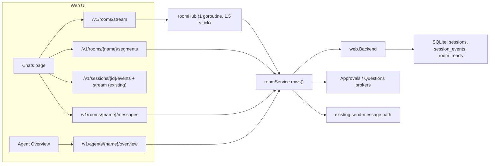

# Design: Agent rooms

- **Issue**: `—`
- **Requirements**: [requirements.md](requirements.md)
- **Contract**: [api-contract.md](api-contract.md) — Required
- **Requirements revision**: 1
- **Contract revision**: 1
- **Requirements status**: Approved
- **Contract status**: Approved
- **Status**: Approved
- **Design revision**: 1

## Architecture references

- **ADR index**: [docs/adr](../../adr/README.md)
- **ADR**: `—` (no cross-feature decision; rooms are a read model over sessions)
- **Feature-local diagram**: [below](#feature-local-view)
- **Durable diagram**: `—`

## Architecture decision scan

| Topic | Existing authority | Decision location | Action |
|---|---|---|---|
| Public interface | spec #9 web contract | this contract | create (additive `/v1/rooms*`) |
| Persistence | `store/migrations` | this design | create one table `room_reads` |
| State and lifecycle | spec #4 session status, spec #10 teams | requirements REQ-ROOM-006 | reuse; presence is derived, not stored |
| Concurrency | web brokers, `configWriteMu` | this design | local: one room hub goroutine, per-room create lock |
| Dependency direction | `web` → `Backend` interface → `cmd/lana` | unchanged | reuse |

## Visual Architecture Check

| Trigger | Present? | Required view |
|---|---:|---|
| Module or crate boundary | No | — |
| Interaction with an actor or external system | No | — |
| Multi-component flow | Yes | flowchart |
| Lifecycle or state transition | Yes | presence precedence (in requirements) |
| Entity relation | Yes | room → sessions (flowchart below) |
| Concurrency, retry, or failure flow | Yes | room hub (flowchart below) |
| Dependency direction or runtime topology | No | — |

## Feature-local view

## Repository fit

- Backend code lives in the `web` package next to `sessions.go` and `dashboard.go`, and reaches
  storage only through the `Backend` interface implemented in `cmd/lana/web.go`. This is the same
  split the sessions and dashboard endpoints use.
- The store gets one migration and three small queries. Rooms are not a new stored entity; a room
  is the set of top-level sessions with `sessions.agent = name`.
- The web UI keeps its pattern: one `api/*.ts` module per area, views in `views/`, styles in
  `styles/`, vitest tests next to the view.

## Proposed design

### Components

- **Config fields** (`core/config.go`, `config/` validation, `web/agents.go`) — `AgentConfig.Title`
  and `AgentConfig.Color`; validation of length and color set; `agentRecord`, `putAgentKeys` and
  `agentJSON` carry them. `resolveColor(name, color)` returns the configured color or the FNV
  derived one. Teams: title = description, color = `brand`.
- **Job file** (`internal/agenthome`, `web/agentfiles.go`) — `agenthome` gets the `JOB.md` path
  and a 4000 limit; `agentFileTarget` maps `job` to it.
- **Store queries** (`store/`, `core/session.go`)
  - `SessionFilter.Agent` filters `sessions.agent`.
  - `CountAgentEvents(agent string, kinds []string, sinceMS int64) (int64, error)` counts events of
    every session (top-level and child) whose `agent` matches. It is used for unread and `turns_7d`.
  - Migration `0005_room_reads.sql`: `room_reads(room TEXT PRIMARY KEY, read_at INTEGER NOT NULL)`
    with `RoomReadAt(room)` and `SetRoomRead(room, at)` (`at` only moves forward:
    `ON CONFLICT DO UPDATE SET read_at = max(read_at, excluded.read_at)`).
- **Room service** (`web/rooms.go`) — builds rows (API-ROOM-001):
  1. Rooms = `backend.Agents()` (agents and teams).
  2. For each room: the newest top-level session (`SessionFilter{Agent, TopLevelOnly, Limit: 1}`);
     preview and failed state from the existing `deriveSessionStatusPreview`.
  3. Unread = `CountAgentEvents(name, [assistant/message, question/asked], readAt)` limited to
     top-level sessions of the room (the count query takes a `topLevelOnly` flag).
  4. `turns_7d` = `CountAgentEvents(name, [turn/end], now-7d)`.
  5. Presence (REQ-ROOM-006):
     - `waiting`: an open request in `Approvals`/`Questions` whose root session's agent is the room,
       or whose child tag `agent` is the room.
     - `working`: a session with `agent = name` and `status = running` (child sessions included)
       for which `backend.TurnActive(id)` is true. Label from the newest `tool/call` name of that
       turn, else `Thinking`.
     - `problem`: newest top-level session preview state is `failed`; label is the error summary.
     - `online`: `last_active_at` within 6 h; `resting` otherwise. Label `Active <relative time>`.
- **Room hub** (`web/rooms.go`) — started lazily on the first stream subscriber, stopped when the
  last one leaves. Every 1.5 s it computes all rows once, compares each row's JSON with the last
  sent, and broadcasts changed rows as `room` events. New subscribers get a full `rooms` event.
  Subscribers use buffered channels; a slow subscriber is dropped and reconnects.
- **Segments** (`GET /v1/rooms/{name}/segments`) — `SessionFilter{Agent, TopLevelOnly, Before,
  Limit+1}` newest first, reversed to ascending; `has_more` from the extra row.
- **Room send** (`POST /v1/rooms/{name}/messages`) — under a per-room mutex: find the current web
  session (`Channel: web, Address: owner, Agent, TopLevelOnly, Limit 1`), or create one with the
  same backend call as `POST /v1/sessions`; then call the same internal path as
  `POST /v1/sessions/{id}/messages`. For a team room with a leading `@member`, the turn gets a
  runtime user note (`UserMessage.Runtime = true`): `The owner addressed @<member>. Hand this
  request to <member> with the task tool and report back.`
- **Read marks** (`POST /v1/rooms/{name}/read`) — `SetRoomRead(name, now)`.
- **Overview** (`web/overview.go`, `GET /v1/agents/{name}/overview`) — uses `ScanEvents` for the
  last 7 days, filtered to the agent, to build `activity`, `week`, and `notes`; the running turn's
  events for `now`; `agenthome.ReadEntries(MEMORY.md)` for `memory`; AGENT.md for `persona_line`;
  JOB.md for `job`; `cfg.Routes` and `cfg.Teams` for `looks_after`; dashboard token sums for
  `week.tokens`.
- **Web: navigation** (`app/Sidebar.tsx`, `app/router.ts`, `App.tsx`) — grouped `NAV_SECTIONS`;
  routes `#/chats`, `#/chats/{name}`, `#/history` (same view as `#/sessions`); default `#/chats`.
- **Web: rooms API** (`api/rooms.ts`) — `listRooms`, `roomSegments`, `sendToRoom`, `markRoomRead`,
  `openRoomsStream` (fetch-based SSE reader like `openStream`, reconnect after 1 s).
- **Web: presence kit** (`views/presence.tsx`, `styles/rooms.css`) — `AgentFace` (initial, color,
  presence dot, working ring), `PresenceLabel`, `TypingDots`, `Skeleton`, `useRooms()` hook that
  holds the stream state for every page.
- **Web: Chats** (`views/chats.tsx`, `views/room-timeline.tsx`) — room list (filters All / Working /
  Needs you, search), room header, timeline of segments, dividers, live tail, composer with
  "New topic" and mention chips. Event rendering reuses the existing turn/event components from
  `turn.tsx` and the approval/question cards from the session view; the newest segment uses the
  existing `openStream` for live frames.
- **Web: group room** (`views/room-group.tsx`) — maps root `tool/call` `task` + `tool/result`
  (`taskResult{agent, answer}`) into handoff chips and member messages, reusing `teamSteps` logic
  from `team.tsx`.
- **Web: roster and profile** (`views/agents.tsx`, `views/agent-overview.tsx`) — roster cards and
  pulse from `useRooms()`; Overview tab as the default agent tab; title/color fields in General;
  JOB.md in Persona & memory.
- **Motion** (`styles/rooms.css`) — keyframes `presence-pulse`, `ring-spin`, `typing-bounce`,
  `skeleton-shimmer`, `msg-enter`, `badge-pop`, `progress-indeterminate`; every animation is set to
  `none` inside `@media (prefers-reduced-motion: reduce)`.

### Contract mapping

| Contract operation | Component | Input | Result | Requirements |
|---|---|---|---|---|
| `API-ROOM-001` | Room service | — | rows | `REQ-ROOM-001/005/006` |
| `API-ROOM-002` | Segments | name, before, limit | segments | `REQ-ROOM-002` |
| `API-ROOM-003` | Room send | name, text, new_topic | session + turn | `REQ-ROOM-003/008` |
| `API-ROOM-004` | Read marks | name | read_at | `REQ-ROOM-005` |
| `API-ROOM-005` | Room hub | — | SSE | `REQ-ROOM-007` |
| `API-ROOM-006` | Config fields | toml | validated config | `REQ-ROOM-009` |
| `API-ROOM-007` | Config fields, Job file | JSON | rows, files | `REQ-ROOM-009` |
| `API-ROOM-008` | Overview | name | overview | `REQ-ROOM-010/011` |

### Persistence

- New migration `store/migrations/0005_room_reads.sql` (table above). No change to existing tables
  or events. `room_reads` rows for removed agents are harmless and ignored.

### Failure handling

| Failure | Internal error | Observable result |
|---|---|---|
| Unknown room | lookup miss | 404 `room_not_found` |
| Blank message | validation | 400 `empty_message` |
| Store error while building rows | logged | 500 `internal_error`; stream keeps the last rows and retries next tick |
| Slow stream client | channel full | client dropped, reconnects, gets a full `rooms` event |
| Session creation fails during send | backend error | same error as `POST /v1/sessions` |

### Concurrency

- One hub goroutine; rows computed once per tick for all subscribers.
- A `sync.Map` of per-room mutexes guards "find or create the current web session".
- Read marks use an upsert with `max()`.

### Security

- All routes are registered with `s.Handle` (auth + CSRF). Previews pass through the same runtime-note
  filtering as session previews. Tool labels are truncated to 80 characters.

### Observability

- Errors are logged with `web: rooms ...` like the other handlers. No new metrics.

## Requirement traceability

| Requirement | Contract operation | Design component | Verification level |
|---|---|---|---|
| `REQ-ROOM-001` | `API-ROOM-001` | Room service | unit |
| `REQ-ROOM-002` | `API-ROOM-002` | Segments, Web Chats | unit + view test |
| `REQ-ROOM-003` | `API-ROOM-003` | Room send | unit |
| `REQ-ROOM-004` | Not applicable (existing stream) | Web Chats | view test + runtime |
| `REQ-ROOM-005` | `API-ROOM-001`, `API-ROOM-004` | Read marks | unit |
| `REQ-ROOM-006` | `API-ROOM-001` | Room service | unit |
| `REQ-ROOM-007` | `API-ROOM-005` | Room hub | unit |
| `REQ-ROOM-008` | `API-ROOM-003` | Room send, Web group room | unit + view test |
| `REQ-ROOM-009` | `API-ROOM-006`, `API-ROOM-007` | Config fields, Job file | unit |
| `REQ-ROOM-010` | `API-ROOM-008` | Overview, Web profile | unit + view test |
| `REQ-ROOM-011` | `API-ROOM-001`, `API-ROOM-008` | Web roster | view test |
| `REQ-ROOM-012` | Not applicable | Web navigation | view test |
| `REQ-ROOM-013` | Not applicable | Motion, presence kit | view test + manual |

## Acceptance verification map

| Acceptance criterion | Verification method | Planned evidence |
|---|---|---|
| `AC-ROOM-001` | unit | `web/rooms_test.go` TestRoomsSortAndPreview |
| `AC-ROOM-002` | view test | `views/chats.test.tsx` segments and dividers |
| `AC-ROOM-003` | view test | `views/chats.test.tsx` loads older page on scroll top |
| `AC-ROOM-004` | unit | `web/rooms_test.go` TestRoomSendCreatesWebSession |
| `AC-ROOM-005` | unit | `web/rooms_test.go` TestRoomSendNewTopic |
| `AC-ROOM-006` | view test | `views/chats.test.tsx` typing indicator on running turn |
| `AC-ROOM-007` | unit | `web/rooms_test.go` TestRoomUnreadAndRead |
| `AC-ROOM-008` | unit | `web/rooms_test.go` TestPresenceWaitingBeatsWorking |
| `AC-ROOM-009` | unit | `web/rooms_test.go` TestPresenceProblem |
| `AC-ROOM-010` | unit | `web/rooms_test.go` TestPresenceResting |
| `AC-ROOM-011` | unit | `web/rooms_test.go` TestRoomStreamSendsChangedRow |
| `AC-ROOM-012` | view test | `views/room-group.test.tsx` |
| `AC-ROOM-013` | unit | `web/rooms_test.go` TestRoomSendMentionNote |
| `AC-ROOM-014` | unit | `web/agents_test.go` title/color round trip |
| `AC-ROOM-015` | unit | `config/agent_keys_test.go` + `web/agents_test.go` invalid values |
| `AC-ROOM-016` | unit | `web/agentfiles_test.go` job file |
| `AC-ROOM-017` | unit + view test | `web/overview_test.go` now steps; `views/agent-overview.test.tsx` |
| `AC-ROOM-018` | unit | `web/overview_test.go` week and activity |
| `AC-ROOM-019` | view test | `views/agents.test.tsx` pulse and actions |
| `AC-ROOM-020` | view test | `app/router.test.ts` default route; `app/Sidebar` test |
| `AC-ROOM-021` | view test + manual | skeleton test; CSS reduced-motion block reviewed |

## Verification strategy

- **Unit**: Go tests in `web/` with the existing fake backend; store tests for the new queries.
- **Integration**: `go test ./store/...` against SQLite for the migration and queries.
- **Runtime**: `make web`, start `lana daemon` locally, open Chats, send a message, watch presence.

## Risks and tradeoffs

- Rows are recomputed every 1.5 s while a page is open. With tens of agents this is a handful of
  small queries per tick; if it grows, cache per-room rows by `sessions.updated_at`.
- A room joins sessions for display only. Context does not carry across segments; knowledge and
  `session_search` already bridge that gap.
- Group room rendering depends on the `task` tool payload shape from spec #10; a change there must
  update `room-group.tsx`.

## Blocking Design Questions

None.

## Approval

- [x] Requirements are Approved and their revision is recorded.
- [x] Contract is Approved or `Not required`.
- [x] Architecture decision scan and Visual Architecture Check are complete.
- [x] Required ADRs are Accepted.
- [x] Every requirement maps to one design component.
- [x] Every acceptance criterion has a verification method.
- [x] Blocking Design Questions is `None`.
- **Approved by**: agent on behalf of the owner (gate lifted 2026-11-02)
- **Approved on**: 2026-11-02
