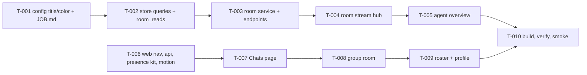

# Tasks: Agent rooms

- **Issue**: `—`
- **Requirements**: [requirements.md](requirements.md)
- **Contract**: [api-contract.md](api-contract.md) — Required
- **Design**: [design.md](design.md)
- **Requirements revision**: 1
- **Contract revision**: 1
- **Design revision**: 1
- **Status**: Completed

## Execution rules

- Implement only the requirements and acceptance criteria assigned to the task.
- Stop if requirements, design, or contract conflict with each other.
- Every acceptance criterion has exactly one evidence owner.
- Mark a task complete only after verification evidence has been recorded.
- Work happens on branch `feature/agent-rooms`. It is not merged into `development` without the
  owner.
- Two chains run in parallel: backend (Go, `T-001`–`T-005`) and web (`web/ui`, `T-006`–`T-009`).
  The chains do not edit each other's files. `T-010` joins them.

## Coverage

| Acceptance criterion | Contract operation | Evidence owner | Verification | Evidence |
|---|---|---|---|---|
| `AC-ROOM-001` | `API-ROOM-001` | `T-003` | `go test ./web -run TestRooms` | Pass |
| `AC-ROOM-002` | `API-ROOM-002` | `T-007` | `npx vitest run src/views/chats.test.tsx` | Pass |
| `AC-ROOM-003` | `API-ROOM-002` | `T-007` | `npx vitest run src/views/chats.test.tsx` | Pass |
| `AC-ROOM-004` | `API-ROOM-003` | `T-003` | `go test ./web -run TestRoomSend` | Pass |
| `AC-ROOM-005` | `API-ROOM-003` | `T-003` | `go test ./web -run TestRoomSend` | Pass |
| `AC-ROOM-006` | Not applicable | `T-007` | `npx vitest run src/views/chats.test.tsx` | Pass |
| `AC-ROOM-007` | `API-ROOM-004` | `T-003` | `go test ./web -run TestRoomUnread` | Pass |
| `AC-ROOM-008` | `API-ROOM-001` | `T-003` | `go test ./web -run TestPresence` | Pass |
| `AC-ROOM-009` | `API-ROOM-001` | `T-003` | `go test ./web -run TestPresence` | Pass |
| `AC-ROOM-010` | `API-ROOM-001` | `T-003` | `go test ./web -run TestPresence` | Pass |
| `AC-ROOM-011` | `API-ROOM-005` | `T-004` | `go test ./web -run TestRoomStream` | Pass |
| `AC-ROOM-012` | Not applicable | `T-008` | `npx vitest run src/views/room-group.test.tsx` | Pass |
| `AC-ROOM-013` | `API-ROOM-003` | `T-003` | `go test ./web -run TestRoomSendMention` | Pass |
| `AC-ROOM-014` | `API-ROOM-006/007` | `T-001` | `go test ./config ./web -run 'Title|Color'` | Pass |
| `AC-ROOM-015` | `API-ROOM-006/007` | `T-001` | `go test ./config ./web -run 'Title|Color'` | Pass |
| `AC-ROOM-016` | `API-ROOM-007` | `T-001` | `go test ./web -run TestAgentFileJob` | Pass |
| `AC-ROOM-017` | `API-ROOM-008` | `T-005` | `go test ./web -run TestOverview` | Pass |
| `AC-ROOM-018` | `API-ROOM-008` | `T-005` | `go test ./web -run TestOverview` | Pass |
| `AC-ROOM-019` | Not applicable | `T-009` | `npx vitest run src/views/agents.test.tsx` | Pass |
| `AC-ROOM-020` | Not applicable | `T-006` | `npx vitest run src/app` | Pass |
| `AC-ROOM-021` | Not applicable | `T-006` | `npx vitest run src/views/presence.test.tsx` + CSS review | Pass |

## Task graph

## Tasks

- [x] `T-001` Add agent title, color and JOB.md
  - Depends on: `None`
  - Requirements: `REQ-ROOM-009`
  - Acceptance criteria: `AC-ROOM-014`, `AC-ROOM-015`, `AC-ROOM-016`
  - Contract operations: `API-ROOM-006`, `API-ROOM-007`
  - Scope: `core/config.go`, `config/` validation, `internal/agenthome`, `web/agents.go`, `web/agentfiles.go`, tests.
  - Completion evidence:
    - Status: Completed
    - Command/test: `go test ./core/... ./config/... ./internal/agenthome/... ./web/...`
    - Result: pass
    - PR/commit: 9779a4f
    - Deviation: None

- [x] `T-002` Add store queries and the room_reads table
  - Depends on: `T-001`
  - Requirements: `REQ-ROOM-002`, `REQ-ROOM-005`
  - Acceptance criteria: covered by `T-003`
  - Contract operations: Not applicable (internal)
  - Scope: `SessionFilter.Agent` (+ `Before` if missing), `CountAgentEvents`, migration `0005_room_reads.sql`, `RoomReadAt`/`SetRoomRead`, `Backend` plumbing in `cmd/lana/web.go`, store tests.
  - Completion evidence:
    - Status: Completed
    - Command/test: `go test ./store/... ./core/... ./web/... ./cmd/...`
    - Result: pass
    - PR/commit: 9c551dc
    - Deviation: None

- [x] `T-003` Build the room service and room endpoints
  - Depends on: `T-002`
  - Requirements: `REQ-ROOM-001`, `REQ-ROOM-003`, `REQ-ROOM-005`, `REQ-ROOM-006`, `REQ-ROOM-008`
  - Acceptance criteria: `AC-ROOM-001`, `AC-ROOM-004`, `AC-ROOM-005`, `AC-ROOM-007`–`AC-ROOM-010`, `AC-ROOM-013`
  - Contract operations: `API-ROOM-001`–`API-ROOM-004`
  - Scope: `web/rooms.go`, `web/rooms_test.go`, route registration.
  - Completion evidence:
    - Status: Completed
    - Command/test: `go test -race ./web/... ./cmd/... ./store/...`
    - Result: pass (TestRooms*, TestRoomSend*, TestPresence*, TestRoomUnreadAndRead)
    - PR/commit: 4a605ef, 498e3b4
    - Deviation: None

- [x] `T-004` Stream room changes
  - Depends on: `T-003`
  - Requirements: `REQ-ROOM-007`
  - Acceptance criteria: `AC-ROOM-011`
  - Contract operations: `API-ROOM-005`
  - Scope: room hub in `web/rooms.go` (or `web/roomstream.go`), tests.
  - Completion evidence:
    - Status: Completed
    - Command/test: `go test -race ./web/ -run TestRoomStream`
    - Result: pass
    - PR/commit: 4a605ef
    - Deviation: None

- [x] `T-005` Serve the agent overview
  - Depends on: `T-004`
  - Requirements: `REQ-ROOM-010`, `REQ-ROOM-011`
  - Acceptance criteria: `AC-ROOM-017`, `AC-ROOM-018`
  - Contract operations: `API-ROOM-008`
  - Scope: `web/overview.go`, `web/overview_test.go`, backend plumbing.
  - Completion evidence:
    - Status: Completed
    - Command/test: `go test -race ./web/... ./cmd/...`
    - Result: pass (TestOverview*)
    - PR/commit: fbfd738
    - Deviation: None

- [x] `T-006` Add web navigation, rooms API client, presence kit and motion
  - Depends on: `None`
  - Requirements: `REQ-ROOM-012`, `REQ-ROOM-013`
  - Acceptance criteria: `AC-ROOM-020`, `AC-ROOM-021`
  - Contract operations: client side of `API-ROOM-001`–`API-ROOM-008`
  - Scope: `app/Sidebar.tsx`, `app/router.ts`, `App.tsx`, `api/rooms.ts`, `api/agents.ts`, `views/presence.tsx`, `styles/rooms.css`, tests.
  - Completion evidence:
    - Status: Completed
    - Command/test: `npm run typecheck && npm test && npm run lint` (web/ui)
    - Result: pass, 193 tests
    - PR/commit: a5cd4a3
    - Deviation: None

- [x] `T-007` Build the Chats page
  - Depends on: `T-006`
  - Requirements: `REQ-ROOM-001`–`REQ-ROOM-005`
  - Acceptance criteria: `AC-ROOM-002`, `AC-ROOM-003`, `AC-ROOM-006`
  - Scope: `views/chats.tsx`, `views/room-timeline.tsx`, tests.
  - Completion evidence:
    - Status: Completed
    - Command/test: `npm test` (chats.test.tsx)
    - Result: pass, 199 tests
    - PR/commit: 5136d60
    - Deviation: None

- [x] `T-008` Render group rooms
  - Depends on: `T-007`
  - Requirements: `REQ-ROOM-008`
  - Acceptance criteria: `AC-ROOM-012`
  - Scope: `views/room-group.tsx`, tests.
  - Completion evidence:
    - Status: Completed
    - Command/test: `npm test` (room-group.test.tsx)
    - Result: pass, 203 tests
    - PR/commit: e13a449
    - Deviation: None

- [x] `T-009` Build the alive roster and agent profile
  - Depends on: `T-008`
  - Requirements: `REQ-ROOM-009`, `REQ-ROOM-010`, `REQ-ROOM-011`
  - Acceptance criteria: `AC-ROOM-019`
  - Scope: `views/agents.tsx`, `views/agent-overview.tsx`, `views/agent-detail.tsx` (Overview tab, title/color fields, JOB.md), tests.
  - Completion evidence:
    - Status: Completed
    - Command/test: `npm test` (agents.test.tsx, agent-overview.test.tsx)
    - Result: pass, 212 tests
    - PR/commit: fa88f81
    - Deviation: None

- [x] `T-010` Build the dashboard and verify end to end
  - Depends on: `T-005`, `T-009`
  - Scope: `make web`, `go build ./...`, `go test ./...`, `gofmt -l .`, `golangci-lint run ./...`, `npx vitest run`, local daemon smoke.
  - Completion evidence:
    - Status: Completed
    - Command/test: `make web`, `go vet ./...`, `go test -race ./...`, `golangci-lint run ./...`, `npm test`; runtime smoke on a copy of LANA_HOME (port 18399, Telegram off) with CDP screenshots
    - Result: pass; smoke found 7 UI bugs and 2 API issues, all fixed
    - PR/commit: 498e3b4, 2ee7f16, 60f1dc3
    - Deviation: None

## Final verification

- [x] Every acceptance criterion has passing evidence.
- [x] No observable behavior exists without a requirement ID.
- [x] `gofmt -l .` is empty, `golangci-lint run ./...`, `go test -race ./...`, and the release build pass.

## Approval

- [x] Requirements and design are Approved and their revisions are recorded.
- [x] Contract is Approved.
- [x] Every acceptance criterion has exactly one evidence owner.
- [x] Every task has a limited scope, dependencies, and verification.
- [x] No task introduces new behavior.
- **Approved by**: agent on behalf of the owner (gate lifted 2026-11-02)
- **Approved on**: 2026-11-02

## Runtime smoke notes (T-010, 2026-11-02)

- Daemon built from this branch ran on a copy of the owner's `LANA_HOME` (sessions copied with
  `sqlite3 .backup`, Telegram disabled, port 18399, one team `career` added).
- API: `GET /v1/rooms` returned real rows; `POST /v1/rooms/default/messages` with blank text →
  400 `empty_message`, unknown room → 404 `room_not_found`, `new_topic` → new web session, the
  agent answered "ok"; unread rose to 1 and `POST .../read` cleared it; segments joined the
  Telegram and web sessions in order.
- UI was captured through Obscura CDP at 1440×1024 (Chats, team room, Agents, agent Overview).
- Fixed after the smoke: never-read rooms counted all history as unread (now the last 24 h,
  REQ-ROOM-005 updated); empty presence label; `useRooms` waited for the stream before showing
  rows; chips wrapped their labels; the Overview tab repeated the old header; team faces
  overlapped names; empty rooms were blank; turn faces used the legacy color.
- Known renderer quirks seen only in Obscura: the composer placeholder shows in a monospace face
  and the 96 px hero face looks squarer than in CSS. The CSS sets `font: inherit` and
  `border-radius: 50%`; confirm in a real browser.
