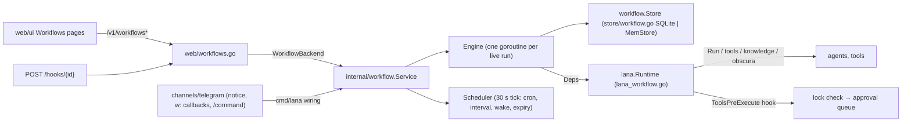

# Design: Workflows

- **Issue**: `—`
- **Requirements**: [requirements.md](requirements.md)
- **Contract**: [api-contract.md](api-contract.md) — Required
- **Requirements revision**: 1
- **Contract revision**: 1
- **Status**: Approved
- **Design revision**: 1

## Architecture decision scan

| Topic | Existing authority | Decision location | Action |
|---|---|---|---|
| Public interface | spec #9 web contract | this contract | create `/v1/workflows*`, `/hooks/{id}` |
| Persistence | `store/migrations` | this design | migration `0006_workflows.sql`, 7 tables |
| Domain logic | none | `internal/workflow` | create: model, validation, templates, cron, engine, service |
| Agent runs | `Runtime.Run`, `CreateChannelSession` | `lana_workflow.go` | reuse with channel `workflow` |
| Permissions | `ToolsPreExecute` waterfall, `ApprovalRouter` | `lana_workflow.go`, `cmd/lana/daemon.go` | prepend a workflow hook; route channel `workflow` to the web broker |
| Telegram | `channels/telegram` | `channels/telegram/workflow.go` | add owner notice with buttons, `w:` callbacks, command hook |
| Dependency direction | archtest | unchanged | `internal/workflow` imports only `core`/`internal`; `store`, `web`, `lana` import it; `cmd/lana` wires Telegram |

## Feature-local view



## Package `internal/workflow`

Imports only the standard library, `core` and `internal/*`. Files:

| File | Content |
|---|---|
| `model.go` | Types below, status constants, errors. |
| `store.go` | `Store` interface. |
| `memstore.go` | `MemStore`, an in-memory `Store` for tests and the memstore runtime. |
| `deps.go` | `Deps` and `Notifier` interfaces. |
| `catalog.go` | Node catalog: type → ports, required params, tool name for the lock. |
| `validate.go` | `Validate(g Graph, agents func(string) bool) []Issue`, `Slug(name) string`. |
| `template.go` | `Render(v any, sc Scope) (any, error)`, `CheckTemplates(v any) error`. |
| `cond.go` | `Compare(left any, op string, right any) (bool, error)`, `CheckSchema(schema map[string]any, v any) error`, `ExtractJSON(text string) (any, error)`. |
| `cron.go` | `ParseCron(expr string) (Cron, error)`, `(Cron) Matches(t time.Time) bool`, `(Cron) Next(after time.Time) time.Time`, `Describe(expr) string`. |
| `lock.go` | `ComputeLock(g Graph, risk func(tool string) string) []LockTool`, `LockCovers(lock *Lock, g Graph) bool`. |
| `engine.go` | Run execution, error ladder, durable resume. |
| `guardian.go` | Diagnosis prompt and decision parsing; assistant prompt, reply parsing, graph diff. |
| `service.go` | `Service`: every operation the web and Telegram call; scheduler; trigger matching; change broadcast. |

### Types (`model.go`)

```go
package workflow

type Status string // workflow status
const (
	StatusDraft  Status = "draft"
	StatusActive Status = "active"
	StatusPaused Status = "paused"
	StatusError  Status = "error"
)

type RunStatus string
const (
	RunQueued    RunStatus = "queued"
	RunRunning   RunStatus = "running"
	RunWaiting   RunStatus = "waiting"
	RunSucceeded RunStatus = "succeeded"
	RunFailed    RunStatus = "failed"
	RunCancelled RunStatus = "cancelled"
)

type NodeStatus string
const (
	NodePending   NodeStatus = "pending"
	NodeRunning   NodeStatus = "running"
	NodeSucceeded NodeStatus = "succeeded"
	NodeFailed    NodeStatus = "failed"
	NodeSkipped   NodeStatus = "skipped"
	NodeWaiting   NodeStatus = "waiting"
	NodeFallback  NodeStatus = "fallback"
)

var (
	ErrNotFound        = errors.New("workflow: not found")
	ErrExists          = errors.New("workflow: already exists")
	ErrVersionConflict = errors.New("workflow: version conflict")
	ErrRunActive       = errors.New("workflow: a run is already running")
	ErrRunFinished     = errors.New("workflow: run already finished")
	ErrDecisionClosed  = errors.New("workflow: decision already resolved")
	ErrInvalidChoice   = errors.New("workflow: invalid choice")
	ErrLockRequired    = errors.New("workflow: permissions must be locked again")
	ErrBadToken        = errors.New("workflow: bad webhook token")
)

// InvalidGraphError carries every validation problem.
type InvalidGraphError struct{ Issues []Issue }
func (e *InvalidGraphError) Error() string

type Issue struct {
	NodeID  string `json:"node_id"`
	Code    string `json:"code"`    // unknown_type, duplicate_id, missing_node, cycle, unreachable, missing_param, bad_template, bad_cron, bad_parent, no_trigger, unknown_agent
	Message string `json:"message"`
}

type Position struct {
	X float64 `json:"x"`
	Y float64 `json:"y"`
}

type FailurePolicy struct {
	Mode        string   `json:"mode,omitempty"`         // default|guardian|stop|continue
	Retries     *int     `json:"retries,omitempty"`
	BackoffSecs []int    `json:"backoff_secs,omitempty"`
	Fallback    any      `json:"fallback,omitempty"`
}

type Node struct {
	ID        string         `json:"id"`
	Type      string         `json:"type"`
	Name      string         `json:"name"`
	Parent    string         `json:"parent,omitempty"`
	Disabled  bool           `json:"disabled,omitempty"`
	Position  Position       `json:"position"`
	Params    map[string]any `json:"params"`
	OnFailure *FailurePolicy `json:"on_failure,omitempty"`
}

type Edge struct {
	ID       string `json:"id"`
	From     string `json:"from"`
	FromPort string `json:"from_port,omitempty"` // "" means "out"
	To       string `json:"to"`
}

type Graph struct {
	Nodes []Node `json:"nodes"`
	Edges []Edge `json:"edges"`
}

type LockTool struct {
	Tool   string   `json:"tool"`
	UsedBy []string `json:"used_by"`
	Risk   string   `json:"risk"` // read|write|admin
}

type Lock struct {
	Version  int        `json:"version"`
	LockedAt int64      `json:"locked_at"`
	Tools    []LockTool `json:"tools"`
}

type Webhook struct {
	Path  string `json:"path"`
	Token string `json:"token"`
}

type Workflow struct {
	ID                  string        `json:"id"`
	Name                string        `json:"name"`
	Description         string        `json:"description"`
	Guardian            string        `json:"guardian"`
	Status              Status        `json:"status"`
	Version             int           `json:"version"`
	Lock                *Lock         `json:"lock"`
	FailureDefault      FailurePolicy `json:"failure_default"`
	WebhookToken        string        `json:"-"`
	ConsecutiveFailures int           `json:"consecutive_failures"`
	CreatedAt           int64         `json:"created_at"`
	UpdatedAt           int64         `json:"updated_at"`
}

type Version struct {
	WorkflowID string `json:"-"`
	Version    int    `json:"version"`
	Graph      Graph  `json:"graph"`
	Author     string `json:"author"` // owner|guardian
	Summary    string `json:"summary"`
	CreatedAt  int64  `json:"created_at"`
}

type Run struct {
	ID            string          `json:"id"`
	WorkflowID    string          `json:"workflow_id"`
	Number        int             `json:"number"`
	Version       int             `json:"version"`
	Trigger       string          `json:"trigger"`
	Input         json.RawMessage `json:"input"`
	Status        RunStatus       `json:"status"`
	WaitingReason string          `json:"waiting_reason"`
	WakeAt        int64           `json:"wake_at"`
	Error         string          `json:"error"`
	Tokens        int64           `json:"tokens"`
	NodesDone     int             `json:"nodes_done"`
	NodesTotal    int             `json:"nodes_total"`
	Summary       string          `json:"summary"`
	// Overrides holds "this run only" parameter patches by node id.
	Overrides     map[string]map[string]any `json:"overrides,omitempty"`
	StartedAt     int64           `json:"started_at"`
	EndedAt       int64           `json:"ended_at"`
}

type Attempt struct {
	N         int    `json:"n"`
	StartedAt int64  `json:"started_at"`
	EndedAt   int64  `json:"ended_at"`
	Error     string `json:"error,omitempty"`
}

type NodeRun struct {
	RunID     string          `json:"-"`
	NodeID    string          `json:"node_id"`
	ItemIndex int             `json:"item_index"`
	Status    NodeStatus      `json:"status"`
	Attempts  []Attempt       `json:"attempts"`
	Input     json.RawMessage `json:"input"`
	Output    json.RawMessage `json:"output"`
	Port      string          `json:"port,omitempty"` // branch taken (if/switch/approval/loop)
	Error     string          `json:"error"`
	Logs      []string        `json:"logs"`
	Tokens    int64           `json:"tokens"`
	SessionID string          `json:"session_id"`
	StartedAt int64           `json:"started_at"`
	EndedAt   int64           `json:"ended_at"`
}

type Decision struct {
	ID         string         `json:"id"`
	WorkflowID string         `json:"workflow_id"`
	RunID      string         `json:"run_id"`
	RunNumber  int            `json:"run_number"`
	NodeID     string         `json:"node_id"`
	ItemIndex  int            `json:"item_index"`
	Kind       string         `json:"kind"`   // guardian|approval
	Action     string         `json:"action"` // retry_fix|skip|fallback|ask|stop
	Reason     string         `json:"reason"`
	Fix        map[string]any `json:"fix,omitempty"`
	Persistent bool           `json:"persistent"`
	Confidence float64        `json:"confidence"`
	Tokens     int64          `json:"tokens"`
	Status     string         `json:"status"` // applied|pending|resolved|expired
	Choice     string         `json:"choice"`
	CreatedAt  int64          `json:"created_at"`
	ExpiresAt  int64          `json:"expires_at"`
	ResolvedAt int64          `json:"resolved_at"`
}

type StateEntry struct {
	Key       string          `json:"key"`
	Value     json.RawMessage `json:"value"`
	UpdatedAt int64           `json:"updated_at"`
}

type ChatMessage struct {
	ID         int64        `json:"id"`
	WorkflowID string       `json:"-"`
	Role       string       `json:"role"` // owner|guardian
	Text       string       `json:"text"`
	Change     *GraphChange `json:"change,omitempty"`
	Issues     []Issue      `json:"issues,omitempty"`
	CreatedAt  int64        `json:"created_at"`
}

type GraphChange struct {
	FromVersion int      `json:"from_version"`
	ToVersion   int      `json:"to_version"`
	Summary     string   `json:"summary"`
	Added       []string `json:"added"`
	Removed     []string `json:"removed"`
	Changed     []string `json:"changed"`
}

type RunFilter struct {
	WorkflowID string
	Statuses   []RunStatus
	Since      int64 // started_at >= Since (0 = any)
	Before     int   // number < Before (0 = any)
	Limit      int   // 0 = no limit
}

type DecisionFilter struct {
	WorkflowID string
	RunID      string
	Status     string
}
```

### Store (`store.go`)

```go
type Store interface {
	CreateWorkflow(ctx context.Context, w Workflow, g Graph, author, summary string) (Workflow, error) // ErrExists; sets Version=1
	GetWorkflow(ctx context.Context, id string) (Workflow, error)                                     // ErrNotFound
	ListWorkflows(ctx context.Context) ([]Workflow, error)                                            // by name
	UpdateWorkflow(ctx context.Context, w Workflow) error  // metadata only; never changes Version
	SaveVersion(ctx context.Context, id string, base int, g Graph, author, summary string) (Version, error) // ErrVersionConflict when base != current; sets workflow.Version
	GetVersion(ctx context.Context, id string, version int) (Version, error)
	ListVersions(ctx context.Context, id string) ([]Version, error) // newest first
	DeleteWorkflow(ctx context.Context, id string) error            // cascades to all rows

	CreateRun(ctx context.Context, r Run) (Run, error) // sets Number = max(number)+1 for the workflow
	UpdateRun(ctx context.Context, r Run) error
	GetRun(ctx context.Context, id string) (Run, error)
	GetRunByNumber(ctx context.Context, workflowID string, number int) (Run, error)
	ListRuns(ctx context.Context, f RunFilter) ([]Run, error) // newest first

	PutNodeRun(ctx context.Context, nr NodeRun) error // upsert by (run, node, item)
	ListNodeRuns(ctx context.Context, runID string) ([]NodeRun, error)

	PutDecision(ctx context.Context, d Decision) error // upsert by id
	GetDecision(ctx context.Context, id string) (Decision, error)
	ListDecisions(ctx context.Context, f DecisionFilter) ([]Decision, error) // newest first

	ListState(ctx context.Context, workflowID string) ([]StateEntry, error) // by key
	SetState(ctx context.Context, workflowID, key string, value json.RawMessage) error
	DeleteState(ctx context.Context, workflowID, key string) error // key "" clears all

	AppendChat(ctx context.Context, m ChatMessage) (ChatMessage, error) // sets ID
	ListChat(ctx context.Context, workflowID string, limit int) ([]ChatMessage, error) // oldest first, last `limit`
}
```

All methods are safe for concurrent use.

### Dependencies (`deps.go`)

```go
// Deps is what the engine needs from the runtime. lana.Runtime implements it.
type Deps interface {
	// RunAgent runs one prompt in a fresh session on channel "workflow",
	// address = WorkflowID, and blocks until the turn ends.
	RunAgent(ctx context.Context, req AgentRequest) (AgentResult, error)
	CallTool(ctx context.Context, req ToolRequest) (string, error) // tool text output
	Bash(ctx context.Context, req BashRequest) (BashResult, error)
	WebFetch(ctx context.Context, url string) (title, markdown string, err error)
	Browse(ctx context.Context, req BrowseRequest) (string, error)
	SaveKnowledge(ctx context.Context, req KnowledgeRequest) error
	AgentExists(name string) bool
	ToolRisk(name string) string // read|write|admin; "" when unknown
}

type AgentRequest struct {
	WorkflowID, RunID, NodeID string
	Agent    string
	Prompt   string
	Model    string   // "" keeps the agent model
	Tools    []string // nil = agent defaults; non-nil = only these tools may run
	Lock     []string // tools that run without approval
	MaxSteps int      // 0 = agent default; counts tool calls
}

type AgentResult struct {
	Text       string
	SessionID  string
	Tokens     int64
	StopReason string
}

type ToolRequest struct {
	WorkflowID, RunID, NodeID string
	Name  string
	Input json.RawMessage
}

type BashRequest struct {
	WorkflowID string
	Command    string
	Timeout    time.Duration
}

type BashResult struct {
	ExitCode int
	Output   string // combined, last 64 KiB
}

type BrowseRequest struct {
	WorkflowID string
	URL        string
	Format     string // text|markdown|html
	Stealth    bool
	Selector   string
	Timeout    time.Duration
}

type KnowledgeRequest struct {
	WorkflowID, Agent, Title, Folder, Text string
}

// Notifier tells the owner. cmd/lana sets a Telegram notifier; nil = no-op.
type Notifier interface {
	Notify(ctx context.Context, n Notice)
	SendOwner(ctx context.Context, text string) error // message node
}

type Notice struct {
	WorkflowID   string
	WorkflowName string
	RunNumber    int
	Title        string // e.g. "Riset harian · Run #8 is paused"
	Text         string
	DecisionID   string   // "" = no buttons
	Choices      []string // apply, run_only, skip, stop, approve, deny
}
```

### Catalog and validation

`catalog.go` holds, per node type: group (`trigger`, `ai`, `tool`, `flow`, `state`), required params, output ports,
and the lock tool name: `browser` → `browser`, `bash` → `bash`, `webfetch` → `webfetch`, `tool` → `params.name`,
`message` → `telegram.send`, `knowledge` → `knowledge.save`, `state_set` → `state.set`, `worker` → each of
`params.tools`, `bot`/`agent` → none (their agent's own tools run through the normal permission engine and the hook).
Lock risk: `browser`, `webfetch`, `state.get`-like reads → `read`; `telegram.send`, `knowledge.save`, `state.set` → `write`;
`bash` → `admin`; other tools → `Deps.ToolRisk(name)` defaulting to `write`.

`Validate` checks every rule of REQ-WF-002. Order is: node checks (type, id, duplicate, required params, templates,
cron for schedules, `parent` exists and is a `loop`, no nested loops in v1), then edge checks (missing nodes, a port the
source does not have, an edge crossing a loop boundary other than `loop --body--> body node`), then the cycle check
(Kahn), then reachability (every non-trigger node has an incoming edge, except body nodes which need an edge from
the loop or a sibling). `no_trigger` is only an issue for activation, not for saving a draft.

### Templates

- Grammar: `{{ path }}` where path is `root(.segment | [index])*`; roots: `input`, `nodes`, `item`, `item_index`,
  `state`, `run`, `workflow`. `nodes.<id>.output.x` reads the latest output of node `<id>` (inside a loop body,
  the output for the current item). A missing path renders `null` (or `""` in mixed text).
- `Render` walks strings, maps and slices. A string that is exactly one `{{ }}` returns the value's JSON type.
- Objects and arrays in mixed text render as compact JSON.

### Engine

`Engine.execute(ctx, run)` (one goroutine per live run, registered in a `map[runID]cancel` under a mutex):

1. Load the version graph, node runs, run overrides and state.
2. Order the top-level nodes (nodes without `parent`) topologically, ties by `(position.y, position.x, id)`.
3. For each node: skip if already final (`succeeded`, `skipped`, `failed` with mode `continue`, `fallback`);
   decide readiness: all incoming edges resolved; an edge is *live* when its source succeeded/fallback and
   (`from_port` = taken port or source has a single output port). No live inputs → `skipped` (for `merge`: skipped only
   when all inputs are dead). Trigger nodes: only the trigger that fired runs; other triggers are `skipped`.
4. Render params with the scope, apply `run.Overrides[node.ID]`, save `running`, call the handler, save the result.
   `NodesDone` and `Tokens` update after each node; publish `changed`.
5. Loop node: render `items` (must be an array, max 500). For each item index not final: run the body nodes in
   their own topological order with scope `item`/`item_index`; per-item failures go through the ladder, a
   `skip` decision marks that item's node `skipped` and the rest of that item's body is skipped too. Loop output:
   `items` = output of the body's last node per item (`null` for skipped), `count`, `ok`, `skipped`.
6. Waiting handlers (`wait`, `approval`, guardian `ask`) save the node `waiting`, set `run.Status = waiting`,
   `WaitingReason`, `WakeAt`/`ExpiresAt`, and return. The scheduler or the decision answer calls `Engine.Resume(runID)`.
7. End: `succeeded` when no node is `failed` (except `continue`); else `failed` with the first error. Update
   `ConsecutiveFailures` (reset on success); at 3 set the workflow to `error` and notify. A failed run notifies.

Error ladder (`runWithLadder`): attempts = 1 + retries for transient errors (`IsTransient(err)`: context deadline,
`timeout`, `429`, `rate limit`, ` 5\d\d`, `connection reset|refused`, `EOF`, `no such host`, `temporar`); backoff from
`backoff_secs` (last value repeats), cancellable. Then mode `stop` → fail; `continue` → node failed, run goes on;
`guardian` → if no guardian decision exists for (node, item) in this run: diagnose (one `RunAgent` on the guardian with
`guardianPrompt`, max 3 minutes, tokens added to the run), parse `{action, reason, fix, persistent, confidence}`.
Rules: `persistent` or `confidence < 0.6` or a fix key that names a tool outside the lock turns the action into `ask`.
`retry_fix` → one retry with `fix` merged into the params (this run only); `skip` → `skipped`; `fallback` → output
= `on_failure.fallback` (or the error as `{error}` if none) with status `fallback`; `ask` → pending decision,
`ExpiresAt` = now + 24 h, notify with choices `apply`, `run_only`, `skip`, `stop`; `stop` → fail. A second failure of the
same node after a decision fails the node (no loop). Guardian errors fail the run with a plain alert.

Durable resume (`Service.Start`): runs in `running` re-execute from their first non-final node; `waiting` runs with
`WakeAt <= now` resume; pending decisions past `ExpiresAt` expire (`approval` → `deny`; guardian `ask` → `stop`).

### Service and scheduler

`Service` holds `Store`, `Deps`, `Notifier`, a change broadcaster (`Subscribe() (<-chan Change, func())`, non-blocking
send, buffer 64), and the engine. It exposes: `List`, `Get`, `Create`, `Update`, `Delete`, `Versions`, `Restore`,
`LockPreview`, `Activate`, `Pause`, `Resume`, `StartRun`, `Runs`, `RunDetail`, `Cancel`, `Answer`, `State`,
`SetState`, `DeleteState`, `Chat`, `Assist`, `RotateWebhook`, `Webhook(ctx, id, token, body)`,
`Command(ctx, channel, text) (CommandResult, bool)`, `HandleEvent(core.SessionEvent)`, `Start(ctx)` (resume + scheduler
loop every 30 s), `Close()`.

Service API (exact signatures; `web.WorkflowBackend` mirrors the subset it uses):

```go
type Summary struct { // contract workflow_summary
	ID, Name, Description, Guardian string
	Status     Status
	Version    int
	NodeCount  int           `json:"node_count"`
	Triggers   []TriggerInfo `json:"triggers"`
	Runs7d     int           `json:"runs_7d"`
	Success7d  *float64      `json:"success_7d"`
	Running    bool          `json:"running"`
	Waiting    bool          `json:"waiting"`
	LastRun    *Run          `json:"last_run"`
	Bots       []string      `json:"bots"`
	UpdatedAt  int64         `json:"updated_at"`
} // all fields snake_case JSON per the contract
type TriggerInfo struct{ Type, Label, Detail string; Enabled bool }
type Stats struct { Total, Active, Paused, Error, WaitingOnYou, Approvals, Decisions int; Success7d, SuccessPrev7d *float64; RunsToday, RunsTodayOK, RunsTodayFailed, RunsTodayRunning int }
type Attention struct { Decision; WorkflowName string `json:"workflow_name"`; NodeName string `json:"node_name"` }
type Overview struct { Workflows []Summary; Stats Stats; Attention []Attention }
type Detail struct { // contract workflow (detail)
	Workflow
	VersionAuthor  string  `json:"version_author"`
	VersionSummary string  `json:"version_summary"`
	VersionAt      int64   `json:"version_at"`
	Graph          Graph   `json:"graph"`
	LockCurrent    bool    `json:"lock_current"`
	Webhook        Webhook `json:"webhook"`
}
type CreateInput struct { Name, Description, Guardian string; Graph *Graph }
type UpdateInput struct { BaseVersion int; Name, Description, Guardian *string; Graph *Graph; FailureDefault *FailurePolicy; Summary string }
type RunDetail struct { Run Run; Graph Graph; Nodes []NodeRun; Decisions []Decision }
type AssistResult struct { Message ChatMessage; Workflow Detail; Tokens int64 }
type CommandResult struct { WorkflowID string; RunID string; Number int; Reply string }
type Change struct { WorkflowID string `json:"workflow_id"`; RunID string `json:"run_id,omitempty"` }

func NewService(st Store, deps Deps, opts ...Option) *Service
func WithClock(now func() time.Time) Option
func WithNotifier(n Notifier) Option
func (s *Service) SetNotifier(n Notifier)
func (s *Service) Start(ctx context.Context) error // resume + scheduler loop; returns at once
func (s *Service) Close()
func (s *Service) Subscribe() (<-chan Change, func())
func (s *Service) Overview(ctx context.Context) (Overview, error)
func (s *Service) Get(ctx context.Context, id string) (Detail, error)
func (s *Service) Create(ctx context.Context, in CreateInput) (Detail, error)
func (s *Service) Update(ctx context.Context, id string, in UpdateInput) (Detail, error)
func (s *Service) Delete(ctx context.Context, id string) error
func (s *Service) Versions(ctx context.Context, id string) ([]Version, error)
func (s *Service) Restore(ctx context.Context, id string, version int) (Detail, error)
func (s *Service) LockPreview(ctx context.Context, id string) ([]LockTool, error)
func (s *Service) Activate(ctx context.Context, id string, version int) (Detail, error)
func (s *Service) Pause(ctx context.Context, id string) (Detail, error)
func (s *Service) Resume(ctx context.Context, id string) (Detail, error)
func (s *Service) StartRun(ctx context.Context, id, trigger string, input json.RawMessage) (Run, error)
func (s *Service) Runs(ctx context.Context, id string, limit, before int) ([]Run, error)
func (s *Service) RunDetail(ctx context.Context, id, run string) (RunDetail, error) // run = id or number
func (s *Service) Cancel(ctx context.Context, id, run string) (Run, error)
func (s *Service) Answer(ctx context.Context, id, decisionID, choice string) (Run, error)
func (s *Service) State(ctx context.Context, id string) ([]StateEntry, error)
func (s *Service) SetState(ctx context.Context, id, key string, value json.RawMessage) (StateEntry, error)
func (s *Service) DeleteState(ctx context.Context, id, key string) error // "" clears
func (s *Service) Chat(ctx context.Context, id string) ([]ChatMessage, error)
func (s *Service) Assist(ctx context.Context, id string, baseVersion int, message string) (AssistResult, error)
func (s *Service) RotateWebhook(ctx context.Context, id string) (string, error)
func (s *Service) Webhook(ctx context.Context, id, token string, body []byte) (Run, error) // ErrBadToken, ErrNotFound
func (s *Service) Command(ctx context.Context, channel, text string) (CommandResult, bool)
func (s *Service) HandleEvent(ctx context.Context, kind, sessionID, agent string, data json.RawMessage)
func (s *Service) IsWorkflowSession(sessionID string) bool
```

`Create` with a nil graph uses a graph with one `trigger.manual` node. `Create` generates the webhook token
(32 random bytes, hex). Errors from the service are the `Err*` values and `*InvalidGraphError`; an unknown guardian is
an `*InvalidGraphError` with issue code `unknown_agent` and empty node id.

Scheduler tick: for each `active` workflow, for each enabled `trigger.schedule` whose cron matches the current minute in
its zone and that has not fired in that minute (in-memory `lastFired[wf/node] = minute`, seeded at start so a restart does
not double fire), and each `trigger.interval` whose last run by that trigger is older than N minutes, start a run unless
one is `running`/`waiting` (then skip). Then resume due waits and expire decisions.

Attention list (API-WF-001): pending decisions joined with workflow and node names. Tool approvals are added by the web
layer from the approval broker (sessions on channel `workflow`).

### Guardian prompts (`guardian.go`)

- Diagnosis prompt: role line, workflow goal, the node JSON, rendered input (≤ 4 KiB), error, last logs (≤ 2 KiB),
  outcomes of the last 5 runs, the lock tool list, the five actions with their rules, and "Reply with one JSON object
  only: {\"action\":…,\"reason\":…,\"fix\":{param:value}|null,\"persistent\":bool,\"confidence\":0..1}".
- Assistant prompt: workflow name/goal, current graph JSON, node catalog (types, params, ports), the template and
  loop rules, the last 10 chat messages, the owner message, and "Reply with one JSON object only:
  {\"reply\": text in the owner's language, \"graph\": full new graph or null, \"summary\": one line}". Do not call tools.
- `ExtractJSON` takes the first JSON object in the text (code fences allowed).
- `DiffGraphs(a, b Graph) GraphChange` compares nodes by id: added, removed, changed (params, type, name, parent, failure
  policy differ; position-only moves are not changes).

## Persistence (`store/migrations/0006_workflows.sql`)

```sql
CREATE TABLE workflows (
  id TEXT PRIMARY KEY, name TEXT NOT NULL, description TEXT NOT NULL DEFAULT '',
  guardian TEXT NOT NULL, status TEXT NOT NULL, version INTEGER NOT NULL,
  lock_json TEXT NOT NULL DEFAULT '', failure_json TEXT NOT NULL DEFAULT '{}',
  webhook_token TEXT NOT NULL DEFAULT '', consecutive_failures INTEGER NOT NULL DEFAULT 0,
  created_at INTEGER NOT NULL, updated_at INTEGER NOT NULL);
CREATE TABLE workflow_versions (
  workflow_id TEXT NOT NULL REFERENCES workflows(id) ON DELETE CASCADE, version INTEGER NOT NULL,
  graph_json TEXT NOT NULL, author TEXT NOT NULL, summary TEXT NOT NULL DEFAULT '', created_at INTEGER NOT NULL,
  PRIMARY KEY (workflow_id, version));
CREATE TABLE workflow_runs (
  id TEXT PRIMARY KEY, workflow_id TEXT NOT NULL REFERENCES workflows(id) ON DELETE CASCADE,
  number INTEGER NOT NULL, version INTEGER NOT NULL, trigger TEXT NOT NULL, input_json TEXT NOT NULL DEFAULT 'null',
  status TEXT NOT NULL, waiting_reason TEXT NOT NULL DEFAULT '', wake_at INTEGER NOT NULL DEFAULT 0,
  error TEXT NOT NULL DEFAULT '', tokens INTEGER NOT NULL DEFAULT 0, nodes_done INTEGER NOT NULL DEFAULT 0,
  nodes_total INTEGER NOT NULL DEFAULT 0, summary TEXT NOT NULL DEFAULT '', overrides_json TEXT NOT NULL DEFAULT '',
  started_at INTEGER NOT NULL, ended_at INTEGER NOT NULL DEFAULT 0, UNIQUE (workflow_id, number));
CREATE INDEX workflow_runs_status ON workflow_runs(status);
CREATE TABLE workflow_node_runs (
  run_id TEXT NOT NULL REFERENCES workflow_runs(id) ON DELETE CASCADE, node_id TEXT NOT NULL,
  item_index INTEGER NOT NULL, status TEXT NOT NULL, attempts_json TEXT NOT NULL DEFAULT '[]',
  input_json TEXT NOT NULL DEFAULT 'null', output_json TEXT NOT NULL DEFAULT 'null', port TEXT NOT NULL DEFAULT '',
  error TEXT NOT NULL DEFAULT '', logs_json TEXT NOT NULL DEFAULT '[]', tokens INTEGER NOT NULL DEFAULT 0,
  session_id TEXT NOT NULL DEFAULT '', started_at INTEGER NOT NULL DEFAULT 0, ended_at INTEGER NOT NULL DEFAULT 0,
  PRIMARY KEY (run_id, node_id, item_index));
CREATE TABLE workflow_decisions (
  id TEXT PRIMARY KEY, workflow_id TEXT NOT NULL REFERENCES workflows(id) ON DELETE CASCADE,
  run_id TEXT NOT NULL, run_number INTEGER NOT NULL, node_id TEXT NOT NULL, item_index INTEGER NOT NULL,
  kind TEXT NOT NULL, action TEXT NOT NULL, reason TEXT NOT NULL DEFAULT '', fix_json TEXT NOT NULL DEFAULT '',
  persistent INTEGER NOT NULL DEFAULT 0, confidence REAL NOT NULL DEFAULT 0, tokens INTEGER NOT NULL DEFAULT 0,
  status TEXT NOT NULL, choice TEXT NOT NULL DEFAULT '', created_at INTEGER NOT NULL,
  expires_at INTEGER NOT NULL DEFAULT 0, resolved_at INTEGER NOT NULL DEFAULT 0);
CREATE INDEX workflow_decisions_status ON workflow_decisions(status);
CREATE TABLE workflow_state (
  workflow_id TEXT NOT NULL REFERENCES workflows(id) ON DELETE CASCADE, key TEXT NOT NULL,
  value_json TEXT NOT NULL, updated_at INTEGER NOT NULL, PRIMARY KEY (workflow_id, key));
CREATE TABLE workflow_chat (
  id INTEGER PRIMARY KEY AUTOINCREMENT, workflow_id TEXT NOT NULL REFERENCES workflows(id) ON DELETE CASCADE,
  role TEXT NOT NULL, text TEXT NOT NULL, change_json TEXT NOT NULL DEFAULT '', issues_json TEXT NOT NULL DEFAULT '',
  created_at INTEGER NOT NULL);
```

`schemaVersion` becomes 6 and `names[6] = "workflows"`. `*store.Store` implements `workflow.Store` in
`store/workflow.go`. The runtime uses it when `rt.store` implements `workflow.Store`, else `workflow.NewMemStore()`.

## Runtime glue (`lana_workflow.go`)

- `Runtime.Workflows() *workflow.Service`, created in `New`, started by `Runtime.StartWorkflows(ctx)` (like
  `StartKnowledgeUpkeep`), closed in `Close` before the registry closes.
- `RunAgent`: `CreateChannelSession(ctx, "workflow", req.WorkflowID, req.Agent)`; register
  `wfSessions[sessionID] = {lock set, tools set|nil, maxSteps, steps}`; `SetModel` when `req.Model != ""`;
  `rt.Run(ctx, Request{SessionID, Agent, Prompt})`; unregister; tokens = input + output.
- Workflow permission hook, prepended on `ToolsPreExecute`: for a session in `wfSessions` (or whose parent is):
  tool not in `tools` (when set) → `Allowed:false, Status: rejected, Reason: "not in this worker's tools"`; steps over
  `maxSteps` → rejected with "step budget used"; tool in `lock` → `Allowed:true`; else `next` (normal engine; it asks
  through the approval router).
- `CallTool`: `coreCtx.Tools.Get(name)` and `tool.Call` with `ToolCtx{Workspace: $LANA_HOME/workspaces/<guardian>,
  Home, Jobs, Knowledge…}`. `Bash`: `exec.CommandContext("bash", "-lc", cmd)` in that workspace. `WebFetch`:
  `tools.FetchMarkdown`. `Browse`: `obscura fetch --dump <format> [--stealth] [--selector s] --storage-dir
  $LANA_HOME/workflows/<id>/browser <url>` with the timeout. `SaveKnowledge`: `rt.IngestKnowledge` with
  `Channel: "workflow"`, `Text`, title `<folder>/<title>`.
- Event triggers: subscribe `Hooks.SessionEvent`, skip sessions on channel `workflow`, pass the rest to
  `Service.HandleEvent`.

## Wiring (`cmd/lana`)

- `daemon.go`: `ApproveChannels("telegram", "web", "workflow")`; the router sends channel `workflow` to the web broker
  and, when Telegram is on, a plain Telegram notice "Workflow <id> asks to run <tool>" (the answer happens on the web).
- Telegram: `channel.SetWorkflowHooks(cmdFn, callbackFn)`; notifier implementing `workflow.Notifier` with
  `SendOwnerButtons`. `rt.StartWorkflows(runCtx)` after `StartKnowledgeUpkeep`.
- `web.go`: `webBackend` gets `Workflows() web.WorkflowBackend` (the `*workflow.Service`), detected in `SetBackend`.

## Web (`web/workflows.go`)

`WorkflowBackend` is the subset of `*workflow.Service` used by the handlers (defined in `web`, satisfied by the
service). Routes as in the contract. The stream follows the rooms SSE loop. `/hooks/{id}` is registered with
`s.mux.Handle` directly (no auth wrapper). The chat command check runs in `sendSessionMessage` before a turn starts.
The attention list adds open approvals from `s.approvals.openRequests()` whose session channel is `workflow`.

## Web UI (`web/ui`)

- `api/workflows.ts` (types + calls), `views/workflows.tsx` (list), `views/workflow-editor.tsx` (editor shell, tabs),
  `views/workflow-canvas.tsx` (canvas, shared by editor and executions), `views/workflow-inspector.tsx`,
  `views/workflow-assistant.tsx`, `views/workflow-runs.tsx`, `views/workflow-settings.tsx`, `styles/workflows.css`.
- Routes: `#/workflows`, `#/workflows/new`, `#/workflows/{id}` (editor), `#/workflows/{id}/runs[/{run}]`,
  `#/workflows/{id}/settings`.
- Canvas: absolutely positioned 248×64 node cards on a dot grid inside a transformed layer (pan by drag on empty space,
  zoom buttons and ctrl+wheel, Fit); SVG edges as orthogonal paths with port labels; loop bodies drawn as a dashed group
  around nodes with that `parent`; ports: bottom handle drag to a node to connect; select an edge and press Delete;
  palette drag-and-drop or click to add.
- Live: subscribe `/v1/workflows/stream`, refetch on `changed` for the open workflow/run.
- Preview fixtures in `src/preview/fixtures.ts` for every endpoint.

## Test strategy

- `internal/workflow`: unit tests per file with `MemStore` and a fake `Deps` (AC-WF-001..015).
- `store`: workflow store round trip, cascade delete, version conflict, run numbering.
- `web`: handler tests with a fake backend (AC-WF-004, -005, -019 server side).
- `lana`: hook test (AC-WF-016) with a fake tool.
- `web/ui`: vitest for list, canvas editing (AC-WF-020), runs live refresh (AC-WF-021).
- Runtime smoke on a copy of `LANA_HOME` (port 18399, Telegram off).
