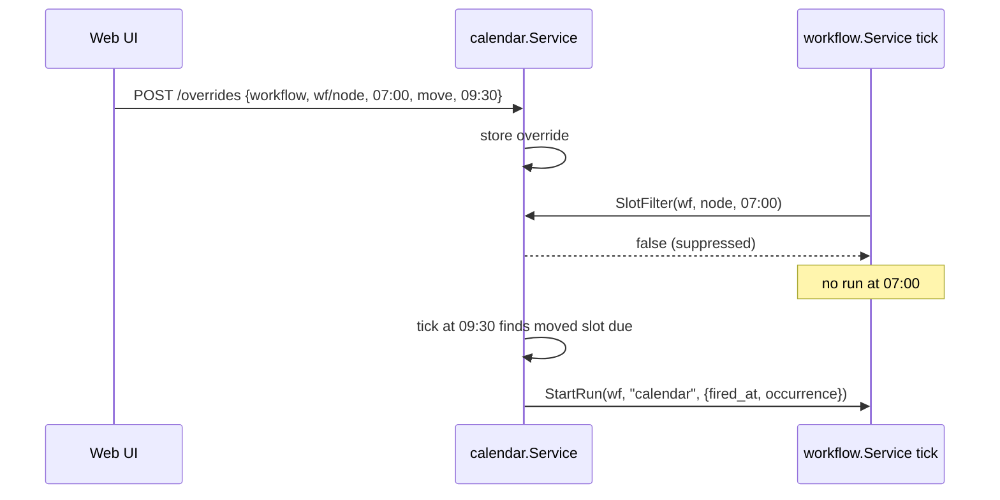
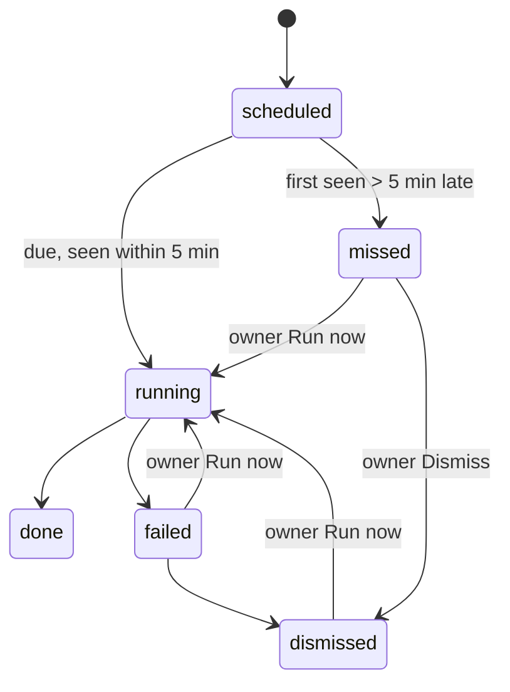

# Design: Calendar

- **Issue**: `—`
- **Requirements**: [requirements.md](requirements.md)
- **Contract**: [api-contract.md](api-contract.md) — Required
- **Requirements revision**: 1
- **Contract revision**: 1
- **Requirements status**: Approved
- **Contract status**: Approved
- **Status**: Approved
- **Design revision**: 1

## Architecture references

- **ADR index**: [docs/adr](../../adr/README.md)
- **Diagram index**: [docs/diagram](../../diagram/README.md)
- **ADR**: `—`
- **Feature-local diagram**: [Feature-local view](#feature-local-view)
- **Durable diagram**: `—`

## Architecture decision scan

| Topic | Existing authority | Decision location | Action |
|---|---|---|---|
| Public interface | spec #9 web conventions, spec #33 contract style | this contract | reuse |
| Persistence | session SQLite + migrations (`store/migrations`) | this design | reuse, new migration `0007` |
| State and lifecycle | firing states in requirements | requirements | local |
| Concurrency | workflow scheduler tick (spec #33) | this design | reuse pattern |
| Dependency direction | `internal/*` imports stdlib + `core` only | spec #33 | reuse |
| External system | Google Calendar API v3, OAuth 2 | this design | create (feature-local) |

## Visual Architecture Check

| Trigger | Present? | Required view |
|---|---:|---|
| Module or crate boundary | Yes | Feature-local view |
| Interaction with an actor or external system | Yes (Google, Telegram, ICS client) | Feature-local view |
| Multi-component flow | Yes (slot override → workflow scheduler) | Slot override flow |
| Lifecycle or state transition | Yes (firing) | Firing states |

## Feature-local view

```mermaid
flowchart LR
  UI["web/ui Calendar page"] -->|/v1/calendar/*| WEB["web/calendar.go"]
  ICS["ICS client"] -->|/cal/{token}.ics| WEB
  WEB -->|CalendarBackend| SVC["internal/calendar.Service"]
  TOOL["tools/calendar.go (agent tool)"] --> SVC
  TG["Telegram owner chat (/agenda, daily agenda, notices)"] --> SVC
  SVC --> ST["calendar.Store (store/calendar.go SQLite | MemStore)"]
  SVC --> SCH["Scheduler (30 s tick: firings, moved slots, agenda, missed)"]
  SVC -->|WorkflowSource| WF["internal/workflow.Service"]
  WF -->|SlotFilter| SVC
  SVC -->|Actions| RT["lana.Runtime (lana_calendar.go): room turn, StartRun, owner message"]
  SVC --> G["google sync (pull 5 min, push 1 min)"]
  G -->|HTTPS| GAPI["Google Calendar API v3"]
```

### Slot override flow



### Firing states



## Repository fit

- New package `internal/calendar` mirrors `internal/workflow`: model, store interface, MemStore, service,
  scheduler loop, no imports outside stdlib + `core` + `internal/*`.
- `internal/workflow` gets one optional hook (`SetSlotFilter`) and an exported slot expander reused by the
  calendar (`(*Service) Slots(ctx, from, to) []Slot`), so cron logic stays in one place (`cron.go`).
- Runtime glue `lana_calendar.go` like `lana_workflow.go`.
- Web handlers `web/calendar.go` with a `CalendarBackend` interface, like `web/workflows.go`.

## Package `internal/calendar`

| File | Content |
|---|---|
| `model.go` | `Item`, `Repeat`, `Action`, `Firing`, `Override`, `HabitCheck`, `Entry`, `Settings`, `GoogleLink`, errors (`ErrInvalidItem` with field list, `ErrNotFound`, `ErrRangeTooLarge`, …). |
| `validate.go` | `Validate(it Item, agents func(string) bool, workflows func(string) bool) []FieldError`. |
| `expand.go` | `Occurrences(it Item, loc *time.Location, from, to time.Time) []time.Time` — REQ-CAL-003 rules; monthly 29–31 skip; `until` inclusive. |
| `entries.go` | `Build(items, overrides, firings, checks, slots, runs, google, from, to, now, loc) []Entry` — pure; sorting; streaks (REQ-CAL-005); short-interval collapse (REQ-CAL-008). |
| `store.go` | `Store` interface: items CRUD (soft delete), overrides upsert/delete/list-in-range, firings upsert with `(item_id, occurrence)` unique + CAS `UpdateFiring(key, from, to)`, habit checks, settings, google link, item history. |
| `memstore.go` | In-memory `Store`. |
| `service.go` | Operations of the contract; change broadcast (`Subscribe`). |
| `scheduler.go` | 30 s loop: due firings, moved workflow slots, daily agenda, missed scan at start. |
| `agenda.go` | Text for `API-CAL-017` and the tool `list`. |
| `ics.go` | RFC 5545 writer (folding at 75 octets, escaping, `DTSTART;TZID`, all-day `VALUE=DATE`). |
| `google.go` | OAuth (code exchange, refresh), events list with `syncToken`, insert/patch/delete with `If-Match` etag, mapping. Uses `net/http` only. |

### Scheduler

- `Start`: `lastSeen` = settings `last_tick` (persisted each tick). For every action occurrence in
  `(lastSeen, now]` with no firing row: if `now - at > 5 min` insert `missed`, else insert `scheduled`.
  Missed rows found in this pass → one Telegram notice (REQ-CAL-007).
- Tick: occurrences due in `(lastTick, now]` → insert firing `scheduled` (unique key; insert conflict = already
  handled) → CAS `scheduled → running` → run the action in a goroutine → `done` / `failed`. Rows left `running`
  at start are set `failed` with "interrupted by restart" and never re-run (AC-CAL-012).
- Moved workflow slots whose `to` is due → `WorkflowSource.StartRun(wfID, "calendar", input)` once per override
  (override row gets `fired_at`).
- Agenda: when enabled and local time ≥ `agenda.time` and `agenda_sent_on` ≠ today and now − agenda time ≤ 5 min →
  send and store `agenda_sent_on` (AC-CAL-019).

### Workflow hook

`workflow.Service.SetSlotFilter(func(ctx, wfID, nodeID string, at time.Time) bool)`. `tickSchedule` and
`tickIntervals` call it before `startIgnoringActive`; `false` → skip (lastFired still updated). The calendar
filter returns false when an override for `(workflow, wfID/nodeID, at)` exists.

## Persistence (`store/migrations/0007_calendar.sql`)

```sql
CREATE TABLE calendar_items (
  id TEXT PRIMARY KEY, kind TEXT NOT NULL, title TEXT NOT NULL, notes TEXT NOT NULL DEFAULT '',
  start_ms INTEGER NOT NULL DEFAULT 0, end_ms INTEGER NOT NULL DEFAULT 0, all_day INTEGER NOT NULL DEFAULT 0,
  date TEXT NOT NULL DEFAULT '', end_date TEXT NOT NULL DEFAULT '', time TEXT NOT NULL DEFAULT '',
  repeat_json TEXT NOT NULL DEFAULT '{}', assignee TEXT NOT NULL DEFAULT 'owner', color TEXT NOT NULL DEFAULT '',
  state TEXT NOT NULL DEFAULT '', action_json TEXT NOT NULL DEFAULT 'null',
  google_calendar TEXT NOT NULL DEFAULT '', google_event TEXT NOT NULL DEFAULT '', google_etag TEXT NOT NULL DEFAULT '',
  google_sync TEXT NOT NULL DEFAULT '', created_by TEXT NOT NULL, updated_by TEXT NOT NULL,
  created_at INTEGER NOT NULL, updated_at INTEGER NOT NULL, deleted_at INTEGER NOT NULL DEFAULT 0);
CREATE INDEX calendar_items_span ON calendar_items(deleted_at, start_ms, date);
CREATE TABLE calendar_overrides (source TEXT, ref TEXT, occurrence INTEGER, op TEXT NOT NULL, to_ms INTEGER NOT NULL DEFAULT 0,
  by TEXT NOT NULL, at INTEGER NOT NULL, fired_at INTEGER NOT NULL DEFAULT 0, PRIMARY KEY (source, ref, occurrence));
CREATE TABLE calendar_firings (item_id TEXT, occurrence INTEGER, status TEXT NOT NULL, started_at INTEGER NOT NULL DEFAULT 0,
  ended_at INTEGER NOT NULL DEFAULT 0, session_id TEXT NOT NULL DEFAULT '', run_workflow TEXT NOT NULL DEFAULT '',
  run_number INTEGER NOT NULL DEFAULT 0, error TEXT NOT NULL DEFAULT '', PRIMARY KEY (item_id, occurrence));
CREATE TABLE calendar_habit_checks (item_id TEXT, date TEXT, by TEXT NOT NULL, at INTEGER NOT NULL, PRIMARY KEY (item_id, date));
CREATE TABLE calendar_history (item_id TEXT NOT NULL, at INTEGER NOT NULL, by TEXT NOT NULL, summary TEXT NOT NULL, snapshot TEXT NOT NULL DEFAULT '');
CREATE TABLE calendar_google_events (calendar_id TEXT, event_id TEXT, etag TEXT, item_id TEXT NOT NULL DEFAULT '',
  json TEXT NOT NULL, updated_ms INTEGER NOT NULL, PRIMARY KEY (calendar_id, event_id));
CREATE TABLE calendar_kv (key TEXT PRIMARY KEY, value TEXT NOT NULL); -- settings, ics token hash, google link, sync tokens, last_tick
```

Google tokens and the OAuth client are in the secret store (`calendar.google.client_id`, `…client_secret`,
`…refresh_token`), not in `calendar_kv`.

## Google sync

- Pull every 5 min and on "Sync now": per selected calendar, `events.list(syncToken)`; on 410 do a full list
  (window −30 d … +365 d). Events with `extendedProperties.private.lana_item` map to that item; others are cached in
  `calendar_google_events` and shown as `google` entries. A cached event the owner edits in lana becomes an item
  (`created_by: google`) linked to it.
- Push within 1 min of a change: items with `google_sync = pending` → insert/patch/delete with `If-Match`. 412 →
  re-read, compare `updated` (REQ-CAL-012), write the loser into `calendar_history.snapshot`.
- 401/invalid_grant → link state `needs_reauth`; no local deletes. Network errors: backoff 1, 2, 5, 10 min.
- Repeats map to `RRULE` (`FREQ`, `BYDAY`, `UNTIL`); a moved occurrence of a synced repeating item is written as a
  Google instance exception.

## Runtime glue (`lana_calendar.go`)

- `Runtime.Calendar() *calendar.Service`, started by `StartCalendar(ctx)` after `StartWorkflows`.
- Actions: `agent_prompt` → the room turn path of spec #32 for that agent, with origin `calendar` and a header line
  "Calendar · <title>"; `run_workflow` → `Workflows().StartRun(id, "calendar", input)`; `send_message` →
  Telegram owner chat or a web toast notice.
- Tool `calendar` registered in `tools/calendar.go`, risk `low`, caller identity from `ToolCtx.Agent`.

## Wiring (`cmd/lana`)

- `daemon.go`: `rt.StartCalendar(runCtx)`; Telegram command `/agenda`; notifier for missed/failed notices.
- `web.go`: `webBackend` exposes `Calendar() web.CalendarBackend`.

## Web (`web/calendar.go`)

Routes as in the contract. `/cal/{token}.ics` and the OAuth callback are registered with `s.mux.Handle` directly.
The stream follows the workflows SSE loop.

## Web UI (`web/ui`)

### Files

| File | Content |
|---|---|
| `api/calendar.ts` | Types of the contract and calls `API-CAL-001`–`015`. `loadEntries` falls back to workflow data on `404` (below). |
| `views/calendar-model.ts` | Pure date math: `startOfWeek`, `addDays`, `dayKey`, month grid cells, range of a view, layout of timed entries into columns (overlap lanes), entry grouping by day, labels. |
| `views/calendar-fallback.ts` | Builds `workflow_slot` / `workflow_run` entries from `/v1/workflows` + runs + `nextCron` when `/v1/calendar` is not served. |
| `views/calendar.tsx` | `CalendarPage`: header, toolbar, habit strip, view switch, data loading, stream, drag and drop. |
| `views/calendar-views.tsx` | `MonthView`, `WeekView`, `DayView`, `AgendaView`, `EntryChip`, `EntryCard`. |
| `views/calendar-detail.tsx` | Entry popover (detail + actions) and `ItemEditor` modal (create/edit any kind, repeat, assignee, action). |
| `views/calendar-settings.tsx` | Settings drawer: time zone, week start, daily agenda, ICS URL (copy, rotate), Google link. |
| `styles/pages-gr8r/calendar.css` | Ported Gr8r calendar CSS (`.cal-h`, `.cal-g`, `.cday`, `.cev`, `.week`, `.wcol`, `.wcard`) + Day timeline + Agenda + habit strip. |
| `preview/calendar-fixtures.ts` | Stateful mock of every calendar endpoint for `preview.html`. |

### Routing and URL state

- `#/calendar` (section `calendar`), query `?view=month|week|day|agenda&date=YYYY-MM-DD`. Default `week`, today.
- Sidebar: Workspace group → Home, Chats, Workflows, Calendar (icon `calendar-days`).

### Page layout

- Header: title "Calendar", subtitle "Your plans, agents' plans and every workflow run in one place.", actions:
  `New` (menu: Event, Task, Reminder, Note, Habit), settings icon button.
- Missed banner when `missed > 0`: "N actions were missed while lana was off" + "Review" (switches to Agenda filtered
  to missed).
- Fallback banner when the backend is absent: "Calendar service is not running in this daemon yet. Showing workflow
  schedules and runs only."
- Habit strip (Week/Day/Agenda, when habits exist): today's habits as check chips with 🔥 streak.
- Toolbar (Gr8r `.toolbar`): Today, ‹ ›, period label (`aria-live`), source filter chips (Mine, Agents, Workflows,
  Google), `Seg` Month/Week/Day/Agenda.

### Entry look

| Source / kind | Icon | Look |
|---|---|---|
| event | `calendar` | solid chip, item color |
| task | `square` / `square-check` | chip, strike when done, assignee avatar |
| reminder | `bell` | chip |
| note | `sticky-note` | muted chip |
| habit | `repeat` | check chip with streak |
| workflow slot | `workflow` | dashed chip (gr8r `.cev.event` style), accent color, `moved` → `move` icon, `skipped` → strike |
| workflow run | status icon | chip tinted by run status (green/red/amber/blue) |
| google | `calendar` | chip with Google calendar color, small "G" marker |

Agent-made items show the agent's `AgentFace` and "Added by <name>" in the popover. Missed firings get a red
`alert-triangle` and the word "Missed".

### Views

- Month: Gr8r month grid (5–6 weeks), up to 3 chips per day then "+N more" (opens Day view), "+" add button per day,
  drop target per day (moves keeping the time of day).
- Week: Gr8r week columns, all-day lane on top, then timed cards sorted by start; "+" per day; drop target per day.
- Day: all-day lane + hourly grid 00–24 (48 px/hour), entries placed by start/end with overlap lanes, a now line,
  drop target per 15-minute slot; scrolls to 07:00 or now.
- Agenda: next 14 days (and missed firings first when filtered), grouped by day, one row per entry.

### Interactions

- Click an entry → popover: title, when, kind/source, status, created by, action summary, firing state, buttons:
  Edit, Mark done / Tick, Move…, Skip (repeating or workflow slot), Reset (moved/skipped), Run now (missed/failed
  firing), Dismiss, Open run / Open workflow, Delete.
- Drag (HTML5 DnD) items and workflow slots; run entries, Google read-only and fallback entries are not draggable.
  Dropping a repeating item asks "This one / All events" (Modal); "This one" → override, "All" → PATCH.
- Move… → small form with date and time fields (keyboard path, AC-CAL-018).
- Live: `EventSource` on `/v1/calendar/stream` → reload visible range (debounced 300 ms); also reload on
  `/v1/workflows/stream` changes.

### Fallback (backend absent)

`loadEntries` calls `API-CAL-001`; on `404` it marks the session as fallback, then builds entries from
`listWorkflows` → `getWorkflow` (graphs) → `listRuns` with `nextCron` for schedule slots and the interval rule of
REQ-CAL-008. Create/edit/move are disabled with a tooltip; Run workflow now still works.

## Test strategy

- `internal/calendar`: unit tests for `expand.go` (AC-CAL-005), `entries.go` (AC-CAL-003, -008, -009, -015),
  scheduler with a fake clock and fake actions (AC-CAL-006, -007, -010–014, -019), validation (AC-CAL-001, -002),
  ICS writer golden file (AC-CAL-023), Google mapping and conflict with an `httptest` server (AC-CAL-020–022).
- `internal/workflow`: slot filter test (AC-CAL-006 workflow side).
- `web`: handler tests with a fake backend; range errors (AC-CAL-004); ICS token 404.
- `tools`: calendar tool marks `agent:<name>` (AC-CAL-016).
- `web/ui`: vitest for `calendar-model.ts`, fallback builder, and the page (render each view, drag override
  AC-CAL-017, keyboard Move… AC-CAL-018, stream refresh AC-CAL-024).
