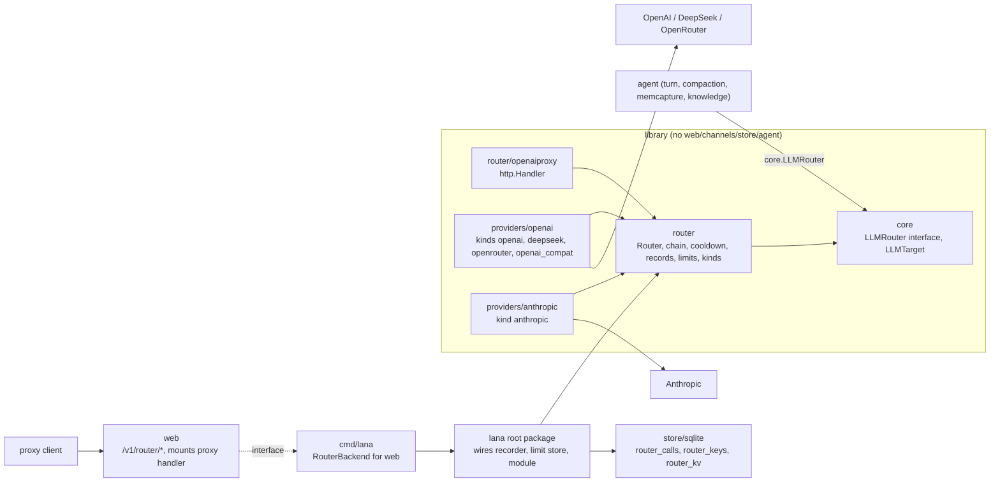

# Design: LLM router

- **Requirements**: [requirements.md](requirements.md) r1 Approved
- **Contract**: [api-contract.md](api-contract.md) r1 Approved
- **Status**: Approved (agent recommendation on the owner's instruction, 2026-11-08)
- **Design revision**: 1

## Architecture references

- **ADR**: [0019](../../adr/0019-llm-router-as-embeddable-core.md) (new), [0015](../../adr/0015-embeddable-runtime-for-services.md), [0013](../../adr/0013-use-go-as-single-binary.md)
- **Feature-local diagram**: below.

## Visual Architecture Check

| Trigger | Present? | Required view |
|---|---:|---|
| Module boundary | Yes | boundary (below) |
| External system | Yes | providers, proxy clients (below) |
| Multi-component flow | Yes | chain flow (below) |
| Concurrency, retry, or failure flow | Yes | chain flow (below) |
| Dependency direction | Yes | boundary (below) |
| Entity relation | No | — |



```mermaid
sequenceDiagram
  participant A as caller (agent/proxy)
  participant R as router.StreamChain
  participant C as cooldown
  participant P as adapter
  A->>R: chain [a/x, b/y], req, meta
  R->>C: drop cooling targets (all cooling → keep all)
  loop each target
    loop attempts (2 retries if more targets, else 5)
      R->>P: Stream
      alt first event ok
        R-->>A: stream (served target); record ok on end
      else rate_limit/server/network
        R->>R: onAttempt + record; backoff or move on (Retry-After > 20s)
      else auth/missing_secret/not_found
        R->>C: cool (auth); next target
      else client/context_length
        R-->>A: error, stop
      end
    end
  end
```

## Repository fit

- `core` gains `LLMRouter` (interface) and call metadata types so `agent` can use the router without
  importing it (archtest allows only `core` and `internal/*`).
- `router` is a new library package. Adapters register kinds with `router.RegisterKind` from `init()`,
  the same pattern as `core.RegisterModule`. The `llm` module moves from `providers/openai/module.go` to
  `router/module.go` and builds the router from `core.Config`.
- The archtest gains: `router` → core, internal; `router/*` → router, core, internal; `providers/*` may
  also import `router`.
- Persistence follows ADR 0005: new SQLite tables in `store/sqlite` (migration `0008_router.sql`). The
  root package adapts the store to `router.Recorder` and `router.LimitStore`.
- `web` cannot import `router`; it calls a `RouterBackend` interface implemented in `cmd/lana`, like
  `ProviderTester` today.

## Proposed design

### Components

- **core/router.go** — `LLMRouter interface { LLMRegistry; Resolve(string) ([]LLMTarget, error);
  StreamChain(ctx, []LLMTarget, ChatRequest, LLMCallMeta, func(LLMAttempt)) (ChatStream, LLMTarget, error);
  Embed(ctx, address string, []string, LLMCallMeta) ([][]float32, error) }`, `LLMCallMeta`, `LLMAttempt`.
  `router.Target` is an alias of `core.LLMTarget`.
- **router.Router** — holds `atomic.Pointer[snapshot]` (adapters by provider name, combos, cooldown
  duration). `Apply` builds a new snapshot (adapters are rebuilt only for changed provider configs) and
  swaps it. Calls capture the snapshot at start.
- **router chain** — the retry/fallback loop of REQ-RTR-005, ported from `agent/retry.go` (same backoff
  2/4/8/16/32 s ×0.8–1.2, Retry-After capped at 120 s). Success = first event, as today. HTTP 404 from
  an adapter is classified `not_found` (new class) by both adapters.
- **router cooldown** — `map[Target]time.Time` under a mutex; set after a target's last attempt ends with
  `rate_limit` or `auth`.
- **router records** — the chain wraps the stream: it measures TTFT and duration, captures `usage`
  events, computes cost from `ModelInfo.Price`, and calls `Recorder.Record` once per attempt. The
  recorder in lana is an async buffered writer (cap 1024, drops + counts when full).
- **router limits** — adapters push `LimitUpdate` (from headers) through `Deps.Limits`; balance and
  credit fetchers implement `BalanceFetcher`; `Limits(refresh)` merges, rate-limits refresh to 5 min,
  persists through `LimitStore` (debounced 10 s). External sources (Claude Agent, spec 38) call
  `Router.UpdateLimits(LimitUpdate)`.
- **router models** — `Models` merges `internal/models` catalog entries for the provider's kind with
  `Adapter.ListModels` (cached 24 h in memory and through `LimitStore`-like `ModelCache` in `router_kv`).
- **internal/models** — the catalog gains `Provider kind`, `Price{Input, CachedInput, Output}` per
  million tokens, and entries for OpenAI, Anthropic (current Claude models, IDs and prices taken from
  the `claude-api` skill), DeepSeek, and an OpenRouter mapping (`<vendor>/<model>` IDs resolve to the
  same entry by suffix). `Lookup` accepts an address or `(kind, id)`.
- **providers/openai** — registers kinds `openai`, `deepseek`, `openrouter`, `openai_compat`. Adds per
  kind: effort mapping (`openai`: `reasoning_effort` off→`minimal`, low, high, max→`xhigh`, sent only for
  catalog thinking models or when the agent sets an effort; `openrouter`: `reasoning:{effort}` and
  `delta.reasoning` parsing; `deepseek`: existing format), rate-limit header parsing, `ListModels`
  (`GET {base}/models`; OpenRouter also reads `pricing` and `context_length`), balance (`deepseek`:
  `GET https://api.deepseek.com/user/balance`; `openrouter`: `GET {base}/key`), 404 → `not_found`.
- **providers/anthropic** — new adapter: `POST {base}/v1/messages` with `stream:true`,
  `anthropic-version: 2023-06-01`, `x-api-key`. Maps system → `system` blocks with `cache_control` on
  the last system block and on the last tool; user/assistant blocks (text, image base64, tool_use,
  tool_result with images, thinking with signature round-trip); effort → thinking per the `claude-api`
  skill's current guidance for the model (adaptive thinking/effort where supported, else
  `budget_tokens`); SSE events `message_start`, `content_block_start/delta/stop`, `message_delta`,
  `message_stop`, `error`; usage `input_tokens + cache_read_input_tokens + cache_creation_input_tokens`
  as input, cached = cache reads; stop reasons; errors 401/403 auth, 404 not_found, 413/400 prompt-too-long
  → context_length, 429 rate_limit, 500/529 server; `anthropic-ratelimit-*` headers → limits;
  `GET /v1/models` for `ListModels`. Thinking blocks need the signature preserved: `core.ContentBlock`
  gains `Signature string` (json `signature,omitempty`), ignored by other adapters.
- **router/openaiproxy** — OpenAI Chat Completions ⇄ `core.ChatRequest` translation, SSE writer,
  non-stream aggregation, error mapping, `X-Lana-Served-By`. Auth through the injected func.
- **router/module.go** — module `llm`: builds `router.Config` from `core.Config` (`Providers`,
  `Combos`, `Router.Cooldown`), options from `cfg.Values` (`_providers` custom adapters kept for tests
  and embedders, `_recorder`, `_limit_store`), provides `core.ServiceLLM` (the router satisfies both
  `LLMRegistry` and `LLMRouter`). Boot key checks as today, plus combo targets.
- **config** — kinds, defaults (`base_url`, `api_key_env`), `[combos]`, `[router]`, agent `model` rules
  (API-RTR-003), in-use checks, `topKeys`.
- **agent** — `resolve` builds the chain: legacy (`provider`+`model`+`fallback`) or
  `LLMRouter.Resolve(model)` + fallback; session selection the same. The default `LLMStream` handler
  calls `StreamChain` with `onAttempt` writing `assistant/attempt`; the `Retry` hook no longer retries
  routed calls (router owns retry) and is removed. `step/end` records the served target. Context window
  for a chain = the smallest known window in the chain (agent `context_window` still wins). Effort and
  vision defaults come from the first target. Compaction, memcapture, and knowledge passes call
  `StreamChain` with their source; knowledge embeddings call `Embed`.
- **store/sqlite** — `router_calls(id INTEGER PK, at, source, agent, session_id, turn_id, requested,
  provider, model, attempt, outcome, input_tokens, output_tokens, cached_tokens, cost_usd NULL, ttft_ms,
  duration_ms, error)` with indexes on `at` and `(provider, at)`; `router_keys(id, name, prefix, hash
  UNIQUE, created_at, last_used_at, revoked_at)`; `router_kv(key PK, value, updated_at)`. Queries for
  usage (totals, series, by provider/model/source, percentiles computed in Go over the range), calls
  page, prune older than 30 days (hourly, from the daemon).
- **web** — `RouterBackend` interface; handlers for API-RTR-006..014; mounts the proxy handler on
  `s.mux` (no cookie auth) at `/router/v1/` when enabled, keeping `checkHost`; provider PUT/DELETE apply
  live through `ApplyLive`.
- **cmd/lana** — implements `RouterBackend` over the runtime's router and store; `Runtime.ApplyConfig`
  calls `router.Apply`.
- **web/ui** — `api/router.ts`; `views/router/` with tabs Overview (KPI tiles, tokens/cost chart,
  provider & model tables, limit cards incl. Claude Agent), Providers (moved `SettingsProvidersPage` +
  `ProviderDialog`, kind picker with four presets + custom), Models, Combos (ordered editor with
  drag/up/down, used-by), Logs (filterable table, detail drawer), Proxy (switch, base URL, keys with
  copy-once dialog, curl example). Sidebar item and routes per API-RTR-017. Agent model picker uses
  `choices`. Charts follow the `dataviz` skill and Gr8r components.

### Persistence

- Migration `0008_router.sql` (three tables). Session events unchanged except `step/end` now names the
  served target.

### Failure handling

| Failure | Internal error | Observable result |
|---|---|---|
| All targets fail | last `*core.ProviderError` | turn error as today |
| Recorder full | dropped record counter | log warn once per minute |
| Apply with invalid config | validation error | 422, old snapshot stays |
| Balance fetch fails | snapshot `error` set | card shows last values + error |

### Concurrency

- Snapshot swap is lock-free; cooldown and limits use mutexes; the recorder is a single writer goroutine.

### Security

- Keys only via `core.Secrets`; adapters redact the key from error text (existing `redactProviderKey`
  logic moves to `router`). Proxy keys: `lrk_` + 43 base62 chars from `crypto/rand`, SHA-256 stored,
  constant-time compare on hash lookup.

## Requirement traceability

| Requirement | Contract | Component | Level |
|---|---|---|---|
| REQ-RTR-001 | API-RTR-001 | config, providers/openai | unit |
| REQ-RTR-002 | API-RTR-001 | providers/anthropic | unit (fixtures) |
| REQ-RTR-003 | API-RTR-003 | router.Resolve, config, agent | unit |
| REQ-RTR-004 | API-RTR-002 | config | unit |
| REQ-RTR-005 | API-RTR-005 | router chain, agent | unit + integration |
| REQ-RTR-006 | API-RTR-004 | router cooldown | unit |
| REQ-RTR-007 | — | agent consumers | integration |
| REQ-RTR-008 | API-RTR-006 | router.Apply, cmd/lana | integration |
| REQ-RTR-009 | API-RTR-012 | records, store | unit + integration |
| REQ-RTR-010 | API-RTR-011 | records, internal/models | unit |
| REQ-RTR-011 | API-RTR-011 | store, web, UI | integration |
| REQ-RTR-012 | API-RTR-013 | limits, adapters | unit |
| REQ-RTR-013 | API-RTR-009/010 | models, adapters | unit + runtime |
| REQ-RTR-014 | API-RTR-006/007 | web, config | integration |
| REQ-RTR-015 | API-RTR-015/016 | openaiproxy, web | integration |
| REQ-RTR-016 | API-RTR-014 | store, web | integration |
| REQ-RTR-017 | API-RTR-005 | router, examples/router, archtest | unit |
| REQ-RTR-018 | API-RTR-008 | UI | runtime |

## Verification strategy

- **Unit**: chain/cooldown with a mock kind and fake clock/sleep; Anthropic SSE and error fixtures;
  OpenAI-wire per-kind effort and header parsing; proxy translation; config validation; cost math.
- **Integration**: `httptest` fake providers driving a full turn through the agent with fallback;
  store queries; web handlers; proxy with keys.
- **Runtime**: daemon with the real DeepSeek key (the owner's `DEEPSEEK_API_KEY`), Router page
  screenshots, curl against the proxy. Other providers are verified with fakes when no key is present.

## Risks and tradeoffs

- Moving retry from the agent hook into the router changes where attempts are produced; existing retry
  tests move with it.
- Catalog prices go stale; OpenRouter prices are live, the rest are a snapshot with a date in the
  catalog.
