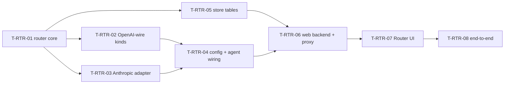

# Tasks: LLM router

- **Status**: In Progress · branch `feature/router` (worktree `../lana-harness-router`)
- **Requirements** r1 · **Contract** r1 · **Design** r1 (all Approved 2026-11-08)

| ID | Slice | Covers | Evidence |
|---|---|---|---|
| T-RTR-01 | `core` LLMRouter types; `router` package (Router, Apply, Resolve, chain retry/fallback, cooldown, records + cost, limits, models merge, kind registry, module `llm` moved here); `internal/models` catalog with kinds, prices, OpenAI/Anthropic/OpenRouter entries; `examples/router`; archtest rules | REQ-RTR-003..006, 009, 010, 017; AC-RTR-004, 006 (router side), 007..009, 014, 023 | `go test ./router/... ./internal/... ./providers/... ./agent/ .` ok, `-race ./router` ok, `go run ./examples/router` prints reply + record (AC-RTR-023); commit 2dc265d. Deviation: `requested` needed `LLMCallMeta.Requested` (added in T-RTR-04) |
| T-RTR-02 | `providers/openai` registers `openai`, `deepseek`, `openrouter`, `openai_compat`; per-kind effort; rate-limit headers; `ListModels`; balances; `not_found` | REQ-RTR-001, 012, 013; AC-RTR-001, 016, 017 | 18 new tests (`providers/openai/kinds_test.go`) incl. AC-RTR-001, 016, 017 data; openai_compat gets no default key env (avoids sending a key to a custom host); commit on wip/rtr-oai merged |
| T-RTR-03 | `providers/anthropic` native adapter + fixtures; `core.ContentBlock.Signature` | REQ-RTR-002; AC-RTR-002, 003, 018 | fixtures AC-RTR-002/003, 22-case effort table, signature + redacted thinking round-trip; `agent/turn.go` keeps signed thinking in response order (`TestTurnSignedThinkingKeepsOrder`); merged from wip/rtr-ant |
| T-RTR-04 | `config` kinds/defaults/combos/router/agent model rules; agent resolve via router, attempts via `onAttempt`, served target in `step/end`, compaction/memcapture/knowledge/embeddings through router; root wiring of recorder + limit store; `Runtime.ApplyConfig` applies router | REQ-RTR-003..008; AC-RTR-004, 005, 006, 007, 008, 010, 011 | `lana_router_turn_test.go` AC-RTR-007/008/010/011 on fake servers + SQLite; whole repo `go test ./...` ok; agent Retry hook removed (router owns retry). Deviation: a bare model that is neither combo nor address fails at turn time, not validation; `provider/model` with unknown provider is rejected (AC-RTR-005) |
| T-RTR-05 | `store/sqlite` migration 0008, call insert (async recorder), usage/calls queries, prune, keys, kv | REQ-RTR-009, 011, 016; AC-RTR-012, 013, 015, 022 (store side) | migration 0008; store + `internal/routerdb` tests incl. AC-RTR-015 math, keys lifecycle (AC-RTR-022 store side); async recorder batching/drop tests; calls cursor is exclusive |
| T-RTR-06 | `router/openaiproxy`; `web` RouterBackend + API-RTR-006..016 handlers; `cmd/lana` backend | REQ-RTR-008, 013..016; AC-RTR-019..022 | `web/router_test.go` (all shapes, 404/409/422/503), `cmd/lana/web_router_test.go` on a real Runtime: proxy live toggle, 401, revoked key 401, source proxy record (AC-RTR-020..022), AC-RTR-011 end to end; proxy handler tests (`router/openaiproxy`, 14 tests). Deviations: errors use the repo envelope `{error:{code,message,details}}`; missing key at boot warns instead of failing; secrets.env re-read on mtime change |
| T-RTR-07 | UI: sidebar, `#/router/*`, six tabs, providers moved, agent model picker, `make web` | REQ-RTR-011..014, 018; AC-RTR-015, 024 | vitest 351/351, typecheck, eslint; AC-RTR-014/015/017/019/024 UI tests; Tokens and cost as two aligned charts (dataviz rule: no dual axis) |
| T-RTR-08 | End-to-end on a real daemon: DeepSeek key, fake failing provider for fallback, proxy curl, screenshots; docs (README, CHANGELOG) | SC-001, all AC smoke | Pending |
