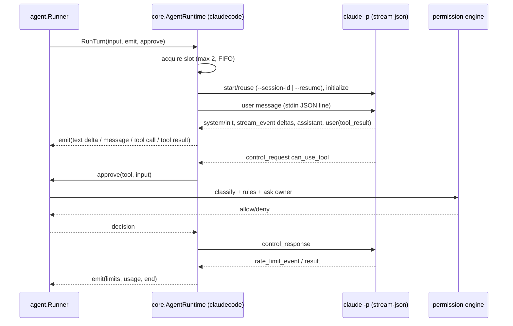

# Design: Claude Agent runtime

- **Requirements** r1 · **Contract** r1 · **Status**: Approved (2026-11-08) · **Design revision**: 1
- **ADR**: [0018](../../adr/0018-claude-code-as-external-agent-runtime.md) (binding)

## Visual Architecture Check

| Trigger | Present? | View |
|---|---:|---|
| Module boundary / dependency direction | Yes | below |
| External system | Yes | `claude` process |
| Concurrency, retry, failure | Yes | below |

## Repository fit

- **core/runtime.go** — `AgentRuntime` interface, `RegisterRuntime(name, factory)`, `RuntimeTurn`
  (session, turn, agent config, resume UUID, input blocks, `Emit func(RuntimeEvent)`,
  `Approve func(ctx, RuntimeApproval) (allow bool, message string)`), `RuntimeEvent` kinds
  (`text_delta`, `thinking_delta`, `assistant_message`, `tool_call`, `tool_result`, `session_meta`,
  `usage`, `limits`, `end`). `core.AgentConfig` gains `Runtime`, `Auth`, `Binary`, `AllowScheduled`
  (and `APIKeyEnv` for `auth = "api_key"`).
- **runtime/claudecode** (library; imports core, internal) — registers `claude-code`. Parts:
  `process.go` (spawn with flags, env scrubbing, stdout line reader with 10 MB line cap, stderr ring
  buffer, idle timer, SIGTERM), `protocol.go` (message types for `system`, `stream_event`, `assistant`,
  `user`, `result`, `rate_limit_event`, `control_request`/`control_response`, `initialize`, `interrupt`),
  `runtime.go` (per-session process pool, global semaphore 2 with FIFO wait, `RunTurn`), `status.go`
  (`--version` parse, `auth status` probe, 60 s cache), `toolclass.go` (Claude tool → lana risk class).
  Hooks to report usage and limits are injected by the root package (`Options{Record func(...), Limits
  func(...)}`) so the package does not import `router`.
- **agent** — `Runner.runTurn` branches to `runExternalTurn` when the resolved agent has a runtime. It
  writes the same `turn/*`, `step/*`, `user/message`, `assistant/message`, `tool/call`
  (`external: true`), `tool/result` events, streams deltas through the hub like native turns, reads the
  stored Claude session UUID from the latest `system/message` runtime payload, and routes `Approve`
  through the existing approval path used by `toolrunner.go` (classifier input built from the Claude
  tool name and input; `bash(<command>)` matching for `Bash`). Cancel maps to the runtime's interrupt.
  Background passes (compaction, memcapture, knowledge) skip runtime agents. Subagent `task` to a Claude
  Agent creates a child session as today and runs it through the same branch.
- **config** — keys and validation per API-CCR-001 (forbidden keys list, `auth`, `allow_scheduled`).
- **calendar / workflows** — check `allow_scheduled` before firing on a runtime agent.
- **root package** — blank-imports `runtime/claudecode`, wires `Record` → router recorder (provider
  `claude-agent`) and `Limits` → `Router.UpdateLimits`.
- **web + cmd/lana** — `GET /v1/router/claude-agent` through `RouterBackend`; agent endpoints carry the
  runtime keys; UI: agent form runtime switch, profile engine label, Router Overview Claude Agent card
  (plan windows with text labels and progress bars).
- **archtest** — `runtime/*` → core, internal.

## Testing

- A fake `claude` (Go test helper binary built in `TestMain`, `testdata/fakeclaude`) that replays JSONL
  fixtures, records argv/env to a file, answers control requests, and can ignore `interrupt`.
- Fixtures recorded once from the real CLI with a harmless prompt (`--model haiku`, "say hi", and one
  `ls` tool call) and checked in with session IDs and paths scrubbed.
- Runtime smoke: one real turn through the daemon with the owner's logged-in Claude Code.

## Risks

- The control protocol is not a versioned public spec (ADR 0018); fixtures and a minimum version check
  catch drift.
