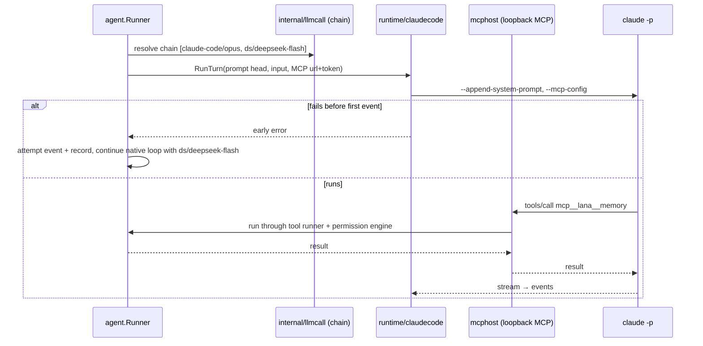

# Design: Claude Code as a router target

- **Requirements** r1 · **Contract** r1 · **Status**: Approved (2026-11-08) · **Revision**: 1
- **ADR**: [0020](../../adr/0020-claude-code-as-router-target-with-lana-context.md)

## Components

- **router** — `claude-code` is a reserved provider name: `Resolve`/validation accept `claude-code/<m>`;
  `StreamChain` never calls it (it returns `not_found` if reached, which cannot happen because the agent
  dispatches first). `Router.Models("claude-code")` returns the alias list. Proxy model list excludes it.
- **config** — address rules (API-CCT-001), legacy `runtime` mapping in the effective config
  (API-CCT-002), `[router] background_model` (API-CCT-003). Validation of Claude-only agent keys:
  allowed on any agent; they apply to Claude Code turns only.
- **internal/llmcall** — `IsClaudeCode(target)`, `SplitEngine(chain)` → first target engine;
  `BackgroundChain(agent)` per REQ-CCT-007 (replaces the `ErrRuntimeAgent` refusal).
- **agent** — `runTurn` decides per turn: first available target is `claude-code/*` → `runExternalTurn`
  with `RuntimeConfig.Model` from the address; on an early failure (`claudecode` reports "before first
  event") write `assistant/attempt`, record, and continue in the native loop with the rest of the chain.
  Session meta per engine: switching engine drops the stored Claude session for resume. The prompt head
  builder used by native turns is reused to produce `AppendSystemPrompt`; a hash of it triggers a process
  restart with `--resume`. Knowledge recall prepended to the input like native turns.
- **runtime/claudecode** — `RuntimeConfig` gains `AppendSystemPrompt`, `MCPConfig` (JSON string); args add
  `--append-system-prompt` and `--mcp-config` (not `--strict-mcp-config`, so the owner's own Claude MCP
  servers still load). `RunTurn` returns a typed `EarlyError` when it fails before the first content event
  (and treats `rate_limit_event` status `rejected` before output as early).
- **mcphost** (new library package `internal/mcphost` or `runtime/mcphost`, imports core + internal +
  the MCP go-sdk already in go.mod) — one loopback listener per lana Runtime, started lazily on the first
  Claude Code turn; per-session tokens (`crypto/rand`, 32 bytes) registered for the life of the Claude
  process; tool list from the agent's allowed tools minus file/shell tools, plus the agent's MCP server
  tools; calls dispatched through a callback into the agent's tool runner (so permission, approvals,
  events, spill, guard all apply). Root package wires it.
- **web + UI** — remove the Engine radio and `agent-runtime.tsx` branches; model picker group
  "Claude Code" with the claude logo; agent form shows the Claude note + Claude-only keys when the
  selected model is `claude-code/*`; Router Providers "Subscriptions" card "Claude Code" (from the
  redesign) lists models and users; legacy agents saved through the dashboard drop `runtime`.
- **records/limits** — provider name `claude-code` for new records and the limits snapshot.

## Testing

- Fake `claude` from `runtime/claudecode/testdata/fakeclaude` extended to (a) record argv incl.
  `--append-system-prompt`/`--mcp-config`, (b) call an MCP tool against the given URL+token when a
  fixture directive says so, (c) report not-logged-in for the fallback test.
- Tests per AC in requirements; one root integration test runs combo fallback, MCP memory tool, and the
  background model.
- Runtime smoke with the real `claude`: persona injection, `mcp__lana__memory` call with approval, combo
  fallback by making the binary path wrong.
