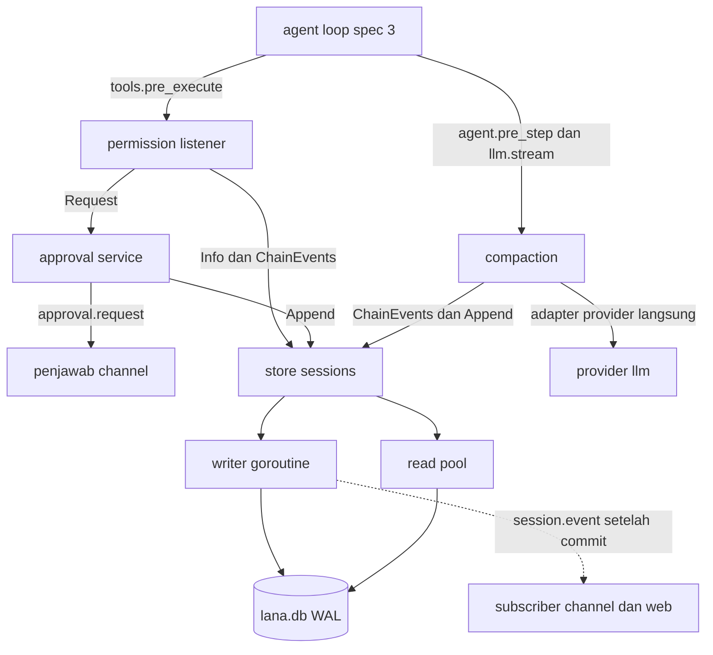
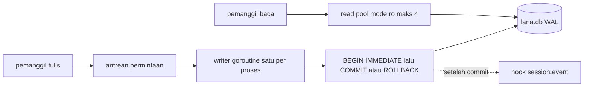
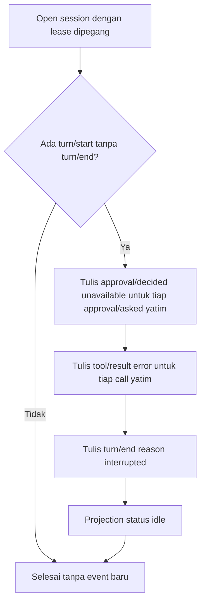
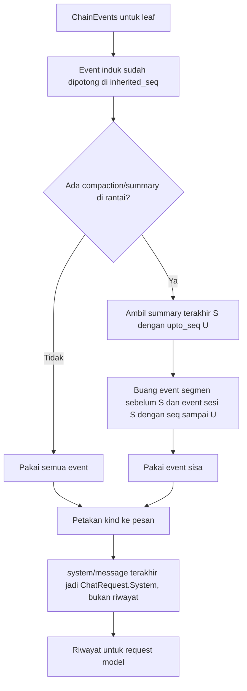
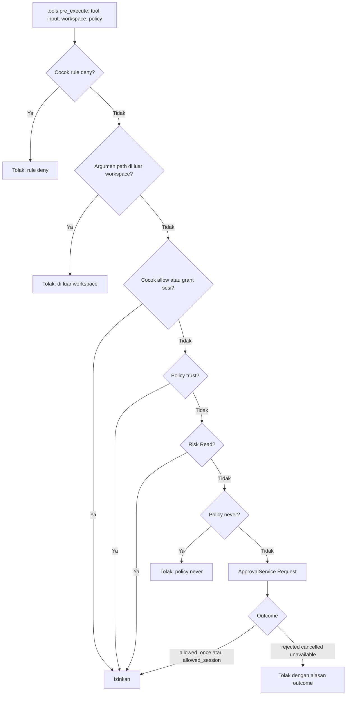
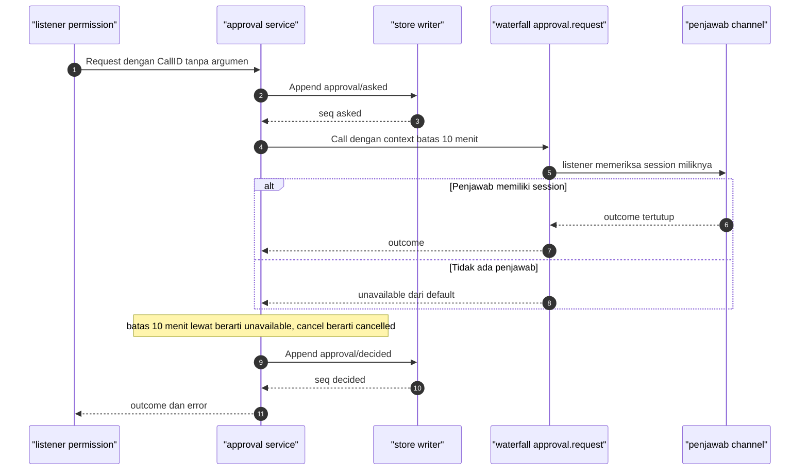

# Design: Session event log, permission, approval

- **Issue**: [`#4`](https://github.com/ridhomujizat/lana-harness/issues/4)
- **Requirements**: [requirements.md](requirements.md)
- **Contract**: [api-contract.md](api-contract.md) — Diperlukan
- **Revisi requirements**: 2
- **Revisi contract**: 2
- **Status requirements**: Approved
- **Status contract**: Approved
- **Status**: Approved
- **Revisi design**: 2 (rekonsiliasi: `core.DeriveMessages` di `core`, `internal/pattern`, penjawab library, signature store, lihat `DQ-011` sampai `DQ-015`)

Jangan membuat design terhadap requirements atau contract yang belum di-approve.

## Referensi arsitektur

- **Index ADR**: [docs/adr](../../adr/README.md)
- **Index diagram**: [docs/diagram](../../diagram/README.md)
- **ADR**: [0002](../../adr/0002-core-dari-modul-service-dan-hook.md), [0004](../../adr/0004-permission-mode-per-agent.md), [0005](../../adr/0005-sqlite-sebagai-storage-tunggal.md), [0009](../../adr/0009-session-sebagai-event-log-append-only.md), [0010](../../adr/0010-profile-dan-config-patch.md), [0011](../../adr/0011-subagent-sebagai-child-session.md), [0013](../../adr/0013-gunakan-go-sebagai-single-binary.md), [0014](../../adr/0014-integrasi-sebagai-agentic-tool.md). Semua Accepted.
- **Diagram lokal fitur**: [Komponen](#komponen-dan-dependency), [Topologi writer](#topologi-writer-dan-read-pool), [Resume repair](#resume-repair), [Derive](#derive-dengan-fork-dan-compaction), [Keputusan permission](#keputusan-permission), [Rantai approval](#rantai-approval)
- **Diagram tahan lama**: [0002. Agent Loop Dan Approval](../../diagram/0002-agent-loop-dan-approval.md), [0003. Data Model Dan Scheduler](../../diagram/0003-data-model-dan-scheduler.md), [0004. Profile, Fork, Subagent, Dan Protokol](../../diagram/0004-profile-fork-subagent-dan-protokol.md)
- **Lease**: diagram alur lease ada di [spec #1 design, bagian Lock session](../1-cli-tui/design.md#lock-session). Spec ini tidak menggambar ulang.

## Scan keputusan arsitektur

| Topik | Otoritas yang ada | Lokasi keputusan | Aksi |
|---|---|---|---|
| Antarmuka publik | Contract spec #4, `core` dari spec #2 | contract | Pakai ulang. Method baca di `SessionStore` (`Info`, `ChainEvents`, `DeriveMessages`) ditambah di spec #2 (`API-CORE-009`) |
| Persistence | ADR 0005 dan 0009 | ADR | Pakai ulang. Tambahan kolom projection `workspace` dan `turn_count` (contract `CQ-008`) |
| State dan lifecycle turn | Diagram 0002 dan 0004 | diagram | Pakai ulang. Resume repair dari diagram 0004 |
| Konkurensi | ADR 0005 (writer tunggal), spec #1 (`BEGIN IMMEDIATE`) | ADR dan spec #1 | Pakai ulang. Writer per proses, `BEGIN IMMEDIATE` lintas proses |
| Arah dependency | ADR 0013 | ADR | Pakai ulang. Package implementasi hanya meng-import `core` |
| Permission | ADR 0004 | ADR | Pakai ulang urutan 1 sampai 7 |
| Compaction | ADR 0005, 0009, diagram 0002 | ADR dan diagram | Pakai ulang ambang 70% dan retry sekali |
| Pola rule dan wildcard | Tidak ada | design | Lokal. Didefinisikan di contract `API-PERM-001` |

## Visual Architecture Check

| Pemicu | Ada? | Tampilan yang dibutuhkan |
|---|---:|---|
| Batas modul atau package | Ya | Komponen dan dependency |
| Interaksi dengan aktor atau sistem luar | Ya | Rantai approval (sequence) |
| Alur multi-komponen | Ya | Keputusan permission, derive, resume |
| Lifecycle atau transisi state | Ya | Resume repair (flowchart) |
| Relasi entity | Ya | ERD di diagram 0003 (tidak digambar ulang) |
| Konkurensi, retry, atau alur gagal | Ya | Topologi writer, rantai approval |
| Arah dependency atau topologi runtime | Ya | Topologi writer dan read pool |

## Tampilan lokal fitur

### Komponen dan dependency

### Topologi writer dan read pool

### Resume repair

### Derive dengan fork dan compaction

### Keputusan permission

### Rantai approval

## Kesesuaian dengan repository

Layout mengikuti ADR 0013 dan ARCHITECTURE §4. Satu package baru di luar layout: `internal/pattern` (`DQ-013`).

| Package | Isi | Boleh meng-import |
|---|---|---|
| `store/` | `Open`, writer, migrator, projection, derive, lease, repair, prune, payload, `migrations/*.sql` | `core` |
| `internal/pattern/` | `ParsePattern`, `Match`, `Argument` (grammar pola) | `core`. Dipakai `config` (spec #2) dan `tools/permission` |
| `tools/permission/` | workspace, evaluator, grant, approval service, penjawab library, modul `permission` dan `approval` | `core`, `internal/pattern` |
| `agent/compaction/` | compaction service, modul `compaction` | `core` |

- Pemakaian antar-modul hanya lewat interface di `core` (`SessionStore`, `ApprovalService`, `Compactor`), sesuai ADR 0013.
- Fungsi murni (pattern, derive, policy, grant, batas izin subagent) ditulis tanpa I/O agar bisa diuji tanpa database.
- Penambahan method di `core.SessionStore` (`Info`, `ChainEvents`, `DeriveMessages`) dan tipe di `core` dicatat di contract dan di spec #2 (`API-CORE-009`, `API-CORE-015`). Lihat `DQ-005` dan `DQ-012`.

## Design yang diusulkan

### Komponen

- **Store** (`store/store.go`) — membuka `lana.db`, memasang writer dan read pool, dan mengimplementasikan `core.SessionStore`. Invariant: semua tulis lewat writer.
- **Writer** (`store/writer.go`) — satu goroutine per proses. Menerima `writeReq` berisi fungsi yang berjalan di dalam `BEGIN IMMEDIATE`. Setelah `COMMIT`, mengirim event ke hook `session.event`. Saat `Close`, menolak permintaan baru dengan `ErrStoreClosed`.
- **Migrator** (`store/migrate.go`) — membaca `user_version`, lalu menjalankan file SQL berurutan dari `embed.FS`. Setiap migrasi di satu transaksi.
- **Projection** (`store/projection.go`) — memperbarui baris `sessions` di transaksi yang sama dengan event. `RebuildProjections` membangun ulang dari `session_events`.
- **Chain dan derive** (`store/chain.go`) — `ChainEvents` membaca rantai dalam satu read transaction dan memotong induk di `inherited_seq`. `DeriveMessages` (store) memanggil `core.DeriveMessages` (`API-CORE-015`) atas hasil `ChainEvents`. Fungsi murni itu ada di `core` dan memuat aturan compaction dari spec ini (`DQ-011`).
- **Lease** (`store/lease.go`) — `TryLease` mengembalikan `release func() error` (`API-CORE-009`). Cek PID lewat `syscall.Kill(pid, 0)`. Host dibandingkan dengan `os.Hostname()`.
- **Repair** (`store/repair.go`) — dijalankan di transaksi writer saat `Open`. Lihat diagram [Resume repair](#resume-repair).
- **Prune** (`store/prune.go`) — mengisi `session_prune_allow`, menghapus event dan projection, lalu menghapus baris allow di transaksi yang sama.
- **Payload** (`store/payload.go`) — menulis `v` = 1. `NormalizePayload` men-decode versi lama ke versi sekarang di memori.
- **Pattern** (`internal/pattern/pattern.go`) — `ParsePattern` dan `Match`. Pure function. Dipakai `config` untuk validasi `rules` dan `tools/permission` untuk evaluasi.
- **Workspace** (`tools/permission/workspace.go`) — menyelesaikan path, `~` dan relatif, `filepath.Clean`, `filepath.EvalSymlinks`. Untuk path belum ada, memakai induk terdekat yang ada.
- **Evaluator** (`tools/permission/evaluator.go`) — listener `tools.pre_execute`. Mengikuti urutan 1 sampai 7 di diagram [Keputusan permission](#keputusan-permission). Tidak punya state; aman dipakai paralel untuk tool `Read`.
- **Grant dan policy** (`tools/permission/grant.go`) — fungsi murni atas `ChainEvents`: `EffectivePolicy(events, default)`, `Grants(events)`. Grant dihitung dari `tool/call` yang dirujuk `call_id`.
- **Approval service** (`tools/permission/approval.go`) — implementasi `core.ApprovalService`. Menulis audit lewat `Append`, memanggil hook `approval.request`, mengelola timeout dan cancel.
- **Penjawab library** (`tools/permission/library.go`, dipasang lewat `lana.ApproveWith`) — listener `approval.request` untuk session channel `library`. Session channel lain memanggil `next` (`API-APPR-005`, `DQ-014`).
- **Batas izin subagent** (`tools/permission/grant.go`) — `ChildPolicy(parent, child)`, `MergeDeny(parent, child)`. Dipakai tool `task` di M4.
- **Compaction** (`agent/compaction/compaction.go`) — implementasi `core.Compactor`. `CompactNow`, pengecekan ambang, dan retry `ErrContextTooLong`.
- **Modul** — `sqlite_store` (`store/module.go`), `approval` dan `permission` (`tools/permission/module.go`), `compaction` (`agent/compaction/module.go`). Urutan install: `sqlite_store`, `approval`, `permission`, `compaction`. Keempat modul ada di base profile (`API-CONF-009` spec #2).

### Pemetaan contract

| Operasi contract | Komponen | Input | Hasil | Requirements |
|---|---|---|---|---|
| `API-STORE-001` | Store, migrator, writer | path | `*Store` siap | `REQ-STORE-001`, `REQ-STORE-002`, `REQ-STORE-004`, `REQ-STORE-016` |
| `API-STORE-002` | Writer, projection | `core.NewSession` | `core.SessionInfo` | `REQ-STORE-006` |
| `API-STORE-003` | Writer, repair | ID session | `SessionInfo` | `REQ-STORE-006` |
| `API-STORE-004` | Writer, projection, hook | `[]core.EventDraft` | `[]SessionEvent` | `REQ-STORE-003`, `REQ-STORE-005`, `REQ-STORE-015` |
| `API-STORE-005` | Read pool | ID, from | event | `REQ-STORE-008` |
| `API-STORE-006` | Read pool | `core.SessionFilter` | daftar session | `REQ-STORE-008` |
| `API-STORE-007` | Read pool | prefix | daftar session, lalu `core.ResolvePrefix` | `REQ-STORE-009` |
| `API-STORE-008` | Writer | parent, atSeq | `core.SessionInfo` | `REQ-STORE-007` |
| `API-STORE-009` | Lease | ID session | `release func() error` | `REQ-STORE-010` |
| `API-STORE-010` | Chain, derive | ID session | pesan model, rantai | `REQ-STORE-011` |
| `API-STORE-011` | Prune | ID session | session dihapus | `REQ-STORE-014` |
| `API-STORE-012` | Projection | — | tabel `sessions` | `REQ-STORE-012` |
| `API-STORE-013` | Payload | kind, raw | payload v1 | `REQ-STORE-013` |
| `API-PERM-001` | Pattern | string | `Pattern` | `REQ-PERM-001` |
| `API-PERM-002` | Config validation (spec #2) | config | error validasi | `REQ-PERM-001` |
| `API-PERM-003` | Evaluator, workspace, grant | `core.ToolsPreExecuteInput` | `core.ToolDecision` | `REQ-PERM-002` sampai `REQ-PERM-006` |
| `API-APPR-005` | Penjawab library | `ApproveWith(fn)` | outcome dari fn | `REQ-APPR-007` |
| `API-APPR-001` | Approval service | session, policy | event, policy | `REQ-APPR-001` |
| `API-APPR-002` | Approval service | `ApprovalRequest` | outcome | `REQ-APPR-002`, `REQ-APPR-004`, `REQ-APPR-005` |
| `API-APPR-003` | Waterfall approval.request | `ApprovalRequest` | outcome | `REQ-APPR-003` |
| `API-APPR-004` | `ChildPolicy`, `MergeDeny` | policy dan deny | policy child | `REQ-APPR-006` |
| `API-COMP-001` | Compaction service | session | `CompactionResult` | `REQ-COMP-002` |
| `API-COMP-002` | Compaction listener | `agent.pre_step`, `ErrContextTooLong` | summary, retry | `REQ-COMP-001`, `REQ-COMP-003` |

### Persistence

- Skema, DDL, dan trigger ada di contract (`Skema SQL`). Design tidak mengulang DDL.
- Setiap event ditulis dengan `created_at` = waktu saat transaksi commit (milidetik).
- `turn_count` bertambah saat `turn/start`. `last_seq` = seq event terakhir. `updated_at` = `created_at` event terakhir.
- Judul diisi saat `user/message` pertama masuk dan `title` masih kosong: 40 rune pertama teks pesan itu (`Q-011`).
- Status `running` saat ada `turn/start` tanpa `turn/end`, `idle` sebaliknya.
- Event `session/created` untuk fork berisi `parent_session_id` dan `inherited_seq`. Event lain tidak menyalin data induk.

### Failure handling

| Kegagalan | Error internal | Hasil yang terlihat |
|---|---|---|
| Database tidak bisa dibuka | error dari `sql.Open` atau `Ping` | Boot gagal, pesan menyebut path |
| Schema terlalu baru | `ErrSchemaTooNew` | Boot gagal, database tidak diubah |
| Migrasi gagal | error dan rollback | Boot gagal, `user_version` tetap |
| `SQLITE_BUSY` lebih dari 5 detik | error driver | Pemanggil menerima error. Tidak ada event parsial |
| Store ditutup | `ErrStoreClosed` | Tulis tertunda gagal |
| Lease dipegang proses hidup | `*core.LeaseHeldError` | CLI keluar dengan pesan PID (spec #1) |
| `approval/asked` gagal | error biasa | Penjawab tidak dipanggil. Tool ditolak |
| `approval/decided` gagal | error biasa | Tool tidak berjalan (`Allowed` false) |
| Penjawab error | error dari waterfall | Outcome `unavailable`, listener berikutnya tidak berjalan |
| `EvalSymlinks` gagal (bukan `ENOENT`) | error OS | `Allowed` false, alasan menyebut path |
| Ringkasan otomatis gagal | error provider | Log `warn`, turn lanjut |
| Ringkasan manual gagal | error provider | Error ke pemanggil, session tidak berubah |
| `ErrContextTooLong` dua kali | `core.ErrContextTooLong` | `turn/end` reason `error` |
| Proses mati saat turn | tidak ada error. Terdeteksi saat `Open` | Resume repair (`turn/end` `interrupted`) |

### Konkurensi

- **Writer tunggal per proses**: satu goroutine memegang koneksi tulis. Permintaan diproses berurutan. Ini menghilangkan `SQLITE_BUSY` di dalam proses.
- **Lintas proses**: setiap transaksi tulis memakai `BEGIN IMMEDIATE`. `busy_timeout` 5000 ms. Dua proses tidak bisa menghitung seq yang sama karena penulisan terkunci.
- **Read pool**: `sql.DB` dengan DSN `mode=ro` dan `MaxOpenConns` 4. Derive dan `ChainEvents` memakai satu read transaction supaya snapshot konsisten.
- **Lease**: `TryLease` lewat writer. Pemeriksaan PID dan penulisan baris dalam satu transaksi.
- **Approval**: satu permintaan = satu goroutine turn. Timeout dengan `context.WithTimeout`. Penulisan `approval/decided` memakai context tanpa pembatalan dengan batas 5 detik (lihat contract `API-APPR-002`).
- **Permission paralel**: tool `Read` boleh paralel (ADR 0002). Evaluator tidak punya state. Setiap evaluasi membaca `ChainEvents` dan `Info` sendiri.
- **Compaction**: dijalankan di goroutine turn. Pemanggilan manual ditolak saat turn terbuka (`ErrTurnActive`). Verifikasi `last_seq` optimistic di transaksi append.
- **Pembatalan**: `ctx` turn dibatalkan saat `Ctrl+C` (spec #1). Approval menjadi `cancelled`. Tool yang berjalan dibatalkan oleh spec #3.

### Keamanan

- **Urutan keputusan** mengikuti ADR 0004. `deny` diperiksa pertama, sehingga tidak bisa dilewati oleh `trust` atau grant.
- **Batas workspace** memakai path hasil `EvalSymlinks`. Symlink keluar workspace ditolak. Path belum ada memakai induk terdekat yang ada, supaya `write_file` file baru tetap bisa.
- **Rule deny dicocokkan dua kali** untuk path: path lexical dan path hasil `EvalSymlinks`. Salah satu cocok, tolak. Rule allow harus cocok keduanya.
- **Fail-closed**: error baca store, error `EvalSymlinks`, error audit, error penjawab, dan outcome tidak dikenal semuanya menghasilkan tidak diizinkan.
- **Audit tanpa argumen**: `approval/asked` dan `approval/decided` tidak menyimpan argumen. Penjawab mengambil argumen dari `tool/call` lewat `call_id`.
- **File**: `lana.db`, `-wal`, dan `-shm` mode `0600` (`Q-019`).
- **Secret**: tidak masuk database (ADR 0005). Argumen tool yang mengandung secret tetap ada di `tool/call` (lihat risiko).

### Observability

- `slog` level `info`: session dibuka (ID, agent), repair ditulis (jumlah call yatim, jumlah approval yatim), compaction selesai (`tokens_before`, `tokens_after`), approval selesai (`call_id`, outcome).
- Level `warn`: ringkasan otomatis gagal, `EvalSymlinks` gagal.
- Level `debug`: pola yang cocok (tanpa argumen penuh), grant yang dipakai.
- Tidak ada isi argumen tool, isi pesan, atau isi ringkasan di level `info`.

## Migration strategy

- Migrasi berupa file SQL bernomor di `store/migrations/` yang di-embed (`0001_session_log.sql`, `0002_session_leases.sql`).
- Setiap migrasi berjalan di satu transaksi. `user_version` diatur di transaksi yang sama.
- Hanya maju. Tidak ada migrasi turun. Rollback dilakukan dengan menyalin file database sebelum upgrade (ADR 0005).
- Migrasi tidak boleh mengubah isi `session_events`. Perubahan format payload memakai `v`, bukan migrasi SQL.
- Fitur M5 (memory, cron) menambah migrasi `0003` dan seterusnya. Tidak ada perubahan pada `0001` dan `0002`.
- Migrasi tidak memakai library pihak ketiga (`DQ-003`).

## Traceability requirement

| Requirement | Operasi contract | Komponen design | Level verifikasi |
|---|---|---|---|
| `REQ-STORE-001` | `API-STORE-001` | Store, migrator | integrasi |
| `REQ-STORE-002` | `API-STORE-001` | Migrator | integrasi |
| `REQ-STORE-003` | `API-STORE-004` | Writer, read pool | integrasi (concurrency) |
| `REQ-STORE-004` | `API-STORE-001` | DDL, trigger | integrasi |
| `REQ-STORE-005` | `API-STORE-004` | Writer, projection | integrasi |
| `REQ-STORE-006` | `API-STORE-002`, `API-STORE-003` | Projection, repair | integrasi, simulasi crash |
| `REQ-STORE-007` | `API-STORE-008` | Writer | integrasi |
| `REQ-STORE-008` | `API-STORE-005`, `API-STORE-006` | Read pool | integrasi |
| `REQ-STORE-009` | `API-STORE-007` | Read pool | unit dan integrasi |
| `REQ-STORE-010` | `API-STORE-009` | Lease | integrasi (PID palsu) |
| `REQ-STORE-011` | `API-STORE-010` | Chain, derive | unit (golden) |
| `REQ-STORE-012` | `API-STORE-012` | Projection | integrasi |
| `REQ-STORE-013` | `API-STORE-013` | Payload | unit |
| `REQ-STORE-014` | `API-STORE-011` | Prune | integrasi |
| `REQ-STORE-015` | `API-STORE-004` | Writer, hook | integrasi |
| `REQ-STORE-016` | `API-STORE-001` | Modul `sqlite_store` | integrasi (boot) |
| `REQ-PERM-001` | `API-PERM-001`, `API-PERM-002` | Pattern, config | unit dan property test |
| `REQ-PERM-002` | `API-PERM-003` | Evaluator | unit dan integrasi |
| `REQ-PERM-003` | `API-PERM-003` | Workspace | unit (filesystem sementara) |
| `REQ-PERM-004` | `API-PERM-003`, `API-APPR-002` | Grant, evaluator | integrasi |
| `REQ-PERM-005` | `API-PERM-003` | Modul `permission` | integrasi (boot) |
| `REQ-PERM-006` | `API-PERM-003` | Evaluator | unit |
| `REQ-APPR-001` | `API-APPR-001` | Grant dan policy, approval | integrasi |
| `REQ-APPR-002` | `API-APPR-002` | Approval service | integrasi |
| `REQ-APPR-003` | `API-APPR-003` | Waterfall | unit |
| `REQ-APPR-004` | `API-APPR-002` | Approval service, jam uji | unit |
| `REQ-APPR-005` | `API-APPR-002` | Approval service | unit (store palsu gagal) |
| `REQ-APPR-006` | `API-APPR-004` | `ChildPolicy`, `MergeDeny` | unit |
| `REQ-APPR-007` | `API-APPR-005` | Penjawab library | integrasi |
| `REQ-COMP-001` | `API-COMP-002` | Compaction listener | unit dan integrasi |
| `REQ-COMP-002` | `API-COMP-001` | Compaction service | integrasi |
| `REQ-COMP-003` | `API-COMP-002` | Compaction listener, `llm` palsu | integrasi |

## Peta verifikasi acceptance

Setiap acceptance criterion muncul tepat satu kali. Nama test adalah nama yang direncanakan.

| Acceptance criterion | Metode verifikasi | Bukti yang direncanakan |
|---|---|---|
| `AC-STORE-001`, `AC-STORE-002` | integrasi | `TestOpenCreatesWALDatabase` (cek pragma dan mode), `TestOpenRelativePath` |
| `AC-STORE-003`, `AC-STORE-004` | integrasi | `TestMigrateIdempotent`, `TestSchemaTooNew` |
| `AC-STORE-005`, `AC-STORE-006` | integrasi | `TestConcurrentAppendNoBusy` (50 goroutine, `-race`), `TestTwoInstancesSeqUnique` |
| `AC-STORE-007`, `AC-STORE-008` | integrasi | `TestRawUpdateDeleteRejected` |
| `AC-STORE-009`, `AC-STORE-010`, `AC-STORE-011` | integrasi | `TestAppendSeq`, `TestAppendBatchAtomic`, `TestTurnStartRejectedWhileOpen` |
| `AC-STORE-012` | integrasi | `TestCreateWritesSessionCreated` |
| `AC-STORE-013`, `AC-STORE-014`, `AC-STORE-015`, `AC-STORE-016` | integrasi dan simulasi crash | `TestResumeRepairOrphanCall`, `TestResumeRepairOrphanApproval`, `TestOpenIdempotent`, `TestOpenWithoutLease`. Simulasi crash: lihat [Strategi verifikasi](#strategi-verifikasi) |
| `AC-STORE-017`, `AC-STORE-018` | integrasi | `TestForkAtTurnEnd`, `TestForkNotBoundary` |
| `AC-STORE-019`, `AC-STORE-020` | integrasi | `TestEventsFromSeq`, `TestListOrderAndLimit` |
| `AC-STORE-021`, `AC-STORE-022`, `AC-STORE-023` | integrasi dan unit | `TestFindPrefixCaseInsensitive`, `TestFindPrefixAmbiguous`, `TestFindPrefixErrors` |
| `AC-STORE-024`, `AC-STORE-025`, `AC-STORE-026`, `AC-STORE-027` | integrasi | `TestLeaseFree`, `TestLeaseLiveHeld` (PID proses tes), `TestLeaseDeadReplaced` (PID 999999), `TestLeaseOtherHost` |
| `AC-STORE-028`, `AC-STORE-029`, `AC-STORE-030` | unit (golden) | `TestDeriveGolden` (`testdata/derive/*.golden`, flag `-update`), `TestDeriveForkCut`, `TestDeriveCompactionCut` |
| `AC-STORE-031` | integrasi | `TestRebuildProjectionsIdentical` |
| `AC-STORE-032`, `AC-STORE-033` | unit | `TestUnknownPayloadVersion`, `TestOldPayloadMigratedInMemory` (fixture `v` 0) |
| `AC-STORE-034`, `AC-STORE-035` | integrasi | `TestPruneWholeSession`, `TestPruneWithChildren` |
| `AC-STORE-036`, `AC-STORE-037` | integrasi | `TestNoBroadcastOnFailure`, `TestBroadcastAfterCommit` |
| `AC-STORE-038` | integrasi | `TestModuleStoreDefaultPath` |
| `AC-PERM-001`, `AC-PERM-002`, `AC-PERM-003` | unit dan property test | `TestPatternExamples`, `TestPatternPropertyNoPanic`, `TestPatternRoundTrip` (`testing/quick`) |
| `AC-PERM-004` | unit | `TestConfigRejectsBadPattern` |
| `AC-PERM-005` sampai `AC-PERM-010` | unit dan integrasi | `TestEvaluateOrder` (tabel: deny, workspace, allow, trust, read, never, ask) |
| `AC-PERM-011`, `AC-PERM-012`, `AC-PERM-013` | unit (filesystem sementara) | `TestWorkspaceSymlinkEscape`, `TestWorkspaceDotDot`, `TestWorkspaceNewFile` |
| `AC-PERM-014`, `AC-PERM-015`, `AC-PERM-016` | integrasi | `TestGrantReused`, `TestGrantInheritedByFork`, `TestGrantArgsMismatch` |
| `AC-PERM-017`, `AC-PERM-018` | integrasi | `TestPermissionListenerReplacesDefault`, `TestNoPermissionModuleFailsClosed` |
| `AC-PERM-019` | unit | `TestRejectionDecisionShape` |
| `AC-APPR-001` sampai `AC-APPR-004` | integrasi | `TestEffectivePolicyDefaults`, `TestSetPolicyLastWins`, `TestSetPolicyInvalid`, `TestPolicyChangeMidTurn` |
| `AC-APPR-005`, `AC-APPR-006` | integrasi | `TestApprovalAuditPair`, `TestOutcomeToDecision` |
| `AC-APPR-007` sampai `AC-APPR-010` | unit | `TestWaterfallFirstOwner`, `TestNoAnswererUnavailable`, `TestAnswererErrorUnavailable`, `TestInvalidOutcomeUnavailable` |
| `AC-APPR-011`, `AC-APPR-012` | unit dengan jam uji | `TestApprovalTimeout10Min`, `TestApprovalCancelled` |
| `AC-APPR-013`, `AC-APPR-014` | unit dengan store palsu | `TestAskedWriteFailsNoAnswerer`, `TestDecidedWriteFailsNotAllowed` |
| `AC-APPR-015`, `AC-APPR-016` | unit dan integrasi | `TestChildPolicyMin`, `TestChildInheritsDenyFromParent` |
| `AC-APPR-017` | integrasi | `TestApproveWithLibraryChannel` |
| `AC-COMP-001`, `AC-COMP-002`, `AC-COMP-003` | unit dan integrasi | `TestAutoCompactThreshold` (7001 dan 7000 dengan window 10000), `TestDefaultContextWindow` |
| `AC-COMP-004`, `AC-COMP-005` | integrasi dengan `llm` palsu | `TestCompactNowSummary`, `TestCompactNowRejects` |
| `AC-COMP-006`, `AC-COMP-007` | integrasi dengan `llm` palsu | `TestContextTooLongRetryOnce`, `TestContextTooLongTwiceEndsTurn` |

## Strategi verifikasi

- **Unit (fungsi murni)**: `ParsePattern`, `Match` (`internal/pattern`), `core.DeriveMessages`, `EffectivePolicy`, `Grants`, `ChildPolicy`, `MergeDeny`, ambang compaction, dan pemetaan outcome. Tidak ada I/O.
- **Golden derive**: fixture event di `core/testdata/derive/` (satu file per skenario: turn lengkap, fork, compaction, attempt, approval). Test di package `core` (`DQ-011`). Hasil `DeriveMessages` dibandingkan dengan `*.golden`. Update lewat flag `-update`, diff ditinjau manual.
- **Property test pola**: `testing/quick` (stdlib, tanpa dependency baru) untuk `ParsePattern`: tidak panic untuk string acak, `String()` lalu `ParsePattern` menghasilkan pola setara, dan `*` dengan argumen yang sama selalu cocok.
- **Integrasi store**: SQLite di `t.TempDir()`. Setiap test membuka store baru. Tidak ada database bersama antar test.
- **Simulasi crash**: untuk setiap skenario golden, tulis prefix event sampai seq N (N dari 1 sampai panjang log), tutup store tanpa `turn/end`, buka ulang dengan lease, lalu periksa tiga hal: tidak ada call atau approval yatim, `turn/end` `interrupted` tepat satu, dan `Open` kedua tidak menulis apa pun. Ini cara "truncating log" yang dipakai karena trigger melarang penghapusan.
- **Concurrency**: `go test -race ./store/...` dengan 50 goroutine dan dua instance store.
- **Integrasi permission**: store dan approval nyata, penjawab palsu yang memiliki atau tidak memiliki session, filesystem sementara untuk workspace dan symlink.
- **Integrasi compaction**: `llm` palsu dari spec #3 (`MockLlm`) yang bisa mengembalikan `ErrContextTooLong`.
- **Runtime**: smoke test manual lewat CLI setelah spec #1 selesai (SC-001 sampai SC-003).

## Risiko dan tradeoff

- **Derive membaca rantai setiap step.** Biaya tumbuh dengan panjang log. Compaction membatasi riwayat yang dikirim, tetapi tidak membatasi jumlah baris yang dibaca. Cache tidak dibuat di v1 (`DQ-010`).
- **Pemeriksaan path tidak atomik dengan eksekusi tool.** Symlink bisa diganti antara pemeriksaan dan eksekusi. Mitigasi di v1: tidak ada. Sandbox OS ada di ADR 0004 sebagai langkah berikutnya.
- **Pola bisa diakali.** `bash(git status*)` tetap bisa menjalankan perintah lain lewat `;`. ADR 0004 mencatat ini sebagai tradeoff. Pola dipakai sebagai izin cepat, bukan sandbox.
- **Argumen tool tersimpan di log.** Argumen yang berisi secret masuk `tool/call`. Redaksi di spec #3 adalah prasyarat.
- **Approval menahan turn.** Tanpa pemilik aktif, turn menunggu 10 menit lalu gagal. Ini sesuai ADR 0004.
- **Lease lintas host tidak bisa dicek.** Host lain dianggap hidup. Lease yang tertinggal harus dibersihkan manual dari `session_leases`.
- **`modernc.org/sqlite` lebih lambat dari SQLite C.** Diterima sesuai ADR 0013.
- **Writer tunggal membatasi throughput tulis.** Cukup untuk pemakaian pribadi (ADR 0005).

## Blocking Design Questions

| ID | Pertanyaan | Mengendalikan | Referensi yang diminta | Pemilik | Status | Resolusi |
|---|---|---|---|---|---|---|
| `DQ-001` | Topologi writer | Konkurensi | Tidak ada | Ridho | Resolved | Rekomendasi agent: satu writer goroutine per proses, `BEGIN IMMEDIATE` untuk lintas proses, read pool 4 koneksi `mode=ro`. Ini sesuai ADR 0005 dan lock di spec #1. |
| `DQ-002` | Bentuk DSN dan pragma driver `modernc.org/sqlite` | Persistence | Tidak ada | Ridho | Resolved | Rekomendasi agent: DSN `file:` dengan parameter `_pragma` untuk `journal_mode`, `synchronous`, `foreign_keys`, dan `busy_timeout`. Writer memakai koneksi tunggal. Pragma diverifikasi di `AC-STORE-001`. |
| `DQ-003` | Alat migrasi | Migration strategy | Tidak ada | Ridho | Resolved | Rekomendasi agent: `embed.FS` dengan `PRAGMA user_version`, tanpa library migrasi. Paling sedikit dependency. |
| `DQ-004` | Lokasi kode `permission`, `approval`, `compaction` | Kesesuaian repository | Tidak ada | Ridho | Resolved | Rekomendasi agent: `tools/permission/` untuk permission dan approval, `agent/compaction/` untuk compaction. Sesuai layout ARCHITECTURE §4 dan ADR 0013. |
| `DQ-005` | Method tambahan di `core.SessionStore` | Antarmuka | Konfirmasi spec #2 | Ridho | Resolved | Rekomendasi agent: tambah `Info`, `ChainEvents`, dan `DeriveMessages`. Tanpa `DeriveMessages` di interface, spec #3 tidak bisa membuat riwayat model lewat `core`. |
| `DQ-006` | Sumber waktu untuk timeout approval | Test approval | Tidak ada | Ridho | Resolved | Rekomendasi agent: interface `Clock` kecil (`Now`, `NewTimer`) yang disuntikkan. Produksi memakai `time`, test memakai jam palsu. |
| `DQ-007` | Cek PID dan host | Lease | Tidak ada | Ridho | Resolved | Rekomendasi agent: `syscall.Kill(pid, 0)`. `nil` atau `EPERM` berarti hidup, `ESRCH` berarti mati. Host dari `os.Hostname()`. Sesuai tabel ADR 0013. |
| `DQ-008` | Library property test | Verifikasi | Tidak ada | Ridho | Resolved | Rekomendasi agent: `testing/quick` dari stdlib. Tidak menambah dependency. |
| `DQ-009` | Tempat prompt ringkasan dan adapter | Compaction | Tidak ada | Ridho | Resolved | Rekomendasi agent: prompt ringkasan konstanta di kode. Pemanggilan lewat adapter provider langsung, tanpa hook `llm.stream`, supaya tidak rekursif (`Q-009`). Isi prompt tidak mengubah perilaku terlihat. |
| `DQ-010` | Cache riwayat atau derive setiap step | Kinerja | Tidak ada | Ridho | Resolved | Rekomendasi agent: derive penuh setiap step tanpa cache di v1. Dikendalikan compaction. Cache hanya jika pengukuran menunjukkan perlu. |
| `DQ-011` | Lokasi `DeriveMessages` dan potongan fork | `REQ-STORE-011`, `CQ-013`, `CQ-028` spec #2 | Ridho | Resolved | Rekomendasi agent (rekonsiliasi): `core.DeriveMessages` di `core` (`API-CORE-015`). Store membungkusnya: `ChainEvents` memotong induk di `inherited_seq`, lalu fungsi itu. Aturan compaction ada di fungsi core. Fixture golden di `core/testdata/derive/`. |
| `DQ-012` | Signature `SessionStore` dan `Fork` | `API-STORE-002` sampai `API-STORE-009`, `CQ-012` | Ridho | Resolved | Rekomendasi agent (rekonsiliasi): signature di `API-CORE-009` (spec #2). `Fork` tanpa argumen agent. Child subagent (M4) memakai `Create` dengan `ParentSessionID` dan `ParentCallID`. |
| `DQ-013` | Lokasi grammar pola `rules` | `API-PERM-001`, `API-PERM-002`, `CQ-017` | Ridho | Resolved | Rekomendasi agent (rekonsiliasi): paket `internal/pattern`. Aturan impor `config` (spec #2) mengizinkan `internal/...`. `tools/permission` juga memakainya. Grammar tidak berubah. |
| `DQ-014` | Bentuk penjawab library | `API-APPR-005`, `CQ-019` | Ridho | Resolved | Rekomendasi agent (rekonsiliasi): fungsi `ApproveWith(fn)` di package `lana` menjadi `Option` (spec #3). Penjawab ini listener `approval.request` yang hanya menjawab channel `library`. |
| `DQ-015` | `system/message` di riwayat model | `REQ-STORE-011`, `Q-028`, `CQ-013` | Ridho | Resolved | Rekomendasi agent (rekonsiliasi): `system/message` tidak masuk `DeriveMessages`. Pesan terakhirnya dipakai sebagai `ChatRequest.System` oleh spec #3. Ini sesuai `Q-028` spec #3 dan memperbaiki contoh di tabel event (sebelumnya "Ya, hanya yang terakhir"). |

None.

## Approval

- [x] Requirements sudah Approved dan revisinya dicatat.
- [x] Contract sudah Approved.
- [x] Scan keputusan arsitektur dan Visual Architecture Check selesai.
- [x] ADR yang dibutuhkan sudah Accepted.
- [x] Setiap requirement terpetakan ke satu komponen design.
- [x] Setiap acceptance criterion punya metode verifikasi.
- [x] Blocking Design Questions bernilai `None`.
- **Di-approve oleh**: Ridho (gate dilepas 2026-10-29)
- **Di-approve pada**: 2026-10-29 (revisi 1). Revisi 2 rekonsiliasi oleh agent atas nama pemilik (gate dilepas 2026-10-29).
