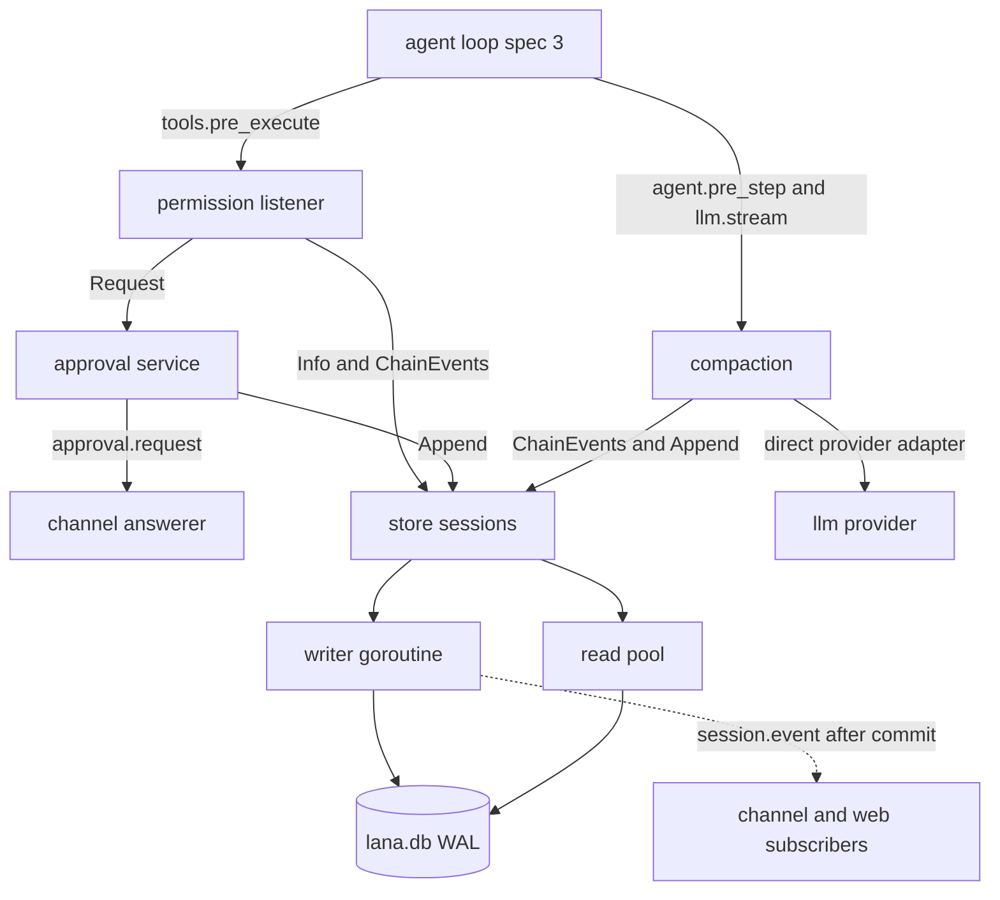
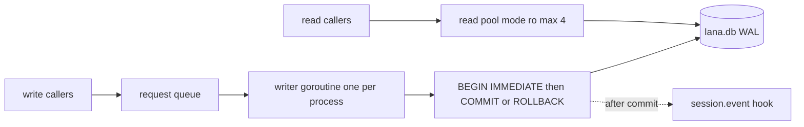
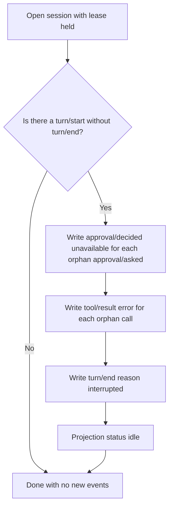
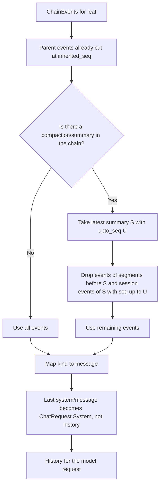
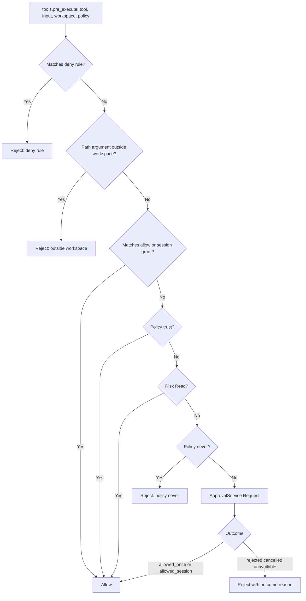
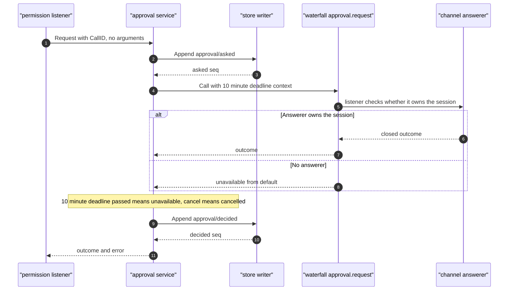

# Design: Session event log, permission, approval

- **Issue**: [`#4`](https://github.com/ridhomujizat/lana-harness/issues/4)
- **Requirements**: [requirements.md](requirements.md)
- **Contract**: [api-contract.md](api-contract.md) — Required
- **Requirements revision**: 2
- **Contract revision**: 2
- **Requirements status**: Approved
- **Contract status**: Approved
- **Status**: Approved
- **Design revision**: 2 (reconciliation: `core.DeriveMessages` in `core`, `internal/pattern`, library answerer, store signatures; see `DQ-011` to `DQ-015`)

Do not create a design against requirements or a contract that have not been approved.

## Architecture References

- **ADR Index**: [docs/adr](../../adr/README.md)
- **Diagram Index**: [docs/diagram](../../diagram/README.md)
- **ADR**: [0002](../../adr/0002-core-from-modules-services-and-hooks.md), [0004](../../adr/0004-permission-mode-per-agent.md), [0005](../../adr/0005-sqlite-as-single-storage.md), [0009](../../adr/0009-session-as-append-only-event-log.md), [0010](../../adr/0010-profile-and-config-patch.md), [0011](../../adr/0011-subagent-as-child-session.md), [0013](../../adr/0013-use-go-as-single-binary.md), [0014](../../adr/0014-integration-as-agentic-tool.md). All Accepted.
- **Feature-local diagrams**: [Components](#components-and-dependencies), [Writer topology](#writer-topology-and-read-pool), [Resume repair](#resume-repair), [Derive](#derive-with-fork-and-compaction), [Permission decision](#permission-decision), [Approval chain](#approval-chain)
- **Durable diagrams**: [0002. Agent Loop and Approval](../../diagram/0002-agent-loop-and-approval.md), [0003. Data Model and Scheduler](../../diagram/0003-data-model-and-scheduler.md), [0004. Profile, Fork, Subagent, and Protocol](../../diagram/0004-profile-fork-subagent-and-protocols.md)
- **Lease**: the lease flow diagram is in [spec #1 design, section Lock session](../1-cli-tui/design.md#session-lock). This spec does not redraw it.

## Architecture Decision Scan

| Topic | Existing authority | Decision location | Action |
|---|---|---|---|
| Public interface | Contract of spec #4, `core` from spec #2 | contract | Reuse. Read methods on `SessionStore` (`Info`, `ChainEvents`, `DeriveMessages`) added in spec #2 (`API-CORE-009`) |
| Persistence | ADR 0005 and 0009 | ADR | Reuse. Additional projection columns `workspace` and `turn_count` (contract `CQ-008`) |
| Turn state and lifecycle | Diagrams 0002 and 0004 | diagram | Reuse. Resume repair from diagram 0004 |
| Concurrency | ADR 0005 (single writer), spec #1 (`BEGIN IMMEDIATE`) | ADR and spec #1 | Reuse. Writer per process, `BEGIN IMMEDIATE` across processes |
| Dependency direction | ADR 0013 | ADR | Reuse. Implementation packages import only `core` |
| Permission | ADR 0004 | ADR | Reuse steps 1 to 7 |
| Compaction | ADR 0005, 0009, diagram 0002 | ADR and diagram | Reuse the 70% threshold and one retry |
| Rule patterns and wildcards | None | design | Local. Defined in contract `API-PERM-001` |

## Visual Architecture Check

| Trigger | Present? | Required view |
|---|---:|---|
| Module or package boundary | Yes | Components and dependencies |
| Interaction with an actor or external system | Yes | Approval chain (sequence) |
| Multi-component flow | Yes | Permission decision, derive, resume |
| Lifecycle or state transition | Yes | Resume repair (flowchart) |
| Entity relationships | Yes | ERD in diagram 0003 (not redrawn) |
| Concurrency, retry, or failure flow | Yes | Writer topology, approval chain |
| Dependency direction or runtime topology | Yes | Writer topology and read pool |

## Feature-Local Views

### Components and dependencies

### Writer topology and read pool

### Resume repair

### Derive with fork and compaction

### Permission decision

### Approval chain

## Repository Conformance

The layout follows ADR 0013 and ARCHITECTURE §4. One new package outside the layout: `internal/pattern` (`DQ-013`).

| Package | Contents | May import |
|---|---|---|
| `store/` | `Open`, writer, migrator, projection, derive, lease, repair, prune, payload, `migrations/*.sql` | `core` |
| `internal/pattern/` | `ParsePattern`, `Match`, `Argument` (pattern grammar) | `core`. Used by `config` (spec #2) and `tools/permission` |
| `tools/permission/` | workspace, evaluator, grant, approval service, library answerer, modules `permission` and `approval` | `core`, `internal/pattern` |
| `agent/compaction/` | compaction service, module `compaction` | `core` |

- Cross-module use goes only through interfaces in `core` (`SessionStore`, `ApprovalService`, `Compactor`), consistent with ADR 0013.
- Pure functions (pattern, derive, policy, grant, subagent permission bound) are written without I/O so they can be tested without a database.
- Additions of methods to `core.SessionStore` (`Info`, `ChainEvents`, `DeriveMessages`) and types in `core` are recorded in the contract and in spec #2 (`API-CORE-009`, `API-CORE-015`). See `DQ-005` and `DQ-012`.

## Proposed Design

### Components

- **Store** (`store/store.go`) — opens `lana.db`, installs the writer and read pool, and implements `core.SessionStore`. Invariant: all writes go through the writer.
- **Writer** (`store/writer.go`) — one goroutine per process. Receives `writeReq` containing a function that runs inside `BEGIN IMMEDIATE`. After `COMMIT`, sends events to the `session.event` hook. On `Close`, rejects new requests with `ErrStoreClosed`.
- **Migrator** (`store/migrate.go`) — reads `user_version`, then runs SQL files in order from `embed.FS`. Each migration in one transaction.
- **Projection** (`store/projection.go`) — updates `sessions` rows in the same transaction as the events. `RebuildProjections` rebuilds from `session_events`.
- **Chain and derive** (`store/chain.go`) — `ChainEvents` reads the chain in one read transaction and cuts the parent at `inherited_seq`. `DeriveMessages` (store) calls `core.DeriveMessages` (`API-CORE-015`) on the result of `ChainEvents`. That pure function lives in `core` and contains the compaction rules of this spec (`DQ-011`).
- **Lease** (`store/lease.go`) — `TryLease` returns `release func() error` (`API-CORE-009`). PID check via `syscall.Kill(pid, 0)`. Host is compared with `os.Hostname()`.
- **Repair** (`store/repair.go`) — runs in the writer transaction on `Open`. See the [Resume repair](#resume-repair) diagram.
- **Prune** (`store/prune.go`) — fills `session_prune_allow`, deletes events and projection, then deletes the allow row in the same transaction.
- **Payload** (`store/payload.go`) — writes `v` = 1. `NormalizePayload` decodes older versions to the current version in memory.
- **Pattern** (`internal/pattern/pattern.go`) — `ParsePattern` and `Match`. Pure functions. Used by `config` to validate `rules` and by `tools/permission` for evaluation.
- **Workspace** (`tools/permission/workspace.go`) — resolves paths, `~` and relative, `filepath.Clean`, `filepath.EvalSymlinks`. For paths that do not yet exist, uses the nearest existing parent.
- **Evaluator** (`tools/permission/evaluator.go`) — listener on `tools.pre_execute`. Follows steps 1 to 7 in the [Permission decision](#permission-decision) diagram. Stateless; safe for parallel use for `Read` tools.
- **Grant and policy** (`tools/permission/grant.go`) — pure functions over `ChainEvents`: `EffectivePolicy(events, default)`, `Grants(events)`. Grants are computed from the `tool/call` referenced by `call_id`.
- **Approval service** (`tools/permission/approval.go`) — implementation of `core.ApprovalService`. Writes audit through `Append`, calls the `approval.request` hook, and manages timeout and cancel.
- **Library answerer** (`tools/permission/library.go`, installed through `lana.ApproveWith`) — `approval.request` listener for channel `library` sessions. Sessions on other channels call `next` (`API-APPR-005`, `DQ-014`).
- **Subagent permission bound** (`tools/permission/grant.go`) — `ChildPolicy(parent, child)`, `MergeDeny(parent, child)`. Used by the `task` tool in M4.
- **Compaction** (`agent/compaction/compaction.go`) — implementation of `core.Compactor`. `CompactNow`, threshold check, and `ErrContextTooLong` retry.
- **Modules** — `sqlite_store` (`store/module.go`), `approval` and `permission` (`tools/permission/module.go`), `compaction` (`agent/compaction/module.go`). Install order: `sqlite_store`, `approval`, `permission`, `compaction`. All four are in the base profile (`API-CONF-009` of spec #2).

### Contract mapping

| Contract operation | Component | Input | Result | Requirements |
|---|---|---|---|---|
| `API-STORE-001` | Store, migrator, writer | path | `*Store` ready | `REQ-STORE-001`, `REQ-STORE-002`, `REQ-STORE-004`, `REQ-STORE-016` |
| `API-STORE-002` | Writer, projection | `core.NewSession` | `core.SessionInfo` | `REQ-STORE-006` |
| `API-STORE-003` | Writer, repair | session ID | `SessionInfo` | `REQ-STORE-006` |
| `API-STORE-004` | Writer, projection, hook | `[]core.EventDraft` | `[]SessionEvent` | `REQ-STORE-003`, `REQ-STORE-005`, `REQ-STORE-015` |
| `API-STORE-005` | Read pool | ID, from | event | `REQ-STORE-008` |
| `API-STORE-006` | Read pool | `core.SessionFilter` | list of sessions | `REQ-STORE-008` |
| `API-STORE-007` | Read pool | prefix | list of sessions, then `core.ResolvePrefix` | `REQ-STORE-009` |
| `API-STORE-008` | Writer | parent, atSeq | `core.SessionInfo` | `REQ-STORE-007` |
| `API-STORE-009` | Lease | session ID | `release func() error` | `REQ-STORE-010` |
| `API-STORE-010` | Chain, derive | session ID | model messages, chain | `REQ-STORE-011` |
| `API-STORE-011` | Prune | session ID | session deleted | `REQ-STORE-014` |
| `API-STORE-012` | Projection | — | `sessions` table | `REQ-STORE-012` |
| `API-STORE-013` | Payload | kind, raw | v1 payload | `REQ-STORE-013` |
| `API-PERM-001` | Pattern | string | `Pattern` | `REQ-PERM-001` |
| `API-PERM-002` | Config validation (spec #2) | config | validation error | `REQ-PERM-001` |
| `API-PERM-003` | Evaluator, workspace, grant | `core.ToolsPreExecuteInput` | `core.ToolDecision` | `REQ-PERM-002` to `REQ-PERM-006` |
| `API-APPR-005` | Library answerer | `ApproveWith(fn)` | outcome from fn | `REQ-APPR-007` |
| `API-APPR-001` | Approval service | session, policy | event, policy | `REQ-APPR-001` |
| `API-APPR-002` | Approval service | `ApprovalRequest` | outcome | `REQ-APPR-002`, `REQ-APPR-004`, `REQ-APPR-005` |
| `API-APPR-003` | Waterfall approval.request | `ApprovalRequest` | outcome | `REQ-APPR-003` |
| `API-APPR-004` | `ChildPolicy`, `MergeDeny` | parent and deny policy | child policy | `REQ-APPR-006` |
| `API-COMP-001` | Compaction service | session | `CompactionResult` | `REQ-COMP-002` |
| `API-COMP-002` | Compaction listener | `agent.pre_step`, `ErrContextTooLong` | summary, retry | `REQ-COMP-001`, `REQ-COMP-003` |

### Persistence

- Schema, DDL, and triggers are in the contract (`Skema SQL`). The design does not repeat the DDL.
- Every event is written with `created_at` = the time the transaction commits (milliseconds).
- `turn_count` increases on `turn/start`. `last_seq` = seq of the last event. `updated_at` = `created_at` of the last event.
- The title is set when the first `user/message` arrives and `title` is still empty: the first 40 runes of that message text (`Q-011`).
- Status is `running` while there is a `turn/start` without a `turn/end`, otherwise `idle`.
- The `session/created` event for a fork contains `parent_session_id` and `inherited_seq`. Other events do not copy parent data.

### Failure handling

| Failure | Internal error | Visible result |
|---|---|---|
| Database cannot be opened | error from `sql.Open` or `Ping` | Boot fails, message names the path |
| Schema too new | `ErrSchemaTooNew` | Boot fails, database unchanged |
| Migration fails | error and rollback | Boot fails, `user_version` unchanged |
| `SQLITE_BUSY` for more than 5 seconds | driver error | Caller receives an error. No partial events |
| Store closed | `ErrStoreClosed` | Pending write fails |
| Lease held by a live process | `*core.LeaseHeldError` | CLI exits with a PID message (spec #1) |
| `approval/asked` fails | plain error | Answerer not called. Tool rejected |
| `approval/decided` fails | plain error | Tool does not run (`Allowed` false) |
| Answerer errors | error from waterfall | Outcome `unavailable`, next listener does not run |
| `EvalSymlinks` fails (not `ENOENT`) | OS error | `Allowed` false, reason names the path |
| Automatic summary fails | provider error | `warn` log, turn continues |
| Manual summary fails | provider error | Error to caller, session unchanged |
| `ErrContextTooLong` twice | `core.ErrContextTooLong` | `turn/end` reason `error` |
| Process dies during a turn | no error. Detected on `Open` | Resume repair (`turn/end` `interrupted`) |

### Concurrency

- **Single writer per process**: one goroutine holds the write connection. Requests are processed in order. This removes `SQLITE_BUSY` inside the process.
- **Across processes**: every write transaction uses `BEGIN IMMEDIATE`. `busy_timeout` 5000 ms. Two processes cannot compute the same seq because writes are locked.
- **Read pool**: `sql.DB` with DSN `mode=ro` and `MaxOpenConns` 4. Derive and `ChainEvents` use one read transaction so the snapshot is consistent.
- **Lease**: `TryLease` goes through the writer. PID check and row write happen in one transaction.
- **Approval**: one request = one turn goroutine. Timeout with `context.WithTimeout`. Writing `approval/decided` uses a non-cancelling context with a 5 second limit (see contract `API-APPR-002`).
- **Parallel permission**: `Read` tools may run in parallel (ADR 0002). The evaluator has no state. Each evaluation reads `ChainEvents` and `Info` itself.
- **Compaction**: runs in the turn goroutine. Manual calls are rejected while a turn is open (`ErrTurnActive`). Optimistic verification of `last_seq` in the append transaction.
- **Cancellation**: the turn `ctx` is cancelled on `Ctrl+C` (spec #1). Approval becomes `cancelled`. Running tools are cancelled by spec #3.

### Security

- **Decision order** follows ADR 0004. `deny` is checked first, so it cannot be bypassed by `trust` or grants.
- **Workspace boundary** uses the path returned by `EvalSymlinks`. Symlinks leaving the workspace are rejected. Paths that do not yet exist use the nearest existing parent, so `write_file` for a new file still works.
- **Deny rules are matched twice** for paths: the lexical path and the path returned by `EvalSymlinks`. If either matches, reject. Allow rules must match both.
- **Fail-closed**: store read errors, `EvalSymlinks` errors, audit errors, answerer errors, and unknown outcomes all produce not allowed.
- **Audit without arguments**: `approval/asked` and `approval/decided` do not store arguments. The answerer gets arguments from `tool/call` through `call_id`.
- **Files**: `lana.db`, `-wal`, and `-shm` have mode `0600` (`Q-019`).
- **Secrets**: not stored in the database (ADR 0005). Tool arguments containing secrets still appear in `tool/call` (see risks).

### Observability

- `slog` level `info`: session opened (ID, agent), repair written (number of orphan calls, number of orphan approvals), compaction finished (`tokens_before`, `tokens_after`), approval finished (`call_id`, outcome).
- Level `warn`: automatic summary failed, `EvalSymlinks` failed.
- Level `debug`: matched patterns (without full arguments), grants used.
- No tool argument contents, message contents, or summary contents at level `info`.

## Migration strategy

- Migrations are numbered SQL files in `store/migrations/` that are embedded (`0001_session_log.sql`, `0002_session_leases.sql`).
- Each migration runs in one transaction. `user_version` is set in the same transaction.
- Forward only. There are no down migrations. Rollback is done by copying the database file before upgrading (ADR 0005).
- Migrations must not change the contents of `session_events`. Payload format changes use `v`, not SQL migrations.
- Features of M5 (memory, cron) add migration `0003` and onward. No changes to `0001` and `0002`.
- Migrations do not use third-party libraries (`DQ-003`).

## Traceability requirement

| Requirement | Contract operation | Design component | Verification level |
|---|---|---|---|
| `REQ-STORE-001` | `API-STORE-001` | Store, migrator | integration |
| `REQ-STORE-002` | `API-STORE-001` | Migrator | integration |
| `REQ-STORE-003` | `API-STORE-004` | Writer, read pool | integration (concurrency) |
| `REQ-STORE-004` | `API-STORE-001` | DDL, trigger | integration |
| `REQ-STORE-005` | `API-STORE-004` | Writer, projection | integration |
| `REQ-STORE-006` | `API-STORE-002`, `API-STORE-003` | Projection, repair | integration, crash simulation |
| `REQ-STORE-007` | `API-STORE-008` | Writer | integration |
| `REQ-STORE-008` | `API-STORE-005`, `API-STORE-006` | Read pool | integration |
| `REQ-STORE-009` | `API-STORE-007` | Read pool | unit and integration |
| `REQ-STORE-010` | `API-STORE-009` | Lease | integration (fake PID) |
| `REQ-STORE-011` | `API-STORE-010` | Chain, derive | unit (golden) |
| `REQ-STORE-012` | `API-STORE-012` | Projection | integration |
| `REQ-STORE-013` | `API-STORE-013` | Payload | unit |
| `REQ-STORE-014` | `API-STORE-011` | Prune | integration |
| `REQ-STORE-015` | `API-STORE-004` | Writer, hook | integration |
| `REQ-STORE-016` | `API-STORE-001` | Module `sqlite_store` | integration (boot) |
| `REQ-PERM-001` | `API-PERM-001`, `API-PERM-002` | Pattern, config | unit and property test |
| `REQ-PERM-002` | `API-PERM-003` | Evaluator | unit and integration |
| `REQ-PERM-003` | `API-PERM-003` | Workspace | unit (temporary filesystem) |
| `REQ-PERM-004` | `API-PERM-003`, `API-APPR-002` | Grant, evaluator | integration |
| `REQ-PERM-005` | `API-PERM-003` | Module `permission` | integration (boot) |
| `REQ-PERM-006` | `API-PERM-003` | Evaluator | unit |
| `REQ-APPR-001` | `API-APPR-001` | Grant and policy, approval | integration |
| `REQ-APPR-002` | `API-APPR-002` | Approval service | integration |
| `REQ-APPR-003` | `API-APPR-003` | Waterfall | unit |
| `REQ-APPR-004` | `API-APPR-002` | Approval service, test clock | unit |
| `REQ-APPR-005` | `API-APPR-002` | Approval service | unit (fake store fails) |
| `REQ-APPR-006` | `API-APPR-004` | `ChildPolicy`, `MergeDeny` | unit |
| `REQ-APPR-007` | `API-APPR-005` | Library answerer | integration |
| `REQ-COMP-001` | `API-COMP-002` | Compaction listener | unit and integration |
| `REQ-COMP-002` | `API-COMP-001` | Compaction service | integration |
| `REQ-COMP-003` | `API-COMP-002` | Compaction listener, fake `llm` | integration |

## Acceptance verification map

Every acceptance criterion appears exactly once. Test names are the planned names.

| Acceptance criterion | Verification method | Planned evidence |
|---|---|---|
| `AC-STORE-001`, `AC-STORE-002` | integration | `TestOpenCreatesWALDatabase` (checks pragmas and mode), `TestOpenRelativePath` |
| `AC-STORE-003`, `AC-STORE-004` | integration | `TestMigrateIdempotent`, `TestSchemaTooNew` |
| `AC-STORE-005`, `AC-STORE-006` | integration | `TestConcurrentAppendNoBusy` (50 goroutines, `-race`), `TestTwoInstancesSeqUnique` |
| `AC-STORE-007`, `AC-STORE-008` | integration | `TestRawUpdateDeleteRejected` |
| `AC-STORE-009`, `AC-STORE-010`, `AC-STORE-011` | integration | `TestAppendSeq`, `TestAppendBatchAtomic`, `TestTurnStartRejectedWhileOpen` |
| `AC-STORE-012` | integration | `TestCreateWritesSessionCreated` |
| `AC-STORE-013`, `AC-STORE-014`, `AC-STORE-015`, `AC-STORE-016` | integration and crash simulation | `TestResumeRepairOrphanCall`, `TestResumeRepairOrphanApproval`, `TestOpenIdempotent`, `TestOpenWithoutLease`. Crash simulation: see [Verification strategy](#verification-strategy) |
| `AC-STORE-017`, `AC-STORE-018` | integration | `TestForkAtTurnEnd`, `TestForkNotBoundary` |
| `AC-STORE-019`, `AC-STORE-020` | integration | `TestEventsFromSeq`, `TestListOrderAndLimit` |
| `AC-STORE-021`, `AC-STORE-022`, `AC-STORE-023` | integration and unit | `TestFindPrefixCaseInsensitive`, `TestFindPrefixAmbiguous`, `TestFindPrefixErrors` |
| `AC-STORE-024`, `AC-STORE-025`, `AC-STORE-026`, `AC-STORE-027` | integration | `TestLeaseFree`, `TestLeaseLiveHeld` (test process PID), `TestLeaseDeadReplaced` (PID 999999), `TestLeaseOtherHost` |
| `AC-STORE-028`, `AC-STORE-029`, `AC-STORE-030` | unit (golden) | `TestDeriveGolden` (`testdata/derive/*.golden`, flag `-update`), `TestDeriveForkCut`, `TestDeriveCompactionCut` |
| `AC-STORE-031` | integration | `TestRebuildProjectionsIdentical` |
| `AC-STORE-032`, `AC-STORE-033` | unit | `TestUnknownPayloadVersion`, `TestOldPayloadMigratedInMemory` (fixture `v` 0) |
| `AC-STORE-034`, `AC-STORE-035` | integration | `TestPruneWholeSession`, `TestPruneWithChildren` |
| `AC-STORE-036`, `AC-STORE-037` | integration | `TestNoBroadcastOnFailure`, `TestBroadcastAfterCommit` |
| `AC-STORE-038` | integration | `TestModuleStoreDefaultPath` |
| `AC-PERM-001`, `AC-PERM-002`, `AC-PERM-003` | unit and property test | `TestPatternExamples`, `TestPatternPropertyNoPanic`, `TestPatternRoundTrip` (`testing/quick`) |
| `AC-PERM-004` | unit | `TestConfigRejectsBadPattern` |
| `AC-PERM-005` to `AC-PERM-010` | unit and integration | `TestEvaluateOrder` (table: deny, workspace, allow, trust, read, never, ask) |
| `AC-PERM-011`, `AC-PERM-012`, `AC-PERM-013` | unit (temporary filesystem) | `TestWorkspaceSymlinkEscape`, `TestWorkspaceDotDot`, `TestWorkspaceNewFile` |
| `AC-PERM-014`, `AC-PERM-015`, `AC-PERM-016` | integration | `TestGrantReused`, `TestGrantInheritedByFork`, `TestGrantArgsMismatch` |
| `AC-PERM-017`, `AC-PERM-018` | integration | `TestPermissionListenerReplacesDefault`, `TestNoPermissionModuleFailsClosed` |
| `AC-PERM-019` | unit | `TestRejectionDecisionShape` |
| `AC-APPR-001` to `AC-APPR-004` | integration | `TestEffectivePolicyDefaults`, `TestSetPolicyLastWins`, `TestSetPolicyInvalid`, `TestPolicyChangeMidTurn` |
| `AC-APPR-005`, `AC-APPR-006` | integration | `TestApprovalAuditPair`, `TestOutcomeToDecision` |
| `AC-APPR-007` to `AC-APPR-010` | unit | `TestWaterfallFirstOwner`, `TestNoAnswererUnavailable`, `TestAnswererErrorUnavailable`, `TestInvalidOutcomeUnavailable` |
| `AC-APPR-011`, `AC-APPR-012` | unit with test clock | `TestApprovalTimeout10Min`, `TestApprovalCancelled` |
| `AC-APPR-013`, `AC-APPR-014` | unit with fake store | `TestAskedWriteFailsNoAnswerer`, `TestDecidedWriteFailsNotAllowed` |
| `AC-APPR-015`, `AC-APPR-016` | unit and integration | `TestChildPolicyMin`, `TestChildInheritsDenyFromParent` |
| `AC-APPR-017` | integration | `TestApproveWithLibraryChannel` |
| `AC-COMP-001`, `AC-COMP-002`, `AC-COMP-003` | unit and integration | `TestAutoCompactThreshold` (7001 and 7000 with window 10000), `TestDefaultContextWindow` |
| `AC-COMP-004`, `AC-COMP-005` | integration with fake `llm` | `TestCompactNowSummary`, `TestCompactNowRejects` |
| `AC-COMP-006`, `AC-COMP-007` | integration with fake `llm` | `TestContextTooLongRetryOnce`, `TestContextTooLongTwiceEndsTurn` |

## Verification strategy

- **Unit (pure functions)**: `ParsePattern`, `Match` (`internal/pattern`), `core.DeriveMessages`, `EffectivePolicy`, `Grants`, `ChildPolicy`, `MergeDeny`, compaction threshold, and outcome mapping. No I/O.
- **Golden derive**: event fixtures in `core/testdata/derive/` (one file per scenario: complete turn, fork, compaction, attempt, approval). Tests in package `core` (`DQ-011`). `DeriveMessages` results are compared with `*.golden`. Updated with the `-update` flag, diff reviewed manually.
- **Pattern property test**: `testing/quick` (stdlib, no new dependency) for `ParsePattern`: does not panic for random strings, `String()` followed by `ParsePattern` yields an equivalent pattern, and `*` always matches the same argument.
- **Store integration**: SQLite in `t.TempDir()`. Each test opens a new store. No shared database between tests.
- **Crash simulation**: for each golden scenario, write the event prefix up to seq N (N from 1 to the length of the log), close the store without `turn/end`, reopen with the lease, then check three things: no orphan call or approval, exactly one `turn/end` `interrupted`, and a second `Open` writes nothing. This is the "truncating log" approach used because the triggers forbid deletion.
- **Concurrency**: `go test -race ./store/...` with 50 goroutines and two store instances.
- **Permission integration**: real store and approval, fake answerers that own or do not own the session, temporary filesystem for workspace and symlinks.
- **Compaction integration**: fake `llm` from spec #3 (`MockLlm`) that can return `ErrContextTooLong`.
- **Runtime**: manual smoke test through the CLI after spec #1 is done (SC-001 to SC-003).

## Risks and tradeoffs

- **Derive reads the chain on every step.** Cost grows with log length. Compaction limits the history sent, but not the number of rows read. No cache in v1 (`DQ-010`).
- **The path check is not atomic with tool execution.** A symlink can be swapped between check and execution. Mitigation in v1: none. The OS sandbox is in ADR 0004 as the next step.
- **Patterns can be bypassed.** `bash(git status*)` can still run other commands through `;`. ADR 0004 records this as a tradeoff. Patterns are used as a fast permission, not as a sandbox.
- **Tool arguments are stored in the log.** Arguments containing secrets go into `tool/call`. Redaction in spec #3 is a prerequisite.
- **Approval holds the turn.** Without an active owner, the turn waits 10 minutes and then fails. This is consistent with ADR 0004.
- **Cross-host lease cannot be checked.** Another host is considered alive. Stale leases must be cleaned up manually from `session_leases`.
- **`modernc.org/sqlite` is slower than C SQLite.** Accepted per ADR 0013.
- **A single writer limits write throughput.** Enough for personal use (ADR 0005).

## Blocking Design Questions

| ID | Question | Controls | Requested reference | Owner | Status | Resolution |
|---|---|---|---|---|---|---|
| `DQ-001` | Writer topology | Concurrency | None | Ridho | Resolved | Agent recommendation: one writer goroutine per process, `BEGIN IMMEDIATE` across processes, read pool of 4 connections `mode=ro`. This is consistent with ADR 0005 and the lock in spec #1. |
| `DQ-002` | DSN form and pragmas for the `modernc.org/sqlite` driver | Persistence | None | Ridho | Resolved | Agent recommendation: `file:` DSN with `_pragma` parameters for `journal_mode`, `synchronous`, `foreign_keys`, and `busy_timeout`. The writer uses a single connection. Pragmas are verified in `AC-STORE-001`. |
| `DQ-003` | Migration tool | Migration strategy | None | Ridho | Resolved | Agent recommendation: `embed.FS` with `PRAGMA user_version`, no migration library. Fewest dependencies. |
| `DQ-004` | Code location for `permission`, `approval`, `compaction` | Repository conformance | None | Ridho | Resolved | Agent recommendation: `tools/permission/` for permission and approval, `agent/compaction/` for compaction. Consistent with the ARCHITECTURE §4 layout and ADR 0013. |
| `DQ-005` | Additional methods on `core.SessionStore` | Interface | Confirmation from spec #2 | Ridho | Resolved | Agent recommendation: add `Info`, `ChainEvents`, and `DeriveMessages`. Without `DeriveMessages` in the interface, spec #3 cannot build model history through `core`. |
| `DQ-006` | Time source for approval timeout | Approval tests | None | Ridho | Resolved | Agent recommendation: a small injected `Clock` interface (`Now`, `NewTimer`). Production uses `time`, tests use a fake clock. |
| `DQ-007` | PID and host check | Lease | None | Ridho | Resolved | Agent recommendation: `syscall.Kill(pid, 0)`. `nil` or `EPERM` means alive, `ESRCH` means dead. Host from `os.Hostname()`. Consistent with the ADR 0013 table. |
| `DQ-008` | Property test library | Verification | None | Ridho | Resolved | Agent recommendation: `testing/quick` from stdlib. No new dependency. |
| `DQ-009` | Location of the summary prompt and adapter | Compaction | None | Ridho | Resolved | Agent recommendation: summary prompt is a constant in code. Calls go through the direct provider adapter, without the `llm.stream` hook, so it is not recursive (`Q-009`). Changing the prompt text does not change visible behavior. |
| `DQ-010` | Cache of history or derive on every step | Performance | None | Ridho | Resolved | Agent recommendation: full derive on every step with no cache in v1. Controlled by compaction. Add a cache only if measurements show it is needed. |
| `DQ-011` | Location of `DeriveMessages` and the fork cut | `REQ-STORE-011`, `CQ-013`, `CQ-028` of spec #2 | Ridho | Resolved | Agent recommendation (reconciliation): `core.DeriveMessages` in `core` (`API-CORE-015`). The store wraps it: `ChainEvents` cuts the parent at `inherited_seq`, then that function runs. Compaction rules live in the core function. Golden fixtures in `core/testdata/derive/`. |
| `DQ-012` | `SessionStore` signature and `Fork` | `API-STORE-002` to `API-STORE-009`, `CQ-012` | Ridho | Resolved | Agent recommendation (reconciliation): signatures in `API-CORE-009` (spec #2). `Fork` without an agent argument. A subagent child (M4) uses `Create` with `ParentSessionID` and `ParentCallID`. |
| `DQ-013` | Location of the `rules` pattern grammar | `API-PERM-001`, `API-PERM-002`, `CQ-017` | Ridho | Resolved | Agent recommendation (reconciliation): package `internal/pattern`. The import rule for `config` (spec #2) allows `internal/...`. `tools/permission` also uses it. The grammar does not change. |
| `DQ-014` | Shape of the library answerer | `API-APPR-005`, `CQ-019` | Ridho | Resolved | Agent recommendation (reconciliation): function `ApproveWith(fn)` in package `lana` becomes an `Option` (spec #3). This answerer is an `approval.request` listener that answers only channel `library`. |
| `DQ-015` | `system/message` in model history | `REQ-STORE-011`, `Q-028`, `CQ-013` | Ridho | Resolved | Agent recommendation (reconciliation): `system/message` is not in `DeriveMessages`. Its last message is used as `ChatRequest.System` by spec #3. This is consistent with `Q-028` of spec #3 and fixes the example in the event table (previously "Yes, only the last one"). |

None.

## Approval

- [x] Requirements are Approved and their revisions are recorded.
- [x] Contract is Approved.
- [x] Architecture decision scan and Visual Architecture Check are done.
- [x] Required ADRs are Accepted.
- [x] Every requirement maps to one design component.
- [x] Every acceptance criterion has a verification method.
- [x] Blocking Design Questions is `None`.
- **Approved by**: Ridho (gate released 2026-10-29)
- **Approved on**: 2026-10-29 (revision 1). Revision 2 reconciled by the agent on behalf of the owner (gate released 2026-10-29).
