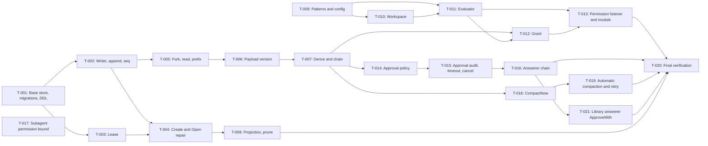

# Tasks: Session event log, permission, approval

- **Issue**: `#4`
- **Requirements**: [requirements.md](requirements.md)
- **Contract**: [api-contract.md](api-contract.md) — Required
- **Design**: [design.md](design.md)
- **Requirements revision**: 3
- **Contract revision**: 2
- **Design revision**: 2
- **Tasks revision**: 2 (reconciliation: `core.DeriveMessages` in T-007, `internal/pattern` in T-009, `ResolvePrefix` in T-005, library answerer T-021)
- **Status**: Approved

Do not create a task plan before requirements, contract, and design are approved.

## Prerequisites

- Spec #2 (`core`, `config`, hook waterfall and observe, profile loader) is implemented. All tasks below depend on it.
- Spec #3 (agent loop, `MockLlm`, hooks `tools.pre_execute`, `agent.pre_step`, `llm.stream`) is implemented for `T-013` and `T-019`.
- Nix dev shell is active (`nix develop`). No global installs.

## Execution Rules

- Implement only the requirements and acceptance criteria assigned to the task.
- Stop if requirements, design, ADRs, diagrams, or the contract contradict each other.
- Do not answer product or architecture questions only in code.
- Each acceptance criterion has exactly one evidence owner.
- Required verification is never optional.
- Mark a task done only after verification evidence is recorded.

## Baseline Verification Commands

Used in every task, in addition to the task-specific commands:

```text
nix develop -c gofmt -l .
nix develop -c golangci-lint run ./...
nix develop -c go test -race ./store/... ./tools/permission/... ./agent/compaction/...
```

The output of `gofmt -l .` must be empty. The other two commands must pass.

## Coverage

| Acceptance criterion | Contract operation | Evidence owner | Issue/PR | Verification | Evidence |
|---|---|---|---|---|---|
| `AC-STORE-001` | `API-STORE-001` | `T-001` | `#4` | `TestOpenCreatesWALDatabase` | Pending |
| `AC-STORE-002` | `API-STORE-001` | `T-001` | `#4` | `TestOpenRelativePath` | Pending |
| `AC-STORE-003` | `API-STORE-001` | `T-001` | `#4` | `TestMigrateIdempotent` | Pending |
| `AC-STORE-004` | `API-STORE-001` | `T-001` | `#4` | `TestSchemaTooNew` | Pending |
| `AC-STORE-005` | `API-STORE-004` | `T-002` | `#4` | `TestConcurrentAppendNoBusy` | Pending |
| `AC-STORE-006` | `API-STORE-004` | `T-002` | `#4` | `TestTwoInstancesSeqUnique` | Pending |
| `AC-STORE-007` | `API-STORE-001` | `T-001` | `#4` | `TestRawUpdateDeleteRejected` | Pending |
| `AC-STORE-008` | `API-STORE-001` | `T-001` | `#4` | `TestRawUpdateDeleteRejected` | Pending |
| `AC-STORE-009` | `API-STORE-004` | `T-002` | `#4` | `TestAppendSeq` | Pending |
| `AC-STORE-010` | `API-STORE-004` | `T-002` | `#4` | `TestAppendBatchAtomic` | Pending |
| `AC-STORE-011` | `API-STORE-004` | `T-002` | `#4` | `TestTurnStartRejectedWhileOpen` | Pending |
| `AC-STORE-012` | `API-STORE-002` | `T-004` | `#4` | `TestCreateWritesSessionCreated` | Pending |
| `AC-STORE-013` | `API-STORE-003` | `T-004` | `#4` | `TestResumeRepairOrphanCall` | Pending |
| `AC-STORE-014` | `API-STORE-003` | `T-004` | `#4` | `TestResumeRepairOrphanApproval` | Pending |
| `AC-STORE-015` | `API-STORE-003` | `T-004` | `#4` | `TestOpenIdempotent` | Pending |
| `AC-STORE-016` | `API-STORE-003` | `T-004` | `#4` | `TestOpenWithoutLease` | Pending |
| `AC-STORE-017` | `API-STORE-008` | `T-005` | `#4` | `TestForkAtTurnEnd` | Pending |
| `AC-STORE-018` | `API-STORE-008` | `T-005` | `#4` | `TestForkNotBoundary` | Pending |
| `AC-STORE-019` | `API-STORE-005` | `T-005` | `#4` | `TestEventsFromSeq` | Pending |
| `AC-STORE-020` | `API-STORE-006` | `T-005` | `#4` | `TestListOrderAndLimit` | Pending |
| `AC-STORE-021` | `API-STORE-007` | `T-005` | `#4` | `TestFindPrefixCaseInsensitive` | Pending |
| `AC-STORE-022` | `API-STORE-007` | `T-005` | `#4` | `TestFindPrefixAmbiguous` | Pending |
| `AC-STORE-023` | `API-STORE-007` | `T-005` | `#4` | `TestFindPrefixErrors` | Pending |
| `AC-STORE-024` | `API-STORE-009` | `T-003` | `#4` | `TestLeaseFree` | Pending |
| `AC-STORE-025` | `API-STORE-009` | `T-003` | `#4` | `TestLeaseLiveHeld` | Pending |
| `AC-STORE-026` | `API-STORE-009` | `T-003` | `#4` | `TestLeaseDeadReplaced` | Pending |
| `AC-STORE-027` | `API-STORE-009` | `T-003` | `#4` | `TestLeaseOtherHost` | Pending |
| `AC-STORE-028` | `API-STORE-010` | `T-007` | `#4` | `TestDeriveGolden` | Pending |
| `AC-STORE-029` | `API-STORE-010` | `T-007` | `#4` | `TestDeriveForkCut` | Pending |
| `AC-STORE-030` | `API-STORE-010` | `T-007` | `#4` | `TestDeriveCompactionCut` | Pending |
| `AC-STORE-031` | `API-STORE-012` | `T-008` | `#4` | `TestRebuildProjectionsIdentical` | Pending |
| `AC-STORE-032` | `API-STORE-013` | `T-006` | `#4` | `TestUnknownPayloadVersion` | Pending |
| `AC-STORE-033` | `API-STORE-013` | `T-006` | `#4` | `TestOldPayloadMigratedInMemory` | Pending |
| `AC-STORE-034` | `API-STORE-011` | `T-008` | `#4` | `TestPruneWholeSession` | Pending |
| `AC-STORE-035` | `API-STORE-011` | `T-008` | `#4` | `TestPruneWithChildren` | Pending |
| `AC-STORE-036` | `API-STORE-004` | `T-002` | `#4` | `TestNoBroadcastOnFailure` | Pending |
| `AC-STORE-037` | `API-STORE-004` | `T-002` | `#4` | `TestBroadcastAfterCommit` | Pending |
| `AC-STORE-038` | `API-STORE-001` | `T-001` | `#4` | `TestModuleStoreDefaultPath` | Pending |
| `AC-PERM-001` | `API-PERM-001` | `T-009` | `#4` | `TestPatternExamples` | Pending |
| `AC-PERM-002` | `API-PERM-001` | `T-009` | `#4` | `TestPatternExamples` | Pending |
| `AC-PERM-003` | `API-PERM-001` | `T-009` | `#4` | `TestPatternPropertyNoPanic`, `TestPatternRoundTrip` | Pending |
| `AC-PERM-004` | `API-PERM-002` | `T-009` | `#4` | `TestConfigRejectsBadPattern` | Pending |
| `AC-PERM-005` | `API-PERM-003` | `T-011` | `#4` | `TestEvaluateOrder` | Pending |
| `AC-PERM-006` | `API-PERM-003` | `T-011` | `#4` | `TestEvaluateOrder` | Pending |
| `AC-PERM-007` | `API-PERM-003` | `T-011` | `#4` | `TestEvaluateOrder` | Pending |
| `AC-PERM-008` | `API-PERM-003` | `T-011` | `#4` | `TestEvaluateOrder` | Pending |
| `AC-PERM-009` | `API-PERM-003` | `T-011` | `#4` | `TestEvaluateOrder` | Pending |
| `AC-PERM-010` | `API-PERM-003` | `T-011` | `#4` | `TestEvaluateOrder` | Pending |
| `AC-PERM-011` | `API-PERM-003` | `T-010` | `#4` | `TestWorkspaceSymlinkEscape` | Pending |
| `AC-PERM-012` | `API-PERM-003` | `T-010` | `#4` | `TestWorkspaceDotDot` | Pending |
| `AC-PERM-013` | `API-PERM-003` | `T-010` | `#4` | `TestWorkspaceNewFile` | Pending |
| `AC-PERM-014` | `API-PERM-003` | `T-012` | `#4` | `TestGrantReused` | Pending |
| `AC-PERM-015` | `API-PERM-003` | `T-012` | `#4` | `TestGrantInheritedByFork` | Pending |
| `AC-PERM-016` | `API-PERM-003` | `T-012` | `#4` | `TestGrantArgsMismatch` | Pending |
| `AC-PERM-017` | `API-PERM-003` | `T-013` | `#4` | `TestPermissionListenerReplacesDefault` | Pending |
| `AC-PERM-018` | `API-PERM-003` | `T-013` | `#4` | `TestNoPermissionModuleFailsClosed` | Pending |
| `AC-PERM-019` | `API-PERM-003` | `T-011` | `#4` | `TestRejectionDecisionShape` | Pending |
| `AC-APPR-001` | `API-APPR-001` | `T-014` | `#4` | `TestEffectivePolicyDefaults` | Pending |
| `AC-APPR-002` | `API-APPR-001` | `T-014` | `#4` | `TestSetPolicyLastWins` | Pending |
| `AC-APPR-003` | `API-APPR-001` | `T-014` | `#4` | `TestSetPolicyInvalid` | Pending |
| `AC-APPR-004` | `API-APPR-001` | `T-014` | `#4` | `TestPolicyChangeMidTurn` | Pending |
| `AC-APPR-005` | `API-APPR-002` | `T-015` | `#4` | `TestApprovalAuditPair` | Pending |
| `AC-APPR-006` | `API-APPR-002` | `T-015` | `#4` | `TestOutcomeToDecision` | Pending |
| `AC-APPR-007` | `API-APPR-003` | `T-016` | `#4` | `TestWaterfallFirstOwner` | Pending |
| `AC-APPR-008` | `API-APPR-003` | `T-016` | `#4` | `TestNoAnswererUnavailable` | Pending |
| `AC-APPR-009` | `API-APPR-003` | `T-016` | `#4` | `TestAnswererErrorUnavailable` | Pending |
| `AC-APPR-010` | `API-APPR-003` | `T-016` | `#4` | `TestInvalidOutcomeUnavailable` | Pending |
| `AC-APPR-011` | `API-APPR-002` | `T-015` | `#4` | `TestApprovalTimeout10Min` | Pending |
| `AC-APPR-012` | `API-APPR-002` | `T-015` | `#4` | `TestApprovalCancelled` | Pending |
| `AC-APPR-013` | `API-APPR-002` | `T-015` | `#4` | `TestAskedWriteFailsNoAnswerer` | Pending |
| `AC-APPR-014` | `API-APPR-002` | `T-015` | `#4` | `TestDecidedWriteFailsNotAllowed` | Pending |
| `AC-APPR-015` | `API-APPR-004` | `T-017` | `#4` | `TestChildPolicyMin` | Pending |
| `AC-APPR-016` | `API-APPR-004` | `T-017` | `#4` | `TestChildInheritsDenyFromParent` | Pending |
| `AC-APPR-017` | `API-APPR-005` | `T-021` | `#4` | `TestApproveWithLibraryChannel` | Pending |
| `AC-COMP-001` | `API-COMP-002` | `T-019` | `#4` | `TestAutoCompactThreshold` | Pending |
| `AC-COMP-002` | `API-COMP-002` | `T-019` | `#4` | `TestAutoCompactThreshold` | Pending |
| `AC-COMP-003` | `API-COMP-002` | `T-019` | `#4` | `TestDefaultContextWindow` | Pending |
| `AC-COMP-004` | `API-COMP-001` | `T-018` | `#4` | `TestCompactNowSummary` | Pending |
| `AC-COMP-005` | `API-COMP-001` | `T-018` | `#4` | `TestCompactNowRejects` | Pending |
| `AC-COMP-006` | `API-COMP-002` | `T-019` | `#4` | `TestContextTooLongRetryOnce` | Pending |
| `AC-COMP-007` | `API-COMP-002` | `T-019` | `#4` | `TestContextTooLongTwiceEndsTurn` | Pending |

## Task Graph



## Tasks

- [x] `T-001` Create package `store` with `Open`, pragmas, migrator, and base DDL
  - Issue/PR: `#4`
  - Depends on: `None` (spec #2 done)
  - Requirements: `REQ-STORE-001`, `REQ-STORE-002`, `REQ-STORE-004`, `REQ-STORE-016`
  - Acceptance criteria: `AC-STORE-001`, `AC-STORE-002`, `AC-STORE-003`, `AC-STORE-004`, `AC-STORE-007`, `AC-STORE-008`, `AC-STORE-038`
  - Contract operation: `API-STORE-001`
  - Scope:
    - Driver `modernc.org/sqlite`, DSN with pragmas, file mode `0600`, `-wal` and `-shm` chmod.
    - Migrator with `embed.FS`, `PRAGMA user_version`, one transaction per migration.
    - Files `store/migrations/0001_session_log.sql` and `0002_session_leases.sql` per contract.
    - Module `sqlite_store` that reads `config.path`.
  - Verification:
    - `nix develop -c go test -race ./store/ -run 'TestOpen|TestMigrate|TestSchemaTooNew|TestRawUpdateDelete|TestModuleStoreDefaultPath'`
    - Baseline verification commands.
  - Completion evidence:
    - Status: Completed
    - Command/test: see docs/eval/deepseek-flash-20261029.md
    - Result: see docs/eval/deepseek-flash-20261029.md
    - PR/commit: branch eval/deepseek-flash-20261029-spec-4
    - Deviation: None

- [x] `T-002` Write writer goroutine, read pool, atomic `Append`, seq, and single turn
  - Issue/PR: `#4`
  - Depends on: `T-001`
  - Requirements: `REQ-STORE-003`, `REQ-STORE-005`, `REQ-STORE-015`
  - Acceptance criteria: `AC-STORE-005`, `AC-STORE-006`, `AC-STORE-009`, `AC-STORE-010`, `AC-STORE-011`, `AC-STORE-036`, `AC-STORE-037`
  - Contract operation: `API-STORE-004`
  - Scope:
    - Writer goroutine with request queue, `BEGIN IMMEDIATE` through `*sql.Conn`, `COMMIT` or `ROLLBACK`.
    - Read pool `mode=ro`, maximum 4 connections.
    - `Append` with contiguous seq, `sessions` projection updated in the same transaction.
    - Rejection of `turn/start` while a turn is open (`ErrTurnActive`).
    - Hook `session.event` sent after commit.
  - Verification:
    - `nix develop -c go test -race ./store/ -run 'TestConcurrentAppend|TestTwoInstances|TestAppend|TestTurnStart|TestNoBroadcast|TestBroadcastAfter'`
    - Baseline verification commands.
  - Completion evidence:
    - Status: Completed
    - Command/test: see docs/eval/deepseek-flash-20261029.md
    - Result: see docs/eval/deepseek-flash-20261029.md
    - PR/commit: branch eval/deepseek-flash-20261029-spec-4
    - Deviation: None

- [x] `T-003` Implement session lease through `session_leases`
  - Issue/PR: `#4`
  - Depends on: `T-001`
  - Requirements: `REQ-STORE-010`
  - Acceptance criteria: `AC-STORE-024`, `AC-STORE-025`, `AC-STORE-026`, `AC-STORE-027`
  - Contract operation: `API-STORE-009`
  - Scope:
    - `TryLease` in `BEGIN IMMEDIATE` through the writer. `syscall.Kill(pid, 0)` check. Host from `os.Hostname()`.
    - `Release` deletes only the row owned by this process.
    - `*core.LeaseHeldError{SessionID, PID, Host}` (`errors.As`). `TryLease` returns `release func() error` (`API-CORE-009`, spec #2).
    - PID check function made injectable so tests can use a dead PID.
  - Verification:
    - `nix develop -c go test -race ./store/ -run 'TestLease'`
    - Baseline verification commands.
  - Completion evidence:
    - Status: Completed
    - Command/test: see docs/eval/deepseek-flash-20261029.md
    - Result: see docs/eval/deepseek-flash-20261029.md
    - PR/commit: branch eval/deepseek-flash-20261029-spec-4
    - Deviation: None

- [x] `T-004` Implement `Create`, `Open` with resume repair, and lease requirement
  - Issue/PR: `#4`
  - Depends on: `T-002`, `T-003`
  - Requirements: `REQ-STORE-006`
  - Acceptance criteria: `AC-STORE-012`, `AC-STORE-013`, `AC-STORE-014`, `AC-STORE-015`, `AC-STORE-016`
  - Contract operations: `API-STORE-002`, `API-STORE-003`
  - Scope:
    - `Create` writes `session/created` with `workspace`, status `idle`.
    - `Open` checks the lease (`ErrLeaseNotHeld`), then repair in one transaction: orphan approvals, orphan calls, `turn/end` `interrupted`.
    - `Info` for reads without repair.
    - Crash simulation: for each golden scenario, write the log prefix up to seq N, close the store, reopen, check three invariants (design, section Verification strategy).
  - Verification:
    - `nix develop -c go test -race ./store/ -run 'TestCreate|TestResume|TestOpen|TestCrashSimulation'`
    - Baseline verification commands.
  - Completion evidence:
    - Status: Completed
    - Command/test: see docs/eval/deepseek-flash-20261029.md
    - Result: see docs/eval/deepseek-flash-20261029.md
    - PR/commit: branch eval/deepseek-flash-20261029-spec-4
    - Deviation: None

- [x] `T-005` Implement `Fork`, `Events`, `ChainEvents`, `List`, `FindPrefix`, and `ResolvePrefix`
  - Issue/PR: `#4`
  - Depends on: `T-002`
  - Requirements: `REQ-STORE-007`, `REQ-STORE-008`, `REQ-STORE-009`
  - Acceptance criteria: `AC-STORE-017`, `AC-STORE-018`, `AC-STORE-019`, `AC-STORE-020`, `AC-STORE-021`, `AC-STORE-022`, `AC-STORE-023`
  - Contract operations: `API-STORE-005`, `API-STORE-006`, `API-STORE-007`, `API-STORE-008`
  - Scope:
    - `Fork` in the writer. Valid only if `atSeq` points to `turn/end`. Empty fields are filled from the parent.
    - `FindPrefix` with `UPPER(prefix)` and `substr`, returns a list. `core.ResolvePrefix` (`API-CORE-015`): minimum 6 characters, exactly one match, `core.ErrAmbiguousPrefix` with candidates in ascending order.
    - `ChainEvents` cuts parent events at `inherited_seq`, in one read transaction.
  - Verification:
    - `nix develop -c go test -race ./store/ -run 'TestFork|TestEvents|TestList|TestFindPrefix'`
    - Baseline verification commands.
  - Completion evidence:
    - Status: Completed
    - Command/test: see docs/eval/deepseek-flash-20261029.md
    - Result: see docs/eval/deepseek-flash-20261029.md
    - PR/commit: branch eval/deepseek-flash-20261029-spec-4
    - Deviation: None

- [x] `T-006` Implement payload versioning and `NormalizePayload`
  - Issue/PR: `#4`
  - Depends on: `T-005`
  - Requirements: `REQ-STORE-013`
  - Acceptance criteria: `AC-STORE-032`, `AC-STORE-033`
  - Contract operation: `API-STORE-013`
  - Scope:
    - Every payload writes `v` = 1.
    - In-memory payload migration registry (test fixture changes `v` 0 to 1).
    - `ErrUnknownPayloadVersion` for unknown `v`.
  - Verification:
    - `nix develop -c go test ./store/ -run 'TestUnknownPayloadVersion|TestOldPayloadMigratedInMemory'`
    - Baseline verification commands.
  - Completion evidence:
    - Status: Completed
    - Command/test: see docs/eval/deepseek-flash-20261029.md
    - Result: see docs/eval/deepseek-flash-20261029.md
    - PR/commit: branch eval/deepseek-flash-20261029-spec-4
    - Deviation: None

- [x] `T-007` Implement compaction rules in `core.DeriveMessages` and `SessionStore.DeriveMessages`
  - Issue/PR: `#4`
  - Depends on: `T-006`
  - Requirements: `REQ-STORE-011`
  - Acceptance criteria: `AC-STORE-028`, `AC-STORE-029`, `AC-STORE-030`
  - Contract operation: `API-STORE-010`
  - Scope:
    - Kind-to-message mapping per contract. `tool/call`, `assistant/attempt`, lifecycle, and approval are excluded.
    - Cut the latest summary according to `upto_seq` and the segment rules.
    - Last `system/message` used as `ChatRequest.System`, not a history message (`Q-028`).
    - Golden fixtures in `core/testdata/derive/`, flag `-update`. Function in package `core` (`API-CORE-015`).
  - Verification:
    - `nix develop -c go test ./core/ -run 'TestDerive'`
    - Baseline verification commands.
  - Completion evidence:
    - Status: Completed
    - Command/test: see docs/eval/deepseek-flash-20261029.md
    - Result: see docs/eval/deepseek-flash-20261029.md
    - PR/commit: branch eval/deepseek-flash-20261029-spec-4
    - Deviation: None

- [x] `T-008` Implement projection rebuild and `Prune`
  - Issue/PR: `#4`
  - Depends on: `T-004`
  - Requirements: `REQ-STORE-012`, `REQ-STORE-014`
  - Acceptance criteria: `AC-STORE-031`, `AC-STORE-034`, `AC-STORE-035`
  - Contract operations: `API-STORE-011`, `API-STORE-012`
  - Scope:
    - `RebuildProjections` in one `BEGIN IMMEDIATE` transaction.
    - `Prune`: fill `session_prune_allow`, delete events, projection, and lease, then delete the allow row in the same transaction. Children (FK `RESTRICT`) mapped to `ErrSessionHasChildren`.
  - Verification:
    - `nix develop -c go test -race ./store/ -run 'TestRebuild|TestPrune'`
    - Baseline verification commands.
  - Completion evidence:
    - Status: Completed
    - Command/test: see docs/eval/deepseek-flash-20261029.md
    - Result: see docs/eval/deepseek-flash-20261029.md
    - PR/commit: branch eval/deepseek-flash-20261029-spec-4
    - Deviation: None

- [x] `T-009` Implement pattern grammar (`internal/pattern`) and `rules` validation in config
  - Issue/PR: `#4`
  - Depends on: `None` (spec #2 for config validation)
  - Requirements: `REQ-PERM-001`
  - Acceptance criteria: `AC-PERM-001`, `AC-PERM-002`, `AC-PERM-003`, `AC-PERM-004`
  - Contract operations: `API-PERM-001`, `API-PERM-002`
  - Scope:
    - Parser per contract grammar (`tool`, `tool(arg)`, escape `\`).
    - `Match` with wildcard rules per argument kind.
    - Package `internal/pattern`: `ParsePattern` and `Match`. Used by `config` (`rules` validation, `CQ-030` of spec #2) and `tools/permission`.
    - `testing/quick` property tests.
  - Verification:
    - `nix develop -c go test ./internal/pattern/ ./config/ -run 'TestPattern|TestConfigRejectsBadPattern'`
    - Baseline verification commands.
  - Completion evidence:
    - Status: Completed
    - Command/test: see docs/eval/deepseek-flash-20261029.md
    - Result: see docs/eval/deepseek-flash-20261029.md
    - PR/commit: branch eval/deepseek-flash-20261029-spec-4
    - Deviation: None

- [x] `T-010` Implement path resolution and workspace boundary
  - Issue/PR: `#4`
  - Depends on: `T-009`
  - Requirements: `REQ-PERM-003`
  - Acceptance criteria: `AC-PERM-011`, `AC-PERM-012`, `AC-PERM-013`
  - Contract operation: `API-PERM-003`
  - Scope:
    - `~` and relative to workspace, `filepath.Clean`, `filepath.EvalSymlinks`.
    - Paths that do not exist yet: go up to the nearest existing parent.
    - `EvalSymlinks` errors other than `ENOENT` become not allowed.
  - Verification:
    - `nix develop -c go test ./tools/permission/ -run 'TestWorkspace'`
    - Baseline verification commands.
  - Completion evidence:
    - Status: Completed
    - Command/test: see docs/eval/deepseek-flash-20261029.md
    - Result: see docs/eval/deepseek-flash-20261029.md
    - PR/commit: branch eval/deepseek-flash-20261029-spec-4
    - Deviation: None

- [x] `T-011` Implement `tools.pre_execute` evaluator per ADR 0004 order
  - Issue/PR: `#4`
  - Depends on: `T-009`, `T-010`
  - Requirements: `REQ-PERM-002`, `REQ-PERM-006`
  - Acceptance criteria: `AC-PERM-005`, `AC-PERM-006`, `AC-PERM-007`, `AC-PERM-008`, `AC-PERM-009`, `AC-PERM-010`, `AC-PERM-019`
  - Contract operation: `API-PERM-003`
  - Scope:
    - Steps 1 to 7 from the design. The first decision wins.
    - Deny rules matched against the lexical path and the `EvalSymlinks` result. Allow must match both.
    - Rejection always has `Allowed` false, `Status` `rejected`, `Reason` not empty.
    - Without a grant, approval outcome is requested through the `core.ApprovalService` interface (dummy in tests).
  - Verification:
    - `nix develop -c go test ./tools/permission/ -run 'TestEvaluateOrder|TestRejectionDecisionShape'`
    - Baseline verification commands.
  - Completion evidence:
    - Status: Completed
    - Command/test: see docs/eval/deepseek-flash-20261029.md
    - Result: see docs/eval/deepseek-flash-20261029.md
    - PR/commit: branch eval/deepseek-flash-20261029-spec-4
    - Deviation: None

- [x] `T-012` Implement session grant and replay from the chain
  - Issue/PR: `#4`
  - Depends on: `T-007`, `T-011`
  - Requirements: `REQ-PERM-004`
  - Acceptance criteria: `AC-PERM-014`, `AC-PERM-015`, `AC-PERM-016`
  - Contract operation: `API-PERM-003`
  - Scope:
    - `Grants(events)` pure function: grants from `approval/decided` with `allowed_session` that reference the `tool/call` `call_id`.
    - Grant = tool name; matches every later call of that tool (requirements revision 3; was a literal `tool(main argument)` pattern).
    - Evaluator reads grants from `ChainEvents` on every evaluation.
  - Verification:
    - `nix develop -c go test ./tools/permission/ -run 'TestGrant'`
    - Baseline verification commands.
  - Completion evidence:
    - Status: Completed
    - Command/test: see docs/eval/deepseek-flash-20261029.md
    - Result: see docs/eval/deepseek-flash-20261029.md
    - PR/commit: branch eval/deepseek-flash-20261029-spec-4
    - Deviation: None

- [x] `T-013` Install `tools.pre_execute` listener and `permission` module
  - Issue/PR: `#4`
  - Depends on: `T-011`, `T-012`, spec #3 (hooks and `MockLlm`)
  - Requirements: `REQ-PERM-005`
  - Acceptance criteria: `AC-PERM-017`, `AC-PERM-018`
  - Contract operation: `API-PERM-003`
  - Scope:
    - Module `permission` registers the listener, without `next`. Decision carried by `core.ToolDecision`.
    - Verification without the module: spec #3 fail-closed default still rejects.
    - Hook output must be `core.ToolDecision`. Confirm with spec #3 (`CQ-003`).
  - Verification:
    - `nix develop -c go test ./tools/permission/ -run 'TestPermissionListener|TestNoPermissionModule'`
    - Baseline verification commands.
  - Completion evidence:
    - Status: Completed
    - Command/test: see docs/eval/deepseek-flash-20261029.md
    - Result: see docs/eval/deepseek-flash-20261029.md
    - PR/commit: branch eval/deepseek-flash-20261029-spec-4
    - Deviation: None

- [x] `T-014` Implement `SetPolicy` and `EffectivePolicy`
  - Issue/PR: `#4`
  - Depends on: `T-007`
  - Requirements: `REQ-APPR-001`
  - Acceptance criteria: `AC-APPR-001`, `AC-APPR-002`, `AC-APPR-003`, `AC-APPR-004`
  - Contract operation: `API-APPR-001`
  - Scope:
    - `SetPolicy` writes `approval/policy` through `Append`. Validates values `trust`, `ask`, `never`.
    - `EffectivePolicy(events, default)` pure function over `ChainEvents`. Default = agent's `permission`.
    - Re-read on every tool evaluation (`Q-014`).
  - Verification:
    - `nix develop -c go test -race ./tools/permission/ -run 'TestEffectivePolicy|TestSetPolicy|TestPolicyChangeMidTurn'`
    - Baseline verification commands.
  - Completion evidence:
    - Status: Completed
    - Command/test: see docs/eval/deepseek-flash-20261029.md
    - Result: see docs/eval/deepseek-flash-20261029.md
    - PR/commit: branch eval/deepseek-flash-20261029-spec-4
    - Deviation: None

- [x] `T-015` Implement approval request, audit, timeout, cancel, and fail-closed
  - Issue/PR: `#4`
  - Depends on: `T-014`
  - Requirements: `REQ-APPR-002`, `REQ-APPR-004`, `REQ-APPR-005`
  - Acceptance criteria: `AC-APPR-005`, `AC-APPR-006`, `AC-APPR-011`, `AC-APPR-012`, `AC-APPR-013`, `AC-APPR-014`
  - Contract operation: `API-APPR-002`
  - Scope:
    - New ULID `request_id`. `approval/asked` without arguments, `approval/decided` with outcome and reason.
    - `context.WithTimeout` 10 minutes through `Clock` (`DQ-006`). Timeout becomes `unavailable` with reason `timeout`.
    - Cancellation of the turn context becomes `cancelled`.
    - Writing `approval/decided` uses a non-cancelling context with a 5 second limit.
    - Failure of `approval/asked` means no answerer is called. Failure of `approval/decided` makes `Allowed` false.
  - Verification:
    - `nix develop -c go test -race ./tools/permission/ -run 'TestApproval|TestOutcomeToDecision|TestAskedWrite|TestDecidedWrite'`
    - Baseline verification commands.
  - Completion evidence:
    - Status: Completed
    - Command/test: see docs/eval/deepseek-flash-20261029.md
    - Result: see docs/eval/deepseek-flash-20261029.md
    - PR/commit: branch eval/deepseek-flash-20261029-spec-4
    - Deviation: None

- [x] `T-016` Implement `approval.request` answerer chain (waterfall)
  - Issue/PR: `#4`
  - Depends on: `T-015`, spec #2 (waterfall)
  - Requirements: `REQ-APPR-003`
  - Acceptance criteria: `AC-APPR-007`, `AC-APPR-008`, `AC-APPR-009`, `AC-APPR-010`
  - Contract operation: `API-APPR-003`
  - Scope:
    - Default handler returns `unavailable`.
    - Outcome outside the closed set becomes `unavailable`.
    - Answerer error becomes `unavailable` and the next listener does not run.
  - Verification:
    - `nix develop -c go test ./tools/permission/ -run 'TestWaterfall|TestNoAnswerer|TestAnswererError|TestInvalidOutcome'`
    - Baseline verification commands.
  - Completion evidence:
    - Status: Completed
    - Command/test: see docs/eval/deepseek-flash-20261029.md
    - Result: see docs/eval/deepseek-flash-20261029.md
    - PR/commit: branch eval/deepseek-flash-20261029-spec-4
    - Deviation: None

- [x] `T-017` Implement subagent permission bound functions
  - Issue/PR: `#4`
  - Depends on: `None` (pure functions)
  - Requirements: `REQ-APPR-006`
  - Acceptance criteria: `AC-APPR-015`, `AC-APPR-016`
  - Contract operation: `API-APPR-004`
  - Scope:
    - `ChildPolicy(parent, child)` chooses the strictest value from the order `never` < `ask` < `trust`.
    - `MergeDeny(parent, child)` merges deny lists. Used by the evaluator when a child runs.
    - Does not create the `task` tool (M4).
  - Verification:
    - `nix develop -c go test ./tools/permission/ -run 'TestChildPolicy|TestChildInheritsDeny'`
    - Baseline verification commands.
  - Completion evidence:
    - Status: Completed
    - Command/test: see docs/eval/deepseek-flash-20261029.md
    - Result: see docs/eval/deepseek-flash-20261029.md
    - PR/commit: branch eval/deepseek-flash-20261029-spec-4
    - Deviation: None

- [x] `T-018` Implement manual `CompactNow`
  - Issue/PR: `#4`
  - Depends on: `T-007`, provider adapter from spec #3
  - Requirements: `REQ-COMP-002`
  - Acceptance criteria: `AC-COMP-004`, `AC-COMP-005`
  - Contract operation: `API-COMP-001`
  - Scope:
    - Reject if a turn is open (`ErrTurnActive`) or there are no events (`ErrNothingToCompact`).
    - Model and provider from `ChainEvents` (latest `model/selection`) or `permission`/agent config.
    - Summary call through the direct adapter, without the `llm.stream` hook.
    - `upto_seq` = last seq before the summary. Optimistic verification of `last_seq` (`ErrSessionChanged`).
  - Verification:
    - `nix develop -c go test ./agent/compaction/ -run 'TestCompactNow'`
    - Baseline verification commands.
  - Completion evidence:
    - Status: Completed
    - Command/test: see docs/eval/deepseek-flash-20261029.md
    - Result: see docs/eval/deepseek-flash-20261029.md
    - PR/commit: branch eval/deepseek-flash-20261029-spec-4
    - Deviation: None

- [x] `T-019` Implement automatic compaction and `ErrContextTooLong` retry
  - Issue/PR: `#4`
  - Depends on: `T-018`, spec #3 (`agent.pre_step`, `llm.stream`, `ErrContextTooLong`)
  - Requirements: `REQ-COMP-001`, `REQ-COMP-003`
  - Acceptance criteria: `AC-COMP-001`, `AC-COMP-002`, `AC-COMP-003`, `AC-COMP-006`, `AC-COMP-007`
  - Contract operation: `API-COMP-002`
  - Scope:
    - `agent.pre_step` listener: threshold `input_tokens` > 70% of `context_window` (default 128000). Computed with integers (`tokens*100 > window*70`).
    - `llm.stream` listener installed in front: on `ErrContextTooLong`, compaction with `upto_seq` = seq before `step/start`, then history is re-derived and the request is retried once.
    - Automatic summary failure: `warn` log, turn continues.
  - Verification:
    - `nix develop -c go test ./agent/compaction/ -run 'TestAutoCompact|TestDefaultContextWindow|TestContextTooLong'`
    - Baseline verification commands.
  - Completion evidence:
    - Status: Completed
    - Command/test: see docs/eval/deepseek-flash-20261029.md
    - Result: see docs/eval/deepseek-flash-20261029.md
    - PR/commit: branch eval/deepseek-flash-20261029-spec-4
    - Deviation: None

- [x] `T-021` Install library answerer `lana.ApproveWith`
  - Issue/PR: `#4`
  - Depends on: `T-016`, spec #3 `T-018` (`lana.New` option)
  - Requirements: `REQ-APPR-007`
  - Acceptance criteria: `AC-APPR-017`
  - Contract operation: `API-APPR-005`
  - Scope:
    - Function `ApproveWith(fn)` in package `lana` as an `Option`. The `approval.request` listener in module `approval` answers only `library` channel sessions. Sessions on other channels call `next`.
    - `fn` nil, `fn` panics, or an outcome outside the closed set becomes `unavailable`.
  - Verification:
    - `nix develop -c go test -race . -run 'TestApproveWithLibraryChannel'`
    - Baseline verification commands.
  - Completion evidence:
    - Status: Completed
    - Command/test: see docs/eval/deepseek-flash-20261029.md
    - Result: see docs/eval/deepseek-flash-20261029.md
    - PR/commit: branch eval/deepseek-flash-20261029-spec-4
    - Deviation: None

- [x] `T-020` Final cross-component verification and CI gate
  - Issue/PR: `#4`
  - Depends on: `T-008`, `T-013`, `T-016`, `T-019`
  - Requirements: all requirements of this spec (verification, adds no behavior)
  - Acceptance criteria: no new owner. Re-verifies `AC-*` that already passed
  - Contract operations: all operations in the contract
  - Scope:
    - Re-run all tests of this spec with `-race`.
    - Full crash simulation for scenario SC-002 (hanging approval).
    - Import check: implementation packages import only `core`, not each other (ADR 0013). Use `go list -deps`.
    - Smoke test SC-001 to SC-003 if spec #1 is available.
  - Verification:
    - `nix develop -c go test -race ./store/... ./tools/permission/... ./agent/compaction/...`
    - `nix develop -c go list -deps ./store/ ./tools/permission/ ./agent/compaction/ | grep lana-harness`
    - Baseline verification commands.
  - Completion evidence:
    - Status: Completed
    - Command/test: see docs/eval/deepseek-flash-20261029.md
    - Result: see docs/eval/deepseek-flash-20261029.md
    - PR/commit: branch eval/deepseek-flash-20261029-spec-4
    - Deviation: None

## Final Verification

- [x] Every acceptance criterion has passing evidence.
- [x] No visible behavior exists without a requirement ID.
- [x] No behavior is outside scope (no JSONL export, no memory or cron tables, no CLI commands).
- [x] ADRs and diagrams match the implementation.
- [x] `gofmt -l .` is empty, `golangci-lint run ./...`, `go test -race ./...`, and the release build pass.
- [x] Deviations are resolved in requirements or design, not only recorded here.
- [x] Revision of ARCHITECTURE §3 for the `minimal` profile is made (`CQ-010`, revised by reconciliation of spec #2 `CQ-031`).

## Approval

- [x] Requirements, contract, and design are Approved and their revisions are recorded.
- [x] Every acceptance criterion has exactly one evidence owner.
- [x] Every task has a limited scope, dependencies, and verification.
- [x] No task introduces new behavior.
- **Approved by**: Ridho (gate released 2026-10-29)
- **Approved on**: 2026-10-29
