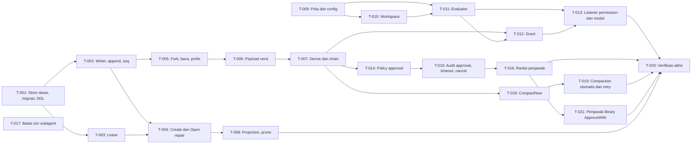

# Tasks: Session event log, permission, approval

- **Issue**: `#4`
- **Requirements**: [requirements.md](requirements.md)
- **Contract**: [api-contract.md](api-contract.md) — Diperlukan
- **Design**: [design.md](design.md)
- **Revisi requirements**: 2
- **Revisi contract**: 2
- **Revisi design**: 2
- **Revisi tasks**: 2 (rekonsiliasi: `core.DeriveMessages` di T-007, `internal/pattern` di T-009, `ResolvePrefix` di T-005, penjawab library T-021)
- **Status**: Approved

Jangan membuat rencana task sebelum requirements, contract, dan design di-approve.

## Prasyarat

- Spec #2 (`core`, `config`, hook waterfall dan observe, loader profile) sudah diimplementasi. Semua task di bawah bergantung padanya.
- Spec #3 (agent loop, `MockLlm`, hook `tools.pre_execute`, `agent.pre_step`, `llm.stream`) sudah diimplementasi untuk `T-013` dan `T-019`.
- Dev shell Nix aktif (`nix develop`). Tidak ada install global.

## Aturan eksekusi

- Implementasi hanya requirement dan acceptance criteria yang ditugaskan ke task.
- Berhenti jika requirements, design, ADR, diagram, atau contract saling bertentangan.
- Jangan menjawab pertanyaan produk atau arsitektur hanya di kode.
- Satu acceptance criterion punya tepat satu pemilik bukti.
- Verifikasi yang diwajibkan tidak pernah opsional.
- Tandai task selesai hanya setelah bukti verifikasi dicatat.

## Perintah verifikasi dasar

Dipakai di setiap task, selain perintah khusus di task itu:

```text
nix develop -c gofmt -l .
nix develop -c golangci-lint run ./...
nix develop -c go test -race ./store/... ./tools/permission/... ./agent/compaction/...
```

Output `gofmt -l .` harus kosong. Dua perintah lain harus lulus.

## Cakupan

| Acceptance criterion | Operasi contract | Pemilik bukti | Issue/PR | Verifikasi | Bukti |
|---|---|---|---|---|---|
| `AC-STORE-001` | `API-STORE-001` | `T-001` | `#4` | `TestOpenCreatesWALDatabase` | Pending |
| `AC-STORE-002` | `API-STORE-001` | `T-001` | `#4` | `TestOpenRelativePath` | Pending |
| `AC-STORE-003` | `API-STORE-001` | `T-001` | `#4` | `TestMigrateIdempotent` | Pending |
| `AC-STORE-004` | `API-STORE-001` | `T-001` | `#4` | `TestSchemaTooNew` | Pending |
| `AC-STORE-005` | `API-STORE-004` | `T-002` | `#4` | `TestConcurrentAppendNoBusy` | Pending |
| `AC-STORE-006` | `API-STORE-004` | `T-002` | `#4` | `TestTwoInstancesSeqUnique` | Pending |
| `AC-STORE-007` | `API-STORE-001` | `T-001` | `#4` | `TestRawUpdateDeleteRejected` | Pending |
| `AC-STORE-008` | `API-STORE-001` | `T-001` | `#4` | `TestRawUpdateDeleteRejected` | Pending |
| `AC-STORE-009` | `API-STORE-004` | `T-002` | `#4` | `TestAppendSeq` | Pending |
| `AC-STORE-010` | `API-STORE-004` | `T-002` | `#4` | `TestAppendBatchAtomic` | Pending |
| `AC-STORE-011` | `API-STORE-004` | `T-002` | `#4` | `TestTurnStartRejectedWhileOpen` | Pending |
| `AC-STORE-012` | `API-STORE-002` | `T-004` | `#4` | `TestCreateWritesSessionCreated` | Pending |
| `AC-STORE-013` | `API-STORE-003` | `T-004` | `#4` | `TestResumeRepairOrphanCall` | Pending |
| `AC-STORE-014` | `API-STORE-003` | `T-004` | `#4` | `TestResumeRepairOrphanApproval` | Pending |
| `AC-STORE-015` | `API-STORE-003` | `T-004` | `#4` | `TestOpenIdempotent` | Pending |
| `AC-STORE-016` | `API-STORE-003` | `T-004` | `#4` | `TestOpenWithoutLease` | Pending |
| `AC-STORE-017` | `API-STORE-008` | `T-005` | `#4` | `TestForkAtTurnEnd` | Pending |
| `AC-STORE-018` | `API-STORE-008` | `T-005` | `#4` | `TestForkNotBoundary` | Pending |
| `AC-STORE-019` | `API-STORE-005` | `T-005` | `#4` | `TestEventsFromSeq` | Pending |
| `AC-STORE-020` | `API-STORE-006` | `T-005` | `#4` | `TestListOrderAndLimit` | Pending |
| `AC-STORE-021` | `API-STORE-007` | `T-005` | `#4` | `TestFindPrefixCaseInsensitive` | Pending |
| `AC-STORE-022` | `API-STORE-007` | `T-005` | `#4` | `TestFindPrefixAmbiguous` | Pending |
| `AC-STORE-023` | `API-STORE-007` | `T-005` | `#4` | `TestFindPrefixErrors` | Pending |
| `AC-STORE-024` | `API-STORE-009` | `T-003` | `#4` | `TestLeaseFree` | Pending |
| `AC-STORE-025` | `API-STORE-009` | `T-003` | `#4` | `TestLeaseLiveHeld` | Pending |
| `AC-STORE-026` | `API-STORE-009` | `T-003` | `#4` | `TestLeaseDeadReplaced` | Pending |
| `AC-STORE-027` | `API-STORE-009` | `T-003` | `#4` | `TestLeaseOtherHost` | Pending |
| `AC-STORE-028` | `API-STORE-010` | `T-007` | `#4` | `TestDeriveGolden` | Pending |
| `AC-STORE-029` | `API-STORE-010` | `T-007` | `#4` | `TestDeriveForkCut` | Pending |
| `AC-STORE-030` | `API-STORE-010` | `T-007` | `#4` | `TestDeriveCompactionCut` | Pending |
| `AC-STORE-031` | `API-STORE-012` | `T-008` | `#4` | `TestRebuildProjectionsIdentical` | Pending |
| `AC-STORE-032` | `API-STORE-013` | `T-006` | `#4` | `TestUnknownPayloadVersion` | Pending |
| `AC-STORE-033` | `API-STORE-013` | `T-006` | `#4` | `TestOldPayloadMigratedInMemory` | Pending |
| `AC-STORE-034` | `API-STORE-011` | `T-008` | `#4` | `TestPruneWholeSession` | Pending |
| `AC-STORE-035` | `API-STORE-011` | `T-008` | `#4` | `TestPruneWithChildren` | Pending |
| `AC-STORE-036` | `API-STORE-004` | `T-002` | `#4` | `TestNoBroadcastOnFailure` | Pending |
| `AC-STORE-037` | `API-STORE-004` | `T-002` | `#4` | `TestBroadcastAfterCommit` | Pending |
| `AC-STORE-038` | `API-STORE-001` | `T-001` | `#4` | `TestModuleStoreDefaultPath` | Pending |
| `AC-PERM-001` | `API-PERM-001` | `T-009` | `#4` | `TestPatternExamples` | Pending |
| `AC-PERM-002` | `API-PERM-001` | `T-009` | `#4` | `TestPatternExamples` | Pending |
| `AC-PERM-003` | `API-PERM-001` | `T-009` | `#4` | `TestPatternPropertyNoPanic`, `TestPatternRoundTrip` | Pending |
| `AC-PERM-004` | `API-PERM-002` | `T-009` | `#4` | `TestConfigRejectsBadPattern` | Pending |
| `AC-PERM-005` | `API-PERM-003` | `T-011` | `#4` | `TestEvaluateOrder` | Pending |
| `AC-PERM-006` | `API-PERM-003` | `T-011` | `#4` | `TestEvaluateOrder` | Pending |
| `AC-PERM-007` | `API-PERM-003` | `T-011` | `#4` | `TestEvaluateOrder` | Pending |
| `AC-PERM-008` | `API-PERM-003` | `T-011` | `#4` | `TestEvaluateOrder` | Pending |
| `AC-PERM-009` | `API-PERM-003` | `T-011` | `#4` | `TestEvaluateOrder` | Pending |
| `AC-PERM-010` | `API-PERM-003` | `T-011` | `#4` | `TestEvaluateOrder` | Pending |
| `AC-PERM-011` | `API-PERM-003` | `T-010` | `#4` | `TestWorkspaceSymlinkEscape` | Pending |
| `AC-PERM-012` | `API-PERM-003` | `T-010` | `#4` | `TestWorkspaceDotDot` | Pending |
| `AC-PERM-013` | `API-PERM-003` | `T-010` | `#4` | `TestWorkspaceNewFile` | Pending |
| `AC-PERM-014` | `API-PERM-003` | `T-012` | `#4` | `TestGrantReused` | Pending |
| `AC-PERM-015` | `API-PERM-003` | `T-012` | `#4` | `TestGrantInheritedByFork` | Pending |
| `AC-PERM-016` | `API-PERM-003` | `T-012` | `#4` | `TestGrantArgsMismatch` | Pending |
| `AC-PERM-017` | `API-PERM-003` | `T-013` | `#4` | `TestPermissionListenerReplacesDefault` | Pending |
| `AC-PERM-018` | `API-PERM-003` | `T-013` | `#4` | `TestNoPermissionModuleFailsClosed` | Pending |
| `AC-PERM-019` | `API-PERM-003` | `T-011` | `#4` | `TestRejectionDecisionShape` | Pending |
| `AC-APPR-001` | `API-APPR-001` | `T-014` | `#4` | `TestEffectivePolicyDefaults` | Pending |
| `AC-APPR-002` | `API-APPR-001` | `T-014` | `#4` | `TestSetPolicyLastWins` | Pending |
| `AC-APPR-003` | `API-APPR-001` | `T-014` | `#4` | `TestSetPolicyInvalid` | Pending |
| `AC-APPR-004` | `API-APPR-001` | `T-014` | `#4` | `TestPolicyChangeMidTurn` | Pending |
| `AC-APPR-005` | `API-APPR-002` | `T-015` | `#4` | `TestApprovalAuditPair` | Pending |
| `AC-APPR-006` | `API-APPR-002` | `T-015` | `#4` | `TestOutcomeToDecision` | Pending |
| `AC-APPR-007` | `API-APPR-003` | `T-016` | `#4` | `TestWaterfallFirstOwner` | Pending |
| `AC-APPR-008` | `API-APPR-003` | `T-016` | `#4` | `TestNoAnswererUnavailable` | Pending |
| `AC-APPR-009` | `API-APPR-003` | `T-016` | `#4` | `TestAnswererErrorUnavailable` | Pending |
| `AC-APPR-010` | `API-APPR-003` | `T-016` | `#4` | `TestInvalidOutcomeUnavailable` | Pending |
| `AC-APPR-011` | `API-APPR-002` | `T-015` | `#4` | `TestApprovalTimeout10Min` | Pending |
| `AC-APPR-012` | `API-APPR-002` | `T-015` | `#4` | `TestApprovalCancelled` | Pending |
| `AC-APPR-013` | `API-APPR-002` | `T-015` | `#4` | `TestAskedWriteFailsNoAnswerer` | Pending |
| `AC-APPR-014` | `API-APPR-002` | `T-015` | `#4` | `TestDecidedWriteFailsNotAllowed` | Pending |
| `AC-APPR-015` | `API-APPR-004` | `T-017` | `#4` | `TestChildPolicyMin` | Pending |
| `AC-APPR-016` | `API-APPR-004` | `T-017` | `#4` | `TestChildInheritsDenyFromParent` | Pending |
| `AC-APPR-017` | `API-APPR-005` | `T-021` | `#4` | `TestApproveWithLibraryChannel` | Pending |
| `AC-COMP-001` | `API-COMP-002` | `T-019` | `#4` | `TestAutoCompactThreshold` | Pending |
| `AC-COMP-002` | `API-COMP-002` | `T-019` | `#4` | `TestAutoCompactThreshold` | Pending |
| `AC-COMP-003` | `API-COMP-002` | `T-019` | `#4` | `TestDefaultContextWindow` | Pending |
| `AC-COMP-004` | `API-COMP-001` | `T-018` | `#4` | `TestCompactNowSummary` | Pending |
| `AC-COMP-005` | `API-COMP-001` | `T-018` | `#4` | `TestCompactNowRejects` | Pending |
| `AC-COMP-006` | `API-COMP-002` | `T-019` | `#4` | `TestContextTooLongRetryOnce` | Pending |
| `AC-COMP-007` | `API-COMP-002` | `T-019` | `#4` | `TestContextTooLongTwiceEndsTurn` | Pending |

## Graf task



## Tasks

- [x] `T-001` Buat package `store` dengan `Open`, pragma, migrator, dan DDL dasar
  - Issue/PR: `#4`
  - Bergantung pada: `None` (spec #2 selesai)
  - Requirements: `REQ-STORE-001`, `REQ-STORE-002`, `REQ-STORE-004`, `REQ-STORE-016`
  - Acceptance criteria: `AC-STORE-001`, `AC-STORE-002`, `AC-STORE-003`, `AC-STORE-004`, `AC-STORE-007`, `AC-STORE-008`, `AC-STORE-038`
  - Operasi contract: `API-STORE-001`
  - Scope:
    - Driver `modernc.org/sqlite`, DSN dengan pragma, mode file `0600`, `-wal` dan `-shm` di-chmod.
    - Migrator dengan `embed.FS`, `PRAGMA user_version`, satu transaksi per migrasi.
    - File `store/migrations/0001_session_log.sql` dan `0002_session_leases.sql` sesuai contract.
    - Modul `sqlite_store` yang membaca `config.path`.
  - Verifikasi:
    - `nix develop -c go test -race ./store/ -run 'TestOpen|TestMigrate|TestSchemaTooNew|TestRawUpdateDelete|TestModuleStoreDefaultPath'`
    - Perintah verifikasi dasar.
  - Bukti penyelesaian:
    - Status: Completed
    - Perintah/test: lihat docs/eval/deepseek-flash-20261029.md
    - Hasil: lihat docs/eval/deepseek-flash-20261029.md
    - PR/commit: branch eval/deepseek-flash-20261029-spec-4
    - Deviasi: Tidak ada

- [x] `T-002` Tulis writer goroutine, read pool, `Append` atomik, seq, dan turn tunggal
  - Issue/PR: `#4`
  - Bergantung pada: `T-001`
  - Requirements: `REQ-STORE-003`, `REQ-STORE-005`, `REQ-STORE-015`
  - Acceptance criteria: `AC-STORE-005`, `AC-STORE-006`, `AC-STORE-009`, `AC-STORE-010`, `AC-STORE-011`, `AC-STORE-036`, `AC-STORE-037`
  - Operasi contract: `API-STORE-004`
  - Scope:
    - Writer goroutine dengan antrean permintaan, `BEGIN IMMEDIATE` lewat `*sql.Conn`, `COMMIT` atau `ROLLBACK`.
    - Read pool `mode=ro`, maksimal 4 koneksi.
    - `Append` dengan seq berurutan, projection `sessions` diperbarui di transaksi yang sama.
    - Penolakan `turn/start` saat turn terbuka (`ErrTurnActive`).
    - Hook `session.event` dikirim setelah commit.
  - Verifikasi:
    - `nix develop -c go test -race ./store/ -run 'TestConcurrentAppend|TestTwoInstances|TestAppend|TestTurnStart|TestNoBroadcast|TestBroadcastAfter'`
    - Perintah verifikasi dasar.
  - Bukti penyelesaian:
    - Status: Completed
    - Perintah/test: lihat docs/eval/deepseek-flash-20261029.md
    - Hasil: lihat docs/eval/deepseek-flash-20261029.md
    - PR/commit: branch eval/deepseek-flash-20261029-spec-4
    - Deviasi: Tidak ada

- [x] `T-003` Implementasi lease sesi lewat `session_leases`
  - Issue/PR: `#4`
  - Bergantung pada: `T-001`
  - Requirements: `REQ-STORE-010`
  - Acceptance criteria: `AC-STORE-024`, `AC-STORE-025`, `AC-STORE-026`, `AC-STORE-027`
  - Operasi contract: `API-STORE-009`
  - Scope:
    - `TryLease` dalam `BEGIN IMMEDIATE` lewat writer. Cek `syscall.Kill(pid, 0)`. Host dari `os.Hostname()`.
    - `Release` hanya menghapus baris milik proses ini.
    - `*core.LeaseHeldError{SessionID, PID, Host}` (`errors.As`). `TryLease` mengembalikan `release func() error` (`API-CORE-009`, spec #2).
    - Fungsi cek PID dibuat injectable supaya test bisa memakai PID mati.
  - Verifikasi:
    - `nix develop -c go test -race ./store/ -run 'TestLease'`
    - Perintah verifikasi dasar.
  - Bukti penyelesaian:
    - Status: Completed
    - Perintah/test: lihat docs/eval/deepseek-flash-20261029.md
    - Hasil: lihat docs/eval/deepseek-flash-20261029.md
    - PR/commit: branch eval/deepseek-flash-20261029-spec-4
    - Deviasi: Tidak ada

- [x] `T-004` Implementasi `Create`, `Open` dengan resume repair, dan syarat lease
  - Issue/PR: `#4`
  - Bergantung pada: `T-002`, `T-003`
  - Requirements: `REQ-STORE-006`
  - Acceptance criteria: `AC-STORE-012`, `AC-STORE-013`, `AC-STORE-014`, `AC-STORE-015`, `AC-STORE-016`
  - Operasi contract: `API-STORE-002`, `API-STORE-003`
  - Scope:
    - `Create` menulis `session/created` dengan `workspace`, status `idle`.
    - `Open` memeriksa lease (`ErrLeaseNotHeld`), lalu repair di satu transaksi: approval yatim, call yatim, `turn/end` `interrupted`.
    - `Info` untuk baca tanpa repair.
    - Simulasi crash: untuk setiap skenario golden, tulis prefix log sampai seq N, tutup store, buka ulang, cek tiga invarian (design, bagian Strategi verifikasi).
  - Verifikasi:
    - `nix develop -c go test -race ./store/ -run 'TestCreate|TestResume|TestOpen|TestCrashSimulation'`
    - Perintah verifikasi dasar.
  - Bukti penyelesaian:
    - Status: Completed
    - Perintah/test: lihat docs/eval/deepseek-flash-20261029.md
    - Hasil: lihat docs/eval/deepseek-flash-20261029.md
    - PR/commit: branch eval/deepseek-flash-20261029-spec-4
    - Deviasi: Tidak ada

- [x] `T-005` Implementasi `Fork`, `Events`, `ChainEvents`, `List`, `FindPrefix`, dan `ResolvePrefix`
  - Issue/PR: `#4`
  - Bergantung pada: `T-002`
  - Requirements: `REQ-STORE-007`, `REQ-STORE-008`, `REQ-STORE-009`
  - Acceptance criteria: `AC-STORE-017`, `AC-STORE-018`, `AC-STORE-019`, `AC-STORE-020`, `AC-STORE-021`, `AC-STORE-022`, `AC-STORE-023`
  - Operasi contract: `API-STORE-005`, `API-STORE-006`, `API-STORE-007`, `API-STORE-008`
  - Scope:
    - `Fork` di writer. Valid hanya jika `atSeq` menunjuk `turn/end`. Field kosong diisi dari induk.
    - `FindPrefix` dengan `UPPER(prefix)` dan `substr`, mengembalikan daftar. `core.ResolvePrefix` (`API-CORE-015`): minimal 6 karakter, tepat satu cocok, `core.ErrAmbiguousPrefix` dengan kandidat urut naik.
    - `ChainEvents` memotong event induk di `inherited_seq`, dalam satu read transaction.
  - Verifikasi:
    - `nix develop -c go test -race ./store/ -run 'TestFork|TestEvents|TestList|TestFindPrefix'`
    - Perintah verifikasi dasar.
  - Bukti penyelesaian:
    - Status: Completed
    - Perintah/test: lihat docs/eval/deepseek-flash-20261029.md
    - Hasil: lihat docs/eval/deepseek-flash-20261029.md
    - PR/commit: branch eval/deepseek-flash-20261029-spec-4
    - Deviasi: Tidak ada

- [x] `T-006` Implementasi versi payload dan `NormalizePayload`
  - Issue/PR: `#4`
  - Bergantung pada: `T-005`
  - Requirements: `REQ-STORE-013`
  - Acceptance criteria: `AC-STORE-032`, `AC-STORE-033`
  - Operasi contract: `API-STORE-013`
  - Scope:
    - Setiap payload menulis `v` = 1.
    - Registry migrasi payload in-memory (fixture uji mengubah `v` 0 ke 1).
    - `ErrUnknownPayloadVersion` untuk `v` yang tidak dikenal.
  - Verifikasi:
    - `nix develop -c go test ./store/ -run 'TestUnknownPayloadVersion|TestOldPayloadMigratedInMemory'`
    - Perintah verifikasi dasar.
  - Bukti penyelesaian:
    - Status: Completed
    - Perintah/test: lihat docs/eval/deepseek-flash-20261029.md
    - Hasil: lihat docs/eval/deepseek-flash-20261029.md
    - PR/commit: branch eval/deepseek-flash-20261029-spec-4
    - Deviasi: Tidak ada

- [x] `T-007` Implementasi aturan compaction di `core.DeriveMessages` dan `SessionStore.DeriveMessages`
  - Issue/PR: `#4`
  - Bergantung pada: `T-006`
  - Requirements: `REQ-STORE-011`
  - Acceptance criteria: `AC-STORE-028`, `AC-STORE-029`, `AC-STORE-030`
  - Operasi contract: `API-STORE-010`
  - Scope:
    - Pemetaan kind ke pesan sesuai contract. `tool/call`, `assistant/attempt`, lifecycle, dan approval tidak masuk.
    - Potong ringkasan terakhir sesuai `upto_seq` dan aturan segmen.
    - `system/message` terakhir dipakai sebagai `ChatRequest.System`, bukan pesan riwayat (`Q-028`).
    - Fixture golden di `core/testdata/derive/`, flag `-update`. Fungsi di package `core` (`API-CORE-015`).
  - Verifikasi:
    - `nix develop -c go test ./core/ -run 'TestDerive'`
    - Perintah verifikasi dasar.
  - Bukti penyelesaian:
    - Status: Completed
    - Perintah/test: lihat docs/eval/deepseek-flash-20261029.md
    - Hasil: lihat docs/eval/deepseek-flash-20261029.md
    - PR/commit: branch eval/deepseek-flash-20261029-spec-4
    - Deviasi: Tidak ada

- [x] `T-008` Implementasi projection rebuild dan `Prune`
  - Issue/PR: `#4`
  - Bergantung pada: `T-004`
  - Requirements: `REQ-STORE-012`, `REQ-STORE-014`
  - Acceptance criteria: `AC-STORE-031`, `AC-STORE-034`, `AC-STORE-035`
  - Operasi contract: `API-STORE-011`, `API-STORE-012`
  - Scope:
    - `RebuildProjections` di satu transaksi `BEGIN IMMEDIATE`.
    - `Prune`: isi `session_prune_allow`, hapus event, projection, dan lease, lalu hapus baris allow di transaksi yang sama. Child (FK `RESTRICT`) dipetakan ke `ErrSessionHasChildren`.
  - Verifikasi:
    - `nix develop -c go test -race ./store/ -run 'TestRebuild|TestPrune'`
    - Perintah verifikasi dasar.
  - Bukti penyelesaian:
    - Status: Completed
    - Perintah/test: lihat docs/eval/deepseek-flash-20261029.md
    - Hasil: lihat docs/eval/deepseek-flash-20261029.md
    - PR/commit: branch eval/deepseek-flash-20261029-spec-4
    - Deviasi: Tidak ada

- [x] `T-009` Implementasi grammar pola (`internal/pattern`) dan validasi `rules` di config
  - Issue/PR: `#4`
  - Bergantung pada: `None` (spec #2 untuk validasi config)
  - Requirements: `REQ-PERM-001`
  - Acceptance criteria: `AC-PERM-001`, `AC-PERM-002`, `AC-PERM-003`, `AC-PERM-004`
  - Operasi contract: `API-PERM-001`, `API-PERM-002`
  - Scope:
    - Parser sesuai grammar contract (`tool`, `tool(arg)`, escape `\`).
    - `Match` dengan aturan wildcard per jenis argumen.
    - Paket `internal/pattern`: `ParsePattern` dan `Match`. Dipakai `config` (validasi `rules`, `CQ-030` spec #2) dan `tools/permission`.
    - Property test `testing/quick`.
  - Verifikasi:
    - `nix develop -c go test ./internal/pattern/ ./config/ -run 'TestPattern|TestConfigRejectsBadPattern'`
    - Perintah verifikasi dasar.
  - Bukti penyelesaian:
    - Status: Completed
    - Perintah/test: lihat docs/eval/deepseek-flash-20261029.md
    - Hasil: lihat docs/eval/deepseek-flash-20261029.md
    - PR/commit: branch eval/deepseek-flash-20261029-spec-4
    - Deviasi: Tidak ada

- [x] `T-010` Implementasi penyelesaian path dan batas workspace
  - Issue/PR: `#4`
  - Bergantung pada: `T-009`
  - Requirements: `REQ-PERM-003`
  - Acceptance criteria: `AC-PERM-011`, `AC-PERM-012`, `AC-PERM-013`
  - Operasi contract: `API-PERM-003`
  - Scope:
    - `~` dan relatif terhadap workspace, `filepath.Clean`, `filepath.EvalSymlinks`.
    - Path belum ada: naik ke induk terdekat yang ada.
    - Error `EvalSymlinks` selain `ENOENT` menjadi tidak diizinkan.
  - Verifikasi:
    - `nix develop -c go test ./tools/permission/ -run 'TestWorkspace'`
    - Perintah verifikasi dasar.
  - Bukti penyelesaian:
    - Status: Completed
    - Perintah/test: lihat docs/eval/deepseek-flash-20261029.md
    - Hasil: lihat docs/eval/deepseek-flash-20261029.md
    - PR/commit: branch eval/deepseek-flash-20261029-spec-4
    - Deviasi: Tidak ada

- [x] `T-011` Implementasi evaluator `tools.pre_execute` sesuai urutan ADR 0004
  - Issue/PR: `#4`
  - Bergantung pada: `T-009`, `T-010`
  - Requirements: `REQ-PERM-002`, `REQ-PERM-006`
  - Acceptance criteria: `AC-PERM-005`, `AC-PERM-006`, `AC-PERM-007`, `AC-PERM-008`, `AC-PERM-009`, `AC-PERM-010`, `AC-PERM-019`
  - Operasi contract: `API-PERM-003`
  - Scope:
    - Urutan 1 sampai 7 dari design. Keputusan pertama menang.
    - Rule deny dicocokkan dengan path lexical dan hasil `EvalSymlinks`. Allow harus cocok keduanya.
    - Penolakan selalu `Allowed` false, `Status` `rejected`, `Reason` tidak kosong.
    - Tanpa grant, outcome approval dipanggil lewat interface `core.ApprovalService` (dummy di test).
  - Verifikasi:
    - `nix develop -c go test ./tools/permission/ -run 'TestEvaluateOrder|TestRejectionDecisionShape'`
    - Perintah verifikasi dasar.
  - Bukti penyelesaian:
    - Status: Completed
    - Perintah/test: lihat docs/eval/deepseek-flash-20261029.md
    - Hasil: lihat docs/eval/deepseek-flash-20261029.md
    - PR/commit: branch eval/deepseek-flash-20261029-spec-4
    - Deviasi: Tidak ada

- [x] `T-012` Implementasi grant sesi dan replay dari rantai
  - Issue/PR: `#4`
  - Bergantung pada: `T-007`, `T-011`
  - Requirements: `REQ-PERM-004`
  - Acceptance criteria: `AC-PERM-014`, `AC-PERM-015`, `AC-PERM-016`
  - Operasi contract: `API-PERM-003`
  - Scope:
    - `Grants(events)` fungsi murni: grant dari `approval/decided` `allowed_session` yang merujuk `tool/call` `call_id`.
    - Pola literal `tool(argumen utama)` atau `tool` tanpa argumen. Dicocokkan literal (karakter wildcard di-escape).
    - Evaluator membaca grant dari `ChainEvents` setiap evaluasi.
  - Verifikasi:
    - `nix develop -c go test ./tools/permission/ -run 'TestGrant'`
    - Perintah verifikasi dasar.
  - Bukti penyelesaian:
    - Status: Completed
    - Perintah/test: lihat docs/eval/deepseek-flash-20261029.md
    - Hasil: lihat docs/eval/deepseek-flash-20261029.md
    - PR/commit: branch eval/deepseek-flash-20261029-spec-4
    - Deviasi: Tidak ada

- [x] `T-013` Pasang listener `tools.pre_execute` dan modul `permission`
  - Issue/PR: `#4`
  - Bergantung pada: `T-011`, `T-012`, spec #3 (hook dan `MockLlm`)
  - Requirements: `REQ-PERM-005`
  - Acceptance criteria: `AC-PERM-017`, `AC-PERM-018`
  - Operasi contract: `API-PERM-003`
  - Scope:
    - Modul `permission` mendaftarkan listener, tanpa `next`. Keputusan dibawa oleh `core.ToolDecision`.
    - Verifikasi tanpa modul: default fail-closed spec #3 tetap menolak.
    - Output hook harus `core.ToolDecision`. Konfirmasi ke spec #3 (`CQ-003`).
  - Verifikasi:
    - `nix develop -c go test ./tools/permission/ -run 'TestPermissionListener|TestNoPermissionModule'`
    - Perintah verifikasi dasar.
  - Bukti penyelesaian:
    - Status: Completed
    - Perintah/test: lihat docs/eval/deepseek-flash-20261029.md
    - Hasil: lihat docs/eval/deepseek-flash-20261029.md
    - PR/commit: branch eval/deepseek-flash-20261029-spec-4
    - Deviasi: Tidak ada

- [x] `T-014` Implementasi `SetPolicy` dan `EffectivePolicy`
  - Issue/PR: `#4`
  - Bergantung pada: `T-007`
  - Requirements: `REQ-APPR-001`
  - Acceptance criteria: `AC-APPR-001`, `AC-APPR-002`, `AC-APPR-003`, `AC-APPR-004`
  - Operasi contract: `API-APPR-001`
  - Scope:
    - `SetPolicy` menulis `approval/policy` lewat `Append`. Validasi nilai `trust`, `ask`, `never`.
    - `EffectivePolicy(events, default)` fungsi murni atas `ChainEvents`. Default = `permission` agent.
    - Dibaca ulang di setiap evaluasi tool (`Q-014`).
  - Verifikasi:
    - `nix develop -c go test -race ./tools/permission/ -run 'TestEffectivePolicy|TestSetPolicy|TestPolicyChangeMidTurn'`
    - Perintah verifikasi dasar.
  - Bukti penyelesaian:
    - Status: Completed
    - Perintah/test: lihat docs/eval/deepseek-flash-20261029.md
    - Hasil: lihat docs/eval/deepseek-flash-20261029.md
    - PR/commit: branch eval/deepseek-flash-20261029-spec-4
    - Deviasi: Tidak ada

- [x] `T-015` Implementasi permintaan approval, audit, timeout, cancel, dan fail-closed
  - Issue/PR: `#4`
  - Bergantung pada: `T-014`
  - Requirements: `REQ-APPR-002`, `REQ-APPR-004`, `REQ-APPR-005`
  - Acceptance criteria: `AC-APPR-005`, `AC-APPR-006`, `AC-APPR-011`, `AC-APPR-012`, `AC-APPR-013`, `AC-APPR-014`
  - Operasi contract: `API-APPR-002`
  - Scope:
    - `request_id` ULID baru. `approval/asked` tanpa argumen, `approval/decided` dengan outcome dan reason.
    - `context.WithTimeout` 10 menit lewat `Clock` (`DQ-006`). Timeout menjadi `unavailable` dengan reason `timeout`.
    - Pembatalan context turn menjadi `cancelled`.
    - Penulisan `approval/decided` memakai context tanpa pembatalan dengan batas 5 detik.
    - Kegagalan `approval/asked` memanggil tidak ada penjawab. Kegagalan `approval/decided` membuat `Allowed` false.
  - Verifikasi:
    - `nix develop -c go test -race ./tools/permission/ -run 'TestApproval|TestOutcomeToDecision|TestAskedWrite|TestDecidedWrite'`
    - Perintah verifikasi dasar.
  - Bukti penyelesaian:
    - Status: Completed
    - Perintah/test: lihat docs/eval/deepseek-flash-20261029.md
    - Hasil: lihat docs/eval/deepseek-flash-20261029.md
    - PR/commit: branch eval/deepseek-flash-20261029-spec-4
    - Deviasi: Tidak ada

- [x] `T-016` Implementasi rantai penjawab `approval.request` (waterfall)
  - Issue/PR: `#4`
  - Bergantung pada: `T-015`, spec #2 (waterfall)
  - Requirements: `REQ-APPR-003`
  - Acceptance criteria: `AC-APPR-007`, `AC-APPR-008`, `AC-APPR-009`, `AC-APPR-010`
  - Operasi contract: `API-APPR-003`
  - Scope:
    - Default handler mengembalikan `unavailable`.
    - Outcome di luar set tertutup menjadi `unavailable`.
    - Error penjawab menjadi `unavailable` dan listener berikutnya tidak berjalan.
  - Verifikasi:
    - `nix develop -c go test ./tools/permission/ -run 'TestWaterfall|TestNoAnswerer|TestAnswererError|TestInvalidOutcome'`
    - Perintah verifikasi dasar.
  - Bukti penyelesaian:
    - Status: Completed
    - Perintah/test: lihat docs/eval/deepseek-flash-20261029.md
    - Hasil: lihat docs/eval/deepseek-flash-20261029.md
    - PR/commit: branch eval/deepseek-flash-20261029-spec-4
    - Deviasi: Tidak ada

- [x] `T-017` Implementasi fungsi batas izin subagent
  - Issue/PR: `#4`
  - Bergantung pada: `None` (fungsi murni)
  - Requirements: `REQ-APPR-006`
  - Acceptance criteria: `AC-APPR-015`, `AC-APPR-016`
  - Operasi contract: `API-APPR-004`
  - Scope:
    - `ChildPolicy(parent, child)` memilih nilai paling ketat dari urutan `never` < `ask` < `trust`.
    - `MergeDeny(parent, child)` gabungan daftar deny. Dipakai evaluator saat child berjalan.
    - Tidak membuat tool `task` (M4).
  - Verifikasi:
    - `nix develop -c go test ./tools/permission/ -run 'TestChildPolicy|TestChildInheritsDeny'`
    - Perintah verifikasi dasar.
  - Bukti penyelesaian:
    - Status: Completed
    - Perintah/test: lihat docs/eval/deepseek-flash-20261029.md
    - Hasil: lihat docs/eval/deepseek-flash-20261029.md
    - PR/commit: branch eval/deepseek-flash-20261029-spec-4
    - Deviasi: Tidak ada

- [x] `T-018` Implementasi `CompactNow` manual
  - Issue/PR: `#4`
  - Bergantung pada: `T-007`, adapter provider dari spec #3
  - Requirements: `REQ-COMP-002`
  - Acceptance criteria: `AC-COMP-004`, `AC-COMP-005`
  - Operasi contract: `API-COMP-001`
  - Scope:
    - Tolak jika turn terbuka (`ErrTurnActive`) atau tanpa event (`ErrNothingToCompact`).
    - Model dan provider dari `ChainEvents` (`model/selection` terakhir) atau `permission`/agent config.
    - Panggilan ringkasan lewat adapter langsung, tanpa hook `llm.stream`.
    - `upto_seq` = seq terakhir sebelum summary. Verifikasi `last_seq` optimistic (`ErrSessionChanged`).
  - Verifikasi:
    - `nix develop -c go test ./agent/compaction/ -run 'TestCompactNow'`
    - Perintah verifikasi dasar.
  - Bukti penyelesaian:
    - Status: Completed
    - Perintah/test: lihat docs/eval/deepseek-flash-20261029.md
    - Hasil: lihat docs/eval/deepseek-flash-20261029.md
    - PR/commit: branch eval/deepseek-flash-20261029-spec-4
    - Deviasi: Tidak ada

- [x] `T-019` Implementasi compaction otomatis dan retry `ErrContextTooLong`
  - Issue/PR: `#4`
  - Bergantung pada: `T-018`, spec #3 (`agent.pre_step`, `llm.stream`, `ErrContextTooLong`)
  - Requirements: `REQ-COMP-001`, `REQ-COMP-003`
  - Acceptance criteria: `AC-COMP-001`, `AC-COMP-002`, `AC-COMP-003`, `AC-COMP-006`, `AC-COMP-007`
  - Operasi contract: `API-COMP-002`
  - Scope:
    - Listener `agent.pre_step`: ambang `input_tokens` > 70% dari `context_window` (default 128000). Hitung dengan integer (`tokens*100 > window*70`).
    - Listener `llm.stream` dipasang di depan: jika `ErrContextTooLong`, compaction dengan `upto_seq` = seq sebelum `step/start`, lalu riwayat diderive ulang dan request diulang sekali.
    - Kegagalan ringkasan otomatis: log `warn`, turn lanjut.
  - Verifikasi:
    - `nix develop -c go test ./agent/compaction/ -run 'TestAutoCompact|TestDefaultContextWindow|TestContextTooLong'`
    - Perintah verifikasi dasar.
  - Bukti penyelesaian:
    - Status: Completed
    - Perintah/test: lihat docs/eval/deepseek-flash-20261029.md
    - Hasil: lihat docs/eval/deepseek-flash-20261029.md
    - PR/commit: branch eval/deepseek-flash-20261029-spec-4
    - Deviasi: Tidak ada

- [x] `T-021` Pasang penjawab library `lana.ApproveWith`
  - Issue/PR: `#4`
  - Bergantung pada: `T-016`, spec #3 `T-018` (opsi `lana.New`)
  - Requirements: `REQ-APPR-007`
  - Acceptance criteria: `AC-APPR-017`
  - Operasi contract: `API-APPR-005`
  - Scope:
    - Fungsi `ApproveWith(fn)` di package `lana` sebagai `Option`. Listener `approval.request` di modul `approval` hanya menjawab session channel `library`. Session channel lain memanggil `next`.
    - `fn` nil, `fn` panik, atau outcome di luar set tertutup menjadi `unavailable`.
  - Verifikasi:
    - `nix develop -c go test -race . -run 'TestApproveWithLibraryChannel'`
    - Perintah verifikasi dasar.
  - Bukti penyelesaian:
    - Status: Completed
    - Perintah/test: lihat docs/eval/deepseek-flash-20261029.md
    - Hasil: lihat docs/eval/deepseek-flash-20261029.md
    - PR/commit: branch eval/deepseek-flash-20261029-spec-4
    - Deviasi: Tidak ada

- [x] `T-020` Verifikasi akhir lintas komponen dan gate CI
  - Issue/PR: `#4`
  - Bergantung pada: `T-008`, `T-013`, `T-016`, `T-019`
  - Requirements: seluruh requirement spec ini (verifikasi, tidak menambah perilaku)
  - Acceptance criteria: tidak memiliki pemilik baru. Memverifikasi ulang `AC-*` yang sudah lulus
  - Operasi contract: seluruh operasi di contract
  - Scope:
    - Jalankan ulang seluruh test spec ini dengan `-race`.
    - Simulasi crash lengkap untuk skenario SC-002 (approval menggantung).
    - Cek import: package implementasi hanya meng-import `core`, bukan satu sama lain (ADR 0013). Gunakan `go list -deps`.
    - Smoke test SC-001 sampai SC-003 jika spec #1 sudah tersedia.
  - Verifikasi:
    - `nix develop -c go test -race ./store/... ./tools/permission/... ./agent/compaction/...`
    - `nix develop -c go list -deps ./store/ ./tools/permission/ ./agent/compaction/ | grep lana-harness`
    - Perintah verifikasi dasar.
  - Bukti penyelesaian:
    - Status: Completed
    - Perintah/test: lihat docs/eval/deepseek-flash-20261029.md
    - Hasil: lihat docs/eval/deepseek-flash-20261029.md
    - PR/commit: branch eval/deepseek-flash-20261029-spec-4
    - Deviasi: Tidak ada

## Verifikasi akhir

- [x] Setiap acceptance criterion punya bukti lulus.
- [x] Tidak ada perilaku terlihat tanpa ID requirement.
- [x] Tidak ada perilaku di luar scope (tidak ada export JSONL, tidak ada tabel memory atau cron, tidak ada perintah CLI).
- [x] ADR dan diagram sesuai implementasi.
- [ ] `gofmt -l .` kosong, `golangci-lint run ./...`, `go test -race ./...`, dan build release lulus.
- [x] Deviasi diselesaikan di requirements atau design, tidak hanya dicatat di sini.
- [x] Revisi ARCHITECTURE §3 untuk profile `minimal` dibuat (`CQ-010`, direvisi rekonsiliasi spec #2 `CQ-031`).

## Approval

- [x] Requirements, contract, dan design sudah Approved dan revisinya dicatat.
- [x] Setiap acceptance criterion punya tepat satu pemilik bukti.
- [x] Setiap task punya scope terbatas, dependency, dan verifikasi.
- [x] Tidak ada task yang memperkenalkan perilaku baru.
- **Di-approve oleh**: Ridho (gate dilepas 2026-10-29)
- **Di-approve pada**: 2026-10-29
