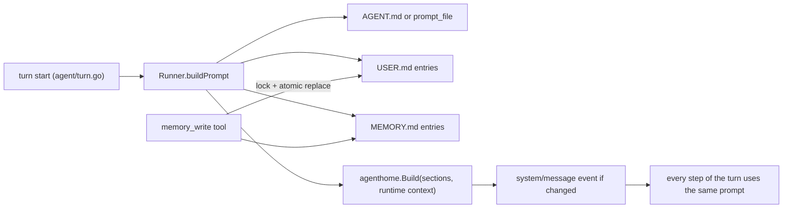

# Design: Agent home, memory, and onboarding

- **Issue**: —
- **Requirements**: [requirements.md](requirements.md)
- **Contract**: [api-contract.md](api-contract.md) — Required
- **Requirements revision**: 1
- **Contract revision**: 1
- **Requirements status**: Approved
- **Contract status**: Approved
- **Status**: Approved
- **Design revision**: 3 (revision 2: package path `internal/agenthome`; `Backend.Memory` in `cmd/lana`; revision 3: no onboarding section)

## Architecture references

- **ADR index**: [docs/adr](../../adr/README.md)
- **Diagram index**: [docs/diagram](../../diagram/README.md)
- **ADR**: [0003](../../adr/0003-multi-agent-with-channel-routing.md), [0004](../../adr/0004-permission-mode-per-agent.md), [0009](../../adr/0009-session-as-append-only-event-log.md), [0010](../../adr/0010-profile-and-config-patch.md)
- **Feature-local diagram**: [Prompt assembly](#prompt-assembly)
- **Durable diagram**: [0002. Agent Loop and Approval](../../diagram/0002-agent-loop-and-approval.md) — unchanged; memory tools pass through the same `tools.pre_execute` gate

## Architecture decision scan

| ADR | Effect on this design |
|---|---|
| 0003 | An agent stays configuration. The agent home adds files next to the config; no process per agent |
| 0004 | Memory writes go through `tools.pre_execute`. A new risk class `memory` encodes `Q-002` in one place |
| 0009 | The assembled prompt is written as `system/message` only when it changes, as today. Memory writes are visible as `tool/call` and `tool/result` events |
| 0010 | The word "profile" keeps its config meaning; this feature uses "agent home" |

No new ADR is needed: the decisions are local to the agent package and reversible.

## Visual Architecture Check

- New boundary: no. New external actor: no.
- Multi-component flow: yes, prompt assembly reads files and is consumed by the turn loop. A feature-local diagram is enough.

## Feature-local view

### Prompt assembly

## Repository fit

- Prompt loading lives in `agent/turn.go` (`promptPath`, `readPrompt`) and is called once per **step**. It moves to once per **turn**, which also keeps the timestamp in the runtime context from producing a new `system/message` event each step.
- Tools are registered in `tools/module.go`; the permission evaluator is `tools/permission/evaluator.go`; the default gate is `tools/registry.go`.
- `ToolCtx` (`core/tool.go`) has `AgentName` but no home path. The memory tools need `$LANA_HOME`.
- CLI subcommands are dispatched in `cmd/lana/main.go`; config writes already exist for `lana init`.
- TUI slash commands live in `channels/cli/tui/model.go` with the command table in `menu.go`.

## Proposed design

### Components

- **`agenthome` package (new, `internal/agenthome/`, because the import rule only lets implementation packages import `core` and `internal/*`)** — pure functions with no runtime dependency:
  - `Paths(home, name)` returns the folder and the three file paths.
  - `ValidName(name)` implements the contract regex.
  - `ReadEntries(path)` parses entries split on `§` lines; `Size(entries)` counts code points of the joined text.
  - `Apply(entries, action, content, oldText, limit)` returns new entries or a typed error (`ErrOverLimit`, `ErrNoMatch`, `ErrAmbiguous`, `ErrInvalid`).
  - `WriteEntries(path, entries)` writes atomically (temp file in the same folder, `fsync`, rename) with mode `0600` under an exclusive `flock` on `<file>.lock`.
  - `Build(PromptInput) string` renders `API-HOME-002`, including truncation.
  - `Templates` holds the three templates (persona text with `{{name}}`, tools, permission) as `embed.FS` files under `agenthome/templates/`.
- **`agent` package** — `Runner.readPrompt` becomes `Runner.buildPrompt(res, channel)`, called once in `runTurn` before the step loop. It resolves the persona source (`prompt_file` wins, `Q-004`), reads entries, and calls `agenthome.Build`. Read errors on `USER.md`/`MEMORY.md` log a warning and skip the section; a `prompt_file` read error keeps today's behavior (turn error).
- **`core`** — add `RiskMemory Risk = "memory"` and `ToolCtx.Home string`. `agent/turn.go` fills `Home` from `Registry.home`.
- **`tools/memory.go` (new)** — `memory_read` (risk `read`) and `memory_write` (risk `memory`). They derive paths only from `tc.Home` and `tc.AgentName`; an empty `Home` returns `error: memory is not available`. Registered with the built-ins.
- **Permission** — in `evaluator.go`, after the trust check: `RiskRead` or `RiskMemory` is allowed unless the policy is `never`; for `RiskMemory` under `never`, reject with `policy never`. `RiskRead` keeps being allowed under `never` as today. In `tools/registry.go` the default gate allows `RiskMemory` like `RiskRead`.
- **Config** — `config/validate.go` accepts `memory_read` and `memory_write` in `[agents.*].tools`. `lana config check` adds a warning per agent whose user or memory file is over its limit.
- **CLI (`cmd/lana/agent.go`, new)** — `new`, `list`, `edit`, `show`. `new` reuses the prompt helpers from `lana init` (`readLine`), writes the folder first, then appends to `config.toml` through the same TOML writer used by `init`; on config write failure it removes the folder. Route change edits only the `agent` key of the first `cli` route. After success in a TTY, answer `Y` to question 5 calls the same entry point as `lana chat --agent <name>`.
- **TUI** — `Backend` gains `Memory(agent) (user, memory []string, err error)`, implemented in `cmd/lana/chat.go` from the agent home files; `/memory` renders it. Command table entry added in `menu.go`.

### Contract mapping

| Contract operation | Implementation |
|---|---|
| `API-HOME-001` | `agenthome.Paths`, `ValidName`, `ReadEntries`, `WriteEntries` |
| `API-HOME-002` | `agenthome.Build`, `agent.Runner.buildPrompt` |
| `API-AGENT-001` through `004` | `cmd/lana/agent.go` |
| `API-MEM-001`, `API-MEM-002` | `tools/memory.go`, `core.RiskMemory`, `tools/permission/evaluator.go`, `tools/registry.go` |
| `API-TUI-001` | `channels/cli/tui` (`/memory`, `Backend.Memory`), `cmd/lana/chat.go` |

### Persistence

- Files only; no schema change. The prompt snapshot per turn is already persisted as `system/message`.
- Memory writes are reconstructible from the session log (`tool/call` input), but the files are the source of truth.

### Failure handling

| Failure | Handling |
|---|---|
| `USER.md`/`MEMORY.md` unreadable | Skip section, `slog.Warn`, turn continues |
| Persona `prompt_file` unreadable | Turn error, as today |
| Lock or rename fails in `memory_write` | Tool result `error`, file unchanged |
| `config.toml` write fails in `agent new` | Remove the created folder, exit 1 |

### Concurrency

- `memory_write` holds an exclusive `flock` on `<file>.lock` across read, apply, and rename, so concurrent writers from several sessions or processes serialize and none is lost.
- Readers do not lock; rename makes each read see either the old or the new file.
- The prompt is read once per turn, so a write during a turn takes effect on the next turn (`REQ-PROMPT-002`).

### Security

- Paths come from `ToolCtx`, never from tool input. `ValidName` is enforced at creation and agent names in config are already validated, so no `..` can reach the path.
- `AGENT.md` has no write path in tools.
- Files `0600`, folders `0700`.

### Observability

- `slog` debug line per turn with the sizes of the user and memory sections.
- `lana agent show --prompt` prints the exact prompt for inspection.

## Requirement traceability

| Requirement | Component |
|---|---|
| `REQ-HOME-001`, `REQ-HOME-002` | `agenthome`, `agent.buildPrompt` |
| `REQ-PROMPT-001` through `004` | `agenthome.Build`, `agent.buildPrompt` |
| `REQ-MEM-001` through `004` | `tools/memory.go`, `agenthome.Apply`/`WriteEntries` |
| `REQ-MEM-005` | `evaluator.go`, `registry.go` default gate |
| `REQ-AGCLI-001` through `004`, `REQ-TPL-001`, `REQ-ONB-002` | `cmd/lana/agent.go`, `agenthome.Templates` |
| `REQ-ONB-001` | `agenthome.Build` |
| `REQ-TUI-001` | TUI `/memory`, `Backend.Memory` |

## Acceptance verification map

| Acceptance criteria | Verification |
|---|---|
| `AC-HOME-001` through `003`, `AC-PROMPT-001` through `004`, `AC-ONB-001`, `AC-ONB-002` | unit tests in `agenthome` (`Build` golden), `agent` turn tests with `MockLlm` inspecting `ChatRequest.System` |
| `AC-MEM-001` through `006` | unit tests in `tools/memory_test.go` with a temp `$LANA_HOME` |
| `AC-MEM-007`, `AC-MEM-008` | `tools/permission` evaluator tests per policy |
| `AC-AGCLI-001` through `006`, `AC-TPL-001`, `AC-ONB-003` | `cmd/lana/agent_test.go` with temp `LANA_HOME` and `EDITOR=true` |
| `AC-TUI-001` | TUI program test with the fake backend |

## Verification strategy

- `nix develop -c go test -count=1 ./...` and `gofmt -l`.
- Concurrency: a test that runs 20 goroutines adding entries and checks all 20 survive.
- Manual smoke test: `lana agent new <name>` in a TTY, first chat with a real provider, then `/memory` and a new session that uses the saved name.

## Risks and tradeoffs

- Re-reading files per turn changes the system prompt whenever memory changes, which defeats provider prompt caching for that turn. Accepted: memory changes are rare compared with turns.
- The runtime date changes the system prompt at most once per minute between turns; same tradeoff.
- Character limits are small by design; agents must consolidate. The over-limit error tells them how.
- `prompt_file` winning over `AGENT.md` can surprise an owner who creates `AGENT.md` for an old agent; `lana agent list` shows the active source.

## Blocking Design Questions

None.
